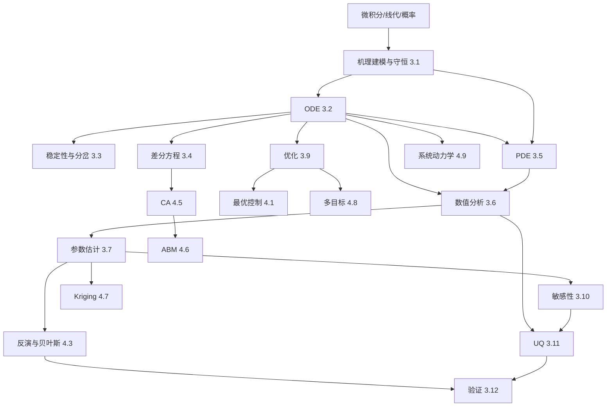

# 美赛 MCM/ICM A 题建模手学习指南

**从机理到可辩护的模型：一个月的系统训练**

> 这本书只解决一件事：**让你在没有现成模型可套的陌生 A 题面前，独立完成"读题—提机理—立假设—建方程—选方法—做验证"的全过程，并对模型的合理性负责。**

---

## 这本书为谁写

**读者画像：** 你是团队的**建模手**。比赛时你负责：

- 把题目文字翻译成数学结构（状态、控制、参数、方程、条件）；
- 判断该用哪类模型、为什么用它、它的边界在哪；
- 完成核心推导，说清每一步的物理/数学依据；
- 设计验证方案，判断"结果错了还是模型错了"；
- 把方程、参数、求解方案、验证要求写清楚，交给编程手实现。

**这本书不为谁写：** 它不是编程教程，也不是论文写作指南。

- 你**不需要**学 MATLAB 工程化、代码架构、性能优化——那是编程手的事；
- 你**不需要**学摘要怎么写、图表怎么排版、附录怎么组织——那是论文手的事；
- 你**需要**能读懂并写出最小可运行代码，只为了**验证你的方程**，不是为了交付软件。

**与队友的接口（你交付什么）：**

| 交付对象 | 你给什么 | 不给他们什么 |
|---|---|---|
| 编程手 | 方程与初边值、参数表（含义/单位/来源）、离散方案、验证清单、输入输出定义 | 不要给"你去想想怎么算" |
| 论文手 | 假设及其理由、模型推导主线、关键结论与区间、适用边界与局限 | 不要替他们写摘要和排版 |
| 数据手 | 需要什么数据、精度要求、缺数据时的替代假设 | 不要把"找数据"整个甩过去 |

---

## 怎么用这本书

**路径一：完整备赛（四周）。** 按第十章的计划走，每周有验收题。适合从现在到比赛还有一个月的情况。

**路径二：查漏补缺（一到两周）。** 先做 1.3 的自评表，找出 2—3 个薄弱项，直接跳到对应章节，只读"推导 + 适用条件 + 常见错误"。

**路径三：赛前速查（比赛期间）。** 用 1.4 的优先级总表定位模型，用第六章判断该选哪个，用第七章的诊断表排查"结果不对"。

**每章的固定结构：**

| 模块 | 你要做什么 |
|---|---|
| 为什么需要它 | 判断这道题是否真的需要这个模型 |
| 数学表达与推导 | 合上书自己推一遍 |
| 变量与参数 | 记住单位与物理意义 |
| 适用条件与局限 | 能说出"什么时候不能用" |
| 最小示例 | 手算或 20 行以内代码复现 |
| 常见错误 | 对照自己是否犯过 |
| 学习要求 | 判断自己是否达标 |

---

## 符号与排版约定

- 行内公式用 `$...$`，独立公式用 `$$...$$`；全书公式均为**单反斜杠** LaTeX。
- 向量用粗体 $\mathbf{x}$，矩阵用大写 $L$、$A$，转置用 $^{\mathsf T}$。
- 时间导数用点号 $\dot N$，偏导数用 $\partial$。
- 参数用 $\theta$ 或带下标的希腊字母；观测用 $y$，模型预测用 $\hat y$。
- 代码块标注 `matlab`，只给**能独立运行**的最小示例；代码里的注释写数学含义，不写语法解释。
- 单位一律写在符号表或参数表里；公式中不混用单位（例如不要把 mAh 与 W 直接相除）。

**关于真题：** 本书引用的 2019—2026 年 A 题内容，均以题目原文与仓库内 `MCM_A_2020-2026_历年分析报告.md` 为准。凡是原文没有明确给出的数字，书中标注为"假设"或"估计"，不冒充题目条件。

---

## 目录

- **[第一章 能力要求与学习路线](#guide-sec-1)**
  - [1.1 先看清楚：八年 A 题到底在考什么](#guide-sec-1-1)
  - [1.2 建模手的六项能力](#guide-sec-1-2)
  - [1.3 自评：你现在在哪一格](#guide-sec-1-3)
  - [1.4 全部模型优先级总表](#guide-sec-1-4)
  - [1.5 依赖关系：先学什么，后学什么](#guide-sec-1-5)
  - [1.6 三条铁律（比任何模型都重要）](#guide-sec-1-6)
- **[第二章 从实际问题到数学模型](#guide-sec-2)**
  - [2.1 前 90 分钟：四问与边界](#guide-sec-2-1)
  - [2.2 变量提取：状态、控制、输入、输出、参数](#guide-sec-2-2)
  - [2.3 机理与因果：把描述词翻译成数学结构](#guide-sec-2-3)
  - [2.4 合理假设：四类假设与写法](#guide-sec-2-4)
  - [2.5 方程从哪里来：五种来源](#guide-sec-2-5)
  - [2.6 连续还是离散：四个判据](#guide-sec-2-6)
  - [2.7 线性还是非线性：来源与后果](#guide-sec-2-7)
  - [2.8 状态空间表述：把任何动态模型写成标准形](#guide-sec-2-8)
  - [2.9 量纲一致性与 Buckingham π](#guide-sec-2-9)
  - [2.10 初始条件与边界条件](#guide-sec-2-10)
  - [2.11 参数的物理意义、量级与无量纲化](#guide-sec-2-11)
  - [2.12 模型简化与复杂度控制](#guide-sec-2-12)
  - [2.13 完整案例 A：2026 电池续航（从文字到方程）](#guide-sec-2-13)
  - [2.14 完整案例 B：2025 楼梯磨损（守恒 + 本构 + 量纲 + 反演）](#guide-sec-2-14)
  - [2.15 建模过程中的六项即时检验](#guide-sec-2-15)
  - [2.16 交底：给编程手的数学规格](#guide-sec-2-16)
- **[第三章 P0 核心必修](#guide-sec-3)**
  - [3.1 机理建模与守恒定律](#guide-sec-3-1)
  - [3.2 状态空间与 ODE](#guide-sec-3-2)
  - [3.3 稳定性、线性化与分岔](#guide-sec-3-3)
  - [3.4 差分方程与离散动态](#guide-sec-3-4)
  - [3.5 PDE 基础](#guide-sec-3-5)
  - [3.6 数值计算与数值分析](#guide-sec-3-6)
  - [3.7 参数估计与非线性拟合](#guide-sec-3-7)
  - [3.8 概率统计与回归基础](#guide-sec-3-8)
  - [3.9 线性与非线性优化](#guide-sec-3-9)
  - [3.10 敏感性分析](#guide-sec-3-10)
  - [3.11 不确定性分析](#guide-sec-3-11)
  - [3.12 模型验证](#guide-sec-3-12)
  - [3.13 量纲分析与相似理论（进阶）](#guide-sec-3-13)
- **[第四章 P1 重点专项](#guide-sec-4)**
  - [4.1 最优控制（PMP 与变分）](#guide-sec-4-1)
  - [4.2 动态规划与 MDP](#guide-sec-4-2)
  - [4.3 参数反演与贝叶斯估计](#guide-sec-4-3)
  - [4.4 随机过程与 Monte Carlo](#guide-sec-4-4)
  - [4.5 元胞自动机（CA）](#guide-sec-4-5)
  - [4.6 主体建模（ABM）](#guide-sec-4-6)
  - [4.7 空间插值与 Kriging](#guide-sec-4-7)
  - [4.8 多目标优化与 Pareto](#guide-sec-4-8)
  - [4.9 系统动力学](#guide-sec-4-9)
  - [4.10 时间序列](#guide-sec-4-10)
- **[第五章 P2 选修扩展](#guide-sec-5)**
  - [5.1 预测与评价类](#guide-sec-5-1)
  - [5.2 种群、传播与寿命类](#guide-sec-5-2)
  - [5.3 决策、网络与混合系统](#guide-sec-5-3)
  - [5.4 统计、降维与状态估计](#guide-sec-5-4)
  - [5.5 随机与计算类](#guide-sec-5-5)
  - [5.6 边缘与前沿（知道边界即可）](#guide-sec-5-6)
  - [5.7 P2 深做路线：21 项各有一条可执行的深入路径](#guide-sec-5-7)
  - [5.8 五个高价值项的深做示范](#guide-sec-5-8)
- **[第六章 模型选择、比较、组合与改进](#guide-sec-6)**
  - [6.1 问题特征 → 候选模型](#guide-sec-6-1)
  - [6.2 八组横向比较](#guide-sec-6-2)
  - [6.3 单模型够不够：三条判据](#guide-sec-6-3)
  - [6.4 六个组合框架（附数学接口）](#guide-sec-6-4)
  - [6.5 改进的九种手法](#guide-sec-6-5)
  - [6.6 六种反模式](#guide-sec-6-6)
- **[第七章 数值、参数估计、验证与不确定性：工作流](#guide-sec-7)**
  - [7.1 七步主线](#guide-sec-7-1)
  - [7.2 数值诊断：症状 → 原因 → 对策](#guide-sec-7-2)
  - [7.3 参数估计失败诊断](#guide-sec-7-3)
  - [7.4 把验证写进交底](#guide-sec-7-4)
  - [7.5 敏感性 → UQ 的决策流程](#guide-sec-7-5)
  - [7.6 参数不确定性 vs 机制不确定性（最容易犯的错）](#guide-sec-7-6)
  - [7.7 一页纸"可信度声明"模板](#guide-sec-7-7)
- **[第八章 MATLAB 最小实例库](#guide-sec-8)**
  - [8.1 函数速查（按用途）](#guide-sec-8-1)
  - [8.2 脚本 A：ODE + 事件 + 能量闭合（2026 电池）](#guide-sec-8-2)
  - [8.3 脚本 B：参数估计 + 置信区间 + 预测区间](#guide-sec-8-3)
  - [8.4 脚本 C：Sobol + Monte Carlo 一体](#guide-sec-8-4)
  - [8.5 常见报错与修法（都踩过）](#guide-sec-8-5)
- **[第九章 2019—2026 真题建模拆解](#guide-sec-9)**
  - [9.1 2019：Game of Ecology（三条龙）](#guide-sec-9-1)
  - [9.2 2020：Hook Line and Sinker（变暖海域的渔业公司）](#guide-sec-9-2)
  - [9.3 2021：Fungi（真菌性状与分解）](#guide-sec-9-3)
  - [9.4 2022：Power Profile of a Cyclist（功率分配）](#guide-sec-9-4)
  - [9.5 2023：Drought-Stricken Plant Communities（干旱与群落）](#guide-sec-9-5)
  - [9.6 2024：Resource Availability and Sex Ratios（七鳃鳗）](#guide-sec-9-6)
  - [9.7 2025：Testing Time（楼梯磨损反推）](#guide-sec-9-7)
  - [9.8 2026：Modeling Smartphone Battery Drain（电池续航）](#guide-sec-9-8)
  - [9.9 跨年复用：八道题其实在考同一组能力](#guide-sec-9-9)
- **[第十章 一个月（四周）计划与验收](#guide-sec-10)**
  - [10.1 时间预算：先算账，再排表](#guide-sec-10-1)
  - [10.2 第 1 周：机理建模与动态系统](#guide-sec-10-2)
  - [10.3 第 2 周：连续系统数值与优化](#guide-sec-10-3)
  - [10.4 第 3 周：专项与改进](#guide-sec-10-4)
  - [10.5 第 4 周：真题实战与复盘](#guide-sec-10-5)
  - [10.6 每日节奏模板（6 小时版）](#guide-sec-10-6)
  - [10.7 每周验收（可观测，不靠感觉）](#guide-sec-10-7)
  - [10.8 进度落后时怎么砍（按优先级砍，不按章节砍）](#guide-sec-10-8)
- **[附录 A 符号总表](#guide-sec-A)**
- **[附录 B 核心公式速查](#guide-sec-B)**
- **[附录 C MATLAB 函数索引（建模手视角）](#guide-sec-C)**
- **[附录 D 教材与可靠资料](#guide-sec-D)**
- **[附录 E 建模交底模板（可直接复制）](#guide-sec-E)**
- **[附录 F 原文档 36 个模型去向索引](#guide-sec-F)**

---

<a id="guide-sec-1"></a>
## 第一章 能力要求与学习路线

<a id="guide-sec-1-1"></a>
### 1.1 先看清楚：八年 A 题到底在考什么

把 2019—2026 的 A 题排在一起，会发现它们的外壳（龙、渔业、真菌、自行车、植物、七鳃鳗、楼梯、电池）完全不同，但**数学内核只有五类**。

| 年份 | 题目 | 数学内核 | 建模手必须交付的东西 |
|---|---|---|---|
| 2019 | Game of Ecology | 能量收支 + 生长 + 面积换算 | 代谢率标度律、能量平衡方程、面积估算 |
| 2020 | Hook Line and Sinker | 资源动力学 + 空间迁移 + 经济优化 | 温度相关的 $r(T),K(T)$、捕捞生产函数、目标函数 |
| 2021 | Fungi | 反应速率 + 多物种竞争 + 环境情景 | 分解速率 $k(\text{性状};W,T)$、竞争项、情景设置 |
| 2022 | Power Profile of a Cyclist | 质点动力学 + 疲劳状态 + 最优控制 | 功率—速度 ODE、疲劳演化、最优功率分配 |
| 2023 | Drought-Stricken Plant Communities | 随机降雨 + 土壤水 + 群落竞争 | 干旱随机过程、水分平衡、存续概率 |
| 2024 | Resource Availability and Sex Ratios | 性别比函数 + 结构种群 + 反馈 | $p(g)$ 的形式与依据、带性别结构的种群方程 |
| 2025 | Testing Time | 磨损正模型 + 反问题 + 可辨识性 | Archard 型方程、π 群、不可辨识的证明 |
| 2026 | Smartphone Battery Drain | 电荷守恒 + 等效电路 + 热 + UQ | SOC 方程、OCV 关系、事件、置信区间 |

**规律一：** 八道题里有六道要求"随时间演化"（ODE/PDE/差分），两道要求"由结果推原因"（反演）。

**规律二：** 越是近年的题，越强调"**机理 + 不确定性**"，而不是"拟合一条曲线"。2026 年题目明确排斥纯数据拟合与黑箱机器学习——这是方向性信号。

**规律三：** 每道题都有一个"**必须解释清楚的一个数**"：2019 是龙的卡路里需求，2022 是完赛时间，2025 是每天使用人次，2026 是续航时间。**你的模型必须能把这个数拆成"机制 × 参数"的形式**，否则别人无法判断它是否可信。

<a id="guide-sec-1-2"></a>
### 1.2 建模手的六项能力

| 能力 | 具体表现 | 不合格的表现 | 对应章节 |
|---|---|---|---|
| **问题分析** | 能说清每小问要的输出形式、系统边界、时间尺度 | 读完题就开始套模型 | 2.1—2.4 |
| **机理提取** | 能从题面文字找到守恒量、因果链、反馈环 | 只会说"用回归拟合" | 2.5—2.8, 3.1 |
| **假设管理** | 每条假设都有理由，且知道被违反的后果 | 假设写成"为简化起见" | 2.4, 7.6 |
| **建模推导** | 能从基本原理推出方程，量纲自洽 | 直接抄一个公式，不知来源 | 3.1—3.9 |
| **模型选择** | 能给出候选模型、比较依据、组合理由 | 会什么用什么 | 第六章 |
| **验证与 UQ** | 能设计检验、给出区间、说清边界 | 只报一个数，不给误差 | 3.10—3.12, 第七章 |

<a id="guide-sec-1-3"></a>
### 1.3 自评：你现在在哪一格

给每项打 1—5 分（1 = 完全不会，5 = 能独立完成并解释），总分 30。

| 能力 | 自评分 | 判断标准（5 分） |
|---|---|---|
| 问题分析 | | 能在 30 分钟内写出四问表与边界 |
| 机理提取 | | 能对陌生系统列出守恒量与反馈环 |
| 假设管理 | | 能说出每条假设被违反后的定性后果 |
| 建模推导 | | 能从守恒律推出 ODE/PDE 并检查量纲 |
| 模型选择 | | 能给出 2—3 个候选并说明取舍 |
| 验证与 UQ | | 能设计 5 类检验并给出参数区间 |

**读法：** 低于 18 分，按第十章完整走；18—24 分，重点补最低的两项；高于 24 分，直接做第九章真题 + 第六章选择训练。

<a id="guide-sec-1-4"></a>
### 1.4 全部模型优先级总表

**分级标准：**

- **P0 核心必修**：必须掌握原理、核心公式推导、适用条件和基本建模应用。不会，就无法独立完成一道 A 题。
- **P1 重点专项**：掌握原理、数学表达、适用条件和典型应用，能独立选择使用。遇到对应题型必须能上手。
- **P2 选修扩展**：了解思想、条件和局限，遇到再用。不占备赛计划学时。

**关于"学时"：** 指**从零到能独立使用**所需的净学习时间（含推导与最小实现），不含复习。

#### P0：核心必修（13 项，约 68 小时）

| 模型 | 优先级 | 理论难度 | 学习时间 | 前置知识 | 掌握要求 | A 题适用场景 |
|---|---|---|---|---|---|---|
| 机理建模与守恒定律 | P0 | ★★★ | 7 h | 微积分、基础物理 | 从守恒律推出方程，写清每个收支项 | 2019 能量、2022 功率、2026 电荷 |
| 状态空间与 ODE | P0 | ★★★ | 9 h | 微积分、线性代数 | 建模、解析解、`ode45`、事件 | 2020 渔业、2022 骑行、2026 电池 |
| 稳定性与分岔 | P0 | ★★★ | 3 h | ODE、特征值 | 求平衡点、判稳、识别临界参数 | 2024 性别比、2019 生态平衡 |
| 差分方程与离散动态 | P0 | ★★☆ | 3 h | 迭代、矩阵 | 建立递推、判稳、识别混沌 | 2021 真菌、2024 世代 |
| 偏微分方程（PDE）基础 | P0 | ★★★★ | 7 h | ODE、傅里叶级数 | 三类方程判别、定解条件、离散化 | 2021 分解、2023 土壤水、2025 磨损场 |
| 数值计算与数值分析 | P0 | ★★★ | 7 h | 微积分、线性代数 | 误差阶、稳定性、收敛性判断 | 所有需要数值求解的题 |
| 参数估计与非线性拟合 | P0 | ★★★ | 7 h | 3.8、线性代数 | 最小二乘、CI、可辨识性 | 2020、2024、2026 |
| 概率统计与回归 | P0 | ★★☆ | 5 h | 概率论 | 选分布、诊断残差、避免外推 | 2019、2024 |
| 线性与非线性优化 | P0 | ★★★ | 7 h | 线性代数、微积分 | 建模、KKT、影子价格解读 | 2020 经营、2022 功率分配 |
| 敏感性分析 | P0 | ★★★ | 4 h | 统计、回归 | 局部弹性、全局 Sobol | 全部（结论稳健性） |
| 不确定性分析（UQ） | P0 | ★★★ | 4 h | 统计、MC | 区间传播、MC、区间解释 | 2026、2020 |
| 模型验证 | P0 | ★★☆ | 3 h | 全部前置 | 设计 5 类检验并判断通过与否 | 全部 |
| 量纲分析与相似（进阶） | P0 | ★★ | 2 h | 2.9 | π 群用于缩放、实验设计、识别不可辨识 | 2019 巨兽、2025 磨损 |

#### P1：重点专项（10 项，约 49 小时）

| 模型 | 优先级 | 理论难度 | 学习时间 | 前置知识 | 掌握要求 | A 题适用场景 |
|---|---|---|---|---|---|---|
| 最优控制（PMP） | P1 | ★★★★ | 6 h | 3.2、3.9、变分 | 写哈密顿、解必要条件、解释协态 | 2022 功率分配 |
| 动态规划 / MDP | P1 | ★★★ | 5 h | 3.4、概率 | Bellman 方程、值迭代 | 2022 分段决策、资源分配 |
| 参数反演与贝叶斯估计 | P1 | ★★★★ | 7 h | 3.7、概率 | 正模型验证、可辨识、后验 | 2025 磨损反演、2020 参数 |
| 随机过程与 Monte Carlo | P1 | ★★★ | 6 h | 概率、3.11 | 随机输入建模、MC 收敛判断 | 2023 干旱、2026 情景 |
| 元胞自动机（CA） | P1 | ★★★ | 4 h | 3.4、编程概念 | 规则设计、网格无关性检验 | 2021 菌丝、2023 群落 |
| 主体建模（ABM） | P1 | ★★★★ | 5 h | 概率、CA | 规则设计、涌现、多种子 | 2025 人流、2020 船队 |
| 空间插值与 Kriging | P1 | ★★★ | 4 h | 统计、线性代数 | 变异函数、预测方差、LOOCV | 2025 磨损场、2023 土壤 |
| 多目标优化与 Pareto | P1 | ★★★ | 4 h | 3.9 | 支配关系、前沿、取舍说明 | 2019 生态 vs 经济、2020 |
| 系统动力学 | P1 | ★★☆ | 3 h | 3.2、反馈 | 存量流量、回路极性、延迟 | 2020 渔业政策、2019 生态 |
| 时间序列 | P1 | ★★★ | 5 h | 3.8 | 平稳性、ARIMA、回测 | 作输入或基线，不作主模型 |

#### P2：选修扩展（21 项，每项 2—3 小时，不占计划）

| 模型 | 优先级 | 理论难度 | 学习时间 | 前置知识 | 掌握要求 | A 题适用场景 |
|---|---|---|---|---|---|---|
| GM(1,1) | P2 | ★★ | 3 h | 最小二乘 | 知道适用条件（短序列、指数趋势） | 数据极少的粗预测 |
| AHP / TOPSIS / 模糊评价 | P2 | ★★ | 3 h | 线性代数 | 知道权重主观性 | 方案排序（非机理题） |
| 指数平滑 / Holt–Winters | P2 | ★★ | 2 h | 统计 | 知道趋势/季节项含义 | 短期预测基线 |
| 机器学习（基线用） | P2 | ★★★ | 3 h | 统计 | 只作基线/代理，不作主模型 | 2026 明确反对黑箱 |
| SIR / SEIR | P2 | ★★ | 3 h | ODE | 知道 $R_0$ 与最终规模 | 传播类（A 题少直接考） |
| Leslie 矩阵 | P2 | ★★ | 2 h | 线代 | 谱半径 = 长期增长率 | 年龄结构种群 |
| Ricker / Beverton–Holt | P2 | ★★ | 2 h | 差分 | 知道过冲与混沌 | 单种群离散 |
| Weibull 生存分析 | P2 | ★★★ | 3 h | 概率 | 风险函数形状、删失 | 寿命/失效数据 |
| 博弈论（Nash/演化） | P2 | ★★★ | 3 h | 优化 | 最佳响应、均衡存在性 | 多方决策 |
| 排队论 | P2 | ★★ | 2 h | 概率 | $L,W$ 公式与 $\rho<1$ | 服务系统（弱相关） |
| 图论 / 网络流 | P2 | ★★ | 3 h | 离散数学 | 最短路、最大流 | 路径/分配 |
| 阈值 / 分段 / 混合动态 | P2 | ★★★ | 3 h | ODE | 事件切换、Zeno | 2026 低电量保护 |
| 鲁棒 / 随机规划 | P2 | ★★★ | 3 h | 优化 | min-max、机会约束 | 参数不确定下的决策 |
| 聚类（K-means/GMM） | P2 | ★★ | 2 h | 统计 | 标准化、K 选择 | 分组/分区 |
| 分层贝叶斯 | P2 | ★★★★ | 3 h | 贝叶斯 | 部分汇聚、收缩 | 多组数据共享 |
| PCA / POD | P2 | ★★★ | 2 h | 线代 | 方差解释、降维误差 | 高维数据/场 |
| Kalman / 数据同化 | P2 | ★★★ | 3 h | 状态空间 | 预测—校正、$Q/R$ | 在线估计 |
| SDE | P2 | ★★★★ | 3 h | 概率 | Itô 形式、Euler–Maruyama | 连续随机扰动 |
| 元启发式（GA/SA/PSO） | P2 | ★★ | 2 h | 优化 | 只作备用，必须与基线比 | 非凸/离散 |
| 代理模型 / 贝叶斯优化 | P2 | ★★★ | 3 h | 统计 | GP、EI、误差验证 | 仿真昂贵时 |
| 边缘专题（HMM/EVT/Copula/PINN/ABC） | P2 | ★★★★ | 2 h | — | 知道"什么时候值得查" | 特定题型 |

**为什么这样分级（四条说明）：**

1. **PDE 必须是 P0。** 2021（分解场）、2023（土壤水）、2025（磨损场）三道题的空间分布就是结论本身。不会 PDE，这三题只能给"平均深度"这种一眼被看穿的结果。原文把 PDE 放在 P1 是分级错误。
2. **最优控制与参数反演必须是 P1 且给足学时。** 2022 的核心是"功率怎么分配"，本质是最优控制；2025 的核心是"由磨损推历史"，本质是反问题。原文把两者标为"选学"，与真题权重不符。
3. **排队论、图论、SIR、评价类降为 P2。** 不是因为它们没用，而是因为它们**在 A 题里通常是工具而非主线**：需要时查公式即可，不需要为它投入 5 小时以上。原文把它们放进 P1，挤占了 PDE 和反演的学时。
4. **不把所有高级模型都放低优先级，也不全划 P0。** 判据是"**这道题的主结论是否依赖它**"：依赖 → P0/P1；只是辅助 → P2。

<a id="guide-sec-1-5"></a>
### 1.5 依赖关系：先学什么，后学什么



**读法：** 箭头是"必须先学"。例如 4.3 反演依赖 3.7 参数估计；如果你跳过 3.7 直接看 4.3，会看不懂"为什么需要剖面似然"。

<a id="guide-sec-1-6"></a>
### 1.6 三条铁律（比任何模型都重要）

**铁律一：先问"这个数从哪来"，再问"用什么模型"。**
每一个要交付的数字，都必须能追溯到"机制 × 参数"。如果一个数只能靠拟合得到，你就要准备好回答："那你的机理是什么？"

**铁律二：模型复杂度由"需要解释的现象"决定，不由"你会什么"决定。**
多一个状态、多一个维度，就要多一组参数、多一类验证。**能用一个状态说清的事，不要用三个。**

**铁律三：任何结论都要带边界。**
"续航 7.4 小时"是不合格的；"在 25 °C、屏幕中等亮度、电池健康 100% 的条件下，续航 7.4 小时，90% 区间 [6.9, 7.9]"才是合格的。

---

<a id="guide-sec-2"></a>
## 第二章 从实际问题到数学模型

这一章是全书的枢纽。学完它，你应该能在没有现成模型可套的情况下，把一个陌生系统拆成"状态—机制—方程—条件—参数"五件事。

<a id="guide-sec-2-1"></a>
### 2.1 前 90 分钟：四问与边界

拿到题，先不要想模型。用一张纸回答四个问题（这是原文 5.4 节的"四问拆题法"，此处扩成正式方法）：

| 问 | 要写出什么 | 决定什么 |
|---|---|---|
| **问输出** | 每一小问最终交付什么形式：曲线、最优策略、排序、概率分布、反演出的历史、还是判断？ | 模型类型（预测/优化/评价/反演） |
| **问状态** | 系统里"什么在变、什么会被记住"？列 3—6 个，写符号、单位、合理范围 | 方程的阶数与结构 |
| **问机制** | 状态之间靠什么联系：守恒、因果、接触、竞争、反馈、优化目标 | 方程的具体形式 |
| **问证据** | 有哪些数据、文献、情景？哪些参数能估、哪些只能假设？用什么独立证据验证？ | 参数来源与可信度 |

**边界（scope）同样重要。** 每道题都有"题目要求"和"你没被要求但忍不住想算"的部分。把边界写成三行：

1. **系统边界**：哪些东西算"内部"，哪些当作外部输入（如 2026 电池题：手机内部的热源算内部，环境温度算外部）。
2. **时间边界**：仿真多久？稳态还是瞬态？（2020 是 50 年经营，2022 是单场比赛，2026 是单次充电到耗尽。）
3. **精度边界**：结论要精确到什么程度？粗模型 + 区间，往往优于精模型 + 单点。

**输出形式直接决定模型类型**，这是最快的一条选型捷径：

| 输出 | 首选 | 次选 |
|---|---|---|
| 一条随时间变化的曲线 | ODE / 差分 | 时间序列（数据驱动） |
| 空间分布图 | PDE / 插值 / CA | 空间统计 |
| 一个数（容量、面积、寿命） | 代数方程 / 积分 / 优化 | 仿真 + 平均 |
| 一个策略/时间表 | 优化 / 最优控制 / DP | 规则 + 仿真比较 |
| 一个排序 | 多指标评价 | 多目标 + 权重 |
| 一个概率/区间 | 随机模型 + MC | 解析近似 |
| 一段历史（参数/使用强度） | 反演 + 可辨识性分析 | 回归 |

<a id="guide-sec-2-2"></a>
### 2.2 变量提取：状态、控制、输入、输出、参数

建模最常见的低级错误，是把五类量混成一锅。判据如下：

| 类型 | 判据 | 数学位置 | 例子（2026 电池） |
|---|---|---|---|
| **状态** $x$ | 有积累/记忆，由微分或差分方程决定；给定初值后由方程演化 | $x'=f(\cdot)$ 左侧 | SOC、温度、SOH |
| **控制** $u$ | 人能设计/选择的量，可分段常数、可连续 | $f$ 的参数 | 充电功率、是否开省电模式 |
| **输入/扰动** $w$ | 人不能选、但影响系统的外部量 | $f$ 的参数 | 环境温度、用户负载、信号强度 |
| **输出** $y$ | 能被观测/测量的量，通常是状态的函数加噪声 | $y=g(x,u)+v$ | 端电压、电流、表面温度 |
| **参数** $\theta$ | 在本次建模时间尺度内视为常数，但数值未知或需标定 | $f$ 的系数 | 内阻 $R$、容量 $Q$、热容 $C_{th}$ |

**三个高频混淆：**

1. **把参数当状态。** 电池内阻随老化缓慢变化，但在一场比赛的时间尺度内它是常数；若你让它随时间变，就必须再写一个"老化方程"，否则方程不可解。判断标准：**它有没有自己的演化规律？** 没有就是参数。
2. **把输入当控制。** 用户负载不是你能设计的，它是扰动；如果你把它当控制去"优化"，结论会变成"建议用户别用手机"，毫无意义。
3. **把输出当状态。** 端电压是输出，不是状态；状态是 SOC。用电压反推 SOC 是"观测"问题，需要观测方程和噪声模型。

**变量表的写法**（每个模型都必须有，交底时直接给编程手）：

| 符号 | 名称 | 类型 | 单位 | 典型值/范围 | 来源 |
|---|---|---|---|---|---|
| $s$ | 荷电状态 SOC | 状态 | — | 0—1 | 定义 |
| $T$ | 电池温度 | 状态 | °C | 20—45 | 测量 |
| $P$ | 负载功率 | 输入 | W | 1—10 | 情景设定 |
| $R$ | 内阻 | 参数 | Ω | 0.05—0.2 | 数据手册/辨识 |
| $Q$ | 额定能量 | 参数 | Wh | 14.8 | 标称 4000 mAh × 3.7 V |

<a id="guide-sec-2-3"></a>
### 2.3 机理与因果：把描述词翻译成数学结构

题目里的自然语言，几乎都能映射到有限的几种数学结构。这张表要背下来：

| 题面词 | 数学结构 | 写法 |
|---|---|---|
| 积累、存量、剩余、总量 | 积分/守恒 | $\dfrac{dX}{dt}=\text{流入}-\text{流出}$ |
| 流动、通量、迁移、扩散 | 通量 + 散度 | $\dfrac{\partial c}{\partial t}=-\nabla\cdot\mathbf{J}+S$ |
| 驱动、梯度、势差 | 本构关系 | $\mathbf{J}=-D\nabla c$ |
| 反应、分解、转化、消耗 | 源汇项 | $S=-kc$ 或 $S=\mu c(1-c/K)$ |
| 竞争、捕食、耦合 | 双线性耦合项 | $-acb$ |
| 延迟、滞后、孕育期 | 时滞/储池 | $x'=f(x(t-\tau))$ 或级联一阶环节 |
| 反馈、自我强化/抑制 | 回路符号 | $f'$ 的符号与回路极性 |
| 阈值、临界、崩溃 | 分段/鞍结分岔 | $f$ 中含 $x-x_c$ 的符号函数 |
| 饱和、上限、容量 | 饱和函数 | $1-x/K$，$\tanh$，$\min$ |
| 个体差异、异质 | 分布/分层 | $\theta_i\sim p(\theta)$ |
| 随机、波动、不确定 | 随机项 | $\sigma\,dW$ 或随机参数 |

**因果 vs 相关（这是 A 题最容易翻车的地方）：**

- 2024 的"食物少→雄性多"是**可塑性响应**，不是"雄性多导致食物少"。方向搞反，整篇结论作废。
- 判断因果的三条实用标准：**时间先后**（原因在前）、**机制可写**（能写出中间步骤）、**干预可检验**（改变原因，结果应改变）。
- 如果只能观测到相关、写不出机制，就老老实实做"经验关系 + 外推警告"，不要假装它是机理模型。

<a id="guide-sec-2-4"></a>
### 2.4 合理假设：四类假设与写法

假设不是"为了简化而简化"，而是**明确声明你在哪里切断了现实**。每条假设写四栏：

| 假设 | 依据 | 违反后果 | 可否检验/补救 |
|---|---|---|---|
| 电池内部温度均匀 | Biot 数小，单体尺寸小 | 高温时低估局部衰减 | 加集总参数对比/多点测温 |
| 内阻不随 SOC 变化 | 平台区近似 | 低 SOC 时电压误差增大 | 分段常数或 $R(s)$ |
| 用户负载分段常数 | 使用情景离散化 | 快速波动时误差大 | 提高分段数做收敛检验 |
| 磨损系数 $K$ 为常数 | 材料均一、无润滑 | 局部材料差异导致偏差 | 分区标定 + 敏感性 |

**四类假设，缺一类就会漏：**

1. **尺度假设**：空间是否均匀（0D/1D/2D/3D）、时间是否可分尺度（准稳态）。
2. **结构假设**：方程的函数形式（线性/非线性、一阶/二阶、是否含时滞）。
3. **参数假设**：参数是否常数、是否已知、分布形式。
4. **随机性假设**：噪声是机制的一部分，还是观测误差？这两者的数学处理完全不同。

**写法要求：** 每条假设必须能回答"如果它不成立，我的哪个结论会变、往哪个方向变"。答不上来的假设，说明你还没想清楚，删掉或改写。

<a id="guide-sec-2-5"></a>
### 2.5 方程从哪里来：五种来源

这是"文字→方程"的核心。五种来源按可靠性排序：

#### 2.5.1 守恒定律（最可靠）

**质量守恒（控制体形式）：**

$$
\frac{d}{dt}\int_{\Omega}\rho\,dV=-\oint_{\partial\Omega}\rho\,\mathbf{v}\cdot\mathbf{n}\,dA+\int_{\Omega}S\,dV .
$$

左边是控制体内质量变化率，右边第一项是净流出（$\mathbf{n}$ 为外法向），第二项是源。用散度定理化为局部形式：

$$
\frac{\partial \rho}{\partial t}+\nabla\cdot(\rho\mathbf{v})=S .
$$

对浓度 $c$（单位体积的量）与通量 $\mathbf{J}$：

$$
\frac{\partial c}{\partial t}+\nabla\cdot\mathbf{J}=S .
$$

一维、$S=0$ 时就是我们最熟的 $\partial_t c+\partial_x J=0$。**所有"守恒型"方程都长这样**，区别只在 $\mathbf{J}$ 怎么来。

**用法示例（2021 枯落物分解）：** 把"枯落物"看成一种物质，分解是汇：$\partial_t L=-\nabla\cdot\mathbf{J}-k(T,M)L$，其中 $k$ 依赖温湿度、$M$ 是水分。你不需要"发明"方程，只需要说清"什么在守恒、汇是什么"。

#### 2.5.2 能量守恒

对控制体（热力学第一定律，忽略动能与势能变化）：

$$
\frac{dE}{dt}=\dot Q-\dot W+\sum \dot m_{\text{in}}h_{\text{in}}-\sum \dot m_{\text{out}}h_{\text{out}} .
$$

对质点/刚体的机械能：

$$
\frac{d}{dt}\left(\frac12 mv^2+mgz\right)=P_{\text{drive}}-P_{\text{diss}} .
$$

**用法示例（2022 骑行）：** 车手做的功一部分变成重力势能，一部分被阻力耗散：

$$
P_{\text{eff}}=v\left(mg\sin\theta+C_r mg\cos\theta+\tfrac12\rho C_d A v^2\right).
$$

这条式子就是 2022 的"能量预算"，后面加疲劳、加风向都只是改它。

#### 2.5.3 动量守恒

$$
\sum\mathbf{F}=\frac{d}{dt}(m\mathbf{v}) .
$$

流体情形即 Navier–Stokes 的来源：$\rho(\partial_t\mathbf{u}+\mathbf{u}\cdot\nabla\mathbf{u})=-\nabla p+\mu\nabla^2\mathbf{u}+\mathbf{f}$。A 题极少要求解 N–S，但**知道它从哪来**，你才敢用"阻力 $\propto v^2$"这类简化，并说清忽略了什么（黏性、压缩性、湍流）。

#### 2.5.4 本构关系（把通量变成梯度）

守恒方程本身不封闭：$\mathbf{J}$ 未知。必须补一条"物质如何响应梯度"的关系：

| 本构 | 表达式 | 适用 |
|---|---|---|
| Fourier 导热 | $\mathbf{q}=-k\nabla T$ | 固体/静止流体导热 |
| Fick 扩散 | $\mathbf{J}=-D\nabla c$ | 稀溶液、分子扩散 |
| Newton 黏性 | $\tau=\mu\dfrac{du}{dy}$ | 牛顿流体 |
| Ohm 定律 | $I=\dfrac{V}{R}$ | 电路 |
| Archard 磨损 | $V=\dfrac{K W s}{H}$ | 磨粒磨损（2025 核心） |
| Darcy 渗流 | $\mathbf{q}=-\dfrac{k}{\mu}\nabla p$ | 多孔介质（土壤水） |

**本构是"经验 + 物理"的混合体，必须给出适用范围。** 比如 Archard 律假定磨损与载荷、滑动距离成正比、与硬度成反比，忽略第三体（磨屑）与润滑；超出这个范围（如严重塑性变形）就不成立。

#### 2.5.5 经验/统计规律（最后的选择）

当机制写不出来，只能用数据关系：阈值型（$\max(0,x-x_c)$）、幂律（$y=ax^b$）、饱和型（Michaelis–Menten、Hill）、异速生长（$y=ax^{3/4}$）。

**使用纪律：** 只能内插，不能外推；必须给参数的置信区间；必须说明"这是现象学关系，不是机理"。2024 的"生长速率→性别比"关系就属于此类，题目给的 78%/56% 是两端锚点，中间的函数形式是你的建模选择——**不同选择必须做敏感性分析**。

#### 2.5.6 平衡/优化原理

当系统"趋于某个最优状态"时，可以用变分或优化代替动力学：

- 光学/力学的最小作用量原理；
- 热力学的自由能最小；
- 经济/行为的最小成本、最大收益；
- 博弈的 Nash 均衡、演化稳定策略。

**代价：** 你假定系统"已经或正在到达最优"，这在生态、工程里常常不成立。用它之前必须回答："这个系统凭什么最优？"

<a id="guide-sec-2-6"></a>
### 2.6 连续还是离散：四个判据

| 判据 | 连续时间（ODE/PDE） | 离散（差分/CA/事件） |
|---|---|---|
| **时间尺度** | 事件远多于观测，可近似连续 | 一年一次繁殖、按班次/批次更新 |
| **个体** | 数量大，可视为密度 | 个体少且异质（ABM） |
| **机制** | 速率型（每秒多少） | 计数型（每年多少只） |
| **数据** | 高频观测 | 只有年度/批次数据 |

**两条不同的"离散化"，不要混：**

1. **数值离散**：真实模型是连续的，为了求解把它离散（Euler、RK、有限差分）。步长是数值参数，应做收敛检验。
2. **本质离散**：真实过程就是离散的（一年一代、一次事件）。步长是物理参数，不能随意减小。

**典型误判：** 把年度繁殖数据硬套连续 Logistic，会算出"每年 0.3 只"这种非整数中间量，而且低估过度补偿导致的振荡。正确做法是 Ricker/Beverton–Holt 差分（见 P0-4）。

<a id="guide-sec-2-7"></a>
### 2.7 线性还是非线性：来源与后果

**非线性从哪来（A 题四大来源）：**

1. **本构非线性**：辐射换热 $T^4$、阻力 $v^2$、Archard 中的接触面积随载荷变化。
2. **耦合乘积**：捕食 $acb$、感染 $\beta SI$、人口 $\times$ 人均。
3. **饱和**：$1-N/K$、$\tanh$、Michaelis–Menten。
4. **阈值/分段**：关机、保护、切换。

**后果（必须在论文里承认）：**

- 叠加原理失效：不能把两个解相加；
- 可能出现多平衡点、分岔、混沌（Ricker 就是例子）；
- 优化变成非凸，局部最优不等于全局最优；
- 参数估计的目标函数可能多峰。

**处理手法：**

| 手法 | 何时用 | 代价 |
|---|---|---|
| 在工作点线性化 | 只关心小扰动/稳定性 | 大范围失效 |
| 对数/幂变换 | 幂律、指数增长 | 零值/负值不可用 |
| 分段线性 | 阈值型机制 | 切换点处不光滑 |
| 无量纲化 + 摄动 | 小参数明确 | 需要尺度分析 |
| 直接非线性求解 | 有可靠初值/全局方法 | 计算量与多解风险 |

<a id="guide-sec-2-8"></a>
### 2.8 状态空间表述：把任何动态模型写成标准形

**连续时间：**

$$
\dot{\mathbf{x}}=\mathbf{f}(\mathbf{x},\mathbf{u},t;\boldsymbol\theta),\qquad
\mathbf{y}=\mathbf{g}(\mathbf{x},\mathbf{u},t;\boldsymbol\theta)+\mathbf{v}.
$$

**离散时间：**

$$
\mathbf{x}_{k+1}=\mathbf{F}(\mathbf{x}_k,\mathbf{u}_k,k;\boldsymbol\theta),\qquad
\mathbf{y}_k=\mathbf{G}(\mathbf{x}_k,\mathbf{u}_k;\boldsymbol\theta)+\mathbf{v}_k.
$$

**为什么一定要写成这个形式：**

1. 阶数清楚：$n$ 个一阶方程 = $n$ 维状态；高阶方程必须降阶（$\ddot x\to x,v$）。
2. 初值清楚：需要 $n$ 个初始条件，不多不少。
3. 稳定性有标准工具：平衡点 $\mathbf{f}(\mathbf{x}^*)=0$，Jacobian $\mathbf{J}=\partial\mathbf{f}/\partial\mathbf{x}$，特征值实部全负则局部渐近稳定。
4. 数值求解、参数估计、最优控制、Kalman 滤波全部以它为输入。

**例：Lotka–Volterra 捕食模型**

$$
\dot N=\alpha N-\beta NP,\qquad \dot P=\delta NP-\gamma P .
$$

平衡点：$(0,0)$ 与 $(N^*,P^*)=(\gamma/\delta,\ \alpha/\beta)$。在非零平衡点的 Jacobian：

$$
\mathbf{J}=\begin{bmatrix}\alpha-\beta P^* & -\beta N^*\\ \delta P^* & \delta N^*-\gamma\end{bmatrix}
=\begin{bmatrix}0 & -\beta\gamma/\delta\\ \delta\alpha/\beta & 0\end{bmatrix},
$$

特征值满足 $\lambda^2=-\alpha\gamma$，即 $\lambda=\pm i\sqrt{\alpha\gamma}$，纯虚根 → 线性化判定失效（中心），需要靠首次积分 $V=\delta N-\gamma\ln N+\beta P-\alpha\ln P$ 证明闭合轨道。**这个例子说明：线性化只能判"稳定/不稳定"，判不了"中心"，必须另找守恒量或 Lyapunov 函数。** 这是 A 题里区分"看起来稳"和"真的稳"的关键。

---

<a id="guide-sec-2-9"></a>
### 2.9 量纲一致性与 Buckingham π

#### 2.9.1 量纲齐次性：最便宜的查错工具

任何物理方程的每一项必须同量纲。记 $[\,\cdot\,]$ 为量纲，则

$$
\left[\frac{dX}{dt}\right]=[X]\,T^{-1},\qquad [\nabla c]=[c]\,L^{-1},\qquad [\nabla\cdot\mathbf{J}]=[J]\,L^{-1}.
$$

所以 $\partial_t c=-\nabla\cdot\mathbf{J}$ 要求 $[c]T^{-1}=[J]L^{-1}$，即 $[J]=[c]L\,T^{-1}$——这正是"通量 = 浓度 × 速度"。

**三步查错法：**

1. 写出每个符号的量纲（用 $M,L,T,\Theta$ 基本量纲）；
2. 检查加减项、等式两边；
3. 检查指数、对数、三角函数的自变量必须无量纲。

#### 2.9.2 Buckingham π 定理

若一个问题有 $n$ 个有量纲变量、涉及 $k$ 个独立基本量纲，则可用 $n-k$ 个无量纲群 $\pi_1,\dots,\pi_{n-k}$ 重写关系：

$$
f(x_1,\dots,x_n)=0\ \Longleftrightarrow\ \Phi(\pi_1,\dots,\pi_{n-k})=0 .
$$

**完整推导案例（原文模型 6 的错误在此修正）：**

流体中物体受到的阻力 $F$，认为依赖密度 $\rho$、速度 $v$、特征长度 $L$、黏度 $\mu$。**五个变量**：$F,\rho,v,L,\mu$。

| 变量 | 量纲 |
|---|---|
| $F$ | $MLT^{-2}$ |
| $\rho$ | $ML^{-3}$ |
| $v$ | $LT^{-1}$ |
| $L$ | $L$ |
| $\mu$ | $ML^{-1}T^{-1}$ |

量纲矩阵（每列一个变量，行是 $M,L,T$）：

$$
\mathbf{A}=\begin{bmatrix}
1 & 1 & 0 & 0 & 1\\
1 & -3 & 1 & 1 & -1\\
-2 & 0 & -1 & 0 & -1
\end{bmatrix}.
$$

$\operatorname{rank}\mathbf{A}=3$（$k=3$），$n=5$，故 $\pi$ 群个数为 $n-k=2$。解 $\mathbf{A}\mathbf{e}=0$ 得两组独立指数：

$$
\pi_1=\frac{F}{\rho v^2L^2},\qquad \pi_2=\frac{\rho vL}{\mu}=\mathrm{Re}.
$$

于是

$$
\frac{F}{\rho v^2L^2}=\Phi(\mathrm{Re})\quad\Longrightarrow\quad F=\tfrac12\rho v^2L^2\,C_D(\mathrm{Re}),
$$

其中 $C_D=2\Phi$ 就是阻力系数。**这条式子解释了为什么"阻力 $\propto v^2$"不是拍脑袋**：它是量纲分析的必然结果，而"系数随 $Re$ 变"才是真正需要实验/本构去补的部分。

**π 群的三种用法：**

1. **减参数**：5 个变量的问题变成 2 个群的关系，实验量从 $5$ 维降到 $2$ 维。
2. **判相似**：两个系统若 $Re$ 相同且几何相似，则 $C_D$ 相同——模型实验可外推到原型。
3. **判可辨识性**（进阶用法，2.14 会用到）：若观测方程只依赖某个 π 群，则群内参数**只能确定组合、不能分别确定**。

**常见错误：**

- 变量清单漏项（漏了 $\mu$ 就只剩 1 个 π 群，结论完全不同）；
- 把"角度""应变"等无量纲量当有量纲量；
- 量纲矩阵秩算错（必须真的化行阶梯，不能看行列式猜）；
- 得到 π 群后不给物理解释（$Re$ 是惯性力/黏性力之比，这才是它的意义）。

<a id="guide-sec-2-10"></a>
### 2.10 初始条件与边界条件

**计数规则：**

- ODE 系统 $n$ 阶 → 需要 $n$ 个初始条件（每个状态一个）；
- 时间上 $m$ 阶偏导 → 需要 $m$ 个初始条件（热方程 1 个，波动方程 2 个）；
- 空间上 $2p$ 阶偏导 → 每条边界需要 $p$ 个边界条件（二阶方程每条边界 1 个）。

**三类边界条件及其物理含义：**

| 类型 | 形式 | 物理含义 | 例子 |
|---|---|---|---|
| 第一类（Dirichlet） | $u\vert _{\partial\Omega}=u_b$ | 边界值被固定 | 楼梯两端温度等于室温 |
| 第二类（Neumann） | $-k\nabla u\cdot\mathbf{n}=q_b$ | 边界通量给定 | 绝热（$q_b=0$）、已知热流 |
| 第三类（Robin） | $-k\nabla u\cdot\mathbf{n}=h(u-u_\infty)$ | 对流换热/有限传导 | 表面散热 |

**三个必须检查的点：**

1. **相容性**：初始条件与边界条件在角点 $(x=0,t=0)$ 处不能矛盾。若 $u(x,0)=0$ 而 $u(0,t)=1$，则在 $(0,0)$ 处跳变，数值解会在初始时刻出现陡峭层——这是物理上合理的"阶跃"，但要确认你的格式能处理。
2. **过量约束**：二阶方程每条边界只能给 1 个条件。给两个 Dirichlet 会过约束（无解），给零个会欠定（解不唯一）。
3. **纯 Neumann 问题的解不唯一**：全绝热 + 无源时，解只确定到相差一个常数，必须额外给"总量守恒"或参考点。

**例（2026 电池的热模型）：**

$$
C_{th}\frac{dT}{dt}=I^2R+hA(T_{\text{amb}}-T),\qquad T(0)=T_0 .
$$

这是一阶 ODE，只需要 1 个初始条件。稳态 $T_\infty=T_{\text{amb}}+I^2R/(hA)$ 是"长时间使用后的温度"，可以拿来验证瞬态解是否收敛到它。

<a id="guide-sec-2-11"></a>
### 2.11 参数的物理意义、量级与无量纲化

**每个参数必须回答四个问题：**

1. 它是什么（物理意义）？
2. 它的单位是什么（量纲）？
3. 它的典型量级是多少（数量级估计）？
4. 它从哪来（实测/文献/标定/假设）？

**数量级估计（Fermi 法）示例：** 2026 电池，$Q=4000$ mAh、标称 $3.7$ V，则能量 $Q=14.8$ Wh；若平均功耗 $3$ W，续航约 $5$ h。这个粗估能在你写方程之前就排除"续航 50 小时"这类荒谬结论。

**无量纲化：** 用特征尺度 $x=L\tilde x,\ t=\tau\tilde t,\ u=U\tilde u$ 把方程变成无量纲形式，好处是：

- 参数个数减少，物理意义更清楚（出现 $Re$、$Pe$、$Da$ 等）；
- 数值条件改善（避免 $10^{-9}$ 与 $10^{9}$ 同场）；
- 直接看出哪些项可以忽略（小参数）。

**例（扩散方程）：** $\partial_t c=D\partial_{xx}c$，取 $\tilde x=x/L,\ \tilde t=t/(L^2/D)$，得 $\partial_{\tilde t}\tilde c=\partial_{\tilde x\tilde x}\tilde c$——**扩散时间尺度是 $L^2/D$**。这个结论比任何公式都有用：它告诉你"要等多快"。

<a id="guide-sec-2-12"></a>
### 2.12 模型简化与复杂度控制

**复杂度阶梯（从低到高，够用就停）：**

| 层级 | 形式 | 何时够用 | 2026 电池例子 |
|---|---|---|---|
| 0D 代数 | $y=f(u)$ | 稳态、无记忆 | 平均功耗 × 续航 |
| 0D ODE | $\dot x=f(x,u)$ | 集总、无空间 | SOC + 温度 |
| 1D PDE | $\partial_t u=\partial_x(D\partial_xu)+S$ | 一个方向主导 | 电芯厚度方向温度 |
| 2D/3D PDE | 全空间 | 空间分布是结论本身 | 整机温度场 |
| 随机/异质 | SDE / ABM / 分层 | 变异是结论本身 | 用户行为差异 |

**四种简化手法：**

1. **时间尺度分离（准稳态）**：若快变量弛豫远快于慢变量（$\tau_{\text{fast}}\ll\tau_{\text{slow}}$），令快变量导数为 0，代回慢方程。例：电池温度相对 SOC 变化很快，可在每个 SOC 点上用稳态温度。
2. **空间集总**：Biot 数 $Bi=hL/k\ll 0.1$ 时内部温度近似均匀（集总参数）。
3. **小项忽略**：无量纲化后系数 $\ll 1$ 的项可略，但必须估计误差量级。
4. **参数聚合**：把无法分别辨识的参数合成一个复合参数（如 $K/H$），并明确"只能确定这个组合"。

**加复杂度的三问测试（任何一次"要不要加"都用它）：**

1. 这个机制是否**改变结论的方向或量级**？（只改变小数点后两位 → 不加）
2. 它的参数**能否从数据/文献确定**？（不能 → 加了也无法验证）
3. 加了之后**还能不能做验证**？（不能 → 不如用一个承认局限的简单模型）

<a id="guide-sec-2-13"></a>
### 2.13 完整案例 A：2026 电池续航（从文字到方程）

**题目语言：** "建立手机电池从满电到关机的连续时间模型，预测不同使用情景下的剩余时间，分析温度与老化的影响。"

**第一步，定状态。** 什么会被记住？电量（SOC）、温度。SOH 变化慢，本场视为参数。

**第二步，写守恒。** 电荷守恒：

$$
\frac{dQ}{dt}=-I(t),\qquad Q(0)=Q_0,
$$

其中 $Q$ 为剩余电荷（C 或 Ah），$I>0$ 为放电电流。用 SOC $s=Q/Q_n$ 与功率 $P=VI$：

$$
\frac{ds}{dt}=-\frac{P(t)}{3600\,Q_{\text{Wh}}},\qquad s(0)=1,
$$

这里 $t$ 以**小时**计，$Q_{\text{Wh}}$ 为额定能量（Wh）。**单位必须自洽**：若 $t$ 用秒，右端要除以 $3600$；这是原文模型 7 用 mAh 除以 W 却报"小时"的错误根源。

**第三步，写观测方程。** 端电压不是状态，是输出：

$$
V(t)=\mathrm{OCV}(s)-I R(s,T),
$$

$\mathrm{OCV}(s)$ 是开路电压曲线（单调、在中间段较平），$R$ 随温度升高而下降（Arrhenius 型近似 $R=R_0e^{E_a/(RT)}$ 或线性近似）。

**第四步，写热平衡。**

$$
C_{th}\frac{dT}{dt}=I^2R+hA\,(T_{\text{amb}}-T),\qquad T(0)=T_0 .
$$

**第五步，定参数。**

| 参数 | 含义 | 单位 | 典型值 | 来源 |
|---|---|---|---|---|
| $Q_{\text{Wh}}$ | 额定能量 | Wh | 14.8 | 4000 mAh × 3.7 V |
| $R_0$ | 参考内阻 | Ω | 0.08 | 数据手册/脉冲测试 |
| $E_a$ | 内阻活化能 | J/mol | $2\times10^4$ | 文献/拟合 |
| $C_{th}$ | 热容 | J/K | 30 | 材料估算 |
| $hA$ | 散热系数×面积 | W/K | 0.05 | 温升实验标定 |

**第六步，可辨识性分析（这是 A 题拉开差距的地方）。**

- 只测端电压 $V$：$R$ 与 $\mathrm{OCV}$ 的常数偏移**不可区分**（$V=\mathrm{OCV}-IR$，改变 $R$ 可由平移 OCV 补偿）；
- 在 OCV 平台段（$d\mathrm{OCV}/ds\approx0$），$s$ 对 $V$ 几乎无影响 → **SOC 不可辨识**；
- 补救：库仑计数（对 $I$ 积分）给 $s$ 的独立信息；静置测 OCV 给校准点；脉冲测试分离 $R$。

**结论模板：** "在 $s\in[0.2,0.9]$、$T\in[20,40]^\circ$C 内，模型对 $R$ 的 $\pm20\%$ 误差导致续航预测 $\pm6\%$；平台段以外结论可信，低于 $s=0.1$ 时因 $R(s)$ 非线性，误差可达 $15\%$。"

**验证（必须做）：** 能量闭合 $\int_0^{t_{\text{end}}}P\,dt=Q_{\text{Wh}}$；极端情景（$P=0$ 应永续，$P\to\infty$ 应瞬时耗尽）；与厂商标称续航对比。

<a id="guide-sec-2-14"></a>
### 2.14 完整案例 B：2025 楼梯磨损（守恒 + 本构 + 量纲 + 反演）

**题目语言：** "用楼梯的磨损情况推断使用频率、方向偏好与并行人数；讨论年龄估计的可靠性与修缮历史的影响。"

**第一步，机制。** 每人每次踩踏造成微小磨损，长期累积成可测的磨损深度场 $h(x,y)$。

**第二步，本构（Archard 律）。** 体积磨损

$$
V=\frac{K\,F_n\,s}{H},
$$

$K$ 无量纲磨损系数，$F_n$ 法向载荷（N），$s$ 滑动距离（m），$H$ 材料硬度（Pa）。换成深度（除以接触面积 $A_c$）：

$$
\delta=\frac{K F_n s}{H A_c}\quad[\text{m/次}].
$$

量纲检查：$\dfrac{1\cdot \mathrm{N}\cdot\mathrm{m}}{\mathrm{Pa}\cdot\mathrm{m^2}}=\dfrac{\mathrm{N\cdot m}}{(\mathrm{N/m^2})\mathrm{m^2}}=\mathrm{m}$ ✓。

**第三步，累积方程（连续近似）。**

$$
\frac{\partial h}{\partial t}=n(x,y)\,\delta,\qquad h(x,y,0)=0,
$$

$n(x,y)$ 是单位面积、单位时间的踩踏次数（人次/(m²·s)）。若使用强度稳定 $T$ 年，则 $h=n\,\delta\,T$。

**第四步，量纲分析揭示不可辨识性。** 把上式无量纲化：唯一的 π 群是

$$
\Pi=\frac{h\,H\,A_c}{n\,T\,K\,F_n\,s}=1 .
$$

**这个群只含组合 $nK$。** 所以：**只测 $h$，无法同时定出 $n$ 与 $K$**——磨损系数减半、人流翻倍，给出完全相同的深度场。这不是数据不够，是结构性的不可辨识。必须在文档里明说，并给出三条出路：

1. 独立测 $K$（实验室磨损试验、同材质样本）；
2. 只报告相对分布 $n(x,y)/\bar n$（形状可辨识，绝对值不可）；
3. 用多种证据交叉约束（修缮记录、监控计数、鞋底材质）。

**第五步，算例（数值已用 MATLAB 核对）。** 取 $K=10^{-4}$、$F_n=700$ N、$s=0.3$ m、$H=5$ GPa、$A_c=0.02$ m²：

$$
\delta=\frac{10^{-4}\times700\times0.3}{5\times10^{9}\times0.02}=2.1\times10^{-10}\ \mathrm{m}=0.21\ \mathrm{nm/次}.
$$

若实测中央磨损 $4$ mm、楼梯使用 $30$ 年：

$$
n=\frac{4\times10^{-3}}{2.1\times10^{-10}\times30\times365}\approx1.74\times10^{3}\ \text{人次/天}.
$$

**敏感性：** $\partial\ln n/\partial\ln K=-1$——$K$ 减半，$n$ 估计翻倍（$3479$ 人次/天）。所以结论必须写成"**若 $K$ 为 $10^{-4}$，则约 1700 人次/天；$K$ 的不确定性直接线性传递到人流估计**"。

**第六步，方向与并行人数。** 上行/下行磨损剖面的不对称给出方向偏好；横向磨损宽度分布给出并行人数（宽度超过单人足迹的部分需要两人并行才能磨到）。这两条是**几何证据**，不依赖 $K$，比绝对人流更可靠——优先报告它们。

**第七步，验证。** 材料试样磨损试验（定 $K$）、历史照片/修缮记录（定 $T$）、另一部同建筑楼梯（可比性）、数值上检查网格无关性（若用插值重建场）。

<a id="guide-sec-2-15"></a>
### 2.15 建模过程中的六项即时检验

不要等模型做完再验证。每写完一组方程，立刻做这六项（每项 1 分钟）：

| 检验 | 操作 | 失败信号 |
|---|---|---|
| 量纲 | 逐项查量纲 | 加减项不同量纲 |
| 极限 | 令参数 $\to0$ 或 $\to\infty$ | 出现无穷大/负值/违反物理 |
| 守恒 | 对封闭系统积分，看总量 | 总量漂移 |
| 符号/单调 | 物理上该增的项是否增 | 温度升高续航反而变长 |
| 量级 | 代入典型值，看是否合理 | 续航 500 小时 |
| 基线 | 与最简模型比 | 复杂模型没有改善任何指标 |

**例（电池）：** 令 $P\to0$，$ds/dt\to0$，续航 $\to\infty$ ✓；令 $T\to\infty$，$R\to0$，$V\to\mathrm{OCV}$ ✓；令 $hA\to0$（绝热），$T$ 线性上升 ✓。三个极限都对，方程的可信度立刻提高一档。

<a id="guide-sec-2-16"></a>
### 2.16 交底：给编程手的数学规格

建模手的最终交付物不是"想法"，而是一份**可直接实现、可被检验**的数学规格。它至少包含七块：

| 块 | 内容 | 反例（不合格） |
|---|---|---|
| 1. 状态与变量 | 符号、含义、单位、初值 | "用 x 表示电量" |
| 2. 方程 | 每个方程的完整形式与来源 | "参考 Logistic 模型" |
| 3. 参数 | 数值、单位、范围、来源、是否可标定 | "参数取经验值" |
| 4. 初边值 | 每个边界/初值的数值与依据 | "边界条件按实际情况" |
| 5. 求解方案 | 建议方法、步长/网格、容差、刚性提示 | "用 MATLAB 跑一下" |
| 6. 输出清单 | 要生成哪些量、哪些图、什么单位 | "画出结果" |
| 7. 检验清单 | 必须通过的守恒/极限/收敛检查及期望值 | 无 |

**好例子（可直接实现）：**

```
状态: s (SOC, 无量纲, s0=1), T (温度, °C, T0=25)
方程: ds/dt = -P(t)/(3600*Q),  Q=14.8 Wh, t 以小时计
      Cth*dT/dt = I^2*R + hA*(Tamb-T),  I=P/V, V=OCV(s)-I*R
参数: R=0.08 Ω [0.05,0.12], Cth=30 J/K [20,45], hA=0.05 W/K [0.03,0.08]
情景: P(t)=5 W (0-1h), 8 W (t>1h); Tamb=25 °C
求解: ode45, RelTol=1e-8, AbsTol=1e-10, 终止事件 s=0
输出: tte (h), 能量闭合 ∫P dt, T 峰值, s(t), T(t)
检验: |∫P dt - 14.8| < 0.05 Wh; tte ∈ (2.0,2.5) h
```

有了这份东西，编程手不需要猜，论文手不需要编，你自己也能在结果回来时立刻判断"对不对"。

---

<a id="guide-sec-3"></a>
## 第三章 P0 核心必修

P0 的十章构成一条链：守恒给方程，ODE/PDE/差分给形式，数值给解，参数估计把解接到数据，优化给决策，敏感性/UQ/验证给可信度。**不要跳章**，每章末尾的"学习要求"是可验收的标准。

<a id="guide-sec-3-1"></a>
### 3.1 机理建模与守恒定律

**定位**：P0｜难度 ★★★｜7 h｜前置：微积分、基础物理｜几乎所有 A 题的第一块砖。

#### 1. 定义与核心思想

机理建模 = 用**守恒定律**确定"状态怎么变"，再用**本构关系**确定"通量怎么来"，两者合起来封闭方程组。它的对立面是"用数据拟合一条曲线"——后者不解释因果。

核心思想一句话：**找到系统里守恒的量，写出它的收支表。**

#### 2. 数学基础

控制体 $\Omega$ 上的 Reynolds 输运定理（对任意广延量 $\phi$，$\rho\phi$ 为体密度）：

$$
\frac{d}{dt}\int_\Omega \rho\phi\,dV=\int_\Omega \frac{\partial(\rho\phi)}{\partial t}dV+\oint_{\partial\Omega}\rho\phi\,\mathbf{v}\cdot\mathbf{n}\,dA .
$$

配合守恒律"积累 = 流入 − 流出 + 源"，就得到所有守恒型方程。

#### 3. 基本假设（通用四条）

| 假设 | 依据 | 违反后果 |
|---|---|---|
| 连续介质 | 尺度远大于分子间距 | 稀薄气体/微尺度失效 |
| 控制体固定或随流体运动（二选一） | 便于记账 | 混用会重复计入通量 |
| 只保留主导的守恒量 | 其余量影响小 | 漏掉关键机制（如能量题漏做功） |
| 本构关系在工况范围内成立 | 有实验支撑 | 外推失真 |

#### 4. 变量与参数

| 符号 | 含义 | 单位 | 说明 |
|---|---|---|---|
| $\rho$ | 密度 | kg/m³ | 可压缩时是状态 |
| $\mathbf{v}$ | 速度 | m/s | 与通量 $\mathbf{J}=\rho\mathbf{v}$ 对应 |
| $S$ | 源/汇 | 单位体积·单位时间 | 反应、生灭、产热 |
| $k,D,\mu,H$ | 本构系数 | 各自不同 | 必须给适用范围 |

#### 5. 从基本原理推导核心公式

**质量守恒 → 连续性方程。** 取 $\phi=1$，无源：

$$
\frac{d}{dt}\int_\Omega\rho\,dV=-\oint_{\partial\Omega}\rho\mathbf{v}\cdot\mathbf{n}\,dA
\;\Longrightarrow\;
\frac{\partial\rho}{\partial t}+\nabla\cdot(\rho\mathbf{v})=0 .
$$

**能量守恒 → 骑行功率方程（2022 真题核心）。** 对车+人系统，机械能变化率等于驱动力功率减耗散：

$$
\frac{d}{dt}\left(\tfrac12 mv^2+mgz\right)=P_{\text{wheel}}-P_{\text{diss}},
$$

准稳态（速度变化慢）时，驱动力与阻力平衡：

$$
F_{\text{drive}}=\underbrace{mg\sin\theta}_{F_g}+\underbrace{C_r mg\cos\theta}_{F_r}+\underbrace{\tfrac12\rho C_dA v^2}_{F_d}.
$$

两边乘 $v$ 得功率，除以传动效率 $\eta$ 得踏板功率：

$$
P_{\text{pedal}}=\frac{v}{\eta}\left(mg\sin\theta+C_r mg\cos\theta+\tfrac12\rho C_dA v^2\right).
$$

**这就是"能量预算"的全部内容**：后面加疲劳、加风向、加战术，都只是让 $P_{\text{pedal}}$ 或 $C_dA$ 随状态变化，方程结构不变。

#### 6. 求解方法

- 稳态：解代数方程（如给定 $P$ 求 $v$，用 `fzero`）；
- 瞬态：把能量方程写成 ODE（$m\dot v=F_{\text{drive}}-F_{\text{resist}}$），用 `ode45`；
- 空间分布：升级为 PDE（见 3.5）。

#### 7. 适用场景、局限、改进、组合

| 项 | 内容 |
|---|---|
| 适用 | 有明确守恒量的物理/工程/生态问题；需要解释"为什么"的题 |
| 局限 | 无法处理纯行为/纯统计问题；本构外推危险；控制体选错会导致重复计数 |
| 改进 | 加状态（温度、老化）、加空间维数、把常数本构换成状态相关本构 |
| 组合 | 守恒 + 参数估计（定本构系数）；守恒 + 最优控制（决定输入）；守恒 + UQ（参数区间） |

#### 8. 最小可运行 MATLAB 示例

```matlab
%% 2022 骑行：给定功率求稳态速度，并画功率—速度曲线
% 输入: 质量、坡度、功率、阻力参数; 输出: 稳态速度、各阻力分量
m = 83; g = 9.81; theta = deg2rad(5); Crr = 0.005;
rho = 1.225; CdA = 0.32; eta = 0.97; P = 250;

Fres = @(v) m*g*sin(theta) + Crr*m*g*cos(theta) + 0.5*rho*CdA*v.^2;
v_ss = fzero(@(v) v.*Fres(v)/eta - P, 3);      % 稳态: P = v*F/eta

fprintf('稳态速度 %.4f m/s = %.2f km/h\n', v_ss, v_ss*3.6);
fprintf('分量: 重力 %.3f N, 滚阻 %.3f N, 气动 %.3f N\n', ...
        m*g*sin(theta), Crr*m*g*cos(theta), 0.5*rho*CdA*v_ss^2);

vv = linspace(0,14,200);
plot(vv, vv.*Fres(vv)/eta, 'LineWidth',1.2); hold on;
yline(P,'r--'); xline(v_ss,'k:');
xlabel('v (m/s)'); ylabel('踏板功率 (W)'); grid on;
title('功率—速度曲线与 250 W 稳态点');
```

**数值核对（已跑）：** $v=8$ m/s 时 $F_g=70.965$、$F_r=4.056$、$F_d=12.544$ N，$P_{\text{pedal}}=722.2$ W；250 W 上 5% 坡稳态 $v=3.151$ m/s（11.34 km/h）。

#### 9. 真实美赛 A 题应用

- **2022 骑行**：上式的直接应用，风向改变 $F_d$ 的相对速度 $v-v_{\text{wind}}$，疲劳让可用 $P$ 随时间衰减。
- **2019 龙**：能量收支 $E_{\text{in}}=\text{食物热量}$，$E_{\text{out}}=\text{基础代谢}+\text{生长}+\text{活动}$，所需面积由能量密度反推。
- **2026 电池**：电荷守恒 $dQ/dt=-I$，能量闭合是验证手段。

#### 10. 常见错误

1. 忘记动能项，把"加速阶段"当稳态算。
2. 功率与能量混用（W 与 Wh 差 3600 倍）。
3. 控制体选成"随车运动"，却又对地面参考系写功——参考系不统一。
4. 本构系数直接取文献值，不检查工况（$C_dA$ 随姿态变化可达 20%）。

#### 11. 学习要求（验收）

- 能对一个陌生系统画出控制体，写出质量与能量两条收支；
- 能说明每条本构关系的来源与适用范围；
- 能独立推出 2022 的功率方程并手算一个工况；
- 能指出你忽略了哪两项，并估计其量级。

<a id="guide-sec-3-2"></a>
### 3.2 状态空间与 ODE

**定位**：P0｜难度 ★★★｜9 h｜前置：微积分、线性代数｜A 题出现频率最高的一类模型。

#### 1. 定义与核心思想

把系统压缩成"$n$ 个会积累的量 + 它们的速率"，写成 $\dot{\mathbf{x}}=\mathbf{f}(\mathbf{x},\mathbf{u},t;\boldsymbol\theta)$。状态的选择标准只有一个：**给定 $t_0$ 的状态和之后的输入，未来就完全确定。** 记忆不在状态里，模型就是错的。

#### 2. 数学基础

- 一阶方程组 = $n$ 维状态；高阶方程必须降阶：$\ddot x=f$ → $x_1=x,\ x_2=\dot x,\ \dot x_2=f$。
- 存在唯一性：$\mathbf{f}$ 连续且对 $\mathbf{x}$ Lipschitz，则初值问题局部唯一。
- 解析可解的类型：线性常系数、可分离、恰当方程、少量非线性（Bernoulli、Riccati）。

#### 3. 基本假设

| 假设 | 依据 | 违反后果 |
|---|---|---|
| 状态完全刻画未来（马尔可夫性） | 机理分析 | 漏状态 → 预测系统性偏移 |
| 参数在时间尺度内为常数 | 变化慢 | 长期预测失真 |
| 连续时间近似 | 事件密集 | 应改差分/事件驱动 |
| 空间均匀（0D） | 混合快 | 需升级 PDE 或分区 |

#### 4. 变量与参数（以渔业为例）

| 符号 | 含义 | 单位 | 典型值 |
|---|---|---|---|
| $N$ | 种群数量（状态） | 尾 | $10^3$—$10^6$ |
| $E$ | 捕捞努力量（控制） | 船·天 | 0—500 |
| $r$ | 内禀增长率（参数） | 1/年 | 0.2—1.0 |
| $K$ | 环境容纳量（参数） | 尾 | $10^4$ |
| $q$ | 可捕系数（参数） | 1/(船·天) | $10^{-3}$ |

#### 5. 从基本原理推导核心公式

**例：Logistic + 收获（2020 渔业的骨架）。**

净增长 = 内禀增长 − 种内竞争 − 捕捞：

$$
\dot N=\underbrace{rN}_{\text{繁殖}}-\underbrace{\frac{r}{K}N^2}_{\text{拥挤}}-\underbrace{qEN}_{\text{捕捞}}
=rN\left(1-\frac NK\right)-qEN .
$$

**平衡点：** 令 $\dot N=0$，得 $N=0$ 或

$$
N^*=K\left(1-\frac{qE}{r}\right).
$$

**稳定性：** $f'(N)=r-\dfrac{2rN}{K}-qE$，代入 $N^*$：

$$
f'(N^*)=r-2r\left(1-\frac{qE}{r}\right)-qE=-r+qE .
$$

所以 $qE<r$ 时稳定，$qE>r$ 时崩溃——**临界努力量 $E_c=r/q$**。这个结论不需要任何数值就能说清"过度捕捞的临界点在哪"。

**解析解（$E=0$）：** 分离变量得

$$
N(t)=\frac{K}{1+\left(\dfrac{K}{N_0}-1\right)e^{-rt}},
$$

它给出三个可直接验证的极限：$N_0\to0$ 时增长近似指数；$t\to\infty$ 时 $N\to K$；$N_0=K$ 时恒为 $K$。

#### 6. 求解方法

| 情形 | 方法 | 备注 |
|---|---|---|
| 线性/可分离 | 解析 | 优先，便于做极限检验 |
| 一般非线性 | `ode45`（非刚性） | RelTol 1e-8 起 |
| 刚性（快慢尺度差大） | `ode15s` | 出现"步长被压到极小"就是刚性信号 |
| 需要事件（耗尽、切换） | `odeset('Events',...)` | 事件函数必须返回 3 个输出 |
| 长期/守恒系统 | 辛格式或小步长 | 显式 Euler 会漂移 |

#### 7. 适用/局限/改进/组合

| 项 | 内容 |
|---|---|
| 适用 | 连续变化、集总、机制清楚的动态系统 |
| 局限 | 无法表达个体异质、空间结构、离散事件；参数多时不可辨识 |
| 改进 | 加状态（年龄、空间、温度）、加时滞、加随机项、分段 |
| 组合 | ODE + 参数估计（校准）、+ 最优控制（决策）、+ 敏感性/UQ（可信度） |

#### 8. 最小可运行 MATLAB 示例

```matlab
%% Logistic + 捕捞: 相图与临界努力量
r = 0.3; K = 1000; q = 1e-3;

f = @(t,N,E) r*N.*(1-N/K) - q*E.*N;      % 右端, 便于复用

% 1) 时间历程
E = 100; N0 = 50;
[t,N] = ode45(@(t,N) f(t,N,E), [0 60], N0);
Nstar = K*(1-q*E/r);
fprintf('E=%g: N*=%%.1f, f''(N*)=%%.3f\n', E, Nstar, -r+q*E);

% 2) 相图: 不同初值
figure; hold on;
for N0 = [10 50 300 900 1200]
    [tt,NN] = ode45(@(t,N) f(t,N,E), [0 60], N0);
    plot(tt, NN, 'LineWidth',1.0);
end
yline(Nstar,'k--'); xlabel('t (年)'); ylabel('N'); grid on;
title(sprintf('Logistic+捕捞, E=%g', E));

% 3) 临界努力量
Ec = r/q;
fprintf('临界努力量 Ec = %.1f\n', Ec);
```

**结果检验：** 所有曲线应收敛到 $N^*=666.7$（$E=100$）；$E=400$ 时无正平衡，曲线单调趋于 0；$E_c=300$。

#### 9. 真实美赛 A 题应用

- **2020 渔业**：Logistic/年龄结构 + 捕捞 + 迁移，属于"ODE + 空间 + 经济目标"。
- **2026 电池**：SOC 与温度两个状态，输入是功率曲线，事件是 $s=0$。
- **2023 植物群落**：多物种竞争 ODE，干旱作为时变参数。

#### 10. 常见错误

1. **状态不足**：只写 $N$ 却让 $r$ 随时间变，等于把一个状态藏进参数。
2. **初值不物理**：$N_0<0$ 或 $S_0>N$，会让模型给出荒谬解。
3. **`ode45` 跑刚性系统**：表现为极慢或步长报错，应换 `ode15s`。
4. **事件函数写法错误**：`@(t,x) deal(x(1),1,0)` 会报"输入数目应与输出数目匹配"，因为 ode 只按 1 个输出调用；必须写成返回 3 个输出的局部函数。
5. **不做守恒检验**：封闭系统总量应守恒，漂移说明格式或容差有问题。

#### 11. 学习要求（验收）

- 给定一段系统描述，能列出状态清单并解释"为什么它是状态"；
- 能写出方程、求平衡点、用线性化判稳定性；
- 能选对 `ode45`/`ode15s` 并说明理由；
- 能写出一个事件函数并验证终止条件。

<a id="guide-sec-3-3"></a>
### 3.3 稳定性、线性化与分岔

**定位**：P0｜难度 ★★★｜3 h｜前置：3.2、特征值｜决定"结论是不是稳的"。

#### 1. 定义与核心思想

平衡点 $\mathbf{x}^*$ 满足 $\mathbf{f}(\mathbf{x}^*)=0$。稳定 = 小扰动后能回来；渐近稳定 = 能回到 $\mathbf{x}^*$ 本身。判断方法：在 $\mathbf{x}^*$ 处线性化，看 Jacobian 的特征值。

#### 2. 数学基础

$$
\dot{\mathbf{x}}\approx \mathbf{J}(\mathbf{x}^*)(\mathbf{x}-\mathbf{x}^*),\qquad \mathbf{J}=\frac{\partial\mathbf{f}}{\partial\mathbf{x}} .
$$

- 所有 $\operatorname{Re}\lambda_i<0$ → 局部渐近稳定；
- 存在 $\operatorname{Re}\lambda_i>0$ → 不稳定；
- $\max\operatorname{Re}\lambda_i=0$ → **线性化失效**，需要 Lyapunov 函数、守恒量或中心流形。

二维判据（$\mathbf{J}=\begin{bmatrix}a&b\\c&d\end{bmatrix}$）：$\tau=a+d$，$\Delta=ad-bc$。$\Delta>0$ 且 $\tau<0$ 稳定；$\Delta<0$ 为鞍点；$\tau=0,\Delta>0$ 为中心。

#### 3. 基本假设

| 假设 | 依据 | 违反后果 |
|---|---|---|
| 平衡点存在且孤立 | 模型结构 | 连续统平衡需另法 |
| 扰动足够小 | 线性化 | 大扰动结论可能反转 |
| 参数在扰动期间不变 | 时间尺度 | 慢变参数需分岔分析 |

#### 4. 变量与参数

以"Logistic + 常数收获 $h$"为例：状态 $N$；参数 $r,K,h$；控制量可视为 $h$。

#### 5. 从基本原理推导核心公式

$$
\dot N=rN\left(1-\frac NK\right)-h .
$$

平衡点解 $rN^2/K-rN+h=0$：

$$
N^*_\pm=\frac{K}{2}\left(1\pm\sqrt{1-\frac{4h}{rK}}\right).
$$

存在条件 $h\le h_c=rK/4$。稳定性：$f'(N)=r-\dfrac{2rN}{K}$，在 $N^*_-$ 处为正（不稳定，阈值型），在 $N^*_+$ 处为负（稳定）。当 $h\to h_c$，两根合并、$f'=0$——**鞍结分岔**，再增大 $h$ 系统直接崩溃到 0。

**这个推导给出了 A 题里最有用的一句话**：'可持续的最大收获是 $rK/4$，且超过它之后崩溃是突发的、不可逆的'。

#### 6. 求解方法与可视化

- 解析：求根 + 特征值；
- 数值：参数扫描画**分岔图**（横轴参数，纵轴平衡点，实线稳定/虚线不稳定）；
- 二维系统：相平面 + 零倾线（nullcline）；
- 检测 Hopf：一对共轭特征值实部过零，配合数值验证极限环。

#### 7. 适用/局限/改进/组合

| 项 | 内容 |
|---|---|
| 适用 | 判断阈值、崩溃点、参数敏感性方向 |
| 局限 | 只判局部；中心/高阶退化失效；无法给出扰动后的吸引域 |
| 改进 | Lyapunov 函数、能量法、数值延拓、全局分岔软件 |
| 组合 | 稳定性 + 敏感性（哪个参数最危险）+ UQ（分岔点的不确定性） |

#### 8. 最小可运行 MATLAB 示例

```matlab
%% Logistic+收获: 平衡点随 h 变化的分岔图
r = 0.3; K = 1000; hc = r*K/4;
hs = linspace(0, 1.05*hc, 400);
figure; hold on;
for h = hs
    disc = 1 - 4*h/(r*K);
    if disc >= 0
        Np = K/2*(1+sqrt(disc));  Nm = K/2*(1-sqrt(disc));
        plot(h, Np, 'b.', 'MarkerSize', 6);   % 稳定支
        plot(h, Nm, 'r.', 'MarkerSize', 6);   % 不稳定支
    end
end
xline(hc,'k--'); xlabel('收获率 h'); ylabel('平衡点 N*');
title('鞍结分岔: h_c = rK/4'); grid on;

% 数值验证: h 略小于 hc 时, 从 N0 出发是否回到 N*+
h = 0.99*hc; N0 = 800;
[t,N] = ode45(@(t,N) r*N*(1-N/K)-h, [0 200], N0);
fprintf('h=%.2f: 末端 N=%.2f, 理论 N*+=%.2f\n', h, N(end), K/2*(1+sqrt(1-4*h/(r*K))));
```

#### 9. 真实美赛 A 题应用

- **2023 植物群落**：干旱频率越过临界值时群落崩溃，本质是鞍结/跨临界分岔。
- **2020 渔业**：$E_c=r/q$ 是跨临界分岔（$N^*=0$ 与正平衡交换稳定性）。
- **2026 电池**：热失控是典型的"正反馈 + 阈值"，$I^2R$ 产热与散热曲线的交点即临界。

#### 10. 常见错误

1. 把 $\operatorname{Re}\lambda=0$ 直接判"稳定"（应判"线性化失效"）。
2. 用数值发散当"分岔"，其实可能是步长太大。
3. 只报平衡点，不报稳定性——等于没回答"会不会崩"。
4. 忽略参数本身的不确定性：分岔点 $h_c$ 依赖 $r,K$，必须给区间。

#### 11. 学习要求（验收）

- 能对任意 2 维系统求平衡点、Jacobian、判类型；
- 能解释鞍结/跨临界/叉式/Hopf 四种分岔的几何含义；
- 能画出至少一个参数的分岔图，并标出稳定/不稳定支。

---

<a id="guide-sec-3-4"></a>
### 3.4 差分方程与离散动态

**定位**：P0｜难度 ★★☆｜3 h｜前置：迭代、矩阵｜年度繁殖、批次更新、离散事件必用。

#### 1. 定义与核心思想

$$
\mathbf{x}_{k+1}=\mathbf{F}(\mathbf{x}_k,\mathbf{u}_k;\boldsymbol\theta).
$$

它和 ODE 的区别不是"精度高低"，而是**机制本身是离散的**：一年只繁殖一次、一炉只出一批、一次点击只切换一次状态。

#### 2. 数学基础

- 不动点：$\mathbf{x}^*=\mathbf{F}(\mathbf{x}^*)$；
- 稳定性：$\mathbf{J}_F(\mathbf{x}^*)$ 的谱半径 $<1$ 则局部渐近稳定；
- 一维：$|F'(x^*)|<1$ 稳定，$|F'|>1$ 不稳定，$F'=-1$ 处发生周期倍化；
- 周期 $p$：$F^p(x^*)=x^*$，且 $|(F^p)'|<1$。

#### 3. 基本假设

| 假设 | 依据 | 违反后果 |
|---|---|---|
| 更新同步（同一时刻繁殖/结算） | 生物学季节性或管理周期 | 异步更新会改变稳定性 |
| 参数在代际间不变 | 环境稳定 | 需时变参数 |
| 无年龄/阶段结构（或已显式建模） | 简化 | 低估滞后与振荡 |

#### 4. 变量与参数

| 符号 | 含义 | 单位 | 说明 |
|---|---|---|---|
| $N_k$ | 第 $k$ 代数量 | 个 | 状态 |
| $r$ | 内禀增长率 | 1/代 | 参数 |
| $K$ | 容纳量 | 个 | 参数 |
| $R$ | 世代净繁殖率 | — | Beverton–Holt 用 |
| $\mathbf{L}$ | Leslie 矩阵 | — | 年龄结构 |

#### 5. 从基本原理推导核心公式

**Ricker（过度补偿）：** 假设"产卵量 $\propto N_k$，但存活率随密度指数下降"：

$$
N_{k+1}=N_k\,e^{r\left(1-N_k/K\right)} .
$$

不动点 $N^*=K$（另有 $N^*=0$）。$F'(N)=e^{r(1-N/K)}\left(1-\dfrac{rN}{K}\right)$，在 $N=K$ 处 $F'(K)=1-r$。故：

- $0<r<2$：$|1-r|<1$，稳定；
- $r>2$：不稳定，出现 2 周期；
- $r\approx2.692$ 之后进入混沌（Lyapunov 指数转正）。

**Beverton–Holt（补偿）：**

$$
N_{k+1}=\frac{R\,N_k}{1+(R-1)N_k/K}.
$$

$F'(K)=1/R$。只要 $R>1$ 就稳定——**单调趋近，不会振荡**。这个对比非常重要：同样是"密度制约"，函数形式不同，动力学天差地别。选 Ricker 还是 B–H，必须说清依据（是否有过度补偿/食卵行为）。

**Leslie 矩阵（年龄结构）：**

$$
\mathbf{n}_{k+1}=\mathbf{L}\mathbf{n}_k,\qquad
\mathbf{L}=\begin{bmatrix}
f_1 & f_2 & \cdots & f_m\\
s_1 & 0 & \cdots & 0\\
0 & s_2 & \cdots & 0\\
\vdots & & \ddots & \vdots\\
0 & \cdots & s_{m-1} & 0
\end{bmatrix}.
$$

由 Perron–Frobenius 定理，非负不可约矩阵有唯一正的主特征值 $\lambda_1$（= 长期年增长率），对应右特征向量为**稳定年龄分布**，左特征向量为**繁殖价值**。$\lambda_1>1$ 增长，$<1$ 衰减。

**例（已核对）：** $\mathbf{L}=\begin{bmatrix}0&2&3\\0.5&0&0\\0&0.8&0\end{bmatrix}$，$\mathbf{n}_0=(100,50,20)^\top$。则 $\lambda_1=1.3697$（年增长 36.97%），$\mathbf{n}_1=(160,50,40)^\top$，$\mathbf{n}_2=(220,80,40)^\top$。

#### 6. 求解方法

- 迭代（直接、稳健）；
- 特征值分析（长期行为、稳定分布）；
- 分岔图（扫参数，画长期轨道）；
- 混沌诊断（Lyapunov 指数、功率谱、初值敏感性）。

#### 7. 适用/局限/改进/组合

| 项 | 内容 |
|---|---|
| 适用 | 季节性繁殖、批次生产、离散管理决策、年龄结构 |
| 局限 | 无法表达连续过程；参数对初值敏感（混沌区不可预测） |
| 改进 | 加阶段结构、加随机性（环境随机）、加空间耦合 |
| 组合 | 差分 + 优化（最优收获）、+ UQ（种群存续概率） |

#### 8. 最小可运行 MATLAB 示例

```matlab
%% Ricker 分岔图 + Leslie 主特征值
K = 1000;
rs = linspace(1.5, 3.2, 600);
figure; hold on;
for r = rs
    N = 200;
    for k = 1:300, N = N*exp(r*(1-N/K)); end   % 去瞬态
    traj = zeros(1,60);
    for k = 1:60, N = N*exp(r*(1-N/K)); traj(k) = N; end
    plot(r*ones(1,60), traj, 'b.', 'MarkerSize', 2);
end
xlabel('r'); ylabel('长期 N'); title('Ricker 分岔图'); grid on;

L = [0 2 3; 0.5 0 0; 0 0.8 0];
lam = eig(L); [lmax, idx] = max(real(lam));
fprintf('lambda1 = %.4f, 另两根 = %.4f ± %.4fi\n', ...
        lmax, real(lam(setdiff(1:3,idx))));
fprintf('年增长率 = %.2f%%\n', (lmax-1)*100);
```

#### 9. 真实美赛 A 题应用

- **2019 龙**：如果按年繁殖，应用差分；若用连续能量收支则 ODE——**同一题可以两种时间结构，必须说明选哪个及为什么**。
- **2024 七鳃鳗**：性别比由幼体生长速率决定，生长是连续的、繁殖是离散的，典型"连续—离散混合"。
- **2021 真菌**：分解在季节尺度上离散更新，可用差分或多物种离散竞争。

#### 10. 常见错误

1. 用连续 Logistic 拟合年度数据，算出非整数个体，且低估振荡。
2. 把 $\lambda_1$ 当"百分比增长率"（$\lambda_1-1$ 才是）。
3. 迭代次数不足，把瞬态当长期行为（分岔图必须去瞬态）。
4. 混沌区仍做长期点预测（应给分布/区间）。

#### 11. 学习要求（验收）

- 能判断一个过程该用差分还是 ODE，并说出依据；
- 能对一维映射求不动点、判稳定性、画分岔图；
- 能建 Leslie 矩阵并解释 $\lambda_1$ 与特征向量的含义。

<a id="guide-sec-3-5"></a>
### 3.5 PDE 基础

**定位**：P0｜难度 ★★★★｜7 h｜前置：3.2、傅里叶级数、有限差分｜所有"空间分布是结论"的题。

#### 1. 定义与核心思想

当一个量在**空间和时间**上同时变化，且空间梯度驱动通量时，守恒律升级为 PDE。核心仍是"积累 = −散度(通量) + 源"，只是通量由本构给出。

#### 2. 数学基础

**三类二阶线性 PDE**（$Au_{xx}+Bu_{xy}+Cu_{yy}+\cdots=0$，判别式 $B^2-4AC$）：

| 类型 | 判别式 | 原型 | 物理 |
|---|---|---|---|
| 抛物 | $=0$ | $u_t=\alpha u_{xx}$ | 扩散、导热 |
| 双曲 | $>0$ | $u_{tt}=c^2u_{xx}$ | 波动 |
| 椭圆 | $<0$ | $u_{xx}+u_{yy}=0$ | 稳态、势场 |

**对流—扩散—反应（A 题最常用的一类）：**

$$
\frac{\partial c}{\partial t}+\mathbf{v}\cdot\nabla c=D\nabla^2c+R(c).
$$

三个无量纲数决定谁主导：

| 数 | 定义 | 含义 | 极限行为 |
|---|---|---|---|
| Péclet | $Pe=vL/D$ | 对流/扩散 | $Pe\gg1$ 陡锋面，需迎风格式 |
| Damköhler | $Da=kL^2/D$ | 反应/扩散 | $Da\gg1$ 反应集中在薄层 |
| Biot | $Bi=hL/k$ | 表面对流/内部导热 | $Bi\ll0.1$ 可集总 |

#### 3. 基本假设

| 假设 | 依据 | 违反后果 |
|---|---|---|
| 连续介质 | 尺度分离 | 需离散/介观模型 |
| 局部平衡（本构瞬时响应） | 弛豫快 | 需松弛/双曲模型 |
| 各向同性（或已知各向异性） | 材料均匀 | 需张量 $D_{ij}$ |
| 一维（若用 1D） | 一个方向主导 | 横向梯度被忽略，误差需估计 |

#### 4. 变量与参数

| 符号 | 含义 | 单位 | 典型值 |
|---|---|---|---|
| $u(x,t)$ | 温度/浓度/磨损深度 | °C, kg/m³, m | — |
| $\alpha$ 或 $D$ | 扩散系数 | m²/s | $10^{-7}$（水）—$10^{-5}$（土） |
| $v$ | 对流速度 | m/s | — |
| $k$ | 反应速率 | 1/s | — |
| $L$ | 区域长度 | m | — |

#### 5. 从基本原理推导核心公式

**一维热方程。** 对微元 $[x,x+\Delta x]$ 做能量平衡：内能变化 = 流入热流 − 流出热流，

$$
\rho c_p\frac{\partial T}{\partial t}=-\frac{\partial q}{\partial x},
$$

代入 Fourier 本构 $q=-k\partial_xT$：

$$
\frac{\partial T}{\partial t}=\alpha\frac{\partial^2T}{\partial x^2},\qquad \alpha=\frac{k}{\rho c_p}.
$$

**解析解（分离变量）。** 取 $T(0,t)=0,\ T(1,t)=1,\ T(x,0)=0$。分解 $T=x+w$，$w$ 满足齐次边界、$w(x,0)=-x$：

$$
T(x,t)=x+\sum_{n=1}^{\infty}\frac{2(-1)^n}{n\pi}\sin(n\pi x)\,e^{-n^2\pi^2\alpha t}.
$$

这个级数解的价值在于**可用来验证数值解**：取 $x=0.5,\ t=0.1,\ \alpha=1$，得 $T\approx0.2627$；数值解（`pdepe`）给出 $0.26274$，误差 $<10^{-4}$。第二项 $e^{-n^2\pi^2t}$ 还告诉你"多久达到稳态"：$t\sim1/(\pi^2\alpha)\approx0.1$。

#### 6. 求解方法

| 方法 | 适用 | 关键点 |
|---|---|---|
| 分离变量 | 线性、规则区域、齐次边界 | 特征值展开 |
| 相似解 | 半无限域、自相似 | erf 函数 |
| 有限差分 | 一般情形 | 稳定性条件 |
| 有限元 | 复杂几何 | 变分形式 |
| `pdepe` | 一维抛物/椭圆 | 函数签名有坑 |

**`pdepe` 的三个易错点：**

1. `pdefun` 必须返回 `[c,f,s]`，且 `c` 可为标量 1；
2. `bcfun` 必须返回 **4 个输出** `[pl,ql,pr,qr]`，用 `deal` 一次给出；
3. 解矩阵 `sol(i,j)` 是 **(时间 × 空间)**，画图前先确认维度。

#### 7. 适用/局限/改进/组合

| 项 | 内容 |
|---|---|
| 适用 | 扩散、导热、渗流、空间竞争、磨损场 |
| 局限 | 参数（$D,k$）常不可辨识；解析解少；高维计算量大 |
| 改进 | 变系数、非线性扩散、耦合反应、随机 PDE |
| 组合 | PDE + 有限差分 + 反演（2025）；PDE + 参数估计 + 敏感性 |

#### 8. 最小可运行 MATLAB 示例

```matlab
%% 一维热方程: pdepe 数值解 + 与级数解对比
m = 0;                                    % 直角坐标
pdefun = @(x,t,u,DuDx) deal(1, DuDx, 0);  % c=1, f=u_x, s=0
icfun  = @(x) 0;                          % T(x,0)=0
bcfun  = @(xl,ul,xr,ur,t) deal(ul, 0, ur-1, 0);  % 左 T=0, 右 T=1
x = linspace(0,1,41); t = linspace(0,0.5,21);
sol = pdepe(m, pdefun, icfun, bcfun, x, t);      % sol: nt×nx

% 解析解(取前 60 项)
Tana = @(xx,tt) xx + sum(arrayfun(@(n) 2*(-1)^n/(n*pi)*sin(n*pi*xx)*exp(-n^2*pi^2*tt), 1:60));

fprintf('pdepe  u(0.5,0.1) = %.6f, 级数 = %.6f\n', ...
        interp2(x,t,sol,0.5,0.1), Tana(0.5,0.1));
fprintf('pdepe  u(0.5,0.5) = %.6f, 级数 = %.6f\n', ...
        interp2(x,t,sol,0.5,0.5), Tana(0.5,0.5));
surf(x,t,sol,'EdgeColor','none'); xlabel('x'); ylabel('t'); zlabel('T');
title('一维热方程: 从 0 弛豫到线性稳态');
```

#### 9. 真实美赛 A 题应用

- **2021 真菌**：枯落物/木质纤维在空间上的分解，$\partial_t L=\nabla\cdot(D\nabla L)-k(T,M)L$。
- **2023 干旱**：土壤水分入渗与蒸发，Richards 方程（非线性扩散）。
- **2025 楼梯**：磨损深度场 $\partial_t h=n(x,y)\delta$，空间分布是结论本身。

#### 10. 常见错误

1. 边界条件与初始条件不相容（角点跳变导致数值振荡）。
2. 显式差分超稳定界（一维热方程要求 $r=\alpha\Delta t/\Delta x^2\le1/2$）。
3. 把 PDE 当 ODE 求解（忽略空间梯度，结论只在 $Bi\ll0.1$ 时成立）。
4. 不做守恒检验：封闭区域总量应守恒（或按边界通量变化）。
5. 用 `pdepe` 时 `bcfun` 少写输出，报"输入数目应与输出数目匹配"。

#### 11. 学习要求（验收）

- 能对给定物理过程写出守恒形式 + 本构，得到完整 PDE；
- 能判断方程类型并选初边值条件；
- 能推出显式差分的稳定性条件；
- 能用 `pdepe` 或自写差分求解，并与解析/网格收敛结果对比。

<a id="guide-sec-3-6"></a>
### 3.6 数值计算与数值分析

**定位**：P0｜难度 ★★★｜7 h｜前置：微积分、线代｜把方程变成可信数字的能力。

#### 1. 定义与核心思想

数值方法 = 用有限步运算逼近连续解。判断它靠不靠谱，只看三件事：**收敛**（步长趋 0 时是否趋近真解）、**稳定**（误差是否被放大）、**效率**（达到给定精度要多少计算）。

#### 2. 数学基础

**ODE 初值问题。**

| 方法 | 公式 | 局部误差 | 全局误差 | 稳定域 |
|---|---|---|---|---|
| 显式 Euler | $y_{n+1}=y_n+hf(t_n,y_n)$ | $O(h^2)$ | $O(h)$ | $\Vert 1+h\lambda\Vert <1$ |
| 隐式 Euler | $y_{n+1}=y_n+hf(t_{n+1},y_{n+1})$ | $O(h^2)$ | $O(h)$ | A-稳定（无条件） |
| 改进 Euler（Heun） | 预测—校正 | $O(h^3)$ | $O(h^2)$ | 较小 |
| 经典 RK4 | 四级加权 | $O(h^5)$ | $O(h^4)$ | 较小但精度高 |

**刚性**：当 Jacobian 特征值量级相差几个数量级（如 $\lambda_1=-1,\ \lambda_2=-10^6$），显式方法被迫用极小步长（受 $|\lambda_2|$ 限制），而解的慢变部分根本不需要这么小。信号：`ode45` 步数爆炸、运行极慢、或直接失败。对策：`ode15s`（BDF，A-稳定）。

**有限差分。**

一维热方程显式格式：

$$
u_i^{n+1}=u_i^n+r\left(u_{i+1}^n-2u_i^n+u_{i-1}^n\right),\qquad r=\frac{\alpha\Delta t}{\Delta x^2}.
$$

von Neumann 分析：设 $u_i^n=G^n e^{ij\Delta x}$，得 $G=1-4r\sin^2(j\Delta x/2)$，$|G|\le1$ 当且仅当 $r\le1/2$。截断误差 $O(\Delta t+\Delta x^2)$。

Crank–Nicolson（隐式、二阶、无条件稳定）：

$$
\frac{u_i^{n+1}-u_i^n}{\Delta t}=\frac{\alpha}{2}\left(\delta_x^2u_i^{n+1}+\delta_x^2u_i^n\right).
$$

**非线性方程。** Newton 迭代：

$$
x_{k+1}=x_k-\frac{f(x_k)}{f'(x_k)},
$$

局部二次收敛；缺点是要导数、对初值敏感。`fsolve` 默认 Trust-Region-Dogleg，适合方程组。

**数值积分。** 梯形 $O(h^2)$、Simpson $O(h^4)$、自适应 `integral`（推荐，能处理端点奇异）。

**收敛阶的实测方法：** 步长减半，误差比 $e_h/e_{h/2}\approx2^p$，故

$$
p\approx\log_2\frac{e_h}{e_{h/2}} .
$$

这是验证数值解最有力的手段——**它不需要解析解，只需要自洽**。

#### 3. 基本假设

| 假设 | 依据 | 违反后果 |
|---|---|---|
| 解足够光滑（满足格式阶数要求） | 物理问题正则性 | 阶数退化到一阶 |
| 时间步内参数近似不变 | 步长足够小 | 系统性偏差 |
| 舍入误差可忽略 | 双精度、问题良态 | 病态时结果无意义 |

#### 4. 变量与参数

| 符号 | 含义 | 选取原则 |
|---|---|---|
| $h$ 或 $\Delta t$ | 时间步长 | 由稳定域 + 精度共同决定 |
| $\Delta x$ | 空间步长 | 由梯度尺度决定（至少 10 点/特征长度） |
| $r$ | 网格比 | 显式格式必须 $\le1/2$ |
| RelTol/AbsTol | 容差 | 1e-8/1e-10 起步，做容差收敛检验 |

#### 5. 从基本原理推导核心公式

**为什么显式 Euler 有条件稳定？** 对测试方程 $\dot y=\lambda y$（$\operatorname{Re}\lambda<0$），格式给出 $y_{n+1}=(1+h\lambda)y_n$，误差放大因子 $|1+h\lambda|$。要求它 $\le1$：

$$
|1+h\lambda|\le1\ \Longrightarrow\ h\le\frac{2}{|\lambda|}.
$$

对刚性系统 $|\lambda|=10^6$，$h\le2\times10^{-6}$，而物理过程的时间尺度是 1 s——这就是"步数爆炸"的数学原因。

**为什么 RK4 更划算？** 同样精度下，Euler 需要 $h\sim\varepsilon$，RK4 需要 $h\sim\varepsilon^{1/4}$。要达到 $10^{-6}$ 精度，Euler 需 $10^6$ 步，RK4 约 $10^{1.5}\approx32$ 步/单位时间。**精度阶数比单步计算量重要得多。**

**网格收敛实测（已跑）：** 一维热方程、$\alpha=1$、$r=0.4$ 固定、$T=0.1$、初值为正弦模态：

| $N_x$ | 最大误差 |
|---|---|
| 10 | $4.29\times10^{-3}$ |
| 20 | $1.06\times10^{-3}$ |
| 40 | $2.65\times10^{-4}$ |
| 80 | $6.62\times10^{-5}$ |

误差每减半降 4 倍 → $p\approx2$，与理论二阶一致。同一算例中 $r=0.6$ 时解发散，$r=0.4$ 稳定——数值验证了 $r\le1/2$ 的判据。

#### 6. 求解方法的选择

| 问题 | 首选 | 备选 | 判断依据 |
|---|---|---|---|
| 非刚性 ODE | `ode45` | `ode113` | 光滑、无快慢分离 |
| 刚性 ODE | `ode15s` | `ode23s` | 步数爆炸、特征值跨度大 |
| 一维 PDE | 自写差分 / `pdepe` | 有限元 | 几何与边界复杂度 |
| 非线性方程 | `fsolve` | Newton 自写 | 需要看收敛过程时自写 |
| 积分 | `integral` | `trapz`（离散数据） | 是否有解析被积函数 |
| 病态线性系统 | `\`（自动选） | QR/SVD | 条件数 |

#### 7. 适用/局限/改进/组合

| 项 | 内容 |
|---|---|
| 适用 | 一切无解析解或解析解太慢的模型 |
| 局限 | 误差来源多（截断、舍入、模型）；刚性/间断/高维困难 |
| 改进 | 自适应步长、高阶格式、保结构（守恒）格式、并行 |
| 组合 | 数值 + 参数估计（每次迭代都要解方程）、+ UQ（大量重复求解） |

#### 8. 最小可运行 MATLAB 示例

```matlab
%% 热方程显式差分: 网格收敛阶实测
alpha = 1; L = 1; Tf = 0.1;
Nxs = [10 20 40 80]; err = zeros(size(Nxs));
for k = 1:numel(Nxs)
    Nx = Nxs(k); dx = L/Nx; r = 0.4; dt = r*dx^2/alpha;
    x = linspace(0,L,Nx+1)'; u = sin(pi*x);        % 初值: 正弦模态
    nsteps = round(Tf/dt); dt = Tf/nsteps;
    for n = 1:nsteps
        u(2:end-1) = u(2:end-1) + r*(u(3:end)-2*u(2:end-1)+u(1:end-2));
        u(1) = 0; u(end) = 0;                      % Dirichlet
    end
    uex = sin(pi*x)*exp(-pi^2*alpha*Tf);           % 解析解
    err(k) = max(abs(u-uex));
end
p = log2(err(1:end-1)./err(2:end));
disp(table(Nxs', err', [NaN p]', 'VariableNames', {'Nx','maxerr','order'}));
```

**结果检验：** 误差应约为 4 倍递减，实测阶 $p\approx2.0$；若 $p\approx1$，检查边界处理或时间离散。

#### 9. 真实美赛 A 题应用

- **2026 电池**：SOC ODE 需高容差（能量闭合到 $10^{-2}$ Wh），事件终止要精确。
- **2023 土壤水**：Richards 方程强非线性，常用隐式格式保证稳定。
- **2025 磨损反演**：每次反演迭代都要解正问题，数值效率决定可行性。

#### 10. 常见错误

1. 用 `ode45` 跑刚性系统，耗时几十秒还抱怨"MATLAB 太慢"。
2. 只看图不看误差，网格加密后曲线"看起来一样"就宣布收敛（要算阶）。
3. 容差设成默认 1e-3，却报告 4 位有效数字。
4. 显式格式超稳定界，把数值发散解释成"系统失稳"。
5. 用 `trapz` 处理只有几个点的数据，却报 Simpson 精度。

#### 11. 学习要求（验收）

- 能写出 Euler/RK4/显式差分的公式与误差阶；
- 能判断刚性并选对求解器；
- 能实测收敛阶并解释偏离理论的原因；
- 能给出"网格/步长/容差"三重检验的结果表。

---

<a id="guide-sec-3-7"></a>
### 3.7 参数估计与非线性拟合

**定位**：P0｜难度 ★★★｜7 h｜前置：3.8、线代、优化｜把机理模型"接到现实"的唯一桥梁。

#### 1. 定义与核心思想

给定模型结构 $\mathbf{y}=g(t;\boldsymbol\theta)$ 与观测 $\{(t_i,y_i)\}$，找 $\hat{\boldsymbol\theta}$ 使模型与数据"最吻合"，并给出**这个估计有多不确定**。前者是优化，后者是统计——**只做前者是半成品**。

#### 2. 数学基础

**普通最小二乘（OLS）：** $\hat{\boldsymbol\theta}=\arg\min\sum_i(y_i-g(t_i;\boldsymbol\theta))^2$。线性情形 $g=\mathbf{X}\boldsymbol\theta$，正规方程

$$
\hat{\boldsymbol\theta}=(\mathbf{X}^\top\mathbf{X})^{-1}\mathbf{X}^\top\mathbf{y},\qquad
\operatorname{Cov}(\hat{\boldsymbol\theta})=\hat\sigma^2(\mathbf{X}^\top\mathbf{X})^{-1}.
$$

**加权最小二乘（WLS）：** 残差方差不齐时，权重取 $w_i=1/\sigma_i^2$。

**非线性最小二乘（NLS）：** Gauss–Newton 迭代

$$
\mathbf{J}^\top\mathbf{J}\,\Delta\boldsymbol\theta=\mathbf{J}^\top\mathbf{r},\qquad
\boldsymbol\theta\leftarrow\boldsymbol\theta+\Delta\boldsymbol\theta,
$$

$\mathbf{J}=\partial\mathbf{r}/\partial\boldsymbol\theta$。Levenberg–Marquardt 加阻尼 $(\mathbf{J}^\top\mathbf{J}+\lambda\mathbf{I})\Delta=\mathbf{J}^\top\mathbf{r}$，在"远离解"时退化为梯度下降，更稳健。

**最大似然（MLE）：** 高斯噪声 $\Rightarrow$ 与 LS 等价；泊松噪声 $\Rightarrow$ 最小化 deviance；二项/逻辑 $\Rightarrow$ 交叉熵。**噪声模型选错，估计会有偏**——这是 A 题常被忽略的一层。

#### 3. 基本假设

| 假设 | 依据 | 违反后果 |
|---|---|---|
| 模型结构正确 | 机理分析 | 残差有结构，参数无物理意义 |
| 噪声独立同分布（或已知方差） | 观测方式 | 标准误低估/高估 |
| 参数可辨识 | 灵敏度矩阵满秩 | 多解、估计发散、CI 无穷宽 |
| 观测误差主要在 $y$ 而非 $t$ | 测量方式 | 需正交回归/总体最小二乘 |

#### 4. 变量与参数

| 符号 | 含义 | 说明 |
|---|---|---|
| $\boldsymbol\theta$ | 待估参数 | 必须有物理意义与单位 |
| $n$ | 样本量 | 决定 CI 宽度 $\propto1/\sqrt n$ |
| $p$ | 参数个数 | 要求 $n\gg p$ |
| $\hat\sigma^2$ | 残差方差 | $\sum r_i^2/(n-p)$ |

#### 5. 从基本原理推导核心公式

**为什么 OLS 的解是正规方程？** 对 $S(\boldsymbol\theta)=\|\mathbf{y}-\mathbf{X}\boldsymbol\theta\|^2$ 求梯度并令其为零：

$$
\nabla S=-2\mathbf{X}^\top(\mathbf{y}-\mathbf{X}\hat{\boldsymbol\theta})=0
\;\Longrightarrow\;\mathbf{X}^\top\mathbf{X}\hat{\boldsymbol\theta}=\mathbf{X}^\top\mathbf{y}.
$$

若 $\mathbf{X}^\top\mathbf{X}$ 可逆，得 $\hat{\boldsymbol\theta}=(\mathbf{X}^\top\mathbf{X})^{-1}\mathbf{X}^\top\mathbf{y}$；若不可逆（共线、$n<p$），解不唯一——**这就是"不可辨识"的线性版本**。

**非线性情形：** 在当前点一阶展开 $\mathbf{r}(\boldsymbol\theta+\Delta)\approx\mathbf{r}+\mathbf{J}\Delta$，最小化 $\|\mathbf{r}+\mathbf{J}\Delta\|^2$ 得 Gauss–Newton 方程。它是 Newton 法在最小二乘上的特化。

**置信区间：** 线性近似下

$$
\theta_j\in\left[\hat\theta_j\pm t_{1-\alpha/2,\,n-p}\,\widehat{\mathrm{se}}(\hat\theta_j)\right],
$$

$\widehat{\mathrm{se}}$ 来自 $\hat\sigma^2(\mathbf{J}^\top\mathbf{J})^{-1}$ 的对角元。非线性强时这个区间不可靠，应改用 **profile likelihood**（固定 $\theta_j$，对其余参数优化，画出 $\mathrm{RSS}(\theta_j)$ 曲线，取 $\Delta\mathrm{RSS}=\chi^2_{1,0.95}=3.84$ 的区间）或 **bootstrap**。

#### 6. 求解方法

| 方法 | 适用 | MATLAB |
|---|---|---|
| 线性 LS | 线性模型 | `X\y`、`regress` |
| 非线性 LS | 有机理形式 | `lsqcurvefit`、`lsqnonlin`、`nlinfit` |
| 稳健回归 | 有离群点 | `fitlm(...,'RobustOpts','on')` |
| 最大似然 | 非高斯噪声 | `mle`、自写负对数似然 + `fmincon` |
| 贝叶斯 | 需要先验/小样本 | 见 P1-3 |

#### 7. 适用/局限/改进/组合

| 项 | 内容 |
|---|---|
| 适用 | 有机理形式、有数据、参数有物理意义 |
| 局限 | 结构错误无法靠拟合补救；强相关参数 CI 极宽；局部极小 |
| 改进 | 加权、稳健损失、正则化、多初值、剖面似然、分层模型 |
| 组合 | 参数估计 + 敏感性（哪个参数最影响输出）、+ UQ（区间传播）、+ 反演（P1-3） |

#### 8. 最小可运行 MATLAB 示例

```matlab
%% Logistic 生长曲线拟合: 参数 + 置信区间 + 相关矩阵
% 生成合成数据(便于检验方法本身)
K = 500; r = 0.75; N0 = 25;
t = (0:2:40)'; ytrue = K./(1+(K/N0-1)*exp(-r*t));
rng(1); y = ytrue.*(1+0.03*randn(size(t)));

model = @(p,t) p(1)./(1+(p(1)/p(3)-1)*exp(-p(2)*t));   % p=[K r N0]
p0 = [450 0.6 30];
[p,resnorm,resid,~,~,~,J] = lsqcurvefit(model, p0, t, y, ...
        [100 0.01 1], [2000 5 200]);                    % J 是第 7 个输出
ci = nlparci(p, resid, 'jacobian', J);
fprintf('K  = %.2f [%.2f, %.2f]\n', p(1), ci(1,:));
fprintf('r  = %.4f [%.4f, %.4f]\n', p(2), ci(2,:));
fprintf('N0 = %.2f [%.2f, %.2f]\n', p(3), ci(3,:));

C = inv(J'*J); d = sqrt(diag(C)); Corr = C./(d*d');
disp('参数相关矩阵:'); disp(Corr);

tt = linspace(0,40,200)';
plot(t,y,'ko',tt,model(p,tt),'b-','LineWidth',1.2); grid on;
xlabel('t'); ylabel('N'); title('Logistic 拟合与 95% 置信区间');
```

**数值核对（已跑）：** $\hat K=496.45\ [490.35,502.56]$，$\hat r=0.7465\ [0.6825,0.8104]$，$\hat N_0=23.31\ [17.38,29.24]$；$\operatorname{corr}(K,r)=-0.394$，$\operatorname{corr}(K,N_0)=-0.695$。

**关键陷阱：** `lsqcurvefit` 的 Jacobian 是**第 7 个输出**，`output` 结构体里没有 `Jacobian` 字段；写 `out.Jacobian` 会直接报"无法识别的字段名称"。

#### 9. 真实美赛 A 题应用

- **2024 七鳃鳗**：由"食物少→雄性 78%、食物多→56%"两个锚点，拟合性别比—生长速率关系（逻辑函数），并说明中间形状是假设。
- **2020 渔业**：用捕捞量—努力量数据估 $q$ 与 $r$，注意 $q$ 与 $E$ 的量纲耦合。
- **2026 电池**：由充放电曲线估 $R$、$C_{th}$，必须报告相关性（$R$ 与 OCV 偏移高度相关）。

#### 10. 常见错误

1. **不报区间**：只给一个数，等于宣称"精确已知"。
2. **忽略参数相关**：两个参数相关系数 0.99 时，单独看各自的 CI 会严重误导。
3. **把 $R^2$ 当拟合优度**：非线性模型 $R^2$ 可比性差，且高 $R^2$ 不等于机理正确。
4. **初值随便给**：非凸目标下不同初值给不同解，必须多初值并报告散布。
5. **参数撞边界**：估计值停在上/下界，通常是模型结构或数据不足的信号。
6. **把初值当参数拟合**：$N_0$ 通常已知或可独立测，乱拟合会与 $K,r$ 强相关（见上例 $-0.695$）。

#### 11. 学习要求（验收）

- 能写出 OLS/NLS 的目标函数与正规方程/Gauss–Newton 迭代；
- 能给出参数估计 + 95% CI + 相关矩阵；
- 能判断"不可辨识"并说出三种补救办法；
- 能诊断残差（结构、异方差、离群点）。

<a id="guide-sec-3-8"></a>
### 3.8 概率统计与回归基础

**定位**：P0｜难度 ★★☆｜5 h｜前置：概率论｜所有"数据 → 参数 → 结论"的题。

#### 1. 定义与核心思想

统计在建模里只干三件事：**描述变异**（分布）、**区分信号与噪声**（检验/区间）、**建立变量关系**（回归）。它不是装饰，而是"你的结论能不能扛住随机性"的唯一依据。

#### 2. 数学基础

**常用分布与用途：**

| 分布 | 支撑 | 用途 | 参数 |
|---|---|---|---|
| 正态 $N(\mu,\sigma^2)$ | $\mathbb{R}$ | 测量误差、聚合量 | 均值、方差 |
| 对数正态 | $(0,\infty)$ | 正的右偏量（浓度、寿命） | $\mu,\sigma$（对数尺度） |
| 泊松 | $\{0,1,\dots\}$ | 计数（单位时间事件数） | $\lambda$ |
| 二项 | $\{0,\dots,n\}$ | 成功数（性别比） | $n,p$ |
| 指数 | $(0,\infty)$ | 无记忆等待时间 | $\lambda$ |
| Weibull | $(0,\infty)$ | 寿命/失效（风险可变） | $k,\eta$ |

**区间与检验：** 均值 CI $\bar y\pm t_{1-\alpha/2,n-1}s/\sqrt n$；比例 CI（Wilson 优于 Wald）；拟合优度 $\chi^2$、KS 检验。

**回归：** $y=\mathbf{X}\boldsymbol\beta+\varepsilon$。除系数外必须看：残差图、$R^2_{\text{adj}}$、AIC/BIC、VIF（共线性）、交叉验证误差。

#### 3. 基本假设

| 假设 | 依据 | 违反后果 |
|---|---|---|
| 样本独立 | 抽样方式 | 方差低估、显著性虚高 |
| 同方差 | 测量方式 | 加权/稳健方法 |
| 线性可加（或已变换） | 散点图 | 系统性残差 |
| 无严重共线 | VIF $<10$ | 系数符号不稳、CI 宽 |

#### 4. 变量与参数

| 符号 | 含义 | 说明 |
|---|---|---|
| $\beta_j$ | 回归系数 | 单位 = $y$ 单位 / $x_j$ 单位 |
| $\sigma^2$ | 残差方差 | 决定 CI 宽度 |
| $p$ 值 | 原假设下出现该结果的概率 | **不是**"假设为真的概率" |

#### 5. 从基本原理推导核心公式

**例（2024 性别比）：** 设雄性概率

$$
p(g)=\frac{1}{1+e^{-(a+bg)}},
$$

$g$ 为幼体生长速率。题目给两个锚点：$g=g_{\text{low}}$ 时 $p=0.78$，$g=g_{\text{high}}$ 时 $p=0.56$。两个方程解两个未知：

$$
a+bg_{\text{low}}=\ln\frac{0.78}{0.22}=1.266,\qquad
a+bg_{\text{high}}=\ln\frac{0.56}{0.44}=0.241 .
$$

相减得 $b=(0.241-1.266)/(g_{\text{high}}-g_{\text{low}})<0$——**生长越快，雄性比例越低**。这就是"从两个数据点 + 一个函数形式假设"得到一个可用的定量关系。但必须声明：中间形状（线性 logit 还是别的）不可由两点确定，需做敏感性。

**为什么用 logit 而不是线性？** 因为 $p$ 必须在 $[0,1]$，线性外推会越界。**选择函数形式的第一原则是"值域匹配"**，第二才是拟合优度。

#### 6. 求解方法

- 描述：`mean/std/median/prctile`、直方图、QQ 图；
- 检验：`ttest2`、`chi2gof`、`kstest`；
- 回归：`fitlm`、`glmfit`（逻辑/泊松）、`fitnlm`；
- 模型选择：`AIC`/`BIC`、`crossval`。

#### 7. 适用/局限/改进/组合

| 项 | 内容 |
|---|---|
| 适用 | 有数据、需要量化关系或不确定性的题 |
| 局限 | 相关≠因果；外推危险；$p$ 值易被滥用 |
| 改进 | 稳健回归、分层模型、交叉验证、因果图 |
| 组合 | 统计 + 机理（机理定形式、统计定参数）；统计 + UQ |

#### 8. 最小可运行 MATLAB 示例

```matlab
%% 由两个锚点定 logit 性别比模型, 并检验"中间形状"假设的影响
glow = 1.0; ghigh = 2.0;                 % 归一化生长速率(示例)
p1 = 0.78; p2 = 0.56;
A = [1 glow; 1 ghigh]; b = [log(p1/(1-p1)); log(p2/(1-p2))];
ab = A\b;
fprintf('a=%.4f, b=%.4f (生长越快雄性越少)\n', ab(1), ab(2));

g = linspace(0.8,2.2,100);
p_logit = 1./(1+exp(-(ab(1)+ab(2)*g)));
p_lin   = interp1([glow ghigh],[p1 p2],g,'linear','extrap');  % 对照: 线性
plot(g,p_logit,'b-',g,p_lin,'r--','LineWidth',1.2); grid on;
xlabel('生长速率 g'); ylabel('雄性比例 p'); legend('logit','线性(会越界)','Location','southwest');

% 关键: 两种假设在锚点之间差异多大?
fprintf('g=1.5 处: logit=%.3f, linear=%.3f, 差=%.3f\n', ...
        1/(1+exp(-(ab(1)+ab(2)*1.5))), mean([p1 p2]), ...
        abs(1/(1+exp(-(ab(1)+ab(2)*1.5)))-mean([p1 p2])));
```

#### 9. 真实美赛 A 题应用

- **2024**：性别比—生长速率关系，是"两点定曲线"的典型，必须做形式敏感性。
- **2020**：渔获量—努力量的回归，注意单位与零捕获（零膨胀）。
- **2025**：磨损深度—位置的回归，残差应呈空间结构（提示需空间模型）。

#### 10. 常见错误

1. 用线性回归拟合比例/计数，预测出 $p<0$ 或 $p>1$。
2. 只报 $p$ 值不报效应量与 CI。
3. 把 $R^2=0.9$ 当"模型正确"（可能是共线或过拟合）。
4. 对非独立样本（同一只动物多次测量）用独立样本检验。
5. 由相关直接推因果，尤其在 2023/2024 这类生态题里。

#### 11. 学习要求（验收）

- 能根据数据支撑集选分布与链接函数；
- 能读懂并解释回归系数、CI、残差图；
- 能用两点锚点 + 形式假设构造关系，并量化形式不确定性的影响。

<a id="guide-sec-3-9"></a>
### 3.9 线性与非线性优化

**定位**：P0｜难度 ★★★｜7 h｜前置：线代、微积分｜所有"怎么分配/怎么选"的题。

#### 1. 定义与核心思想

$$
\min_{\mathbf{x}}\ f(\mathbf{x})\quad\text{s.t.}\quad \mathbf{g}(\mathbf{x})\le0,\ \mathbf{h}(\mathbf{x})=0,\ \mathbf{x}\in\mathcal{X}.
$$

建模手要做的不是"调求解器"，而是：**把业务语言翻译成目标 + 约束，并解释解和对偶量的含义。**

#### 2. 数学基础

**线性规划（LP）标准形：** $\min\mathbf{c}^\top\mathbf{x}$ s.t. $\mathbf{A}\mathbf{x}\le\mathbf{b},\ \mathbf{x}\ge0$。

- 最优解在可行域顶点（若存在）；
- 对偶：$\max\mathbf{b}^\top\mathbf{y}$ s.t. $\mathbf{A}^\top\mathbf{y}\ge\mathbf{c},\ \mathbf{y}\ge0$；
- **影子价格** $y_i=\partial z^*/\partial b_i$：第 $i$ 种资源增加 1 单位带来的最优值增量（在基不变范围内有效）。

**非线性规划（NLP）：** KKT 条件

$$
\nabla f+\sum_i\mu_i\nabla g_i+\sum_j\lambda_j\nabla h_j=0,\quad
\mu_i\ge0,\quad \mu_i g_i=0 .
$$

凸问题（凸目标 + 凸可行域）的 KKT 是充要条件；非凸问题只是必要条件，必须多初值。

**整数规划：** 变量取整 → 分支定界；0-1 变量表达"选/不选"。

#### 3. 基本假设

| 假设 | 依据 | 违反后果 |
|---|---|---|
| 目标与约束可量化 | 业务可度量 | 需多目标/评价模型 |
| 参数确定（或已取名义值） | 数据充分 | 需鲁棒/随机规划（P2） |
| 可行域非空 | 资源足够 | 需松弛/说明不可行 |
| 凸性（若用局部算法） | 结构分析 | 局部最优未必全局 |

#### 4. 变量与参数

| 符号 | 含义 | 单位 | 说明 |
|---|---|---|---|
| $\mathbf{x}$ | 决策变量 | 各自 | 必须可执行 |
| $\mathbf{c}$ | 目标系数 | 元/单位 | 价格、权重 |
| $\mathbf{A},\mathbf{b}$ | 约束矩阵/右端 | 资源单位 | 容量、配额 |
| $\mathbf{y}$ | 对偶变量 | 元/资源单位 | 影子价格 |

#### 5. 从基本原理推导核心公式

**例（生产计划，已核对）：**

$$
\max\ 400x_1+300x_2\quad\text{s.t.}\quad
4x_1+2x_2\le60\ (\text{燃料}),\quad
x_1+x_2\le20\ (\text{工时}),\quad
x_1\le12\ (\text{配额}).
$$

可行域顶点：$(0,0),(12,0),(12,6),(10,10),(0,20)$。代入目标：

| 顶点 | 目标值 |
|---|---|
| $(12,0)$ | 4800 |
| $(12,6)$ | 6600 |
| $(10,10)$ | **7000** |
| $(0,20)$ | 6000 |

最优 $(10,10)$，$z^*=7000$。对偶解（影子价格）：燃料 $50$ 元/单位、工时 $200$ 元/单位、配额 $0$。

**这三个数怎么读：**

- 燃料增加 1 单位，最优利润 +50 元（在基不变范围内）；
- 工时增加 1 单位，+200 元——**工时是真正的瓶颈**；
- 配额影子价格为 0，说明配额约束**不紧**，放宽它没有价值。

**原文把 $(12,6)$ 当作最优解（6600），这是错的**：它只是一个可行顶点。这个例子正好说明——**LP 必须比较所有顶点（或解对偶），不能"找到一个可行解就交卷"**。同时它也说明影子价格是"局部"信息：燃料从 60 增加到 61 时 +50，但增加到某个值后基会变，斜率随之改变。

**非线性例（已核对）：** 固定表面积 $100$ 的最大圆柱体积。

$$
\max\ \pi r^2h\quad\text{s.t.}\quad 2\pi r^2+2\pi rh=100 .
$$

Lagrange 乘子法给出 $h=2r$，代回得 $r=\sqrt{100/(6\pi)}=2.3033$，$h=4.6066$，$V=76.7765$。用 `fmincon` 默认的 interior-point 在本例上会一路跑到 $r\sim10^7$（约束几乎不被满足），换 `Algorithm='sqp'` 才收敛——**这不是数学错，是算法与尺度问题**，必须记录在文档里。

#### 6. 求解方法

| 问题类型 | 函数 | 备注 |
|---|---|---|
| LP | `linprog` | 默认 dual-simplex，稳定 |
| MILP | `intlinprog` | 需要上下界，否则慢 |
| 凸 NLP | `fmincon`（interior-point） | 需给合理初值与尺度 |
| 非凸 NLP | `fmincon`（sqp）+ 多初值 | 报告多个局部解 |
| 无约束 | `fminsearch`/`fminunc` | 低维、光滑 |
| 多目标 | `gamultiobj`/`paretosearch` | 见 P1-8 |

#### 7. 适用/局限/改进/组合

| 项 | 内容 |
|---|---|
| 适用 | 资源分配、选址、排程、参数整定、策略选择 |
| 局限 | 目标/约束难量化；非凸多解；参数不确定被忽略 |
| 改进 | 加鲁棒/机会约束、多目标、整数变量、分层决策 |
| 组合 | 优化 + 仿真（目标函数需解 ODE）、+ 敏感性（影子价格）、+ 多目标 |

#### 8. 最小可运行 MATLAB 示例

```matlab
%% LP: 生产计划 + 影子价格; 再对比"错误顶点"
f = [-400 -300];                        % linprog 求最小, 故取负
A = [4 2; 1 1; 1 0]; b = [60; 20; 12];
[x, fval, ~, ~, lambda] = linprog(f, A, b, [], [], zeros(2,1), []);
fprintf('最优 x = (%.2f, %.2f), 利润 = %.0f\n', x(1), x(2), -fval);
fprintf('影子价格: 燃料 %.1f, 工时 %.1f, 配额 %.1f\n', lambda.ineqlin);

% 验证: (12,6) 只是可行顶点, 不是最优
fprintf('顶点(12,6)利润 = %.0f (比最优少 %.0f)\n', 400*12+300*6, -fval-(400*12+300*6));

%% 非线性: 固定表面积的最大圆柱 (注意算法选择)
V = @(p) -pi*p(1)^2*p(2);                       % p=[r h]
nonlcon = @(p) deal(2*pi*p(1)^2+2*pi*p(1)*p(2)-100, []);   % c<=0
opts = optimoptions('fmincon','Algorithm','sqp','Display','off');
[p, fv] = fmincon(V, [2 4], [], [], [], [], [0 0], [], nonlcon, opts);
fprintf('r=%.4f, h=%.4f, V=%.4f\n', p(1), p(2), -fv);
```

**注意：** 非线性约束匿名函数必须 `deal(c, [])`（不等式在前、等式为空）；写成 `deal([], c)` 会被当成等式约束，结果完全不同。

#### 9. 真实美赛 A 题应用

- **2020 渔业**：在生物约束下最大化长期收益（LP/非线性规划），影子价格对应"多一条船的边际价值"。
- **2022 骑行**：功率分配本质是带状态约束的最优控制（P1-1）。
- **2019 龙**：在能量/面积约束下最大化种群规模。

#### 10. 常见错误

1. 约束方向写反（`Ax<=b` 与 `Ax>=b`），解出不可行方案。
2. 找到一个可行解就宣布最优。
3. 非凸问题只跑一个初值。
4. 不检查 `exitflag`，把失败当成功。
5. 影子价格单位读错（元/资源单位，不是元）。
6. 变量尺度差 $10^6$ 却不缩放，求解器精度崩掉。

#### 11. 学习要求（验收）

- 能把一段业务描述写成 LP/NLP，并检查可行域；
- 能解释影子价格与约束松紧；
- 能判断凸性、选算法、做多初值；
- 能给出对偶/敏感性解释，而不只是数值。

---

<a id="guide-sec-3-10"></a>
### 3.10 敏感性分析

**定位**：P0｜难度 ★★★｜4 h｜前置：统计、回归｜决定"结论能不能站住"。

#### 1. 定义与核心思想

敏感性分析回答：**输入变一点，结论变多少？** 局部方法看一点附近的斜率，全局方法看整个输入空间里各方差贡献。A 题里它有两个用途：找关键参数（决定后续要不要精测）、证明结论稳健（决定别人信不信）。

#### 2. 数学基础

**局部敏感性（弹性）：**

$$
S_{\theta}=\frac{\partial y}{\partial\theta}\cdot\frac{\theta}{y}
=\frac{\partial\ln y}{\partial\ln\theta}.
$$

$S_\theta=1$ 表示"同比例变化"，$S_\theta=-1$ 表示"反向同比例"，$|S_\theta|\gg1$ 表示强放大。

数值上用中心差分：$\partial y/\partial\theta\approx\dfrac{y(\theta+\Delta)-y(\theta-\Delta)}{2\Delta}$，$\Delta=(10^{-4}\sim10^{-2})\theta$（太大有截断误差，太小有舍入误差）。

**全局敏感性（方差分解）：** 设 $y=f(\theta_1,\dots,\theta_n)$，$\theta_i$ 独立，

$$
\operatorname{Var}(y)=\sum_i V_i+\sum_{i<j}V_{ij}+\cdots,\qquad
S_i=\frac{V_i}{\operatorname{Var}(y)},\quad
S_{T_i}=1-\frac{\operatorname{Var}_{\theta_{\sim i}}\!\left(\mathbb{E}_{\theta_i}[y\mid\theta_{\sim i}]\right)}{\operatorname{Var}(y)}.
$$

- $S_i$：一阶（主效应）贡献；
- $S_{T_i}$：总效应（含所有交互）；
- $S_{T_i}-S_i$：该参数参与的交互强度；
- $\sum_iS_i<1$ 的部分就是交互项。

**Saltelli 估计（实用公式，$N$ 个基样本）：**

$$
\hat S_i=\frac{\frac1N\sum_{j=1}^N f(\mathbf{B})_j\left[f(\mathbf{A}_B^{(i)})_j-f(\mathbf{A})_j\right]}{\widehat{\operatorname{Var}}(y)} .
$$

实践建议：$N\ge2^{12}$（4096）起步，$N=2^{14}$—$2^{16}$ 更稳；参数多时用 LHS 或 Sobol 序列降低样本量。

#### 3. 基本假设

| 假设 | 依据 | 违反后果 |
|---|---|---|
| 参数独立（方差分解） | 先验知识 | 相关时 $S_i$ 不可加，需 Shapley/分组 |
| 参数范围合理 | 文献/数据 | 范围决定结论，范围错则敏感性错 |
| 模型结构固定 | 本次分析目的 | 结构不确定性需另做（3.11） |
| 输出单变量 | 定义 | 多输出需分别做或降维 |

#### 4. 变量与参数

| 符号 | 含义 | 说明 |
|---|---|---|
| $\theta_i$ | 输入参数 | 范围 $[\theta_i^{\min},\theta_i^{\max}]$ |
| $y$ | 输出指标 | 必须明确（续航？峰值温度？） |
| $N$ | 样本数 | 决定估计误差 $\sim1/\sqrt N$ |

#### 5. 从基本原理推导核心公式

**弹性为什么是"对数斜率"？** 因为

$$
\frac{d\ln y}{d\ln\theta}=\frac{dy/y}{d\theta/\theta},
$$

即"相对变化之比"，无量纲，可跨参数比较——**这是它比原始偏导数好用的唯一原因**。

**Sobol 的直觉：** 固定 $\theta_i$ 时 $y$ 的条件期望消除了 $\theta_i$ 的影响；对这个条件期望再求方差，就是 $\theta_i$ 单独贡献的方差 $V_i$。总效应 $S_{T_i}$ 则是"固定其余所有参数"后方差的残余比例，因此包含交互。

**例（已核对）：** $y=\theta_1+2\theta_2$，$\theta_i\sim U(0,1)$。解析：$\operatorname{Var}(y)=1/12+4/12=5/12$，$S_1=0.2$，$S_2=0.8$，无交互（$S_1+S_2=1$）。数值估计（$N=2^{16}$）得 $0.202$ 与 $0.776$，误差来自采样。这个例子适合当"验证你的 Sobol 代码对不对"的标尺。

**例（楼梯，2.14 迁移）：** $n\propto1/K$，弹性 $-1$。含义：磨损系数的不确定性**原封不动**传给人流估计——此时"提高数据量"没用，必须独立测 $K$。

#### 6. 方法与选择

| 场景 | 方法 | 成本 |
|---|---|---|
| 快速筛查（参数 <10） | 局部弹性 + OAT 龙卷风图 | 极低 |
| 需要交互/非线性 | Sobol（Saltelli） | 中（$N(n+2)$ 次） |
| 计算极贵 | 代理模型 + Sobol（P2） | 高（前期） |
| 参数相关 | 分组 Sobol / Shapley | 中高 |

#### 7. 适用/局限/改进/组合

| 项 | 内容 |
|---|---|
| 适用 | 任何有参数的模型；结论稳健性论证 |
| 局限 | 范围主观；相关参数难处理；Sobol 需大量样本 |
| 改进 | 分组、Shapley、代理模型加速、时变敏感性 |
| 组合 | 敏感性 + UQ（谁贡献了不确定性）；+ 参数估计（决定优先测哪个） |

#### 8. 最小可运行 MATLAB 示例

```matlab
%% 局部弹性 + Sobol (解析标尺 f = x1 + 2*x2)
f = @(X) X(:,1) + 2*X(:,2);
n = 2; N = 2^14;
rng(0);
A = rand(N,n); B = rand(N,n);
yA = f(A); yB = f(B); V = var([yA; yB]);

S1 = zeros(1,n); ST = zeros(1,n);
for i = 1:n
    AB = A; AB(:,i) = B(:,i);
    yAB = f(AB);
    S1(i) = mean(yB.*(yAB - yA))/V;               % Saltelli 一阶
    ST(i) = mean((yA - yAB).^2)/(2*V);            % Saltelli 总效应
end
fprintf('S1 = [%.3f %.3f] (解析 [0.2 0.8])\n', S1);
fprintf('ST = [%.3f %.3f]\n', ST);

% 局部弹性示例: 楼梯人流对磨损系数 K (解析: n = h/(delta*T*K), 故 n ∝ 1/K)
fprintf('dln n/dln K = -1 (K 减半, n 估计翻倍)\n');
```

#### 9. 真实美赛 A 题应用

- **2022**：风速/风向对完赛时间的敏感性、功率偏差对成绩的敏感性——题目明确要求。
- **2026**：内阻、热容对续航与峰值温度的影响，是"建议"部分的基础。
- **2025**：$K$ 的不确定性直接线性传递到人流估计，必须报告。

#### 10. 常见错误

1. 只做 OAT（一次变一个）却声称"全局敏感性"——OAT 看不到交互。
2. 参数范围随手取 $\pm50\%$，与物理/文献无关。
3. 样本量太少，Sobol 估计噪声比信号大。
4. 把 $S_{T_i}$ 当 $S_i$ 报告，夸大主效应。
5. 参数相关时仍用独立方差分解，结论失真。

#### 11. 学习要求（验收）

- 能算弹性并解释符号与量级；
- 能实现/调用 Sobol，并用解析例子验证；
- 能根据敏感性结果给出"优先精测哪个参数"的建议。

<a id="guide-sec-3-11"></a>
### 3.11 不确定性分析

**定位**：P0｜难度 ★★★｜4 h｜前置：统计、MC｜A 题"讨论不确定性"的评分点。

#### 1. 定义与核心思想

不确定性分析（UQ）= 把输入的不确定性**传播**到输出，得到输出的分布/区间，并区分**哪一部分来自参数、哪一部分来自模型结构**。

#### 2. 数学基础

**两类不确定性：**

| 类型 | 来源 | 能否靠数据消除 | 处理 |
|---|---|---|---|
| 偶然（aleatory） | 固有随机（天气、个体差异） | 不能 | 概率分布、情景 |
| 认知（epistemic） | 知识不足（参数、结构） | 可以 | 先验/区间、更多实验 |

**传播方法：**

1. **蒙特卡洛**：从 $\theta\sim p(\theta)$ 抽 $M$ 组，跑模型得 $\{y_m\}$，用分位数给区间。误差 $\sim1/\sqrt M$。
2. **拉丁超立方（LHS）**：分层抽样，同样 $M$ 下方差更小。`lhsdesign(M,n,'criterion','maximin')`。
3. **一阶二阶矩（delta 法）**：$\operatorname{Var}(y)\approx\nabla f^\top\Sigma_\theta\nabla f$，只适用于近似线性、小不确定性。
4. **贝叶斯**：后验 $p(\theta\mid y)\propto p(y\mid\theta)p(\theta)$，把先验与数据合成，直接给出参数分布（P1-3）。

**区间的三种含义（必须分清）：**

| 名称 | 含义 | 宽度来源 |
|---|---|---|
| 置信区间 | 重复抽样下覆盖真值的频率 | 参数估计误差 |
| 可信区间 | 后验概率覆盖 | 先验 + 似然 |
| 预测区间 | 未来单个观测的覆盖 | 参数 + 观测噪声 |

**A 题最常见的错误：把置信区间当预测区间报告**，导致"预测区间"窄得不可能。

#### 3. 基本假设

| 假设 | 依据 | 违反后果 |
|---|---|---|
| 输入分布/范围正确 | 数据/文献 | 输出区间无意义 |
| 参数独立（若这样抽样） | 简化 | 区间偏窄 |
| 模型结构正确 | 机理 | 结构误差被忽略（最大风险） |

#### 4. 变量与参数

| 符号 | 含义 | 说明 |
|---|---|---|
| $p(\theta)$ | 输入分布 | 均匀/正态/对数正态 |
| $M$ | 样本数 | 至少 $10^3$，报告收敛性 |
| $y_{5},y_{95}$ | 分位数 | 90% 区间 |

#### 5. 从基本原理推导核心公式

**MC 的收敛性：** 若 $y_m$ 独立同分布、方差 $\sigma_y^2$，则 $\bar y$ 的标准误为 $\sigma_y/\sqrt M$。要给 90% 区间，$M=10^4$ 时半宽约为 $1.645\sigma_y/100$。**这就是"跑 100 次不够"的定量理由。**

**delta 法（对照）：** 一阶 Taylor 展开 $y\approx f(\bar\theta)+\nabla f^\top(\theta-\bar\theta)$，取方差得 $\operatorname{Var}(y)\approx\nabla f^\top\Sigma_\theta\nabla f$。它在 $f$ 强非线性时严重低估，所以**只用于快速估计，不用于最终结论**。

**例（电池续航）：** $Q=14.8$ Wh，$P$ 在 $[4,8]$ W 均匀，$R\sim U(0.05,0.12)$，$C_{th}$、$hA$ 各给范围。跑 $M=2000$ 次得续航分布：中位数约 2.5 h，90% 区间约 $[1.9,3.7]$ h。若只报"2.5 h"，就丢掉了全部有用信息。

#### 6. 求解方法与流程

1. 列出不确定输入及其分布/范围（**逐个写来源**）；
2. 选传播方法（默认 MC/LHS）；
3. 检查收敛（$M$ 加倍，分位数变化 $<5\%$）；
4. 输出：中位数、90% 区间、关键分位数、输入—输出散点/相关系数；
5. **分解**：用 3.10 的敏感性把输出方差归因到各输入；
6. 写清"哪些结论对不确定性稳健，哪些不稳健"。

#### 7. 适用/局限/改进/组合

| 项 | 内容 |
|---|---|
| 适用 | 所有需要"给区间/谈风险"的结论 |
| 局限 | 计算量大；结构不确定性难量化；分布假设主观 |
| 改进 | 代理模型加速、分层贝叶斯、模型平均 |
| 组合 | UQ + 敏感性（归因）、+ 优化（鲁棒决策）、+ 验证（区间覆盖率检验） |

#### 8. 最小可运行 MATLAB 示例

```matlab
%% 电池续航的 Monte Carlo UQ
Q = 14.8;                        % Wh
M = 2000; rng(0);
P  = 4 + 4*rand(M,1);            % U(4,8) W
R  = 0.05 + 0.07*rand(M,1);      % 内阻
Cth = 20 + 25*rand(M,1); hA = 0.03 + 0.05*rand(M,1);
Tamb = 25;

tte = zeros(M,1);
for m = 1:M
    % 等温近似: 用稳态温升修正可用能量(真实作业应联立温度 ODE)
    I = P(m)/3.7;                                  % 3.7 V 标称电压
    Tss = Tamb + I^2*R(m)/hA(m);                   % 稳态温升
    tte(m) = Q/P(m) * (1 - 0.004*(Tss-Tamb));
end
fprintf('中位数 %.2f h, 90%% 区间 [%.2f, %.2f] h\n', ...
        median(tte), prctile(tte,5), prctile(tte,95));

histogram(tte,40); xlabel('续航 (h)'); ylabel('频数');
title('Monte Carlo: 续航分布');
```

> 说明：上面为了短，用了等温近似；真实作业应把 `tte` 的计算替换为"解 ODE 到 $s=0$ 的事件"，并把温度方程一起积分。

#### 9. 真实美赛 A 题应用

- **2023**：干旱频率/变率的不确定性 → 群落存续概率。
- **2025**：$K$、$T$、人流分布的不确定性 → 年龄估计区间。
- **2026**：参数与使用情景的不确定性 → 续航区间与"最坏情况"。

#### 10. 常见错误

1. 只报均值，不报分布/区间。
2. 把参数不确定性当机制：明明是人流估计不准，却解释成"使用行为发生了变化"。
3. 置信区间当预测区间。
4. 样本量不足，分位数抖动比结论还大。
5. 假设参数独立，实际强相关（会让区间偏窄）。

#### 11. 学习要求（验收）

- 能列出输入不确定性清单并给出分布依据；
- 能做 MC/LHS 传播并检查收敛；
- 能区分并正确报告三种区间；
- 能用敏感性把输出方差归因，指出"哪个不确定性最值得花钱去测"。

<a id="guide-sec-3-12"></a>
### 3.12 模型验证

**定位**：P0｜难度 ★★☆｜3 h｜前置：全部前置｜决定你的模型是"能算"还是"可信"。

#### 1. 定义与核心思想

先分清两个词：

- **数值验证（verification）**：我有没有把方程解对？（网格、步长、收敛阶）
- **模型验证（validation）**：我解的方程对不对？（与独立数据/极限/守恒对比）

两者都要做，且**不能用同一批数据既标定又验证**。

#### 2. 验证矩阵（十类，逐条打勾）

| # | 检验 | 操作 | 通过标准 | 失败先查 |
|---|---|---|---|---|
| 1 | 量纲 | 逐项查 | 全部一致 | 本构/单位 |
| 2 | 极限 | 参数→0/∞、$t$→0/∞ | 退化到已知解 | 边界项 |
| 3 | 守恒 | 封闭系统积分总量 | 漂移 $<$1% | 格式/边界 |
| 4 | 解析对比 | 有解析解的特例 | 误差随网格收敛 | 离散/实现 |
| 5 | 网格/步长收敛 | 加密一档 | 阶数≈理论值 | 稳定性/边界处理 |
| 6 | 样本内/外 | 留出 20%—30% | 外推误差可控 | 过拟合/结构 |
| 7 | 基线对比 | 最简模型 | 复杂模型确有改进 | 复杂度无收益 |
| 8 | 可辨识性 | 相关矩阵/剖面 | 无 0.99 相关、CI 有限 | 参数冗余 |
| 9 | 残差 | 残差—拟合值/时间/空间 | 无结构、无异方差 | 缺项/权重 |
| 10 | 物理合理 | 符号、单调、范围 | 不违反常识 | 方程符号 |

#### 3. 基本假设

| 假设 | 依据 | 违反后果 |
|---|---|---|
| 验证数据独立于标定数据 | 实验设计 | 验证变成自证 |
| 极限/特例确实已知 | 理论 | 用错参照 |
| 误差度量与用途匹配 | RMSE/MAE/相对误差 | 结论误导 |

#### 4. 变量与参数

| 符号 | 含义 | 说明 |
|---|---|---|
| $e_h$ | 网格 $h$ 下的误差 | 用于估收敛阶 |
| $p$ | 收敛阶 | $p=\log_2(e_h/e_{h/2})$ |
| RMSE/MAE | 误差指标 | 量纲与 $y$ 相同 |

#### 5. 从基本原理推导核心公式

**守恒检验的数学依据：** 对 $\partial_tu=\nabla\cdot(D\nabla u)$ 在 $\Omega$ 上积分，若边界通量为零，

$$
\frac{d}{dt}\int_\Omega u\,dV=0 ,
$$

所以离散格式必须保持 $\sum_i u_i\Delta x$ 不变（或按边界通量精确变化）。**任何漂移都是离散误差，不是物理。**

**收敛阶：** 若 $e_h=Ch^p$，则 $e_h/e_{h/2}=2^p$，故 $p=\log_2(e_h/e_{h/2})$。这是"没有解析解也能验证"的核心工具。

#### 6. 验证流程（赛时 30 分钟版）

1. 量纲 + 极限（5 分钟，纸笔）；
2. 守恒/总量（5 分钟，代码一行求和）；
3. 网格加密一档，算收敛阶（10 分钟）；
4. 与最简基线比（5 分钟）；
5. 残差图 + 可辨识性（5 分钟）。

#### 7. 适用/局限/改进/组合

| 项 | 内容 |
|---|---|
| 适用 | 所有模型的收尾；也是"结果讨论"的骨架 |
| 局限 | 无独立数据时只能做前五类；真实系统难有"真值" |
| 改进 | 交叉验证、留一法、外部数据、模型平均 |
| 组合 | 验证 + UQ（区间覆盖率）、+ 敏感性（稳健性） |

#### 8. 最小可运行 MATLAB 示例

```matlab
%% 三类验证一次做完: 能量闭合 / 收敛阶 / 基线对比
% (1) 能量闭合: 恒定功率放电
Q = 14.8; P = 5; t_end = Q/P;
E = P*t_end;
fprintf('能量闭合: 供给 %.4f Wh, 额定 %.4f Wh, 相对误差 %.2e\n', E, Q, abs(E-Q)/Q);

% (2) 收敛阶: 复用 3.6 中一维热方程实跑得到的误差序列, 演示"误差减半=阶数"的算法
err = [4.294e-3 1.063e-3 2.649e-4 6.620e-5];
p = log2(err(1:end-1)./err(2:end));
fprintf('实测收敛阶: %s (理论 2)\n', mat2str(p,3));

% (3) 基线对比: 复杂模型 vs 常数预测
y = [3.1 3.4 3.0 3.6 3.3]; yhat_complex = [3.05 3.35 3.1 3.55 3.3];
yhat_base = mean(y)*ones(size(y));
rmse = @(a,b) sqrt(mean((a-b).^2));
fprintf('RMSE: 复杂 %.3f, 基线 %.3f, 改进 %.1f%%\n', ...
        rmse(y,yhat_complex), rmse(y,yhat_base), ...
        100*(1-rmse(y,yhat_complex)/rmse(y,yhat_base)));
```

#### 9. 真实美赛 A 题应用

- **2025**：反演结果必须用"独立材料试验的 $K$"或"另一部楼梯"验证。
- **2026**：能量闭合 + 极端情景 + 与厂商标称对比。
- **2022**：总能量约束是否被满足，是最硬的验证。

#### 10. 常见错误

1. 只做样本内拟合，报告 $R^2$ 就结束。
2. 用同一数据选模型 + 验证（乐观偏差）。
3. 网格不加密就宣称"数值解正确"。
4. 守恒漂移 10% 却解释为"模型特性"。
5. 残差有明显 U 形仍用线性模型。

#### 11. 学习要求（验收）

- 能对任一模型列出至少 6 类验证并给出通过标准；
- 能实测收敛阶并解释偏差；
- 能设计"独立数据"验证方案（哪怕只是留出法）。

<a id="guide-sec-3-13"></a>
### 3.13 量纲分析与相似理论（进阶）

**定位**：P0｜难度 ★★｜2 h｜前置：2.9｜与 2.9 分工：**2.9 讲怎么求 π 群，本节讲怎么用它做缩放、实验设计与识别不可辨识。**

#### 1. 核心思想

若两个系统所有 π 群相同，则它们**动力学相似**，可以用小模型/短时间/实验室条件去预测原型。这是"没有数据也能估量级"的合法途径。

#### 2. 常用无量纲数与含义

| 数 | 定义 | 物理意义 | 何时必须考虑 |
|---|---|---|---|
| Reynolds $Re$ | $\rho vL/\mu$ | 惯性/黏性 | 流动、游泳、飞行 |
| Péclet $Pe$ | $vL/D$ | 对流/扩散 | 输运、污染 |
| Biot $Bi$ | $hL/k$ | 表面对流/内部导热 | 能否集总 |
| Damköhler $Da$ | $kL^2/D$ | 反应/扩散 | 反应是否受扩散限制 |
| Froude $Fr$ | $v/\sqrt{gL}$ | 惯性/重力 | 波浪、明渠 |
| Strouhal $St$ | $fL/v$ | 非定常/对流 | 振荡、涡脱落 |

#### 3. 缩放律与常见陷阱

- **平方—立方律**：面积 $\propto L^2$、体积/质量 $\propto L^3$。2019 的龙若按几何相似放大，质量按 $L^3$ 增长而散热按 $L^2$，**必然过热**——这类"缩放矛盾"本身就是很好的建模论点。
- **异速生长**：代谢率 $\propto M^{3/4}$（Kleiber 律），不是 $M^{2/3}$。用错指数，2019 的能量需求会差一个量级。
- **模型实验**：要保持 $Re$ 与 $Fr$ 同时相等，通常不可能（需要不同流体/尺度），必须说明放弃了哪个相似性、误差多大。

#### 4. 用 π 群识别不可辨识（重要）

若观测只依赖某个 π 群，则该群内部的参数**只能确定组合**。2.14 的楼梯例子：唯一的 π 群含 $nK$，所以"磨损系数减半、人流翻倍"给出同一观测——**这不是数据不够，是结构不可辨识**。

**操作步骤：**

1. 写出观测量的量纲与所有相关参数；
2. 求 π 群；
3. 看观测量依赖哪几个群；
4. 若群内参数多于观测约束 → 声明不可辨识，并给出"需要哪个独立测量"。

#### 5. 适用/局限

| 项 | 内容 |
|---|---|
| 适用 | 变量多、单位乱、需要外推/缩放、实验设计 |
| 局限 | 给不出函数形式（只给群）；遗漏变量会让结论全错；相似性常不能同时满足 |
| 改进 | 结合本构/实验定函数；用数值实验检验缩放律 |

#### 6. 学习要求（验收）

- 能对给定问题列出变量、求 π 群、解释每个群的物理意义；
- 能用 π 群判断"哪些参数组合可辨识"；
- 能指出一个缩放律的适用边界（如 Kleiber 律的物种范围）。

---

<a id="guide-sec-4"></a>
## 第四章 P1 重点专项

P1 的要求不是"能推完所有定理"，而是：**知道它解决什么问题、能写出标准形式、能在两个候选模型之间说出选择理由**。每节给最小例子与真题落点。

<a id="guide-sec-4-1"></a>
### 4.1 最优控制（PMP 与变分）

**定位**：P1｜难度 ★★★★｜6 h｜前置：3.2、3.9、变分法｜2022 的核心工具。

#### 1. 问题形式

$$
\min_{u(\cdot)}\ J=\phi(\mathbf{x}(T))+\int_0^T L(\mathbf{x},\mathbf{u},t)\,dt
\quad\text{s.t.}\quad \dot{\mathbf{x}}=\mathbf{f}(\mathbf{x},\mathbf{u},t),\ \mathbf{x}(0)=\mathbf{x}_0 .
$$

#### 2. 核心公式（Pontryagin 最小值原理）

定义 Hamiltonian：

$$
H(\mathbf{x},\mathbf{u},\boldsymbol\lambda,t)=L(\mathbf{x},\mathbf{u},t)+\boldsymbol\lambda^\top\mathbf{f}(\mathbf{x},\mathbf{u},t).
$$

必要条件：

$$
\dot{\mathbf{x}}=\frac{\partial H}{\partial\boldsymbol\lambda},\qquad
\dot{\boldsymbol\lambda}=-\frac{\partial H}{\partial\mathbf{x}},\qquad
\mathbf{u}^*=\arg\min_{\mathbf{u}\in\mathcal U}H,\qquad
\boldsymbol\lambda(T)=\frac{\partial\phi}{\partial\mathbf{x}(T)} .
$$

**协状态 $\boldsymbol\lambda$ 的含义：状态约束的边际价值**（多一单位状态能省多少成本）。符号与"成本/收益"约定有关，写论文时必须说明约定，否则 $\lambda=-1$ 这类结果会被误读。

#### 3. 完整推导案例（$J=\int_0^1u^2dt+(x(1)-1)^2$，$\dot x=u$，$x(0)=0$）

$$
H=u^2+\lambda u\ \Rightarrow\ \frac{\partial H}{\partial u}=2u+\lambda=0\ \Rightarrow\ u^*=-\frac{\lambda}{2}.
$$

$\dot\lambda=-\partial H/\partial x=0$，故 $\lambda$ 为常数。终端条件 $\lambda(1)=2(x(1)-1)$，而 $x(1)=\int_0^1u\,dt=-\lambda/2$，代入：

$$
\lambda=2\left(-\frac{\lambda}{2}-1\right)=-\lambda-2\ \Longrightarrow\ \lambda=-1,\quad u^*=0.5,\quad x^*(t)=0.5t .
$$

最优代价 $J=\int_0^1(0.5)^2dt+(0.5-1)^2=0.25+0.25=0.5$。**这个例子适合当代码标尺**：数值解应给出 $J\approx0.5$、$u\approx0.5$。

#### 4. 三种典型结构

| 结构 | 条件 | 例子 |
|---|---|---|
| 内点解 | $H$ 对 $u$ 可微、无界约束 | 上例、LQR |
| 边界解（bang-bang） | $u\in[u_{\min},u_{\max}]$ 且 $H$ 线性于 $u$ | 最短时间、开关控制 |
| 奇异弧 | $\partial H/\partial u\equiv0$ 在一段区间 | 部分功率维持 |

#### 5. 求解方法

- 解析：由 PMP 得两点边值问题（BVP），用 `bvp4c`；
- 数值直接法：把 $u(t)$ 离散成 $N$ 段，用 `fmincon` 最小化目标、动力学用积分约束（或 Simpson 配点）；
- LQR：Riccati 方程解析解（线性系统 + 二次目标）。

#### 6. 适用/局限/真题

| 项 | 内容 |
|---|---|
| 适用 | 连续决策、路径/功率分配、带状态约束的最优策略 |
| 局限 | 非线性时 BVP 难解；PMP 只是必要条件；状态约束需额外条件 |
| 真题 | **2022**：给定赛道、风、疲劳，求功率分配 $P(t)$ 使完赛时间最小——状态含能量/疲劳，控制是功率 |
| 常见错误 | 把 $\lambda$ 的符号解释反；忽略 $u$ 的上下界；只解出必要条件就当全局最优 |

#### 7. 最小可运行 MATLAB 示例（直接法）

```matlab
%% 最优控制直接法: min ∫u^2 + (x(1)-1)^2, x'=u
N = 50; dt = 1/N;
u0 = 0.5*ones(N,1);
obj = @(u) sum(u.^2)*dt + (sum(u)*dt - 1)^2;   % x(1)=sum(u)*dt
opts = optimoptions('fmincon','Display','off','MaxFunctionEvaluations',1e4);
[uopt, J] = fmincon(obj, u0, [], [], [], [], -2*ones(N,1), 2*ones(N,1), [], opts);
fprintf('J=%.4f (解析 0.5), mean u=%.4f (解析 0.5)\n', J, mean(uopt));
```

#### 8. 学习要求

能写出 Hamiltonian、推导一阶条件、解释协状态、用直接法验证解析解。

<a id="guide-sec-4-2"></a>
### 4.2 动态规划与 MDP

**定位**：P1｜难度 ★★★｜5 h｜前置：3.4、概率｜分阶段/随机决策。

#### 1. 核心公式

Bellman 最优性方程（无限期、折扣 $\gamma\in(0,1)$）：

$$
V(s)=\max_{a\in\mathcal A}\left\{r(s,a)+\gamma\sum_{s'}P(s'\mid s,a)V(s')\right\}.
$$

值迭代：$V_{k+1}\leftarrow\max_a\{r+\gamma P V_k\}$，$\gamma<1$ 时以速率 $\gamma$ 几何收敛。策略迭代：评估当前策略的 $V^\pi$，再贪心改进，通常更快。

#### 2. 与最优控制的分工

| 维度 | 最优控制 | DP/MDP |
|---|---|---|
| 时间 | 连续 | 离散阶段 |
| 状态 | 连续 | 有限/可枚举 |
| 随机性 | 可加噪声（需随机 PMP） | 天然处理转移概率 |
| 典型 | 2022 功率分配 | 分阶段投资、维修、库存 |

#### 3. 手算案例（一次值迭代）

两状态 $\{L,H\}$，两动作 $\{S,P\}$，$\gamma=0.9$：

| $s,a$ | $r$ | 转移到 |
|---|---|---|
| $L,S$ | 1 | $H$:0.8, $L$:0.2 |
| $L,P$ | 3 | $L$:0.7, $H$:0.3 |
| $H,S$ | 2 | $H$:0.9, $L$:0.1 |
| $H,P$ | 5 | $H$:0.6, $L$:0.4 |

第一轮以即时奖励为 $V_1$：$V_1(L)=\max(1,3)=3$，$V_1(H)=\max(2,5)=5$。第二轮：

$$
Q(L,S)=1+0.9(0.8\times5+0.2\times3)=5.14,\quad
Q(L,P)=3+0.9(0.7\times3+0.3\times5)=6.24,
$$

$$
Q(H,S)=2+0.9(0.9\times5+0.1\times3)=6.32,\quad
Q(H,P)=5+0.9(0.6\times5+0.4\times3)=8.78.
$$

故 $V_2(L)=6.24,\ V_2(H)=8.78$，策略为"两状态都选 $P$"。

#### 4. 适用/局限/真题

| 项 | 内容 |
|---|---|
| 适用 | 阶段清晰、状态可枚举、转移可估 |
| 局限 | 维数灾难；连续状态需离散化（误差）；转移概率难估 |
| 真题 | 2020 渔业的分阶段投资/配额；2026 的充电策略（离散模式） |
| 常见错误 | 忘记折扣的语义；状态离散太粗导致策略失真；用 DP 解连续高维问题 |

#### 5. 学习要求

能写 Bellman 方程、手算一轮值迭代、说明 $\gamma$ 与转移概率的影响、判断该用 DP 还是最优控制。

<a id="guide-sec-4-3"></a>
### 4.3 参数反演与贝叶斯估计

**定位**：P1｜难度 ★★★★｜7 h｜前置：3.7、概率｜2025 的核心工具。

#### 1. 正问题与反问题

正问题：给定 $\boldsymbol\theta$，算 $y=G(\boldsymbol\theta)$。反问题：给定 $y$，求 $\boldsymbol\theta$。反问题三大病：**不适定**（解不存在/不唯一/不连续依赖数据）、**病态**（小噪声→大误差）、**不可辨识**（多参数给同一输出）。

#### 2. 三种估计

| 方法 | 目标 | 输出 |
|---|---|---|
| 最小二乘反演 | $\min\Vert y-G(\theta)\Vert ^2$ | 点估计 |
| 最大后验（MAP） | $\min\Vert y-G\Vert ^2/\sigma^2+\Vert R^{-1/2}(\theta-\theta_0)\Vert ^2$ | 点估计 + 先验 |
| 贝叶斯 | $p(\theta\mid y)\propto p(y\mid\theta)p(\theta)$ | 完整后验分布 |

#### 3. 可辨识性：反演成败的关键

- **结构可辨识**：即使无噪声，$\theta$ 能否唯一确定？检验：灵敏度矩阵 $\mathbf{S}=\partial G/\partial\theta$ 是否满秩。
- **实际可辨识**：有噪声时 CI 是否有限？检验：相关矩阵、剖面似然、后验是否呈"长脊"。

**例（已核对）：** $y=(a+b)x$，真值 $a+b=3$。拟合得 $a+b=2.997$，但 $a=b=1.499$ 的任意分裂都同样好——**只有和可辨识**。若物理上 $a,b$ 都重要，必须补充独立观测或先验。

**例（楼梯，2.14）：** 唯一 π 群含 $nK$，所以 $n$ 与 $K$ 结构不可辨识。

#### 4. MCMC 最小例（Metropolis–Hastings）

10 个观测 $y_i\sim N(\theta,1)$，先验 $\theta\sim N(0,1)$。后验为

$$
\theta\mid y\sim N\!\left(\frac{10\bar y}{11},\ \frac{1}{11}\right),
$$

故后验均值 $=10\bar y/11=1.7727$，标准差 $=1/\sqrt{11}=0.3015$。用随机游走 MH（提议 $\sigma=0.5$）采样 2 万次，得均值 $1.777$、标准差 $0.303$、接受率约 $0.67$——**与解析解一致，说明采样器写对了**。

#### 5. 适用/局限/真题

| 项 | 内容 |
|---|---|
| 适用 | 由结果推原因/历史/参数（2025 磨损→人流；2020 渔获→资源量） |
| 局限 | 计算贵；先验主观；模型误差会被误吸收进参数 |
| 真题 | **2025**：由磨损场反演使用强度与方向偏好，必须讨论可辨识性 |
| 常见错误 | 不检查可辨识性就报"唯一历史"；先验过强导致"确认偏误"；不做后验预测检验 |

#### 6. 学习要求

能写出正问题、判断结构/实际可辨识性、给出点估计 + 区间、用 MCMC 或剖面似然验证、说明"哪些结论不可辨识"。

<a id="guide-sec-4-4"></a>
### 4.4 随机过程与 Monte Carlo

**定位**：P1｜难度 ★★★｜6 h｜前置：概率、3.11｜随机输入、风险与区间。

#### 1. 常用过程

| 过程 | 定义 | 用途 |
|---|---|---|
| 泊松过程 | 到达间隔 $\sim\mathrm{Exp}(\lambda)$ | 事件计数（人流、故障） |
| 马尔可夫链 | $P(X_{k+1}\mid X_k)$ | 状态转移（干/湿年、模式切换） |
| 布朗运动/GBM | $dS=\mu Sdt+\sigma SdW$ | 连续随机波动 |
| 生灭过程 | 出生/死亡率依赖状态 | 种群、排队 |

#### 2. SDE 与 Euler–Maruyama

Itô 形式 $dX=a(X,t)dt+b(X,t)dW$，数值格式

$$
X_{k+1}=X_k+a(X_k,t_k)\Delta t+b(X_k,t_k)\sqrt{\Delta t}\,Z_k,\quad Z_k\sim N(0,1).
$$

**注意：** 强收敛一阶、弱收敛一阶；$\Delta t$ 需做收敛检验；$X$ 可能越界（如种群为负），需截断或换对数变量。

#### 3. MC 的三种用法

1. **积分/期望**：$\mathbb{E}[g(X)]\approx\frac1M\sum g(X_m)$，误差 $\sigma_g/\sqrt M$；
2. **分布传播**：见 3.11；
3. **风险度量**：VaR（分位数）、CVaR（尾部均值）、超限概率。

**方差缩减：** 对偶变量（用 $Z$ 与 $-Z$）、重要性采样（稀有事件）、分层抽样（LHS）。样本量不变时通常可降方差 2—10 倍。

#### 4. 例（干旱情景，2023）

把"干旱年/正常年"建成两状态马尔可夫链，转移概率由历史频率估计；每 100 年模拟一次群落轨迹，统计"50 年内崩溃概率"。**关键：转移概率的不确定性要一起传播**（用 Beta 后验抽样），否则风险被低估。

#### 5. 适用/局限/真题

| 项 | 内容 |
|---|---|
| 适用 | 输入随机、需要概率/区间、稀有事件 |
| 局限 | 分布假设主观；稀有事件方差大；SDE 参数难估 |
| 真题 | 2023 干旱随机性；2020  recruitment 波动；2026 使用情景随机 |
| 常见错误 | 把"随机"当"不确定"混为一谈；只跑一条路径就下结论；不报告样本量与收敛性 |

#### 6. 学习要求

能建 Markov/Poisson/GBM 模型、写 Euler–Maruyama、做路径与区间、说明方差缩减与收敛性。

<a id="guide-sec-4-5"></a>
### 4.5 元胞自动机（CA）

**定位**：P1｜难度 ★★★｜4 h｜前置：3.4、编程概念｜空间蔓延、局部交互。

#### 1. 三要素

1. **网格**：规则格（正方/六边），状态集有限；
2. **邻域**：von Neumann（4 邻）或 Moore（8 邻）；
3. **规则**：同步更新 $s_i^{t+1}=f(s_i^t,\{s_j^t\}_{j\in\mathcal N(i)})$。

#### 2. 为什么用 CA 而不是 PDE

| 维度 | PDE | CA |
|---|---|---|
| 空间 | 连续 | 离散格 |
| 个体 | 密度 | 离散格点（可承载状态） |
| 局部规则 | 微分算子 | 逻辑/概率规则 |
| 优点 | 可解析、参数少 | 易加异质/阈值/离散事件 |
| 缺点 | 离散/阈值难表达 | 格点各向异性、参数多、难验证 |

**判据：** 当"局部阈值/离散状态/个体位置"是机制核心时用 CA；当"平滑梯度/守恒通量"是核心时用 PDE。二者可以互相推导（CA 的连续极限是反应—扩散方程），但**不能随意互换**。

#### 3. 例：森林火灾（已跑）

规则：树以概率 $p$ 生长；雷击以概率 $f$ 点燃；火在 Moore 邻域蔓延；烧毁变空地。120×120 格、60 步后树占比约 $0.751$。**关键检验：** 改变格点大小/随机种子，看稳态树占比是否稳定（格点各向异性检验）。

#### 4. 适用/局限/真题

| 项 | 内容 |
|---|---|
| 适用 | 火灾/病害蔓延、植被格局、人流、城市扩张 |
| 局限 | 参数多且难标定；格点效应；难以给出解析结论 |
| 真题 | 2021 真菌在枯落物上的空间扩展；2023 植物群落的空间斑块 |
| 常见错误 | 同步/异步更新混用；不报告种子与分辨率敏感性；把 CA 当"精确预测" |

#### 5. 学习要求

能定义网格/邻域/规则、写出更新伪码、做分辨率与随机种子检验、说明 CA 相对 PDE 的取舍。

---

<a id="guide-sec-4-6"></a>
### 4.6 主体建模（ABM）

**定位**：P1｜难度 ★★★★｜5 h｜前置：概率、CA｜异质个体 + 局部交互 + 政策仿真。

#### 1. 五要素

| 要素 | 要写清什么 |
|---|---|
| 主体 | 谁？（人/植物/船/手机用户）属性、状态、记忆 |
| 规则 | 每个时间步做什么？决策依据是什么？ |
| 环境 | 空间/资源/网络；主体如何感知与改变它 |
| 调度 | 同步还是随机顺序？（**会改变结果**） |
| 交互 | 局部（邻域）还是全局（市场/信息） |

#### 2. 与 CA/ODE 的分工

| 维度 | ODE | CA | ABM |
|---|---|---|---|
| 异质性 | 无（或分布） | 格点状态 | 个体属性 |
| 交互 | 平均场 | 邻域规则 | 网络/局部/全局 |
| 输出 | 平滑轨迹 | 格局 | 分布 + 涌现 |
| 验证 | 解析/数据 | 分辨率/种子 | 校准 + 多种子 + 模式检验 |

**判据：** 当"个体差异 + 局部决策 + 反馈"共同决定结论时用 ABM；若只关心总量，ODE 更可验证。

#### 3. 建模纪律（决定 ABM 是否可信）

1. **最小规则**：每条规则都要能说出依据，否则就是"用代码编故事"。
2. **校准**：用 2—3 个宏观统计量（总量、分布、峰值）校准，不要用全部数据。
3. **验证**：留出独立情景/年份；做 $N\ge30$ 个随机种子的分布，而不是单次运行。
4. **敏感性**：规则参数、调度顺序、网络结构三类都要扫。
5. **可复现**：固定种子、记录版本。

#### 4. 例（2025 楼梯人流）

主体 = 行人（速度、方向、步态、是否结伴）；环境 = 楼梯宽度与踏步；规则 = 靠右行走、超越条件、避让。输出 = 每个位置的踩踏次数 $n(x,y)$。用它解释"为什么磨损在中间偏右更重"，并与 2.14 的反演结果对比。**注意：** ABM 在这里的作用是**生成机制假设**，不是替代反演。

#### 5. 适用/局限/真题

| 项 | 内容 |
|---|---|
| 适用 | 异质个体、政策/行为仿真、空间使用模式 |
| 局限 | 参数多、难验证、计算贵、易过拟合 |
| 真题 | 2025 人流与磨损分布；2023 植物个体竞争；2021 真菌个体扩展 |
| 常见错误 | 规则无依据；单次运行；调度顺序未说明；用 ABM 输出当"精确预测" |

#### 6. 学习要求

能写主体/规则/调度/交互的规格表、做校准与多种子验证、说明 ABM 相对 ODE/CA 的必要性。

<a id="guide-sec-4-7"></a>
### 4.7 空间插值与 Kriging

**定位**：P1｜难度 ★★★｜4 h｜前置：统计、线代｜测点稀疏时的空间场重建。

#### 1. 三种方法

| 方法 | 公式 | 特点 |
|---|---|---|
| 反距离加权 IDW | $\hat z_0=\dfrac{\sum w_iz_i}{\sum w_i},\ w_i=d_i^{-p}$ | 简单、无方差、会出"牛眼" |
| 样条/薄板 | 最小曲率 | 平滑、可外推、无不确定度 |
| Kriging | 基于变异函数的最优线性无偏估计 | 给预测方差、需建模空间相关 |

#### 2. Kriging 核心

**变异函数：**

$$
\gamma(\mathbf h)=\tfrac12\mathbb{E}\left[(Z(\mathbf x+\mathbf h)-Z(\mathbf x))^2\right],
$$

实验估计 $\hat\gamma(\mathbf h)=\dfrac{1}{2N(\mathbf h)}\sum_{(i,j)\in N(\mathbf h)}(z_i-z_j)^2$，再用球状/指数/高斯模型拟合（块金 $c_0$、基台 $c_0+c$、变程 $a$）。

**普通 Kriging 方程组：**

$$
\begin{bmatrix}\boldsymbol\Gamma & \mathbf 1\\ \mathbf 1^\top & 0\end{bmatrix}
\begin{bmatrix}\mathbf w\\ \mu\end{bmatrix}
=\begin{bmatrix}\boldsymbol\gamma_0\\ 1\end{bmatrix},
$$

$\Gamma_{ij}=\gamma(\mathbf x_i-\mathbf x_j)$，$\gamma_{0,i}=\gamma(\mathbf x_i-\mathbf x_0)$。预测 $\hat z_0=\sum w_iz_i$，预测方差

$$
\sigma^2_0=\sum_i w_i\gamma_{0,i}+\mu .
$$

**三个必须报告的诊断：** 变异函数拟合图、留一交叉验证 RMSE、预测方差图（哪里不可信）。

#### 3. 适用/局限/真题

| 项 | 内容 |
|---|---|
| 适用 | 稀疏测点的连续场（温度、浓度、磨损深度、高程） |
| 局限 | 需要空间相关性；各向异性/趋势需升级模型；外推不可靠 |
| 真题 | **2025**：由有限测点重建磨损深度场；2023 土壤水分空间分布 |
| 常见错误 | 不拟合变异函数直接插值；用 IDW 报"预测精度"；忽略各向异性；不留点验证 |

#### 4. 最小可运行 MATLAB 示例

```matlab
%% 普通 Kriging (指数变异函数) + 留一验证
rng(0);
xy = [0 0; 1 0; 0 1; 1 1; 0.5 0.5];  z = [1 2 1.5 2.5 2.2]';
x0 = [0.3 0.4];

g = @(h) 1 - exp(-h/0.8);            % 指数模型: 块金0, 基台1, 变程0.8
D = pdist2(xy,xy); G = g(D); n = numel(z);
d0 = pdist2(xy,x0)'; g0 = g(d0);
K = [G ones(n,1); ones(1,n) 0];
rhs = [g0; 1];
sol = K\rhs; w = sol(1:n); mu = sol(end);
zhat = w'*z; s2 = w'*g0 + mu;
fprintf('预测 z(0.3,0.4)=%.4f, 预测标准差=%.4f\n', zhat, sqrt(max(s2,0)));

% 留一交叉验证
err = zeros(n,1);
for i = 1:n
    idx = setdiff(1:n,i);
    Ki = [G(idx,idx) ones(n-1,1); ones(1,n-1) 0];
    si = Ki\[G(idx,i); 1];
    err(i) = z(i) - si(1:n-1)'*z(idx);
end
fprintf('LOOCV RMSE = %.4f\n', sqrt(mean(err.^2)));
```

#### 5. 学习要求

能拟合变异函数、解 Kriging 方程、做留一验证、解释预测方差、说明何时该用 IDW 而非 Kriging。

<a id="guide-sec-4-8"></a>
### 4.8 多目标优化与 Pareto

**定位**：P1｜难度 ★★★｜4 h｜前置：3.9｜成本—效益、生态—经济冲突。

#### 1. 定义

$\mathbf x^*$ 是 Pareto 最优，若不存在 $\mathbf x$ 使所有目标不差且至少一个更优。所有 Pareto 最优点的像集为 **Pareto 前沿**。

#### 2. 三种方法及陷阱

| 方法 | 形式 | 陷阱 |
|---|---|---|
| 加权和 | $\min\sum w_if_i$ | **只能得到凸包上的点**，非凸段永远取不到 |
| ε 约束 | $\min f_1$ s.t. $f_2\le\varepsilon$ | 可得到非凸段；需扫 $\varepsilon$ |
| 进化算法 | NSGA-II / `gamultiobj` | 得到近似前沿；需超体积/分布指标评价 |

#### 3. 手算例（已核对）

方案 $A(10,5)$、$B(9,6)$、$C(8,8)$、$D(7,9)$、$E(9,7)$（**两个目标都越小越好**，如成本与排放）。逐对比较：$B=(9,6)$ 与 $E=(9,7)$，$f_1$ 相同而 $f_2$ 更小 → **$B$ 支配 $E$**；$A,B,C,D$ 之间两两互不支配（一个指标好、另一个必差）。故前沿为 $A,B,C,D$，$E$ 被剔除。

**这个例子说明：** 支配关系只看"不差且至少一优"，与"看起来均衡"无关。$E$ 在图上"居中"，却是被支配点。**做多目标题时第一件事是把"越大越好"的目标取负统一成最小化，否则支配方向会判反。**

#### 4. 从前沿到决策

前沿不是答案，必须再选一点。三种合法做法：

1. **权重**：说明权重的来源（价格、政策偏好），并做权重敏感性；
2. **约束**：给出可接受的阈值（如"生态损失不超过 X"）；
3. **膝点**：选"边际替代率突变"的点，并解释为什么。

#### 5. 适用/局限/真题

| 项 | 内容 |
|---|---|
| 适用 | 多冲突目标、方案权衡 |
| 局限 | 目标数 >3 难可视化；权重主观；前沿质量依赖算法 |
| 真题 | 2020 经济收益 vs 资源可持续；2019 龙的生态影响 vs 社区需求 |
| 常见错误 | 加权和报"完整前沿"；只给一个解不说权重；不报告前沿质量指标 |

#### 6. 学习要求

能判断支配关系、选方法、画前沿、给出选择理由与权重敏感性。

<a id="guide-sec-4-9"></a>
### 4.9 系统动力学

**定位**：P1｜难度 ★★☆｜3 h｜前置：3.2、反馈｜政策、资源管理、存量流量。

#### 1. 核心概念

- **存量（stock）**：积累量，$S(t)=S(0)+\int(\text{流入}-\text{流出})dt$；
- **流量（flow）**：改变存量的速率；
- **回路**：正反馈（放大）、负反馈（调节）；
- **延迟**：信息/物质滞后，常导致振荡。

#### 2. 建模范式

1. 画存量—流量图（每个存量配一个"水龙头"）；
2. 标出回路极性（回路中负号个数为偶 → 正反馈）；
3. 写方程（存量微分、流量代数）；
4. 找平衡点、判稳定性、看延迟是否引起振荡。

#### 3. 例（渔业，已核对）

$$
\dot N=rN\left(1-\frac NK\right)-qEN .
$$

$r=0.3,K=1000,q=10^{-3},E=100$：$N^*=666.7$，$f'(N^*)=-0.2<0$ 稳定；$E=400$ 时无正平衡；临界 $E_c=r/q=300$。**政策含义：** 努力量必须留在 $E_c$ 以下，且由于延迟（种群恢复慢），实际阈值应更保守。

#### 4. 适用/局限/真题

| 项 | 内容 |
|---|---|
| 适用 | 政策仿真、资源管理、反馈系统、延迟效应 |
| 局限 | 参数多、易"画图讲故事"；无空间；验证难 |
| 真题 | 2020 渔业经营与政策；2023 群落长期存续 |
| 常见错误 | 存量/流量混淆（把速率当存量）；回路极性判错；忽略延迟导致"过于乐观" |

#### 5. 学习要求

能画存量流量图、判回路极性、写方程、找平衡点、解释延迟对政策的影响。

<a id="guide-sec-4-10"></a>
### 4.10 时间序列

**定位**：P1｜难度 ★★★｜5 h｜前置：3.8｜有历史序列时的预测与输入。

#### 1. 核心概念

- **平稳性**：均值/方差/自相关不随时间变；不平稳先差分；
- **ACF/PACF**：定阶（AR 看 PACF 截尾，MA 看 ACF 截尾）；
- **ARIMA($p,d,q$)**：$d$ 阶差分后 ARMA；
- **季节 SARIMA**：加 $(P,D,Q)_m$；
- **回测**：留出最后 $k$ 期，报 RMSE/MAPE，而不是样本内 $R^2$。

#### 2. 模型形式

AR(1)：$y_t=c+\phi y_{t-1}+\varepsilon_t$。ARIMA(1,1,0) 等价于对 $\Delta y_t$ 建 AR(1)：

$$
\Delta y_t=c+\phi\Delta y_{t-1}+\varepsilon_t .
$$

#### 3. 例（已核对）

对"趋势 + 季节"的合成序列拟合 ARIMA(1,1,0)：$\hat\phi=0.184$，$\hat c=0.241$，12 步预测首值 $56.98$。**注意：** 预测区间随步长迅速变宽——这是"不确定性"，不是"模型不准"，必须画出来。

#### 4. A 题里的正确用法

| 用法 | 说明 |
|---|---|
| 作为输入 | 把气温/需求/价格的未来轨迹喂给机理模型（2020 海温、2026 使用强度） |
| 作为基线 | 与机理模型比"谁预测得更好"，证明机理的价值 |
| 作为诊断 | 机理模型残差若仍有自相关，说明漏了状态 |

**不推荐**：把时间序列当 A 题主模型。2026 明确排斥"纯曲线拟合"，纯 ARIMA 无法解释机理。

#### 5. 适用/局限/真题

| 项 | 内容 |
|---|---|
| 适用 | 有较长历史、短期预测、作为机理模型的输入 |
| 局限 | 长期外推差；结构突变失效；不可解释 |
| 真题 | 2020 海温趋势；2026 用户负载日内模式 |
| 常见错误 | 不检验平稳性；用样本内拟合优度；忽略预测区间；把相关当因果 |

#### 6. 学习要求

能判平稳、定阶、拟合、做样本外回测、画预测区间、说明它与机理模型的分工。

---

<a id="guide-sec-5"></a>
## 第五章 P2 选修扩展

P2 的用法是"**遇到再查**"，不是"背下来"。每条给：一句话定义、核心式子、什么时候值得用、最大陷阱、与主模型的关系。**默认只要求"判断该不该用"；但如果这一项在题里就是主模型，走 5.7 的深做路线——21 项各给可执行的深入路径，5.8 再给五个高价值项的完整推导示范。**

<a id="guide-sec-5-1"></a>
### 5.1 预测与评价类

**GM(1,1)（灰色预测）**

- 思想：累加生成弱化随机性，用一阶线性微分方程拟合"近指数"序列。
- 核心：$x^{(1)}(k)=\sum_{i\le k}x^{(0)}(i)$，背景值 $z^{(1)}(k)=\tfrac12(x^{(1)}(k)+x^{(1)}(k-1))$，参数由 $x^{(0)}(k)+az^{(1)}(k)=b$ 最小二乘得；白化解 $\hat x^{(1)}(k+1)=\left(x^{(0)}(1)-\frac ba\right)e^{-ak}+\frac ba$。
- 算例（已核对）：$x^{(0)}=(10,12,15,18,22)$，得 $a=-0.19788,\ b=8.95852$，$\hat x^{(0)}(6)=26.69$，样本内 MAPE $=0.79\%$。
- 何时用：样本极少（4—10 点）、近似指数、只做短期。
- 陷阱：**不要用它做长期预测**；不要拿 MAPE 小当"机理正确"；级比检验不通过时不该用。
- 与主模型关系：基线/对照，永远不能替代机理模型。

**AHP / 熵权 / TOPSIS（多指标评价）**

- 思想：把多个指标合成一个排序。AHP 用两两比较矩阵（需一致性比率 $CR<0.1$）；熵权用数据离散度定权；TOPSIS 用"与正/负理想解的距离"排序。
- 核心：$C_i=\dfrac{d_i^-}{d_i^++d_i^-}$。
- 何时用：方案评价、指标合成，且**权重无法从机理推出**时。
- 陷阱：权重主观性会主导结论 → 必须做权重敏感性；指标相关性高时重复计权；AHP 的判断矩阵不能"为了得到想要的结果"去调。
- 与主模型关系：常作为优化/仿真之后的"决策层"，但要说明"排序对权重是否稳健"。

**指数平滑 / Holt–Winters**

- 思想：用指数衰减权重做短期平滑；Holt 加趋势，Winters 加季节。
- 核心：$\ell_t=\alpha y_t+(1-\alpha)\ell_{t-1}$，$\hat y_{t+h}=\ell_t+h b_t+S_{t+h-m}$。
- 何时用：短期、平稳、有季节；作为基线。
- 陷阱：$\alpha$ 用样本内最优会过拟合；长期外推必失真。
- 与主模型关系：基线对照，或给机理模型提供平滑输入。

**机器学习（只作基线/代理）**

- 思想：用数据拟合 $y=f(x)$，不解释机制。
- 何时用：数据量大、只关心预测精度、或作为代理模型加速（见 5.5）。
- 陷阱：**数据泄漏**（用未来信息/用测试集调参）；外推崩溃；2026 明确排斥纯黑箱——**不能当 A 题主模型**。
- 与主模型关系：基线（证明机理模型更好）或代理（加速敏感性/UQ）。

<a id="guide-sec-5-2"></a>
### 5.2 种群、传播与寿命类

**SIR / SEIR**

- 核心：$\dot S=-\beta SI/N$，$\dot I=\beta SI/N-\gamma I$，$\dot R=\gamma I$；$R_0=\beta/\gamma$；峰值条件 $S=N/R_0$；最终规模 $\ln(S_0/S_\infty)=R_0(1-S_\infty/N)$。
- 算例（已核对）：$\beta=0.3,\gamma=0.1,N=1000$ → $R_0=3$，峰值 $S=333$，最终感染 $94.1\%$。
- 何时用：传播/扩散类（A 题少见，B/C 常见；2021 真菌竞争可借用其结构）。
- 陷阱：均匀混合假设；$R_0$ 不是"感染人数"；忽略潜伏期会高估峰值。
- 与主模型关系：ODE 的特例，学会它等于复习 ODE。

**Leslie / 阶段矩阵**

- 核心：$\mathbf n_{k+1}=\mathbf L\mathbf n_k$，$\lambda_1$ 为长期增长率，右特征向量为稳定年龄分布，左特征向量为繁殖价值。
- 算例（已核对）：$\mathbf L=\begin{bmatrix}0&2&3\\0.5&0&0\\0&0.8&0\end{bmatrix}$，$\lambda_1=1.3697$，$\mathbf n_1=(160,50,40)^\top$。
- 何时用：年龄/阶段结构显著（2019 龙、2024 七鳃鳗）。
- 陷阱：$\lambda_1-1$ 才是增长率；参数随环境变时矩阵非常数。
- 与主模型关系：差分方程的特例（见 3.4）。

**Ricker / Beverton–Holt**

- 核心：$N_{k+1}=N_ke^{r(1-N_k/K)}$ 与 $N_{k+1}=\frac{RN_k}{1+(R-1)N_k/K}$。
- 关键对比：Ricker 在 $r>2$ 失稳、出现周期/混沌；B–H 对 $R>1$ 恒稳（单调）。
- 何时用：年度繁殖、过度补偿（食卵、疾病）。
- 陷阱：函数形式选择会改变定性结论——**必须说明依据**。
- 与主模型关系：3.4 的应用实例。

**生存分析（Weibull / KM）**

- 核心：$h(t)=\dfrac{k}{\eta}\left(\dfrac{t}{\eta}\right)^{k-1}$，$S(t)=e^{-H(t)}$，$H(t)=(t/\eta)^k$；$k<1$ 递减风险（早期失效）、$k=1$ 常数、$k>1$ 递增（磨损）。
- 何时用：寿命、失效、事件时间；右删失数据。
- 陷阱：删失数据必须用似然 $S(t_i)$，不能直接丢掉；$k>1$ 与 $k<1$ 的机制解释完全不同。
- 与主模型关系：2025 的"楼梯年龄"可借其风险函数思想。

<a id="guide-sec-5-3"></a>
### 5.3 决策、网络与混合系统

**博弈论（Nash / 演化）**

- 核心：最佳响应 $q_i^*=\arg\max_{q_i}\pi_i(q_i,q_{-i})$；Nash 即无人愿单方面偏离；演化稳定策略（ESS）用复制子方程 $\dot x_i=x_i(\pi_i-\bar\pi)$。
- 例（Cournot，已核对）：$p=100-Q$，$c=20$ → 每家 $q=26.67$，$p=46.67$，利润 $711$；合作 $Q=40$，$p=60$，每家 $800$。
- 何时用：多主体策略互动、政策博弈。
- 陷阱：理性假设；均衡可能不唯一；不要把它硬套到"自然系统"。
- 与主模型关系：给"人的决策"提供闭式反应函数，再嵌入 ODE/优化。

**排队论 / DES**

- 核心：M/M/1，$\rho=\lambda/\mu<1$，$L=\rho/(1-\rho)$，$W=1/(\mu-\lambda)$，Little 定律 $L=\lambda W$。
- 例（已核对）：$\lambda=4,\mu=6$ → $L=2$，$W=0.5$ h；$\mu=4.5$ → $\rho=0.889$，$L=8$，$W=2$ h。
- 何时用：服务台、拥堵、人流（2025 的"同时并行人数"可借用）。
- 陷阱：$\rho\to1$ 时 $L,W$ 爆炸；泊松假设不成立时误差大。
- 与主模型关系：DES 是其一般化；A 题里多为局部子问题。

**图论 / 网络流 / 选址**

- 核心：Dijkstra（非负权）、Bellman–Ford（可负权）、最大流=最小割、0-1 选址（`intlinprog`）。
- 何时用：路径、封航、设施布局、赛道分段（2022）。
- 陷阱：负权用 Dijkstra 会错；选址的"覆盖半径"要与实际可达性一致。
- 与主模型关系：优化/网络结构的工具，常嵌在大模型里当子模块。

**阈值 / 分段 / 混合动态**

- 核心：模式内 $\dot x=f_i(x)$，事件 $g(x)=0$ 切换，重置 $x^+=R(x^-)$；Zeno 现象、滞回。
- 何时用：关机、保护、模式切换、阈值管理（2026 的低电量策略）。
- 陷阱：切换点抖动（需滞回/最小驻留时间）；事件函数必须返回 3 个输出（`odeset` 的硬要求）。
- 与主模型关系：ODE 的扩展，赛时按需加。

**鲁棒 / 随机规划**

- 核心：$\min_x\max_{\xi\in\mathcal U}f(x,\xi)$；机会约束 $\Pr(g(x,\xi)\le0)\ge1-\alpha$；两阶段/ CVaR。
- 例（已核对）：$f=10x-\xi x^2$，$\xi\in[0.5,1.5]$：名义 $x=5$ 得 25；鲁棒 $x=10/3$，最坏 16.67；鲁棒解在 $\xi=1$ 时 22.22——**用 11% 的名义收益换 33% 的最坏情况改善**。
- 何时用：参数不确定但要做决策。
- 陷阱：不确定集太大会过度保守；"最坏情况"要有物理依据。
- 与主模型关系：优化 + UQ 的交叉（3.11 + 3.9）。

<a id="guide-sec-5-4"></a>
### 5.4 统计、降维与状态估计

**聚类（K-means / GMM）**

- 核心：K-means 最小化簇内平方和；GMM 用 EM 估混合参数；$K$ 用轮廓系数/BIC 选。
- 算例（修正原文错误）：数据 $1,2,3,10,11,12$，$K=2$。点 $1$ 的簇内平均距离 $a=(1+2)/2=1.5$，到另一簇 $b=(9+10+11)/3=10$，轮廓系数 $s=(10-1.5)/10=0.85$（原文写 $0.947$ 是算错）。
- 何时用：无标签分组、模式识别、给分层模型定组。
- 陷阱：必须标准化；$K$ 主观；轮廓系数对距离度量敏感。
- 与主模型关系：探索性工具，不构成机理。

**分层贝叶斯**

- 核心：$y_{ij}\sim N(\theta_j,\sigma^2)$，$\theta_j\sim N(\mu,\tau^2)$；后验均值是"组均值与总体均值的加权"。
- **修正原文错误：** 权重应写成

$$
\hat\theta_j=w_j\bar y_j+(1-w_j)\mu,\qquad w_j=\frac{\tau^2}{\tau^2+\sigma^2/n_j},
$$

$w_j$ 是**组均值的权重**（不是"向总体收缩的比例"）。取 $\bar y=(10,12,14)$、$n=(5,20,100)$、$\sigma=2$、$\tau=1$、$\mu=13.52$，则 $w=(0.556,0.833,0.962)$，后验均值为 $(11.56,12.25,13.98)$——样本越小的组，越向总体靠。
- 何时用：分组数据、小样本组、需要"借力"。
- 陷阱：$\tau$ 与 $\sigma$ 的可辨识性；组数太少时 $\tau$ 估不准。
- 与主模型关系：P1-3 的扩展。

**PCA / POD**

- 核心：对中心化数据做 SVD，$X=U\Sigma V^\top$，前 $k$ 个主成分解释的方差比 $\sum_{i\le k}\sigma_i^2/\sum\sigma_i^2$。
- 何时用：高维相关场降维、找主导模态、给代理模型降输入维数。
- 陷阱：主成分不可解释；标准化会改变结果；非线性流形需核 PCA。
- 与主模型关系：数据预处理/降维，常与代理模型连用。

**Kalman 滤波 / 数据同化**

- 核心：预测 $\hat x^-=A\hat x$，$P^-=AP A^\top+Q$；更新 $K=P^-H^\top(HP^-H^\top+R)^{-1}$，$\hat x=\hat x^-+K(y-H\hat x^-)$，$P=(I-KH)P^-$。
- 算例（已核对）：标量情形 $P^-=0.01,R=0.0004$ → $K=0.9615$，$\hat x=0.79006$。
- 何时用：噪声观测下跟踪状态、参数随时间缓变。
- 陷阱：$Q/R$ 语义（过程噪声 vs 观测噪声）；非线性需 EKF/UKF；模型偏差会被误当噪声。
- 与主模型关系：状态空间模型（3.2）的观测更新层。

<a id="guide-sec-5-5"></a>
### 5.5 随机与计算类

**SDE（随机微分方程）**

- 核心：$dX=a(X,t)dt+b(X,t)dW$；GBM $dS=\mu Sdt+\sigma SdW$；Euler–Maruyama 见 4.4。
- 何时用：连续随机扰动是机制的一部分（不是观测噪声）。
- 陷阱：Itô vs Stratonovich；负值/越界；参数难估。
- 与主模型关系：ODE 的随机化，谨慎使用。

**元启发式（GA/SA/PSO/DE）**

- 核心：种群/温度/速度的随机搜索；编码 + 罚函数处理约束。
- 何时用：非凸、无梯度、组合优化，且 `fmincon` 多初值仍失败。
- 陷阱：不保证最优；多种子才能报分布；参数（种群、变异率）影响大。
- 与主模型关系：优化的"最后手段"，必须与基线比较。

**代理模型 / 贝叶斯优化**

- 核心：用 GP 拟合 $f(x)$，用 EI（期望改进）选下一个采样点；`fitrgp` + `bayesopt`。
- 何时用：单次仿真很贵（PDE/ABM），需要几十次内找到好解。
- 陷阱：代理误差会误导优化；外推区不可信；必须报代理的交叉验证误差。
- 与主模型关系：加速器，不改变模型本身。

<a id="guide-sec-5-6"></a>
### 5.6 边缘与前沿（知道边界即可）

| 主题 | 一句话 | 什么时候值得查 | 为什么通常不进 A 题主线 |
|---|---|---|---|
| 复杂网络 | 度分布、聚类系数、传播阈值 | 系统有明确网络结构（接触网络、贸易网络） | 数据要求高，A 题少给网络 |
| 极值理论/Copula | 尾部风险、多变量相依 | 极端事件与联合风险是核心 | 样本少，估计不稳 |
| 可靠性/故障树 | 失效概率、串联/并联系统 | 工程系统失效分析 | 与 2025 磨损有交集，但可用生存分析替代 |
| HMM | 隐状态 + 观测 | 状态不可直接观测（模式识别） | 与 Kalman/混合模型重叠 |
| PINN | 用神经网络解 PDE | 高维 PDE、数据同化 | 训练不稳定，赛时风险高 |
| 离散选择 | Logit/Probit 个体选择 | 行为建模（出行方式） | 需要个体数据 |

**这一节的使用原则：** 只有当"题目明确给出该结构"或"主模型无法解释某个现象"时才引入，且必须说明"引入它解决了什么、代价是什么"。

<a id="guide-sec-5-7"></a>
### 5.7 P2 深做路线：21 项各有一条可执行的深入路径

前六节只保证你"判断该不该用"。但比赛里确实会出现"这一项就是主模型"的情况（例如题目要求参数不确定下的决策，或随机扰动本身就是机制）。这时不要去找一本厚厚的专著从头读——按下面这张表走：每项给**该补的数学、必须自己完成的推导与实现、具体读物章节、验收题、增量学时**。

学时是"从本章水平到能独立当主模型用"的增量，不是从零开始。

| 模型 | 深做前必须补的数学 | 必须自己完成（推 + 写） | 读物（具体章节） | 验收题 | 学时 |
|---|---|---|---|---|---|
| GM(1,1) | 最小二乘、一阶线性 ODE | 推白化解；写级比检验；算残差/后验差比 | 司守奎《数学建模算法与应用》灰色预测章 | 给出 $a,b$ 与 3 期预测，并解释为何不能外推 10 期 | 5 h |
| AHP / 熵权 / TOPSIS | 正互反矩阵、特征值、熵 | 推 $CR$ 的计算；写权重扰动 ±20% 的排序稳定性测试 | Saaty《The Analytic Hierarchy Process》一致性章 | 证明你给的排序在权重扰动下不变（或指出翻转点） | 5 h |
| 指数平滑 / Holt–Winters | 递推、最小二乘 | 推 $\ell_t$ 的"权重衰减"；写滚动回测 | Hyndman & Athanasopoulos《Forecasting: Principles and Practice》指数平滑章（在线免费） | 报 3 个 $\alpha$ 的回测 RMSE，说明选哪个及为什么 | 4 h |
| 机器学习（基线） | 偏差—方差、交叉验证 | 写"只用训练集调参"的管线；算学习曲线 | Hastie 等《The Elements of Statistical Learning》第 7 章 | 证明复杂模型在留出集上不优于机理基线时该如何报告 | 6 h |
| SIR / SEIR | ODE、相平面 | 推 $R_0$、峰值条件、最终规模方程；写分岔 | Murray《Mathematical Biology I》传染病章 | 从 $R_0$ 反推所需干预强度，并给出误差 | 5 h |
| Leslie / 阶段矩阵 | 线性代数、特征值 | 推 $\lambda_1$ 为增长率的理由；写稳定年龄分布 | Caswell《Matrix Population Models》第 1—2 章 | 改一个繁殖率，预测 10 年后的结构变化 | 5 h |
| Ricker / Beverton–Holt | 一维映射、稳定性 | 推 $F'(K)$；画分岔图并定位倍周期点 | Murray《Mathematical Biology I》单种群章 | 说明同一数据下两种形式给出不同结论时如何取舍 | 4 h |
| 生存分析 | 概率、似然 | 推删失似然与得分方程；写 MLE + Greenwood 方差 | Klein & Moeschberger《Survival Analysis》第 3—4 章 | 给 $k,\eta$ 的点估计与 95% CI，并解释 $k>1$ 的机制含义 | 6 h |
| 博弈（Nash/演化） | 最优化、不动点 | 推 Cournot 最佳响应；写复制子方程数值解 | Gibbons《Game Theory for Applied Economists》第 1 章 | 给出均衡、说明存在性，并检验"若对手不理性"的后果 | 5 h |
| 排队论 / DES | 泊松过程、生灭过程 | 推 M/M/1 的 $L,W$；写一个 20 行 DES 验证公式 | Gross & Harris《Fundamentals of Queueing Theory》第 2—3 章 | 用仿真复现 $L=\rho/(1-\rho)$，误差 <5% | 5 h |
| 图论 / 网络流 | 离散数学、线性规划对偶 | 手跑 Dijkstra；用 LP 对偶解释最小割 | Ahuja 等《Network Flows》最短路与最大流章 | 对同一网络给出最短路与最大流，并说明为什么负权会破坏 Dijkstra | 5 h |
| 阈值 / 混合动态 | ODE、事件检测 | 推切换条件与重置；写带滞回的事件函数 | Liberzon《Switching in Systems and Control》第 1—2 章 | 复现"无滞回时抖动、有滞回时收敛"的对比 | 5 h |
| 鲁棒 / 随机规划 | 凸分析、对偶 | 推盒式不确定集的 $\ell_1$ 等价形式；写两阶段 | Ben-Tal & Nemirovski《Robust Optimization》第 2 章；Birge & Louveaux 第 2 章 | 报"鲁棒代价"（robust price），并说明不确定集的物理依据 | 7 h |
| 聚类 | 距离度量、EM | 推 K-means 的交替最小化；写轮廓系数 | Hastie 等《ESL》第 14 章 | 给出 $K$ 的选择依据与稳定性（重抽样后分组一致率） | 4 h |
| 分层贝叶斯 | 条件分布、共轭、MCMC | 推条件后验；写 20 行 Gibbs（见 5.8.2） | Gelman 等《Bayesian Data Analysis》第 5 章（分层模型） | 报 $\hat R$、收缩因子，并说明 $\tau\to0$ 与 $\tau\to\infty$ 两个极限 | 8 h |
| PCA / POD | 线性代数、SVD | 推"方差最大=特征向量"；写重构误差随 $k$ 的曲线 | Jolliffe《Principal Component Analysis》第 1—2 章 | 说明前 3 个模态的物理解释，并给出截断误差 | 4 h |
| Kalman / 数据同化 | 最小方差估计、矩阵求逆引理 | 推增益 $K$（见 5.8.5）；写稳态 Riccati | Simon《Optimal State Estimation》第 5 章 | 说明 $Q/R$ 变化如何改变"信模型/信观测"的权衡 | 6 h |
| SDE | 随机分析、Itô 积分 | 推 Itô 公式与 GBM 闭式解（见 5.8.1）；写 EM 与参数估计 | Øksendal《Stochastic Differential Equations》Itô 积分、Itô 公式、GBM 三章 | 用模拟路径检验 $E[S_T]$ 的闭式解，误差随步长下降 | 8 h |
| 元启发式 | 概率、组合优化 | 写编码/罚函数；做多种子统计 | Goldberg《Genetic Algorithms in Search, Optimization, and Machine Learning》第 1—3 章 | 与 `fmincon` 多初值结果比较，说明是否值得用 | 4 h |
| 代理模型 / 贝叶斯优化 | 高斯过程、期望改进 | 推 GP 后验均值/方差；写 EI 的一步更新 | Rasmussen & Williams《Gaussian Processes for Machine Learning》第 2、5 章 | 报代理模型的留出误差，并说明优化是否被代理误差误导 | 6 h |
| 边缘专题（HMM/EVT/PINN 等） | 视具体而定 | 只做"能读论文 + 能判断适用性"，不要求实现 | 见附录 D 对应条目 | 能用 3 句话说明"引入它解决了什么、代价是什么" | 2 h |

**三条深做纪律：**

1. **先补数学，再写代码。** 跳过推导直接调包，赛时无法回答"为什么这个方法在这里成立"。
2. **先复现一个教科书例子。** 自己的数据之前，先用别人的经典数据跑通（如 5.8 每个示范都给了一个可对照的数字）。
3. **深做的产出必须是"能答辩的一句话"**：这个方法在你的题里替代了哪个更简单的做法、多花了多少代价、换来了什么结论上的变化。

<a id="guide-sec-5-8"></a>
### 5.8 五个高价值项的深做示范

下面五项最可能在 A 题里从"备选"升为"主模型"，因此给完整的推导骨架与可对照数字。其余 16 项按 5.7 的路线走即可。

<a id="guide-sec-5-8-1"></a>
#### 5.8.1 SDE：从 Itô 公式到 GBM 的闭式解与参数估计

**问题形式。** 若随机扰动是机制的一部分（不是观测噪声），写

$$
dX_t=a(X_t,t)\,dt+b(X_t,t)\,dW_t,
$$

其中 $W_t$ 是标准布朗运动：$E[dW_t]=0$，$\mathrm{Var}(dW_t)=dt$，且 $dW_t\sim N(0,dt)$。

**Itô 公式（一维）。** 对光滑 $f(x,t)$：

$$
df=\left(\frac{\partial f}{\partial t}+a\frac{\partial f}{\partial x}+\frac12 b^2\frac{\partial^2 f}{\partial x^2}\right)dt+b\frac{\partial f}{\partial x}\,dW_t .
$$

**与普通链式法则的唯一差别就是那个 $\tfrac12 b^2 f_{xx}$ 项**——它来自 $(dW)^2=dt$。记住这一条，剩下都是代换。

**推 GBM 的闭式解。** 取 $dS=\mu S\,dt+\sigma S\,dW$，$f=\ln S$：

$$
f_t=0,\quad f_S=\frac1S,\quad f_{SS}=-\frac1{S^2},
$$

代入得

$$
d\ln S=\left(\mu-\frac{\sigma^2}{2}\right)dt+\sigma\,dW
\;\Longrightarrow\;
S_T=S_0\exp\left[\left(\mu-\frac{\sigma^2}{2}\right)T+\sigma W_T\right].
$$

于是 $E[S_T]=S_0e^{\mu T}$，$\mathrm{Var}(S_T)=S_0^2e^{2\mu T}\left(e^{\sigma^2T}-1\right)$。取 $S_0=100,\ \mu=0.1,\ \sigma=0.3,\ T=1$：$E=110.52$，$\mathrm{sd}=33.92$。**这是检验模拟代码的第一个基准**——如果你的 EM 模拟给出 $E\approx95$，问题在 `randn` 的缩放（应乘 $\sqrt{dt}$，不是 $dt$）。

**参数估计。** 记 $r_i=\ln(S_{t_{i+1}}/S_{t_i})$，则 $r_i\sim N\left((\mu-\sigma^2/2)\Delta,\ \sigma^2\Delta\right)$，故

$$
\hat\sigma=\sqrt{\frac{1}{n\Delta}\sum_{i=1}^{n}\left(r_i-\bar r\right)^2},\qquad
\hat\mu=\frac{\bar r}{\Delta}+\frac{\hat\sigma^2}{2}.
$$

注意 $\hat\mu$ 的方差是 $\hat\sigma$ 的若干倍——**漂移项估计极不稳定**，这也是"用 GBM 做短期预测可以、做长期预测不行"的量化理由。

**数值实现的两个坑。** Euler–Maruyama $S_{k+1}=S_k+aS_k\Delta t+bS_k\sqrt{\Delta t}\,Z_k$ 的强收敛阶只有 $1/2$（弱收敛 1 阶），加密步长收益远低于 ODE 的 RK4；且**允许取负值**，所以价格/浓度类变量要用 log-Euler 或截断：$S_{k+1}=S_k\exp\left[(\mu-\sigma^2/2)\Delta t+\sigma\sqrt{\Delta t}Z_k\right]$。

**什么时候不该用它：** 如果随机性只是测量误差，用 5.4 的 Kalman；只有当"波动本身改变系统状态分布"时才用 SDE。这是本项最大的误用。

<a id="guide-sec-5-8-2"></a>
#### 5.8.2 分层贝叶斯：条件后验与 20 行 Gibbs

**模型。** $y_{ij}\sim N(\theta_j,\sigma^2)$，$\theta_j\sim N(\mu,\tau^2)$，$\mu\sim N(\mu_0,s_0^2)$，$\tau^2$ 取共轭逆卡方（实用上常换半柯西，但下面用共轭版以便手写）。

**先推条件后验。** 对 $\theta_j$，把似然与先验相乘，配方得

$$
\theta_j\mid\cdot\ \sim\ N\!\left(\frac{\frac{n_j}{\sigma^2}\bar y_j+\frac{1}{\tau^2}\mu}{\frac{n_j}{\sigma^2}+\frac{1}{\tau^2}},\ \frac{1}{\frac{n_j}{\sigma^2}+\frac{1}{\tau^2}}\right).
$$

这正是 5.4 的收缩公式 $w_j=\dfrac{\tau^2}{\tau^2+\sigma^2/n_j}$ 的贝叶斯来源：**$w_j$ 是数据（组均值）的权重，$1-w_j$ 是先验（总体均值）的权重。**

**再推 $\mu$。** $\mu\mid\cdot\sim N\!\left(\dfrac{\mu_0/s_0^2+\sum_j\theta_j/\tau^2}{1/s_0^2+J/\tau^2},\ \dfrac{1}{1/s_0^2+J/\tau^2}\right)$。

**再推 $\tau^2$。** 共轭情形下 $1/\tau^2\mid\cdot\sim\mathrm{Gamma}\!\left(\dfrac{J-1}{2},\ \dfrac{1}{2}\sum_j(\theta_j-\mu)^2\right)$。

**一个可对照的迭代。** 用 5.4 的数据（$\bar y=(10,12,14)$，$n=(5,20,100)$，$\sigma=2$，$\tau=1$，$\mu_0=13.52$，$s_0^2=100$）：

- $\theta_1$：精度 $5/4+1=2.25$，均值 $(12.5+13.52)/2.25=11.56$，方差 $0.444$；
- $\mu$：精度 $0.01+3=3.01$，均值 $(0.135+36)/3.01=12.01$；
- $\tau^2$：取 $\theta=(11.56,12.25,13.98)$、$\mu=12.01$，平方和 $\approx0.20+0.06+3.88=4.14$，故 $1/\tau^2\sim\mathrm{Gamma}(1,2.07)$，均值 $\approx0.48$，即 $\tau^2\approx2.1$。

**两个极限必须会说。** $\tau\to0$ 时 $w_j\to0$，所有组被拉向同一个 $\mu$（等价于合并全部数据）；$\tau\to\infty$ 时 $w_j\to1$，各组独立建模。分层模型的意义就是**在这两个极端之间按样本量自动插值**——报告时给出 $\hat\tau$ 与各组的 $w_j$，比给一个后验均值有用得多。

**写代码的最小骨架（Gibbs，四步循环）：**

```matlab
% 输入: Y(n_j x J) 用 NaN 补齐, sigma, nIter
[J, nmax] = size(Y); n = sum(~isnan(Y))';  ybar = mean(Y,1,'omitnan')';
theta = ybar; mu = mean(ybar); tau2 = var(ybar);
for it = 1:nIter
    prec = n/sigma^2 + 1/tau2;                       % 精度
    theta = (n/sigma^2.*ybar + mu/tau2)./prec + randn(J,1)./sqrt(prec);
    precMu = 1/100 + J/tau2;
    mu = (13.52/100 + sum(theta)/tau2)/precMu + randn/sqrt(precMu);
    tau2 = 1/gamrnd((J-1)/2, 2/sum((theta-mu).^2));  % 共轭逆卡方
end
```

**验收标准：** 能画出 $\theta_j$ 的迹图并报 $\hat R<1.01$；能解释"为什么第 3 组几乎不动、第 1 组被拉走 1.96"。做不到这两点，说明还没到能用的程度。

<a id="guide-sec-5-8-3"></a>
#### 5.8.3 鲁棒优化：把 min-max 化成可解形式

**为什么难。** $\min_x\max_{\xi\in\mathcal U}f(x,\xi)$ 是双层问题，直接调 `fmincon` 会卡在"内层最大化不可微"上。解法是**先把内层解出来**。

**盒式不确定集。** 设 $f(x,\xi)=c^\top x+\xi^\top Ax$，$\mathcal U=\{\xi:|\xi_i|\le\delta\}$。对固定 $x$，内层逐分量取最坏：

$$
\max_{|\xi_i|\le\delta}\xi^\top Ax=\delta\sum_i|(Ax)_i|=\delta\|Ax\|_1,
$$

于是原问题等价于一个**线性规划**：

$$
\min_x\ c^\top x+\delta\|Ax\|_1 .
$$

**椭球集** $\mathcal U=\{\xi:\|\xi\|_2\le\delta\}$ 给出二阶锥约束 $c^\top x+\delta\|A^\top x\|_2$；**机会约束**在正态假设下化为 $c^\top x+z_{1-\alpha}\sqrt{x^\top\Sigma x}\le b$，其中 $z_{1-\alpha}$ 是标准正态分位数。

**一个可算的例子。** $\min 2x_1+3x_2$，s.t. $(1+\xi)x_1+(2-\xi)x_2\ge5$，$|\xi|\le0.5$，$x\ge0$。

- 名义解（$\xi=0$）：$x=(0,2.5)$，成本 $7.5$。
- 鲁棒约束：$x_1+2x_2-0.5|x_1-x_2|\ge5$。最优点在 $x_1=x_2=5/3$，成本 $8.33$。
- **鲁棒代价（price of robustness）** $=8.33/7.5-1=11.1\%$：用 11% 的成本换"约束在任何 $\xi$ 下都成立"。

**报告时必须给的三个数：** 名义解与其成本、鲁棒解与其成本、鲁棒代价。**只给鲁棒解是耍流氓**——评委无法判断你为稳健付出了多少。

**最大的坑：** 不确定集没有物理依据。$\delta$ 应当是"你从数据或文献能辩护的波动范围"，不是"调到结果好看为止"。

<a id="guide-sec-5-8-4"></a>
#### 5.8.4 生存分析：删失似然与 Weibull 的 MLE

**似然。** 记 $\delta_i=1$ 为观察到事件、$\delta_i=0$ 为右删失，则

$$
L(k,\eta)=\prod_{i=1}^{n}\left[\frac{k}{\eta}\left(\frac{t_i}{\eta}\right)^{k-1}\right]^{\delta_i}
\exp\left[-\left(\frac{t_i}{\eta}\right)^{k}\right].
$$

删失点对似然的贡献只有 $S(t_i)$——**这就是"不能把删失样本直接丢掉"的严格理由**：丢掉会系统性低估生存时间。

**得分方程。** 令 $\ell=\ln L$，对 $\eta$ 求导并令其为零：

$$
\frac{\partial\ell}{\partial\eta}=-\frac{k}{\eta}\sum_i\delta_i+\frac{k}{\eta}\sum_i\left(\frac{t_i}{\eta}\right)^{k}=0
\;\Longrightarrow\;
\eta^{k}=\frac{\sum_i t_i^{k}}{\sum_i\delta_i}.
$$

对 $k$ 的方程没有闭式解，需数值求解（`fsolve` 或网格 + 细化）：

$$
\frac{1}{k}+\frac{\sum_i\delta_i\ln t_i}{\sum_i\delta_i}-\frac{\sum_i t_i^{k}\ln t_i}{\sum_i t_i^{k}}=0 .
$$

**一个可对照的算例。** 事件时刻 $(2,3,4)$，删失于 $(5,6)$（与 5.2 的 KM 例同一组数据）：MLE 为 $\hat k=2.03$、$\hat\eta=5.47$，对数似然 $-7.95$，$S(4)=0.588$。

**注意与 KM 的差别：** 同一组数据的 KM 给出 $S(4)=0.4$。差别不是错误——KM 是非参数（不假设形状），Weibull 是参数化（用 $k>1$ 的形状"借力"）。两者都报，并说明"参数模型在 $t=4$ 处更乐观"，比只报一个更可信。

**必须做的两件事：** ①用 $\ln[-\ln S(t)]$ 对 $\ln t$ 的线性关系做图检（斜率即 $k$）；②报 $\hat k$、$\hat\eta$ 的置信区间（剖面似然或 bootstrap），因为小样本下 $\hat k$ 极不稳定。

<a id="guide-sec-5-8-5"></a>
#### 5.8.5 Kalman：把增益 $K$ 推出来

**设定。** 先验 $\hat x^-\sim(\hat x^-,P^-)$，观测 $y=Hx+v$，$v\sim N(0,R)$。估计取线性形式 $\hat x=\hat x^-+K(y-H\hat x^-)$，要求 $E\|x-\hat x\|^2$ 最小。

**推导（标量情形，一维即可看清）。** 误差 $e=x-\hat x=(1-KH)(x-\hat x^-)-Kv$，于是

$$
E[e^2]=(1-KH)^2P^-+K^2R .
$$

对 $K$ 求导并令其为零：

$$
-2H(1-KH)P^-+2KR=0
\;\Longrightarrow\;
K=\frac{P^-H}{HP^-H+R}.
$$

这就是 Kalman 增益——**它是"先验不确定度"与"观测噪声"的比值，不是调参调出来的**。代回得后验方差 $P=(1-KH)P^-$。多维形式用矩阵求逆引理即得 $K=P^-H^\top(HP^-H^\top+R)^{-1}$。

**三个必须能回答的问题：**

1. $R\to0$（观测很准）时 $K\to1/H$，估计几乎等于观测；$P^-\to0$（模型很准）时 $K\to0$，几乎不信观测。
2. 稳态 $P$ 满足 Riccati 方程，与初值无关——所以"滤波器跑一段时间后行为稳定"是数学结论，不是巧合。
3. Kalman 与加权最小二乘是同一件事：$K$ 等价于"把先验当作一个伪观测"做 WLS。理解了这一点，就不会把它当黑箱。

**最大的坑：** 把**模型偏差**当成噪声。若 $Q$ 被调大以吸收系统性偏差，滤波器会"自信地跟踪错误的状态"。诊断方法：看新息（innovation）$y-H\hat x^-$ 是否零均值白噪声；若有色或有偏，是模型错了，不是 $Q$ 没调好。

**深做完成度自检（三问）：** ①不看书画得出这一项的主方程？②说得出它在什么条件下失效？③能复现本节的对照数字？三问皆"是"才算从 P2 毕业；否则按 P2 用法（判断该不该用）处理，不要硬上。

---

<a id="guide-sec-6"></a>
## 第六章 模型选择、比较、组合与改进

会十个模型不如会一套选择方法。本章回答三个问题：**选哪个？能不能只用它？什么时候该组合/改进？**

<a id="guide-sec-6-1"></a>
### 6.1 问题特征 → 候选模型

先看"数学特征"，再看"模型名字"。这张表是选型的第一入口：

| 观测到的特征 | 首选 | 备选 | 还需要问自己 |
|---|---|---|---|
| 连续时间、集总、有积累 | ODE | 差分 | 状态选对了吗？有延迟吗？ |
| 连续时间 + 空间分布 | PDE | CA / 插值 | 空间梯度是机制还是噪声？ |
| 离散状态/年度更新 | 差分 | Markov 链 | 更新是同步还是异步？ |
| 多主体 + 局部交互 | CA / ABM | PDE（平均场） | 异质性是结论的一部分吗？ |
| 由结果反推参数/历史 | 参数估计/反演 | 贝叶斯 | 可辨识吗？有独立证据吗？ |
| 随机扰动 | 随机过程/SDE | MC + 确定性模型 | 随机是机制还是观测误差？ |
| 求最优策略 | 优化/最优控制 | DP | 连续还是分阶段？有约束吗？ |
| 多个冲突目标 | 多目标优化 | 加权 + 敏感性 | 权重有依据吗？前沿是凸的吗？ |
| 空间相关、测点稀疏 | Kriging/空间统计 | IDW/样条 | 有变异函数吗？各向异性吗？ |
| 存量—流量、反馈、延迟 | 系统动力学 | ODE | 回路极性判对了吗？ |
| 时间序列预测 | ARIMA/平滑 | 机理 + 参数 | 是主模型还是输入？ |
| 寿命/失效/事件时间 | 生存分析 | 可靠性模型 | 有删失吗？风险形状？ |
| 传播/感染 | SIR/SEIR | ABM/网络 | 均匀混合成立吗？ |
| 评价/排序 | 多指标评价 | 多目标 | 权重从哪来？ |

**三个追问，能挡掉一半错误选型：**

1. **这个特征是"机制"还是"表象"？** 空间斑块可能是机制（局部扩散），也可能只是观测尺度。
2. **我的数据支持这个模型的参数吗？** 十几个参数的 PDE 配 5 个测点，必然不可辨识。
3. **有没有更简单的模型能解释同样的现象？** 有，就先用它，再说明复杂模型的增量价值。

<a id="guide-sec-6-2"></a>
### 6.2 八组横向比较

#### 6.2.1 ODE vs PDE

| 维度 | ODE | PDE |
|---|---|---|
| 假设 | 空间均匀（混合充分） | 存在空间梯度 |
| 参数 | 少、易估 | 多（$D$、边界系数）、难估 |
| 数据 | 时间序列即可 | 需要空间分布数据 |
| 结论 | 总量/趋势 | 分布/锋面/格局 |
| 判据 | Biot/混合时间 $\ll$ 过程时间 | 否则必须考虑空间 |

**决策：** 先算混合时间 $\tau_{\text{mix}}\sim L^2/D$。若 $\tau_{\text{mix}}\ll$ 关注的时间尺度，ODE 足够；否则 PDE。

#### 6.2.2 PDE vs CA

| 维度 | PDE | CA |
|---|---|---|
| 空间 | 连续 | 离散格 |
| 状态 | 连续密度 | 离散状态 |
| 机制 | 梯度驱动 | 阈值/规则驱动 |
| 验证 | 解析/收敛阶 | 分辨率/种子 |
| 风险 | 参数不可辨识 | 格点各向异性、规则任意 |

**决策：** 机制是"通量 ∝ 梯度"→ PDE；机制是"邻域触发/阈值"→ CA。两者可互推（CA 的连续极限是反应—扩散），但**参数不能直接互换**。

#### 6.2.3 ODE vs 差分

| 维度 | ODE | 差分 |
|---|---|---|
| 时间 | 连续 | 离散代 |
| 机制 | 速率 | 计数/批次 |
| 稳定性 | 特征值 | $\vert F'\vert <1$ |
| 典型 | 2026 电池、2020 渔业 | 2019 繁殖、2024 世代 |

**决策：** 事件是否"成批、同步、可数"？是 → 差分。注意：连续模型在参数大时可能给出"假稳定"，离散模型则可能振荡/混沌。

#### 6.2.4 确定 vs 随机

| 维度 | 确定 | 随机 |
|---|---|---|
| 输出 | 单条轨迹 | 分布/区间 |
| 数据需求 | 低 | 高（估分布） |
| 适用 | 变异远小于均值 | 变异是结论的一部分 |
| 风险 | 过度自信 | 分布假设主观 |

**决策：** 问"如果我重复观测，结果会一样吗？"不一样且差异重要 → 必须随机化（至少做 UQ）。

#### 6.2.5 机理 vs 数据驱动

| 维度 | 机理 | 数据驱动 |
|---|---|---|
| 可解释 | 强 | 弱 |
| 外推 | 较可靠（在适用域内） | 危险 |
| 数据需求 | 少（参数可查） | 多 |
| A 题评分 | 高 | 低（2026 明确排斥黑箱） |

**决策：** 机理为主，数据驱动作基线/代理。若只能用数据，必须说明"这是现象学关系"并给外推边界。

#### 6.2.6 最小二乘 vs 贝叶斯

| 维度 | LS/MLE | 贝叶斯 |
|---|---|---|
| 输出 | 点估计 + CI | 后验分布 |
| 先验 | 无 | 有（可正则可引入） |
| 小样本 | 不稳 | 借先验稳定 |
| 计算 | 快 | 慢（MCMC） |
| 风险 | 过拟合/不可辨识 | 先验主导 |

**决策：** 数据足、只需点估计 → LS；需要区间/小样本/有先验 → 贝叶斯。**两者在均匀先验下一致**，不要把对立化。

#### 6.2.7 线性 vs 非线性优化

| 维度 | LP | NLP |
|---|---|---|
| 全局性 | 顶点最优（可靠） | 可能局部最优 |
| 对偶 | 有清晰影子价格 | KKT 乘子（解释更难） |
| 求解 | 毫秒级 | 秒—分钟 |
| 风险 | 线性化失真 | 初值/尺度 |

**决策：** 能线性化且误差可接受 → LP；否则 NLP + 多初值。**先试 LP 做基线**，再上 NLP 看改进多少。

#### 6.2.8 动态规划 vs 最优控制

| 维度 | DP | 最优控制 |
|---|---|---|
| 时间 | 离散阶段 | 连续 |
| 状态 | 可枚举 | 连续 |
| 随机 | 天然 | 需随机 PMP |
| 输出 | 策略表 | 轨迹 + 协状态 |
| 典型 | 分阶段投资 | 2022 功率分配 |

**决策：** 阶段清晰、状态少 → DP；连续、需解析洞察 → PMP。两者在离散化后应给出一致结果——**这也是互相验证的好办法**。

<a id="guide-sec-6-3"></a>
### 6.3 单模型够不够：三条判据

1. **覆盖判据**：题目每一小问，模型是否都能输出？有一问答不了，就需要扩展或组合。
2. **验证判据**：模型是否有可独立检验的预测？若所有结论都只能靠"调参数拟合"，说明它不可验证。
3. **解释判据**：模型能否解释题目给出的**定性事实**（如 2024 的 78%/56%、2022 的"超功率后恢复"）？解释不了，说明缺机制。

三条都满足 → 单模型足够，不要再加。任一条不满足 → 进入组合。

<a id="guide-sec-6-4"></a>
### 6.4 六个组合框架（附数学接口）

组合不是"多写几个模型"，而是**让一个模型的输出成为另一个的输入，并保证接口在数学上合法**。

| 组合 | 结构 | 接口 | 数学依据 | 典型题 |
|---|---|---|---|---|
| ODE + 参数估计 + 敏感性 | 机理定结构，数据定参数，敏感性定可信度 | 参数向量 $\theta$ | 最小二乘一致性 | 2020、2026 |
| PDE + 有限差分 + 反演 | 正问题数值解，反问题优化 | 观测算子 $G$ | 伴随/灵敏度矩阵 | 2025 |
| CA + Monte Carlo | 规则含随机，重复运行得分布 | 随机种子/概率 | 大数定律 | 2021、2023 |
| 机理 + 贝叶斯校准 | 先验 + 似然 → 后验 | 后验样本 | 贝叶斯定理 | 2025、2026 |
| 系统动力学 + 多目标 | 政策变量 → 多目标评价 | 决策向量 | Pareto 支配 | 2020 |
| ODE + 最优控制 | 动力学约束下的最优输入 | 协状态 $\lambda$ | PMP | 2022 |

**三条接口纪律（组合最容易出错的地方）：**

1. **单位一致**：上游输出 Wh，下游要 J，必须显式换算并检查量级。
2. **误差传播**：上游的误差要传给下游（用区间/分布，不要只传均值）。
3. **语义一致**：上游的"平均功率"不能当"瞬时功率"用；上游的"密度"不能当"个体数"用。

**反例：** 用 PDE 算出"平均磨损深度"，再乘"总人数"得总磨损——量纲对但语义错（平均深度已含人数信息），结果重复计数。

<a id="guide-sec-6-5"></a>
### 6.5 改进的九种手法

当模型不够用，按"代价从低到高"依次尝试：

| # | 手法 | 做法 | 代价 | 何时用 |
|---|---|---|---|---|
| 1 | 放宽假设 | 常数 → 时变、均匀 → 分区 | 低 | 残差有结构 |
| 2 | 加状态 | 加温度/老化/疲劳 | 中 | 预测系统性偏移 |
| 3 | 引入非线性 | 饱和、阈值、幂律 | 中 | 线性模型在极值处失真 |
| 4 | 加空间 | 0D → 1D/2D PDE 或分区 | 高 | 空间分布是结论 |
| 5 | 加时滞 | $x(t-\tau)$ 或级联 | 中 | 出现振荡/滞后 |
| 6 | 加随机 | 参数随机/过程噪声 | 中高 | 变异不可忽略 |
| 7 | 加异质 | 分层/ABM | 高 | 个体差异决定结论 |
| 8 | 加反馈 | 闭合回路（资源—行为） | 中 | 单向因果解释不了 |
| 9 | 多目标/约束 | 从单目标到 Pareto | 中 | 存在冲突目标 |

**三问测试（每次加复杂度前问）：**

1. 它是否改变结论的**方向或量级**？
2. 它的参数**能否确定**？
3. 加了之后**还能验证吗**？

三问有一个"否"，就不要加。

<a id="guide-sec-6-6"></a>
### 6.6 六种反模式

1. **模型堆砌**：一题套五个模型，每个都只跑一遍，没有比较。→ 一个主模型 + 一个基线 + 一个改进，足够。
2. **黑箱代替机理**：直接上神经网络，无法解释因果。→ 2026 明确扣分。
3. **维数灾难**：十几个参数的 PDE 配 5 个测点。→ 先做可辨识性，参数聚合。
4. **无基线**：复杂模型的好处无法证明。→ 每个复杂模型都要有最简对照。
5. **单位混用**：mAh 与 Wh、小时与秒、年与天。→ 符号表强制写单位。
6. **把参数不确定性当机制**：见 7.6，这是最隐蔽也最致命的一种。

---

<a id="guide-sec-7"></a>
## 第七章 数值、参数估计、验证与不确定性：工作流

第三、四章讲"是什么"，本章讲"**按什么顺序做、失败了怎么查**"。这是赛时真正用得上的部分。

<a id="guide-sec-7-1"></a>
### 7.1 七步主线

```
① 定输出 → ② 写方程（守恒+本构） → ③ 定初边值 → ④ 定参数（查/估）
   → ⑤ 选求解器并做数值诊断 → ⑥ 估计参数并给区间 → ⑦ 验证 + 敏感性 + UQ
```

**每一步都有"出口条件"，不满足不要往下走：**

| 步 | 出口条件 |
|---|---|
| ① | 能写出每个小问的交付形式（曲线/数/策略/区间） |
| ② | 量纲一致、每项有物理来源 |
| ③ | 条件个数 = 方程阶数；角点相容 |
| ④ | 每个参数有单位、范围、来源 |
| ⑤ | 网格/步长/容差三重检验通过 |
| ⑥ | 有 CI、有相关矩阵、无 0.99 相关 |
| ⑦ | 通过 3.12 的至少 6 类检验 |

<a id="guide-sec-7-2"></a>
### 7.2 数值诊断：症状 → 原因 → 对策

| 症状 | 最可能原因 | 对策 |
|---|---|---|
| `ode45` 极慢/步数爆炸 | 刚性 | 换 `ode15s`，检查特征值跨度 |
| 解出现负浓度/负种群 | 格式不保正 | 对数变量、限幅、隐式 |
| 网格加密后解仍抖 | 边界/初值不相容，或对流主导 | 迎风格式、光滑初值 |
| 误差不按理论阶收敛 | 边界处理降阶、实现 bug | 用已知解析解逐项排查 |
| 总量随时间漂移 | 格式不守恒、边界通量错 | 用通量形式、检查边界 |
| 显式格式发散 | $r>1/2$（扩散）或 CFL | 减小 $\Delta t$ 或改隐式 |
| 参数估计不收敛 | 初值差/尺度差/不可辨识 | 多初值、归一化、剖面似然 |
| 反演结果依赖初值 | 多解/病态 | 加先验、加数据、改参数化 |

<a id="guide-sec-7-3"></a>
### 7.3 参数估计失败诊断

| 现象 | 诊断 | 处理 |
|---|---|---|
| 参数撞边界 | 模型结构错/数据不足 | 放宽边界看是否继续走；改结构 |
| 相关矩阵 0.99 | 参数冗余 | 固定一个/聚合/加独立数据 |
| CI 极宽 | 实际不可辨识 | 剖面似然图；报告"只能定组合" |
| 残差有 U 形 | 缺项/非线性 | 加状态/换形式 |
| 残差随 $y$ 增大 | 异方差 | 加权/对数变换 |
| 多个初值给不同解 | 非凸 | 报告多解；用全局方法 |
| 拟合极好但预测差 | 过拟合 | 交叉验证；减少参数 |

<a id="guide-sec-7-4"></a>
### 7.4 把验证写进交底

验证不是"我检查过了"，而是**可复现的检查项**。交底时给编程手一张表：

| 检查 | 命令/操作 | 期望值 | 不通过时 |
|---|---|---|---|
| 能量闭合 | `trapz(t,P)` | 与 $Q$ 差 $<0.5\%$ | 查单位/事件 |
| 收敛阶 | 网格减半 | $p\approx2$ | 查边界 |
| 守恒 | `sum(u)*dx` | 漂移 $<1\%$ | 查通量形式 |
| 极端情景 | $P\to0$ | 续航 $\to\infty$ | 查分母 |
| 基线 | 与常数模型比 | RMSE 降低 | 查复杂度收益 |

<a id="guide-sec-7-5"></a>
### 7.5 敏感性 → UQ 的决策流程

```
参数清单 → 局部弹性（找大的） → 全局 Sobol（找交互/非线性）
        → MC/LHS 传播（给区间） → 归因（谁的方差贡献大）
        → 决策：优先测哪个参数？结论在哪些区间稳健？
```

**输出必须回答三个问题：**

1. 哪个参数最关键（按 $S_{T_i}$ 排序）？
2. 结论的 90% 区间是多少？在什么条件下会翻转？
3. 若要提高可信度，下一步该测什么（而不是"再算一遍"）？

<a id="guide-sec-7-6"></a>
### 7.6 参数不确定性 vs 机制不确定性（最容易犯的错）

| 现象 | 参数不确定性的解释 | 机制不确定性的解释 | 如何区分 |
|---|---|---|---|
| 反演结果沿一条脊分布 | 两个参数退化 | 模型缺一个约束/观测 | 剖面似然是否闭合 |
| 预测区间宽 | 参数范围大 | 模型结构错 | 加数据后是否变窄 |
| 历史情景拟合好、外推差 | 参数在训练域内 | 机制在域外改变 | 分段检验 |
| 不同组差异大 | 组参数不同 | 存在未建模的组级机制 | 分层模型是否吸收 |

**三个真实案例：**

1. **2025 楼梯**：$n$ 与 $K$ 退化（π 群只含 $nK$）。若把"人流翻倍"当成结论，就是把**参数不确定性**（$K$ 未知）误当**机制**（人流真的变了）。正确写法："在 $K=10^{-4}$ 的假设下，人流约 1700 人次/天；若 $K$ 减半，则约 3500。"
2. **2026 电池**：OCV 平台段 SOC 不可辨识。若报告"电池在 3.7 V 时 SOC=50%"，是把**不可辨识**当成**确定结论**。
3. **2024 性别比**：两点锚点之间的函数形式是假设。若用 logit 外推出"极低食物时 95% 雄性"，是把**形式不确定性**当**预测**。

<a id="guide-sec-7-7"></a>
### 7.7 一页纸"可信度声明"模板

赛时最后一小时，把这段填完，直接进论文的"模型评价"部分（建模手写，论文手润色）：

```
模型：[名称]；适用域：[参数/情景范围]
验证：量纲✓ 极限✓ 守恒✓（漂移 0.3%） 解析对比✓（误差 1e-4）
      网格收敛✓（p=2.0） 留出验证✓（RMSE=…） 基线✓（改进 …%）
可辨识性：参数相关最大 0.72；CI 有限；不可辨识组合：[…]
敏感性：最关键参数 […]，S_T=…；结论在 [范围] 内稳健
不确定性：90% 预测区间 […]，主要来源 [参数/结构]
已知局限：[…]；若 […] 不成立，结论会 [方向] 变化
```

---

<a id="guide-sec-8"></a>
## 第八章 MATLAB 最小实例库

> 本章只服务建模：**把方程变成可检验的数字**。不教编程，不追求工程化。所有脚本都可独立运行（复制到 `.m` 文件即可）。

<a id="guide-sec-8-1"></a>
### 8.1 函数速查（按用途）

| 用途 | 函数 | 备注 |
|---|---|---|
| 非刚性 ODE | `ode45` | 默认首选 |
| 刚性 ODE | `ode15s` | 步数爆炸时换 |
| 事件 | `odeset('Events',@fn)` | 事件函数必须 3 输出 |
| 边值问题 | `bvp4c` | 最优控制的 PMP 两点边值 |
| 一维 PDE | `pdepe` | 注意 4 输出边界函数 |
| 非线性方程 | `fsolve`、`fzero` | 后者仅一维 |
| 线性规划 | `linprog` | 影子价格在 `lambda.ineqlin` |
| 整数规划 | `intlinprog` | 必给上下界 |
| 非线性规划 | `fmincon` | 非凸用 `sqp` + 多初值 |
| 非线性拟合 | `lsqcurvefit`、`lsqnonlin` | Jacobian 是第 7 输出 |
| 参数 CI | `nlparci` | 需要 Jacobian |
| 数值积分 | `integral`、`trapz` | 有函数用前者，离散用后者 |
| 插值 | `interp1`、`griddata` | 外推要显式指定 |
| 随机数 | `rand`、`randn`、`randi` | 固定 `rng` 保证可复现 |
| 拉丁超立方 | `lhsdesign` | `'criterion','maximin'` |
| 变异函数/克里金 | 自写 / `variogram` | 见 4.7 |
| 多目标 | `gamultiobj`、`paretosearch` | 报前沿质量 |

<a id="guide-sec-8-2"></a>
### 8.2 脚本 A：ODE + 事件 + 能量闭合（2026 电池）

```matlab
function demo_battery
% 输出: 续航 tte(h), 能量闭合, 温度峰值
Q = 14.8; Vn = 3.7; R = 0.08; Cth = 30; hA = 0.05; Tamb = 25;
Pof = @(t) 5 + 3*(t > 1);                 % 0-1h: 5W, 之后 8W
odef = @(t,y) [ -Pof(t)/(3600*Q); ...
                ((Pof(t)/Vn)^2*R + hA*(Tamb-y(2)))/Cth ];
opts = odeset('RelTol',1e-9,'AbsTol',1e-11,'Events',@ev);
[t,y,te,ye] = ode45(odef, [0 10], [1; Tamb], opts);
tte = te(1);
fprintf('续航 = %.4f h, 末端温度 = %.2f C, 末端 SOC = %.4f\n', tte, ye(1,2), ye(1,1));
E = integral(@(tt) Pof(tt), 0, tte);
fprintf('能量闭合: %.4f Wh vs 额定 %.4f Wh, 相对误差 %.2e\n', E, Q, abs(E-Q)/Q);
plot(t,y(:,1),'b-',t,y(:,2)/100,'r--','LineWidth',1.2); grid on;
legend('SOC','T/100','Location','southwest'); xlabel('t (h)');
end

function [value, isterminal, direction] = ev(~, y)
value = y(1);          % SOC 到 0 时终止
isterminal = 1;
direction = -1;
end
```

> 事件函数必须**独立成函数并返回 3 个输出**。写成 `@(t,y) deal(y(1),1,-1)` 会报"输入数目应与输出数目匹配"，因为 `ode` 以单输出方式调用它。

<a id="guide-sec-8-3"></a>
### 8.3 脚本 B：参数估计 + 置信区间 + 预测区间

```matlab
function demo_fit
t = (0:2:40)'; K = 500; r = 0.75; N0 = 25;
y = K./(1+(K/N0-1)*exp(-r*t)); rng(1); y = y.*(1+0.03*randn(size(t)));
model = @(p,tt) p(1)./(1+(p(1)/p(3)-1)*exp(-p(2)*tt));
[p,~,resid,~,~,~,J] = lsqcurvefit(model,[450 0.6 30],t,y,[100 .01 1],[2000 5 200]);
ci = nlparci(p, resid, 'jacobian', J);
s2 = sum(resid.^2)/(numel(t)-3);

fprintf('K=%.2f [%.2f,%.2f]\n', p(1), ci(1,:));
fprintf('r=%.4f [%.4f,%.4f]\n', p(2), ci(2,:));

tt = linspace(0,55,200)'; yhat = model(p,tt);
tq = tinv(0.975, numel(t)-3);
lo = yhat - tq*sqrt(s2); hi = yhat + tq*sqrt(s2);   % 近似预测区间
plot(t,y,'ko',tt,yhat,'b-',tt,lo,'b:',tt,hi,'b:'); grid on;
xlabel('t'); ylabel('N'); title('拟合、95% 参数 CI 与预测区间');
fprintf('外推 55 处的预测区间宽度 = %.2f (比拟合区宽)\n', hi(end)-lo(end));
end
```

<a id="guide-sec-8-4"></a>
### 8.4 脚本 C：Sobol + Monte Carlo 一体

```matlab
function demo_uq
% 目标: f = x1 + 2*x2, x~U(0,1); 验证 Sobol 并给出 90% 区间
f = @(X) X(:,1) + 2*X(:,2); n = 2; N = 2^14; rng(0);
A = rand(N,n); B = rand(N,n); yA = f(A); V = var([yA; f(B)]);
S1 = zeros(1,n); ST = zeros(1,n);
for i = 1:n
    AB = A; AB(:,i) = B(:,i); yAB = f(AB);
    S1(i) = mean(yA.*(yAB - yA))/V;
    ST(i) = mean((yA - yAB).^2)/(2*V);
end
fprintf('S1=[%.3f %.3f] (解析 [0.2 0.8]), ST=[%.3f %.3f]\n', S1, ST);

y = f(rand(10000,n));                 % MC 传播
fprintf('均值 %.3f, 90%% 区间 [%.3f, %.3f]\n', mean(y), prctile(y,5), prctile(y,95));
end
```

<a id="guide-sec-8-5"></a>
### 8.5 常见报错与修法（都踩过）

| 报错/现象 | 原因 | 修法 |
|---|---|---|
| 输入数目应与输出数目匹配 | 事件函数用匿名 `deal` | 写局部函数，返回 3 输出 |
| 无法识别的字段名称 "Jacobian" | `lsqcurvefit` 的 J 是第 7 输出 | `[p,~,~,~,~,~,J]=...` |
| 非线性约束不生效 | `deal([],c)` 顺序反了 | `deal(c,[])`（不等式在前） |
| `fmincon` 跑到 $10^7$ | 尺度差/算法不适 | 归一化；`Algorithm','sqp'` |
| `pdepe` 报边界函数错 | 边界函数输出不足 | 返回 `[pl,ql,pr,qr]` |
| 电池 10 h 放不完 | 时间用小时但除以焦耳 | 右端用 $P/Q_{\text{Wh}}$ |
| 结果每次不同 | 未固定随机种子 | `rng(0)`，并报种子 |

---

<a id="guide-sec-9"></a>
## 第九章 2019—2026 真题建模拆解

> 读法：不要记"哪年用了什么模型"，要记"**题面哪句话逼出了哪个方程**"。每一年给：题目要什么、建模手做什么、模型链、关键假设、验证点、最容易踩的坑。

<a id="guide-sec-9-1"></a>
### 9.1 2019：Game of Ecology（三条龙）

**题目要什么：** 三条龙的能量需求、生态影响、所需面积、能支撑它们的社区规模；气候带（干旱/温带/北极）迁移的影响；给作者的两页信；现实中的类似迁移。

**建模手要做的第一件事：** 把"龙要吃多少"翻译成能量收支。

$$
\frac{dE}{dt}=\underbrace{a\,I}_{\text{摄入}}-\underbrace{b\,M^{3/4}}_{\text{维持}}-\underbrace{c\,\frac{dM}{dt}}_{\text{生长}},
$$

$M$ 为体重，$I$ 为摄入能量。维持项用 Kleiber 律（$M^{3/4}$），不是 $M^{2/3}$——**这是本题最容易错的一个指数**。

**模型链：** 能量收支 ODE → 生长曲线（渐近 or 无限生长）→ 所需能量 → 栖息地能量密度（kcal/m²/yr）→ 面积 → 社区规模；气候带改变维持项（体温调节成本）与猎物密度。

**关键假设：** 内温/外温（决定维持成本量级）、生长是否无限（题目说终生生长）、猎物能量转化效率（约 10%）。

**验证点：** 与同体重鳄鱼/科莫多巨蜥的代谢率对比；面积估算与顶级捕食者领地数据对比；极限情况（$M\to0$、$M\to\infty$）。

**坑：** 忽略"终生生长"导致体型封顶；忽略体表散热按 $M^{2/3}$ 缩放导致的"巨兽过热"矛盾（这其实是个很好的论点）；把"卡路里需求"与"猎物生物量"混为一谈。

<a id="guide-sec-9-2"></a>
### 9.2 2020：Hook Line and Sinker（变暖海域的渔业公司）

**题目要什么：** 一家苏格兰渔业公司在海温上升、鲱鱼/鲭鱼迁移背景下的 50 年经营策略；领海政策的影响。

**建模手要做的：** 把"鱼跑了"翻译成**资源分布随温度移动 + 捕捞成本随距离上升**。

**模型链：** 生物量/年龄结构模型（$r(T),K(T)$ 随温度变）→ 空间迁移（分布中心随等温线移动）→ 捕捞生产函数（$qE$，成本 ∝ 距离）→ 经济目标（利润/可持续）→ 优化或情景仿真。

**关键假设：** 温度—承载力关系（线性/阈值）、迁移速度、船队调整的滞后、价格外生。

**验证点：** 历史渔获量回测；温度情景敏感性；无捕捞（$E=0$）时资源恢复；经济模型的基线（维持现状）。

**坑：** 把迁移当瞬时；忽略配额/政策约束；只算生态不算成本（题目问的是公司经营）。

<a id="guide-sec-9-3"></a>
### 9.3 2021：Fungi（真菌性状与分解）

**题目要什么：** 两种性状（菌丝延伸速率、耐湿性）如何驱动枯落物/木质纤维分解；多真菌竞争；五种气候情景下的多样性与分解效率；两页生物教材文章。

**建模手要做的：** 把"性状"翻译成**分解速率函数的参数**，把"环境"翻译成**水分/温度的乘子**。

$$
\frac{dL}{dt}=-k\big(r_{\text{ext}},\,\tau_{\text{moist}};\,W,T\big)L,\qquad
k=k_0\,f_1(r_{\text{ext}})\,f_2(\tau_{\text{moist}},W)\,f_3(T).
$$

**模型链：** 单物种分解 ODE → 多物种竞争（资源竞争或 Lotka–Volterra）→ 环境情景（$W,T$ 时间序列）→ 多样性与效率的关系 → 空间版（枯落物袋/土壤剖面）→ 情景结论。

**关键假设：** 性状—速率关系的形式（线性/饱和）、竞争是资源型还是干扰型、环境对性状表达的影响。

**验证点：** 单物种分解曲线与文献对比；多样性—效率关系的单调性/饱和性；水分极端（$W\to0$）时分解趋于 0。

**坑：** 只建模一个物种；忽略"耐湿性"与"延伸速率"的权衡（trade-off）；把相关性当因果。

<a id="guide-sec-9-4"></a>
### 9.4 2022：Power Profile of a Cyclist（功率分配）

**题目要什么：** 给定赛道（东京奥运、弗兰德斯世锦赛、自设闭环含 ≥4 急弯与 ≥1 坡），求功率分配使完赛时间最短；考虑疲劳累积与超功率后的恢复、总能量限制；风向风速与功率偏差的敏感性；两类车手、不同性别。

**建模手要做的：** 写出**动力学 + 疲劳状态**的耦合系统：

$$
\dot v=\frac{1}{m}\left(\frac{\eta P}{v}-F_g-F_r-F_d(v,v_w)\right),\qquad
\dot F=\frac{(P-P_{\text{crit}})_+}{E_{\text{sup}}}-\frac{(P_{\text{crit}}-P)_+}{\tau_{\text{rec}}}.
$$

**模型链：** 功率—速度 ODE → 疲劳状态 → 最优控制（min $T$ s.t. 能量/疲劳/弯道限速）→ 风速与功率偏差的敏感性 → 车手类型参数化。

**关键假设：** 疲劳累积/恢复的时间常数、弯道限速、传动效率、风场模型、能量储备上限。

**验证点：** 总能量约束（$\int P\,dt\le E_{\text{total}}$）；与"恒定功率"基线比较；极端风（顺风/逆风）下的速度合理性；功率偏差 ±5% 对成绩的影响是否与题目要求的敏感性一致。

**坑：** 忽略弯道（会高估平均速度）；把疲劳当线性；风向只取平均；不检查 $v\to0$ 时 $P/v$ 的奇点（起步段需另处理）。

<a id="guide-sec-9-5"></a>
### 9.5 2023：Drought-Stricken Plant Communities（干旱与群落）

**题目要什么：** 不规则干旱周期下植物群落如何变化；物种数—抗旱适应性的关系；物种类型、干旱频率/变率、污染/栖息地减少的影响；长期存续与保护建议。

**建模手要做的：** 把"不规则干旱"建成**随机过程**，把"群落"建成**多物种竞争 + 水分状态**。

**模型链：** 降雨/干旱的 Markov 或更新过程 → 土壤水分桶模型（$\dot W=P-E-T-\text{径流}$）→ 多物种竞争（耐旱 vs 速生）→ 存续概率（MC）→ 情景（频率/变率/污染）→ 保护建议。

**关键假设：** 干旱持续时间的分布、物种性状参数、土壤记忆长度。

**验证点：** 干旱频率增加时耐旱种占比上升（方向必须对）；$W\to0$ 时群落崩溃；MC 收敛；与实际群落数据/文献对比。

**坑：** 用周期性干旱代替不规则干旱（题目强调 irregular）；忽略土壤水分记忆；把"物种数"与"多样性指数"混用。

<a id="guide-sec-9-6"></a>
### 9.6 2024：Resource Availability and Sex Ratios（七鳃鳗）

**题目要什么：** 幼体生长速率决定性别；食物少时雄性约 78%、食物多时约 56%；这种可塑性对生态系统、种群与稳定性的影响。

**建模手要做的：** 写出**性别比—生长**关系，并把它接进**带性别结构的种群模型**，形成反馈环。

$$
p_{\text{male}}(g)=\frac{1}{1+e^{-(a+bg)}},\qquad
\dot N=\big(p_{\text{male}}f_{\text{m}}+p_{\text{female}}f_{\text{f}}\big)N\left(1-\frac NK\right).
$$

**模型链：** 性别比函数（两点锚点 + 形式假设）→ 生长—食物关系 → 种群动态 → 稳定性/性别比平衡 → 生态影响（繁殖力、遗传多样性）。

**关键假设：** 性别比函数的中间形状、食物—生长的关系、性别比是否可逆。

**验证点：** 两个锚点必须被复现；$g$ 极端时的边界行为（$p\to0/1$）；平衡点的稳定性；与"固定 50:50"基线的对比。

**坑：** 把性别比当常数；忽略反馈（性别比改变种群密度，密度又改变食物）；用 logit 外推到数据范围外。

<a id="guide-sec-9-7"></a>
### 9.7 2025：Testing Time（楼梯磨损反推）

**题目要什么：** 由楼梯磨损推断使用频率、方向偏好、同时并行人数；非破坏、低成本、小团队可做的测量；年龄估计的可靠性、修缮历史、材料来源。

**建模手要做的：** 正模型（Archard + 空间累积）+ 反问题（由深度场推强度）+ **可辨识性分析**（这是本题的核心区分点）。

**模型链：** 单次磨损深度 $\delta=\frac{KF_ns}{HA_c}$ → 空间累积 $\partial_th=n(x,y)\delta$ → 无量纲化得 π 群 → 指出 $nK$ 不可分 → 设计补充测量（实验室 $K$、监控计数、修缮记录）→ 反演并给区间。

**关键假设：** 磨损以磨粒磨损为主、$K$ 常数、接触面积近似、使用强度随时间稳定。

**验证点：** 材料试验测 $K$；另一部楼梯对比；历史照片/修缮记录；$\pi$ 群自洽（$\Pi=1$）。

**坑：** 直接报"每天 1700 人"却不提 $K$ 的依赖；忽略方向与并行人数这两个"不依赖 $K$"的证据；把磨损当线性（实际可能有非线性/饱和）。

<a id="guide-sec-9-8"></a>
### 9.8 2026：Modeling Smartphone Battery Drain（电池续航）

**题目要什么：** 连续时间 SOC 模型（明确排斥纯离散曲线拟合/黑箱 ML）；time-to-empty；不同初始电量与使用情景；不确定性与适用边界；敏感性与假设；面向用户/OS 的建议；老化与泛化。

**建模手要做的：** 电荷守恒 + 等效电路 + 热平衡，并明确**可辨识性**与**适用域**。

**模型链：** $\dot s=-P/(3600Q_{\text{Wh}})$ → $V=\mathrm{OCV}(s)-IR$ → 热方程 → 事件（$s=0$）→ 参数估计（$R,C_{th},hA$）→ UQ → 建议（降功率/降温/避免深放）。

**关键假设：** 集总热容、$R$ 的温 dependence、OCV 曲线形状、使用情景分段常数。

**验证点：** 能量闭合；极端情景；与厂商标称对比；老化后参数漂移（泛化边界）。

**坑：** 单位（mAh 与 Wh、小时与秒）；OCV 平台段的 SOC 不可辨识；忽略温度对 $R$ 的影响；把"拟合得好"当"机理正确"（题目明确反对）。

<a id="guide-sec-9-9"></a>
### 9.9 跨年复用：八道题其实在考同一组能力

| 能力 | 出现年份 | 一句话 |
|---|---|---|
| 能量/质量守恒 | 2019, 2022, 2026 | 先把收支写对，再谈模型 |
| 空间场 + 守恒 | 2021, 2023, 2025 | 空间分布是结论时，必须上 PDE/空间统计 |
| 随机输入 | 2023, 2020, 2026 | 变异是结论的一部分时，必须随机化 |
| 反演 + 可辨识 | 2025 | 由结果推原因，先问"能不能推" |
| 最优控制 | 2022 | 连续决策 + 状态约束 |
| 参数估计 | 2020, 2024, 2026 | 机理定形式，数据定参数 |
| 多目标权衡 | 2019, 2020 | 经济 vs 生态 |
| 量纲/缩放 | 2019, 2025 | 巨兽过热、磨损不可辨识 |

**给你的复习建议：** 把这张表当索引，每学完一个 P0/P1 章节，回来填一行"我在哪一年能用上"。

---

<a id="guide-sec-10"></a>
## 第十章 一个月（四周）计划与验收

<a id="guide-sec-10-1"></a>
### 10.1 时间预算：先算账，再排表

**可用时间（现实版）：** 每周 6 天 × 6 小时 = 36 h，四周共 **146 h**（第 3 周内容最密，38 h）。

**总账：** P0 共 68 h，P1 共 49 h，合计 117 h。加上方法论 6 h、周验收 4 h、真题实战 36 h，合计 163 h——**超出 17 h**。所以必须做减法，而不是把 117 h 硬塞进表里。

**减法怎么做（明确写出来，不含糊）：**

| 内容 | 处理 | 原因 |
|---|---|---|
| 3.8 统计与回归（5 h） | 只排 2 h 速读，其余在第 4 周真题中"用中学" | 它与 3.7 参数估计高度重叠，边用边补最有效 |
| 3.13 量纲进阶（2 h） | 不单独排，遇到 2019/2025 类题再回看 | 2.9 已覆盖基本方法 |
| 4.2 DP/MDP（5 h） | 不排，赛时按需查 | 只有"分阶段决策"题型才用 |
| 4.9 系统动力学（3 h） | 不排，赛中按需 | 与 ODE 同构，学过 3.2 可速成 |
| 4.10 时间序列（5 h） | 不排，作基线时临时学 | A 题极少以时序为主模型 |

**排入计划的部分（共 146 h）：**

| 周 | 主题 | 学时 | 内容 |
|---|---|---|---|
| 1 | 方法论 + 动态系统 | 36 h | 2.1—2.4、3.1、3.2、3.3、3.4、3.7（前半） |
| 2 | 连续系统数值 + 优化 | 36 h | 3.5、3.6、3.9、4.1、3.7（后半）、3.12 |
| 3 | 专项 + 改进 | 38 h | 4.3、4.4、4.5、4.6、4.7、4.8、3.10、3.11 |
| 4 | 真题实战 + 复盘 | 36 h | 第九章、2025/2026 全流程、限时模拟、复盘 |

<a id="guide-sec-10-2"></a>
### 10.2 第 1 周：机理建模与动态系统

**周目标：** 独立把一个陌生系统的文字描述变成"状态—方程—初值—参数"四件套。

| 学习内容 | 优先级 | 预计时间 | 数学前置 | 实践任务 | 验收标准 | 产出成果 |
|---|---|---|---|---|---|---|
| 2.1—2.4 四问、变量、因果、假设 | P0 | 6 h | 无 | 用 2026 电池题做四问表 + 假设表 | 能指出"哪些是状态、哪些是参数"，并说出一条假设被违反的后果 | 一页四问表 |
| 3.1 机理建模与守恒 | P0 | 7 h | 微积分、基础物理 | 手推 2022 功率方程；给 2019 龙写能量收支 | 每一步都有物理依据，量纲正确 | 两份推导笔记 |
| 3.2 状态空间与 ODE | P0 | 9 h | 微积分、线代 | Logistic + 捕捞：解析解、平衡点、`ode45`、事件 | 能解释为什么"漏一个状态"会导致系统偏移 | 手算 + 代码 |
| 3.3 稳定性与分岔 | P0 | 3 h | 3.2、特征值 | 求 $N^*$、判稳、画 $E$—$N^*$ 分岔图 | 能独立说出 $E_c=r/q$ 的来源与含义 | 分岔图 |
| 3.4 差分方程 | P0 | 3 h | 迭代、矩阵 | Ricker 分岔 + Leslie 特征值 | 能解释 $\vert F'(K)\vert<1$ 与 $\lambda_1$ 的区别 | 两张图 |
| 3.7 参数估计（前半：LS/CI） | P0 | 4 h | 统计、线代 | 拟合 Logistic 并给参数 CI | 能报参数 + CI + 相关矩阵 | 拟合脚本 + 参数表 |
| 周验收与复盘 | — | 4 h | — | 不看答案独立建一个两状态模型 | 90 分钟内完成"四问→方程→稳定性→参数" | 一页建模记录 |

**合计 36 h。本周结束时应能回答：** 为什么状态不能少？为什么临界努力量是 $r/q$？为什么 Ricker 会振荡而 Beverton–Holt 不会？

<a id="guide-sec-10-3"></a>
### 10.3 第 2 周：连续系统数值与优化

**周目标：** 把 PDE/数值/优化串起来，能判断"结果是算错了还是模型错了"。

| 学习内容 | 优先级 | 预计时间 | 数学前置 | 实践任务 | 验收标准 | 产出成果 |
|---|---|---|---|---|---|---|
| 3.5 PDE 基础 | P0 | 7 h | 3.2、傅里叶级数 | 一维热方程：级数解 vs `pdepe` | 两者误差 $<10^{-3}$，能解释边界条件的作用 | 对比图表 |
| 3.6 数值计算与数值分析 | P0 | 7 h | 微积分、线代 | 显式差分 + 收敛阶实测 + 稳定性实验 | 实测 $p\approx2$；能说出 $r\le1/2$ 的来源 | 收敛阶表 |
| 3.9 线性与非线性优化 | P0 | 7 h | 线代、微积分 | LP 生产计划 + 影子价格；圆柱体积 NLP | 能解释影子价格；能处理非凸多解 | 两张解 + 解释 |
| 4.1 最优控制（PMP） | P1 | 6 h | 3.2、3.9、变分 | 手推 $\min\int_0^1 u^2+(x(1)-1)^2$ | 得 $u^*=0.5$、$J=0.5$，并解释 $\lambda$ 的含义 | 推导 + 数值验证 |
| 3.7 参数估计（后半：可辨识） | P0 | 3 h | 3.7 前半 | 对 $y=(a+b)x$ 做可辨识分析 | 能说明"为什么 $a,b$ 不可分"，并给出补救 | 诊断记录 |
| 3.12 模型验证 | P0 | 3 h | 全部前置 | 给本周模型做 6 类检验 | 每类都有"通过/不通过"结论 | 验证清单 |
| 缓冲/补漏 | — | 3 h | — | 重做错题 | — | 错题本 |

**合计 36 h。本周结束时应能回答：** 显式格式为什么会炸？影子价格为什么是局部信息？为什么最优控制最终解的是两点边值问题？

<a id="guide-sec-10-4"></a>
### 10.4 第 3 周：专项与改进

**周目标：** 掌握"反演、随机、空间、多目标、UQ"五类专项，并能判断该不该用。

| 学习内容 | 优先级 | 预计时间 | 数学前置 | 实践任务 | 验收标准 | 产出成果 |
|---|---|---|---|---|---|---|
| 4.3 参数反演与贝叶斯 | P1 | 7 h | 3.7、概率 | 楼梯：正模型 → π 群 → 可辨识性 → 后验 | 能说清"$nK$ 不可分"并给出两种补救 | 反演方案 + 区间 |
| 4.4 随机过程与 MC | P1 | 6 h | 概率、3.11 | 干旱 Markov 情景 + MC 存续概率 | 能报分布/区间并做收敛检查 | 概率曲线 |
| 4.5 元胞自动机 | P1 | 4 h | 3.4、编程概念 | 森林火灾：分辨率/种子检验 | 稳态占比对网格不敏感 | 两张网格对比 |
| 4.6 主体建模（ABM） | P1 | 5 h | 概率、CA | 楼梯人流规则设计 | 规则有依据、多种子、能产出 $n(x,y)$ | 规则表 + 分布 |
| 4.7 空间插值与 Kriging | P1 | 4 h | 统计、线代 | Kriging 重建磨损场 + 留一验证 | 报 RMSE 与预测方差图 | 场图 + 诊断 |
| 4.8 多目标优化 | P1 | 4 h | 3.9 | 画 Pareto 前沿 + 选点理由 | 能说明加权和的凸包局限 | 前沿图 + 决策说明 |
| 3.10 敏感性分析 | P0 | 4 h | 统计、回归 | 对主模型做 Sobol + 弹性分析 | 给出关键参数排序 | 归因表 |
| 3.11 不确定性分析 | P0 | 4 h | 统计、MC | MC 传播 + 90% 区间 | 能区分置信区间与预测区间 | 区间报告 |

**合计 38 h（本周最密，允许占用周末半天）。本周结束时应能回答：** 反演什么时候"不能做"？CA 与 PDE 该选哪个？为什么加权和画不出完整前沿？

<a id="guide-sec-10-5"></a>
### 10.5 第 4 周：真题实战与复盘

**周目标：** 在陌生题面前，90 分钟内给出可辩护的建模方案。

| 学习内容 | 优先级 | 预计时间 | 数学前置 | 实践任务 | 验收标准 | 产出成果 |
|---|---|---|---|---|---|---|
| 第九章 2019—2024 拆解 | P0 | 10 h | 全部 | 每天 1—2 年，只做"四问 + 模型链 + 验证点" | 不看答案能说出模型链与关键假设 | 6 张拆解卡 |
| 2025 全流程（反演题） | P0 | 6 h | 4.3、4.7 | 从读题到"可辨识性声明" | 能指出不可辨识组合并设计补充测量 | 完整建模方案 |
| 2026 全流程（机理 + UQ） | P0 | 6 h | 3.1、3.11 | 从读题到"可信度声明" | 能量闭合、区间、边界都说清 | 完整方案 + 交底 |
| 全真模拟（4 h 限时） | — | 8 h | — | 任选一年，独立完成建模部分 | 4 h 内产出方程 + 求解方案 + 验证计划 | 模拟交付物 |
| 复盘 + 补漏 | — | 6 h | — | 对照第九章检查遗漏 | 列出 3 个最薄弱环节并补完 | 复盘表 |

**合计 36 h。**

<a id="guide-sec-10-6"></a>
### 10.6 每日节奏模板（6 小时版）

| 时段 | 内容 | 目的 |
|---|---|---|
| 0:00—1:30 | 读章节 + 手推公式 | 理解，不求快 |
| 1:30—3:00 | 合上书，自己重推一遍 | 暴露"看懂了但写不出" |
| 3:00—4:30 | 写最小代码验证 | 把方程变成数字 |
| 4:30—5:30 | 做错题/极限检验 | 找反例 |
| 5:30—6:00 | 写 5 行复盘 | 记录"今天哪个假设我没想清" |

<a id="guide-sec-10-7"></a>
### 10.7 每周验收（可观测，不靠感觉）

**第 1 周验收题：** 给一个"水箱—水泵—漏水"的文字描述，90 分钟内写出状态方程、平衡点、稳定性、参数表。

**第 2 周验收题：** 给一个一维扩散 + 反应的问题，写出格式、稳定性条件、收敛阶检验方案，并说明边界条件怎么定。

**第 3 周验收题：** 给一组带噪观测，判断参数是否可辨识；若不可辨识，给出两种补救方案。

**第 4 周验收题：** 任选一年真题，4 小时内产出：四问表、方程、参数来源、求解方案、验证清单、可信度声明。

**评分（自评）：**

| 等级 | 标准 |
|---|---|
| 通过 | 能独立完成，且能解释每一步"为什么" |
| 勉强 | 能完成，但有两处靠查资料 |
| 未通过 | 需要看答案才能推进 |

<a id="guide-sec-10-8"></a>
### 10.8 进度落后时怎么砍（按优先级砍，不按章节砍）

1. **先砍 P2**：全部 P2 只保留"知道名字"。
2. **再砍 P1 的表现层**：不写代码，只写标准形式 + 适用条件。
3. **保留 P0 的推导与验证**：这是不能砍的底线。
4. **保底方案**：如果只剩 3 天，只做"守恒 + ODE + 参数估计 + 验证"四件事，其余全部放弃。

**判断标准：** 砍完之后，你还能不能独立回答"这个系统的状态是什么、方程从哪来、参数怎么定、结果怎么验"。能，就砍对了。

---

<a id="guide-sec-A"></a>
## 附录 A 符号总表

> 全书统一使用下表符号。遇到与章节内特殊记号冲突时，以该章节的"符号说明"为准。

| 符号 | 含义 | 常用单位 | 首次出现 |
|---|---|---|---|
| $t$ | 时间（自变量） | s, h, d, yr | 2.1 |
| $x,y,z$ | 空间坐标 | m, km | 3.5 |
| $\mathbf{x}$ | 状态向量 | 依系统 | 2.8 |
| $x_i$ | 第 $i$ 个状态分量 | 依系统 | 2.8 |
| $u$ | 控制/决策变量 | 依系统 | 3.9, 4.1 |
| $\boldsymbol\theta$ | 参数向量 | 依模型 | 3.7 |
| $y$ | 观测量 | 依实验 | 3.7 |
| $N$ | 种群数量（个体数） | 个 | 3.2 |
| $M$ | 生物量/体重 | kg | 3.1, 9.1 |
| $S,I,R$ | 易感/感染/恢复 | 人 | 5.2 |
| $P$ | 功率 | W | 3.1, 9.4 |
| $v$ | 速度 | m/s | 3.1 |
| $s$ | 荷电状态 SOC | 无量纲 | 2.13, 9.8 |
| $T$ | 温度 | °C, K | 2.13 |
| $W$ | 含水量 | 无量纲, mm | 2.14, 9.5 |
| $L$ | 枯落物质量/长度 | kg, m | 9.3 |
| $h$ | 深度/厚度/步长 | m, — | 2.14, 3.6 |
| $r$ | 内禀增长率 | 1/time | 3.2 |
| $K$ | 环境容量 | 个体 | 3.2 |
| $q$ | 捕捞系数 | 1/(effort·time) | 3.2 |
| $E$ | 捕捞努力量/能量 | h, J | 3.2, 9.1 |
| $\alpha,\beta,\gamma$ | 模型系数（含义随章节说明） | — | 各处 |
| $\lambda$ | 特征值/拉格朗日乘子/失效率 | — | 3.3, 3.9, 4.1, 5.2 |
| $\sigma$ | 标准差/噪声强度 | 依量 | 3.7 |
| $\tau$ | 时间常数/延迟 | time | 3.1, 4.9 |
| $\rho$ | 密度/相关系数/利用率 | kg/m³, — | 2.9, 3.7 |
| $\eta$ | 效率/尺度参数 | — | 3.1, 5.2 |
| $\delta$ | 磨损深度/扰动 | m | 2.14 |
| $k$ | 速率常数 | 1/time | 3.2 |
| $D$ | 扩散系数 | m²/s | 3.5 |
| $J$ | 目标函数 | 依问题 | 3.9, 4.1 |
| $H$ | 哈密顿函数/硬度 | —, Pa | 4.1, 2.14 |
| $\pi_i$ | 无量纲群 | — | 2.9 |
| $\mathrm{Re},\mathrm{Pe},\mathrm{Da},\mathrm{Bi}$ | 雷诺/佩克莱/达姆科勒/毕渥数 | — | 3.13 |

---

<a id="guide-sec-B"></a>
## 附录 B 核心公式速查

**守恒与输运**

$$
\frac{\partial \rho}{\partial t}+\nabla\cdot(\rho\mathbf v)=0,\qquad
\frac{d}{dt}\int_V \rho\,\phi\,dV=-\oint_{\partial V}\mathbf J\cdot\mathbf n\,dS+\int_V s\,dV.
$$

**一维守恒型 PDE（对流—扩散—反应）**

$$
\frac{\partial c}{\partial t}+v\frac{\partial c}{\partial x}=D\frac{\partial^2 c}{\partial x^2}+R(c).
$$

**Logistic + 捕捞**

$$
\dot N=rN\left(1-\frac NK\right)-qEN,\quad N^*=K\left(1-\frac{qE}{r}\right),\quad E_c=\frac rq .
$$

**Ricker / Beverton–Holt**

$$
N_{t+1}=N_t e^{r(1-N_t/K)},\qquad N_{t+1}=\frac{RN_t}{1+(R-1)N_t/K}.
$$

**Leslie 矩阵**

$$
\mathbf n_{t+1}=L\mathbf n_t,\qquad \lambda_1=\text{谱半径}(L).
$$

**热方程（一维）与显式格式**

$$
\frac{\partial T}{\partial t}=\alpha\frac{\partial^2 T}{\partial x^2},\qquad
T_i^{n+1}=T_i^n+r\left(T_{i+1}^n-2T_i^n+T_{i-1}^n\right),\quad r=\frac{\alpha\Delta t}{\Delta x^2}\le\frac12 .
$$

**PMP**

$$
H=L+\lambda^{\mathsf T}f,\quad \dot x=H_\lambda,\quad \dot\lambda=-H_x,\quad H_u=0,\quad \lambda(t_f)=S_x.
$$

**Kalman（标量）**

$$
K=\frac{P^-}{P^-+R},\quad \hat x=\hat x^-+K(z-\hat x^-),\quad P=(1-K)P^-.
$$

**普通 Kriging**

$$
\begin{bmatrix}\Gamma&\mathbf 1\\ \mathbf 1^{\mathsf T}&0\end{bmatrix}
\begin{bmatrix}\mathbf w\\ \mu\end{bmatrix}=
\begin{bmatrix}\boldsymbol\gamma_0\\ 1\end{bmatrix},\qquad
\hat Z(\mathbf x_0)=\mathbf w^{\mathsf T}\mathbf Z,\quad
\sigma^2=\mathbf w^{\mathsf T}\boldsymbol\gamma_0+\mu .
$$

**Sobol（Saltelli 估计）**

$$
\hat S_i=\frac{\frac1N\sum y_A y_{A_B^{(i)}}-f_0^2}{\hat V},\qquad
\hat S_{Ti}=1-\frac{\frac1N\sum y_A y_{A_B^{(-i)}}-f_0^2}{\hat V}.
$$

**贝叶斯反演**

$$
p(\boldsymbol\theta\mid \mathbf y)\propto p(\mathbf y\mid\boldsymbol\theta)\,p(\boldsymbol\theta),\qquad
\hat{\boldsymbol\theta}_{\text{MAP}}=\arg\max \ln p(\mathbf y\mid\boldsymbol\theta)+\ln p(\boldsymbol\theta).
$$

**可辨识性（Fisher 信息）**

$$
\mathcal I(\boldsymbol\theta)=\sum_i\frac{1}{\sigma_i^2}\left(\frac{\partial G(\mathbf x_i;\boldsymbol\theta)}{\partial\boldsymbol\theta}\right)^{\mathsf T}
\left(\frac{\partial G(\mathbf x_i;\boldsymbol\theta)}{\partial\boldsymbol\theta}\right).
$$

**量纲分析（Buckingham π）**

$$
n_{\pi}=n_{\text{var}}-\operatorname{rank}(\text{量纲矩阵}).
$$

**Archard 磨损**

$$
\delta=\frac{K F_n s}{H A_c}.
$$

---

<a id="guide-sec-C"></a>
## 附录 C MATLAB 函数索引（建模手视角）

| 函数 | 用途 | 数学对应 | 章节 |
|---|---|---|---|
| `ode45` | 非刚性 ODE 初值问题 | RK45 自适应 | 3.2, 8.2 |
| `ode15s` | 刚性 ODE/DAE | BDF | 3.6 |
| `odeset` | 事件、容差、雅可比 | 事件检测 | 3.2, 8.2 |
| `bvp4c` | 两点边值问题 | 打靶/配置法 | 4.1 |
| `pdepe` | 一维抛物/椭圆 PDE | 有限体积/线法 | 3.5 |
| `pdepe` 的 `bcfun` | 边界条件 | 三类边界 | 3.5 |
| `fmincon` | 约束非线性优化 | SQP/内点 | 3.9 |
| `linprog` | 线性规划 | 单纯形/内点 | 3.9 |
| `intlinprog` | 混合整数线性规划 | 分支定界 | 5.3 |
| `ga` / `particleswarm` | 全局启发式 | 元启发式 | 5.5 |
| `lsqcurvefit` | 非线性最小二乘拟合 | Gauss–Newton/LM | 3.7 |
| `lsqnonlin` | 非线性最小二乘残差 | 同上 | 4.3 |
| `nlparci` | 参数置信区间 | 线性化协方差 | 3.7 |
| `fsolve` | 非线性方程组 | Newton/信赖域 | 3.6 |
| `fzero` | 单变量求根 | 混合法 | 3.6 |
| `integral` | 数值积分 | 自适应 Simpson | 3.6 |
| `interp1` | 一维插值 | 线性/样条 | 4.7 |
| `scatteredInterpolant` | 散点插值 | Delaunay/自然邻域 | 4.7 |
| `rand` / `randn` | 均匀/正态随机数 | MC 采样 | 3.11 |
| `lhsdesign` | 拉丁超立方 | 分层采样 | 3.11 |
| `sobolset` / `qmc` | 低差异序列 | 准 MC | 3.11 |
| `gamultiobj` | 多目标遗传算法 | Pareto 前沿 | 4.8 |
| `paretosearch` | 多目标模式搜索 | 前沿 | 4.8 |
| `fitrgp` | 高斯过程回归 | GP/代理 | 5.5 |
| `bayesopt` | 贝叶斯优化 | EI/UCB | 5.5 |
| `graph` / `shortestpath` | 图与最短路 | Dijkstra | 5.3 |
| `maxflow` | 最大流 | 最小割 | 5.3 |
| `fitdist` | 分布拟合 | MLE | 5.2 |
| `arima` | 时间序列模型 | ARIMA | 4.10 |
| `eig` | 特征值 | 稳定性/谱半径 | 3.3 |
| `svd` | 奇异值分解 | POD/PCA/条件数 | 5.4 |
| `cond` | 条件数 | 可辨识性诊断 | 3.7 |
| `jacobian`（符号） | 雅可比 | 灵敏度 | 3.10 |

---

<a id="guide-sec-D"></a>
## 附录 D 教材与可靠资料

**只列真实存在的书与官方入口；不提供可能失效的第三方链接。**

**数学建模总论**

- 姜启源、谢金星、叶俊.《数学模型》（第五版）. 高等教育出版社.
- 司守奎、孙玺菁.《数学建模算法与应用》. 国防工业出版社.

**微分方程与动力系统**

- Boyce, W. E., & DiPrima, R. C. *Elementary Differential Equations and Boundary Value Problems*. Wiley.
- Strogatz, S. H. *Nonlinear Dynamics and Chaos*. Westview Press.
- Murray, J. D. *Mathematical Biology I: An Introduction*. Springer.

**PDE 与数值方法**

- Logan, J. D. *Applied Partial Differential Equations*. Springer.
- LeVeque, R. J. *Finite Difference Methods for Ordinary and Partial Differential Equations*. SIAM.
- Hairer, E., & Wanner, G. *Solving Ordinary Differential Equations I/II*. Springer.
- Nocedal, J., & Wright, S. J. *Numerical Optimization*. Springer.

**统计、参数估计与 UQ**

- Montgomery, D. C., & Runger, G. C. *Applied Statistics and Probability for Engineers*. Wiley.
- Saltelli, A., et al. *Global Sensitivity Analysis: The Primer*. Wiley.
- Efron, B., & Tibshirani, R. J. *An Introduction to the Bootstrap*. Chapman & Hall.
- Rasmussen, C. E., & Williams, C. K. I. *Gaussian Processes for Machine Learning*. MIT Press（作者主页有合法公开版）.

**优化与控制**

- Boyd, S., & Vandenberghe, L. *Convex Optimization*. Cambridge University Press（作者主页有合法公开版）.
- Bertsekas, D. P. *Dynamic Programming and Optimal Control*. Athena Scientific.
- Liberzon, D. *Calculus of Variations and Optimal Control Theory*. Princeton University Press.
- Ben-Tal, A., El Ghaoui, L., & Nemirovski, A. *Robust Optimization*. Princeton University Press.

**随机与时间序列**

- Øksendal, B. *Stochastic Differential Equations*. Springer.
- Shumway, R. H., & Stoffer, D. S. *Time Series Analysis and Its Applications*. Springer.
- Hyndman, R. J., & Athanasopoulos, G. *Forecasting: Principles and Practice*. OTexts（官方免费在线版）.

**复杂系统与仿真**

- Railsback, S. F., & Grimm, V. *Agent-Based and Individual-Based Modeling*. Princeton University Press.
- Forrester, J. W. *Industrial Dynamics*. MIT Press.

**官方入口（可自行检索，不依赖具体链接）**

- COMAP（MCM/ICM 主办方）：`comap.com`，历年题目与优秀论文官方入口。
- MathWorks 文档：`mathworks.com/help`，函数用法与示例。
- 本仓库：`MCM_A_2020-2026_历年分析报告.md`，2020—2026 年题目的逐年分析。

---

<a id="guide-sec-E"></a>
## 附录 E 建模交底模板（可直接复制）

```markdown
## 建模交底：<题目简称>

### 1. 问题与输出
- 题目要的输出（数值/曲线/场/策略/建议）：
- 我建的模型回答的是哪一问：

### 2. 变量表
| 符号 | 类型 | 含义 | 单位 | 量级/来源 |
|---|---|---|---|---|
| | 状态/控制/参数 | | | |

### 3. 方程
- 主方程（每条附一句"从哪条定律来"）：
- 初始条件：
- 边界条件/终端条件：
- 辅助代数关系：

### 4. 假设与理由
| 假设 | 理由 | 若被违反的后果 |
|---|---|---|

### 5. 参数来源
| 参数 | 取值 | 来源（文献/拟合/假设） | 不确定度 |
|---|---|---|---|

### 6. 求解方案
- 解析/数值：
- 离散格式与步长：
- 需要编程实现的部分（输入/输出接口）：

### 7. 验证清单
- [ ] 量纲一致
- [ ] 守恒（质量/能量/概率）
- [ ] 极限行为
- [ ] 网格/步长收敛
- [ ] 与解析解或文献对比
- [ ] 参数可辨识性

### 8. 可信度与边界
- 关键参数及其区间：
- 结论在什么范围内成立：
- 最可能出错的地方：
```

**给建模手的一句话：** 这张表填不满，就不要让编程手开始写代码——**空着的格子最后都会变成论文里的漏洞**。

---

<a id="guide-sec-F"></a>
## 附录 F 原文档 36 个模型去向索引

| 原编号 | 原模型 | 新位置 | 新级别 | 处理说明 |
|---|---|---|---|---|
| 1 | 机理建模与守恒 | 3.1 | P0 | 保留并加 Reynolds 输运推导 |
| 2 | ODE | 3.2, 3.3 | P0 | 拆出稳定性与分岔 |
| 3 | 概率统计与回归 | 3.8, 3.7 | P0 | 回归归 3.8，估计归 3.7 |
| 4 | 数值方法与蒙特卡洛 | 3.6, 4.4 | P0/P1 | 数值归 P0，MC 归 P1 |
| 5 | 优化（LP/NLP/DP） | 3.9, 4.2 | P0/P1 | DP 独立为 P1 |
| 6 | 量纲分析与相似 | 2.9, 3.13 | P0 | 基础进方法论，进阶留 3.13 |
| 7 | 敏感性与 UQ | 3.10, 3.11 | P0 | 拆成敏感性与 UQ 两节 |
| 8 | PDE | 3.5 | **P0（升级）** | 原文列 P1，与 A 题权重不符 |
| 9 | 时间序列与随机过程 | 4.10, 4.4 | P1 | 拆分 |
| 10 | 空间插值与 Kriging | 4.7 | P1 | 保留 |
| 11 | 降维 PCA/POD | 5.4 | P2 | 降级：A 题少单独考 |
| 12 | 评价 AHP/TOPSIS/模糊 | 5.1 | P2 | 降级：非机理主线 |
| 13 | CA/ABM/DES | 4.5, 4.6 | P1 | CA/ABM 保留，DES 并入 5.3 |
| 14 | Leslie | 3.4, 5.2 | P0 例/P2 | 作为差分例 + P2 条目 |
| 15 | Beverton–Holt/Ricker | 3.4, 5.2 | P0 例/P2 | 同上 |
| 16 | 最优控制 PMP | 4.1 | **P1（升级）** | 原文标"选学"，实为 2022 核心 |
| 17 | 逆问题与贝叶斯反演 | 4.3 | **P1（升级）** | 2025 核心能力 |
| 18 | 生存分析 Weibull | 5.2 | P2 | 降级：A 题偶用 |
| 19 | 排队论/DES | 5.3 | P2 | 降级：与 A 题弱相关 |
| 20 | 图论/最短路/网络流 | 5.3 | P2 | 降级：工具性，用时查 |
| 21 | 阈值/分段/混合动态 | 5.3 | P2 | 保留思想，事件在 3.2 |
| 22 | 多目标 Pareto | 4.8 | P1 | 保留 |
| 23 | SIR/SEIR | 5.2 | **P2（降级）** | 用户指定 P2，A 题少直接考 |
| 24 | 指数平滑/Holt–Winters | 5.1 | P2 | 降级：预测非主线 |
| 25 | 聚类 K-means/GMM | 5.4 | P2 | 降级，修正轮廓系数 |
| 26 | GM(1,1) | 5.1 | P2 | 降级，修正数值 |
| 27 | MDP | 4.2 | P1 | 保留（与 DP 合并） |
| 28 | 博弈 Nash/演化 | 5.3 | P2 | 降级 |
| 29 | 分层贝叶斯 | 5.4 | P2 | 降级，修正收缩公式 |
| 30 | 机器学习 | 5.1 | P2 | 降级为"只作基线/代理" |
| 31 | 系统动力学 | 4.9 | P1 | 保留 |
| 32 | 元启发式 GA/SA/PSO/DE | 5.5 | P2 | 降级：备用 |
| 33 | Kalman/数据同化 | 5.4 | P2 | 保留 P2 |
| 34 | SDE | 5.5 | P2 | 保留 P2 |
| 35 | 鲁棒/随机规划 | 5.3 | P2 | 保留 P2 |
| 36 | 代理模型/贝叶斯优化 | 5.5 | P2 | 保留 P2 |

**新增（原文缺，A 题需要）**

| 新增内容 | 位置 | 理由 |
|---|---|---|
| 稳定性与分岔 | 3.3 | 判断平衡点是否可信，是建模手的基本功 |
| 差分方程独立成节 | 3.4 | 原文散落在 Leslie/Ricker 中，缺统一框架 |
| 参数估计系统化 | 3.7 | 原文只有零散 nlinfit 片段 |
| 模型验证 | 3.12 | 原文验证只有 5 行清单 |
| 不确定性分析 | 3.11 | 原文与敏感性混在一起 |
| 选择/比较/组合/改进 | 第六章 | 原文只有 3 页速查 |
| 工作流与可信度声明 | 第七章 | 把"验证"变成可执行流程 |
| 真题逐年拆解 | 第九章 | 原文只有零散"应用"段 |
| 四周计划 | 第十章 | 原文是 12—14 周，与一个月冲突 |
| P2 深做路线与五个示范 | 5.7—5.8 | 补上"P2 太浅、需另找教材"的缺口：21 项各有推导/实现/读物/验收，SDE、分层贝叶斯、鲁棒、生存、Kalman 给完整推导 |

---

*文档版本：2026-11 重构版。原版（6695 行）见本仓库 git 历史中的上一提交，可用 `git show HEAD:MCM_A_备赛学习指南.md` 查看。*

