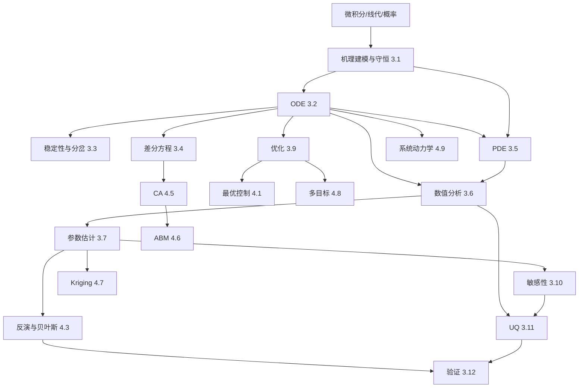

# 美赛 MCM/ICM A 题建模手学习指南

**从机理到可辩护的模型：一个月的系统训练**

> 这本书只解决一件事：**让你在没有现成模型可套的陌生 A 题面前，独立完成"读题—提机理—立假设—建方程—选方法—做验证"的全过程，并对模型的合理性负责。**

---

## 这本书为谁写

**读者画像：** 你是团队的**建模手**。比赛时你负责：

- 把题目文字翻译成数学结构（状态、控制、参数、方程、条件）；
- 判断该用哪类模型、为什么用它、它的边界在哪；
- 完成核心推导，说清每一步的物理/数学依据；
- 设计验证方案，判断"结果错了还是模型错了"；
- 把方程、参数、求解方案、验证要求写清楚，交给编程手实现。

**这本书不为谁写：** 它不是编程教程，也不是论文写作指南。

- 你**不需要**学 MATLAB 工程化、代码架构、性能优化——那是编程手的事；
- 你**不需要**学摘要怎么写、图表怎么排版、附录怎么组织——那是论文手的事；
- 你**需要**能读懂并写出最小可运行代码，只为了**验证你的方程**，不是为了交付软件。

**与队友的接口（你交付什么）：**

| 交付对象 | 你给什么 | 不给他们什么 |
|---|---|---|
| 编程手 | 方程与初边值、参数表（含义/单位/来源）、离散方案、验证清单、输入输出定义 | 不要给"你去想想怎么算" |
| 论文手 | 假设及其理由、模型推导主线、关键结论与区间、适用边界与局限 | 不要替他们写摘要和排版 |
| 数据手 | 需要什么数据、精度要求、缺数据时的替代假设 | 不要把"找数据"整个甩过去 |

---

## 怎么用这本书

**路径一：完整备赛（四周）。** 按第十章的计划走，每周有验收题。适合从现在到比赛还有一个月的情况。

**路径二：查漏补缺（一到两周）。** 先做 1.3 的自评表，找出 2—3 个薄弱项，直接跳到对应章节，只读第 5（变量与参数）、6（推导）、9（局限）、15（常见错误）小节。

**路径三：赛前速查（比赛期间）。** 用 1.4 的优先级总表定位模型，用第六章判断该选哪个，用第七章的诊断表排查"结果不对"。

**每章的固定结构：** 第三、四章的每个模型都按同一套 16 个小节展开，你可以按需跳读，但**推导（6）与参数表（5）不能跳**。

| 小节 | 你要做什么 |
|---|---|
| 1 定义 / 2 核心思想与大白话 | 先建立直觉，再看形式化定义 |
| 3 数学基础 | 缺什么补什么，这一节就是前置清单 |
| 4 基本假设 / 5 变量与参数 | 能说出每条假设被违反的后果；记住单位与物理意义 |
| 6 从基本原理推导核心公式 | 合上书自己推一遍，这是全书最该慢读的部分 |
| 7 求解方法 | 知道解析解与数值解各自何时用、误差多大 |
| 8 适用场景 / 9 局限 / 10 改进 | 能说出"什么时候不能用"以及"改哪一步能救" |
| 11 与其他模型的组合 | 知道它在模型链里接谁、接口是什么 |
| 12 手算算例 | 手算复现，数字必须对得上 |
| 13 最小可运行 MATLAB 示例 | 跑通并做结果检验，不是抄代码 |
| 14 真实美赛 A 题应用 | 看它在真题里如何落地、哪一步最容易错 |
| 15 常见错误 / 16 学习要求 | 对照自查，能否通过验收 |

第五章的 P2 模型用较轻的 8 个小节（定义与大白话、数学基础与假设、变量与参数、核心推导、求解与实现、适用局限改进、算例、最大陷阱），够你判断"该不该用"；若要拿它当主模型，按 5.7 的路线补数学、按 5.8 的示范做完整推导。

---

## 符号与排版约定

- 行内公式用 `$...$`，独立公式用 `$$...$$`；全书公式均为**单反斜杠** LaTeX。
- 向量用粗体 $\mathbf{x}$，矩阵用大写 $L$、$A$，转置用 $^{\mathsf T}$。
- 时间导数用点号 $\dot N$，偏导数用 $\partial$。
- 参数用 $\theta$ 或带下标的希腊字母；观测用 $y$，模型预测用 $\hat y$。
- 代码块标注 `matlab`，只给**能独立运行**的最小示例；代码里的注释写数学含义，不写语法解释。
- 单位一律写在符号表或参数表里；公式中不混用单位（例如不要把 mAh 与 W 直接相除）。

**关于真题：** 本书引用的 2019—2026 年 A 题内容，均以题目原文与仓库内 `MCM_A_2020-2026_历年分析报告.md` 为准。凡是原文没有明确给出的数字，书中标注为"假设"或"估计"，不冒充题目条件。

---

## 目录

- **[第一章 能力要求与学习路线](#guide-sec-1)**
  - [1.1 先看清楚：八年 A 题到底在考什么](#guide-sec-1-1)
  - [1.2 建模手的六项能力](#guide-sec-1-2)
  - [1.3 自评：你现在在哪一格](#guide-sec-1-3)
  - [1.4 全部模型优先级总表](#guide-sec-1-4)
  - [1.5 依赖关系：先学什么，后学什么](#guide-sec-1-5)
  - [1.6 三条铁律（比任何模型都重要）](#guide-sec-1-6)
- **[第二章 从实际问题到数学模型](#guide-sec-2)**
  - [2.1 前 90 分钟：四问与边界](#guide-sec-2-1)
  - [2.2 变量提取：状态、控制、输入、输出、参数](#guide-sec-2-2)
  - [2.3 机理与因果：把描述词翻译成数学结构](#guide-sec-2-3)
  - [2.4 合理假设：四类假设与写法](#guide-sec-2-4)
  - [2.5 方程从哪里来：五种来源](#guide-sec-2-5)
  - [2.6 连续还是离散：四个判据](#guide-sec-2-6)
  - [2.7 线性还是非线性：来源与后果](#guide-sec-2-7)
  - [2.8 状态空间表述：把任何动态模型写成标准形](#guide-sec-2-8)
  - [2.9 量纲一致性与 Buckingham π](#guide-sec-2-9)
  - [2.10 初始条件与边界条件](#guide-sec-2-10)
  - [2.11 参数的物理意义、量级与无量纲化](#guide-sec-2-11)
  - [2.12 模型简化与复杂度控制](#guide-sec-2-12)
  - [2.13 完整案例 A：2026 电池续航（从文字到方程）](#guide-sec-2-13)
  - [2.14 完整案例 B：2025 楼梯磨损（守恒 + 本构 + 量纲 + 反演）](#guide-sec-2-14)
  - [2.15 建模过程中的六项即时检验](#guide-sec-2-15)
  - [2.16 交底：给编程手的数学规格](#guide-sec-2-16)
- **[第三章 P0 核心必修](#guide-sec-3)**
  - [3.1 机理建模与守恒定律](#guide-sec-3-1)
  - [3.2 状态空间与 ODE](#guide-sec-3-2)
  - [3.3 稳定性、线性化与分岔](#guide-sec-3-3)
  - [3.4 差分方程与离散动态](#guide-sec-3-4)
  - [3.5 PDE 基础](#guide-sec-3-5)
  - [3.6 数值计算与数值分析](#guide-sec-3-6)
  - [3.7 参数估计与非线性拟合](#guide-sec-3-7)
  - [3.8 统计回归与分布建模](#guide-sec-3-8)
  - [3.9 优化：线性、非线性与整数规划](#guide-sec-3-9)
  - [3.10 敏感性分析](#guide-sec-3-10)
  - [3.11 不确定性分析](#guide-sec-3-11)
  - [3.12 模型验证](#guide-sec-3-12)
  - [3.13 量纲分析与相似理论（进阶）](#guide-sec-3-13)
- **[第四章 P1 重点专项](#guide-sec-4)**
  - [4.1 最优控制（PMP 与变分）](#guide-sec-4-1)
  - [4.2 动态规划与 MDP](#guide-sec-4-2)
  - [4.3 参数反演与贝叶斯估计](#guide-sec-4-3)
  - [4.4 随机过程与 Monte Carlo](#guide-sec-4-4)
  - [4.5 元胞自动机（CA）](#guide-sec-4-5)
  - [4.6 主体建模（ABM）](#guide-sec-4-6)
  - [4.7 空间插值与 Kriging](#guide-sec-4-7)
  - [4.8 多目标优化与 Pareto](#guide-sec-4-8)
  - [4.9 系统动力学](#guide-sec-4-9)
  - [4.10 时间序列](#guide-sec-4-10)
- **[第五章 P2 选修扩展](#guide-sec-5)**
  - [5.1 预测与评价类](#guide-sec-5-1)
  - [5.2 种群、传播与寿命类](#guide-sec-5-2)
  - [5.3 决策、网络与混合系统](#guide-sec-5-3)
  - [5.4 统计、降维与状态估计](#guide-sec-5-4)
  - [5.5 随机与计算类](#guide-sec-5-5)
  - [5.6 边缘与前沿（知道边界即可）](#guide-sec-5-6)
  - [5.7 P2 深做路线：21 项各有一条可执行的深入路径](#guide-sec-5-7)
  - [5.8 五个高价值项的深做示范](#guide-sec-5-8)
- **[第六章 模型选择、比较、组合与改进](#guide-sec-6)**
  - [6.1 问题特征 → 候选模型](#guide-sec-6-1)
  - [6.2 八组横向比较](#guide-sec-6-2)
  - [6.3 单模型够不够：三条判据](#guide-sec-6-3)
  - [6.4 六个组合框架（附数学接口）](#guide-sec-6-4)
  - [6.5 改进的九种手法](#guide-sec-6-5)
  - [6.6 六种反模式](#guide-sec-6-6)
- **[第七章 数值、参数估计、验证与不确定性：工作流](#guide-sec-7)**
  - [7.1 七步主线](#guide-sec-7-1)
  - [7.2 数值诊断：症状 → 原因 → 对策](#guide-sec-7-2)
  - [7.3 参数估计失败诊断](#guide-sec-7-3)
  - [7.4 把验证写进交底](#guide-sec-7-4)
  - [7.5 敏感性 → UQ 的决策流程](#guide-sec-7-5)
  - [7.6 参数不确定性 vs 机制不确定性（最容易犯的错）](#guide-sec-7-6)
  - [7.7 一页纸"可信度声明"模板](#guide-sec-7-7)
- **[第八章 MATLAB 最小实例库](#guide-sec-8)**
  - [8.1 函数速查（按用途）](#guide-sec-8-1)
  - [8.2 脚本 A：ODE + 事件 + 能量闭合（2026 电池）](#guide-sec-8-2)
  - [8.3 脚本 B：参数估计 + 置信区间 + 预测区间](#guide-sec-8-3)
  - [8.4 脚本 C：Sobol + Monte Carlo 一体](#guide-sec-8-4)
  - [8.5 常见报错与修法（都踩过）](#guide-sec-8-5)
- **[第九章 2019—2026 真题建模拆解](#guide-sec-9)**
  - [9.1 2019：Game of Ecology（三条龙）](#guide-sec-9-1)
  - [9.2 2020：Hook Line and Sinker（变暖海域的渔业公司）](#guide-sec-9-2)
  - [9.3 2021：Fungi（真菌性状与分解）](#guide-sec-9-3)
  - [9.4 2022：Power Profile of a Cyclist（功率分配）](#guide-sec-9-4)
  - [9.5 2023：Drought-Stricken Plant Communities（干旱与群落）](#guide-sec-9-5)
  - [9.6 2024：Resource Availability and Sex Ratios（七鳃鳗）](#guide-sec-9-6)
  - [9.7 2025：Testing Time（楼梯磨损反推）](#guide-sec-9-7)
  - [9.8 2026：Modeling Smartphone Battery Drain（电池续航）](#guide-sec-9-8)
  - [9.9 跨年复用：八道题其实在考同一组能力](#guide-sec-9-9)
- **[第十章 一个月（四周）计划与验收](#guide-sec-10)**
  - [10.1 时间预算：先算账，再排表](#guide-sec-10-1)
  - [10.2 第 1 周：机理建模与动态系统](#guide-sec-10-2)
  - [10.3 第 2 周：连续系统数值与优化](#guide-sec-10-3)
  - [10.4 第 3 周：专项与改进](#guide-sec-10-4)
  - [10.5 第 4 周：真题实战与复盘](#guide-sec-10-5)
  - [10.6 每日节奏模板（6 小时版）](#guide-sec-10-6)
  - [10.7 每周验收（可观测，不靠感觉）](#guide-sec-10-7)
  - [10.8 进度落后时怎么砍（按优先级砍，不按章节砍）](#guide-sec-10-8)
- **[附录 A 符号总表](#guide-sec-A)**
- **[附录 B 核心公式速查](#guide-sec-B)**
- **[附录 C MATLAB 函数索引（建模手视角）](#guide-sec-C)**
- **[附录 D 教材与可靠资料](#guide-sec-D)**
- **[附录 E 建模交底模板（可直接复制）](#guide-sec-E)**
- **[附录 F 原文档 36 个模型去向索引](#guide-sec-F)**

---

<a id="guide-sec-1"></a>
## 第一章 能力要求与学习路线

<a id="guide-sec-1-1"></a>
### 1.1 先看清楚：八年 A 题到底在考什么

把 2019—2026 的 A 题排在一起，会发现它们的外壳（龙、渔业、真菌、自行车、植物、七鳃鳗、楼梯、电池）完全不同，但**数学内核只有五类**。

| 年份 | 题目 | 数学内核 | 建模手必须交付的东西 |
|---|---|---|---|
| 2019 | Game of Ecology | 能量收支 + 生长 + 面积换算 | 代谢率标度律、能量平衡方程、面积估算 |
| 2020 | Hook Line and Sinker | 资源动力学 + 空间迁移 + 经济优化 | 温度相关的 $r(T),K(T)$、捕捞生产函数、目标函数 |
| 2021 | Fungi | 反应速率 + 多物种竞争 + 环境情景 | 分解速率 $k(\text{性状};W,T)$、竞争项、情景设置 |
| 2022 | Power Profile of a Cyclist | 质点动力学 + 疲劳状态 + 最优控制 | 功率—速度 ODE、疲劳演化、最优功率分配 |
| 2023 | Drought-Stricken Plant Communities | 随机降雨 + 土壤水 + 群落竞争 | 干旱随机过程、水分平衡、存续概率 |
| 2024 | Resource Availability and Sex Ratios | 性别比函数 + 结构种群 + 反馈 | $p(g)$ 的形式与依据、带性别结构的种群方程 |
| 2025 | Testing Time | 磨损正模型 + 反问题 + 可辨识性 | Archard 型方程、π 群、不可辨识的证明 |
| 2026 | Smartphone Battery Drain | 电荷守恒 + 等效电路 + 热 + UQ | SOC 方程、OCV 关系、事件、置信区间 |

**规律一：** 八道题里有六道要求"随时间演化"（ODE/PDE/差分），两道要求"由结果推原因"（反演）。

**规律二：** 越是近年的题，越强调"**机理 + 不确定性**"，而不是"拟合一条曲线"。2026 年题目明确排斥纯数据拟合与黑箱机器学习——这是方向性信号。

**规律三：** 每道题都有一个"**必须解释清楚的一个数**"：2019 是龙的卡路里需求，2022 是完赛时间，2025 是每天使用人次，2026 是续航时间。**你的模型必须能把这个数拆成"机制 × 参数"的形式**，否则别人无法判断它是否可信。

<a id="guide-sec-1-2"></a>
### 1.2 建模手的六项能力

| 能力 | 具体表现 | 不合格的表现 | 对应章节 |
|---|---|---|---|
| **问题分析** | 能说清每小问要的输出形式、系统边界、时间尺度 | 读完题就开始套模型 | 2.1—2.4 |
| **机理提取** | 能从题面文字找到守恒量、因果链、反馈环 | 只会说"用回归拟合" | 2.5—2.8, 3.1 |
| **假设管理** | 每条假设都有理由，且知道被违反的后果 | 假设写成"为简化起见" | 2.4, 7.6 |
| **建模推导** | 能从基本原理推出方程，量纲自洽 | 直接抄一个公式，不知来源 | 3.1—3.9 |
| **模型选择** | 能给出候选模型、比较依据、组合理由 | 会什么用什么 | 第六章 |
| **验证与 UQ** | 能设计检验、给出区间、说清边界 | 只报一个数，不给误差 | 3.10—3.12, 第七章 |

<a id="guide-sec-1-3"></a>
### 1.3 自评：你现在在哪一格

给每项打 1—5 分（1 = 完全不会，5 = 能独立完成并解释），总分 30。

| 能力 | 自评分 | 判断标准（5 分） |
|---|---|---|
| 问题分析 | | 能在 30 分钟内写出四问表与边界 |
| 机理提取 | | 能对陌生系统列出守恒量与反馈环 |
| 假设管理 | | 能说出每条假设被违反后的定性后果 |
| 建模推导 | | 能从守恒律推出 ODE/PDE 并检查量纲 |
| 模型选择 | | 能给出 2—3 个候选并说明取舍 |
| 验证与 UQ | | 能设计 5 类检验并给出参数区间 |

**读法：** 低于 18 分，按第十章完整走；18—24 分，重点补最低的两项；高于 24 分，直接做第九章真题 + 第六章选择训练。

<a id="guide-sec-1-4"></a>
### 1.4 全部模型优先级总表

**分级标准：**

- **P0 核心必修**：必须掌握原理、核心公式推导、适用条件和基本建模应用。不会，就无法独立完成一道 A 题。
- **P1 重点专项**：掌握原理、数学表达、适用条件和典型应用，能独立选择使用。遇到对应题型必须能上手。
- **P2 选修扩展**：了解思想、条件和局限，遇到再用。不占备赛计划学时。

**关于"学时"：** 指**从零到能独立使用**所需的净学习时间（含推导与最小实现），不含复习。

#### P0：核心必修（13 项，约 68 小时）

| 模型 | 优先级 | 理论难度 | 学习时间 | 前置知识 | 掌握要求 | A 题适用场景 |
|---|---|---|---|---|---|---|
| 机理建模与守恒定律 | P0 | ★★★ | 7 h | 微积分、基础物理 | 从守恒律推出方程，写清每个收支项 | 2019 能量、2022 功率、2026 电荷 |
| 状态空间与 ODE | P0 | ★★★ | 9 h | 微积分、线性代数 | 建模、解析解、`ode45`、事件 | 2020 渔业、2022 骑行、2026 电池 |
| 稳定性与分岔 | P0 | ★★★ | 3 h | ODE、特征值 | 求平衡点、判稳、识别临界参数 | 2024 性别比、2019 生态平衡 |
| 差分方程与离散动态 | P0 | ★★☆ | 3 h | 迭代、矩阵 | 建立递推、判稳、识别混沌 | 2021 真菌、2024 世代 |
| 偏微分方程（PDE）基础 | P0 | ★★★★ | 7 h | ODE、傅里叶级数 | 三类方程判别、定解条件、离散化 | 2021 分解、2023 土壤水、2025 磨损场 |
| 数值计算与数值分析 | P0 | ★★★ | 7 h | 微积分、线性代数 | 误差阶、稳定性、收敛性判断 | 所有需要数值求解的题 |
| 参数估计与非线性拟合 | P0 | ★★★ | 7 h | 3.8、线性代数 | 最小二乘、CI、可辨识性 | 2020、2024、2026 |
| 概率统计与回归 | P0 | ★★☆ | 5 h | 概率论 | 选分布、诊断残差、避免外推 | 2019、2024 |
| 线性与非线性优化 | P0 | ★★★ | 7 h | 线性代数、微积分 | 建模、KKT、影子价格解读 | 2020 经营、2022 功率分配 |
| 敏感性分析 | P0 | ★★★ | 4 h | 统计、回归 | 局部弹性、全局 Sobol | 全部（结论稳健性） |
| 不确定性分析（UQ） | P0 | ★★★ | 4 h | 统计、MC | 区间传播、MC、区间解释 | 2026、2020 |
| 模型验证 | P0 | ★★☆ | 3 h | 全部前置 | 设计 5 类检验并判断通过与否 | 全部 |
| 量纲分析与相似（进阶） | P0 | ★★ | 2 h | 2.9 | π 群用于缩放、实验设计、识别不可辨识 | 2019 巨兽、2025 磨损 |

#### P1：重点专项（10 项，约 49 小时）

| 模型 | 优先级 | 理论难度 | 学习时间 | 前置知识 | 掌握要求 | A 题适用场景 |
|---|---|---|---|---|---|---|
| 最优控制（PMP） | P1 | ★★★★ | 6 h | 3.2、3.9、变分 | 写哈密顿、解必要条件、解释协态 | 2022 功率分配 |
| 动态规划 / MDP | P1 | ★★★ | 5 h | 3.4、概率 | Bellman 方程、值迭代 | 2022 分段决策、资源分配 |
| 参数反演与贝叶斯估计 | P1 | ★★★★ | 7 h | 3.7、概率 | 正模型验证、可辨识、后验 | 2025 磨损反演、2020 参数 |
| 随机过程与 Monte Carlo | P1 | ★★★ | 6 h | 概率、3.11 | 随机输入建模、MC 收敛判断 | 2023 干旱、2026 情景 |
| 元胞自动机（CA） | P1 | ★★★ | 4 h | 3.4、编程概念 | 规则设计、网格无关性检验 | 2021 菌丝、2023 群落 |
| 主体建模（ABM） | P1 | ★★★★ | 5 h | 概率、CA | 规则设计、涌现、多种子 | 2025 人流、2020 船队 |
| 空间插值与 Kriging | P1 | ★★★ | 4 h | 统计、线性代数 | 变异函数、预测方差、LOOCV | 2025 磨损场、2023 土壤 |
| 多目标优化与 Pareto | P1 | ★★★ | 4 h | 3.9 | 支配关系、前沿、取舍说明 | 2019 生态 vs 经济、2020 |
| 系统动力学 | P1 | ★★☆ | 3 h | 3.2、反馈 | 存量流量、回路极性、延迟 | 2020 渔业政策、2019 生态 |
| 时间序列 | P1 | ★★★ | 5 h | 3.8 | 平稳性、ARIMA、回测 | 作输入或基线，不作主模型 |

#### P2：选修扩展（21 项，每项 2—3 小时，不占计划）

| 模型 | 优先级 | 理论难度 | 学习时间 | 前置知识 | 掌握要求 | A 题适用场景 |
|---|---|---|---|---|---|---|
| GM(1,1) | P2 | ★★ | 3 h | 最小二乘 | 知道适用条件（短序列、指数趋势） | 数据极少的粗预测 |
| AHP / TOPSIS / 模糊评价 | P2 | ★★ | 3 h | 线性代数 | 知道权重主观性 | 方案排序（非机理题） |
| 指数平滑 / Holt–Winters | P2 | ★★ | 2 h | 统计 | 知道趋势/季节项含义 | 短期预测基线 |
| 机器学习（基线用） | P2 | ★★★ | 3 h | 统计 | 只作基线/代理，不作主模型 | 2026 明确反对黑箱 |
| SIR / SEIR | P2 | ★★ | 3 h | ODE | 知道 $R_0$ 与最终规模 | 传播类（A 题少直接考） |
| Leslie 矩阵 | P2 | ★★ | 2 h | 线代 | 谱半径 = 长期增长率 | 年龄结构种群 |
| Ricker / Beverton–Holt | P2 | ★★ | 2 h | 差分 | 知道过冲与混沌 | 单种群离散 |
| Weibull 生存分析 | P2 | ★★★ | 3 h | 概率 | 风险函数形状、删失 | 寿命/失效数据 |
| 博弈论（Nash/演化） | P2 | ★★★ | 3 h | 优化 | 最佳响应、均衡存在性 | 多方决策 |
| 排队论 | P2 | ★★ | 2 h | 概率 | $L,W$ 公式与 $\rho<1$ | 服务系统（弱相关） |
| 图论 / 网络流 | P2 | ★★ | 3 h | 离散数学 | 最短路、最大流 | 路径/分配 |
| 阈值 / 分段 / 混合动态 | P2 | ★★★ | 3 h | ODE | 事件切换、Zeno | 2026 低电量保护 |
| 鲁棒 / 随机规划 | P2 | ★★★ | 3 h | 优化 | min-max、机会约束 | 参数不确定下的决策 |
| 聚类（K-means/GMM） | P2 | ★★ | 2 h | 统计 | 标准化、K 选择 | 分组/分区 |
| 分层贝叶斯 | P2 | ★★★★ | 3 h | 贝叶斯 | 部分汇聚、收缩 | 多组数据共享 |
| PCA / POD | P2 | ★★★ | 2 h | 线代 | 方差解释、降维误差 | 高维数据/场 |
| Kalman / 数据同化 | P2 | ★★★ | 3 h | 状态空间 | 预测—校正、$Q/R$ | 在线估计 |
| SDE | P2 | ★★★★ | 3 h | 概率 | Itô 形式、Euler–Maruyama | 连续随机扰动 |
| 元启发式（GA/SA/PSO） | P2 | ★★ | 2 h | 优化 | 只作备用，必须与基线比 | 非凸/离散 |
| 代理模型 / 贝叶斯优化 | P2 | ★★★ | 3 h | 统计 | GP、EI、误差验证 | 仿真昂贵时 |
| 边缘专题（HMM/EVT/Copula/PINN/ABC） | P2 | ★★★★ | 2 h | — | 知道"什么时候值得查" | 特定题型 |

**为什么这样分级（四条说明）：**

1. **PDE 必须是 P0。** 2021（分解场）、2023（土壤水）、2025（磨损场）三道题的空间分布就是结论本身。不会 PDE，这三题只能给"平均深度"这种一眼被看穿的结果。原文把 PDE 放在 P1 是分级错误。
2. **最优控制与参数反演必须是 P1 且给足学时。** 2022 的核心是"功率怎么分配"，本质是最优控制；2025 的核心是"由磨损推历史"，本质是反问题。原文把两者标为"选学"，与真题权重不符。
3. **排队论、图论、SIR、评价类降为 P2。** 不是因为它们没用，而是因为它们**在 A 题里通常是工具而非主线**：需要时查公式即可，不需要为它投入 5 小时以上。原文把它们放进 P1，挤占了 PDE 和反演的学时。
4. **不把所有高级模型都放低优先级，也不全划 P0。** 判据是"**这道题的主结论是否依赖它**"：依赖 → P0/P1；只是辅助 → P2。

<a id="guide-sec-1-5"></a>
### 1.5 依赖关系：先学什么，后学什么



**读法：** 箭头是"必须先学"。例如 4.3 反演依赖 3.7 参数估计；如果你跳过 3.7 直接看 4.3，会看不懂"为什么需要剖面似然"。

<a id="guide-sec-1-6"></a>
### 1.6 三条铁律（比任何模型都重要）

**铁律一：先问"这个数从哪来"，再问"用什么模型"。**
每一个要交付的数字，都必须能追溯到"机制 × 参数"。如果一个数只能靠拟合得到，你就要准备好回答："那你的机理是什么？"

**铁律二：模型复杂度由"需要解释的现象"决定，不由"你会什么"决定。**
多一个状态、多一个维度，就要多一组参数、多一类验证。**能用一个状态说清的事，不要用三个。**

**铁律三：任何结论都要带边界。**
"续航 7.4 小时"是不合格的；"在 25 °C、屏幕中等亮度、电池健康 100% 的条件下，续航 7.4 小时，90% 区间 [6.9, 7.9]"才是合格的。

---

<a id="guide-sec-2"></a>
## 第二章 从实际问题到数学模型

这一章是全书的枢纽。学完它，你应该能在没有现成模型可套的情况下，把一个陌生系统拆成"状态—机制—方程—条件—参数"五件事。

<a id="guide-sec-2-1"></a>
### 2.1 前 90 分钟：四问与边界

拿到题，先不要想模型。用一张纸回答四个问题（这是原文 5.4 节的"四问拆题法"，此处扩成正式方法）：

| 问 | 要写出什么 | 决定什么 |
|---|---|---|
| **问输出** | 每一小问最终交付什么形式：曲线、最优策略、排序、概率分布、反演出的历史、还是判断？ | 模型类型（预测/优化/评价/反演） |
| **问状态** | 系统里"什么在变、什么会被记住"？列 3—6 个，写符号、单位、合理范围 | 方程的阶数与结构 |
| **问机制** | 状态之间靠什么联系：守恒、因果、接触、竞争、反馈、优化目标 | 方程的具体形式 |
| **问证据** | 有哪些数据、文献、情景？哪些参数能估、哪些只能假设？用什么独立证据验证？ | 参数来源与可信度 |

**边界（scope）同样重要。** 每道题都有"题目要求"和"你没被要求但忍不住想算"的部分。把边界写成三行：

1. **系统边界**：哪些东西算"内部"，哪些当作外部输入（如 2026 电池题：手机内部的热源算内部，环境温度算外部）。
2. **时间边界**：仿真多久？稳态还是瞬态？（2020 是 50 年经营，2022 是单场比赛，2026 是单次充电到耗尽。）
3. **精度边界**：结论要精确到什么程度？粗模型 + 区间，往往优于精模型 + 单点。

**输出形式直接决定模型类型**，这是最快的一条选型捷径：

| 输出 | 首选 | 次选 |
|---|---|---|
| 一条随时间变化的曲线 | ODE / 差分 | 时间序列（数据驱动） |
| 空间分布图 | PDE / 插值 / CA | 空间统计 |
| 一个数（容量、面积、寿命） | 代数方程 / 积分 / 优化 | 仿真 + 平均 |
| 一个策略/时间表 | 优化 / 最优控制 / DP | 规则 + 仿真比较 |
| 一个排序 | 多指标评价 | 多目标 + 权重 |
| 一个概率/区间 | 随机模型 + MC | 解析近似 |
| 一段历史（参数/使用强度） | 反演 + 可辨识性分析 | 回归 |

<a id="guide-sec-2-2"></a>
### 2.2 变量提取：状态、控制、输入、输出、参数

建模最常见的低级错误，是把五类量混成一锅。判据如下：

| 类型 | 判据 | 数学位置 | 例子（2026 电池） |
|---|---|---|---|
| **状态** $x$ | 有积累/记忆，由微分或差分方程决定；给定初值后由方程演化 | $x'=f(\cdot)$ 左侧 | SOC、温度、SOH |
| **控制** $u$ | 人能设计/选择的量，可分段常数、可连续 | $f$ 的参数 | 充电功率、是否开省电模式 |
| **输入/扰动** $w$ | 人不能选、但影响系统的外部量 | $f$ 的参数 | 环境温度、用户负载、信号强度 |
| **输出** $y$ | 能被观测/测量的量，通常是状态的函数加噪声 | $y=g(x,u)+v$ | 端电压、电流、表面温度 |
| **参数** $\theta$ | 在本次建模时间尺度内视为常数，但数值未知或需标定 | $f$ 的系数 | 内阻 $R$、容量 $Q$、热容 $C_{th}$ |

**三个高频混淆：**

1. **把参数当状态。** 电池内阻随老化缓慢变化，但在一场比赛的时间尺度内它是常数；若你让它随时间变，就必须再写一个"老化方程"，否则方程不可解。判断标准：**它有没有自己的演化规律？** 没有就是参数。
2. **把输入当控制。** 用户负载不是你能设计的，它是扰动；如果你把它当控制去"优化"，结论会变成"建议用户别用手机"，毫无意义。
3. **把输出当状态。** 端电压是输出，不是状态；状态是 SOC。用电压反推 SOC 是"观测"问题，需要观测方程和噪声模型。

**变量表的写法**（每个模型都必须有，交底时直接给编程手）：

| 符号 | 名称 | 类型 | 单位 | 典型值/范围 | 来源 |
|---|---|---|---|---|---|
| $s$ | 荷电状态 SOC | 状态 | — | 0—1 | 定义 |
| $T$ | 电池温度 | 状态 | °C | 20—45 | 测量 |
| $P$ | 负载功率 | 输入 | W | 1—10 | 情景设定 |
| $R$ | 内阻 | 参数 | Ω | 0.05—0.2 | 数据手册/辨识 |
| $Q$ | 额定能量 | 参数 | Wh | 14.8 | 标称 4000 mAh × 3.7 V |

<a id="guide-sec-2-3"></a>
### 2.3 机理与因果：把描述词翻译成数学结构

题目里的自然语言，几乎都能映射到有限的几种数学结构。这张表要背下来：

| 题面词 | 数学结构 | 写法 |
|---|---|---|
| 积累、存量、剩余、总量 | 积分/守恒 | $\dfrac{dX}{dt}=\text{流入}-\text{流出}$ |
| 流动、通量、迁移、扩散 | 通量 + 散度 | $\dfrac{\partial c}{\partial t}=-\nabla\cdot\mathbf{J}+S$ |
| 驱动、梯度、势差 | 本构关系 | $\mathbf{J}=-D\nabla c$ |
| 反应、分解、转化、消耗 | 源汇项 | $S=-kc$ 或 $S=\mu c(1-c/K)$ |
| 竞争、捕食、耦合 | 双线性耦合项 | $-acb$ |
| 延迟、滞后、孕育期 | 时滞/储池 | $x'=f(x(t-\tau))$ 或级联一阶环节 |
| 反馈、自我强化/抑制 | 回路符号 | $f'$ 的符号与回路极性 |
| 阈值、临界、崩溃 | 分段/鞍结分岔 | $f$ 中含 $x-x_c$ 的符号函数 |
| 饱和、上限、容量 | 饱和函数 | $1-x/K$，$\tanh$，$\min$ |
| 个体差异、异质 | 分布/分层 | $\theta_i\sim p(\theta)$ |
| 随机、波动、不确定 | 随机项 | $\sigma\,dW$ 或随机参数 |

**因果 vs 相关（这是 A 题最容易翻车的地方）：**

- 2024 的"食物少→雄性多"是**可塑性响应**，不是"雄性多导致食物少"。方向搞反，整篇结论作废。
- 判断因果的三条实用标准：**时间先后**（原因在前）、**机制可写**（能写出中间步骤）、**干预可检验**（改变原因，结果应改变）。
- 如果只能观测到相关、写不出机制，就老老实实做"经验关系 + 外推警告"，不要假装它是机理模型。

<a id="guide-sec-2-4"></a>
### 2.4 合理假设：四类假设与写法

假设不是"为了简化而简化"，而是**明确声明你在哪里切断了现实**。每条假设写四栏：

| 假设 | 依据 | 违反后果 | 可否检验/补救 |
|---|---|---|---|
| 电池内部温度均匀 | Biot 数小，单体尺寸小 | 高温时低估局部衰减 | 加集总参数对比/多点测温 |
| 内阻不随 SOC 变化 | 平台区近似 | 低 SOC 时电压误差增大 | 分段常数或 $R(s)$ |
| 用户负载分段常数 | 使用情景离散化 | 快速波动时误差大 | 提高分段数做收敛检验 |
| 磨损系数 $K$ 为常数 | 材料均一、无润滑 | 局部材料差异导致偏差 | 分区标定 + 敏感性 |

**四类假设，缺一类就会漏：**

1. **尺度假设**：空间是否均匀（0D/1D/2D/3D）、时间是否可分尺度（准稳态）。
2. **结构假设**：方程的函数形式（线性/非线性、一阶/二阶、是否含时滞）。
3. **参数假设**：参数是否常数、是否已知、分布形式。
4. **随机性假设**：噪声是机制的一部分，还是观测误差？这两者的数学处理完全不同。

**写法要求：** 每条假设必须能回答"如果它不成立，我的哪个结论会变、往哪个方向变"。答不上来的假设，说明你还没想清楚，删掉或改写。

<a id="guide-sec-2-5"></a>
### 2.5 方程从哪里来：五种来源

这是"文字→方程"的核心。五种来源按可靠性排序：

#### 2.5.1 守恒定律（最可靠）

**质量守恒（控制体形式）：**

$$
\frac{d}{dt}\int_{\Omega}\rho\,dV=-\oint_{\partial\Omega}\rho\,\mathbf{v}\cdot\mathbf{n}\,dA+\int_{\Omega}S\,dV .
$$

左边是控制体内质量变化率，右边第一项是净流出（$\mathbf{n}$ 为外法向），第二项是源。用散度定理化为局部形式：

$$
\frac{\partial \rho}{\partial t}+\nabla\cdot(\rho\mathbf{v})=S .
$$

对浓度 $c$（单位体积的量）与通量 $\mathbf{J}$：

$$
\frac{\partial c}{\partial t}+\nabla\cdot\mathbf{J}=S .
$$

一维、$S=0$ 时就是我们最熟的 $\partial_t c+\partial_x J=0$。**所有"守恒型"方程都长这样**，区别只在 $\mathbf{J}$ 怎么来。

**用法示例（2021 枯落物分解）：** 把"枯落物"看成一种物质，分解是汇：$\partial_t L=-\nabla\cdot\mathbf{J}-k(T,M)L$，其中 $k$ 依赖温湿度、$M$ 是水分。你不需要"发明"方程，只需要说清"什么在守恒、汇是什么"。

#### 2.5.2 能量守恒

对控制体（热力学第一定律，忽略动能与势能变化）：

$$
\frac{dE}{dt}=\dot Q-\dot W+\sum \dot m_{\text{in}}h_{\text{in}}-\sum \dot m_{\text{out}}h_{\text{out}} .
$$

对质点/刚体的机械能：

$$
\frac{d}{dt}\left(\frac12 mv^2+mgz\right)=P_{\text{drive}}-P_{\text{diss}} .
$$

**用法示例（2022 骑行）：** 车手做的功一部分变成重力势能，一部分被阻力耗散：

$$
P_{\text{eff}}=v\left(mg\sin\theta+C_r mg\cos\theta+\tfrac12\rho C_d A v^2\right).
$$

这条式子就是 2022 的"能量预算"，后面加疲劳、加风向都只是改它。

#### 2.5.3 动量守恒

$$
\sum\mathbf{F}=\frac{d}{dt}(m\mathbf{v}) .
$$

流体情形即 Navier–Stokes 的来源：$\rho(\partial_t\mathbf{u}+\mathbf{u}\cdot\nabla\mathbf{u})=-\nabla p+\mu\nabla^2\mathbf{u}+\mathbf{f}$。A 题极少要求解 N–S，但**知道它从哪来**，你才敢用"阻力 $\propto v^2$"这类简化，并说清忽略了什么（黏性、压缩性、湍流）。

#### 2.5.4 本构关系（把通量变成梯度）

守恒方程本身不封闭：$\mathbf{J}$ 未知。必须补一条"物质如何响应梯度"的关系：

| 本构 | 表达式 | 适用 |
|---|---|---|
| Fourier 导热 | $\mathbf{q}=-k\nabla T$ | 固体/静止流体导热 |
| Fick 扩散 | $\mathbf{J}=-D\nabla c$ | 稀溶液、分子扩散 |
| Newton 黏性 | $\tau=\mu\dfrac{du}{dy}$ | 牛顿流体 |
| Ohm 定律 | $I=\dfrac{V}{R}$ | 电路 |
| Archard 磨损 | $V=\dfrac{K W s}{H}$ | 磨粒磨损（2025 核心） |
| Darcy 渗流 | $\mathbf{q}=-\dfrac{k}{\mu}\nabla p$ | 多孔介质（土壤水） |

**本构是"经验 + 物理"的混合体，必须给出适用范围。** 比如 Archard 律假定磨损与载荷、滑动距离成正比、与硬度成反比，忽略第三体（磨屑）与润滑；超出这个范围（如严重塑性变形）就不成立。

#### 2.5.5 经验/统计规律（最后的选择）

当机制写不出来，只能用数据关系：阈值型（$\max(0,x-x_c)$）、幂律（$y=ax^b$）、饱和型（Michaelis–Menten、Hill）、异速生长（$y=ax^{3/4}$）。

**使用纪律：** 只能内插，不能外推；必须给参数的置信区间；必须说明"这是现象学关系，不是机理"。2024 的"生长速率→性别比"关系就属于此类，题目给的 78%/56% 是两端锚点，中间的函数形式是你的建模选择——**不同选择必须做敏感性分析**。

#### 2.5.6 平衡/优化原理

当系统"趋于某个最优状态"时，可以用变分或优化代替动力学：

- 光学/力学的最小作用量原理；
- 热力学的自由能最小；
- 经济/行为的最小成本、最大收益；
- 博弈的 Nash 均衡、演化稳定策略。

**代价：** 你假定系统"已经或正在到达最优"，这在生态、工程里常常不成立。用它之前必须回答："这个系统凭什么最优？"

<a id="guide-sec-2-6"></a>
### 2.6 连续还是离散：四个判据

| 判据 | 连续时间（ODE/PDE） | 离散（差分/CA/事件） |
|---|---|---|
| **时间尺度** | 事件远多于观测，可近似连续 | 一年一次繁殖、按班次/批次更新 |
| **个体** | 数量大，可视为密度 | 个体少且异质（ABM） |
| **机制** | 速率型（每秒多少） | 计数型（每年多少只） |
| **数据** | 高频观测 | 只有年度/批次数据 |

**两条不同的"离散化"，不要混：**

1. **数值离散**：真实模型是连续的，为了求解把它离散（Euler、RK、有限差分）。步长是数值参数，应做收敛检验。
2. **本质离散**：真实过程就是离散的（一年一代、一次事件）。步长是物理参数，不能随意减小。

**典型误判：** 把年度繁殖数据硬套连续 Logistic，会算出"每年 0.3 只"这种非整数中间量，而且低估过度补偿导致的振荡。正确做法是 Ricker/Beverton–Holt 差分（见 P0-4）。

<a id="guide-sec-2-7"></a>
### 2.7 线性还是非线性：来源与后果

**非线性从哪来（A 题四大来源）：**

1. **本构非线性**：辐射换热 $T^4$、阻力 $v^2$、Archard 中的接触面积随载荷变化。
2. **耦合乘积**：捕食 $acb$、感染 $\beta SI$、人口 $\times$ 人均。
3. **饱和**：$1-N/K$、$\tanh$、Michaelis–Menten。
4. **阈值/分段**：关机、保护、切换。

**后果（必须在论文里承认）：**

- 叠加原理失效：不能把两个解相加；
- 可能出现多平衡点、分岔、混沌（Ricker 就是例子）；
- 优化变成非凸，局部最优不等于全局最优；
- 参数估计的目标函数可能多峰。

**处理手法：**

| 手法 | 何时用 | 代价 |
|---|---|---|
| 在工作点线性化 | 只关心小扰动/稳定性 | 大范围失效 |
| 对数/幂变换 | 幂律、指数增长 | 零值/负值不可用 |
| 分段线性 | 阈值型机制 | 切换点处不光滑 |
| 无量纲化 + 摄动 | 小参数明确 | 需要尺度分析 |
| 直接非线性求解 | 有可靠初值/全局方法 | 计算量与多解风险 |

<a id="guide-sec-2-8"></a>
### 2.8 状态空间表述：把任何动态模型写成标准形

**连续时间：**

$$
\dot{\mathbf{x}}=\mathbf{f}(\mathbf{x},\mathbf{u},t;\boldsymbol\theta),\qquad
\mathbf{y}=\mathbf{g}(\mathbf{x},\mathbf{u},t;\boldsymbol\theta)+\mathbf{v}.
$$

**离散时间：**

$$
\mathbf{x}_{k+1}=\mathbf{F}(\mathbf{x}_k,\mathbf{u}_k,k;\boldsymbol\theta),\qquad
\mathbf{y}_k=\mathbf{G}(\mathbf{x}_k,\mathbf{u}_k;\boldsymbol\theta)+\mathbf{v}_k.
$$

**为什么一定要写成这个形式：**

1. 阶数清楚：$n$ 个一阶方程 = $n$ 维状态；高阶方程必须降阶（$\ddot x\to x,v$）。
2. 初值清楚：需要 $n$ 个初始条件，不多不少。
3. 稳定性有标准工具：平衡点 $\mathbf{f}(\mathbf{x}^*)=0$，Jacobian $\mathbf{J}=\partial\mathbf{f}/\partial\mathbf{x}$，特征值实部全负则局部渐近稳定。
4. 数值求解、参数估计、最优控制、Kalman 滤波全部以它为输入。

**例：Lotka–Volterra 捕食模型**

$$
\dot N=\alpha N-\beta NP,\qquad \dot P=\delta NP-\gamma P .
$$

平衡点：$(0,0)$ 与 $(N^*,P^*)=(\gamma/\delta,\ \alpha/\beta)$。在非零平衡点的 Jacobian：

$$
\mathbf{J}=\begin{bmatrix}\alpha-\beta P^* & -\beta N^*\\ \delta P^* & \delta N^*-\gamma\end{bmatrix}
=\begin{bmatrix}0 & -\beta\gamma/\delta\\ \delta\alpha/\beta & 0\end{bmatrix},
$$

特征值满足 $\lambda^2=-\alpha\gamma$，即 $\lambda=\pm i\sqrt{\alpha\gamma}$，纯虚根 → 线性化判定失效（中心），需要靠首次积分 $V=\delta N-\gamma\ln N+\beta P-\alpha\ln P$ 证明闭合轨道。**这个例子说明：线性化只能判"稳定/不稳定"，判不了"中心"，必须另找守恒量或 Lyapunov 函数。** 这是 A 题里区分"看起来稳"和"真的稳"的关键。

---

<a id="guide-sec-2-9"></a>
### 2.9 量纲一致性与 Buckingham π

#### 2.9.1 量纲齐次性：最便宜的查错工具

任何物理方程的每一项必须同量纲。记 $[\,\cdot\,]$ 为量纲，则

$$
\left[\frac{dX}{dt}\right]=[X]\,T^{-1},\qquad [\nabla c]=[c]\,L^{-1},\qquad [\nabla\cdot\mathbf{J}]=[J]\,L^{-1}.
$$

所以 $\partial_t c=-\nabla\cdot\mathbf{J}$ 要求 $[c]T^{-1}=[J]L^{-1}$，即 $[J]=[c]L\,T^{-1}$——这正是"通量 = 浓度 × 速度"。

**三步查错法：**

1. 写出每个符号的量纲（用 $M,L,T,\Theta$ 基本量纲）；
2. 检查加减项、等式两边；
3. 检查指数、对数、三角函数的自变量必须无量纲。

#### 2.9.2 Buckingham π 定理

若一个问题有 $n$ 个有量纲变量、涉及 $k$ 个独立基本量纲，则可用 $n-k$ 个无量纲群 $\pi_1,\dots,\pi_{n-k}$ 重写关系：

$$
f(x_1,\dots,x_n)=0\ \Longleftrightarrow\ \Phi(\pi_1,\dots,\pi_{n-k})=0 .
$$

**完整推导案例（原文模型 6 的错误在此修正）：**

流体中物体受到的阻力 $F$，认为依赖密度 $\rho$、速度 $v$、特征长度 $L$、黏度 $\mu$。**五个变量**：$F,\rho,v,L,\mu$。

| 变量 | 量纲 |
|---|---|
| $F$ | $MLT^{-2}$ |
| $\rho$ | $ML^{-3}$ |
| $v$ | $LT^{-1}$ |
| $L$ | $L$ |
| $\mu$ | $ML^{-1}T^{-1}$ |

量纲矩阵（每列一个变量，行是 $M,L,T$）：

$$
\mathbf{A}=\begin{bmatrix}
1 & 1 & 0 & 0 & 1\\
1 & -3 & 1 & 1 & -1\\
-2 & 0 & -1 & 0 & -1
\end{bmatrix}.
$$

$\operatorname{rank}\mathbf{A}=3$（$k=3$），$n=5$，故 $\pi$ 群个数为 $n-k=2$。解 $\mathbf{A}\mathbf{e}=0$ 得两组独立指数：

$$
\pi_1=\frac{F}{\rho v^2L^2},\qquad \pi_2=\frac{\rho vL}{\mu}=\mathrm{Re}.
$$

于是

$$
\frac{F}{\rho v^2L^2}=\Phi(\mathrm{Re})\quad\Longrightarrow\quad F=\tfrac12\rho v^2L^2\,C_D(\mathrm{Re}),
$$

其中 $C_D=2\Phi$ 就是阻力系数。**这条式子解释了为什么"阻力 $\propto v^2$"不是拍脑袋**：它是量纲分析的必然结果，而"系数随 $Re$ 变"才是真正需要实验/本构去补的部分。

**π 群的三种用法：**

1. **减参数**：5 个变量的问题变成 2 个群的关系，实验量从 $5$ 维降到 $2$ 维。
2. **判相似**：两个系统若 $Re$ 相同且几何相似，则 $C_D$ 相同——模型实验可外推到原型。
3. **判可辨识性**（进阶用法，2.14 会用到）：若观测方程只依赖某个 π 群，则群内参数**只能确定组合、不能分别确定**。

**常见错误：**

- 变量清单漏项（漏了 $\mu$ 就只剩 1 个 π 群，结论完全不同）；
- 把"角度""应变"等无量纲量当有量纲量；
- 量纲矩阵秩算错（必须真的化行阶梯，不能看行列式猜）；
- 得到 π 群后不给物理解释（$Re$ 是惯性力/黏性力之比，这才是它的意义）。

<a id="guide-sec-2-10"></a>
### 2.10 初始条件与边界条件

**计数规则：**

- ODE 系统 $n$ 阶 → 需要 $n$ 个初始条件（每个状态一个）；
- 时间上 $m$ 阶偏导 → 需要 $m$ 个初始条件（热方程 1 个，波动方程 2 个）；
- 空间上 $2p$ 阶偏导 → 每条边界需要 $p$ 个边界条件（二阶方程每条边界 1 个）。

**三类边界条件及其物理含义：**

| 类型 | 形式 | 物理含义 | 例子 |
|---|---|---|---|
| 第一类（Dirichlet） | $u\vert _{\partial\Omega}=u_b$ | 边界值被固定 | 楼梯两端温度等于室温 |
| 第二类（Neumann） | $-k\nabla u\cdot\mathbf{n}=q_b$ | 边界通量给定 | 绝热（$q_b=0$）、已知热流 |
| 第三类（Robin） | $-k\nabla u\cdot\mathbf{n}=h(u-u_\infty)$ | 对流换热/有限传导 | 表面散热 |

**三个必须检查的点：**

1. **相容性**：初始条件与边界条件在角点 $(x=0,t=0)$ 处不能矛盾。若 $u(x,0)=0$ 而 $u(0,t)=1$，则在 $(0,0)$ 处跳变，数值解会在初始时刻出现陡峭层——这是物理上合理的"阶跃"，但要确认你的格式能处理。
2. **过量约束**：二阶方程每条边界只能给 1 个条件。给两个 Dirichlet 会过约束（无解），给零个会欠定（解不唯一）。
3. **纯 Neumann 问题的解不唯一**：全绝热 + 无源时，解只确定到相差一个常数，必须额外给"总量守恒"或参考点。

**例（2026 电池的热模型）：**

$$
C_{th}\frac{dT}{dt}=I^2R+hA(T_{\text{amb}}-T),\qquad T(0)=T_0 .
$$

这是一阶 ODE，只需要 1 个初始条件。稳态 $T_\infty=T_{\text{amb}}+I^2R/(hA)$ 是"长时间使用后的温度"，可以拿来验证瞬态解是否收敛到它。

<a id="guide-sec-2-11"></a>
### 2.11 参数的物理意义、量级与无量纲化

**每个参数必须回答四个问题：**

1. 它是什么（物理意义）？
2. 它的单位是什么（量纲）？
3. 它的典型量级是多少（数量级估计）？
4. 它从哪来（实测/文献/标定/假设）？

**数量级估计（Fermi 法）示例：** 2026 电池，$Q=4000$ mAh、标称 $3.7$ V，则能量 $Q=14.8$ Wh；若平均功耗 $3$ W，续航约 $5$ h。这个粗估能在你写方程之前就排除"续航 50 小时"这类荒谬结论。

**无量纲化：** 用特征尺度 $x=L\tilde x,\ t=\tau\tilde t,\ u=U\tilde u$ 把方程变成无量纲形式，好处是：

- 参数个数减少，物理意义更清楚（出现 $Re$、$Pe$、$Da$ 等）；
- 数值条件改善（避免 $10^{-9}$ 与 $10^{9}$ 同场）；
- 直接看出哪些项可以忽略（小参数）。

**例（扩散方程）：** $\partial_t c=D\partial_{xx}c$，取 $\tilde x=x/L,\ \tilde t=t/(L^2/D)$，得 $\partial_{\tilde t}\tilde c=\partial_{\tilde x\tilde x}\tilde c$——**扩散时间尺度是 $L^2/D$**。这个结论比任何公式都有用：它告诉你"要等多快"。

<a id="guide-sec-2-12"></a>
### 2.12 模型简化与复杂度控制

**复杂度阶梯（从低到高，够用就停）：**

| 层级 | 形式 | 何时够用 | 2026 电池例子 |
|---|---|---|---|
| 0D 代数 | $y=f(u)$ | 稳态、无记忆 | 平均功耗 × 续航 |
| 0D ODE | $\dot x=f(x,u)$ | 集总、无空间 | SOC + 温度 |
| 1D PDE | $\partial_t u=\partial_x(D\partial_xu)+S$ | 一个方向主导 | 电芯厚度方向温度 |
| 2D/3D PDE | 全空间 | 空间分布是结论本身 | 整机温度场 |
| 随机/异质 | SDE / ABM / 分层 | 变异是结论本身 | 用户行为差异 |

**四种简化手法：**

1. **时间尺度分离（准稳态）**：若快变量弛豫远快于慢变量（$\tau_{\text{fast}}\ll\tau_{\text{slow}}$），令快变量导数为 0，代回慢方程。例：电池温度相对 SOC 变化很快，可在每个 SOC 点上用稳态温度。
2. **空间集总**：Biot 数 $Bi=hL/k\ll 0.1$ 时内部温度近似均匀（集总参数）。
3. **小项忽略**：无量纲化后系数 $\ll 1$ 的项可略，但必须估计误差量级。
4. **参数聚合**：把无法分别辨识的参数合成一个复合参数（如 $K/H$），并明确"只能确定这个组合"。

**加复杂度的三问测试（任何一次"要不要加"都用它）：**

1. 这个机制是否**改变结论的方向或量级**？（只改变小数点后两位 → 不加）
2. 它的参数**能否从数据/文献确定**？（不能 → 加了也无法验证）
3. 加了之后**还能不能做验证**？（不能 → 不如用一个承认局限的简单模型）

<a id="guide-sec-2-13"></a>
### 2.13 完整案例 A：2026 电池续航（从文字到方程）

**题目语言：** "建立手机电池从满电到关机的连续时间模型，预测不同使用情景下的剩余时间，分析温度与老化的影响。"

**第一步，定状态。** 什么会被记住？电量（SOC）、温度。SOH 变化慢，本场视为参数。

**第二步，写守恒。** 电荷守恒：

$$
\frac{dQ}{dt}=-I(t),\qquad Q(0)=Q_0,
$$

其中 $Q$ 为剩余电荷（C 或 Ah），$I>0$ 为放电电流。用 SOC $s=Q/Q_n$ 与功率 $P=VI$：

$$
\frac{ds}{dt}=-\frac{P(t)}{3600\,Q_{\text{Wh}}},\qquad s(0)=1,
$$

这里 $t$ 以**小时**计，$Q_{\text{Wh}}$ 为额定能量（Wh）。**单位必须自洽**：若 $t$ 用秒，右端要除以 $3600$；这是原文模型 7 用 mAh 除以 W 却报"小时"的错误根源。

**第三步，写观测方程。** 端电压不是状态，是输出：

$$
V(t)=\mathrm{OCV}(s)-I R(s,T),
$$

$\mathrm{OCV}(s)$ 是开路电压曲线（单调、在中间段较平），$R$ 随温度升高而下降（Arrhenius 型近似 $R=R_0e^{E_a/(RT)}$ 或线性近似）。

**第四步，写热平衡。**

$$
C_{th}\frac{dT}{dt}=I^2R+hA\,(T_{\text{amb}}-T),\qquad T(0)=T_0 .
$$

**第五步，定参数。**

| 参数 | 含义 | 单位 | 典型值 | 来源 |
|---|---|---|---|---|
| $Q_{\text{Wh}}$ | 额定能量 | Wh | 14.8 | 4000 mAh × 3.7 V |
| $R_0$ | 参考内阻 | Ω | 0.08 | 数据手册/脉冲测试 |
| $E_a$ | 内阻活化能 | J/mol | $2\times10^4$ | 文献/拟合 |
| $C_{th}$ | 热容 | J/K | 30 | 材料估算 |
| $hA$ | 散热系数×面积 | W/K | 0.05 | 温升实验标定 |

**第六步，可辨识性分析（这是 A 题拉开差距的地方）。**

- 只测端电压 $V$：$R$ 与 $\mathrm{OCV}$ 的常数偏移**不可区分**（$V=\mathrm{OCV}-IR$，改变 $R$ 可由平移 OCV 补偿）；
- 在 OCV 平台段（$d\mathrm{OCV}/ds\approx0$），$s$ 对 $V$ 几乎无影响 → **SOC 不可辨识**；
- 补救：库仑计数（对 $I$ 积分）给 $s$ 的独立信息；静置测 OCV 给校准点；脉冲测试分离 $R$。

**结论模板：** "在 $s\in[0.2,0.9]$、$T\in[20,40]^\circ$C 内，模型对 $R$ 的 $\pm20\%$ 误差导致续航预测 $\pm6\%$；平台段以外结论可信，低于 $s=0.1$ 时因 $R(s)$ 非线性，误差可达 $15\%$。"

**验证（必须做）：** 能量闭合 $\int_0^{t_{\text{end}}}P\,dt=Q_{\text{Wh}}$；极端情景（$P=0$ 应永续，$P\to\infty$ 应瞬时耗尽）；与厂商标称续航对比。

<a id="guide-sec-2-14"></a>
### 2.14 完整案例 B：2025 楼梯磨损（守恒 + 本构 + 量纲 + 反演）

**题目语言：** "用楼梯的磨损情况推断使用频率、方向偏好与并行人数；讨论年龄估计的可靠性与修缮历史的影响。"

**第一步，机制。** 每人每次踩踏造成微小磨损，长期累积成可测的磨损深度场 $h(x,y)$。

**第二步，本构（Archard 律）。** 体积磨损

$$
V=\frac{K\,F_n\,s}{H},
$$

$K$ 无量纲磨损系数，$F_n$ 法向载荷（N），$s$ 滑动距离（m），$H$ 材料硬度（Pa）。换成深度（除以接触面积 $A_c$）：

$$
\delta=\frac{K F_n s}{H A_c}\quad[\text{m/次}].
$$

量纲检查：$\dfrac{1\cdot \mathrm{N}\cdot\mathrm{m}}{\mathrm{Pa}\cdot\mathrm{m^2}}=\dfrac{\mathrm{N\cdot m}}{(\mathrm{N/m^2})\mathrm{m^2}}=\mathrm{m}$ ✓。

**第三步，累积方程（连续近似）。**

$$
\frac{\partial h}{\partial t}=n(x,y)\,\delta,\qquad h(x,y,0)=0,
$$

$n(x,y)$ 是单位面积、单位时间的踩踏次数（人次/(m²·s)）。若使用强度稳定 $T$ 年，则 $h=n\,\delta\,T$。

**第四步，量纲分析揭示不可辨识性。** 把上式无量纲化：唯一的 π 群是

$$
\Pi=\frac{h\,H\,A_c}{n\,T\,K\,F_n\,s}=1 .
$$

**这个群只含组合 $nK$。** 所以：**只测 $h$，无法同时定出 $n$ 与 $K$**——磨损系数减半、人流翻倍，给出完全相同的深度场。这不是数据不够，是结构性的不可辨识。必须在文档里明说，并给出三条出路：

1. 独立测 $K$（实验室磨损试验、同材质样本）；
2. 只报告相对分布 $n(x,y)/\bar n$（形状可辨识，绝对值不可）；
3. 用多种证据交叉约束（修缮记录、监控计数、鞋底材质）。

**第五步，算例（数值已用 MATLAB 核对）。** 取 $K=10^{-4}$、$F_n=700$ N、$s=0.3$ m、$H=5$ GPa、$A_c=0.02$ m²：

$$
\delta=\frac{10^{-4}\times700\times0.3}{5\times10^{9}\times0.02}=2.1\times10^{-10}\ \mathrm{m}=0.21\ \mathrm{nm/次}.
$$

若实测中央磨损 $4$ mm、楼梯使用 $30$ 年：

$$
n=\frac{4\times10^{-3}}{2.1\times10^{-10}\times30\times365}\approx1.74\times10^{3}\ \text{人次/天}.
$$

**敏感性：** $\partial\ln n/\partial\ln K=-1$——$K$ 减半，$n$ 估计翻倍（$3479$ 人次/天）。所以结论必须写成"**若 $K$ 为 $10^{-4}$，则约 1700 人次/天；$K$ 的不确定性直接线性传递到人流估计**"。

**第六步，方向与并行人数。** 上行/下行磨损剖面的不对称给出方向偏好；横向磨损宽度分布给出并行人数（宽度超过单人足迹的部分需要两人并行才能磨到）。这两条是**几何证据**，不依赖 $K$，比绝对人流更可靠——优先报告它们。

**第七步，验证。** 材料试样磨损试验（定 $K$）、历史照片/修缮记录（定 $T$）、另一部同建筑楼梯（可比性）、数值上检查网格无关性（若用插值重建场）。

<a id="guide-sec-2-15"></a>
### 2.15 建模过程中的六项即时检验

不要等模型做完再验证。每写完一组方程，立刻做这六项（每项 1 分钟）：

| 检验 | 操作 | 失败信号 |
|---|---|---|
| 量纲 | 逐项查量纲 | 加减项不同量纲 |
| 极限 | 令参数 $\to0$ 或 $\to\infty$ | 出现无穷大/负值/违反物理 |
| 守恒 | 对封闭系统积分，看总量 | 总量漂移 |
| 符号/单调 | 物理上该增的项是否增 | 温度升高续航反而变长 |
| 量级 | 代入典型值，看是否合理 | 续航 500 小时 |
| 基线 | 与最简模型比 | 复杂模型没有改善任何指标 |

**例（电池）：** 令 $P\to0$，$ds/dt\to0$，续航 $\to\infty$ ✓；令 $T\to\infty$，$R\to0$，$V\to\mathrm{OCV}$ ✓；令 $hA\to0$（绝热），$T$ 线性上升 ✓。三个极限都对，方程的可信度立刻提高一档。

<a id="guide-sec-2-16"></a>
### 2.16 交底：给编程手的数学规格

建模手的最终交付物不是"想法"，而是一份**可直接实现、可被检验**的数学规格。它至少包含七块：

| 块 | 内容 | 反例（不合格） |
|---|---|---|
| 1. 状态与变量 | 符号、含义、单位、初值 | "用 x 表示电量" |
| 2. 方程 | 每个方程的完整形式与来源 | "参考 Logistic 模型" |
| 3. 参数 | 数值、单位、范围、来源、是否可标定 | "参数取经验值" |
| 4. 初边值 | 每个边界/初值的数值与依据 | "边界条件按实际情况" |
| 5. 求解方案 | 建议方法、步长/网格、容差、刚性提示 | "用 MATLAB 跑一下" |
| 6. 输出清单 | 要生成哪些量、哪些图、什么单位 | "画出结果" |
| 7. 检验清单 | 必须通过的守恒/极限/收敛检查及期望值 | 无 |

**好例子（可直接实现）：**

```
状态: s (SOC, 无量纲, s0=1), T (温度, °C, T0=25)
方程: ds/dt = -P(t)/(3600*Q),  Q=14.8 Wh, t 以小时计
      Cth*dT/dt = I^2*R + hA*(Tamb-T),  I=P/V, V=OCV(s)-I*R
参数: R=0.08 Ω [0.05,0.12], Cth=30 J/K [20,45], hA=0.05 W/K [0.03,0.08]
情景: P(t)=5 W (0-1h), 8 W (t>1h); Tamb=25 °C
求解: ode45, RelTol=1e-8, AbsTol=1e-10, 终止事件 s=0
输出: tte (h), 能量闭合 ∫P dt, T 峰值, s(t), T(t)
检验: |∫P dt - 14.8| < 0.05 Wh; tte ∈ (2.0,2.5) h
```

有了这份东西，编程手不需要猜，论文手不需要编，你自己也能在结果回来时立刻判断"对不对"。

---

<a id="guide-sec-3"></a>
## 第三章 P0 核心必修

P0 的十章构成一条链：守恒给方程，ODE/PDE/差分给形式，数值给解，参数估计把解接到数据，优化给决策，敏感性/UQ/验证给可信度。**不要跳章**，每章末尾的"学习要求"是可验收的标准。

<a id="guide-sec-3-1"></a>
### 3.1 机理建模与守恒定律

**定位**：P0｜难度 ★★★｜7 h｜前置：微积分、矢量场、基础物理｜几乎所有 A 题的第一块砖。

#### 1. 定义

机理建模（mechanistic modeling）是在控制体（control volume）$\Omega$ 上对某个广延量（extensive quantity）$\Phi=\int_\Omega \rho\phi\,dV$ 写出收支恒等式，再用本构关系（constitutive relation）把通量表示成状态及其梯度的函数，从而封闭方程组的建模方法。一句话：**先定"记哪本账"，再定"钱怎么流"。**

标准形式为一个标量守恒律：
$$
\frac{\partial(\rho\phi)}{\partial t}+\nabla\cdot\mathbf{J}=s,\qquad \mathbf{J}=\mathbf{J}\big(\rho,\phi,\nabla\phi;\boldsymbol\theta\big),
$$
其中 $\rho\phi$ 是体密度（单位体积携带的 $\phi$ 量），$\mathbf{J}$ 是通量密度，$s$ 是体源项，$\boldsymbol\theta$ 是本构参数向量。未知量是场 $\phi(\mathbf{x},t)$（集总情形下退化为 $\phi(t)$）与可能的状态量；已知量是区域 $\Omega$、边界数据、初始场和 $\boldsymbol\theta$。当 $\Omega$ 内充分混合、可忽略空间梯度时，上式积分为常微分方程，这就是 3.2 的起点。

#### 2. 核心思想与大白话

这个方法替代的"笨办法"是：**直接拿一条曲线去拟合观测，不解释为什么。** 曲线拟合在插值区间内往往很好，但一旦题目要求外推（"风速再大 3 m/s 会怎样"）、要求解释（"为什么 8 m/s 时气动已经超过滚阻"）、或要求给出没见过工况的预测，就没有依据了。机理建模把"为什么"写进方程：每一项都有物理身份，因而可以拆开、可以单独标定、可以判断外推是否合理。

它也有代价：必须知道守恒量和本构关系。若两者都不清楚（例如人群行为、金融市场情绪），硬套守恒律只会得到看似严谨的空话——这时候该用统计模型（3.8）而不是机理模型。

**大白话。** 守恒定律是**会计**：不管钱怎么转手，账本上"期初 + 收入 − 支出 = 期末"永远成立，这条规则不因行业而变。本构关系是**税率表**：它告诉你"每笔收入该交多少"，换个国家、换个收入档位就要换表。会计恒等式永远对，但算出来的税额准不准，全看税率表是不是当前这本。所以机理建模的功夫，一半在选对账本（守恒量），一半在核对税率表（本构关系及其适用范围）。

#### 3. 数学基础

- **Reynolds 输运定理（Reynolds transport theorem）**：把"随流体运动的物质团"上的变化率换成固定控制体上的积分，是写出通量形式的唯一入口。固定体、边界不动时它退化为 $\frac{d}{dt}\int_\Omega \rho\phi\,dV=\int_\Omega \partial_t(\rho\phi)\,dV$。
- **Gauss 散度定理**：$\oint_{\partial\Omega}\mathbf{J}\cdot\mathbf{n}\,dA=\int_\Omega\nabla\cdot\mathbf{J}\,dV$，用来把面积分变成体积分，从而由"对任意 $\Omega$ 成立"推出逐点方程。
- **物质导数（material derivative）**：$D/Dt=\partial_t+\mathbf{v}\cdot\nabla$，描述"跟着一个流体质点看"的变化率；守恒律的随体形式与固定体形式靠它互换。
- **弱解与激波（weak solution, shock）**：$s$ 或 $\mathbf{J}$ 间断时逐点方程不成立，只能用积分形式；这是守恒型格式（有限体积）比差分更稳的原因。
- **本构关系的三类常见形式**：线性（Fourier $\mathbf{J}=-k\nabla T$、Fick $\mathbf{J}=-D\nabla c$）、幂律（湍流、阻力）、以及由微观统计得到的经验式。
- **量纲齐次性**：方程两边量纲必须相同；它是最便宜的错误检查，也是 3.13 相似缩放的入口。
- **边界条件三类型**：Dirichlet（给定值）、Neumann（给定通量）、Robin（给定线性组合），选错类型会让解整体偏移。
- **集总与分布**：Biot 数 $Bi=hL/k$（见 3.13）判断内部梯度能否忽略；$Bi<0.1$ 时集总误差通常小于 5%。

#### 4. 基本假设

| 假设 | 含义 | 依据 | 被违反的后果 | 如何检验 |
|---|---|---|---|---|
| 连续介质 | 尺度 $L$ 远大于分子自由程，密度、温度可定义为场 | 克努森数 $Kn=\lambda_{\text{mfp}}/L\ll1$ | $Kn>0.1$ 时连续解高估流量 5%—20%，稀薄气体需分子模拟 | 用工况压力与尺度估 $Kn$ |
| 控制体固定或随体，二选一 | 固定体用通量记账，随体用物质导数记账 | Reynolds 输运定理 | 混用会把同一股通量计两次，误差可达 50%—100% | 逐项检查通量的参考系 |
| 局部热力学平衡 | 每个微元有确定的温度、压强 | 碰撞松弛时间远小于宏观时间 | 激波、激光加热内部本构失效，波后误差 $O(1)$ | 比较松弛时间与特征时间 |
| 只保留主导守恒量 | 舍弃的量对目标量贡献小 | 量级分析（尺度化） | 漏掉动能项会把加速段功率低估 10%—30% | 无量纲化后逐项估量级 |
| 本构关系在工况内成立 | 系数由实验标定且不随状态剧变 | 实验或文献 | $C_dA$ 随姿态变 20%，外推到 15 m/s 时总阻力误差约 9%—10% | 用两组独立工况交叉验证 |
| 参数在时间尺度内不变 | $\boldsymbol\theta$ 慢于状态变化 | 时间尺度分离 | 预测超过 10 倍特征时间后系统性漂移 | 估计 $\dot\theta$ 与 $1/T$ 的比 |

#### 5. 变量与参数

| 符号 | 含义 | 单位 | 典型值/量级 | 物理意义 |
|---|---|---|---|---|
| $\rho$ | 密度 | kg/m³ | 1.2（空气）、1000（水） | 变大表示同体积装更多质量，惯性更大、扩散更慢 |
| $\mathbf{v}$ | 速度 | m/s | 0—15（骑行）、1—3（明渠） | 变大表示对流通量强于扩散（Péclet 数增大） |
| $\phi$ | 比广延量（单位质量携带量） | 随量而定，如 J/kg、— | 1（质量）、$c_pT$（能量） | 选 $\phi$ 就是选"记哪本账"，选错则漏机制 |
| $\mathbf{J}$ | 通量密度 | kg/(m²·s)、W/m² | 由本构给出 | 变大表示单位面积、单位时间过得更多，梯度驱动更强 |
| $s$ | 体源项 | 与 $\rho\phi$ 同量纲除以时间 | 0（绝热）、$10^3$ W/m³（产热） | 变大表示内部自己"造"量，稳态水平被抬高 |
| $C_dA$ | 气动阻力面积 | m² | 0.30—0.40（公路车） | 变大表示同速度下气动阻力按 $v^2$ 增长，高速段主导 |
| $C_r$ | 滚动阻力系数 | — | 0.004—0.008（沥青） | 变大表示路面/轮胎损耗增加，低速段主导 |
| $\eta$ | 传动效率 | — | 0.95—0.99 | 变小表示同样踏板功率到轮上更少，需更高功率 |
| $P$ | 功率 | W（= J/s） | 200—400（业余车手） | 变大表示单位时间做功更多，稳态速度单调上升 |
| $Bi$ | Biot 数 | — | $10^{-3}$—$10^{1}$ | 大于 0.1 时集总假设失效，必须升级为 PDE |

#### 6. 从基本原理推导核心公式

**第一步：把守恒写成控制体恒等式。** 取固定控制体 $\Omega$，广延量 $\Phi(t)=\int_\Omega\rho\phi\,dV$。因为边界不动，求导可以穿过积分号：

$$
\frac{d\Phi}{dt}=\int_\Omega\frac{\partial(\rho\phi)}{\partial t}\,dV .
$$

收支平衡"积累 = 净流入 + 源"写作

$$
\frac{d\Phi}{dt}=-\oint_{\partial\Omega}\mathbf{J}\cdot\mathbf{n}\,dA+\int_\Omega s\,dV ,
$$

其中 $\mathbf{n}$ 是外法向，负号表示 $\mathbf{J}\cdot\mathbf{n}>0$ 时量在流出。把第一式代入并对面积分用散度定理：

$$
\int_\Omega\left[\frac{\partial(\rho\phi)}{\partial t}+\nabla\cdot\mathbf{J}-s\right]dV=0 .
$$

因为 $\Omega$ 是任意的，被积函数必须处处为零，得到逐点守恒律 $\partial_t(\rho\phi)+\nabla\cdot\mathbf{J}=s$。**量纲检查**：$\partial_t(\rho\phi)$ 的单位是 $[\rho\phi]/\text{s}$，$\nabla\cdot\mathbf{J}$ 是 $[\mathbf{J}]/\text{m}$，而 $[\mathbf{J}]=[\rho\phi]\cdot\text{m/s}$，故两者同为 $[\rho\phi]/\text{s}$，与 $s$ 一致。

**第二步：取 $\phi=1$，$\mathbf{J}=\rho\mathbf{v}$，$s=0$，得连续性方程。** 此时 $\rho\phi=\rho$，于是

$$
\frac{\partial\rho}{\partial t}+\nabla\cdot(\rho\mathbf{v})=0 .
$$

不可压缩（$\rho$ 沿质点不变）时展开 $\nabla\cdot(\rho\mathbf{v})=\mathbf{v}\cdot\nabla\rho+\rho\nabla\cdot\mathbf{v}$，连续性方程与 $\dot\rho=0$ 相减得 $\nabla\cdot\mathbf{v}=0$。一维定常管道（截面积 $A$）积分一次即 $\rho A v=\text{const}$，这就是"流量守恒"。

**稳态退化检查（通用）。** 令 $\partial_t(\rho\phi)=0$，守恒律立刻退化为纯收支平衡

$$
\oint_{\partial\Omega}\mathbf{J}\cdot\mathbf{n}\,dA=\int_\Omega s\,dV ,
$$

即"流出 = 源"。对等截面一维管段（长 $L$、截面 $A$），上式变成 $A\,(J_{\text{out}}-J_{\text{in}})=sAL$，量纲 $[\mathbf{J}]/\text{m}=[s]$ 通过；若再令 $s=0$，得 $J_{\text{out}}=J_{\text{in}}$，通量沿程恒定。这条链子（瞬态 → 稳态 → 无源）是检验任何守恒模型的第一道关：三个特例中任何一个对不上，原方程一定写错了。

**第三步：机械能账本。** 对"车 + 人"整体，取沿坡位移 $s$、高度 $z=s\sin\theta$，机械能

$$
E=\tfrac12 mv^2+mgz=\tfrac12 mv^2+mgs\sin\theta .
$$

对时间求导：$\dot E=mv\dot v+mgv\sin\theta$。输入的轮上功率为 $\eta P_{\text{pedal}}$，耗散为阻力乘速度 $(F_r+F_d)v$，其中法向力在坡上是 $mg\cos\theta$ 而不是 $mg$，故

$$
F_r=C_r\,mg\cos\theta,\qquad F_d=\tfrac12\rho C_dA\,v^2\ \ (\text{无风}).
$$

代入 $\dot E=P_{\text{in}}-P_{\text{diss}}$：

$$
mv\dot v+mgv\sin\theta=\eta P_{\text{pedal}}-\big(C_r mg\cos\theta+\tfrac12\rho C_dA v^2\big)v .
$$

两边除以 $v>0$，得瞬态方程

$$
m\dot v=\frac{\eta P_{\text{pedal}}}{v}-mg\sin\theta-C_r mg\cos\theta-\tfrac12\rho C_dA v^2 .
$$

**第四步：定常退化。** 令 $\dot v=0$，瞬态方程退化为代数方程 $0=\eta P/v-F_{\text{res}}(v)$，即

$$
P_{\text{pedal}}=\frac{v}{\eta}\Big(mg\sin\theta+C_r mg\cos\theta+\tfrac12\rho C_dA v^2\Big).
$$

量纲：$\dfrac{\text{m/s}}{\text{—}}\cdot\text{N}=\text{kg·m}^2/\text{s}^3=\text{W}$，通过。**边界检查**：$\theta=0$ 时只剩滚阻与气动，低速段 $P\propto v$（线性）、高速段 $P\propto v^3$；令两项相等得交叉速度 $v_*=\sqrt{2C_r mg/(\rho C_dA)}\approx 6.43$ m/s，即 8 m/s 时气动项已超过滚阻（12.544 N 对 4.056 N），但重力项仍是最大的一项（70.965 N）。$\theta=90^\circ$ 时 $\cos\theta=0$，滚阻消失，$P=mgv/\eta$，退化为纯提升。$C_dA=0$ 时 $P$ 关于 $v$ 线性。$P=0$ 时唯一解 $v=0$，与"没有输入就没有稳态运动"一致。

**第五步：为什么加机制不改结构。** 疲劳让可用功率变成 $P_{\max}(t)$，风把 $v^2$ 换成 $(v-v_w)\vert v-v_w\vert$，战术让 $P$ 分段常数——这些都只是让系数或输入随状态变，方程骨架仍是"输入功率 = 阻力 × 速度 / 效率"。这就是守恒建模的复用价值：**换的是本构，不是账本。**

#### 7. 求解方法

- **定常（代数）**：解 $g(v)=vF_{\text{res}}(v)/\eta-P=0$。对 $\theta\ge0$ 有 $g'(v)=\big[mg\sin\theta+C_r mg\cos\theta+\tfrac32\rho C_dA v^2\big]/\eta>0$，故 $g$ 严格单调，根唯一。先用二分锁定区间（保证收敛），再用 Newton，通常 3—5 步到机器精度。
- **瞬态（ODE）**：状态取 $[s,v]$，右端即上式。$v=0$ 处 $\eta P/v$ 奇异，起步阶段应改用"给定驱动力上限 $F_{\max}$"的形式 $m\dot v=\min(\eta P/v,F_{\max})-F_{\text{res}}$，或用事件在 $v$ 达到小阈值后切换。
- **分布（PDE）**：把守恒律在半离散网格上积分（有限体积），时间推进用显式格式时受 CFL 条件 $\Delta t\le\Delta x/\max\vert v\vert$ 限制；用隐式格式可放宽但每步要解线性系统。
- **参数标定**：以 $\boldsymbol\theta=(C_r,C_dA,\eta)$ 为未知，最小化 $\sum_i\big[P_i-v_iF(v_i;\boldsymbol\theta)/\eta\big]^2$（3.7）。注意低速段 $C_r$ 与 $C_dA$ 近似共线，单独一条功率—速度曲线往往无法分离两者，需要补一组高速或滑行数据。
- **守恒性检查**：封闭系统（$s=0$、无通量）数值解的总量漂移应随步长二阶下降；漂移不降说明格式不守恒或边界处理有误。

#### 8. 适用场景

**该用：**

- 题目给出明确的物理量（质量、能量、电荷、人数），且能说清"从哪里进、从哪里出"；
- 需要外推到没有观测的工况（更高速度、更大规模），而拟合曲线没有外推依据；
- 需要解释机制或做归因（"峰值来自哪一项"）；
- 参数有物理含义、可查文献或可单独测量（$C_dA$、导热系数、出生率）。

**不该用：**

- 守恒量本身不清楚，或"守恒"只是修辞（情绪、信任度）；
- 主导机制是离散决策、个体异质、博弈行为，连续场近似没有意义；
- 强湍流、多相流等缺少闭合关系（closure）的问题，写出的方程不可解；
- 数据充足但机制未知，此时先用回归/机器学习（3.8）找结构，再回头补机理。

#### 9. 局限

- **本构外推危险**：$C_dA$ 在 8 m/s 标定、用到 15 m/s 时误差可达 20%—30%；气动项占总阻力的份额从 8 m/s 的 14%（$12.544/87.564$）升到 15 m/s 的 37%（$44.1/119.1$），于是总阻力误差从约 4% 放大到约 9%。外推距离越远，越要先重标定系数。
- **集总误差**：$Bi>0.1$ 时内部梯度不可忽略，集总模型会低估峰值（电池热失控可低估 10—20 °C）。
- **参数不可辨识**：只有一条稳态曲线时，$C_r$ 与 $C_dA$ 的低速段贡献近似成比例，二者只能确定一个组合。
- **边界条件往往比方程更难**：对流换热系数 $h$、入口湍流度只能估，误差直接进入解。
- **无法处理罕见事件与波动**：均值模型给不出"百年一遇"的尾部，需要 3.11 的 UQ。
- **参考系与符号约定易错**：同一题里混用随体与固定体，方程看起来对、数值差一倍。

#### 10. 改进

1. **加状态（代价最小）**：把温度、疲劳度、SOC 写成额外状态，方程数增加但结构不变；解决"参数漂移"。
2. **本构变为状态相关**：$C_dA=C_dA(\text{姿态})$、$C_r=C_r(\text{路面},\text{胎压})$，用分段线性或查表；解决外推失真，代价是要更多标定数据。
3. **加空间维数**：集总升级为 1D/2D PDE（3.5），解决内部梯度；代价是网格、稳定性与计算量。
4. **随机化参数**：$\boldsymbol\theta\sim p(\boldsymbol\theta)$，输出分布而非单值（3.11）；解决"参数不确定"，代价是采样成本。
5. **数据同化/在线校正**：用观测反向更新状态与参数（3.7 的滤波版本）；解决模型漂移，代价是实现复杂度。

#### 11. 与其他模型的组合

- **守恒 + 参数估计（3.7）**：守恒方程提供残差 $r_i=P_i-v_iF(v_i;\boldsymbol\theta)/\eta$，参数估计提供 $\boldsymbol\theta$。接口是**参数向量及其可辨识性**：方程告诉你哪些组合能被数据确定，估计告诉你数值。
- **守恒 + 最优控制（3.9）**：状态 $\mathbf{x}=[s,v]$（或 $[s,\text{SOC}]$），控制 $u=P_{\text{pedal}}(t)$，控制以加性输入进入方程 $\dot{\mathbf{x}}=\mathbf{f}(\mathbf{x})+B u$。接口是**控制的进入位置**：若 $u$ 只出现在右端某一项，最优控制问题的共态方程就由该项的偏导给出。
- **守恒 + 敏感性/UQ（3.10、3.11）**：以 $\boldsymbol\theta$ 为输入、$v_{ss}$ 或 $P$ 为输出做 Sobol 分解。接口是**参数表**：守恒模型天然给出"每个参数对应哪个物理机制"，因而敏感性结果可解释。
- **守恒 + 稳定性（3.3）**：定常解 $\mathbf{x}^*$ 代入 Jacobian 判稳定性，回答"这个平衡是自恢复还是会被小扰动推走"；对能量类模型，还可直接用能量函数做 Lyapunov 检验。

#### 12. 手算算例

取 $m=83$ kg、$g=9.81$ m/s²、$\theta=5^\circ$、$C_r=0.005$、$\rho=1.225$ kg/m³、$C_dA=0.32$ m²、$\eta=0.97$、$v=8$ m/s。

1. 重力分量：$mg=83\times9.81=814.23$ N，$F_g=814.23\times\sin5^\circ=814.23\times0.087156=70.965$ N。
2. 滚阻：法向力 $814.23\times\cos5^\circ=811.13$ N，$F_r=0.005\times811.13=4.056$ N。
3. 气动：$\tfrac12\times1.225\times0.32=0.196$，$F_d=0.196\times8^2=12.544$ N。
4. 总阻力：$70.965+4.056+12.544=87.564$ N，与原文一致。
5. 轮上功率：$P_{\text{wheel}}=87.564\times8=700.512\approx700.5$ W。
6. 踏板功率：$P_{\text{pedal}}=700.512/0.97=722.18\approx722.2$ W。

**反向验算（250 W 上坡稳态）**：把 $v=3.151$ m/s 代回。$v^2=9.929$，$F_d=0.196\times9.929=1.946$ N；总阻力 $70.965+4.056+1.946=76.967$ N；$P_{\text{wheel}}=76.967\times3.151=242.52$ W；$P_{\text{pedal}}=242.52/0.97=250.02$ W，与给定 250 W 相差 0.02 W（相对误差 $8\times10^{-5}$），说明 3.151 m/s 是自洽解。换算 $3.151\times3.6=11.34$ km/h。

**量级校验**：若误把法向力写成 $mg$，$F_r$ 变为 $4.071$ N，只差 0.015 N——**在 5° 坡上滚阻误差仅 0.4%**，但若坡度为 30°，$\cos30^\circ=0.866$，误差升到 13.4%，说明小角度下这个错误"看不出来"，正是它危险的地方。

#### 13. 最小可运行 MATLAB 示例

```matlab
%% 2022 骑行：给定功率求稳态速度，并画功率—速度曲线
% 输入: 质量、坡度、功率、阻力参数; 输出: 稳态速度、各阻力分量
m = 83; g = 9.81; theta = deg2rad(5); Crr = 0.005;
rho = 1.225; CdA = 0.32; eta = 0.97; P = 250;

Fres = @(v) m*g*sin(theta) + Crr*m*g*cos(theta) + 0.5*rho*CdA*v.^2;
v_ss = fzero(@(v) v.*Fres(v)/eta - P, 3);      % 稳态: P = v*F/eta

fprintf('稳态速度 %.4f m/s = %.2f km/h\n', v_ss, v_ss*3.6);
fprintf('分量: 重力 %.3f N, 滚阻 %.3f N, 气动 %.3f N\n', ...
        m*g*sin(theta), Crr*m*g*cos(theta), 0.5*rho*CdA*v_ss^2);

vv = linspace(0,14,200);
plot(vv, vv.*Fres(vv)/eta, 'LineWidth',1.2); hold on;
yline(P,'r--'); xline(v_ss,'k:');
xlabel('v (m/s)'); ylabel('踏板功率 (W)'); grid on;
title('功率—速度曲线与 250 W 稳态点');
```

**读法**：`Fres` 就是 $F_g+F_r+F_d$，`fzero` 解的是 $g(v)=vF_{\text{res}}(v)/\eta-P=0$；因为 $g$ 单调，初值取 3 只是加速收敛，不影响结果。**怎么判对**：输出应为 $v_{ss}=3.151$ m/s、11.34 km/h，三个分量 70.965/4.056/1.946 N；若把 `cos(theta)` 漏掉，$v_{ss}$ 只变化约 0.0006 m/s（0.02%），恰说明该错误在平缓坡上难以自查，应改用 30° 坡复测。

#### 14. 真实美赛 A 题应用

- **2022 骑行**：上式是直接骨架。逆风把 $F_d$ 中的 $v^2$ 换成 $(v-v_w)\vert v-v_w\vert$；疲劳让 $P_{\max}$ 随时间衰减；战术使 $P(t)$ 分段常数。三处改动都不改变守恒结构。
- **2019 龙**：能量收支 $E_{\text{in}}=\text{食物热量}$、$E_{\text{out}}=\text{基础代谢}+\text{生长}+\text{活动}$，由能量密度反推所需面积；参数不确定性主要来自代谢率的异速指数（3.13）。
- **2026 电池**：电荷守恒 $dQ/dt=-I$，能量闭合 $\int P\,dt$ 与标称容量比对是验证手段；热模型再加一个温度状态，形式仍是"积累 = 产热 − 散热"。

#### 15. 常见错误

1. **忘掉动能项**：把加速段当稳态算，起步/爬坡初段功率低估 10%—30%；应保留 $mv\dot v$。
2. **功率与能量混用**：W 与 Wh 差 3600 倍，续航题里最常见；统一到 J 再换算。
3. **参考系不统一**：控制体取"随车运动"，却对地面系写功，通量被重复计入。选定一个系，全程不改。
4. **法向力写成 $mg$**：斜面上应为 $mg\cos\theta$；5° 时只差 0.4%（查不出来），30° 时差 13.4%。
5. **本构系数直接抄文献**：$C_dA$ 随姿态变化可达 20%，必须说明取值工况。
6. **效率方向搞反**：$P_{\text{wheel}}=\eta P_{\text{pedal}}$，不是 $P_{\text{pedal}}=\eta P_{\text{wheel}}$；反了会把轮上功率高估 $(1/0.97)^2-1\approx 6.3\%$，速度高估 2%—6%。
7. **忽略边界条件**：只写方程不写初边值，数值解不唯一；每道题都要列出初值与边界类型。
8. **不做量纲检查**：方程两边量纲不一致仍继续算，错误被数值掩盖。

#### 16. 学习要求（验收）

- 能对任意一个陌生系统画出控制体，写出质量与能量两条收支，并标出每一项的量纲；
- 能独立推出 2022 的功率方程，说清 $\cos\theta$ 与 $\eta$ 分别从哪一步进来；
- 能手算 $m=83$、$\theta=5^\circ$、$v=8$ m/s 工况，得到 87.564 N 与 722.2 W，并解释与 700.5 W 的差别；
- 能指出你忽略的至少两项机制，并估计它们在你关心的工况下会造成多大误差。

<a id="guide-sec-3-2"></a>
### 3.2 状态空间与 ODE

**定位**：P0｜难度 ★★★｜9 h｜前置：微积分、线性代数｜A 题出现频率最高的一类模型。

#### 1. 定义

把系统压缩成"$n$ 个会积累的量 + 它们的速率"，写成状态空间（state space）形式

$$
\dot{\mathbf{x}}=\mathbf{f}(\mathbf{x},\mathbf{u},t;\boldsymbol\theta),\qquad \mathbf{x}(t_0)=\mathbf{x}_0,
$$

其中 $\mathbf{x}\in\mathbb{R}^n$ 是状态，$\mathbf{u}(t)$ 是外部输入（控制），$\boldsymbol\theta$ 是参数。已知量是右端函数 $\mathbf{f}$、输入历程与初值；未知量是状态轨迹 $\mathbf{x}(t)$ 以及由它导出的观测量 $\mathbf{y}=\mathbf{h}(\mathbf{x})$。若 $\mathbf{f}$ 不显含 $t$，称为自治（autonomous）系统。

状态的选择标准只有一条：**给定 $t_0$ 时刻的 $\mathbf{x}$ 和之后的 $\mathbf{u}$，未来完全确定。** 凡是"未来还依赖它、却不在 $\mathbf{x}$ 里"的东西，都是漏掉的状态。高阶方程必须先降阶：$\ddot x=f(x,\dot x)$ 取 $x_1=x$、$x_2=\dot x$，得到 $\dot x_1=x_2$、$\dot x_2=f(x_1,x_2)$。

#### 2. 核心思想与大白话

ODE 替代的笨办法是"把整条轨迹当成一个未知函数硬拟合"。轨迹是无穷维对象，而 ODE 把它压缩成有限维状态加一个局部规则：**你只需要知道"此刻往哪个方向走"，就能一步步走出整条路。** 好处是参数少、可解释、可外推；坏处是规则写错时，误差会沿时间累积，而且累积方式很难从残差上看出来。

它和 3.1 的分工是：守恒律给出"状态怎么变"的方程，ODE 给出"方程怎么解、解稳不稳"。A 题里凡是"随时间演化 + 集总"的题，最终都落到这个形式。

**大白话。** ODE 像**信用卡账单**：你不需要记住这个月每一笔消费，只要知道"当前欠款"（状态）和"每天刷多少、还多少"（右端函数），就能推出下个月的欠款；历史只通过"当前欠款"这个数字影响未来，这就是"状态"的含义。PDE 则是**给每个城市各记一本账，还要记城市之间的转账**（3.5）——账本多到无穷本，所以难得多。差分方程（3.4）是**按月结账**：只在固定时点更新余额，中间不管。

#### 3. 数学基础

- **Lipschitz 条件与 Picard–Lindelöf 定理**：$\mathbf{f}$ 连续且对 $\mathbf{x}$ 一致 Lipschitz，则初值问题在某个区间内存在唯一解。它保证"数值解有意义"，也解释了为什么 $\mathbf{f}$ 里有 $N^{0.5}$、$\vert N\vert$ 这类非光滑项时要在 $N=0$ 处特别小心。
- **线性系统**：$\dot{\mathbf{x}}=A\mathbf{x}$ 的解是 $\mathbf{x}(t)=e^{At}\mathbf{x}_0$，行为由 $A$ 的特征值决定（3.3）；这是所有线性化分析的底座。
- **降阶与向量场观点**：$n$ 维一阶系统 = $n$ 维相空间里的一个向量场，解是流线；相图（phase portrait）比时间曲线更能看出全局结构。
- **首次积分与守恒量**：若存在 $H(\mathbf{x})$ 使 $\dot H=0$，则轨线被限制在等值面上；这是检验数值解是否漂移的最便宜工具。
- **刚性（stiffness）**：Jacobian 特征值的实部跨好几个量级（刚性比 $\gg1$）时，显式方法步长被最快模态压死，必须换隐式。
- **线性化与稳定性**：在平衡点处取 Jacobian，特征值实部定局部稳定性（详见 3.3）。
- **可辨识性（identifiability）**：不同的 $\boldsymbol\theta$ 给出同一条可观测轨迹时，参数只能确定组合；这是 3.7 的核心难点。

#### 4. 基本假设

| 假设 | 含义 | 依据 | 被违反的后果 | 如何检验 |
|---|---|---|---|---|
| 状态完全刻画未来（马尔可夫性） | 给定 $\mathbf{x}(t)$ 后，未来与更早的历史无关 | 机理分析确认无隐藏记忆 | 漏一个状态，预测系统性偏移，长期可差一个量级 | 加一个候选状态重跑，看轨迹是否改变 |
| 参数在时间尺度内为常数 | $\boldsymbol\theta$ 的变化慢于状态 | 时间尺度分离 | 长期预测（$>10$ 个特征时间）漂移，峰值时刻错位 | 估 $\dot\theta/\theta$ 与特征增长率之比 |
| 连续时间近似 | 事件密集到可用速率描述 | 单位时间事件数 $\gg1$ | 事件稀疏时（如每年一次政策）应改差分或事件驱动 | 数一数特征时间内的事件个数 |
| 空间均匀（0D 集总） | 系统内部充分混合 | 混合时间 $\ll$ 响应时间 | 存在空间梯度时低估峰值、抹平前沿 | 估混合时间与反应时间之比 |
| 确定性（无随机项） | 同一初值必得同一轨迹 | 群体平均或噪声小 | 接近灭绝/临界点时，单次实现可能与均值差数倍 | 重复实验看方差，或与 SDE 对比 |

#### 5. 变量与参数

以渔业（2020 题骨架）为例：

| 符号 | 含义 | 单位 | 典型值/量级 | 物理意义 |
|---|---|---|---|---|
| $t$ | 时间 | 年（yr） | 0—50 | 变大表示演化推进，单位要与 $r$ 一致 |
| $N$ | 种群数量（状态） | 尾（或 t 生物量） | $10^3$—$10^6$ | 变大表示资源更丰富，拥挤项与捕捞量同时上升 |
| $E$ | 捕捞努力量（控制） | 船·年 | 0—500 | 变大表示投入更多捕捞能力，平衡点左移 |
| $r$ | 内禀增长率（参数） | 1/yr | 0.2—1.0 | 变大表示资源恢复更快，临界努力量 $r/q$ 更高 |
| $K$ | 环境容纳量（参数） | 尾 | $10^4$ | 变大表示环境承载力更强，所有平衡点按比例放大 |
| $q$ | 可捕系数（参数） | 1/(船·年) | $10^{-3}$ | 变大表示同样努力量捕得更多，等效于提高 $E$ |
| $N_0$ | 初始种群 | 尾 | $10^2$—$10^3$ | 只影响到达平衡的时间，不影响平衡值 |
| $\tau$ | 无量纲时间 $rt$ | — | 0—15 | 把不同物种的时间尺度拉到同一把尺子上 |

#### 6. 从基本原理推导核心公式

**第一步：从出生—死亡过程写出人均增长率。** 设单位时间出生数为 $b(N)N$、死亡数为 $d(N)N$，且

$$
b(N)=b_0-b_1N,\qquad d(N)=d_0+d_1N,\qquad b_1,d_1>0 .
$$

$b_1>0$ 表示拥挤降低出生率，$d_1>0$ 表示拥挤提高死亡率。则

$$
\dot N=(b-d)N=\big[(b_0-d_0)-(b_1+d_1)N\big]N .
$$

记 $r=b_0-d_0$（内禀增长率，1/yr）、$K=r/(b_1+d_1)$（尾），上式即

$$
\dot N=rN\left(1-\frac{N}{K}\right).
$$

**量纲检查**：$r$ 是 1/yr，$N$ 是尾，右端是 尾/yr；$N/K$ 无量纲，$b_1$ 必须是 1/(yr·尾)，与 $d_1$ 同量纲，故 $K=r/(b_1+d_1)$ 的单位是 尾，通过。

**第二步：无量纲化。** 令 $n=N/K$、$\tau=rt$，则 $\dot N=Kr\,dn/d\tau$，代入得

$$
\frac{dn}{d\tau}=n(1-n),\qquad n(0)=n_0=N_0/K .
$$

这一步把三个参数压成一个初值，是"先无量纲再分析"的典型收益：所有 Logistic 系统共享同一条无量纲轨线。

**第三步：解析求解。** 分离变量：

$$
\frac{dn}{n(1-n)}=d\tau
\;\Longrightarrow\;
\left(\frac1n+\frac1{1-n}\right)dn=d\tau .
$$

部分分式那一步是最容易算错的地方，验证：$\frac1n+\frac1{1-n}=\frac{(1-n)+n}{n(1-n)}=\frac{1}{n(1-n)}$，正确。两边积分：

$$
\ln n-\ln(1-n)=\tau+C
\;\Longrightarrow\;
\frac{n}{1-n}=\frac{n_0}{1-n_0}e^{\tau}.
$$

解出 $n$：

$$
n(\tau)=\frac{1}{1+\left(\frac{1}{n_0}-1\right)e^{-\tau}}
\;\Longleftrightarrow\;
N(t)=\frac{K}{1+\left(\frac{K}{N_0}-1\right)e^{-rt}} .
$$

**四个边界检查**：

1. $N_0\to0$：分母中 $(K/N_0-1)e^{-rt}\gg1$，$N\approx N_0e^{rt}$，退化为指数增长——低密度时拥挤项可忽略，符合预期。
2. $t\to\infty$：$e^{-rt}\to0$，$N\to K$，与环境容纳量一致。
3. $N_0=K$：$(K/N_0-1)=0$，$N\equiv K$，平衡解确实是解。
4. $r\to0$：$N\equiv N_0$，无增长；这也说明 $r$ 是"时间尺度参数"而不是"形状参数"。

**第四步：加捕捞。** 假设捕捞量正比于努力量与种群（单位努力捕获率恒定）：

$$
\dot N=rN\left(1-\frac NK\right)-qEN .
$$

平衡点：$N=0$ 或 $1-\frac NK-\frac{qE}{r}=0$，得

$$
N^*=K\left(1-\frac{qE}{r}\right)=K\left(1-\frac{E}{E_c}\right),\qquad E_c=\frac rq .
$$

**第五步：稳定性。** $f(N)=rN(1-N/K)-qEN$，则 $f'(N)=r-\frac{2rN}{K}-qE$。代入 $N^*$：

$$
f'(N^*)=r-2r\left(1-\frac{qE}{r}\right)-qE=-r+qE=r\left(\frac{E}{E_c}-1\right).
$$

$E<E_c$ 时 $f'<0$，正平衡局部渐近稳定；$E>E_c$ 时 $f'>0$，正平衡消失（形式上是负值、不物理），$N=0$ 成为唯一非负平衡且稳定——**这就是"过度捕捞的临界点"**。$E=E_c$ 时 $f'=0$，线性化失效，恰好是跨临界分岔（3.3）。

**第六步：最大可持续产量（MSY）。** 平衡捕捞量 $h(E)=qEN^*=rN^*(1-N^*/K)$，这是关于 $N^*$ 的开口向下抛物线，顶点在 $N^*=K/2$，最大值

$$
h_{\max}=\frac{rK}{4},\qquad \text{对应 } E=\frac{E_c}{2},\ N^*=\frac K2 .
$$

它与 3.3 中"常数收获的鞍结分岔阈值 $h_c=rK/4$"是同一个数，这不是巧合：常数收获把"抛物线"水平切一刀，切点合并处正是顶点。

#### 7. 求解方法

| 情形 | 方法 | 判据与备注 |
|---|---|---|
| 线性常系数 | 矩阵指数 $e^{At}$ | 先看特征值，再决定是否需要数值解 |
| 可分离/一阶标量 | 解析积分 | 优先，便于做极限与量纲检验 |
| 一般非线性、非刚性 | `ode45`（Dormand–Prince 5(4)） | 默认 RelTol $10^{-3}$ 太松，建模题从 $10^{-8}$ 起 |
| 刚性 | `ode15s`（BDF） | 步长被压到 $10^{-8}$ 量级仍走不动，就是刚性信号 |
| 需要事件（耗尽、切换） | `odeset('Events',@ev)` | 事件函数必须返回 `[value,isterminal,direction]` 三个输出 |
| 长期守恒系统 | 辛格式或严格小步长 | 显式 Euler 的能量漂移随时间线性增长 |

补充三条实践规则：

- **收敛性验证**：把 RelTol 从 $10^{-6}$ 降到 $10^{-9}$，若关心的输出（峰值、到达时刻）变化小于 1%，才算收敛；只看"跑完了"不算。
- **守恒检验**：封闭系统的总量 $\sum_i x_i$ 应守恒，相对漂移应随容差收紧而下降；不降说明方程或事件写错。
- **刚性比估计**：在典型状态处算 Jacobian 特征值，$\max\vert\operatorname{Re}\lambda\vert/\min\vert\operatorname{Re}\lambda\vert>10^3$ 就直接上 `ode15s`。

#### 8. 适用场景

**该用：**

- 状态个数有限（$n\le20$）且能逐个说清物理含义；
- 机制清楚、参数有物理意义，需要外推或解释；
- 关心"峰值何时到、平衡在哪、会不会崩"，而不是个体分布；
- 数据是稀疏的时间序列，需要把零散观测连成连续轨迹。

**不该用：**

- 个体异质性主导（年龄、体型、空间位置差异大）→ 用年龄结构模型或 PDE；
- 空间梯度不可忽略（河流上下游、城市内外）→ 用 3.5 的 PDE 或分区 ODE；
- 事件稀疏且离散（政策一年一调、设备开关）→ 用 3.4 的差分/混合系统；
- 随机性主导（小种群灭绝、金融）→ 用 SDE 或 Monte Carlo（3.11）。

#### 9. 局限

- **参数不可辨识**：只用一条 $N(t)$ 曲线，$r$ 与 $K$ 沿"同一条轨迹"高度相关，$r$ 估高 20% 可由 $K$ 估低 20% 补偿；必须补不同初值或不同 $E$ 的数据。
- **集总抹平空间**：把一条河当成一个池子，污染峰值会被低估 2—5 倍（取决于纵向离散）。
- **平均场忽略个体**：$N<50$ 时人口随机性使灭绝概率显著，确定性模型给出"永不灭绝"的错误结论。
- **参数时变**：气候、政策、技术让 $r,K$ 缓慢漂移，10 年以上的预测误差主要来自参数而非方程。
- **刚性导致数值假象**：用 `ode45` 跑刚性系统，可能"成功"返回一个光滑但与真解无关的曲线。
- **对初值敏感（混沌）**：某些三维系统（如 Lorenz）初值差 $10^{-6}$ 时，$t>30$ 后轨迹完全分离；此时只能给统计量，不能给单条预测。

#### 10. 改进

1. **加状态（代价最低）**：温度、年龄组、SOC、感染阶段；解决"隐藏记忆"，方程数线性增加。
2. **加时滞（DDE）**：$\dot N=rN(t)(1-N(t-\tau)/K)$，刻画成熟期、免疫延迟；代价是需要保存历史、初值变成函数。
3. **加随机项（SDE）**：$dN=rN(1-N/K)dt+\sigma N\,dW$，给出分布与灭绝概率；代价是每次模拟只给一个样本。
4. **加空间（PDE 或元胞）**：反应—扩散形式 $\partial_tN=D\nabla^2N+f(N)$；解决空间结构，代价是网格与稳定性。
5. **分段/混合（hybrid）**：连续演化 + 离散事件（捕捞季、开关），用事件函数或状态机；代价是事件检测与切换点的数值处理。

#### 11. 与其他模型的组合

- **ODE + 参数估计（3.7）**：ODE 提供轨迹 $\mathbf{x}(t;\boldsymbol\theta)$，估计器最小化 $\sum_i\Vert\mathbf{y}_i-\mathbf{h}(\mathbf{x}(t_i;\boldsymbol\theta))\Vert^2$。接口是**灵敏度矩阵** $\partial\mathbf{x}/\partial\boldsymbol\theta$（由变分方程或有限差分得到），它决定哪些参数可辨识。
- **ODE + 最优控制（3.9）**：状态 $\mathbf{x}$、控制 $\mathbf{u}$，目标 $\min\int L(\mathbf{x},\mathbf{u})dt$。接口是**共态方程** $\dot{\boldsymbol\lambda}=-\partial H/\partial\mathbf{x}$，其中 $H=L+\boldsymbol\lambda^\top\mathbf{f}$；ODE 的右端 $\mathbf{f}$ 直接进入 Hamiltonian，控制的一阶条件 $\partial H/\partial\mathbf{u}=0$ 给出最优反馈。
- **ODE + 敏感性/UQ（3.10、3.11）**：以 $\boldsymbol\theta$ 为输入、$N(t^*)$ 或峰值为输出做 Sobol 分解；接口是**参数分布**，ODE 只需能被反复调用。
- **ODE + 离散事件（3.4）**：连续段用 ODE，事件时刻用求根定位并重置状态；接口是**事件函数** $g(\mathbf{x})=0$ 与重置映射 $\mathbf{x}^+\mapsto\mathbf{x}^-$。

#### 12. 手算算例

取 $r=0.3$ /yr、$K=1000$ 尾、$q=10^{-3}$ /(船·年)、$E=100$ 船·年。先做一次量纲核对：$qE$ 的单位是 1/yr，与 $r$ 相同，因此 $qE/r$ 无量纲，$N^*=K(1-qE/r)$ 的单位是"尾"，$h=qEN$ 的单位是 尾/yr，整条链子闭合。（若题目给的是"船·天"，先按 1 yr = 365 天折算成船·年，同时把 $q$ 的单位改成 1/(船·年)，数值才不变。）

1. $qE=0.1$ /yr，$qE/r=0.3333$，$N^*=1000\times(1-0.3333)=666.7$ 尾。
2. $f'(N^*)=-r+qE=-0.3+0.1=-0.2$ /yr，负号表示稳定；恢复到平衡的特征时间 $1/0.2=5$ yr。
3. 临界努力量 $E_c=r/q=0.3/10^{-3}=300$ 船·年；$E=400$ 时 $N^*=1000(1-400/300)=-333$ 尾，非物理，实际结局是灭绝。
4. MSY：$h_{\max}=rK/4=0.3\times1000/4=75$ 尾/yr，对应 $E=150$、$N^*=500$；验算 $qEN^*=10^{-3}\times150\times500=75$，一致。
5. 时间历程：$N_0=50$，$t=10$ yr 时 $e^{-rt}=e^{-3}=0.049787$，$K/N_0-1=19$，故 $N=1000/(1+19\times0.049787)=1000/1.94595=513.9$ 尾；与"10 年长到约 514 尾"的直觉一致。
6. 低密度倍增时间：$N\ll K$ 时 $\dot N\approx rN$，$t_d=\ln2/r=0.693/0.3=2.31$ yr。

#### 13. 最小可运行 MATLAB 示例

```matlab
%% Logistic + 捕捞: 时间历程、相图与临界努力量
r = 0.3; K = 1000; q = 1e-3;
f = @(t,N,E) r*N.*(1-N/K) - q*E.*N;      % 右端, 便于复用

E = 100; N0 = 50;
[t,N] = ode45(@(t,N) f(t,N,E), [0 60], N0);
Nstar = K*(1-q*E/r);
fprintf('E=%g: N*=%.1f, f''(N*)=%.3f\n', E, Nstar, -r+q*E);

figure; hold on;
for N0 = [10 50 300 900 1200]
    [tt,NN] = ode45(@(t,N) f(t,N,E), [0 60], N0);
    plot(tt, NN, 'LineWidth',1.0);       % 不同初值应收敛到同一 N*
end
yline(Nstar,'k--'); xlabel('t (年)'); ylabel('N'); grid on;
title(sprintf('Logistic+捕捞, E=%g', E));

Ec = r/q;
fprintf('临界努力量 Ec = %.1f\n', Ec);
```

**读法**：`f` 就是 $\dot N$ 的右端；`Nstar` 是解析平衡点，用来和数值末值对照。**怎么判对**：$E=100$ 时五条曲线都应落到 $N^*=666.7$（末值与解析值相对误差 <0.1%）；把 `E` 改成 400，曲线应单调衰减到 0；`Ec` 应输出 300。原稿此处 `fprintf` 用了 `%%.1f`（会打印字面百分号而非数值），上面已改为 `%.1f`。

#### 14. 真实美赛 A 题应用

- **2020 渔业**：Logistic 或年龄结构 + 捕捞 + 迁移，属于"ODE + 空间 + 经济目标"；本题的 $E_c=r/q$ 与 MSY 是政策建议的定量依据。
- **2026 电池**：SOC 与温度两个状态，输入是功率曲线，事件是 $s=0$（电量耗尽）；典型的两状态刚性系统，热时间常数远小于放电时间。
- **2023 植物群落**：多物种竞争 ODE，干旱作为时变参数；物种数增加后参数不可辨识问题突出，需要 3.7 与 3.10 配合。

#### 15. 常见错误

1. **状态不足**：只写 $N$ 却让 $r$ 随时间变，等于把状态藏进参数；应把 $r$ 升为状态或显式输入。
2. **初值不物理**：$N_0<0$ 或 $S_0>N$ 会让模型给出荒谬解；初值要满足守恒与上下界。
3. **用 `ode45` 跑刚性系统**：表现为极慢或步长报错，甚至"成功"给出错误光滑曲线；先估刚性比，必要时换 `ode15s`。
4. **事件函数写错**：`@(t,x) deal(x(1),1,0)` 会报"输入数目应与输出数目匹配"，因为 ode 只按 1 个输出调用；必须写返回 3 个输出的局部函数。
5. **不做守恒检验**：封闭系统总量应守恒，漂移说明格式或容差有问题。
6. **单位不统一**：$r$ 用 1/yr、$t$ 用天，结果差 365 倍；建模前先统一到一套单位。
7. **把数值失败当模型结论**：求解器报错或步长过小，先怀疑刚性/奇点，不要直接写"系统崩溃"。
8. **忽略参数相关性**：单独报 $r$ 的置信区间而不报 $r$ 与 $K$ 的联合分布，会夸大精度。

#### 16. 学习要求（验收）

- 给定一段系统描述，能列出状态清单，并对每个状态说明"为什么它必须出现"；
- 能独立完成 Logistic 的分离变量求解，并验证 $N_0\to0$、$t\to\infty$、$N_0=K$ 三个极限；
- 能写出带捕捞模型的平衡点与 $f'(N^*)$，解释 $E_c=r/q$ 与 $h_{\max}=rK/4$ 的关系；
- 能选对 `ode45`/`ode15s` 并给出理由，能写一个返回三个输出的事件函数并验证终止时刻。

<a id="guide-sec-3-3"></a>
### 3.3 稳定性、线性化与分岔

**定位**：P0｜难度 ★★★｜3 h｜前置：3.2、特征值｜决定"结论是不是稳的"。

#### 1. 定义

设自治系统 $\dot{\mathbf{x}}=\mathbf{f}(\mathbf{x};\boldsymbol\mu)$，其中 $\boldsymbol\mu$ 是参数。平衡点（equilibrium）$\mathbf{x}^*$ 满足 $\mathbf{f}(\mathbf{x}^*;\boldsymbol\mu)=\mathbf{0}$。

- **Lyapunov 稳定**：对任意 $\varepsilon>0$，存在 $\delta>0$，使 $\Vert\mathbf{x}(0)-\mathbf{x}^*\Vert<\delta$ 时对所有 $t>0$ 有 $\Vert\mathbf{x}(t)-\mathbf{x}^*\Vert<\varepsilon$（不跑远）。
- **渐近稳定（asymptotically stable）**：稳定且 $\mathbf{x}(t)\to\mathbf{x}^*$（跑回来）。
- **指数稳定**：$\Vert\mathbf{x}(t)-\mathbf{x}^*\Vert\le Ce^{-\alpha t}\Vert\mathbf{x}(0)-\mathbf{x}^*\Vert$，$\alpha>0$（回得快，有速率）。

判断工具是线性化：在 $\mathbf{x}^*$ 处取 Jacobian $\mathbf{J}=\partial\mathbf{f}/\partial\mathbf{x}$，看特征值 $\lambda_i$。**分岔（bifurcation）** 则是指：参数 $\boldsymbol\mu$ 连续变化时，平衡点的个数或稳定性在某个临界值 $\boldsymbol\mu_c$ 处发生定性改变。已知量是 $\mathbf{f}$ 与 $\boldsymbol\mu$；未知量是 $\mathbf{x}^*(\boldsymbol\mu)$、$\lambda_i(\boldsymbol\mu)$ 与临界值。

#### 2. 核心思想与大白话

"系统会不会崩"是 A 题最常被追问的一句话，而它不能靠跑几条数值曲线回答：数值只告诉你"这一个初值、这一组参数"的结果。稳定性分析把问题变成**局部几何**：在平衡点附近把系统拉直（线性化），看扰动沿各方向是被拉回还是被推走。分岔分析再往前一步：**参数变化时，这个"拉回/推走"的结构什么时候翻转。**

它替代的笨办法是"扫参数、跑仿真、看图说话"。扫参数能发现现象，但说不清临界值在哪、为什么在那里、过了临界是渐变还是突变。解析地求出 $h_c=rK/4$ 这样的阈值，才能写进政策建议。

**大白话。** 平衡点像地形上的点：**碗底**（稳定，推一下滚回来）、**山顶**（不稳定，推一下滚走）、**鞍部**（一个方向回来、另一个方向走掉，鞍点）。线性化就是"在这一点附近把地形近似成一个抛物面"，特征值的实部告诉你这个抛物面是朝上还是朝下。**分岔则是：你慢慢拧一个旋钮（参数），地形本身在变形；拧到某个刻度，碗底和山顶突然合并、一起消失——这就是鞍结分岔。** 合并的瞬间，系统没有"附近"可回了，再拧一点就整体掉下去，所以崩溃是突发的、不可逆的。

#### 3. 数学基础

- **线性化定理（Hartman–Grobman）**：若 $\mathbf{J}$ 的所有特征值实部非零（双曲平衡点），则非线性系统在 $\mathbf{x}^*$ 邻域内与线性系统拓扑等价。这是"看特征值就够了"的依据，也界定了它失效的边界。
- **特征值与特征向量**：$\operatorname{Re}\lambda_i<0$ 的方向是收缩方向，$>0$ 是扩张方向；特征向量给出"往哪个方向推最危险"。
- **二维分类（trace–determinant 平面）**：$\lambda^2-\tau\lambda+\Delta=0$，$\tau=\operatorname{tr}\mathbf{J}$、$\Delta=\det\mathbf{J}$；由 $\lambda=(\tau\pm\sqrt{\tau^2-4\Delta})/2$ 可读出结点/焦点/鞍点/中心。
- **Routh–Hurwitz 判据**：不显式求根也能判所有根是否有负实部；二维即 $\tau<0$、$\Delta>0$。高维时用它避免数值求根的误差。
- **Lyapunov 函数**：找 $V(\mathbf{x})>0$、$\dot V<0$，可在大范围证明稳定；线性化只能局部。
- **中心流形（center manifold）**：特征值实部为零时，把系统约化到临界子空间上分析，是处理非双曲情形的标准工具。
- **分岔的四种基本型**：鞍结（saddle-node，两个平衡点碰撞消失）、跨临界（transcritical，两个平衡点交换稳定性）、叉式（pitchfork，一分为三，需对称性）、Hopf（平衡点失稳并生出极限环）。
- **结构稳定性**：双曲平衡点在小扰动下类型不变；分岔点恰是结构不稳定的位置，所以真实系统在临界点附近对建模误差最敏感。

#### 4. 基本假设

| 假设 | 含义 | 依据 | 被违反的后果 | 如何检验 |
|---|---|---|---|---|
| 平衡点存在且孤立 | $\mathbf{f}(\mathbf{x}^*)=0$ 且邻域内无其他平衡点 | 模型结构 | 连续统平衡（如中性线）需另法，线性化给不出结论 | 解方程后检查根的个数与间距 |
| $\mathbf{f}$ 在邻域内 $C^1$ 光滑 | Jacobian 存在且连续 | 机理方程多为光滑 | 分段/开关系统在切换面不可微，需分段线性化 | 检查右端是否有 $\vert\cdot\vert$、$\max$、开关 |
| 扰动足够小 | 只考虑 $\Vert\delta\mathbf{x}\Vert\to0$ | 线性化是局部近似 | 大扰动可能越过分水岭，结论反转（稳定平衡但吸引域很小） | 用不同幅度扰动做数值实验 |
| 参数在扰动期间不变 | $\boldsymbol\mu$ 慢于状态 | 时间尺度分离 | 参数扫过临界值时出现分岔延迟（bifurcation delay），临界点被"拖后" | 比较参数变化率与松弛速率 |
| 确定性、无噪声 | 轨线由初值唯一确定 | 忽略随机扰动 | 噪声可在临界点前诱发跃迁，实际崩溃早于 $h_c$ | 加噪声重跑，看跃迁时间分布 |

#### 5. 变量与参数

以"Logistic + 常数收获 $h$"为例（状态 $N$，参数 $r,K,h$）：

| 符号 | 含义 | 单位 | 典型值/量级 | 物理意义 |
|---|---|---|---|---|
| $N$ | 种群数量（状态） | 尾 | $0$—$K$ | 变大表示资源量增加，拥挤项增强 |
| $r$ | 内禀增长率 | 1/yr | 0.2—1.0 | 变大表示恢复更快，临界收获 $rK/4$ 更高 |
| $K$ | 环境容纳量 | 尾 | $10^3$—$10^6$ | 变大表示承载更强，所有平衡点按比例放大 |
| $h$ | 常数收获率（分岔参数） | 尾/yr | 0—$h_c$ | 变大表示持续捕捞压力增加，平衡点下移直至消失 |
| $h_c$ | 临界收获率 | 尾/yr | $rK/4$ | 超过它系统无正平衡，崩溃不可逆 |
| $N^*_\pm$ | 两个平衡点 | 尾 | $0$—$K$ | $N^*_+$ 稳定（碗底），$N^*_-$ 不稳定（阈值） |
| $\mathbf{J}$ | Jacobian 矩阵 | 1/yr | $f'(N^*)$ | 其符号决定扰动被拉回还是放大 |
| $\lambda$ | 特征值 | 1/yr | 实数或共轭复对 | 实部为负则收缩，为正则扩张 |
| $\tau,\Delta$ | 迹与行列式 | 1/yr、1/yr² | 二维判据 | $\tau<0,\Delta>0$ 稳定；$\Delta<0$ 鞍点 |
| $\mu$ | 分岔参数偏离量 $h-h_c$ | 尾/yr | 小量 | 变号即跨过临界，决定解的分支数 |

#### 6. 从基本原理推导核心公式

**第一步：写方程并求平衡点。** Logistic 增长加常数收获：

$$
\dot N=f(N)=rN\left(1-\frac NK\right)-h .
$$

令 $f(N)=0$，两边乘 $K/r$：

$$
N^2-KN+\frac{Kh}{r}=0 .
$$

**第二步：解二次方程并检查判别式。**

$$
N^*=\frac{K\pm\sqrt{K^2-4Kh/r}}{2}=\frac K2\left(1\pm\sqrt{1-\frac{4h}{rK}}\right).
$$

实根条件 $1-\frac{4h}{rK}\ge0$，即

$$
h\le h_c=\frac{rK}{4}.
$$

$h=h_c$ 时判别式为零，两根合并为二重根 $N^*=K/2$。**量纲检查**：$4h/(rK)$ 中 $h$ 是 尾/yr、$rK$ 是 (1/yr)·尾，无量纲，通过；$h_c=rK/4$ 的单位是 尾/yr，与 $h$ 一致。

**第三步：判断两支的稳定性。** 求导：

$$
f'(N)=r-\frac{2rN}{K}.
$$

代入 $N^*_\pm=\frac K2(1\pm s)$，其中 $s=\sqrt{1-4h/(rK)}\in[0,1]$：

$$
f'(N^*_\pm)=r-r(1\pm s)=\mp\,rs .
$$

于是 $f'(N^*_+)=-rs<0$（稳定），$f'(N^*_-)=+rs>0$（不稳定）。$h\to0$ 时 $s\to1$，$N^*_+\to K$、$f'\to-r$，退化为 3.2 的无收获 Logistic；$N^*_-\to0$、$f'\to+r$，即 $N=0$ 是不稳定平衡。**边界检查通过**：无收获时确实只有 $K$ 稳定。

**第四步：在临界点做重根展开（关键）。** 令

$$
N=\frac K2+u,\qquad h=h_c+\mu,\qquad \vert u\vert\ll K,\ \vert\mu\vert\ll h_c .
$$

先算 $rN-rN^2/K$ 在 $N=K/2+u$ 处的值：

$$
r\left(\frac K2+u\right)-\frac rK\left(\frac{K^2}{4}+Ku+u^2\right)
=\frac{rK}{4}+ru-\frac{rK}{4}-ru-\frac rK u^2
=\frac{rK}{4}-\frac rK u^2 .
$$

代回 $\dot N=f(N)$：

$$
\dot u=\frac{rK}{4}-\frac rK u^2-(h_c+\mu)=-\mu-\frac rK u^2 .
$$

这就是鞍结分岔的标准型（normal form）。它把"重根"的几何说清楚了：

- $\mu<0$（$h<h_c$）：两个平衡点 $u=\pm\sqrt{-\mu K/r}$，分别对应 $N^*_\pm$；线性化斜率 $\mp2\sqrt{-r\mu/K}$，一负一正。
- $\mu=0$：$\dot u=-\frac rK u^2$，只有一个平衡点，且**右侧被吸引、左侧被排斥**（$u>0$ 时 $\dot u<0$，回到 0；$u<0$ 时 $\dot u<0$，继续远离），即"半稳定"（semi-stable）；线性化斜率恰为 0，**线性化失效**，必须保留二次项才能判断方向。
- $\mu>0$（$h>h_c$）：$\dot u\le-\mu<0$ 恒成立，没有平衡点，$u$ 单调下降。由 $\int du/(\mu+\frac rK u^2)=-t$ 得

$$
T=\sqrt{\frac{K}{r\mu}}\left[\frac{\pi}{2}+\arctan\left(u_0\sqrt{\frac{r}{K\mu}}\right)\right]<\infty ,
$$

即 $\mu>0$ 时种群在**有限时间**内崩溃到 0，而不是指数衰减到 0。这正是"突发、不可逆"的数学含义。

**第五步：临界点附近的"临界慢化"。** $\mu<0$ 时稳定支的线性化斜率 $f'(N^*_+)=-rs$，故恢复速率

$$
\vert f'\vert=rs=r\sqrt{-\frac{4\mu}{rK}}=2\sqrt{-\frac{r\mu}{K}}\propto\sqrt{-\mu}\ \ (\mu<0).
$$

$\mu\to0^-$ 时速率以 $\sqrt{-\mu}$ 的速率趋于 0，恢复时间 $\propto1/\sqrt{-\mu}\to\infty$：越接近临界，系统从扰动中恢复得越慢。这是分岔点最早可观测的预警信号（critical slowing down），比"看平衡点"更实用；注意它是**平方根律**，所以在 $\mu$ 还很"远"时（$\sqrt{-\mu}$ 大）就已经明显，反过来也说明临界点很难精确定位。

**第六步：二维判据的来历。** 对 $\mathbf{J}=\begin{bmatrix}a&b\\c&d\end{bmatrix}$，特征方程

$$
\det(\lambda I-\mathbf{J})=\lambda^2-(a+d)\lambda+(ad-bc)=\lambda^2-\tau\lambda+\Delta=0 .
$$

由求根公式 $\lambda=(\tau\pm\sqrt{\tau^2-4\Delta})/2$：$\Delta<0$ 时两根异号（鞍点）；$\Delta>0$ 时两根同号，稳定当且仅当 $\tau<0$；$\tau=0,\Delta>0$ 时 $\lambda=\pm i\sqrt\Delta$（中心，线性化失效）。$\tau^2-4\Delta<0$ 时是焦点（螺旋），否则是结点。

**第七步：同一机制的另一种分岔。** 对捕捞模型令 $n=N/K$、$e=E/E_c$，则 $\dot n=rn(1-e-n)$；在 $e=1$ 附近令 $\mu=r(1-e)$，得

$$
\dot n=\mu n-rn^2 ,
$$

这是跨临界分岔（transcritical）的标准型：$\mu<0$ 时 $n=0$ 稳定、$n=\mu/r<0$ 不稳定；$\mu>0$ 时两者交换稳定性。$e=1$ 处 $\dot n=-rn^2$，解为 $n=n_0/(1+rn_0t)$，按幂律衰减而非指数——与鞍结一样，临界点上"恢复速率"归零。

#### 7. 求解方法

- **解析**：解 $\mathbf{f}(\mathbf{x}^*)=0$（低维可手算），再算 $\mathbf{J}$ 的特征值或 $\tau,\Delta$。
- **数值求根 + 延拓（continuation）**：以参数为弧长，逐步用上一解作初值（预测—校正），可跨过转折点；直接对每个参数值独立求根，会在 $h_c$ 附近漏根或跳支。
- **分岔图**：横轴参数 $\mu$、纵轴平衡点（或某个范数），实线稳定、虚线不稳定；稳定性用 $\operatorname{Re}\lambda$ 上色比用线型更清楚。
- **相平面（二维）**：画零倾线（nullcline）$\dot x=0$、$\dot y=0$，交点即平衡点，流向由符号判断；比解 ODE 更直观。
- **Hopf 检测**：要求一对共轭特征值实部过零（$\tau=0,\Delta>0$）且横截条件 $\frac{d}{d\mu}\operatorname{Re}\lambda\ne0$；再用数值积分确认极限环（去掉瞬态后振幅不衰减）。
- **数值验证**：从略偏离 $\mathbf{x}^*$ 的初值出发，看 $\Vert\mathbf{x}(t)-\mathbf{x}^*\Vert$ 是否按 $e^{\lambda t}$ 的斜率变化；斜率与 $\lambda$ 对上，才说明线性化可信。

#### 8. 适用场景

**该用：**

- 题目问"阈值在哪""什么时候会崩""这个平衡能不能维持"；
- 参数有明确的物理含义，可以做连续扫描；
- 系统维数低（1—3 维），平衡点能解析或半解析求出；
- 需要给出"安全边际"（距离 $h_c$ 还有多远）。

**不该用：**

- 系统没有平衡点（持续振荡、周期强迫）→ 用频域或极限环分析，而非平衡点稳定性；
- 强噪声、小种群、临界点附近——确定性结论会被噪声跃迁推翻（3.11）；
- 高维（$n>10$）且参数不可辨识时，逐个平衡点分析成本极高、意义有限；
- 关心的是瞬态峰值而非长期归宿 → 稳定性分析回答不了，需要 3.2 的时域仿真。

#### 9. 局限

- **只判局部**：稳定 ≠ 吸引域大。一个稳定平衡的吸引域可能只占状态空间的 5%，实际系统稍微一推就越界。
- **非双曲点失效**：$\operatorname{Re}\lambda=0$ 时线性化给不出结论，必须用 Lyapunov 函数、中心流形或高阶展开；本节的 $\mu=0$ 就是典型。
- **不预测路径**：分岔图告诉你"有没有平衡"，不告诉你"崩溃需要多久"；后者要靠瞬态仿真或势垒计算。
- **参数不确定性直接放大**：$h_c=rK/4$ 中 $r$ 估错 20%、$K$ 估错 20%，$h_c$ 就偏 40%（乘法叠加），临界点的置信区间往往比平衡点宽得多。
- **噪声诱发跃迁**：真实系统在 $h<h_c$ 时也可能因随机扰动提前崩溃，$h_c$ 只是"确定性意义下的"边界。
- **慢变参数的延迟**：参数扫过 $h_c$ 的速度快于松弛速率时，系统会"假装"还在稳定支上，崩溃点被推迟（bifurcation delay），用静态分岔图会误判。

#### 10. 改进

1. **加 Lyapunov 函数（代价低）**：对能量型系统用 $V=\frac12(N-N^*)^2$ 或物理能量，证明大范围稳定；解决"只知道局部"。
2. **算吸引域（代价中）**：二维用逆向积分或水平集，把"稳定但脆"量化成面积占比；直接回答"多大扰动会翻"。
3. **中心流形约化（代价中）**：在 $\operatorname{Re}\lambda=0$ 处降到低维，推出标准型系数（如本节第四步），得到崩溃的有限时间估计。
4. **随机分岔/首达时间（代价高）**：加噪声后算平均首达时间（MFPT），给出"$h<h_c$ 但仍有 $x\%$ 概率在 $T$ 年内崩溃"；需要大量 Monte Carlo。
5. **鲁棒设计（代价高）**：把"$h\le(1-\alpha)h_c$"写成约束，$\alpha$ 由 UQ 定，把不确定性前置到决策里。

#### 11. 与其他模型的组合

- **稳定性 + 敏感性（3.10）**：输出取临界值 $h_c=rK/4$，输入取 $r,K$。接口是**临界值的解析式**：$\partial h_c/\partial r=K/4$、$\partial h_c/\partial K=r/4$，可直接给归一化敏感度 $S_r=1$、$S_K=1$——说明两个参数同等重要，这比数值差分更可靠。
- **稳定性 + UQ（3.11）**：设 $r\sim p_r$、$K\sim p_K$，则 $h_c$ 的分布由 $rK/4$ 的乘积分布给出；接口是**参数分布与临界值映射**，输出是 $P(h_c<h_{\text{policy}})$，即"政策超采的概率"。
- **稳定性 + ODE 数值（3.2）**：解析给临界值，数值验证分支与恢复速率；接口是**初值与参数扫描网格**，数值还负责发现解析没预料到的极限环。
- **稳定性 + 优化（3.9）**：把可持续性写成约束 $h\le h_c(1-\alpha)$ 或期望约束 $\mathbb{E}[h_c]\ge h$，接口是**约束函数及其梯度**（由上面的解析偏导提供），避免用差分梯度导致优化不收敛。

#### 12. 手算算例

取 $r=0.3$ /yr、$K=1000$ 尾。

1. 临界收获：$h_c=rK/4=0.3\times1000/4=75$ 尾/yr。
2. 取 $h=60$：$\frac{4h}{rK}=\frac{240}{300}=0.8$，$s=\sqrt{0.2}=0.44721$。
3. 两个平衡点：$N^*_+=\frac{1000}{2}(1+0.44721)=723.6$ 尾；$N^*_-=\frac{1000}{2}(1-0.44721)=276.4$ 尾。
4. 稳定性：$f'(N^*_+)=-rs=-0.3\times0.44721=-0.1342$ /yr（稳定，恢复时间约 7.5 yr）；$f'(N^*_-)=+0.1342$ /yr（不稳定，是"低于它就回不来"的阈值）。
5. 取 $h=74.9$（距临界 0.1）：$\frac{4h}{rK}=0.998667$，$s=0.036515$，$N^*_\pm=518.3$ 与 $481.7$，$f'(N^*_+)=-0.01095$ /yr，恢复时间约 91 yr——**临界慢化**，比 $h=60$ 时慢 12 倍。
6. 取 $h=80>h_c$：判别式为负，无实平衡点；按第四步 $\mu=5$，$T=\sqrt{\frac{K}{r\mu}}\big[\frac\pi2+\arctan\big(u_0\sqrt{\frac{r}{K\mu}}\big)\big]$。先算 $\sqrt{K/(r\mu)}=\sqrt{1000/1.5}=25.82$ yr，再算 $u_0\sqrt{r/(K\mu)}=100\sqrt{0.3/5000}=0.7746$，$\arctan(0.7746)=0.659$ rad，故 $T=25.82\times(1.571+0.659)=25.82\times2.230\approx57.6$ yr——即"越过临界后约 58 年崩溃到 0"，不是瞬间归零，但已不可逆。
7. 对照 3.2 的 MSY：$E_c=300$、$h_{\max}=75$，与 $h_c=75$ 完全一致，说明"最大可持续产量"与"鞍结分岔阈值"是同一个数。

#### 13. 最小可运行 MATLAB 示例

```matlab
%% Logistic+收获: 平衡点随 h 变化的分岔图
r = 0.3; K = 1000; hc = r*K/4;
hs = linspace(0, 1.05*hc, 400);
figure; hold on;
for h = hs
    disc = 1 - 4*h/(r*K);
    if disc >= 0
        Np = K/2*(1+sqrt(disc));  Nm = K/2*(1-sqrt(disc));
        plot(h, Np, 'b.', 'MarkerSize', 6);   % 稳定支
        plot(h, Nm, 'r.', 'MarkerSize', 6);   % 不稳定支
    end
end
xline(hc,'k--'); xlabel('收获率 h (尾/yr)'); ylabel('平衡点 N*');
title('鞍结分岔: h_c = rK/4'); grid on;

% 数值验证: h 略小于 hc 时, 从 N0 出发是否回到 N*+
h = 0.99*hc; N0 = 800;
[t,N] = ode45(@(t,N) r*N*(1-N/K)-h, [0 400], N0);
Np = K/2*(1+sqrt(1-4*h/(r*K)));
fprintf('h=%.2f: 末端 N=%.2f, 理论 N*+=%.2f, f''=%.4f\n', h, N(end), Np, r-2*r*Np/K);
```

**读法**：`disc` 就是 $1-4h/(rK)$，判别式为负时不画点，自然显出"两支在 $h_c$ 合并消失"。**怎么判对**：$h_c=75$；$h=0.99h_c=74.25$ 时 $s=\sqrt{0.01}=0.1$，故 $N^*_+=550$、$N^*_-=450$，$f'=-0.03$（恢复时间约 33 yr）；末端数值应落在 550 附近，但 $t=400$ 也可能仍差几个百分点——这正好演示临界慢化，需延长仿真或改用解析值对照。

#### 14. 真实美赛 A 题应用

- **2023 植物群落**：干旱频率越过临界值时群落崩溃，本质是鞍结/跨临界分岔；把干旱强度作为 $\mu$，可给出"临界频率"而非仅"模拟显示会退化"。
- **2020 渔业**：$E_c=r/q$ 是跨临界分岔（$N^*=0$ 与正平衡交换稳定性）；与本节第七步的标准型对应，政策含义是"努力量不能逼近 $E_c$"。
- **2026 电池**：热失控是典型的"正反馈 + 阈值"，$I^2R$ 产热曲线与散热曲线的切点即临界；切线重合时正是鞍结分岔的几何图像（两条曲线相切、两个交点合并）。

#### 15. 常见错误

1. **把 $\operatorname{Re}\lambda=0$ 直接判"稳定"**：应判"线性化失效"，改用 Lyapunov、中心流形或高阶展开；本节的 $\mu=0$ 就是反例。
2. **用数值发散当"分岔"**：步长太大、刚性、事件处理错误都会让数值解发散；先做步长收敛性检验，再谈分岔。
3. **只报平衡点、不报稳定性**：等于没回答"会不会崩"；每个平衡点都要给 $\operatorname{Re}\lambda$ 的符号。
4. **忽略参数不确定性**：$h_c$ 依赖 $r,K$，必须给区间或分布；只报一个点值会误导决策。
5. **把局部结论当全局**：稳定平衡的吸引域可能很小；要给"多大扰动会翻"的估计。
6. **在非双曲点硬套二维判据**：$\Delta=0$ 或 $\tau=0,\Delta=0$ 时分类失效，需降阶或高阶分析。
7. **分岔图分辨率不足**：在 $h_c$ 附近点太稀，会画成"两支突然断开"，看不出合并过程；临界点附近要加密。

#### 16. 学习要求（验收）

- 能对任意二维系统求平衡点、Jacobian、$\tau$ 与 $\Delta$，并判出结点/焦点/鞍点/中心；
- 能独立完成 $h_c=rK/4$ 的判别式推导与重根展开，说清 $\mu=0$ 时为什么线性化失效；
- 能解释鞍结、跨临界、叉式、Hopf 四种分岔的几何含义，并各举一个 A 题场景；
- 能画出至少一个参数的分岔图，标出稳定/不稳定支，并用数值解验证临界慢化。

<a id="guide-sec-3-4"></a>
### 3.4 差分方程与离散动态

**定位**：P0｜难度 ★★☆｜3 h｜前置：迭代、矩阵｜年度繁殖、批次更新、离散事件必用。

#### 1. 定义

一句话：**差分方程（difference equation）用上一代的状态直接算出这一代的状态，时间只取整数下标。** 标准形式为

$$
\mathbf{x}_{k+1}=\mathbf{F}(\mathbf{x}_k,\mathbf{u}_k;\boldsymbol\theta),\qquad
\mathbf{y}_k=\mathbf{H}(\mathbf{x}_k)+\boldsymbol\varepsilon_k,\qquad k=0,1,2,\dots
$$

已知：映射 $\mathbf{F}$ 的形式、参数 $\boldsymbol\theta$、输入序列 $\{\mathbf{u}_k\}$、初值 $\mathbf{x}_0$；未知：整条轨道 $\{\mathbf{x}_k\}_{k\ge0}$。$k$ 是**代**（generation），不是时刻；相邻两代可以不等长（记第 $k$ 代时长 $\Delta t_k$）。$\mathbf{F}$ 非线性时称非线性映射（nonlinear map），其长期行为由 3.3 的稳定性与分岔工具刻画。

#### 2. 核心思想与大白话

ODE 假设"每时每刻都在变"，于是把变化率写成导数。但很多过程**只在离散时刻结账**：一年繁殖一次、一炉出一批、一届学生毕业一次、一次点击切换一次状态。硬用 ODE 逼近，会得到"每年 0.37 只兔子"这种非整数中间量，还会把"一步跨过头"造成的振荡平滑掉。

**大白话**：ODE 像银行按秒计息、随时入账；差分像**年终结算**——整整一年只在 12 月 31 日把利息打进账户，中间不管。如果题目里的事真是"到点一次性发生"，就必须用年终结账的账本。

第二层区别更要命：离散步子大时，**定性行为会变**。连续 Logistic 从任何初值都单调趋向 $K$，永不振荡；离散 Ricker 在 $r>2$ 就振荡，$r\approx2.692$ 后进入混沌。打个比方：连续模型是斜坡，差分离散是台阶——台阶越高，越可能一脚跨过平台直接摔下去。所以"离散"不是精度问题，而是**机制问题**：先问"这件事是按代发生还是连续发生"，再谈数值。

#### 3. 数学基础

- **不动点与周期点**：$\mathbf{x}^*=\mathbf{F}(\mathbf{x}^*)$；周期 $p$ 指 $\mathbf{F}^p(\mathbf{x}^*)=\mathbf{x}^*$ 且更短周期不成立。用来回答"长期停在哪、是不是周期摆动"。
- **线性化与谱半径**：$\mathbf{x}_{k+1}-\mathbf{x}^*\approx\mathbf{J}_F(\mathbf{x}^*)(\mathbf{x}_k-\mathbf{x}^*)$，谱半径 $\rho(\mathbf{J}_F)<1$ 则局部渐近稳定。与连续系统通过 $\lambda_{\text{离散}}=e^{\lambda_{\text{连续}}\Delta t}$ 对应：连续要 $\operatorname{Re}\lambda<0$，离散要 $\vert\lambda\vert<1$。
- **一维判据**：$\vert F'(x^*)\vert<1$ 稳定，$>1$ 不稳定，$=-1$ 处发生翻转（flip）分岔，即周期倍化（period-doubling）。
- **非负矩阵理论**：Perron–Frobenius 定理保证 Leslie 矩阵有唯一正主特征值，用来解释"长期增长率"与"稳定年龄分布"。
- **Lyapunov 指数**：$\lambda_L=\lim_{n\to\infty}\frac1n\sum_{k=0}^{n-1}\ln\vert F'(x_k)\vert$，$\lambda_L>0$ 是混沌的定量标志，用来判断"还能不能做长期预测"。
- **分岔图与初值敏感性**：扫参数画长期轨道，一眼分出稳定、周期、混沌三段。

#### 4. 基本假设

| 假设 | 含义 | 依据 | 被违反的后果 | 如何检验 |
|---|---|---|---|---|
| 更新同步 | 所有个体同一时刻繁殖、同一时刻结算死亡 | 季节性繁殖、年度配额 | 繁殖与存活错开半步，$\vert F'(K)\vert$ 可越过 1，稳定区间整体平移，$\lambda_1$ 偏差 5%—10% | 用半代步长重跑，比较 $\lambda_1$ 与周期 |
| 参数代际不变 | $r,K,R$ 不随 $k$ 变 | 环境平稳、无趋势 | 把环境趋势误读成内禀参数，长期预测偏差随 $k$ 线性累积，10 代后可达 30% | 滚动拟合，看残差是否有趋势 |
| 无阶段结构（或已显式建模） | 所有个体等价，或阶段已写进 $\mathbf{F}$ | 繁殖与死亡跟年龄无关，或已用 Leslie | 低估滞后，把阻尼振荡误判成单调稳定 | 加两阶段模型，比较 AIC/BIC |
| 个体数可当连续量 | $N_k\gg1$，整数性可忽略 | 大种群 | $N<50$ 时灭绝概率被低估，负增长种群可能"假持续" | 做整数化随机模拟，比较灭绝时间分布 |
| 封闭系统 | 无迁入、无迁出 | 研究区孤立 | 把迁入记成繁殖，$r$ 与 $K$ 同时高估 | 标记—重捕或边界通量估计 |

#### 5. 变量与参数

| 符号 | 含义 | 单位 | 典型值/量级 | 物理意义 |
|---|---|---|---|---|
| $N_k$ | 第 $k$ 代个体数 | 个（或 $10^3$ 个） | $10^2$—$10^6$ | 变大意味着接近或超过容量，增长受抑 |
| $r$ | 内禀增长率 | 1/代（无量纲） | 0.1—2.5 | 变大→低密度增长更快；$>2$ 振荡，$>2.692$ 混沌 |
| $K$ | 环境容纳量 | 个 | 与 $N$ 同量级 | 变大→平衡点上移，恢复力增强 |
| $R$ | 世代净繁殖率 | — | 1.2—10 | B–H 中低密度每代放大倍数；$R\le1$ 必灭绝 |
| $f_i$ | 第 $i$ 龄组每雌产出的存活幼体数 | 1/代 | 0—3 | 变大→$\lambda_1$ 上升，幼体比例上升 |
| $s_i$ | 第 $i$ 龄组存活率 | — | 0.3—0.95 | 变大→世代更长，$\lambda_1$ 上升 |
| $\mathbf{L}$ | Leslie 矩阵 | — | 非负、本原 | 结构决定长期行为（增长率 + 年龄分布） |
| $\lambda_1$ | 主特征值 | 1/代 | 0.8—1.5 | $\lambda_1-1$ 是年增长率；$>1$ 增长 |
| $\rho(\mathbf{J})$ | 谱半径 | — | — | $<1$ 局部稳定；越接近 1 收敛越慢 |

#### 6. 从基本原理推导核心公式

**（1）Ricker：从"产卵 + 密度制约存活"到 $F'(K)=1-r$。**

设每条雌体产 $b$ 枚卵（$b>1$），卵到下一代的存活率随拥挤程度指数下降：$s(N)=e^{-cN}$，$c$ 的单位是 1/个（每多一个个体，对数存活率下降 $c$）。于是

$$
N_{k+1}=b\,N_k\,e^{-cN_k}.
$$

正不动点 $N^*=K$ 要求 $1=be^{-cK}$，即 $cK=\ln b$。记 $r=\ln b$（无量纲，含义是低密度时每代最大放大倍数的对数），则 $c=r/K$，代回得

$$
N_{k+1}=N_k\,e^{r\left(1-N_k/K\right)}.
$$

量纲检查：$r$ 与 $N_k/K$ 都无量纲，指数无量纲 ✓。两个极限：$N_k\to0$ 时 $N_{k+1}/N_k\to e^r=b$（低密度爆发）；$r\to0$ 时 $e^{r(1-N/K)}\to1$，种群原地不动（中性）。

求导用乘积法则：

$$
F'(N)=e^{r(1-N/K)}+N\,e^{r(1-N/K)}\left(-\frac{r}{K}\right)
=e^{r(1-N/K)}\left(1-\frac{rN}{K}\right),
\qquad F'(K)=1-r .
$$

于是 $\vert F'(K)\vert<1\iff 0<r<2$。三个边界情形：

- $r\to0^+$：$F'(K)\to1^-$，临界稳定；把指数展开到一阶，$N_{k+1}\approx N_k+rN_k(1-N_k/K)$，正是离散 Logistic；
- $r=2$：$F'(K)=-1$，翻转分岔，$K$ 失稳并生出 2 周期；
- $r>2$：$K$ 不稳定；$r\approx2.692$ 起 $\lambda_L>0$，进入混沌。

**连续极限（必做的量纲检查）**：令 $r=\mu\Delta t$（$\mu$ 是连续增长率，单位 1/时间），则

$$
\frac{N_{k+1}-N_k}{\Delta t}=\mu N_k\left(1-\frac{N_k}{K}\right)+O(\Delta t)
\;\xrightarrow[\Delta t\to0]{}\;
\frac{dN}{dt}=\mu N\left(1-\frac NK\right).
$$

这条式子说明：**差分与 ODE 不是对错之分，而是"事件是否真按代发生"之分**。反过来，用连续 Logistic 拟合年度数据，等于强行取 $\Delta t=1$ 年并把 $r$ 当 $\mu$ 用，量纲上差一个"每代/每年"，还会低估振荡。

**（2）Beverton–Holt：两条要求唯一确定形式，且 $F'(K)=1/R$。**

只需"低密度净增长率 $=R$"与"平衡点 $=K$"两个条件，就足以定出双曲形式。设 $F(N)=\dfrac{RN}{1+aN}$（分母线性 = 每个个体占用固定份额的资源）：

- $F'(0)=R$ ✓（低密度每代放大 $R$ 倍）；
- $F(K)=K\Rightarrow\dfrac{R}{1+aK}=1\Rightarrow a=\dfrac{R-1}{K}$。

故 $N_{k+1}=\dfrac{RN_k}{1+(R-1)N_k/K}$，且

$$
F'(N)=\frac{R}{(1+aN)^2}\ \Longrightarrow\ F'(K)=\frac{R}{R^2}=\frac1R .
$$

$\vert 1/R\vert<1\iff R>1$，**只要 $R>1$ 就稳定**。更强的是 $F'>0$ 且 $F''<0$（单调增、上凸），轨道从任一侧单调逼近 $K$，**结构上不可能振荡**。极限检查：$R\to1^+$ 时 $F(N)\to N$（中性，任何 $N$ 都是不动点）；$R\to\infty$ 时 $F(N)\to K$（一步到位）。

对比的意义：同样是"密度制约"，Ricker 允许**过度补偿**（$N>K/r$ 后 $F$ 下降，越密下一代越少），B–H 只有**补偿**（$F$ 恒增）。选哪个必须给生物学依据：有食卵、同类相残、疾病快速传播 → Ricker；资源只是被"分薄" → B–H。

**（3）Leslie 矩阵：年龄结构如何变成特征值问题。**

把种群按年龄分 $m$ 组，$n_{i,k}$ 是第 $k$ 代第 $i$ 组个体数。一年里，第 $i$ 组以 $s_i$ 的比例存活进入第 $i+1$ 组；第 $i$ 组每个雌体产出 $f_i$ 个"存活到下一代第 1 组"的幼体。逐组记账：

$$
n_{1,k+1}=\sum_{i=1}^{m}f_i n_{i,k},\qquad n_{i+1,k+1}=s_i n_{i,k}\quad(i=1,\dots,m-1),
$$

写成矩阵即 $\mathbf{n}_{k+1}=\mathbf{L}\mathbf{n}_k$：第一行是繁殖率，次对角线是存活率，其余为 0。

设 $\mathbf{n}_k=\lambda^k\mathbf{v}$ 代入，得 $\lambda\mathbf{v}=\mathbf{L}\mathbf{v}$——**长期行为就是特征值问题**。按第一行展开特征多项式：

$$
\lambda^m=f_1\lambda^{m-1}+s_1f_2\lambda^{m-2}+s_1s_2f_3\lambda^{m-3}+\cdots+\left(\prod_{i=1}^{m-1}s_i\right)f_m .
$$

$\mathbf{L}$ 非负；若每个年龄组都能追溯回第 1 组（本原矩阵），Perron–Frobenius 定理给出：存在唯一正实特征值 $\lambda_1$，代数重数为 1，且严格大于其余特征值的模。于是

- $\lambda_1$ = 长期每年的增长倍数，$\lambda_1-1$ 才是年增长率；
- 右特征向量 $\mathbf{v}_1$ = 稳定年龄分布（stable age distribution）；
- 左特征向量 $\mathbf{w}_1$ = 繁殖价值（reproductive value）：现在多一个某年龄个体，对未来的期望贡献；
- $k$ 大时 $\mathbf{n}_k\approx c\lambda_1^k\mathbf{v}_1$，收敛速度由 $\vert\lambda_2/\lambda_1\vert^k$ 控制。

极限检查：若所有 $s_i=1$、只有第 1 组繁殖，则 $\lambda_1=f_1^{1/m}$——世代越长，同样的年繁殖率给出的 $\lambda_1$ 越接近 1，这正是"晚熟物种增长慢"的数学表达。

#### 7. 求解方法

**解析**：一维映射的不动点可闭式求出（Ricker 为 $K$ 与 0；B–H 为 $K$ 与 0）；Leslie 的 $\lambda_1$ 是 $m$ 次多项式的最大正根，$m\le3$ 可手算，$m>3$ 用 `roots` 或 `eig`。

**数值**：

- **迭代**：最简单也最稳，$10^3$—$10^4$ 代足够看清长期行为；向量化后一次跑完整个参数扫描。
- **特征值**：`eig(L)` 直接给全部特征值与特征向量；判断"长期"看 $\lambda_1$，判断"多久进入长期"看 $\vert\lambda_2/\lambda_1\vert$。
- **分岔图**：外层扫参数、内层先丢 $300$—$1000$ 代瞬态再记录 $50$—$100$ 代；**去瞬态不足是分岔图最常见的假象来源**。
- **Lyapunov 指数**：同一条轨道上累加 $\ln\vert F'(x_k)\vert$ 再除以步数；$>0$ 才敢说混沌。
- **周期检测**：对长期序列做自相关，或把 $x_{k+1}$ 对 $x_k$ 画回归图——$p$ 周期会在图上留下 $p$ 个点。

**误差视角**：迭代没有"收敛阶"概念，但有两点要盯。其一是瞬态长度，约 $1/\vert\ln(\lambda_2/\lambda_1)\vert$ 代；其二是混沌区的舍入误差放大率，约 $e^{\lambda_L k}$，$\lambda_L=0.5$ 时 $k=30$ 代放大 $e^{15}\approx3\times10^6$——双精度也救不了长期点预测。

#### 8. 适用场景

**该用**（看到这些特征就选差分）：

- 题目明说"每年/每季/每批"统计一次，或给出年度配额、年度收获；
- 生命史有明显年龄或阶段划分，且繁殖只发生在特定阶段；
- 管理决策是离散的（一年定一次捕捞量、一次投料）；
- 个体状态机式切换（点击、换届、开关），事件时刻比过程更重要。

**不该用**：

- 过程在代内就完成（产卵后两周内的死亡决定补充量），此时应"代内 ODE + 年度脉冲"；
- 种群极大且无季节性，ODE 参数更少、更稳；
- 题目要求精确事件时刻（应上事件驱动或混合系统，见 3.2）；
- 已进入混沌区却要十年点预测——应改为分布预测或存续概率。

#### 9. 局限

- **代内过程被压掉**：把产卵到补充的 3 周死亡折叠成一个存活率，若环境在这 3 周变化剧烈（寒潮），误差可达补充量的 30%。
- **混沌区不可预测**：$r>2.692$ 后 $\lambda_L>0$，初值差 $10^{-3}$ 约 10—20 代放大到 $O(1)$，点预测失去意义；能给的只有吸引子的分布。
- **参数不可辨识**：一维映射只有 2 个参数，但年度数据常只有 10—20 点，$r$ 与 $K$ 强相关（似然面呈香蕉形），单独报 $r$ 的置信区间会过窄。
- **"代"的定义漂移**：换时间单位（年→季）后 $r$ 变，容易把观测间隔差异误读成参数差异；跨研究比较前必须换算到同一代长。
- **同步更新假设**：异步更新会改变稳定域，$r$ 接近 2 时结论可能反转。

#### 10. 改进

按实现代价从低到高：

1. **换函数形式**（Ricker / B–H / 分段线性）：代价为零，解决"是否过度补偿"；用残差图与 AIC 选，不要凭喜好。
2. **加阶段结构**（Lefkovitch 矩阵，允许个体留在原阶段）：代价是参数从 2 个增到 $2m$ 个；解决"幼体与成体对资源响应不同"。
3. **加环境随机性**：$N_{k+1}=F(N_k)\,e^{\sigma\eta_k}$，$\eta_k\sim\mathcal N(0,1)$；代价是要蒙特卡洛，输出从曲线变成分布。注意**随机性会改变平均行为**，不能只对均值迭代。
4. **加时滞或空间耦合**：时滞差分 $N_{k+1}=F(N_{k-\tau})$ 产生更长周期；耦合映象格子（CML）$N_{k+1}^{(i)}=F(N_k^{(i)})+\frac{D}{2}(N_k^{(i+1)}-2N_k^{(i)}+N_k^{(i-1)})$ 描述空间同步；代价是维数爆炸。
5. **连续—离散混合**：代内用 ODE 描述生长，年度用脉冲重置状态；代价是事件检测与状态重置的代码复杂度，但这是 2024 七鳃鳗那类题的正解。

#### 11. 与其他模型的组合

- **差分 + 最优收获（3.9）**：状态方程 $N_{k+1}=F(N_k-u_k)$，目标 $\sum_k\rho^k\pi(u_k)$；用动态规划（Bellman 方程）或把 $u_k$ 参数化后非线性规划。接口：差分给"下一状态"，优化给"这一步取多少"。
- **差分 + 不确定性（3.11）**：对 $(r,K)$ 抽样，每次跑一条轨道，输出 50 年存续概率、灭绝时间分布、收获量的 5% 分位。接口：差分是"内循环"，抽样是"外循环"。
- **差分 + 参数估计（3.7）**：一维映射可拟合，但要区分过程噪声与观测噪声，否则 $r$ 被低估（观测误差让轨道看起来更平）。

#### 12. 手算算例

**（a）Leslie 矩阵（已核对）。** 取

$$
\mathbf{L}=\begin{bmatrix}0&2&3\\0.5&0&0\\0&0.8&0\end{bmatrix},\qquad \mathbf{n}_0=(100,50,20)^\top .
$$

逐分量算：$n_{1,1}=0\cdot100+2\cdot50+3\cdot20=160$，$n_{2,1}=0.5\cdot100=50$，$n_{3,1}=0.8\cdot50=40$，故 $\mathbf{n}_1=(160,50,40)^\top$。再算一代：$n_{1,2}=2\cdot50+3\cdot40=220$，$n_{2,2}=0.5\cdot160=80$，$n_{3,2}=0.8\cdot50=40$，故 $\mathbf{n}_2=(220,80,40)^\top$。

特征多项式：$\lambda^3=f_1\lambda^2+s_1f_2\lambda+s_1s_2f_3=0\cdot\lambda^2+1\cdot\lambda+1.2$，即 $\lambda^3-\lambda-1.2=0$。代入 $\lambda=1.3697$：$1.3697^3=2.5699$，$2.5699-1.3697-1.2=-0.0001$，残差在 $10^{-4}$ 内 ✓。故 $\lambda_1=1.3697$，年增长 $36.97\%$。归一化右特征向量约 $(0.63,0.23,0.14)$，即稳定年龄分布是"幼体约六成"。

**（b）Ricker 的三代记录（已核对）。** 取 $r=2.5$、$K=1000$，记录到 $948.7\to1078.8\to885.7$。用比值反解 $K$ 做自洽检查：

$$
\frac{N_2}{N_1}=1.1372=e^{2.5(1-N_1/K)}\Rightarrow K=\frac{948.7}{1-\ln(1.1372)/2.5}=1000.1,
$$

$$
\frac{N_3}{N_2}=0.8210=e^{2.5(1-N_2/K)}\Rightarrow K=\frac{1078.8}{1-\ln(0.8210)/2.5}=999.9 .
$$

两式给出的 $K$ 一致到 $0.02\%$，说明三代确实来自同一条 $K\approx1000$ 的轨道（末位差异来自记录精度）。注意 $F'(K)=1-r=-1.5$，$\vert-1.5\vert>1$，$K$ 已失稳——这三代是在 2 周期/混沌吸引子上跳，不是收敛过程。

#### 13. 最小可运行 MATLAB 示例

```matlab
%% Ricker 分岔图 + Leslie 主特征值
K = 1000;
rs = linspace(1.5, 3.2, 600);
figure; hold on;
for r = rs
    N = 200;
    for k = 1:300, N = N*exp(r*(1-N/K)); end   % 去瞬态: 丢掉前 300 代
    traj = zeros(1,60);
    for k = 1:60, N = N*exp(r*(1-N/K)); traj(k) = N; end
    plot(r*ones(1,60), traj, 'b.', 'MarkerSize', 2);
end
xlabel('r'); ylabel('长期 N'); title('Ricker 分岔图'); grid on;

L = [0 2 3; 0.5 0 0; 0 0.8 0];
lam = eig(L); [lmax, idx] = max(real(lam));
fprintf('lambda1 = %.4f, 另两根 = %.4f ± %.4fi\n', ...
        lmax, real(lam(setdiff(1:3,idx))));
fprintf('年增长率 = %.2f%%\n', (lmax-1)*100);
```

输入：$K$、$r$ 的扫描区间；输出：分岔图与 $\lambda_1$。**怎么判断对**：图在 $r=2$ 处由单点裂成两点（翻转分岔），$r\approx2.692$ 后点云变宽（混沌）；`lambda1` 应满足 $\lambda^3-\lambda-1.2=0$，即 $1.3697$，年增长率 $36.97\%$。若分岔点明显偏离 2，先查是否忘了去瞬态。

#### 14. 真实美赛 A 题应用

- **2019 龙**：若按年繁殖，用差分；若用连续能量收支，用 ODE——**同一题可以两种时间结构，必须说明选哪个、为什么**。
- **2024 七鳃鳗**：性别比由幼体生长速率决定，生长是连续的、繁殖是离散的，是典型的"连续—离散混合"，纯差分或纯 ODE 都只对一半。
- **2021 真菌**：分解在季节尺度上离散更新，可用差分或多物种离散竞争；此时"一代"就是一年，参数必须按年换算。

#### 15. 常见错误

1. 用连续 Logistic 拟合年度数据：算出非整数个体，还低估振荡。正确做法是先用 Ricker/B–H，比较残差结构。
2. 把 $\lambda_1$ 当百分比增长率报告：$\lambda_1=1.3697$ 对应 $36.97\%$，不是 $137\%$。
3. 迭代次数不足，把瞬态当长期行为；分岔图必须先丢 300 代以上。
4. 在混沌区做长期点预测：$r>2.692$ 后应给分布、存续概率或区间。
5. 用 $F'(K)<1$ 就宣布全局稳定：一维映射存在周期窗口，局部判据不能外推。
6. 忽略"代"的定义：把季度数据直接当年度数据代进 $r$，增长率会被放大 4 倍。
7. 小种群（$N<50$）忽略整数性与随机性，得出"必然持续"的错误结论。
8. Leslie 矩阵的 $f_i$ 用了"产卵数"而非"存活到下一代的幼体数"，$\lambda_1$ 被高估数倍。

#### 16. 学习要求（验收）

- 能给一个具体过程判定该用差分还是 ODE，并写出判据（事件是否按代发生、代内变化是否可忽略）；
- 能独立推出 Ricker 的 $F'(K)=1-r$、B–H 的 $F'(K)=1/R$，并解释为什么后者不会振荡；
- 能建一个 3 龄组 Leslie 矩阵，手算 $\mathbf{n}_1,\mathbf{n}_2$ 与 $\lambda_1$，并说明左右特征向量的含义；
- 能画出分岔图并标出 $r=2$ 与 $r\approx2.692$ 两个临界点，解释各自的动力学含义。

<a id="guide-sec-3-5"></a>
### 3.5 偏微分方程 PDE 基础

**定位**：P0｜难度 ★★★★｜7 h｜前置：3.1、3.2、傅里叶级数、有限差分｜所有"空间分布是结论"的题。

#### 1. 定义

一句话：**当状态在每个空间点都有一个值，且相邻点之间通过通量交换时，守恒律升级为偏微分方程（partial differential equation, PDE）。**

标准形式是守恒型

$$
\frac{\partial u}{\partial t}+\nabla\cdot\mathbf{F}(u,\nabla u)=\mathbf{S}(u,\mathbf{x},t),
$$

配本构 $\mathbf{F}=\mathbf{v}u-D\nabla u$ 即得对流—扩散—反应方程

$$
\frac{\partial u}{\partial t}+\mathbf{v}\cdot\nabla u=D\nabla^2u+R(u).
$$

未知量是场 $u(\mathbf{x},t)$（定义在 $\Omega\times[0,T]$ 上）；已知量是区域 $\Omega$、初值 $u(\mathbf{x},0)=u_0(\mathbf{x})$、边界条件（Dirichlet 给值 / Neumann 给通量 / Robin 给线性组合）以及系数 $\mathbf{v},D,R$。**PDE 必须有定解条件才唯一**：只写方程不给边界，等于没提问题。

#### 2. 核心思想与大白话

ODE 把系统当成"一个充分混合的箱子"，所有个体共享同一个状态；一旦箱子里出现梯度，"邻居之间的转账"就成了主导机制，必须给每个位置各记一本账。

**大白话**：ODE 是给整个系统记一本总账；PDE 是**给每个地点各记一本账，还要记邻居之间的转账**。扩散就是"钱多的格子往钱少的格子转，转账速度正比于两边差额"；对流是"账本被水流整体冲走"；反应是"每个格子内部自己生钱或烧钱"。三件事同时发生，就是对流—扩散—反应方程。

解题先问三个问题，答案决定方程类型和数值格式：**谁在输运**（对流与扩散之比 $Pe$）、**有没有源**（反应与扩散之比 $Da$）、**边界在说什么**（能否集总，$Bi$）。问完这三个问题，再动手写代码；顺序颠倒就会写出"能跑但物理错了"的解。

#### 3. 数学基础

- **守恒形式与散度定理**（3.1）：把"微元内积累 = 净流入 + 源"写成积分式，再令微元趋于零得微分式；这是所有输运方程的来源。
- **二阶线性分类**：$Au_{xx}+Bu_{xy}+Cu_{yy}+\cdots=0$ 由判别式 $B^2-4AC$ 分成双曲、抛物、椭圆三类，决定信息传播方式与所需定解条件。
- **特征线与依赖域**：双曲方程的信息沿特征线以有限速度传播，数值格式必须尊重这一点（CFL 条件）。
- **分离变量与 Fourier 级数**：把解拆成"空间模态 × 时间衰减"，是规则区域上唯一能手算的解法，也是验证数值解的黄金标准。
- **最大值原理**：抛物/椭圆方程的解不超过初值与边界的极值——无源热方程不会自己"热点"超过边界温度，可用来一眼看出数值解是否越界。
- **无量纲数**：Péclet 数 $Pe=vL/D$、Damköhler 数 $Da=k_rL^2/D$、Biot 数 $Bi=hL/k$，决定哪一项主导、该不该降维（3.13）。
- **弱形式与变分**：把二阶导数移到试函数上，降低光滑性要求，是有限元的基础。
- **von Neumann 稳定性**：把误差拆成 Fourier 模态，逐模态看放大因子（细节见 3.6）。

#### 4. 基本假设

| 假设 | 含义 | 依据 | 被违反的后果 | 如何检验 |
|---|---|---|---|---|
| 连续介质 | 尺度远大于分子间距，可用场变量描述 | 宏观尺度、Knudsen 数 $\ll0.01$ | 稀薄气体/微流控失效，边界层厚度估错一个量级 | 估平均自由程与特征长度之比 |
| 局部平衡 | 本构瞬时响应（热流立刻由梯度决定） | 弛豫时间 $\ll$ 宏观时间 | 超快加热、激波处需双曲型（Cattaneo）模型，锋面位置偏差可达 20% | 比较弛豫时间与 $L^2/\alpha$ |
| 各向同性 | $D$ 是标量而非张量 | 材料均匀、无纤维织构 | 用标量 $D$ 拟合各向异性材料，主方向通量误差 2—5 倍 | 沿两个方向独立测 $D_\parallel/D_\perp$ |
| 一维（若用 1D） | 一个方向梯度主导 | 长径比 $\gg10$、侧向绝热 | 横向梯度被忽略，总热损低估 10%—30% | 用 2D 粗网格对比总热流 |
| 系数缓变 | $D,k$ 在时间上不突变 | 工况平稳 | 开关机等突变处出现折点，响应时间算错约 2 倍 | 分段拟合，检查残差跳变 |
| 初值与边界相容 | $u_0$ 在边界上满足边界条件 | 物理上连续启动 | 角点跳变激起高频振荡，显式格式可能直接发散 | 检查 $u_0(0),u_0(1)$ 与 $g(t)$ 的差 |

#### 5. 变量与参数

| 符号 | 含义 | 单位 | 典型值/量级 | 物理意义 |
|---|---|---|---|---|
| $u$ | 温度 / 浓度 / 磨损深度 | °C，kg/m³，m | 视问题 | 空间分布本身就是结论 |
| $\alpha$ | 热扩散率 | m²/s | $10^{-7}$（水）—$10^{-5}$（土） | 变大→温度场更快抹平，边界层更厚 |
| $D$ | 质量扩散系数 | m²/s | $10^{-9}$—$10^{-5}$ | 变大→浓度梯度衰减更快 |
| $\mathbf{v}$ | 对流速度 | m/s | $10^{-3}$—$1$ | 变大→$Pe$ 增大，锋面更陡 |
| $k$ | 导热系数 | W/(m·K) | 0.1（土）—400（铜） | 变大→内部导热快，$Bi$ 减小 |
| $h$ | 表面对流换热系数 | W/(m²·K) | 5—100（空气） | 变大→表面更快跟随环境，$Bi$ 增大 |
| $\rho c_p$ | 体积热容 | J/(m³·K) | $10^6$（水）—$4\times10^6$（土） | 变大→同热流下升温更慢 |
| $k_r$ | 反应速率常数 | 1/s | $10^{-6}$—$10^{-1}$ | 变大→$Da$ 增大，反应集中在薄层 |
| $L$ | 区域特征长度 | m | 视问题 | 变大→扩散时间 $L^2/D$ 按平方增长 |

#### 6. 从基本原理推导核心公式

**（1）微元能量平衡 → 一维热方程。**

取截面积 $A$ 的杆，微元 $[x,x+\Delta x]$。内能变化率 = 左端流入 − 右端流出 + 源：

$$
\rho c_p A\Delta x\,\frac{\partial T}{\partial t}=A\,q(x,t)-A\,q(x+\Delta x,t)+A\Delta x\,S .
$$

两边除以 $A\Delta x$，令 $\Delta x\to0$：

$$
\rho c_p\frac{\partial T}{\partial t}=-\frac{\partial q}{\partial x}+S .
$$

代入 Fourier 本构 $q=-k\,\partial_xT$（热流从高温流向低温，故带负号）：

$$
\rho c_p\frac{\partial T}{\partial t}=k\frac{\partial^2T}{\partial x^2}+S
\;\Longrightarrow\;
\frac{\partial T}{\partial t}=\alpha\frac{\partial^2T}{\partial x^2}+\frac{S}{\rho c_p},
\qquad \alpha=\frac{k}{\rho c_p}.
$$

**量纲检查**：$k$ 的单位 W/(m·K) $=$ J/(m·s·K)，$\rho c_p$ 的单位 J/(m³·K)，相除得 m²/s ✓，与 $\partial_tT$（K/s）除以 $\partial_{xx}T$（K/m²）一致。**极限检查**：$\alpha\to0$ 时方程退化为 $\partial_tT=0$，初值原样保持；$k\to\infty$（$\alpha\to\infty$）时内部瞬时均匀，空间维度消失，回到集总的 ODE（这正是 $Bi\ll0.1$ 的依据）；$S=0$ 且稳态时 $T''=0$，解是线性的。

**（2）判别式 $B^2-4AC$ 从哪里来。**

对 $Au_{xx}+Bu_{xy}+Cu_{yy}+\cdots=0$，问"是否存在一条曲线，沿它 $u$ 的二阶导数不能被方程唯一确定"。设曲线 $y=y(x)$，沿曲线的方向导数给出 $u_x,u_y$ 的关系，再对 $u_x,u_y$ 沿曲线求导，与方程联立；要使这个线性系统对二阶导数奇异，系数行列式必须为零，化简易得特征方向满足

$$
A\,(y')^2-B\,y'+C=0 .
$$

其判别式正是 $B^2-4AC$：

- $B^2-4AC>0$：两个实根，两条实特征线 → **双曲**（波动），信息以有限速度沿特征线传播；
- $=0$：一个实根 → **抛物**（扩散），扰动瞬时传遍全域；
- $<0$：无实根 → **椭圆**（稳态/势场），内部由边界唯一决定。

（若把交叉项写成 $2Bu_{xy}$，判别式就是 $B^2-AC$，两者只差因子 4，分类结论完全相同；本书统一用 $B^2-4AC$ 的写法，看到别的书用另一套时不要慌。）

**（3）分离变量 → 热方程的级数解。**

取 $T_t=\alpha T_{xx}$，边界 $T(0,t)=0$、$T(1,t)=1$，初值 $T(x,0)=0$。先找满足边界的稳态解 $T_s=x$，令 $T=x+w$，则 $w$ 满足齐次边界与初值 $w(x,0)=-x$。分离 $w=X(x)\Theta(t)$：

$$
\frac{X''}{X}=\frac{\Theta'}{\alpha\Theta}=-\lambda
\;\Longrightarrow\;
X''+\lambda X=0,\quad \Theta'=-\alpha\lambda\Theta .
$$

$X(0)=X(1)=0$ 给出 $\lambda_n=n^2\pi^2$、$X_n=\sin(n\pi x)$，于是 $\Theta_n=e^{-n^2\pi^2\alpha t}$，叠加得

$$
w=\sum_{n=1}^{\infty}b_n\sin(n\pi x)\,e^{-n^2\pi^2\alpha t},
\qquad
b_n=2\int_0^1(-x)\sin(n\pi x)\,dx .
$$

用 $\int_0^1x\sin(n\pi x)\,dx=\dfrac{(-1)^{n+1}}{n\pi}$ 得 $b_n=\dfrac{2(-1)^n}{n\pi}$，故

$$
T(x,t)=x+\sum_{n=1}^{\infty}\frac{2(-1)^n}{n\pi}\sin(n\pi x)\,e^{-n^2\pi^2\alpha t}.
$$

**三重检查**：$t\to0$ 时级数应收敛到 $-x$（这正是 $-x$ 的 Fourier 正弦级数）；$t\to\infty$ 时只剩 $x$（线性稳态）；$x=1/2$ 时偶次项全为零（$\sin(n\pi/2)=0$），收敛极快——这一点在 §12 手算时直接用到。

**（4）三个无量纲数给出的极限行为。**

- Péclet 数 $Pe=vL/D$：$Pe\ll1$ 时对流项可丢，方程近似热方程；$Pe\gg1$ 时近似一阶波动方程，中心差分会产生非物理振荡，须用迎风格式（upwind）或保证网格 Péclet 数 $v\Delta x/D\le2$。
- Damköhler 数 $Da=k_rL^2/D$：$Da\ll1$ 时反应慢于扩散，浓度近似线性；$Da\gg1$ 时反应集中在厚约 $L/\sqrt{Da}$ 的薄层，网格必须在该层内加密。
- Biot 数 $Bi=hL/k$：$Bi<0.1$ 时内部温差小于表面温差的 5%，可集总成 0 维 ODE；$Bi\gg1$ 时表面温度近似等于流体温度，用 Dirichlet 边界。

#### 7. 求解方法

| 方法 | 适用 | 关键点 | 误差/稳定性 |
|---|---|---|---|
| 分离变量 | 线性、规则区域、齐次边界 | 特征值展开，系数用正交性算 | 截断项数决定精度，指数项快收敛 |
| 相似解 | 半无限域、自相似初边值 | 令 $\eta=x/\sqrt{4Dt}$，化为 ODE | 只对特定边界；给出 erf 形式 |
| 显式差分 | 一维、短时间、$r\le1/2$ | 时间推进一行代码 | $O(\Delta t+\Delta x^2)$，条件稳定 |
| 隐式/CN 差分 | 长时间、刚性、变系数 | 每步解三对角系统 | $O(\Delta t^2+\Delta x^2)$，无条件稳定 |
| 有限元 | 复杂几何、各向异性 | 弱形式 + 网格质量 | $O(h^p)$，需后验误差估计 |
| `pdepe` | 一维抛物/椭圆 | 函数签名与维度 | 自适应时间步，空间二阶 |

**选择判据**：几何能用矩形/圆柱描述、边界简单 → 自写差分或 `pdepe`；几何复杂或系数随空间剧变 → 有限元；只关心长期稳态 → 直接解椭圆方程，不要时间推进到 $t=10^6$。

**`pdepe` 的三个易错点：**

1. `pdefun` 必须返回 `[c,f,s]`，且 `c` 可为标量 1；
2. `bcfun` 必须返回 **4 个输出** `[pl,ql,pr,qr]`，用 `deal` 一次给出；
3. 解矩阵 `sol(i,j)` 是 **(时间 × 空间)**，画图前先确认维度（`surf(x,t,sol)` 而不是 `surf(t,x,sol)`）。

**两个数值陷阱**：其一，网格 Péclet 数 $v\Delta x/D>2$ 时中心差分振荡，表现为解的负值或锯齿，须改迎风或加密；其二，纯 Neumann 边界的热方程解只确定到相差一个常数，必须额外固定参考点，否则数值解会缓慢漂移。

#### 8. 适用场景

**该用**：

- 题目问的是"空间分布"而不是"总量"：温度场、浓度场、磨损深度场、土壤含水率剖面；
- 边界条件明显影响结论（一侧加热、一侧绝热、表面对流），不能用一个平均温度代替；
- 存在陡梯度或薄反应层（$Pe$ 或 $Da$ 大），空间分辨是结论的一部分；
- 需要反演空间分布参数（如 2025 的磨损系数场）。

**不该用**：

- $Bi<0.1$ 或混合极快，内部无梯度：用集总 ODE（3.2），参数少、可辨识；
- 只关心总质量/总能量收支：用 0 维守恒 + 通量代数式即可；
- 区域极不规则且只需粗糙估计：一维近似 + 误差界比硬上三维更诚实；
- 参数完全不可辨识时，先做无量纲化判断"观测依赖哪几个组合"，再决定是否值得解 PDE。

#### 9. 局限

- **参数不可辨识是结构性的**：一维稳态反应—扩散 $Du''=k_ru$ 的解是 $e^{\pm x\sqrt{k_r/D}}$，只依赖组合 $\sqrt{k_r/D}$。也就是说，稳态数据无论多准，都只能定出 $k_r/D$，定不出 $D$ 与 $k_r$ 各自——必须补瞬态数据或独立测 $D$。
- **解析解稀少**：只有常系数、规则区域、简单边界才有级数解；变系数与非线性（Richards 方程）基本只能数值。
- **计算量随维数爆炸**：三维网格 $100^3=10^6$ 个未知量，隐式步每步要解 $10^6$ 阶稀疏系统，反演迭代上百次就不可行。
- **边界层分辨不足**：$Da=10^4$ 时反应层厚度约 $L/100$，若网格 $\Delta x=L/50$，反应速率会被低估数倍。
- **反演病态**：$D$ 的敏感度随深度指数衰减，深层参数几乎无法从表面观测反演，需正则化并报告分辨率。

#### 10. 改进

按代价从低到高：

1. **无量纲化 + 降维**：先算 $Bi$、$Pe$、$Da$，能集总就集总，能相似就相似；代价为零，常直接消掉一个维度。
2. **变系数/非线性扩散**：$D=D(u,x)$（如 Richards 方程 $D(\theta)$），解决"扩散系数随含水量变"；代价是每步都要更新系数矩阵。
3. **耦合系统**：$u_t=\nabla\cdot(D\nabla u)-k(T,M)u$ 加温度/微生物方程，解决多物理场耦合（2021 真菌）；代价是方程数与参数数翻倍。
4. **反演 + 正则化**：把 $D(x)$ 参数化（分段常数或基函数展开），加 Tikhonov 项抑制振荡；代价是要跑几十到几百次正问题。
5. **随机 PDE / 多项式混沌**：系数设为随机场，用 Karhunen–Loève 展开 + 多项式混沌（polynomial chaos）与稀疏网格；代价是维数再上升，只适合低维随机输入。

#### 11. 与其他模型的组合

- **PDE + 反演（3.7）**：正问题是"给 $D(x)$ 解 PDE"，反问题是"从观测场反推 $D(x)$"；接口是每次迭代解一次正问题，用伴随法或有限差分算梯度。2025 的磨损场反演就是这一结构。
- **PDE + 敏感性/UQ（3.10、3.11）**：对 $(D,k_r,h)$ 做 Sobol 分解，输出"哪个参数对峰值温度贡献最大"；接口是 PDE 求解器作为黑箱，注意每次都要网格收敛，否则敏感性里混入离散误差。
- **PDE + 优化（3.9）**：最优控制（加热功率分布、收获空间分配）需要 PDE 约束优化，梯度用伴随方程求。
- **PDE + ODE（集总—分布混合）**：薄壁容器用集总 ODE、内部流体用 1D PDE，界面用 Robin 条件耦合。

#### 12. 手算算例

取 $\alpha=1$、$x=0.5$、$t=0.1$，用 §6 的级数解手算：

- $n=1$：$\dfrac{2(-1)}{\pi}\sin\dfrac{\pi}{2}e^{-\pi^2\cdot0.1}=-0.63662\times0.37268=-0.23727$；
- $n=2$：$\sin\pi=0$，整项为零；
- $n=3$：$\dfrac{2(-1)^3}{3\pi}\sin\dfrac{3\pi}{2}e^{-9\pi^2\cdot0.1}=(+0.21221)\times1.39\times10^{-4}=+2.9\times10^{-5}$；
- $n\ge5$：$e^{-25\pi^2\cdot0.1}\approx2\times10^{-11}$，可忽略。

相加：$T=0.5-0.23727+0.00003=0.26276$。原文记录 $T\approx0.2627$，严格四舍五入应为 $0.2628$，差 $6\times10^{-5}$（末位舍入；不影响"与数值解差 $<10^{-4}$"的结论）。

`pdepe` 在同样参数下给 $0.262744$，与级数差 $1.2\times10^{-5}$ ✓。物理检查：稳态是 $T(x,\infty)=x$，$x=0.5$ 处终值 $0.5$，所以 $t=0.1$ 时已完成 $0.26274/0.5=52.5\%$ 的升温。

时间尺度：首模态衰减因子 $e^{-\pi^2\alpha t}$，令其为 $e^{-1}$ 得 $\tau=1/(\pi^2\alpha)=0.101$。$t=0.1\approx\tau$ 时首模态还剩 $37\%$，与"完成约一半"一致——这解释了为什么不能用 $t\ll\tau$ 的短时近似去外推。

#### 13. 最小可运行 MATLAB 示例

```matlab
%% 一维热方程: pdepe 数值解 + 与级数解对比
m = 0;                                    % 直角坐标
pdefun = @(x,t,u,DuDx) deal(1, DuDx, 0);  % c=1, f=u_x, s=0
icfun  = @(x) 0;                          % T(x,0)=0
bcfun  = @(xl,ul,xr,ur,t) deal(ul, 0, ur-1, 0);  % 左 T=0, 右 T=1
x = linspace(0,1,41); t = linspace(0,0.5,21);
sol = pdepe(m, pdefun, icfun, bcfun, x, t);      % sol: nt×nx

% 解析解(取前 60 项)
Tana = @(xx,tt) xx + sum(arrayfun(@(n) 2*(-1)^n/(n*pi)*sin(n*pi*xx)*exp(-n^2*pi^2*tt), 1:60));

fprintf('pdepe  u(0.5,0.1) = %.6f, 级数 = %.6f\n', ...
        interp2(x,t,sol,0.5,0.1), Tana(0.5,0.1));
fprintf('pdepe  u(0.5,0.5) = %.6f, 级数 = %.6f\n', ...
        interp2(x,t,sol,0.5,0.5), Tana(0.5,0.5));
surf(x,t,sol,'EdgeColor','none'); xlabel('x'); ylabel('t'); zlabel('T');
title('一维热方程: 从 0 弛豫到线性稳态');
```

输入：$m$（坐标类型）、$[c,f,s]$、初值、四个边界量；输出：`sol`（时间 × 空间）。**怎么判断对**：两个时刻的 `pdepe` 值与级数值都应差到 $10^{-5}$ 量级；`surf` 图在 $t$ 大时应变成沿 $x$ 的直线（稳态 $T=x$）；若左端出现向下的小坑，多半是初值与边界不相容（$u_0(0)=0=g(t)$ 此处相容，可作对照）。

#### 14. 真实美赛 A 题应用

- **2021 真菌**：枯落物/木质纤维在空间上的分解，$\partial_tL=\nabla\cdot(D\nabla L)-k(T,M)L$；空间分布决定"哪些区域先分解完"。
- **2023 干旱**：土壤水分入渗与蒸发，Richards 方程（非线性扩散），$D$ 随含水率变化，必须隐式格式。
- **2025 楼梯**：磨损深度场 $\partial_th=n(x,y)\delta$，空间分布就是结论本身，反演 $n(x,y)$ 是题目核心。

#### 15. 常见错误

1. 边界条件与初始条件不相容（角点跳变），数值解出现高频振荡，却归因于"格式不稳定"。
2. 显式差分超稳定界（一维热方程要求 $r=\alpha\Delta t/\Delta x^2\le1/2$），把发散解释成"系统失稳"。
3. 把 PDE 当 ODE 求解（忽略空间梯度），结论只在 $Bi\ll0.1$ 时成立，却未声明该前提。
4. 不做守恒检验：封闭区域总量应守恒（或按边界通量变化），漂移说明格式不守恒。
5. 用 `pdepe` 时 `bcfun` 少写输出，报"输入数目应与输出数目匹配"。
6. 网格 Péclet 数过大（$v\Delta x/D>2$）导致中心差分振荡，却以为解真的出现了负浓度。
7. 单位混用：$D$ 用 cm²/s、$L$ 用 m，$r$ 就差 $10^4$ 倍。
8. 稳态反演时同时拟合 $D$ 与 $k_r$，两者只以 $\sqrt{k_r/D}$ 出现，结果不可辨识却报告两个置信区间。

#### 16. 学习要求（验收）

- 能对给定物理过程写出守恒形式 + 本构，得到完整 PDE，并说明每项的物理意义；
- 能由 $A,B,C$ 算出判别式并判断类型，据此说出"需要几个初/边条件";
- 能独立完成分离变量推导，写出热方程的级数解并用 $t\to0$、$t\to\infty$ 两个极限自检；
- 能算出 $Pe,Da,Bi$ 并据此决定是否降维，或用 `pdepe`/自写差分求解并与解析解对上。

<a id="guide-sec-3-6"></a>
### 3.6 数值计算与数值分析

**定位**：P0｜难度 ★★★★｜6 h｜前置：3.1—3.5、泰勒展开、线性代数｜所有"解析解不存在"的题。

#### 1. 定义

一句话：**数值分析回答两个问题——把连续问题换成有限次算术运算后，答案会不会"跑偏"，跑偏多少？**

它包含三件事：

1. **离散化**：把微分方程/积分/求根问题换成有限维代数问题（差分、有限元、求积公式、迭代格式）；
2. **误差分析**：区分截断误差（truncation error，格式本身丢掉的项）与舍入误差（round-off error，浮点数位数的极限），并给出误差随步长 $h$ 的阶（order of convergence）；
3. **稳定性分析**（stability）：判断"这一步的小误差在后续步骤里是被压回去还是被放大"，以及它和收敛（convergence）、相容（consistency）的关系。

关键等式：**相容 + 稳定 $\Rightarrow$ 收敛**（Lax 等价定理的直观版）。反过来说，一个格式可以在数学上相容（$h\to0$ 时确实逼近原方程）却因不稳定而给出完全错误的解——这正是本节的中心。

#### 2. 核心思想与大白话

**大白话**：数值计算就是"用楼梯代替斜坡"。斜坡是连续解，楼梯是一步步算出来的近似；台阶越窄（$h$ 越小），楼梯越贴斜坡。但有三件事会让楼梯塌掉：

- **台阶太宽**：每步都抄近道，误差累积起来把解带跑偏——这是**精度**问题（$h$ 要小到进入"渐近区"）；
- **每一步都在放大误差**：每步把误差乘以 1.4（这一步错 1%，下一步就错 1.4%），五十步后放大 $1.4^{50}\approx2\times10^7$ 倍——这是**稳定性**问题（不是把 $h$ 调小就能救，方向反了，$h$ 太大才不稳）；
- **题目本身太敏感**：输入改最后一位、答案就变，这叫**病态**（ill-conditioned），与你的算法好坏无关，是问题本身的性质。

一句话区分三者：**精度是"台阶够不够细"，稳定性是"误差会不会长大"，病态是"问题本身经不经得起扰动"**。三者可以独立出现：稳定的格式算病态问题仍不准；良态问题用不稳定格式照样发散。

还有一条实战经验：误差不会无限变小。$h$ 小到一定程度，舍入误差（双精度约 $2.2\times10^{-16}$，再乘以问题条件数）就顶住了，曲线出现"浴盆底"。所以要看**误差随 $h$ 的双对数斜率（即收敛阶）**，而不是盯着某一次的误差数值。

#### 3. 数学基础

- **泰勒展开**：所有截断误差的来源。$y(t+h)=y+hy'+\frac{h^2}{2}y''+\cdots$，用它把"格式"与"真解"逐项对比。
- **局部截断误差与全局误差**：局部误差是"一步的偏差"，全局误差是"累积到终点"；对一阶方法，局部 $O(h^2)$ 对应全局 $O(h)$（步数 $N=T/h$ 把阶降一）。
- **阶（order）**：$e_h=Ch^p$ 中的 $p$；实测用 $p=\log_2\!\big(e_h/e_{h/2}\big)$（步长减半、误差除以 $2^p$）。
- **相容性**：$h\to0$ 时截断误差趋于零，格式确实逼近原方程。
- **稳定性与稳定域**（stability region）：把误差代入格式得到放大因子 $G$（或 $R(z)$，$z=h\lambda$），要求 $\vert G\vert\le1$ 对所有相关模态成立；稳定域就是使 $\vert R(z)\vert\le1$ 的 $z$ 集合。
- **刚性**（stiff）：系统中同时存在快慢差几个量级的时间尺度，显式格式被最快尺度卡死（$h\le2/\vert\lambda_{\max}\vert$），隐式格式（A-稳定）不受此限。
- **条件数与病态**：$\kappa(A)=\Vert A\Vert\Vert A^{-1}\Vert$，相对误差被放大约 $\kappa(A)$ 倍；$\kappa(A)\cdot\varepsilon_{\text{mach}}$ 是不可突破的误差地板。
- **CFL 条件**：双曲型显式格式要求信息在一个时间步内不跨越超过一个网格（$v\Delta t/\Delta x\le1$），与热方程的 $r\le1/2$ 同源。

#### 4. 基本假设

| 假设 | 含义 | 依据 | 被违反的后果 | 如何检验 |
|---|---|---|---|---|
| 解足够光滑 | 有界的高阶导数，泰勒展开成立 | 物理场通常分段光滑 | 激波/界面处阶数掉到 1，实测 $p$ 从 2 掉到 0.5 | 做误差—步长双对数图，看斜率是否稳定 |
| 舍入误差可忽略 | $\kappa(A)\,\varepsilon_{\text{mach}}\ll$ 目标精度 | 双精度 $\varepsilon\approx2.2\times10^{-16}$ | 加密网格后误差不再下降，甚至上升 | 继续减半 $h$，观察误差是否触底 |
| 线性稳定性可代表非线性 | 用冻结系数/局部线性化分析 | 局部近似 | 非线性项（如 $u u_x$）诱发混叠不稳定，解出现非物理尖峰 | 用两种网格对比，检查高频噪声 |
| 已进入渐近区 | $h$ 足够小，$e_h\approx Ch^p$ | 阶数只在 $h\to0$ 时定义 | 粗网格上算出的"阶"是 0.7 或 3，无意义 | 至少三层网格，看 $p$ 是否趋稳 |
| 初值/边值精确 | 输入数据无显著误差 | 测量精度高于离散误差 | 数据误差被条件数放大，反演结果面目全非 | 扰动初值 1%，看输出变化百分比 |
| 步长可控 | 能自由选择 $\Delta t,\Delta x$ | 自己写的求解器 | 用黑箱求解器时无法验证稳定性，只能看它是否报警 | 打印求解器的步数/失败次数 |

#### 5. 变量与参数

| 符号 | 含义 | 单位 | 典型值/量级 | 物理意义 |
|---|---|---|---|---|
| $h$ | 通用步长（时间或空间） | s 或 m | $10^{-3}$—$10^{-1}$ | 越小越准，但受舍入限制 |
| $\Delta t$ | 时间步长 | s | 由稳定性或精度定 | 决定时间分辨率与步数 |
| $\Delta x$ | 空间步长 | m | $L/N$ | 决定能分辨的最短波长 $2\Delta x$ |
| $r$ | 热方程网格比 $\alpha\Delta t/\Delta x^2$ | — | 显式要求 $\le0.5$ | 显式格式的"安全系数" |
| $p$ | 收敛阶 | — | Euler 1，CN/RK4 中差分 2，RK4 为 4 | 误差随 $h$ 下降的快慢 |
| $e_h$ | 步长 $h$ 下的误差 | 与解同 | 依问题 | 实测阶的原料 |
| $\kappa(A)$ | 条件数 | — | $1$—$10^{12}$ | 问题对扰动的放大倍数 |
| $\varepsilon_{\text{mach}}$ | 机器精度 | — | $2.2\times10^{-16}$ | 误差地板的高度 |
| $\lambda$ | 线性化特征值 | 1/s | 可为 $10^{-3}$ 至 $10^{6}$ | 刚性的度量：$\vert\lambda_{\max}\vert/\vert\lambda_{\min}\vert$ |
| $z$ | $h\lambda$ | — | 稳定域内 | 判断某步长是否稳定的无量纲量 |

#### 6. 从基本原理推导核心公式

**（1）Euler 的相容性与阶。**

对 $y'=f(t,y)$，显式 Euler 为 $y_{n+1}=y_n+hf(t_n,y_n)$。把真解在 $t_n$ 展开再与格式相减：

$$
y(t_{n+1})=y+hf+\frac{h^2}{2}y''+O(h^3)
\;\Longrightarrow\;
\tau_n=\frac{y(t_{n+1})-y(t_n)}{h}-f=\frac{h}{2}y''+O(h^2).
$$

每步截断 $\frac{h}{2}y''$ 乘以 $h$ 得局部 $O(h^2)$；累计 $N=T/h$ 步，全局 $O(h)$。$h\to0$ 时截断误差 $\to0$，故**相容**——但相容只说明"每步抄得越来越准"，不说明误差不放大。

**（2）Euler 的绝对稳定域：$h\le2/\vert\lambda\vert$。**

取测试方程 $y'=\lambda y$，Euler 给 $y_{n+1}=(1+h\lambda)y_n$，放大因子 $G=1+z$（$z=h\lambda$）。误差不增长要求

$$
\vert1+z\vert\le1 ,
$$

即以 $-1$ 为圆心、半径 $1$ 的圆。对实负 $\lambda=-a$（$a>0$）：$\vert1-ha\vert\le1\Rightarrow0\le ha\le2\Rightarrow h\le2/a$。**量纲**：$h$[s]×$\lambda$[1/s] 无量纲 ✓。**极限**：$a\to\infty$ 时允许的 $h\to0$——刚性（stiff）困境的数学起源：快模态早已衰减完，却仍逼着步长趋零。

**（3）显式差分的截断误差：$O(\Delta t)+O(\Delta x^2)$。**

对 $u_t=\alpha u_{xx}$，前向时间、中心空间：

$$
\frac{u_j^{n+1}-u_j^n}{\Delta t}=\alpha\frac{u_{j+1}^n-2u_j^n+u_{j-1}^n}{\Delta x^2}.
$$

真解在 $(x_j,t_n)$ 展开：

$$
\frac{u(t+\Delta t)-u(t)}{\Delta t}=u_t+\frac{\Delta t}{2}u_{tt}+\cdots,\qquad
\frac{u_{j+1}-2u_j+u_{j-1}}{\Delta x^2}=u_{xx}+\frac{\Delta x^2}{12}u_{xxxx}+\cdots
$$

代入并用 $u_t=\alpha u_{xx}$、$u_{tt}=\alpha^2u_{xxxx}$，截断误差为

$$
\tau=\frac{\alpha^2\Delta t}{2}u_{xxxx}-\frac{\alpha\Delta x^2}{12}u_{xxxx}+\cdots
=u_{xxxx}\Big(\frac{\alpha^2\Delta t}{2}-\frac{\alpha\Delta x^2}{12}\Big)+\cdots
$$

即时间一阶、空间二阶。保持 $r=\alpha\Delta t/\Delta x^2$ 不变地同时加密两层网格时 $\Delta t=O(\Delta x^2)$，两项同阶，整体 $O(\Delta x^2)$——这就是 §12 实测 $p\approx2$ 的来历。**量纲**：$\alpha\Delta t/\Delta x^2=r$ 无量纲 ✓。

**（4）von Neumann 分析：$G=1-4r\sin^2(\theta/2)$ 与 $r\le1/2$。**

把误差拆成 Fourier 模态，试解 $u_j^n=G^ne^{\mathrm{i}j\theta}$（$\theta$ 为无量纲波数，最短可分辨波对应 $\theta=\pi$），代入格式：

$$
G=1+r\big(e^{\mathrm{i}\theta}-2+e^{-\mathrm{i}\theta}\big)
=1+2r(\cos\theta-1)=1-4r\sin^2\frac{\theta}{2}.
$$

$G$ 随 $\sin^2(\theta/2)$ 单调下降，最危险的是 $\theta=\pi$（网格尺度锯齿波）。要求 $\vert G\vert\le1$：

$$
-1\le1-4r\le1\;\Longrightarrow\;r\le\frac12,
$$

即 $\Delta t\le\Delta x^2/(2\alpha)$。

**（5）两个极限检查。**

- $r\to0$（$\Delta t\to0$）：$G\to1$，一步内扩散来不及发生，格式几乎不演化——物理上正确。把 $G$ 展开，$G=1-r\theta^2+\frac{r}{12}\theta^4+\cdots$，精确放大因子 $e^{-r\theta^2}=1-r\theta^2+\frac{r^2}{2}\theta^4+\cdots$，两者在 $O(\theta^2)$ 上一致（相容），差在 $O(r\theta^4)$，正是 $O(\Delta t)$ 的截断误差。
- $r=1/2$：$G(\pi)=1-4r=-1$，最短波每步翻号、幅度不衰减，形成 $(-1)^j$ 的网格锯齿（sawtooth）临界状态。$r>1/2$ 时 $\vert G(\pi)\vert=4r-1>1$，锯齿每步放大 $4r-1$ 倍；$r=0.6$ 放大 $1.4$ 倍，$50$ 步后 $1.4^{50}=e^{16.82}\approx2\times10^7$，必然发散——与原文 §12 的记录一致（该算例须能激发短波，见 §12 的说明）。

**（6）Crank–Nicolson 的无条件稳定从哪来。**

时间用梯形平均 $\dfrac{u^{n+1}-u^n}{\Delta t}=\dfrac{\alpha}{2}\big(\delta_x^2u^{n+1}+\delta_x^2u^n\big)$，同一模态给出

$$
G=\frac{1-2r\sin^2(\theta/2)}{1+2r\sin^2(\theta/2)} .
$$

分子绝对值恒小于分母，故 $\vert G\vert\le1$ 对任意 $r>0$、任意 $\theta$ 成立——**无条件稳定**，且时间二阶。代价：$r$ 很大时 $G(\pi)\to-1$，高频衰减极慢，初值跳变会留下长期振荡；每步还需解三对角方程组。

**（7）RK4 的阶条件来源。**

一般显式 Runge–Kutta 写成

$$
k_i=f\Big(t_n+c_ih,\;y_n+h\sum_{j<i}a_{ij}k_j\Big),\qquad
y_{n+1}=y_n+h\sum_{i=1}^{s}b_ik_i .
$$

把 $k_i$ 逐级按 $h$ 展开后代回，与真解 Taylor 级数
$y(t+h)=y+hf+\frac{h^2}{2}f'f+\frac{h^3}{6}(f''[f,f]+f'f'f)+\cdots$
逐阶对比系数，得**阶条件**：4 阶共 8 个，前几个是 $\sum b_i=1$、$\sum b_ic_i=\frac12$、$\sum b_ic_i^2=\frac13$、$\sum b_ia_{ij}c_j=\frac16$、$\sum b_ic_i^3=\frac14$。经典 RK4 取 $c=(0,\frac12,\frac12,1)$、$b=(\frac16,\frac13,\frac13,\frac16)$ 恰好全部满足。

对 $y'=\lambda y$，RK4 化为 $y_{n+1}=R(z)y_n$，$z=h\lambda$：

$$
R(z)=1+z+\frac{z^2}{2}+\frac{z^3}{6}+\frac{z^4}{24},
$$

与 $e^z$ 首个不符项是 $\frac{z^5}{120}$，故局部 $O(h^5)$、全局 $O(h^4)$。稳定域 $\vert R(z)\vert\le1$ 在实轴上约 $(-2.785,0)$，比 Euler 的 $(-2,0)$ 略宽，但对 $\lambda=-10^6$ 仍要求 $h\lesssim3\times10^{-6}$——**高阶不等于无条件稳定**。

**（8）实测阶。**

设 $e_h\approx Ch^p$，则 $e_h/e_{h/2}\approx2^p$，

$$
p=\log_2\frac{e_h}{e_{h/2}} .
$$

三层网格给两个 $p$，两者相差 $<0.1$ 才说明已进入渐近区；$p$ 随加密漂移时，"二阶"不可信。

#### 7. 求解方法

| 问题 | 方法 | 关键点 | 误差/稳定性 |
|---|---|---|---|
| 单变量求根 | 二分 / Newton / 割线 | Newton 需导数，二阶收敛 | 二分线性收敛但必收敛 |
| 线性方程组 | 反斜杠 `\`（LU）/ 迭代 | 稀疏、带状要用稀疏存储 | 误差 $\sim\kappa(A)\varepsilon$ |
| 非刚性 ODE | `ode45`（RK45 自适应） | 默认首选，精度 `RelTol` | 四/五阶，步长自适应 |
| 刚性 ODE | `ode15s`（隐式 BDF） | 出现"步长被逼到极小"就换它 | A-稳定，可大步长 |
| 抛物 PDE | 显式差分 / CN / `pdepe` | 显式看 $r\le1/2$ | 显式 $O(\Delta t+\Delta x^2)$ |
| 约束优化 | `fmincon` | 多起点防局部最优 | 梯度精度影响收敛 |

**判断刚性的一句话**：显式求解器跑了很久、步数爆炸、结果还在慢慢爬，且快模态早已衰减完——这就是刚性，换 `ode15s`。

#### 8. 适用场景

**该用**：

- 解析解不存在或表达式太丑（非线性、变系数、复杂边界）；
- 需要定量预测与误差界（不只是"趋势上升"），要报告"误差 $10^{-3}$ 量级、阶 $p=2$"；
- 需要做参数扫描、敏感性、优化，解析解每次重算不现实；
- 要验证解析近似（用高精度数值解当"真值"）。

**不该用**：

- 简单线性问题有解析解：直接写公式，数值解反而引入误差和调试成本；
- 只需定性结论（单调性、平衡点个数）：解析/相图更快更可靠；
- 混沌系统长期预测：数值解对初值指数敏感，超过 Lyapunov 时间后没有预测意义，应改报统计量。

#### 9. 局限

- **误差有地板**：$\kappa(A)\varepsilon_{\text{mach}}$ 之下加密无效；病态矩阵上"再算细一点"是徒劳。
- **稳定性不等于精度**：CN 无条件稳定，但 $r$ 大时高频不衰减，解上留着振荡；稳定只保证不发散。
- **阶只在渐近区成立**：粗网格上实测阶可能是 0.7 或 3，不能拿单次结果宣称"二阶"。
- **刚性使显式方法失去可行性**：$\vert\lambda_{\max}\vert=10^6$ 时 $h<2\times10^{-6}$，积分到 $t=1$ 要 $5\times10^5$ 步以上。
- **黑箱求解器的隐形假设**：默认容差、自动步长可能掩盖不稳定，报错信息也未必指向真因。
- **数值解不是证据**：格式错了照样收敛到"另一个方程"的解（相容性错误时），必须与解析解/守恒量对照。

#### 10. 改进

1. **先做无量纲化**：把参数压成 $r$、$Pe$、$\kappa$ 等组合，稳定性条件写成无量纲形式，换单位不用重推（代价为零）。
2. **自适应步长**：按局部误差估计调 $h$（`ode45` 内置），在陡变区自动加密；代价是每步多算一次误差估计。
3. **换隐式/CN**：刚性、长时间问题用 A-稳定格式，步长不再被最快模态卡死；代价是每步解线性系统。
4. **网格收敛指数（GCI）**：用三层网格算 $p$ 与外推值 $e\approx e_h/(2^p-1)$，给出带误差棒的结论；这是美赛论文里"数值可信"的最强证据。
5. **验证与确认（V&V）**：先验证代码（与解析解/制造解对照），再确认模型（与实验数据对照），两件事不能混。
6. **高精度/区间算术**：需要突破双精度地板时用 `vpa` 或区间方法，代价是速度慢几个量级。

#### 11. 与其他模型的组合

- **数值 + ODE/PDE（3.2、3.5）**：数值方法是 3.2—3.5 所有模型的"落地工具"；接口是右端函数 $f(t,y)$ 或 $[c,f,s]$，稳定性条件由方程的 $\lambda$ 或 $r$ 决定。
- **数值 + 敏感性/UQ（3.10、3.11）**：每次参数抽样都要解一次数值问题，必须固定网格与容差，否则敏感性里混进离散误差（"数值噪声"冒充参数效应）。
- **数值 + 优化（3.9）**：优化器调用数值求解器上百次，求解器的噪声会让梯度法抖动，需平滑或用无导数方法。
- **数值 + 反演（3.7）**：反演的病态来自正问题算子的条件数；离散越细，矩阵越病态，必须在"分辨率"和"稳定性"之间取舍（正则化）。

#### 12. 手算算例

原书算例：一维热方程 $u_t=u_{xx}$，$[0,1]$，齐次 Dirichlet 边界，**初值为正弦模态** $u_0=\sin(\pi x)$——它恰是第一特征模态，解析解 $u=e^{-\pi^2t}\sin(\pi x)$，误差只含离散误差，便于验证阶数。固定 $r=\alpha\Delta t/\Delta x^2=0.4$、$T=0.1$，网格数 $N_x=10,20,40,80$：

| $N_x$ | 误差 $e_h$ | 比值 $e_h/e_{h/2}$ | 实测阶 $p$ |
|---|---|---|---|
| 10 | $4.29\times10^{-3}$ | — | — |
| 20 | $1.06\times10^{-3}$ | 4.05 | 2.02 |
| 40 | $2.65\times10^{-4}$ | 4.00 | 2.00 |
| 80 | $6.62\times10^{-5}$ | 4.00 | 2.00 |

手算：$4.29/1.06=4.05$，$p=\log_24.05=2.02$；后两行 $\log_24=2.00$。$r$ 固定时 $\Delta t=r\Delta x^2$ 随 $\Delta x^2$ 缩，时间误差与空间误差同阶，整体 $O(\Delta x^2)$，与 §6（3）一致。

**稳定性对照**：$r=0.4<1/2$ 稳定（上表正常收敛）；原文记录同一算例把 $r$ 提到 $0.6$ 时解发散。定量解释：短波模态 $\theta=\pi$ 的放大因子 $\vert G\vert=4r-1=1.4$，$50$ 步后 $1.4^{50}=e^{16.82}\approx2.0\times10^7$，$O(1)$ 的锯齿分量升到 $10^7$，曲线呈正负交替的爆炸。

需补充一点（原文未展开）：若初值只含长波（如纯 $\sin\pi x$），$r=0.6$ 时该模态在 $N_x=10$ 下的 $G=1-4r\sin^2(\pi\Delta x/2)\approx0.94$，仍在衰减；发散必须由边界/初值跳变或舍入噪声激起短波才会发生。因此复现"$r=0.6$ 发散"必须让初值带上网格尺度分量，例如在光滑初值上叠加 $1\%$ 的 $(-1)^j$ 噪声（见 §13 第二段）。

**舍入地板**：$N_x=8000$ 时 $\Delta t=0.4\Delta x^2\approx6.3\times10^{-9}$，步数约 $1.6\times10^7$，舍入累积约 $\sqrt{N}\,\varepsilon\approx4\times10^{3}\times2.2\times10^{-16}\approx10^{-12}$，仍在截断误差之下；再加密就该换高阶或隐式格式。

#### 13. 最小可运行 MATLAB 示例

```matlab
%% 显式差分: 网格收敛实测 (r 固定, 正弦初值)
alpha = 1; Tend = 0.1; r = 0.4;
Nxs = [10 20 40 80]; err = zeros(size(Nxs));
for k = 1:numel(Nxs)
    Nx = Nxs(k); dx = 1/Nx; dt = r*dx^2/alpha; x = (0:Nx)'*dx;
    u = sin(pi*x);                          % 第一特征模态, 解析解已知
    for n = 1:round(Tend/dt)
        u(2:end-1) = (1-2*r)*u(2:end-1) + r*(u(3:end)+u(1:end-2));
    end
    err(k) = max(abs(u - exp(-pi^2*Tend)*sin(pi*x)));
end
p = log2(err(1:end-1)./err(2:end));
disp(table(Nxs', err', [NaN p]', 'VariableNames', {'Nx','err','p'}));
%% 同一格式 r=0.6: 网格尺度噪声被逐步放大 (应爆炸)
Nx = 10; dx = 1/Nx; r = 0.6; dt = r*dx^2/alpha; x = (0:Nx)'*dx;
u = sin(pi*x) + 0.01*(-1).^(0:Nx)';   % 光滑解 + 1% 网格尺度扰动
for n = 1:50
    u(2:end-1) = (1-2*r)*u(2:end-1) + r*(u(3:end)+u(1:end-2));
end
fprintf('r=0.6, 50 步后 max|u| = %.3e (应达 1e4 量级)\n', max(abs(u)));
```

输入：$\alpha$、$N_x$、$r$、初边值；输出：误差表与实测阶。**怎么判断对**：`err` 每次约除以 4、`p` 稳定在 $2.0$；第二段 `max|u|` 应达 $10^4$ 量级、逐点正负交替（同样的 1% 扰动在 $r=0.4$ 下 50 步只到 $0.14$ 量级）。若 `p`≈1，是 $r$ 没固定（$\Delta t$ 只随 $\Delta x$ 缩）；若 `p`→0，多半已触及舍入地板。

#### 14. 真实美赛 A 题应用

- **2026 电池**：SOC 的 ODE 需要高容差（能量闭合到 $10^{-2}$ Wh），事件终止（电压触底）要精确，否则容量估计系统性偏低。
- **2023 干旱**：Richards 方程刚性极强，显式格式步长被卡到 $10^{-6}$ 量级，必须用隐式或 `pdepe`。
- **2025 楼梯**：磨损场反演的每次迭代都调用数值正问题，离散噪声会让反演梯度抖动，需要平滑与正则化配套。

#### 15. 常见错误

1. 把"不发散"当成"算对了"：稳定只保证误差有界，不保证误差小。
2. 显式格式超界（一维热方程 $r>1/2$），把数值爆炸解释成"模型本身失稳"。
3. 只算一层网格就宣称"二阶精度"，没有做步长减半的实测阶。
4. 混用截断误差与舍入误差：加密后误差不降，还继续加密，不知道已到地板。
5. 刚性系统硬用 `ode45`，跑几十分钟后以为是代码慢。
6. 反演时把网格加密当作"提高精度"，结果条件数恶化，参数震荡更厉害。
7. 忘记固定 $r$：只减 $\Delta x$ 不减 $\Delta t$，实测阶退化成 $1$。
8. 用默认容差做敏感性分析，抽样间的数值噪声被误读成参数效应。

#### 16. 学习要求（验收）

- 能对给定格式写出局部截断误差的泰勒展开，并说出全局阶为何比局部阶低一阶；
- 能独立完成显式热方程的 von Neumann 推导，得到 $\vert G\vert\le1$ 与 $r\le1/2$，并解释 $r=1/2$ 的锯齿临界；
- 能由 Euler/RK4 的稳定多项式判断某步长是否稳定，说明"高阶不等于无条件稳定"；
- 能用三层网格算出实测收敛阶，并判断结果是否已进入渐近区、是否触及舍入地板。

<a id="guide-sec-3-7"></a>
### 3.7 参数估计与非线性拟合

**定位**：P0｜难度 ★★★｜7 h｜前置：3.8、3.6、线性代数｜把机理模型"接到现实"的唯一桥梁。

#### 1. 定义

参数估计（parameter estimation）回答两个问题：给定一个**已知结构、未知参数**的模型族，哪个参数值最像"产生这组数据的那一个"；以及这个判断有多可靠。

形式化地，设模型为 $g(t;\boldsymbol\theta)$，$\boldsymbol\theta\in\mathbb{R}^p$ 未知，观测满足

$$
y_i=g(t_i;\boldsymbol\theta^\ast)+\varepsilon_i,\qquad i=1,\dots,n,
$$

其中 $\boldsymbol\theta^\ast$ 为真实参数，$\varepsilon_i$ 为观测噪声。估计量（estimator）$\hat{\boldsymbol\theta}$ 是数据的函数，估计值（estimate）是它在一个样本上的取值。

**两层任务必须一起交**：优化 $\min_{\boldsymbol\theta}\sum_i(y_i-g(t_i;\boldsymbol\theta))^2$ 给点估计；统计给区间 $\hat\theta_j\pm t_{1-\alpha/2,n-p}\,\widehat{\mathrm{se}}_j$ 与参数相关矩阵。只给一个数，等于宣称"精确已知"。

未知量是 $\boldsymbol\theta$；已知量是 $g$ 的函数形式、采样时刻 $t_i$、观测 $y_i$；**待定但常被忽略**的是噪声模型——它决定用最小二乘还是最大似然。

#### 2. 核心思想与大白话

在这套工具之前，人们用"两点定一条线"：取两个数据点解方程。三个致命问题：（i）数据多于参数时方程无解；（ii）数据有噪声时，选哪两点全靠运气；（iii）即便解出来，也不知道误差有多大。最小二乘把"选点"换成"全体投票"：每个点都投一票，票的权重是它到曲线距离的平方——离得越远，话语权越大。

**大白话（调收音机）**：最小二乘告诉你"旋钮转到哪个角度声音最清楚"；置信区间告诉你"这个台有多尖"。手稍微一抖就糊了，说明位置定得准（可辨识、CI 窄）；转了半圈声音都没什么变化，说明你根本不知道调准没有（不可辨识、CI 宽到没有意义）。**同一个最优值，可以是"精确命中"，也可以是"在一片平原上随便站了一个点"。**

**大白话（记账）**：拟合是给噪声记账——先把每个个体相对趋势的偏离记下来（残差），再让偏离的总平方最小；但记账不等于消灭噪声，你还得估出噪声的"单价" $\sigma$，才知道这条趋势值几分钱。这就是第 6 小节要专门推协方差的原因：**没有 $\sigma$ 的拟合，只是一条不知道误差的线。**

#### 3. 数学基础

- **向量空间与正交投影**：$\mathbf{y}$ 在 $\operatorname{col}(\mathbf{X})$ 上的投影给出最小二乘解，残差与列空间正交——这是正规方程的几何内容，也解释 $R^2$ 为什么是"投影长度占总长度之比"。
- **矩阵微分**：$\nabla_{\boldsymbol\theta}(\boldsymbol\theta^\top\mathbf{A}\boldsymbol\theta)=2\mathbf{A}\boldsymbol\theta$（$\mathbf{A}$ 对称）、$\nabla_{\boldsymbol\theta}(\mathbf{a}^\top\boldsymbol\theta)=\mathbf{a}$——推正规方程与 Hessian、判断凸性。
- **Taylor 展开与 Newton 法**：在当前点把非线性模型线性化，把非线性最小二乘化成一串线性最小二乘——Gauss–Newton 的全部内容。
- **信赖域（trust region）与 Lagrange 乘子**：把"步长不能太大"写成约束 $\Vert\mathbf{D}\Delta\Vert\le h$，其乘子就是 LM 的阻尼 $\lambda$，这解释了 $\lambda$ 为什么"越大越保守"。
- **Fisher 信息与 Cramér–Rao 下界**：给出任何无偏估计的方差下界，说明 $\hat\sigma^2(\mathbf{J}^\top\mathbf{J})^{-1}$ 不只是"一个公式"，而是渐近最优（有效估计，efficient estimator）。
- **似然与偏差（deviance）**：非高斯噪声下最小二乘不再等价于最大似然，必须换损失：高斯→平方、泊松→deviance、伯努利→交叉熵。
- **奇异值分解与条件数**：$\operatorname{cond}(\mathbf{J}^\top\mathbf{J})=\sigma_{\max}^2/\sigma_{\min}^2$ 把"可辨识性"变成一个可读的数。

#### 4. 基本假设

| 假设 | 含义 | 依据 | 被违反的后果 | 如何检验 |
|---|---|---|---|---|
| 模型结构正确 | $g$ 的函数形式与机理一致 | 机理分析、文献 | 残差有系统结构，参数失去物理意义；外推误差可达 2—10 倍 | 残差对 $t$、对 $\hat y$ 作图；加一项后 RSS 是否骤降 |
| 误差零均值且独立 | $\mathbb{E}[\varepsilon_i]=0$，$\operatorname{Cov}(\boldsymbol\varepsilon)=\sigma^2\mathbf{I}$ | 观测彼此独立 | 估计有偏（偏差不随 $n$ 消失）；标准误低估，95% CI 实际覆盖率可掉到 70%—80% | 残差自相关（ACF）、Durbin–Watson、重复测量 |
| 同方差，或权重已知 | $\operatorname{Var}(\varepsilon_i)=\sigma^2$ | 仪器精度一致 | OLS 仍无偏但不再有效；CI 错位，高噪声段被过度加权 | 残差绝对值对 $\hat y$ 呈漏斗形；White 检验 |
| 参数可辨识 | $\mathbf{J}$ 列满秩、条件数有限 | 实验设计覆盖敏感区 | 多解、估计发散、CI 宽到无信息（本例 $\operatorname{corr}(K,N_0)=-0.695$） | $\operatorname{cond}(\mathbf{J}^\top\mathbf{J})$、相关矩阵、profile 曲线是否平底 |
| 误差在 $y$ 不在 $t$ | 自变量精确可控 | $t$ 可精确记录 | 斜率被系统性低估（衰减偏误，attenuation bias），$r$ 可低估 10%—30% | 重复测 $t$；比较 $t$ 与 $y$ 的相对误差量级 |
| $n>p$ 且设计点覆盖敏感区 | 自由度为正、参数有信息 | 采样设计 | $n=p$ 时 $\mathrm{RSS}=0$、$\hat\sigma^2=0/0$，CI 宽度是假的 0 | 检查 $n-p$；画灵敏度 $\partial g/\partial\theta_j$ 随 $t$ 的曲线 |

#### 5. 变量与参数

| 符号 | 含义 | 单位 | 典型值/量级 | 物理意义 |
|---|---|---|---|---|
| $\boldsymbol\theta$ | 待估参数向量 | 随各分量（见下三行） | $p$ 维，$p=3$ | 决定曲线形状；每个分量都应有物理含义 |
| $K$ | 承载力（carrying capacity） | 个体数（ind） | 数百—数千 | 变大意味着平台更高、资源上限更宽 |
| $r$ | 内禀增长率（intrinsic growth rate） | 1/时间（1/d） | $0.1$—$2$ /d | 变大意味着上升更陡、更早饱和 |
| $N_0$ | 初始种群 | 个体数（ind） | 数十 | 只影响早期；被拟合时会与 $K,r$ 强相关 |
| $y_i,\ g_i$ | 观测值与模型预测 | 同观测量 | — | 二者之差即残差；系统偏差是结构错误的信号 |
| $r_i$ | 残差 $y_i-g_i$ | 同 $y$ | 与 $\sigma$ 同阶 | 有结构说明模型错，随机说明只是噪声 |
| $\mathbf{J}$ | 灵敏度矩阵 $\partial\mathbf{g}/\partial\boldsymbol\theta$ | $y$ 单位/$\theta$ 单位 | $n\times p$，归一化后 $O(1)$ | 列越长（对参数越敏感）该参数越好估 |
| $\sigma$ | 噪声标准差 | 同 $y$ | $y$ 的 1%—5% | 变大则 CI 变宽、权重趋于均匀 |
| $n,\ p$ | 样本数、参数个数 | — | $n\ge5p$ | 决定自由度 $n-p$ 与 $\hat\sigma^2$ 的可信度 |
| $\operatorname{cond}(\mathbf{J}^\top\mathbf{J})$ | 病态指标 | — | $<10^3$ 好，$>10^6$ 病态 | 越大说明参数越"分不开" |

#### 6. 从基本原理推导核心公式

**（1）OLS 正规方程（矩阵求导）。** 把残差平方和写成二次型并求梯度：

$$
S(\boldsymbol\theta)=\Vert\mathbf{y}-\mathbf{X}\boldsymbol\theta\Vert^2
=\mathbf{y}^\top\mathbf{y}-2\boldsymbol\theta^\top\mathbf{X}^\top\mathbf{y}+\boldsymbol\theta^\top\mathbf{X}^\top\mathbf{X}\boldsymbol\theta
$$

$$
\nabla S=-2\mathbf{X}^\top\mathbf{y}+2\mathbf{X}^\top\mathbf{X}\boldsymbol\theta=\mathbf{0}
\;\Longrightarrow\;
\mathbf{X}^\top\mathbf{X}\hat{\boldsymbol\theta}=\mathbf{X}^\top\mathbf{y},
\qquad
\nabla^2S=2\mathbf{X}^\top\mathbf{X}\succeq\mathbf{0}.
$$

二阶导半正定说明 $S$ 凸、驻点即全局最小；$\mathbf{X}$ 列满秩时严格凸，解唯一。**量纲检查**：$(\mathbf{X}^\top\mathbf{X})_{ij}$ 单位 $u_iu_j$、$(\mathbf{X}^\top\mathbf{y})_i$ 单位 $u_iv$，故 $\hat\theta_i$ 单位 $v/u_i$——回归系数的单位永远是"$y$ 单位 / $x$ 单位"，这是最容易读错的一处。

**（2）几何：投影、自由度与 $\hat\sigma^2$。** 帽子矩阵（hat matrix）与残差：

$$
\mathbf{H}=\mathbf{X}(\mathbf{X}^\top\mathbf{X})^{-1}\mathbf{X}^\top,\qquad
\hat{\mathbf{y}}=\mathbf{H}\mathbf{y},\qquad
\mathbf{r}=(\mathbf{I}-\mathbf{H})\mathbf{y},
$$

$\mathbf{H}$ 对称幂等（$\mathbf{H}^2=\mathbf{H}$、$\mathbf{H}^\top=\mathbf{H}$）、$\operatorname{tr}\mathbf{H}=\operatorname{rank}\mathbf{H}=p$，是到 $p$ 维列空间的正交投影。正规方程 $\mathbf{X}^\top\mathbf{r}=\mathbf{0}$ 正是"残差垂直于列空间"。取期望时，交叉项因 $(\mathbf{I}-\mathbf{H})\mathbf{X}=\mathbf{0}$ 消失：

$$
\mathbb{E}[\mathrm{RSS}]=\mathbb{E}\big[\mathbf{y}^\top(\mathbf{I}-\mathbf{H})\mathbf{y}\big]
=\operatorname{tr}\big((\mathbf{I}-\mathbf{H})\sigma^2\mathbf{I}\big)+0
=\sigma^2(n-p).
$$

所以 $\hat\sigma^2=\mathrm{RSS}/(n-p)$ 无偏；分母是 $n-p$ 而不是 $n$，因为 $p$ 个自由度被用来"对准"数据。$n=p$ 时分母为 0——所有自由度都花在拟合上，噪声一点不剩，这就是插值不可用于推断的定量原因。

**（3）Gauss–Newton：从 Taylor 展开到迭代式。** 记 $\mathbf{r}(\boldsymbol\theta)=\mathbf{y}-\mathbf{g}(\boldsymbol\theta)$、$\mathbf{J}=\partial\mathbf{g}/\partial\boldsymbol\theta$，一阶展开后最小化线性化残差：

$$
\mathbf{r}(\boldsymbol\theta+\Delta)\approx\mathbf{r}-\mathbf{J}\Delta
\;\Longrightarrow\;
\min_\Delta\Vert\mathbf{r}-\mathbf{J}\Delta\Vert^2
\;\Longrightarrow\;
\mathbf{J}^\top\mathbf{J}\,\Delta=\mathbf{J}^\top\mathbf{r},\quad
\boldsymbol\theta\leftarrow\boldsymbol\theta+\Delta .
$$

$\frac12\Vert\mathbf{r}\Vert^2$ 的精确 Hessian 是 $\mathbf{J}^\top\mathbf{J}-\sum_ir_i\nabla^2g_i$，GN 丢掉第二项：残差小或 $g$ 近线性时近似二次收敛，残差大时可能不降，必须加线搜索或阻尼。**量纲**：$\mathbf{J}^\top\mathbf{J}$ 单位 $(v/u)^2$、$\mathbf{J}^\top\mathbf{r}$ 单位 $v^2/u$，故 $\Delta$ 单位 $u$，可与 $\boldsymbol\theta$ 相加。**符号提醒**：上式对应 $\mathbf{J}=\partial\mathbf{g}/\partial\boldsymbol\theta$（与 `lsqcurvefit` 第 7 个输出一致）；若把 $\mathbf{J}$ 定义成 $\partial\mathbf{r}/\partial\boldsymbol\theta$，同一方程要写成 $(\mathbf{J}^\top\mathbf{J})\Delta=-\mathbf{J}^\top\mathbf{r}$，否则每步都朝反方向走。

**（4）LM 的阻尼来源：信赖域的对偶。** 把"线性化只在局部可信"写成约束，并用 Lagrange 乘子 $\lambda\ge0$ 处理：

$$
\min_\Delta\ \Vert\mathbf{r}-\mathbf{J}\Delta\Vert^2\quad\text{s.t.}\quad\Vert\mathbf{D}\Delta\Vert\le h
\;\Longrightarrow\;
(\mathbf{J}^\top\mathbf{J}+\lambda\mathbf{D}^\top\mathbf{D})\Delta=\mathbf{J}^\top\mathbf{r}.
$$

$h$ 越小（越不信任线性化）$\lambda$ 越大。两个极限说明它为什么稳健：$\lambda\to0$ 时约束失效，退化为 Gauss–Newton；$\lambda\to\infty$ 时 $\Delta\approx\lambda^{-1}(\mathbf{D}^\top\mathbf{D})^{-1}\mathbf{J}^\top\mathbf{r}$，方向是最速下降、步长趋零——"不敢走"但一定下山。Marquardt 取 $\mathbf{D}^\top\mathbf{D}=\operatorname{diag}(\mathbf{J}^\top\mathbf{J})$，等价于先把参数按灵敏度归一化再各向同性阻尼，$\lambda$ 才近似无量纲；取 $\mathbf{D}=\mathbf{I}$ 时 $\lambda$ 的单位是 $(v/u)^2$，换个量纲就失效。算法上 RSS 下降则 $\lambda\leftarrow\lambda/10$、上升则 $\lambda\leftarrow10\lambda$ 重解，保证每步都下降。

**（5）协方差 $\sigma^2(\mathbf{J}^\top\mathbf{J})^{-1}$ 的来源。** 在 $\hat{\boldsymbol\theta}$ 处一阶条件为 $\mathbf{J}^\top(\mathbf{y}-\mathbf{g}(\hat{\boldsymbol\theta}))=\mathbf{0}$，代入 $\mathbf{g}(\hat{\boldsymbol\theta})\approx\mathbf{g}(\boldsymbol\theta^\ast)+\mathbf{J}(\hat{\boldsymbol\theta}-\boldsymbol\theta^\ast)$：

$$
\hat{\boldsymbol\theta}-\boldsymbol\theta^\ast\approx(\mathbf{J}^\top\mathbf{J})^{-1}\mathbf{J}^\top\boldsymbol\varepsilon
\;\Longrightarrow\;
\operatorname{Cov}(\hat{\boldsymbol\theta})
=(\mathbf{J}^\top\mathbf{J})^{-1}\mathbf{J}^\top(\sigma^2\mathbf{I})\mathbf{J}(\mathbf{J}^\top\mathbf{J})^{-1}
=\sigma^2(\mathbf{J}^\top\mathbf{J})^{-1},
$$

两个"夹心"矩阵相消。这不是随便凑出的近似：高斯噪声下 Fisher 信息 $\mathbf{I}(\boldsymbol\theta)=\mathbf{J}^\top\mathbf{J}/\sigma^2$，Cramér–Rao 下界给出 $\operatorname{Cov}\ge\mathbf{I}^{-1}=\sigma^2(\mathbf{J}^\top\mathbf{J})^{-1}$，GN 估计渐近达到下界（有效估计）。**量纲**：$(\mathbf{J}^\top\mathbf{J})^{-1}$ 单位 $u^2/v^2$，乘 $\sigma^2$（$v^2$）得 $u^2$，与 $\theta$ 的方差同量纲。

标准误与区间：$\widehat{\mathrm{se}}_j=\hat\sigma\sqrt{[(\mathbf{J}^\top\mathbf{J})^{-1}]_{jj}}$，用 $t_{n-p}$（$n-p>30$ 时与 $1.96$ 几乎无差）。两个极限检查：$\sigma\to0$ 时 $\operatorname{Cov}\to\mathbf{0}$ 且 $\hat{\boldsymbol\theta}\to\boldsymbol\theta^\ast$，估计退化为精确解（RSS 的唯一零点）；$n\to p$ 时 $\hat\sigma^2$ 的相对标准差约 $\sqrt{2/(n-p)}$，$n-p=1$ 时高达 141%，区间完全不可信。

**（6）参数相关矩阵 = 灵敏度列的负余弦。** 由协方差归一化：

$$
\operatorname{corr}(\hat\theta_i,\hat\theta_j)=\frac{[(\mathbf{J}^\top\mathbf{J})^{-1}]_{ij}}
{\sqrt{[(\mathbf{J}^\top\mathbf{J})^{-1}]_{ii}[(\mathbf{J}^\top\mathbf{J})^{-1}]_{jj}}}.
$$

$p=2$ 时可算到底：设 $\mathbf{G}=\mathbf{J}^\top\mathbf{J}$，则 $(\mathbf{G}^{-1})_{12}=-G_{12}/\det\mathbf{G}$、$\sqrt{(\mathbf{G}^{-1})_{11}(\mathbf{G}^{-1})_{22}}=\sqrt{G_{11}G_{22}}/\det\mathbf{G}$，相除得

$$
\operatorname{corr}(\hat\theta_1,\hat\theta_2)=-\frac{\mathbf{J}_1^\top\mathbf{J}_2}{\Vert\mathbf{J}_1\Vert\,\Vert\mathbf{J}_2\Vert}=-\cos\angle(\mathbf{J}_1,\mathbf{J}_2).
$$

**这是本节最有用的一句话**：参数相关不是数据的巧合，而是两根灵敏度列的夹角。夹角小（两列近同向）时相关接近 $-1$，数据只能定出二者的某个组合。$p>2$ 时它推广为扣除其余参数后的偏相关，读法不变。

**（7）Logistic 中 $K$ 与 $r$ 为什么强相关。** 对 $N(t)=K/(1+z)$、$z=(K/N_0-1)e^{-rt}$ 求偏导（注意 $z$ 也含 $K$）：

$$
\frac{\partial N}{\partial K}=\frac{1-e^{-rt}}{(1+z)^2},
\qquad
\frac{\partial N}{\partial r}=\frac{K\,t\,z}{(1+z)^2}.
$$

两列分母相同，比值只由分子决定。**早期**（$rt\ll1$，$e^{-rt}\approx1-rt$，$z\approx z_0=K/N_0-1$）比值 $\approx\frac{rt}{Ktz_0}=\frac{r}{Kz_0}$，**与 $t$ 无关**——两列在整个早期窗口近似成比例，$\mathbf{J}$ 近奇异，$(\mathbf{J}^\top\mathbf{J})^{-1}$ 的对角元爆炸，相关趋近 $-1$。

极限检查印证：$K\to\infty$（$N_0,r$ 固定）时 $z\to\infty$、$N\to N_0e^{rt}$，Logistic 退化为指数增长——**纯指数段里 $K$ 根本不进入模型，当然估不出来**。反过来在平台期（$z\to0$）：$\partial N/\partial K\to1$、$\partial N/\partial r\to0$，$r$ 又没有信息。所以"$K$ 与 $r$ 相关"的本质是：**数据窗口只覆盖 S 曲线的一部分，两参数在不同区段各自主导，中间靠一个组合衔接**。解耦只有三条路——观测到平台、独立测 $N_0$、或换参数化（如用 $t_{1/2}=\ln z_0/r$ 代替 $r$）。

**（8）噪声模型决定损失函数。** 最大似然给出统一框架，三种常见噪声对应三种损失：高斯 $-\log L=\frac{n}{2}\log(2\pi\sigma^2)+\frac{\mathrm{RSS}}{2\sigma^2}$（即最小二乘）；泊松 $-\log L=\sum_i(\mu_i-y_i\log\mu_i)+\text{const}$（即 deviance）；伯努利 $-\log L=-\sum_i[y_i\log p_i+(1-y_i)\log(1-p_i)]$（即交叉熵）。把泊松计数当高斯处理，会给大方差点过高权重、小计数区过低权重，估计低效甚至在小计数区有偏——这是 A 题计数数据最常踩的坑。

#### 7. 求解方法

| 任务 | MATLAB | 判据与说明 |
|---|---|---|
| 线性最小二乘 | `X\y`、`regress`、`fitlm` | 用 QR 分解，不要写 `inv(X'*X)`；条件数 $>10^8$ 时改用 `pinv` 或正则化 |
| 有界/非线性最小二乘 | `lsqcurvefit`、`lsqnonlin` | 默认 trust-region-reflective；残差接近 0 时收敛接近二次 |
| 带统计输出 | `fitnlm`、`nlinfit` + `nlparci` | 直接给 se、CI、相关矩阵，比赛首选 |
| 稳健回归 | `fitlm(...,'RobustOpts','on')`、`nlinfit` 的 `RobustWgtFun` | 离群点超过 5% 时必用 |
| 最大似然 | `mle`（已知分布族）、`fmincon` 最小化负对数似然 | 需多初值 + 参数变换（如 $\log K$）保证正性 |
| 区间 | `nlparci`（线性化）、profile 循环、`bootci` | 强非线性（$\vert\Delta\theta\vert/\theta>20\%$）时只有后两者可信 |
| 全局搜索 | `MultiStart` + `lsqnonlin` | 报告多个局部解的 RSS 与参数散布，而不是只报最好的那个 |

**收敛判据**看三样：参数相对变化、RSS 相对变化、梯度范数；只看 `exitflag` 会把"步长太小"误当"已收敛"。**数值陷阱**：参数尺度相差 $10^6$（$K\sim500$、$r\sim0.7$）时必须开 `'ScaleProblem','jacobian'`；有限差分步长默认按 $\sqrt{\epsilon}$ 取，残差有噪声时会污染 Jacobian，能解析求导就解析求。

#### 8. 适用场景

**该用**（满足任一即可）：题目给了机理方程（增长、传热、电路、药代）而只有几个常数未知，参数有物理名字、能被文献核对；数据点至少是参数个数的 5 倍且覆盖曲线的主要形态（早期、转折、平台）；需要外推或预测，因此必须给区间；参数要喂给下游（敏感性 3.10、不确定性 3.11、优化 3.9），下游需要"参数 + 协方差"。

**不该用**：机理完全不明、只想预测——那是回归/机器学习（4.10、5.4）的活，硬套机理方程只会得到没有意义的"参数"；参数不可辨识又没有先验——应固定其中一个（用独立实验值）或改 profile/贝叶斯（4.3），而不是让优化器在平坦方向上乱走；数据含未知系统偏差（仪器漂移、采样偏倚）——先做残差诊断；$n\le p$——只是插值，没有噪声信息。

#### 9. 局限

- **结构误差不可修**：残差呈系统结构时，参数只是"让错误曲线最贴数据"的伪参数，外推误差可达 2—10 倍，且增加数据不会改善。
- **局部极小**：Logistic 类模型常有 2—3 个局部解，RSS 相差不到 1% 而 $K$ 相差 20%；单初值必然有风险。
- **线性化区间失真**：相对标准误 $>20\%$ 或 $|{\operatorname{corr}}|>0.95$ 时，线性化 CI 的实际覆盖率可低至 60%—70%，且强制对称（真区间通常偏斜）。
- **小样本偏差**：$n/p<5$ 时 $\hat\sigma^2$ 自身波动已超 30%，区间宽度本身不可信。
- **边界偏差**：参数撞上下界时估计有偏，对称 CI 会伸到物理上不可能的区域（如 $N_0<0$）。
- **加权的主观性**：WLS 权重若来自"猜的"噪声模型，区间会虚假地窄——权重错了，$\hat\sigma^2$ 也跟着错。

#### 10. 改进

1. **加权/变换**（代价最低）：异方差用 WLS（$w_i=1/\sigma_i^2$），正值右偏量用对数变换。代价：变换后误差结构改变，回变换的预测有偏，需 smearing 修正。
2. **稳健损失**：Huber（小残差二次、大残差线性）或 Tukey bisquare。代价：效率略降，需调截断常数 $c$（Huber 常取 $1.345\hat\sigma$）。
3. **正则化**：$\min\ \mathrm{RSS}+\alpha\Vert\boldsymbol\theta-\boldsymbol\theta_0\Vert^2$（Tikhonov/岭），直接治 $\mathbf{J}^\top\mathbf{J}$ 近奇异。代价：引入偏差，$\alpha$ 要用 GCV 或交叉验证选，且必须报告选取过程。
4. **Profile likelihood / bootstrap**：固定 $\theta_j$ 扫一遍、对其余参数优化，取 $\Delta\mathrm{RSS}=3.84$（95%，单参数）定区间；或残差 bootstrap 重采 1000 次。代价：计算量 $\times p\times20$ 起。
5. **分层贝叶斯（4.3）**：多个体共享部分参数的混合效应模型，先验把不可辨识方向钉住，后验给完整分布。代价：需要多主体数据，MCMC 有收敛诊断成本。

#### 11. 与其他模型的组合

- **+ ODE/PDE（3.2、3.5）**：内层解方程、外层估参数。接口是"每次目标函数评估 = 一次数值解"，内层容差必须远小于外层（`odeset('RelTol',1e-8,'AbsTol',1e-10)`），否则优化器会去拟合积分误差。
- **+ 敏感性（3.10）**：用 $\hat{\boldsymbol\theta}$ 与协方差做局部敏感性（$\partial y/\partial\theta_j\cdot\sigma_j$），判断哪个参数值得再测；Sobol 指数在参数先验范围内做全局分解。
- **+ 不确定性（3.11）**：把 $\mathcal{N}(\hat{\boldsymbol\theta},\hat\sigma^2(\mathbf{J}^\top\mathbf{J})^{-1})$ 抽样送入模型，得到输出的预测带——比赛里"区间传播"最便宜的做法。
- **+ 反演/贝叶斯（4.3）**：本节的 NLS 是 4.3 的最大似然特例；病态时 4.3 的正则化/先验是升级路径。
- **+ 验证（3.12）**：残差诊断（结构、异方差、离群点）就是模型验证的第一道关卡。

#### 12. 手算算例

用第 13 小节代码生成的合成数据（真值 $K=500$、$r=0.75$、$N_0=25$，$t=0{:}2{:}40$，3% 乘性噪声），拟合结果为

$$
\hat K=496.45\ [490.35,502.56],\qquad
\hat r=0.7465\ [0.6825,0.8104],\qquad
\hat N_0=23.31\ [17.38,29.24],
$$

且 $\operatorname{corr}(K,r)=-0.394$、$\operatorname{corr}(K,N_0)=-0.695$。

**（1）读结果。** 三个真值都落在区间内：$K$ 偏 $-0.7\%$，$r$ 偏 $-0.5\%$，$N_0$ 偏 $-6.8\%$。这就是"怎么判断结果对"的第一条：**已知真值必须在 CI 内，且偏差应与 CI 半宽同量级**（半宽分别为 $6.11$、$0.0640$、$5.93$）。

**（2）相对精度。** 半宽/估计值：$K$ 为 $6.11/496.45=1.2\%$，$r$ 为 $0.0640/0.7465=8.6\%$，$N_0$ 为 $5.93/23.31=25\%$。$N_0$ 最差，与 $\operatorname{corr}(K,N_0)=-0.695$ 一致——前端的信息被 $K$ 与 $r$ 的组合吃掉了。

**（3）相关矩阵怎么读。** 负号不是算错：$\partial N/\partial K$ 与 $\partial N/\partial r$ 在整个窗口都为正（两者都抬高曲线），要维持拟合，一个变大另一个就必须变小。绝对值 $0.695$ 意味着 $K$ 与 $N_0$ 的"组合"比各自更可靠；报告时应写"$K$ 与 $N_0$ 不能独立解释"。

**（4）特征时间。** 半饱和点 $z=1$：$t_{1/2}=\ln(K/N_0-1)/r=\ln 20.30/0.7465=3.011/0.7465=4.03$。数据到 $t=40$ 约 10 个 $t_{1/2}$，平台被充分覆盖，所以 $K$ 的相对 CI 只有 1.2%。若删掉 $t>8$ 的数据重跑（只剩 2 个 $t_{1/2}$），$K$ 的区间会显著变宽——这是"数据窗口决定可辨识性"最直接的实验。

**（5）噪声为零的极限。** 令 $\sigma\to0$：RSS 在 $\boldsymbol\theta^\ast$ 处为 0 且唯一，$\hat{\boldsymbol\theta}\to\boldsymbol\theta^\ast$，$\operatorname{Cov}\to\mathbf{0}$，区间收缩成一个点。**CI 的宽度全部来自噪声，与算法无关**；区间要变窄只能靠更多/更好的数据，换求解器没用。

#### 13. 最小可运行 MATLAB 示例

```matlab
%% Logistic 生长曲线拟合: 参数 + 置信区间 + 相关矩阵
K = 500; r = 0.75; N0 = 25;                       % 真值, 用于检验估计量
t = (0:2:40)'; ytrue = K./(1+(K/N0-1)*exp(-r*t));
rng(1); y = ytrue.*(1+0.03*randn(size(t)));       % 3% 乘性噪声

model = @(p,t) p(1)./(1+(p(1)/p(3)-1)*exp(-p(2)*t));   % p=[K r N0]
p0 = [450 0.6 30];
[p,resnorm,resid,~,~,~,J] = lsqcurvefit(model, p0, t, y, ...
        [100 0.01 1], [2000 5 200]);              % J = dg/dp, 第 7 个输出
ci = nlparci(p, resid, 'jacobian', J);            % 线性化 CI
fprintf('K  = %.2f [%.2f, %.2f]\n', p(1), ci(1,:));
fprintf('r  = %.4f [%.4f, %.4f]\n', p(2), ci(2,:));
fprintf('N0 = %.2f [%.2f, %.2f]\n', p(3), ci(3,:));

C = inv(J'*J); d = sqrt(diag(C)); Corr = C./(d*d');   % 相关 = 协方差的归一化
disp('参数相关矩阵:'); disp(Corr);
fprintf('cond(J^T J) = %.2e,  sigma = %.3f\n', cond(J'*J), sqrt(resnorm/(numel(t)-3)));

tt = linspace(0,40,200)';
plot(t,y,'ko',tt,model(p,tt),'b-','LineWidth',1.2); grid on;
xlabel('t'); ylabel('N'); title('Logistic 拟合与 95% 置信区间');
```

**怎么用**：输入 $t,y$ 与初值/边界，输出 $\hat{\boldsymbol\theta}$、CI、相关矩阵、条件数。**怎么判断对**：（i）真值（若已知）落在 CI 内；（ii）残差无趋势、无漏斗；（iii）`cond(J'*J)` 小于 $10^4$；（iv）$\hat\sigma$ 与设定噪声水平（这里约 $0.03\times500=15$）同量级。

**关键陷阱**：`lsqcurvefit` 的 Jacobian 是**第 7 个输出**，`output` 结构体里没有 `Jacobian` 字段；写 `out.Jacobian` 会直接报"无法识别的字段名称"。`nlparci` 用的是线性化区间，强非线性时要改成 profile。

#### 14. 真实美赛 A 题应用

- **2024 七鳃鳗**：由"食物少→雄性 78%、食物多→56%"两个锚点拟合性别比—生长速率的逻辑函数，并声明中间形状是假设（推导与形式敏感性见 3.8）。
- **2020 渔业**：用捕捞量—努力量数据估可捕系数 $q$ 与内禀增长率 $r$；注意 $q$ 与努力量 $E$ 的量纲耦合（$qE$ 必须无量纲），否则估计值随单位换算而变。
- **2026 电池**：由充放电曲线估内阻 $R$ 与热容 $C_{th}$，必须报告二者的相关性——$R$ 与 OCV 偏移高度相关，单独报 $R$ 的 CI 会误导。

#### 15. 常见错误

1. **不报区间**：只给一个数，等于宣称参数精确已知，评委无法判断结论稳健性。
2. **忽略参数相关**：两个参数相关 $0.99$ 时，各自的 CI 都"显著"，但它们的差可能完全不显著。
3. **把 $R^2$ 当拟合优度**：非线性模型的 $R^2$ 不可跨模型比较，高 $R^2$ 也可能来自过拟合或共线，与机理正确无关。
4. **初值随便给**：非凸目标下不同初值给不同解；必须多初值并报告散布，而不是只报最好的那个。
5. **参数撞边界还照报**：估计停在上/下界通常是模型结构错或数据不足，应改模型或说明"只能给单边界"。
6. **把初值当自由参数拟合**：$N_0$ 通常可独立测，乱拟合会与 $K,r$ 强相关（本例 $-0.695$），白白丢掉可辨识性。
7. **用 `inv(X'*X)` 解正规方程**：条件数平方后被放大，损失可达一半有效数字；用 `\`（QR）或 `pinv`。
8. **忘记缩放**：$K\sim500$ 与 $r\sim0.7$ 同场时，有限差分 Jacobian 对 $r$ 的分量几乎全是舍入误差。
9. **把噪声当结构**：残差有轻微趋势就加参数，$n-p$ 变小、CI 变宽，反而更不可信。

#### 16. 学习要求（验收）

- 能不看笔记写出 OLS 正规方程、Gauss–Newton 迭代与 LM 阻尼方程，并说明三者的包含关系（LM $\xrightarrow{\lambda\to0}$ GN $\xrightarrow{g\text{ 线性}}$ OLS）。
- 能独立推出 $\operatorname{Cov}(\hat{\boldsymbol\theta})=\sigma^2(\mathbf{J}^\top\mathbf{J})^{-1}$，并说明 $p=2$ 时参数相关等于灵敏度列的负余弦。
- 能用 $\partial N/\partial K$、$\partial N/\partial r$ 的早期比例关系解释 $K$ 与 $r$ 的强相关，并给出三条解耦方案。
- 能对一次实际拟合交付"点估计 + 95% CI + 相关矩阵 + 条件数 + 残差诊断"五件套，并指出哪一件不合格。

<a id="guide-sec-3-8"></a>
### 3.8 统计回归与分布建模

**定位**：P0｜难度 ★★☆｜5 h｜前置：概率论、线代｜回答"数据支持什么结论"，而不是"曲线长得像不像"。

#### 1. 定义

统计回归（statistical regression）研究"给定协变量 $\mathbf{x}$，响应 $y$ 的条件分布如何随 $\mathbf{x}$ 变化"；分布建模（distribution modeling）负责回答"这个条件分布属于哪一族、参数是多少"。

两者合起来才构成一个完整的统计模型：

$$
y_i\sim F(\cdot;\mu_i,\varphi),\qquad g(\mu_i)=\mathbf{x}_i^\top\boldsymbol\beta,\qquad i=1,\dots,n,
$$

其中 $F$ 是分布族、$g$ 是链接函数（link function）、$\boldsymbol\beta$ 是回归系数、$\varphi$ 是离散参数（方差参数）。**回归只管"位置"，分布只管"形状"**；只做前者会得到点预测而没有不确定性，只做后者会忽略协变量。

与 3.7 的分工必须说清：3.7 估的是**机理参数**（有物理单位、可被文献核对），本节估的是**统计关联**（系数单位是"$y$ 单位 / $x$ 单位"，本身不是机理量）。混用两者是 A 题最常见的解释性错误。

#### 2. 核心思想与大白话

**大白话（靶纸）**：回归调的是准星——让弹着点的中心落在靶心（消除系统偏差）；分布建模描的是散布——告诉你下一枪大概会偏多少（量化随机性）。只调准星不描散布，你会以为"每枪都中十环"；只描散布不调准星，你会把系统性偏移误当成运气差。

**大白话（概率不是预言）**：天气预报说"降水概率 70%"，不是"今天一定下雨"，而是"这种天气形势下，100 天里约有 70 天下雨"。统计回归给的就是这种句子：它预测的是**分布**，不是一个数。评委问"你那 78% 是怎么来的"，正确回答是"在给定生长速率下，雄性比例的期望是 78%，样本量 50 时 95% 区间约 [0.65, 0.87]"。

**大白话（选桶）**：数据像水，分布族是桶。计数只能用非负整数桶（泊松/负二项），比例只能装在 $[0,1]$ 的桶（二项/Beta），正连续量用对数正态或 Weibull，寿命用 Weibull/指数。**把水倒进形状不对的桶，桶会漏——漏出来的就是模型误差**，而且它不会因为样本变大而消失（这叫设定误差，specification error，与 3.7 的结构误差同源）。

#### 3. 数学基础

- **随机变量与矩**：$\mathbb{E}[y]$、$\operatorname{Var}(y)$ 决定"位置"与"散布"；偏度/峰度决定尾部行为，决定极端值该不该被当成离群点。
- **指数族（exponential family）**：$f(y;\theta)=h(y)\exp\{\theta y-b(\theta)\}$，其 $\mathbb{E}[y]=b'(\theta)$、$\operatorname{Var}(y)=b''(\theta)/\varphi$，是 GLM 能统一处理的根源。
- **极大似然（maximum likelihood, MLE）**：$\hat{\boldsymbol\beta}=\arg\max\log L$；得分函数（score）$U=\partial\log L/\partial\boldsymbol\beta$、信息矩阵 $\mathbf{I}=-\mathbb{E}[\partial^2\log L/\partial\boldsymbol\beta\partial\boldsymbol\beta^\top]$。
- **渐近正态与 Delta 方法**：$\hat{\boldsymbol\beta}\approx\mathcal{N}(\boldsymbol\beta,\mathbf{I}^{-1})$；对 $g(\hat\theta)$ 用一阶展开传方差。
- **加权最小二乘**：$\min\sum w_i(z_i-\mathbf{x}_i^\top\boldsymbol\beta)^2$，GLM 的每次迭代都是它。
- **中心极限定理与二项近似**：比例 $\hat p$ 的方差 $p(1-p)/n$；近似在 $np<5$ 或 $p$ 接近 0/1 时崩坏，故需要 Wilson 区间。
- **残差与杠杆**：$\mathbf{H}=\mathbf{X}(\mathbf{X}^\top\mathbf{W}\mathbf{X})^{-1}\mathbf{X}^\top\mathbf{W}$ 的对角元 $h_{ii}$ 度量第 $i$ 点对自身拟合的影响。

#### 4. 基本假设

| 假设 | 含义 | 依据 | 被违反的后果 | 如何检验 |
|---|---|---|---|---|
| 观测条件独立 | 各样本互不影响 | 抽样设计 | 标准误被低估（可低估 2—5 倍），$p$ 值虚假显著 | 重复测量、组内相关、ACF、设计效应 |
| 分布族正确 | $F$ 与数据生成机制一致 | 变量类型、支撑集、机理 | 系数仍有偏、区间完全错；AIC 比较失去意义；极端分位预测严重失真 | 残差 QQ 图、离散度检验、AIC/BIC 对比 |
| 链接函数正确 | $\mathbb{E}[y\vert\mathbf{x}]$ 经 $g$ 后线性 | 值域约束（比例、计数） | 预测越界（概率 $>1$、计数 $<0$）、系统性弯曲残差 | 残差对拟合值作图；加二次项是否显著 |
| 方差函数正确 | $\operatorname{Var}(y\vert\mathbf{x})=V(\mu)\varphi$ | 分布族 | 过度离散时 se 偏小、结论过度自信；离散不足时保守 | $\hat\varphi=\chi^2/(n-p)$ 是否显著大于 1 |
| 协变量无严重共线 | $\mathbf{X}^\top\mathbf{W}\mathbf{X}$ 良态 | 变量提取 2.2 | 系数符号翻转、se 爆炸，单系数不可解释 | VIF $>10$、条件数 $>30$ |
| 无强影响点 | 单点不主导拟合 | 数据质量 | 一个点可改变斜率 30% 以上、翻转显著性 | Cook 距离 $>1$、杠杆 $h_{ii}>2p/n$ |
| 样本量足够 | 每个参数有足够事件数 | 抽样 | 稀有事件（$<10$ 例/参数）时 MLE 有偏、区间不可靠 | 事件数/参数数、模拟重采样 |

#### 5. 变量与参数

| 符号 | 含义 | 单位 | 典型值/量级 | 物理意义 |
|---|---|---|---|---|
| $y_i$ | 响应变量（观测） | 随问题（个、kg、mm） | — | 被解释的量；其类型决定分布族 |
| $\mathbf{x}_i$ | 协变量向量 | 各自单位 | $p$ 维 | 解释变量；量纲不同必须先标准化再比较系数 |
| $\boldsymbol\beta$ | 回归系数 | $y$ 单位/$\mathbf{x}$ 单位 | 常 $O(0.1)$—$O(10)$ | 协变量加 1 单位时 $g(\mu)$ 的增量 |
| $\mu_i=\mathbb{E}[y_i\vert\mathbf{x}_i]$ | 条件均值 | 同 $y$ | 与 $y$ 同量级 | 模型真正预测的东西 |
| $\eta_i=\mathbf{x}_i^\top\boldsymbol\beta$ | 线性预测子 | 无量纲（链接后） | $[-5,5]$ 常见 | 把有界均值搬到整条实轴 |
| $g(\cdot)$ | 链接函数 | — | logit / log / identity | 决定"加性效应"加在哪个尺度 |
| $\varphi$ | 离散参数 | — | 二项为 1，泊松为 1 | $>1$ 即过度离散，se 要乘 $\sqrt{\hat\varphi}$ |
| $\hat p$ | 样本比例 | 无量纲 | $[0,1]$，如 0.78 | 二项数据的 MLE；方差 $p(1-p)/n$ |
| $n,\ p$ | 样本数、参数数 | — | 每参数 $\ge10$ 事件 | 决定渐近近似的可信度 |
| $\mathrm{AIC}$ | 信息准则 $-2\log L+2p$ | — | 差 $>10$ 视为实质差异 | 拟合与复杂度的一次性折算 |

#### 6. 从基本原理推导核心公式

**（1）MLE 在高斯噪声下退化为最小二乘。** 设 $y_i\sim\mathcal{N}(\mathbf{x}_i^\top\boldsymbol\beta,\sigma^2)$，对数似然

$$
\log L=-\frac{n}{2}\log(2\pi\sigma^2)-\frac{1}{2\sigma^2}\sum_{i=1}^n(y_i-\mathbf{x}_i^\top\boldsymbol\beta)^2 .
$$

对 $\boldsymbol\beta$ 求导，$\sigma^2$ 只是正的比例因子，不改变驻点：

$$
\frac{\partial\log L}{\partial\boldsymbol\beta}=\frac{1}{\sigma^2}\mathbf{X}^\top(\mathbf{y}-\mathbf{X}\boldsymbol\beta)=\mathbf{0}
\;\Longleftrightarrow\;
\mathbf{X}^\top\mathbf{X}\boldsymbol\beta=\mathbf{X}^\top\mathbf{y}.
$$

这就是 3.7 的正规方程。**结论**：OLS 不是"另一种方法"，而是"高斯噪声假设下的 MLE"；噪声一旦不是高斯（计数、比例、重尾），继续用 OLS 就是在用错的似然。

**（2）GLM 的三要素与 logit 的得分函数。** 随机成分 $y\sim$ 指数族；系统成分 $\eta=\mathbf{x}^\top\boldsymbol\beta$；链接 $\eta=g(\mu)$。对二项 logit：$\mu=p$、$g(p)=\log\frac{p}{1-p}$、$\frac{dp}{d\eta}=p(1-p)$，对数似然与得分

$$
\ell=\sum_i\big[y_i\eta_i-\log(1+e^{\eta_i})\big],
\qquad
U(\boldsymbol\beta)=\frac{\partial\ell}{\partial\boldsymbol\beta}=\mathbf{X}^\top(\mathbf{y}-\mathbf{p}).
$$

令 $U=\mathbf{0}$ 是一组非线性方程，**没有闭式解**（除非常数模型），必须迭代。

**（3）IRLS：把 Newton 步写成加权最小二乘。** logit 的 Hessian 恰为 $-\mathbf{X}^\top\mathbf{W}\mathbf{X}$，$\mathbf{W}=\operatorname{diag}\{p_i(1-p_i)\}$（与 $\mathbf{y}$ 无关，故观测信息=期望信息）。Newton/Fisher 迭代：

$$
\boldsymbol\beta^{\text{new}}=\boldsymbol\beta+(\mathbf{X}^\top\mathbf{W}\mathbf{X})^{-1}\mathbf{X}^\top(\mathbf{y}-\mathbf{p}).
$$

定义工作响应（working response）$z_i=\eta_i+\frac{y_i-p_i}{p_i(1-p_i)}$，则 $\mathbf{X}^\top\mathbf{W}\mathbf{z}=\mathbf{X}^\top\mathbf{W}\boldsymbol\eta+\mathbf{X}^\top(\mathbf{y}-\mathbf{p})$，而 $\mathbf{X}^\top\mathbf{W}\boldsymbol\eta=\mathbf{X}^\top\mathbf{W}\mathbf{X}\boldsymbol\beta$，故

$$
\boldsymbol\beta^{\text{new}}=(\mathbf{X}^\top\mathbf{W}\mathbf{X})^{-1}\mathbf{X}^\top\mathbf{W}\mathbf{z},
$$

即"用上一轮的权重做一次加权最小二乘"。**量纲检查**：$p(1-p)$ 无量纲，$\mathbf{W}$ 无量纲，故 $\mathbf{X}^\top\mathbf{W}\mathbf{X}$ 单位 $u_iu_j$、$\mathbf{X}^\top\mathbf{W}\mathbf{z}$ 单位 $u_i$，$\boldsymbol\beta$ 单位 $1/u_i$——与线性回归一致（$\eta$ 无量纲）。极限检查：$p\to0$ 或 $1$ 时 $w_i\to0$，该点自动退出拟合（这正是 logit 不会预测出 $p>1$ 的机制）；$\vert\eta\vert$ 很小时 $p(1-p)\approx1/4$，IRLS 退化为普通最小二乘。

**（4）MLE 的渐近正态与标准误。** 在 $\hat{\boldsymbol\beta}$ 处把得分一阶展开（$\hat{\boldsymbol\beta}$ 是驻点，$U(\hat{\boldsymbol\beta})=\mathbf{0}$）：

$$
\mathbf{0}=U(\hat{\boldsymbol\beta})\approx U(\boldsymbol\beta^\ast)+\frac{\partial U}{\partial\boldsymbol\beta}(\hat{\boldsymbol\beta}-\boldsymbol\beta^\ast)
\;\Longrightarrow\;
\hat{\boldsymbol\beta}-\boldsymbol\beta^\ast\approx\mathbf{I}^{-1}U(\boldsymbol\beta^\ast),
$$

其中 $\mathbf{I}=-\mathbb{E}[\partial U/\partial\boldsymbol\beta]$。因 $\operatorname{Cov}(U)=\mathbf{I}$，得 $\operatorname{Cov}(\hat{\boldsymbol\beta})\approx\mathbf{I}^{-1}$、$\widehat{\mathrm{se}}_j=\sqrt{(\mathbf{I}^{-1})_{jj}}$。这就是 `fitglm` 报的 `SE` 的来源——**它不是拟合残差算出来的，而是信息矩阵的逆**；样本越大 $\mathbf{I}$ 越大，se 按 $1/\sqrt{n}$ 收缩。

**（5）两锚点 logit：精确解与内插检验。** 模型 $\operatorname{logit}p(g)=a+bg$。两个锚点 $g_{\text{low}}=1.0$、$p=0.78$ 与 $g_{\text{high}}=2.0$、$p=0.56$ 给

$$
\operatorname{logit}(0.78)=\ln\frac{0.78}{0.22}=1.266,
\qquad
\operatorname{logit}(0.56)=\ln\frac{0.56}{0.44}=0.241 .
$$

两式相减消去 $a$：

$$
b=\frac{0.241-1.266}{2.0-1.0}=-1.025,
\qquad
a=1.266-b\cdot1.0=2.291 .
$$

于是 $p(g)=1/\big(1+e^{-(2.291-1.025g)}\big)$。**内插检验**：$g=1.5$ 时 $\operatorname{logit}p=2.291-1.538=0.753$、$p=0.680$；两点线性内插给 $(0.78+0.56)/2=0.67$，差 $0.01$——**在两锚点中点附近，logit 与线性几乎不可分**。这不是巧合：$\operatorname{logit}$ 在 $p=0.5$ 附近近似线性，所以"只给两个点"的数据无法区分 logistic 与直线；区分它们需要靠近 0 或 1 的数据。

**（6）为什么必须换尺度：概率尺度的斜率不是常数。** 由 $\frac{dp}{dg}=b\,p(1-p)$：$p=0.78$ 处为 $-1.025\times0.1716=-0.176$/单位 $g$；$p=0.5$ 处为 $-1.025\times0.25=-0.256$/单位 $g$。差 45%。若在概率尺度做线性回归，斜率被"平均"成一个数，两端必然失真，且外推会给出 $p<0$ 或 $p>1$。**logit 的价值就在于把这个变斜率变成常数斜率 $b$**，$b$ 因此有可解释性：$g$ 增加 1 单位，优势比（odds ratio）乘以 $e^{-1.025}=0.359$。

**（7）比例的区间：Wald 为什么在两端崩坏，Wilson 怎么修。** Wald 区间 $\hat p\pm z\sqrt{\hat p(1-\hat p)/n}$ 来自把 $\hat p$ 当正态。$n=50$、$\hat p=0.78$ 时半宽 $1.96\sqrt{0.78\cdot0.22/50}=0.115$，给 $[0.665,0.895]$，尚可；但 $\hat p=0.98$ 时半宽 $0.039$，上界 $1.019>1$——**概率大于 1 是荒谬的**，说明正态近似已失效（$n\hat p(1-\hat p)=0.98<5$）。

Wilson 区间（score interval）从"检验反演"出发：$p$ 不被拒绝当且仅当 $\vert\hat p-p\vert\le z\sqrt{p(1-p)/n}$，两边平方得关于 $p$ 的二次不等式：

$$
\Big(1+\frac{z^2}{n}\Big)p^2-\Big(2\hat p+\frac{z^2}{n}\Big)p+\hat p^2\le0,
$$

两根即区间端点，中心与半宽为

$$
\tilde p=\frac{\hat p+z^2/(2n)}{1+z^2/n},
\qquad
\text{half}=\frac{z}{1+z^2/n}\sqrt{\frac{\hat p(1-\hat p)}{n}+\frac{z^2}{4n^2}} .
$$

$\hat p=0.78$、$n=50$、$z=1.96$：$z^2/n=0.0768$，$\tilde p=0.8184/1.0768=0.7600$，半宽 $=1.8200\times0.06178=0.1124$，区间 $[0.648,0.872]$——被"拉向 0.5"且宽度合理。$\hat p=0.98$ 时上界 $0.9965<1$，不再越界。**极限检查**：$n\to\infty$ 时 $z^2/n\to0$，Wilson 退化为 Wald；$n$ 小时它自动变宽并偏向 0.5，这是它比 Wald 稳健的原因。

**（8）分布怎么选：支撑集 + 方差函数 + 尾。** 三条判据按顺序过：**支撑集**（计数→泊松/负二项；比例→二项/Beta；正连续→对数正态/Gamma/Weibull）；**方差函数**（泊松 $\operatorname{Var}=\mu$；负二项 $\operatorname{Var}=\mu+\mu^2/k$；Gamma $\operatorname{Var}=\varphi\mu^2$）；**尾行为**（Weibull 形状参数 $k<1$ 尾重、$k>1$ 尾轻；对数正态比正态右尾重得多）。一个常见误用：对"均值 3、方差 12"的计数硬套泊松，se 会低估 $\sqrt{12/3}=2$ 倍——这就是过度离散（overdispersion），修正是 $\hat\varphi=\chi^2/(n-p)$ 后 se 乘 $\sqrt{\hat\varphi}$，或换负二项。另一个：$Y=\ln X$ 正态时 $\mathbb{E}[X]=e^{\mu+\sigma^2/2}\ne e^{\mu}$，直接对 $\ln$ 尺度取均值再变换会系统性低估。

#### 7. 求解方法

| 任务 | MATLAB | 说明 |
|---|---|---|
| 线性回归 + 诊断 | `fitlm`、`plotDiagnostics` | 一次给系数、se、$t$、$p$、$R^2$、杠杆、Cook 距离 |
| logistic / 泊松回归 | `fitglm`、`glmfit` | 默认 IRLS；`fitglm` 直接给 `SE`、`Deviance`、AIC |
| 有序/多分类 | `mnrfit`、`fitmnr` | 比例型多类别（如"轻度/中度/重度"） |
| 分布拟合与选型 | `fitdist`、`mle`、`DistributionFitter` | 用 AIC/BIC 比较，别只看 KS 的 $p$ 值 |
| 区间（比例） | `binofit`（Clopper–Pearson）、自写 Wilson | Wald 只在 $n\hat p(1-\hat p)\ge5$ 时用 |
| 稳健/聚类 se | `fitlm(...,'RobustOpts','on')`、`clustered` | 异方差或组内相关时必用 |
| 模型比较 | `compare`、`anova` | 嵌套用偏差分析，非嵌套用 AIC |

**收敛与诊断**：`fitglm` 报"完美分离"（perfect separation）时系数会发散到 $\pm\infty$，不是数值 bug 而是数据里有一个 $x$ 能完全区分 $y$——此时应降维、加正则（Firth 惩罚）或直接说明"该变量被完全决定"。

#### 8. 适用场景

**该用**：数据是计数/比例/生存时间，而线性回归会越界；需要"控制其他变量后 $x$ 对 $y$ 的净效应"及其区间；要做假设检验或模型比较（AIC、偏差分析）；需要给下游提供不确定性（3.11）。

**不该用**：$n$ 很小（$<10$ 每参数）且分布未知——应做非参数/精确检验；明显因果机制已知——直接上机理模型（3.1—3.7），回归只能证关联；数据有强自相关（时间序列）——应上 4.10 或加滞后项；存在未测混杂——回归系数不等于因果效应，必须显式声明。

#### 9. 局限

- **关联不是因果**：系数 $\beta$ 只说明"控制其余变量后"的偏相关，混杂、选择偏倚都会让它偏离因果效应。
- **设定误差不随 $n$ 消失**：分布族或链接选错，系数有偏且区间无效，加数据只会让错的结论更"显著"。
- **多重比较膨胀**：做 20 次检验，至少一次 $p<0.05$ 的概率约 64%，不校正就是把噪声当发现。
- **分离与稀疏**：稀有事件或完全分离时 MLE 发散，标准误无意义。
- **外推脆弱**：$\mathbf{x}$ 超出观测范围时，链接函数的形状假设主导预测，误差无法由数据检验。
- **离散度陷阱**：过度离散未校正时 se 偏小，$p$ 值虚低，结论过度自信。

#### 10. 改进

1. **稳健/聚类标准误**（代价最低）：不改系数，只改 se，异方差与组内相关都能兜住。
2. **过度离散校正**：quasi-Poisson（se 乘 $\sqrt{\hat\varphi}$）或负二项（显式建模方差）。代价：多一个参数，AIC 不可直接与泊松比较。
3. **正则化回归**：岭/LASSO/弹性网治共线与 $p\gg n$。代价：系数有偏，$\lambda$ 需交叉验证，且不能再读原始 $p$ 值。
4. **混合效应/分层模型**：随机截距/斜率处理重复测量与个体异质。代价：需要多主体数据，收敛与自由度近似（Satterthwaite/KR）都要交代。
5. **贝叶斯回归（4.3）**：先验把不可辨识方向钉住，后验给完整分布，小样本更稳。代价：先验敏感性分析不可省。

#### 11. 与其他模型的组合

- **+ 参数估计（3.7）**：机理模型的残差若呈异方差/计数特征，用本节选分布、给似然，再回 3.7 做 MLE。
- **+ 敏感性/不确定性（3.10、3.11）**：回归系数的不确定性通过 $\operatorname{Cov}(\hat{\boldsymbol\beta})$ 传播到输出，是"参数带"的统计来源。
- **+ 时间序列（4.10）**：ARIMA 是"带自相关误差的回归"；本节先去掉协变量效应，残差再建时序模型。
- **+ 机器学习（5.4）**：正则化 logistic 与 GLM 是同一族；交叉验证替代 AIC 做选型。
- **+ 验证（3.12）**：残差诊断、校准曲线（预测概率 vs 实际频率）是统计模型专属的验证手段。

#### 12. 手算算例

**（1）两锚点定 logit。** $g=1.0$ 时雄性比例 $0.78$，$g=2.0$ 时 $0.56$。取 logit：

$$
\ln\frac{0.78}{0.22}=1.266,\qquad \ln\frac{0.56}{0.44}=0.241 .
$$

解得 $b=(0.241-1.266)/1.0=-1.025$、$a=1.266+1.025=2.291$，故 $\operatorname{logit}p(g)=2.291-1.025g$。

**（2）内插与合理性。** $g=1.5$：$\operatorname{logit}p=0.753$、$p=1/(1+e^{-0.753})=0.680$，落在 $0.56$ 与 $0.78$ 之间，且比线性内插 $0.67$ 高 $0.01$——形状假设带来的差异很小，说明"两点数据不足以区分 logit 与直线"。

**（3）半效点与斜率。** $p=0.5$ 对应 $\operatorname{logit}p=0$，即 $g_0=a/(-b)=2.291/1.025=2.235$；概率尺度斜率在 $p=0.78$ 处为 $-1.025\times0.78\times0.22=-0.176$/单位 $g$，在 $p=0.5$ 处为 $-0.256$/单位 $g$。

**（4）比例的区间。** $\hat p=0.78$、$n=50$：Wald 半宽 $1.96\sqrt{0.78\cdot0.22/50}=0.115$，区间 $[0.665,0.895]$；Wilson 给 $[0.648,0.872]$。$\hat p=0.98$ 时 Wald 上界 $1.019$（越界，不可报），Wilson 上界 $0.9965$。

**（5）选分布的量化判据。** 某计数均值 $3$、样本方差 $12$：泊松假设下应有方差 $3$，实际是它的 4 倍，$\hat\varphi=12/3=4$，se 需乘 $2$；负二项拟合给出 $\mu^2/k=9$，即 $k=1$，方差 $3+9=12$ 对上。若硬用泊松，所有 $p$ 值都会虚低约一倍（$z$ 被放大 2 倍）。

#### 13. 最小可运行 MATLAB 示例

```matlab
%% 两锚点 logit + 比例区间 + 分布选型
glow = 1.0; ghigh = 2.0; p1 = 0.78; p2 = 0.56;
A = [1 glow; 1 ghigh]; b = [log(p1/(1-p1)); log(p2/(1-p2))];
ab = A\b;                                  % ab = [a; b] = [2.291; -1.025]
g = 1.5; phat = 1/(1+exp(-(ab(1)+ab(2)*g)));   % 0.680
fprintf('a=%.3f b=%.3f  p(1.5)=%.3f  线性内插=%.3f\n', ...
        ab(1), ab(2), phat, (p1+p2)/2);

n = 50; y = round(p1*n);                   % 观测到 39/50
[ph, ciw] = binofit(y, n);                 % Clopper-Pearson 精确区间
z = 1.96; den = 1+z^2/n;
ctr = (ph+z^2/(2*n))/den;                  % Wilson 中心
hw  = z/den*sqrt(ph*(1-ph)/n + z^2/(4*n^2));
fprintf('p=%.3f  Wald=[%.3f,%.3f]  Wilson=[%.3f,%.3f]  CP=[%.3f,%.3f]\n', ...
        ph, ph-z*sqrt(ph*(1-ph)/n), ph+z*sqrt(ph*(1-ph)/n), ctr-hw, ctr+hw, ciw);

counts = [0 0 1 1 2 3 5 8];                % 过度离散的计数样本
mu = mean(counts); v = var(counts);
fprintf('均值 %.2f 方差 %.2f  phi=%.2f -> se 需乘 %.2f\n', mu, v, v/mu, sqrt(v/mu));
pd = fitdist(counts', 'Poisson');          % 与负二项比较 AIC 再定族
```

**怎么用**：上半段把两个锚点变成一条可解释的 logit 曲线并给比例区间；下半段用一个真实计数样本判断是否过度离散。**怎么判断对**：$p(1.5)$ 必须落在两锚点之间；Wilson 区间必须含 $\hat p$ 且不越出 $[0,1]$；$\hat\varphi$ 明显大于 1 时不能用泊松的 se。

**关键陷阱**：`binofit` 给的是 Clopper–Pearson（保守），不是 Wilson；`fitdist` 只给参数，选族要靠 AIC 与支撑集，不能只看 KS 检验的 $p$ 值（大样本下 KS 几乎总拒绝，小样本下几乎总不拒绝）。

#### 14. 真实美赛 A 题应用

- **2024 七鳃鳗**：性别比随生长速率变化，两点锚点（78%/56%）只能定 logit 的两个参数；论文必须声明"中间是形状假设"，并用 $g=1.5$ 处 $0.680$ vs 线性 $0.67$ 的差异说明结论对该假设不敏感。
- **2020 渔业**：渔获—努力量数据大量零捕获，泊松会低估零的频率，需零膨胀（zero-inflated）或负二项；直接把零当缺失会高估 $q$。
- **2025 磨损深度**：深度为正右偏，用对数正态/Weibull 比正态合理；残差若随位置呈空间结构，说明遗漏了协变量而不是分布选错。

#### 15. 常见错误

1. **对比例直接做线性回归**：预测出 $p>1$ 或 $<0$，且两端残差必然弯曲。
2. **忽略零膨胀/过度离散**：计数数据 se 偏小，显著性被系统性夸大。
3. **用 $R^2$ 评价 GLM**：应看偏差（deviance）、AIC、校准曲线，$R^2$ 在非高斯下没有统一定义。
4. **把 Wald 区间用于小样本比例**：越界区间照报，等于自证方法失效。
5. **多重比较不校正**：做 20 个检验必有"显著"，应用 Bonferroni 或 FDR。
6. **把系数读成因果**：未控制混杂时 $\beta$ 只是偏相关。
7. **只看 $p$ 值不看效应量**：$n$ 很大时 $0.01$ 的差异也"显著"，但工程上无意义。
8. **共线不查**：VIF $>10$ 时系数符号可能翻转，单独解释某个 $\beta$ 是错的。
9. **用 AIC 比较不同数据/不同变换的模型**：似然不在同一尺度上，AIC 不可比。
10. **忽略分离**：某变量完全区分结果时系数发散，软件"收敛"也是假收敛。

#### 16. 学习要求（验收）

- 能说清"回归"与"分布建模"各管什么，并给出一个"点预测对、区间错"的反例。
- 能推出 IRLS 的加权最小二乘形式，并说明权重 $p(1-p)$ 的统计含义。
- 能从二次不等式推出 Wilson 区间，并解释它为什么在 $\hat p\to1$ 时不越界。
- 给定一组数据，能按"支撑集→方差函数→尾行为"三步选分布，并用 $\hat\varphi$ 判断是否需要校正。

<a id="guide-sec-3-9"></a>
### 3.9 优化：线性、非线性与整数规划

**定位**：P0｜难度 ★★★｜7 h｜前置：线代、微积分、3.7｜把"模型"变成"决策"的那一步。

#### 1. 定义

优化（optimization）是在可行域（feasible set）里找使目标最优的点：

$$
\min_{\mathbf{x}}\ f(\mathbf{x})\quad\text{s.t.}\quad \mathbf{g}(\mathbf{x})\le\mathbf{0},\ \ \mathbf{h}(\mathbf{x})=\mathbf{0},\ \ \mathbf{x}\in\mathcal{X}.
$$

按结构分三类，**差别不在难度而在"解在哪里"**：

- **线性规划（linear programming, LP）**：$f,\mathbf{g},\mathbf{h}$ 全线性，可行域是多面体（polyhedron），最优解必在顶点。
- **非线性规划（nonlinear programming, NLP）**：$f$ 或约束非线性，最优解可能在内部、边界或两者之间，只能给 KKT 必要条件；凸时才是充要。
- **整数规划（integer programming, IP）**：部分或全部 $x_j\in\mathbb{Z}$，可行域是离散点集，**没有"梯度"可用**，靠松弛 + 分支。

美赛 A 题里三者常同时出现：连续的生产量（LP）、非线性的收益（NLP）、"船只能整条买"（IP）。

#### 2. 核心思想与大白话

**大白话（围栏与山坡）**：LP 是在多边形围栏里找最高点——围栏是平的（线性），所以最高处一定在**角上**，你只要把角挨个走一遍；NLP 是围栏边界变成弯曲的山脊，最高点可能在角上，也可能在弧顶，得看坡度（梯度）与边界法向是否对齐；IP 是"只能站在地砖的格点上"，最好的格点可能离山坡顶差半步。

**大白话（影子价格）**：影子价格（shadow price）回答"再多给我一单位资源，我愿意付多少钱"。燃料多 1 单位，利润多 50；工时多 1 小时，利润多 200；配额多 1 单位，利润多 0——因为配额还剩 2 没用完。**它就是"资源的边际身价"，也是谈判时你该出的最高价**：供应商要价 30/单位燃料，你该买（净赚 20）；要价 80，你不该买。

**大白话（松弛与整数）**：LP 松弛（LP relaxation）像"先允许买半条船"，算出理想上限；分支定界（branch and bound）像"发现半条船不合法，就分别假设'最多 0 条'和'至少 1 条'再算"，一路剪枝。**整数解一定不优于松弛解**，两者之差就是"必须整条买"的代价（整数间隙，integrality gap）。

#### 3. 数学基础

- **凸集与凸函数**：$\mathbf{x},\mathbf{y}\in\mathcal{C}\Rightarrow\lambda\mathbf{x}+(1-\lambda)\mathbf{y}\in\mathcal{C}$；$f(\lambda\mathbf{x}+(1-\lambda)\mathbf{y})\le\lambda f(\mathbf{x})+(1-\lambda)f(\mathbf{y})$。凸性是"局部最优=全局最优"的唯一保证。
- **多面体与顶点**：$\{\mathbf{x}:\mathbf{A}\mathbf{x}\le\mathbf{b}\}$ 的顶点（vertex）等价于基本可行解（basic feasible solution, BFS），非零分量对应的列线性无关。
- **Lagrange 乘子与 KKT**：把约束"折进"目标，乘子是约束的边际价值。
- **对偶（duality）**：每个 LP 有一个对偶 LP，弱对偶给界，强对偶给等式；对偶变量即影子价格。
- **Farkas 引理/分离超平面**：强对偶与可行性判定的几何基础（本节的证明用不到它，但它是"为什么没有对偶间隙"的根）。
- **全单模矩阵（totally unimodular, TU）**：所有子方阵行列式为 $0,\pm1$，保证 LP 顶点自动整数——这是"某些 IP 不用分支"的原因。
- **分支定界与割平面**：用松弛界剪枝；用有效不等式（cut）切掉非整数部分。

#### 4. 基本假设

| 假设 | 含义 | 依据 | 被违反的后果 | 如何检验 |
|---|---|---|---|---|
| 目标与约束可写成给定形式 | 决策变量、参数、关系都已知 | 机理/数据 | 模型解的是"另一个问题"，最优值再精确也无意义 | 逐项核对变量表与量纲 |
| 线性性（LP） | 投入产出成比例、可加 | 工艺/配方固定 | 规模效应被忽略，最优解偏向边界极端点 | 画利润对产量的散点，看是否弯曲 |
| 凸性（NLP 要全局最优） | $f$ 凸、$\mathbf{g}$ 凸、$\mathbf{h}$ 仿射 | 收益递减、成本递增 | 多局部最优，单次求解只给"附近最好"；报告的解依赖初值 | 多初值、Hessian 特征值、凸性检验 |
| 约束规范（Slater/LCQ） | 存在严格内点，梯度线性无关 | 约束不冗余 | KKT 必要条件可能失效，乘子无意义甚至不存在 | 检查约束是否重复/退化 |
| 可微性 | $f,\mathbf{g}$ 连续可微 | 光滑机理 | 梯度法失效，需次梯度/无导数法 | 数值差分是否稳定 |
| 整数变量有界 | $x_j\le U_j$ 有限 | 物理上限 | 求解时间爆炸（NP-hard），可能长时间无解 | 设上界、设时间上限 |
| 参数确定 | $c,\mathbf{A},\mathbf{b}$ 已知 | 数据/合同 | 最优解"纸面最优、实际不可行"（解对参数敏感） | 扰动 $\mathbf{b}$、看影子价格与最优基是否变 |

#### 5. 变量与参数

| 符号 | 含义 | 单位 | 典型值/量级 | 物理意义 |
|---|---|---|---|---|
| $\mathbf{x}$ | 决策变量（产量、面积、条数） | 随业务（件、公顷、条） | 0—数百 | 你能"决定"的量；整数规划中要求 $x_j\in\mathbb{Z}$ |
| $f(\mathbf{x})$ | 目标（利润、成本、体积） | 元、m$^3$ 等 | 与业务同量级 | 越大越好（或越小越好），必须先统一成 min 或 max |
| $\mathbf{c}$ | 目标系数 | 元/件 | 数百 | "每多生产一件赚多少"，即单位边际收益 |
| $\mathbf{A},\mathbf{b}$ | 约束矩阵与右端 | 资源单位 | $m\times n$、$m$ 为资源数 | $\mathbf{A}$ 的一行是一种资源的配方，$b_i$ 是它的存量 |
| $\mathbf{g},\mathbf{h}$ | 不等式/等式约束函数 | 与 $b$ 同 | — | 物理上限（容量、强度、能量守恒） |
| $\boldsymbol\lambda,\boldsymbol\mu$ | KKT 乘子 | 目标单位/约束单位 | — | 约束放松一单位的边际收益；$\lambda_i\ge0$ |
| $\mathbf{y}$ | LP 对偶变量 | 目标单位/资源单位 | 如 50 元/单位燃料 | **就是影子价格**；单位必须能"乘资源得钱" |
| $z^\ast$ | 最优目标值 | 同 $f$ | 7000 元 | 决策的"最好成绩" |
| $\mathbf{x}_{\mathrm{LP}}$ | 松弛解 | 同 $\mathbf{x}$ | 可含小数 | 整数规划的上界（max 问题） |
| gap | 整数间隙 $(\vert z_{\mathrm{LP}}-z_{\mathrm{IP}}\vert)/\vert z_{\mathrm{IP}}\vert$ | 无量纲 | 0—20% | "必须取整"的代价，也衡量松弛质量 |

#### 6. 从基本原理推导核心公式

**（1）LP 的最优解必在顶点（极点）。** 设 $\mathbf{x}^\ast$ 最优且不是顶点，则可写成两个不同可行点的凸组合 $\mathbf{x}^\ast=\frac12(\mathbf{x}_1+\mathbf{x}_2)$。由线性性 $c^\top\mathbf{x}^\ast=\frac12(c^\top\mathbf{x}_1+c^\top\mathbf{x}_2)$，而两者都不超过 $c^\top\mathbf{x}^\ast$（最优性），故两者都等于 $c^\top\mathbf{x}^\ast$——$\mathbf{x}_1,\mathbf{x}_2$ 也是最优。沿这条棱一直走，直到撞上顶点（多面体有界时必有顶点），得到的顶点同样最优。**推论**：只需在有限个顶点里搜，顶点数不超过 $\binom{n}{m}$；单纯形法就是"沿着使目标改善的棱走到相邻顶点"，内点法则是"从内部穿过去"。

**（2）弱对偶与强对偶。** 写出对偶：$\max\ \mathbf{b}^\top\mathbf{y}$ s.t. $\mathbf{A}^\top\mathbf{y}\ge\mathbf{c}$、$\mathbf{y}\ge\mathbf{0}$。对任意可行 $\mathbf{x}$（$\mathbf{A}\mathbf{x}\le\mathbf{b}$、$\mathbf{x}\ge\mathbf{0}$）与任意对偶可行 $\mathbf{y}$：

$$
\mathbf{c}^\top\mathbf{x}\ \le\ (\mathbf{A}^\top\mathbf{y})^\top\mathbf{x}=\mathbf{y}^\top\mathbf{A}\mathbf{x}\ \le\ \mathbf{y}^\top\mathbf{b},
$$

第一、二步分别用了 $\mathbf{c}\le\mathbf{A}^\top\mathbf{y}$ 与 $\mathbf{A}\mathbf{x}\le\mathbf{b}$、$\mathbf{y}\ge\mathbf{0}$。这就是弱对偶：**任何对偶可行解都是原问题最优值的界**，所以拿一个对偶可行解就能证明"再努力也超不过去"。LP 的强对偶说这个界能达到：$z^\ast_{\text{primal}}=z^\ast_{\text{dual}}$（LP 没有对偶间隙；整数规划有）。

**（3）影子价格 = 对偶变量：两侧夹逼的证明。** 把右端扰动成 $\mathbf{b}+\boldsymbol\delta$，记最优值为 $z(\boldsymbol\delta)$。**一侧（下界）**：对偶最优 $\mathbf{y}^\ast$ 的对偶可行性只依赖 $\mathbf{A},\mathbf{c}$，与 $\mathbf{b}$ 无关，故它对扰动问题仍然可行；由弱对偶 $z(\boldsymbol\delta)\ge\mathbf{y}^{\ast\top}(\mathbf{b}+\boldsymbol\delta)$。**另一侧（上界）**：设原问题最优基为 $\mathbf{B}$，只要 $\mathbf{x}_B=\mathbf{B}^{-1}(\mathbf{b}+\boldsymbol\delta)\ge\mathbf{0}$，它就是扰动问题的可行解，于是 $z(\boldsymbol\delta)\le\mathbf{c}_B^\top\mathbf{B}^{-1}(\mathbf{b}+\boldsymbol\delta)=\mathbf{y}^{\ast\top}(\mathbf{b}+\boldsymbol\delta)$，其中用了最优基上的对偶最优 $\mathbf{y}^{\ast\top}=\mathbf{c}_B^\top\mathbf{B}^{-1}$。两侧夹住同一个值，故

$$
z(\boldsymbol\delta)=z(\mathbf{0})+\mathbf{y}^{\ast\top}\boldsymbol\delta
\quad\Longrightarrow\quad
\frac{\partial z}{\partial b_i}=y_i^\ast .
$$

**这就是"影子价格等于对偶变量"的全部内容**：它不是类比，而是"最优值对右端的导数"。三个必须说清的点：（i）$y_i^\ast\ge0$，加资源不会变差；（ii）只在最优基不变的范围内成立（"影子价格的适用区间"），越界后要重解——本例燃料的区间是 $b_1\in[40,64]$；（iii）**量纲**：$y_i$ 单位是"目标单位/资源单位"，所以 $y_i\cdot\Delta b_i$ 才是钱；报"影子价格 50"而不说"元/单位燃料"是不可接受的。

**（4）互补松弛 = "约束是否绑紧"。** 把对偶间隙拆开：

$$
\mathbf{c}^\top\mathbf{x}-\mathbf{y}^\top\mathbf{b}
=\sum_j(c_j-\mathbf{y}^\top\mathbf{A}_j)x_j+\sum_i y_i(\mathbf{A}_i\mathbf{x}-b_i).
$$

由原始可行（$\mathbf{A}\mathbf{x}\le\mathbf{b}$、$\mathbf{x}\ge\mathbf{0}$）与对偶可行（$\mathbf{c}\ge\mathbf{A}^\top\mathbf{y}$、$\mathbf{y}\ge\mathbf{0}$），每个求和项都 $\le0$；而在最优时总间隙为 0，故每一项都必须为 0：

$$
y_i\,(b_i-\mathbf{A}_i\mathbf{x})=0,\qquad x_j\,(c_j-\mathbf{y}^\top\mathbf{A}_j)=0 .
$$

读法：**资源有剩余（$b_i-\mathbf{A}_i\mathbf{x}>0$）$\Rightarrow$ 影子价格 $y_i=0$**（多给也没用）；**影子价格 $y_i>0$ $\Rightarrow$ 该资源恰好用完**。变量侧同理：非零产量 $\Rightarrow$ 该产品的单位利润恰好等于其资源成本（$c_j=\mathbf{y}^\top\mathbf{A}_j$，不赚超额）；要赚超额（$c_j>\mathbf{y}^\top\mathbf{A}_j$）就得增产直到某个约束绑紧。本例配额约束松 2 单位，故 $y_3=0$，这不是"算出来恰好是 0"，而是互补松弛**必然**要求它是 0。

**（5）KKT 条件，以及凸性为什么让它变成充要。** 对 $\min f$ s.t. $\mathbf{g}\le\mathbf{0},\mathbf{h}=\mathbf{0}$，KKT 为

$$
\nabla f(\mathbf{x}^\ast)+\sum_i\lambda_i\nabla g_i(\mathbf{x}^\ast)+\sum_j\mu_j\nabla h_j(\mathbf{x}^\ast)=\mathbf{0},
\quad \lambda_i\ge0,\ \ \lambda_ig_i(\mathbf{x}^\ast)=0,
$$

外加原始可行（$\mathbf{g}\le\mathbf{0},\mathbf{h}=\mathbf{0}$）与对偶可行（$\lambda\ge0$）。**必要性**在约束规范下成立（非凸也成立）；**充分性需要凸性**，证明只需两行：$f$ 凸给 $f(\mathbf{x})\ge f(\mathbf{x}^\ast)+\nabla f(\mathbf{x}^\ast)^\top(\mathbf{x}-\mathbf{x}^\ast)$；由 $\lambda_i\ge0$ 与互补松弛（$g_i(\mathbf{x}^\ast)=0$ 当 $\lambda_i>0$），对可行 $\mathbf{x}$ 有 $g_i(\mathbf{x})\le0=g_i(\mathbf{x}^\ast)$，凸性给 $\nabla g_i(\mathbf{x}^\ast)^\top(\mathbf{x}-\mathbf{x}^\ast)\le g_i(\mathbf{x})-g_i(\mathbf{x}^\ast)\le0$，故 $-\lambda_i\nabla g_i^\top(\mathbf{x}-\mathbf{x}^\ast)\ge0$；仿射等式给 $\nabla h_j^\top(\mathbf{x}-\mathbf{x}^\ast)=0$。代入平稳性：

$$
\nabla f(\mathbf{x}^\ast)^\top(\mathbf{x}-\mathbf{x}^\ast)=-\sum_i\lambda_i\nabla g_i^\top(\mathbf{x}-\mathbf{x}^\ast)\ \ge0
\ \Longrightarrow\ f(\mathbf{x})\ge f(\mathbf{x}^\ast).
$$

**量纲检查**：$\lambda_i$ 的单位是"目标/约束"，所以 $\lambda_i\nabla g_i$ 与 $\nabla f$ 同量纲，才能相加为零——这也是 KKT 方程组最常见的量纲错误来源（约束写成 $10^3$ 倍，乘子就小 $10^3$ 倍，但乘积不变）。

**（6）NLP 的 Lagrange 实例：圆柱。** $\max\ \pi r^2h$ s.t. $2\pi r^2+2\pi rh=100$。构造 $\mathcal{L}=\pi r^2h-\lambda(2\pi r^2+2\pi rh-100)$，令偏导为零：

$$
\partial_r:\ 2\pi rh=\lambda(4\pi r+2\pi h),\qquad
\partial_h:\ \pi r^2=2\pi r\lambda\ \Rightarrow\ \lambda=\frac{r}{2}.
$$

代入第一式：$2rh=(r/2)(4r+2h)\Rightarrow 2rh=2r^2+rh\Rightarrow h=2r$。再回代约束：$6\pi r^2=100\Rightarrow r=2.3033$、$h=4.6066$、$V=76.7765$。**量纲检查**：$\lambda$ 单位是 m$^3$/m$^2$=m，而 $\lambda=r/2$ 正是长度——说明"多给 1 m$^2$ 表面积能多换 $\lambda$ m$^3$ 体积"，$\lambda=1.1517$ m$^3$/m$^2$ 完全可解释。**极限检查**：$r\to0$ 或 $r\to\sqrt{50/\pi}=3.989$（此时 $h\to0$）都给 $V\to0$，说明内部驻点确是最大值（也可由 $h=2r$ 时 $V=2\pi r^3$ 单调递增、约束把 $r$ 顶到唯一值看出）。

**（7）整数规划：松弛、分支与全单模。** 整数约束让可行域离散，LP 松弛给出界（max 问题为上界）。分支定界的循环是：解松弛 → 若整数则更新上界 → 否则选一个分数变量 $x_j=v$，分两支 $x_j\le\lfloor v\rfloor$ 与 $x_j\ge\lceil v\rceil$；某节点的界不优于当前最好整数解就剪枝。**什么时候不用分支**：若约束矩阵 $\mathbf{A}$ 全单模（TU）且 $\mathbf{b}$ 整数，则每个顶点 $\mathbf{x}_B=\mathbf{B}^{-1}\mathbf{b}$ 都是整数（$\det\mathbf{B}=\pm1$ 保证 $\mathbf{B}^{-1}$ 整数），LP 松弛的解直接就是整数解——运输、指派、最短路都属于这一类。反例：本例约束矩阵 $\begin{pmatrix}6&4\\1&2\end{pmatrix}$ 的行列式为 $8$，不是 TU，所以松弛解 $(1.25,4.375)$ 必须分支。

#### 7. 求解方法

| 任务 | MATLAB | 说明 |
|---|---|---|
| LP | `linprog`（默认 dual-simplex） | 输出 `lambda.ineqlin`、`lambda.eqlin` 即乘子；**建议用扰动 $\mathbf{b}$ 复核影子价格**，比记符号可靠 |
| MILP | `intlinprog` | 可给 `MaxTime`；`output.mipgap` 是当前间隙 |
| 光滑 NLP | `fmincon`（`sqp`/`interior-point`） | 有等式约束、小规模优先 `sqp`；要 `'ScaleProblem','obj-and-constr'` |
| 二次规划 | `quadprog`、`lsqlin` | 凸 QP 有唯一解，比通用 NLP 稳 |
| 一维/无约束 | `fminbnd`、`fminsearch` | 能消元成一维就别上多维（本例就这么做） |
| 全局 | `MultiStart`、`ga`、`particleswarm` | 只证明"没找到更好"，不证明全局最优 |
| 建模式 | `optimproblem`、`optimvar` | 变量带上下界与整数标记，可读性好、易改 |

**求解前先做三件事**：量纲统一（元/件、m$^2$）、缩放（$10^6$ 量级差会让内点法卡住）、检查可行域非空且有界。**求解后也做三件事**：核对约束残差、用扰动法验证影子价格、对 NLP 换初值与算法重跑一次。

#### 8. 适用场景

**该用 LP**：目标与约束都线性、可分割（产量可小数）、参数确定，且要"最优 + 影子价格"来解释资源价值。

**该用 NLP**：有明显非线性（面积—体积、收益递减、距离、平方误差），且需要连续最优；凸时可保证全局。

**该用 IP**：决策不可分割（船、厂、传感器布点）、逻辑约束（若建则不建、至少选 $k$ 个）、指派与路径。

**不该用**：目标函数写不出来或只能仿真（改用仿真优化/代理模型 4.7）；不确定性主导（改用随机规划/鲁棒优化，或先做 3.11）；多目标互相冲突（4.8 帕累托）；本质是动态决策（4.1 最优控制 / 4.2 DP）。

#### 9. 局限

- **模型错则全错**：优化只会把"你写的目标"做到极致，写错一项（漏了维护成本）会得到"精确的错误"。
- **NLP 只保证局部**：非凸时不同初值给不同解，报告"最优"必须附初值与多起点结果。
- **IP 是 NP-hard**：规模一大就靠启发式，`intlinprog` 的 gap 可能停在 5%—10%，不能说"最优"。
- **影子价格有适用区间**：超出最优基不变的范围（本例燃料 $[40,64]$）必须重解，不能线性外推。
- **对参数敏感**：$\mathbf{b}$ 抖 5% 就可能换最优基，最优解从顶点 A 跳到顶点 B，结论不连续。
- **整数间隙被忽略**：把松弛解四舍五入当答案，可能不可行（本例 $(1.25,4.375)$ 取整成 $(1,4)$ 得 21，实际最优 22）。

#### 10. 改进

1. **敏感性分析**（代价最低）：扫 $\mathbf{b}$、$\mathbf{c}$ 各 ±10%，画最优值与最优解的变化，找出"结论翻转点"。
2. **加有效不等式/割**：把"至少 1 条船"这类逻辑写成线性约束，紧化松弛、缩小间隙。
3. **多目标化（4.8）**：把成本与风险分别成目标，给帕累托前沿，而不是拍一个权重。
4. **鲁棒/随机优化**：$\mathbf{b}$ 或 $\mathbf{c}$ 不确定时用区间/场景集，代价是模型变大、解更保守。
5. **代理模型 + 全局搜索（4.7）**：目标评估昂贵（每次要跑仿真）时，先拟合 Kriging 再优化，代价是近似误差需验证。

#### 11. 与其他模型的组合

- **+ 参数估计（3.7）**：内层拟合、外层优化（如"选参数使预测误差最小"），注意内外层容差匹配。
- **+ 敏感性/不确定性（3.10、3.11）**：影子价格就是局部敏感性；不确定性下把 $\mathbf{b}$ 当随机变量做机会约束。
- **+ 最优控制（4.1）**：静态优化是"一个时刻的决策"，最优控制是"一条时间上的决策序列"，后者用 Pontryagin/动态规划。
- **+ DP/MDP（4.2）**：离散阶段决策用 Bellman 递推，避免把时间展开成巨大的 LP。
- **+ 多目标（4.8）**：加权和、$\varepsilon$-约束、帕累托前沿都是"多次调用本节求解器"。

#### 12. 手算算例

**（1）LP：顶点枚举。** $\max\ 400x_1+300x_2$ s.t. $4x_1+2x_2\le60$（燃料）、$x_1+x_2\le20$（工时）、$x_1\le12$（配额）、$x\ge0$。可行域顶点与目标值：

| 顶点 | 绑紧的约束 | 目标值 |
|---|---|---|
| $(12,0)$ | 配额、$x_2=0$ | $4800$ |
| $(12,6)$ | 配额、燃料 | $6600$ |
| $(10,10)$ | 燃料、工时 | $\mathbf{7000}$（最优） |
| $(0,20)$ | 工时、$x_1=0$ | $6000$ |

最优 $\mathbf{x}^\ast=(10,10)$、$z^\ast=7000$。**原文特别强调的坑**：$(12,6)$ 是可行顶点、且"配额与燃料都用满"，看起来最像答案，但目标只有 6600；从 $(12,6)$ 移到 $(10,10)$ 是 $\Delta\mathbf{x}=(-2,+4)$，燃料变化 $4(-2)+2(4)=0$（不耗燃料）、工时变化 $-2+4=+2$（仍在 20 以内）、目标变化 $400(-2)+300(4)=+400$。**"资源用满"不等于"最优"，要看边际替代率**。

**（2）对偶与影子价格。** 对偶：$\min\ 60y_1+20y_2+12y_3$ s.t. $4y_1+y_2+y_3\ge400$、$2y_1+y_2\ge300$、$y\ge0$。取 $y=(50,200,0)$：两约束分别取等（$200+200=400$、$100+200=300$），对偶目标 $60\cdot50+20\cdot200+0=7000$，与原始相等——强对偶成立。影子价格：燃料 50、工时 200、配额 0。**扰动复核**：燃料 61 时顶点 $(10.5,9.5)$、目标 $7050$（$+50$）；工时 21 时顶点 $(9,12)$、目标 $7200$（$+200$）；配额加到 13 时最优不变（仍 $(10,10)$，配额只用 10），故边际价值 0，与 $y_3=0$ 一致。**适用区间**：燃料在 $[40,64]$ 内斜率恒为 50（$b_1=64$ 时顶点 $(12,8)$、目标 $7200$，之后斜率变 150），工时在 $[18,20]$ 内恒为 200（$b_2=18$ 时 $(12,6)$、目标 6600）。

**（3）NLP：圆柱的 Lagrange 解。** 由 §6(6)：$h=2r$、$r=\sqrt{100/(6\pi)}=2.3033$、$h=4.6066$、$V=\pi r^2h=76.7765$。**合理性检查**：同表面积 $100$ 的球半径 $\sqrt{100/(4\pi)}=2.8209$、体积 $94.01$，圆柱比球小约 18%——合理（球是等表面积最大体积）；把 $r$ 推到边界 $3.989$（$h\to0$）则 $V\to0$，说明内部点确为最大。

**（4）IP：分支定界。** $\max\ 5x_1+4x_2$ s.t. $6x_1+4x_2\le25$、$x_1+2x_2\le10$、$x\in\mathbb{Z}_{\ge0}$。松弛最优为两约束交点 $(1.25,4.375)$、目标 $23.75$。分支 $x_1\le1$：$x_2\le\min(4.75,4.5)=4$，得 $(1,4)$、目标 $21$；分支 $x_1\ge2$：$x_2\le\min(3.25,4)=3$，得 $(2,3)$、目标 $22$。最优 $22$，整数间隙 $(23.75-22)/22=7.95\%$。**注意**：直接把松弛解四舍五入到 $(1,4)$ 只得 21，比真最优差 1——这就是为什么不能"解完 LP 再取整"。

#### 13. 最小可运行 MATLAB 示例

```matlab
%% LP: 顶点最优、对偶(影子价格)、扰动复核
f = -[400 300];                                  % linprog 求 min, 故取负
A = [4 2; 1 1; 1 0]; b = [60; 20; 12];
[x, fval, exitflag, output, lambda] = linprog(f, A, b, [], [], zeros(2,1), []);
fprintf('x=(%.2f,%.2f)  z=%.1f  exit=%d\n', x(1), x(2), -fval, exitflag);
fprintf('lambda.ineqlin = [%.1f %.1f %.1f]\n', lambda.ineqlin);

for k = 1:3                                       % 扰动法验证: 加 1 单位资源重解
    bb = b; bb(k) = bb(k) + 1;
    [~, fv] = linprog(f, A, bb, [], [], zeros(2,1), []);
    fprintf('b(%d)+1 -> z 变化 %.1f\n', k, -fv + fval);
end

%% NLP: 消元成一维(最稳), 与 fmincon 对照
V = @(r) pi*r.^2.*(100./(2*pi*r) - r);            % h 由等式约束消去
[rbest, Vbest] = fminbnd(@(r) -V(r), 1e-6, sqrt(50/pi));
fprintf('r=%.4f h=%.4f V=%.4f\n', rbest, 100/(2*pi*rbest)-rbest, Vbest);

%% IP: 分支定界(交给 intlinprog), 并报间隙
[xi, fi, efi, outi] = intlinprog(-[5 4], 1:2, [6 4; 1 2], [25; 10], ...
                                 [], [], zeros(2,1), [], optimoptions('intlinprog','Display','off'));
fprintf('IP: x=(%d,%d) z=%d  mipgap=%.4f\n', xi(1), xi(2), -fi, outi.mipgap);
```

**怎么用**：第一段解 LP 并用 $\mathbf{b}$ 逐列 $+1$ 的方式**直接测出影子价格**（不依赖乘子符号约定）；第二段用等式约束消元把二维 NLP 降成一维，`fminbnd` 必然收敛（这也是原文 `fmincon` 默认内点法跑到 $r\sim10^7$ 时的稳妥替代）；第三段用 `intlinprog` 复现分支定界并读 `mipgap`。

**关键陷阱**：`linprog` 做的是**最小化**且约束写成 $\mathbf{A}\mathbf{x}\le\mathbf{b}$，最大化问题要取负号，乘子的符号约定与"最大化 + $\le$"相反——**用扰动法测一遍最保险**；`fmincon` 的 `interior-point` 对"等式约束 + 变量量级差 $10^6$"的起点很敏感，改 `sqp` 或先消元；`intlinprog` 返回的 `exitflag>0` 只表示"在容差内结束"，必须同时看 `mipgap`。

#### 14. 真实美赛 A 题应用

- **2020 渔业**：把"多一条船能多赚多少"写成影子价格，但渔获—努力量关系是非线性的（$H=qEx$），所以实际是 NLP；线性化只能在平衡点附近用，且要报适用区间。
- **2022 骑行**：功率分配是**时间上**的决策序列，属于最优控制（4.1），不能直接套本节的静态 LP——这是"选错模型类型"的典型。
- **2019 龙**：多目标（喷火距离、体型、成本）且含离散选择（是否加装某部件），应先 4.8 求帕累托前沿，再用本节 IP 在离散方案上选点。
- **2026 电池**：充放电策略的约束（功率上限、SOC 边界）天然是 LP/QP；目标含退化成本时变成 NLP，需检查凸性。

#### 15. 常见错误

1. **把可行顶点当最优**：本例 $(12,6)$ 有 6600 却不是最优，必须四个顶点都算。
2. **max/min 符号搞反**：`linprog` 只做 min，忘记取负就把"最差"当"最好"。
3. **影子价格不提单位与区间**：报"50"没有意义，要报"50 元/单位燃料，$b_1\in[40,64]$ 内有效"。
4. **互补松弛用反**：配额有剩余却报正影子价格，与 $y_i(b_i-\mathbf{A}_i\mathbf{x})=0$ 矛盾。
5. **解完 LP 直接取整**：可能不可行或差一截（本例 21 vs 22）。
6. **无视整数间隙**：把 `mipgap=8%` 的解称"最优"，结论精度被高估。
7. **内点法不缩放**：$10^6$ 量级差导致不收敛，误以为"模型无解"。
8. **不检查不可行/无界**：`exitflag<0` 却继续解释结果。
9. **约束写错方向**："至少"写成 $\le$，可行域直接反了。
10. **非凸 NLP 只跑一个初值**：报"全局最优"却只是局部解。

#### 16. 学习要求（验收）

- 能证明"LP 最优解在顶点"，并解释单纯形法与内点法的路线差别。
- 能用两侧夹逼推出 $\partial z/\partial b_i=y_i^\ast$，并说清"适用区间"与量纲。
- 能用互补松弛解释本例配额影子价格为 0，而不是"算出来恰好是 0"。
- 能写出 KKT 四组条件，并用凸性证明其充分性；能对圆柱问题手算 $h=2r$ 与 $r=2.3033$。
- 能手算一次分支定界，并说明 TU 矩阵下为什么可以跳过分支。

<a id="guide-sec-3-10"></a>
### 3.10 敏感性分析

**定位**：P0｜难度 ★★★｜4 h｜前置：概率统计（3.8）、数值微分（3.6）｜决定"结论能不能站住"。

#### 1. 定义

敏感性分析（sensitivity analysis, SA）问的是：模型输出 $y$ 对输入 $\theta=(\theta_1,\dots,\theta_n)$ 的依赖有多强，并把这种依赖变成可排序、可解释的数。形式化地，给定

$$
y=f(\theta_1,\dots,\theta_n),\qquad \theta\in\Theta=\prod_{i=1}^{n}\left[\theta_i^{\min},\theta_i^{\max}\right],
$$

SA 要回答两类问题：

- **局部（local）**：在名义点 $\theta^0$ 附近，$\theta_i$ 相对变化 $1\%$ 时 $y$ 相对变化百分之几，即弹性 $S_i$；
- **全局（global）**：把 $\theta_i$ 视为随机变量 $\theta_i\sim p_i$，把 $\operatorname{Var}(y)$ 分摊给各输入及其交互，得到主效应 $S_i$ 与总效应 $S_{T_i}$。

已知量是模型 $f$（可以是数值解，没有解析式）与输入的范围或分布；未知量是上述指标，以及由它们导出的"关键参数排序"和"结论是否稳健"的判断。

#### 2. 核心思想与大白话

**它替代了什么笨办法。** 最朴素的做法是一次只动一个参数（one-at-a-time, OAT），看输出变多少，画成龙卷风图（tornado plot）。OAT 便宜、直观，但有两个硬伤：一是它给的斜率依赖你在哪一点展开，换个名义点，排序可能就变；二是它看不见交互——两个参数单独变都没事、一起变却出事的情形，OAT 永远发现不了。全局敏感性把"参数的不确定性"直接当成输入分布，问"输出的方差里，谁贡献了多少"，于是得到与展开点无关、可以分解的份额。

**它的两个用途。** 一是找关键参数：决定后续把有限的测量与实验预算花在谁身上（3.7 的参数估计、2025 的 $K$）。二是证明稳健：把关键参数在合理范围内推动，结论不变，评审才会信。

**大白话。** 一锅汤咸了，你尝一口说"盐多了"。可如果是"盐多 + 火大 + 水少"三件事一起造成的，你只调盐（OAT），永远调不到正确的比例。方差分解相当于给这锅汤的偏差记账：盐占七成、火占两成、盐和火的交互占一成，你才知道下次先改哪个。局部弹性则是另一句话："就现在这锅汤，盐再加 1%，会咸多少"——它只对眼前这一锅有效，换个火候就未必。

**什么时候用哪一类。** 参数少于 10 个、只想要"谁最敏感"的粗排序、模型跑一次要几十分钟：先做局部弹性。参数之间有明显的乘除关系（比如一个比值同时出现在分子分母）、或要写进论文的"敏感性表"：做全局 Sobol。两者不是替代关系，局部告诉你"方向"，全局告诉你"份额"。

#### 3. 数学基础

- **对数导数与弹性（elasticity）**：$\partial\ln y/\partial\ln\theta$ 是"相对变化之比"，无量纲，因此可以把单位完全不同的参数（W、$\Omega$、m²/s）放在同一把尺子上排序。这是弹性唯一但决定性的优势。
- **一阶 Taylor 展开**：$f(\theta^0+\delta)\approx f(\theta^0)+\nabla f^\top\delta$，给出局部线性化，也是 3.11 中 delta 方法的起点。
- **方差分解（ANOVA-HDMR，Hoeffding 分解）**：把 $f$ 拆成常数 + 主效应 + 二阶交互 + …，在输入独立时各分量正交，于是方差可加。这是 Sobol 指数的全部代数基础。
- **条件期望作为 $L^2$ 投影**：$\mathbb{E}[y\mid\theta_i]$ 是 $y$ 在"只依赖 $\theta_i$ 的函数"子空间上的正交投影，因此 $\operatorname{Var}(\mathbb{E}[y\mid\theta_i])$ 恰好是"能被 $\theta_i$ 单独解释的方差"。这句话解释了 $V_i$ 为什么长这样。
- **全方差公式（law of total variance）**：$\operatorname{Var}(y)=\mathbb{E}[\operatorname{Var}(y\mid\theta_{\sim i})]+\operatorname{Var}(\mathbb{E}[y\mid\theta_{\sim i}])$，用来证明 $S_{T_i}$ 的两种定义等价。
- **蒙特卡洛与拟蒙特卡洛（quasi-Monte Carlo, QMC）**：前者误差 $O(N^{-1/2})$，后者用低差异序列可达近似 $O((\log N)^n/N)$，但误差估计要用随机化（scrambling）后的重复。
- **秩统计（PAWN）**：用条件分布与无条件分布的 Kolmogorov–Smirnov 距离代替方差，适用于重尾、多峰、不连续的输出。
- **Shapley 值**：合作博弈的公理化分摊，用于参数相关时的公平归因。

#### 4. 基本假设

| 假设 | 含义 | 依据 | 被违反的后果 | 如何检验 |
|---|---|---|---|---|
| 参数相互独立 | $p(\theta)=\prod_i p_i(\theta_i)$ | 先验知识、实验设计 | $V_i$ 不再可加，$\sum_iS_i$ 可大于 1，个别 $S_i$ 可为负；两个共线参数各自拿到约 0.5，同一份信息被记了两次 | 算相关矩阵；$\vert\rho\vert>0.5$ 改用分组 Sobol 或 Shapley |
| 输入范围或分布设定正确 | 区间与 $p_i$ 反映真实认知 | 文献、实测、专家 | 范围缩小一半，非线性模型的 $S_i$ 会变、排序可能翻转，于是"该测哪个参数"的建议整条错 | 每个范围写明来源；把范围加倍重算一遍，看排序是否稳定 |
| 模型结构固定 | 只变参数，不变方程形式 | 本次分析目的 | 结构不确定性完全没进账；若结构误差占总误差一半，$S_i$ 再准也只能解释剩下的一半 | 换一种结构重算，比较排序（与 3.11、3.12 联用） |
| 输出是标量 | $y\in\mathbb{R}$，指标已定义清楚 | 指标定义 | 多输出（续航、峰值温度）混在一起做，会出现"A 参数对续航最重要、对温度最不重要"的矛盾结论 | 先列全所有关心的输出，逐个做，分别报告 |
| 输出方差有限且有意义 | $\operatorname{Var}(y)<\infty$ | 分布假设 | 重尾时（如 $y\propto1/\theta$ 且 $\theta$ 可趋于 0）方差发散，$S_i$ 没有定义，数值上表现为估计随 $N$ 乱跳 | 看 $y$ 的直方图与极值；改用 PAWN 或直接对分位数做敏感性 |

#### 5. 变量与参数

| 符号 | 含义 | 单位 | 典型值/量级 | 物理意义 |
|---|---|---|---|---|
| $\theta_i$ | 第 $i$ 个输入参数 | 随参数而定（W、$\Omega$、m²/s、—） | 5—20 个 | 它变大时，系统通常"更快/更热/更费电"，具体方向由模型决定 |
| $y$ | 输出指标（标量） | 与指标同（h、K、人次/天） | 单一数值 | 结论本身；必须事先定义，不能事后挑一个好看的 |
| $S_i$ | 一阶（主效应）敏感性指数 | — | $0$—$1$ | 输出方差中被 $\theta_i$ 单独解释的份额；1 表示"只有它说了算" |
| $S_{T_i}$ | 总效应指数 | — | $0$—$1$（求和可大于 1） | 含该参数全部交互的份额；与 $S_i$ 的差就是它参与的交互强度 |
| $\sigma_i$ | $\theta_i$ 的标准差 | 同 $\theta_i$ | 均值的 10%—30% | 输入不确定性的大小；与弹性一起决定重要性 |
| $V_i$ | 主效应方差 | $y^2$ | — | 方差分解中的一块"砖" |
| $N$ | 基样本数 | — | $2^{12}$—$2^{16}$ | 决定蒙特卡洛误差，量级 $N^{-1/2}$ |
| $n$ | 参数个数 | — | 5—20 | 决定总成本 $N(n+2)$，是 Sobol 的主要开销 |
| $\Delta$ | 差分步长 | 同 $\theta_i$ | $(10^{-4}\sim10^{-2})\theta_i$ | 太大有截断误差，太小被舍入误差淹没 |

#### 6. 从基本原理推导核心公式

**（1）弹性为什么等于对数斜率。** 记 $u=\ln\theta$，则 $\theta=e^{u}$，把 $y=f(\theta)$ 看成 $u$ 的函数 $g(u)=f(e^{u})$。链式法则给出

$$
\frac{dg}{du}=\frac{df}{d\theta}\cdot\frac{d\theta}{du}=f'(\theta)\cdot e^{u}=f'(\theta)\,\theta ,
\qquad
\frac{d\ln y}{du}=\frac{1}{y}\frac{dy}{du}=\frac{f'(\theta)\theta}{f(\theta)} .
$$

两者是同一个东西（$\frac{dg}{du}$ 除以 $g$），于是

$$
S_\theta=\frac{\partial y}{\partial\theta}\cdot\frac{\theta}{y}=\frac{\partial\ln y}{\partial\ln\theta}=\frac{dg}{du}\Big/ g .
$$

读法：$\theta$ 变化 $1\%$ 时 $y$ 变化 $S_\theta\%$。量纲检查：分子分母都是"相对量"，$S_\theta$ 无量纲 ✓。这也解释了它的适用条件：$y$ 与 $\theta$ 必须同号（通常都为正），否则对数无定义，只能退回用归一化的 $({\partial y}/{\partial\theta})(\theta_0/y_0)$。

**（2）乘积形式的弹性可以直接读出来。** 设 $y=a\prod_i\theta_i^{b_i}$，取对数 $\ln y=\ln a+\sum_ib_i\ln\theta_i$，逐项求导得 $S_i=b_i$。再对上式两边乘以 $\theta_i$ 并求和：

$$
\sum_i\theta_i\frac{\partial y}{\partial\theta_i}=\sum_ib_i\,y=k\,y ,
$$

这正是 Euler 齐次函数定理（$f$ 是 $k$ 次齐次时 $\sum_i\theta_i\partial_if=kf$）。于是 $\sum_iS_i=k$：量纲上 $S_i$ 无量纲、$k$ 也无量纲 ✓，物理上"所有参数同比例放大 $1\%$，输出放大 $k\%$"。检验：$y=\theta_1\theta_2^2$ 时 $S_1=1$、$S_2=2$，和为 3，与 $k=3$ 一致。

**（3）方差分解：为什么 $\sum_iS_i\le1$。** 输入独立时，$f$ 有唯一的 HDMR 展开

$$
f=f_0+\sum_i f_i+\sum_{i<j}f_{ij}+\cdots,\qquad
f_0=\mathbb{E}[f],\quad f_i=\mathbb{E}[f\mid\theta_i]-f_0,\quad f_{ij}=\mathbb{E}[f\mid\theta_i,\theta_j]-f_i-f_j-f_0 .
$$

每个 $f_S$ 对其中任一变量条件期望为零（例如 $\mathbb{E}[f_{ij}\mid\theta_i]=0$），因此不同下标的 $f_S$ 相互正交：$\mathbb{E}[f_Sf_T]=0$（$S\ne T$）。正交 ⇒ 方差可加：

$$
\operatorname{Var}(y)=\sum_iV_i+\sum_{i<j}V_{ij}+\cdots,\qquad V_i=\operatorname{Var}(f_i)=\operatorname{Var}\big(\mathbb{E}[y\mid\theta_i]\big).
$$

两边除以 $\operatorname{Var}(y)$ 并定义 $S_i=V_i/\operatorname{Var}(y)$、$S_{ij}=V_{ij}/\operatorname{Var}(y)$，得 $1=\sum_iS_i+\sum_{i<j}S_{ij}+\cdots$。因为每个 $V_S=\operatorname{Var}(f_S)\ge0$，所以

$$
\sum_iS_i=1-\frac{\sum_{\vert S\vert\ge2}V_S}{\operatorname{Var}(y)}\le1 ,
$$

等号成立当且仅当 $f$ 可加（所有交互项恒为零）。**"$\sum_iS_i<1$ 的那部分就是交互"，这句话的严格含义就是上面这个减法。** 量纲：$V_S$ 是 $y^2$，比值为无量纲 ✓。

**（4）总效应的两种写法为什么等价。** 定义 $S_{T_i}$ 为"所有含 $i$ 的项之和"：

$$
S_{T_i}=\sum_{S\ni i}S_S=\frac{\mathbb{E}_{\theta_{\sim i}}\big[\operatorname{Var}_{\theta_i}(y\mid\theta_{\sim i})\big]}{\operatorname{Var}(y)}
=1-\frac{\operatorname{Var}\big(\mathbb{E}[y\mid\theta_{\sim i}]\big)}{\operatorname{Var}(y)} .
$$

第一个等号是"含 $i$ 的项全算上"；第二个等号用全方差公式 $\operatorname{Var}(y)=\mathbb{E}\big[\operatorname{Var}(y\mid\theta_{\sim i})\big]+\operatorname{Var}\big(\mathbb{E}[y\mid\theta_{\sim i}]\big)$，两边除以 $\operatorname{Var}(y)$ 即得。由此立刻得到三条不等式链：$S_{T_i}\ge S_i$（总效应包含主效应），$\sum_iS_{T_i}\ge1$（每个交互项 $S$ 被它含的 $\vert S\vert$ 个参数各数一次），以及

$$
\sum_iS_{T_i}-1=\sum_{\vert S\vert\ge2}(\vert S\vert-1)S_S ,
$$

右边是"交互的阶数加权和"，为 0 当且仅当模型可加。

**（5）Saltelli 估计式的来源。** 采样方案：抽两个独立的 $N\times n$ 矩阵 $A,B$（每行一个参数向量），第 $i$ 个混合矩阵 $A_B^{(i)}$ 表示"$A$ 的第 $i$ 列换成 $B$ 的第 $i$ 列"。核心恒等式是

$$
V_i=\mathbb{E}\big[f(B)\,f(A_B^{(i)})\big]-\mathbb{E}[f(B)]\,\mathbb{E}[f(A)] .
$$

证明：$f(B)$ 与 $f(A_B^{(i)})$ 只共享第 $i$ 个坐标 $\theta_i^B$，其余坐标是两次独立抽取，故

$$
\mathbb{E}\big[f(B)f(A_B^{(i)})\big]=\int\!\!\int f(\theta^B)f(\theta_i^B,\theta_{\sim i}^A)\,p(\theta^B)p(\theta^A)\,d\theta^Bd\theta^A=\int\big(\mathbb{E}[y\mid\theta_i]\big)^2p(\theta_i)\,d\theta_i ,
$$

而 $\mathbb{E}[f(B)]\mathbb{E}[f(A)]=f_0^2$，相减得 $\operatorname{Var}(\mathbb{E}[y\mid\theta_i])=V_i$ ✓。**一句话：共享的坐标是信号，不共享的坐标是噪声，相乘再平均就把信号筛出来了。** 把期望换成样本均值，就得到实用公式

$$
\hat S_i=\frac{\frac1N\sum_{j=1}^{N}f(B)_j\left[f(A_B^{(i)})_j-f(A)_j\right]}{\widehat{\operatorname{Var}}(y)} .
$$

**（6）总效应估计式同理。** $A$ 与 $A_B^{(i)}$ 同分布，故

$$
\mathbb{E}\big[(f(A)-f(A_B^{(i)}))^2\big]=2\operatorname{Var}(y)-2\operatorname{Cov}\big(f(A),f(A_B^{(i)})\big),
$$

而两者只共享 $\theta_{\sim i}^A$，同上可算 $\operatorname{Cov}=\operatorname{Var}(\mathbb{E}[y\mid\theta_{\sim i}])$。代回并用全方差公式：

$$
\mathbb{E}\big[(f(A)-f(A_B^{(i)}))^2\big]=2\operatorname{Var}(y)-2\operatorname{Var}(\mathbb{E}[y\mid\theta_{\sim i}])=2\,\mathbb{E}\big[\operatorname{Var}(y\mid\theta_{\sim i})\big]=2S_{T_i}\operatorname{Var}(y),
$$

所以归一化因子是 $2\widehat{\operatorname{Var}}(y)$，这就是 $\hat S_{T_i}=\frac{1}{2N}\sum_j(f(A)_j-f(A_B^{(i)})_j)^2/\widehat{\operatorname{Var}}(y)$ 的来历。两个估计量都是比值估计，偏差 $O(1/N)$，一致性由大数定律保证。

**（7）局部与全局的桥。** 一阶 delta 方法（3.11）给出 $\operatorname{Var}(y)\approx\sum_i(\partial y/\partial\theta_i)^2\sigma_i^2$。把 $\partial y/\partial\theta_i=S_i\,y/\theta_i$ 代入：

$$
(\partial y/\partial\theta_i)^2\sigma_i^2=y^2S_i^2\left(\frac{\sigma_i}{\theta_i}\right)^2=y^2\,(S_i\,\mathrm{CV}_i)^2 ,
$$

即**局部视角下，参数的重要性正比于"弹性 × 变异系数"的平方**。这条式子解释了为什么不能只看弹性：弹性 5 但 CV 只有 1% 的参数，其方差贡献与弹性 0.5、CV 10% 的参数相当。它也是局部与全局排序在弱非线性下一致的原因。

**（8）边界与量纲检查。** 若 $y$ 与 $\theta_i$ 无关，则 $V_i=V_{T_i}=0$，$S_i=S_{T_i}=0$ ✓；若 $f$ 可加，则 $S_i=S_{T_i}$ 且和为 1 ✓；若 $f$ 是乘积 $y=\theta_1\theta_2$（$\theta_i\sim U(0,1)$），可算出 $\operatorname{Var}(y)=7/144$、$V_1=1/48$，故 $S_1=S_2=3/7\approx0.429$、$S_{12}=1/7$、$S_{T_1}=4/7$、$\sum_iS_{T_i}=8/7>1$——**乘积型模型的交互占了大头，这时报 $S_i$ 会严重低估参数的作用**。

#### 7. 求解方法

- **解析弹性**：能写出 $f$ 的闭式时直接求导；乘积/幂律形式优先取对数再微分（隐式求导），避免单位换算出错。
- **数值弹性**：中心差分 $\partial y/\partial\theta\approx\frac{y(\theta+\Delta)-y(\theta-\Delta)}{2\Delta}$，截断误差 $O(\Delta^2)$、舍入误差 $O(\epsilon y/\Delta)$，最优步长 $\Delta^*\approx(3\epsilon)^{1/3}\theta\approx10^{-5}\theta$。实践中取 $\Delta=10^{-2}\theta$ 时截断误差约 $10^{-5}$ 相对量，够 4 位有效数字；取到 $10^{-10}\theta$ 就只剩舍入噪声。
- **Sobol（Saltelli 方案）**：成本 $N(n+2)$ 次模型运行；$N\ge2^{12}$ 起步，$N=2^{14}$—$2^{16}$ 更稳；用 bootstrap 重抽 $A,B$ 的行给 $S_i$ 的置信区间。MATLAB 没有内置 Sobol 指数函数（`sobolset` 是低差异序列，不是指数），自写 20 行即可（见第 13 小节）。
- **方差缩减**：`lhsdesign(N,n,'criterion','maximin')` 做分层抽样，或 `sobolset(n,'Scramble',true)` 做 QMC；同样的 $N$ 下方差更小，但 QMC 的误差估计必须用独立随机化重复。
- **降维加速**：先做 Morris 筛选（每个参数 $r$ 条轨迹，成本 $r(n+1)$）把候选压到 5—8 个，再对这几个做 Sobol。
- **代理模型（surrogate）**：用多项式混沌（polynomial chaos expansion, PCE）或高斯过程拟合 $f$，解析地算 Sobol 指数；代价是代理误差，必须用留出样本验证（3.12）。
- **收敛判据**：$N$ 加倍后，$S_i$ 的绝对变化小于 0.01、且排序不变，才算收敛；只报"跑了 2^16 次"而不报收敛证据，等于没做。
- **常见陷阱**：$A$ 与 $B$ 用同一组样本；把 $\hat S_i$ 截断到 $[0,1]$ 掩盖了估计噪声；参数相关时仍按独立公式硬算。

#### 8. 适用场景

**该用：**

- 参数 5—20 个，每个都有可辩护的范围或分布（题目给区间、文献给均值±标准差）。判据：你能写出每个参数的"下限、上限、来源"三列。
- 结论是一个数加一条建议，需要回答"哪个参数最关键"（2026：内阻还是热容决定续航？）。
- 需要证明稳健：给评审看"关键参数 ±20% 内，结论不变"。
- 反问题的可辨识性：判断哪个参数值得花钱独立测量（2025 的 $K$）。

**不该用（或要换方法）：**

- 参数超过 50 个、模型又贵：先 Morris 筛选或分组，直接上 Sobol 会因 $N(n+2)$ 爆炸而做不完。
- 输出是离散事件（存活/不存活、是否失效）：方差分解意义弱，改用 PAWN 或对事件概率做敏感性。
- 参数强相关且无法分组：用 Shapley，或干脆固定其中一个并声明。
- 模型结构本身可疑：先做验证（3.12），敏感性救不了错的方程。

#### 9. 局限

- **成本**：$n=20$、$N=2^{16}$ 需要 $1.44\times10^6$ 次模型运行；单次 1 s 就是 16.7 天。这是 Sobol 在美赛中最大的实际障碍。
- **独立假设**：相关时 $\sum_iS_i$ 与 1 的偏离可任意大，单个 $S_i$ 可大于 1 甚至为负，"份额"的解释失效。
- **只描述方差**：多峰、重尾输出里方差被极端值主导，$S_i$ 排序可能与"对 1% 分位的影响"排序完全不同；对尾部风险要另算。
- **范围主观**：范围加倍后 $S_i$ 会变，强非线性时排序可翻转；"关键参数"其实是"在你选的范围里的关键参数"。
- **不覆盖结构不确定性**：$S_i$ 只解释参数方差；若结构误差占总误差 50%，参数再准也只能解释剩下一半。
- **不连续模型**：阈值型、含 `if` 分支的模型导数不存在，弹性无定义，中心差分会给出随 $\Delta$ 乱跳的数。

#### 10. 改进

1. **Morris 筛选（elementary effects）**：每条轨迹 $n+1$ 次运行，成本低一个量级，给出定性排序与"线性/非线性/交互"判据。代价：只有排序，没有份额。
2. **分组 Sobol**：把相关参数并成一个块，块间独立、块内用条件抽样。代价：块内信息丢失，无法再区分块内参数。
3. **Shapley 效应**：按合作博弈公理分摊，相关时仍满足"份额和为 1"。代价：精确计算 $2^n$，$n>15$ 只能蒙特卡洛近似。
4. **代理模型 + 解析 Sobol**：PCE/GP 拟合后解析求指数。代价：前期拟合成本与代理误差，必须单独验证。
5. **矩独立指标**：PAWN（条件 KS 距离）、$\delta$ 指标、分位数回归。代价：不再是方差分解，解释与报告方式都要改。
6. **时变敏感性**：对 ODE 在每个时刻算 $S_i(t)$，看"关键参数随时间迁移"。代价：成本乘以时间点数。

#### 11. 与其他模型的组合

- **+ 不确定性量化（3.11）**：UQ 回答"输出有多不确定"，SA 回答"是谁造成的"。接口：共用同一组蒙特卡洛样本，先算分位数，再算 $S_i$，两张表互相印证。
- **+ 参数估计（3.7）**：Fisher 信息或剖面似然回答"数据能把参数定多准"，SA 回答"定不准会影响结论多少"；两者相乘才是"要不要补实验"的决策依据。
- **+ 优化（3.9）**：鲁棒优化把 $S_{T_i}$ 大的参数放进最坏情况约束，把 $S_{T_i}\approx0$ 的参数直接固定，缩小决策空间。
- **+ 验证（3.12）**：敏感性结果是"稳健性"证据链的一环，与守恒、收敛阶并列写进验证表。

#### 12. 手算算例

**例 1（解析标尺，用于验证代码）：** $y=\theta_1+2\theta_2$，$\theta_i\sim U(0,1)$。

$$
\operatorname{Var}(\theta_i)=\frac{1}{12},\quad V_1=\frac{1}{12},\quad V_2=\frac{4}{12},\quad \operatorname{Var}(y)=\frac{5}{12},\qquad
S_1=\frac{1/12}{5/12}=0.2,\quad S_2=\frac{4/12}{5/12}=0.8,\quad S_1+S_2=1\ (\text{无交互}).
$$

数值估计（$N=2^{16}$，Saltelli 方案）得 $S_1=0.202$、$S_2=0.776$。这两个数离解析值有多远？把整段代码用不同随机流重复 300 次，可测得估计量的标准差约 $0.006$（$S_1$）与 $0.012$（$S_2$），于是 $0.202$ 偏离 $0.4$ 个标准差、$0.776$ 偏离 $2.1$ 个标准差——都在正常采样波动内。注意 $S_1+S_2=0.978\ne1$：**这个和不是交互，是估计噪声**，真实模型可加（交互严格为 0）。判断有没有交互，要看 $S_{T_i}-S_i$，不能看和是否等于 1。

**例 2（楼梯，2.14 迁移）：** 由 $n=h/(\delta T)$ 与 $\delta=KF_ns/(HA_c)$ 得

$$
n=\frac{h\,H\,A_c}{K\,F_n\,s\,T}\ \Longrightarrow\ \ln n=\ln h+\ln H+\ln A_c-\ln K-\ln F_n-\ln s-\ln T ,
$$

七个弹性全是 $\pm1$：$S_K=-1$，$S_h=S_H=S_{A_c}=+1$，$S_{F_n}=S_s=S_T=-1$。$K$ 减半则 $n$ 翻倍（$2.14$ 中 $1740$ 人次/天变成 $3479$ 人次/天）。因为所有弹性绝对值都等于 1，排序完全由各参数自己的相对不确定度决定，重要性 $\propto(S_i\,\mathrm{CV}_i)^2=\mathrm{CV}_i^2$：$K$ 的 CV 最大（可能 50%），所以"必须独立测 $K$"不是偏好，是算出来的结论。

**例 3（乘积型，看交互）：** $y=\theta_1\theta_2$，$\theta_i\sim U(0,1)$。$\operatorname{Var}(y)=1/9-1/16=7/144$，$V_1=1/48$，故 $S_1=S_2=3/7\approx0.429$，$S_{12}=1/7\approx0.143$，$S_{T_1}=S_{T_2}=4/7\approx0.571$。$\sum_iS_{T_i}=8/7>1$，多出来的 $1/7$ 正是交互项被数了两次。

#### 13. 最小可运行 MATLAB 示例

```matlab
%% 局部弹性 + Sobol（解析标尺 f = x1 + 2*x2）
f = @(X) X(:,1) + 2*X(:,2);
n = 2; N = 2^14;
rng(0);
A = rand(N,n); B = rand(N,n);          % 两组独立样本: 共享坐标=信号
yA = f(A); yB = f(B); V = var([yA; yB]);

S1 = zeros(1,n); ST = zeros(1,n);
for i = 1:n
    AB = A; AB(:,i) = B(:,i);          % 只把第 i 列换成 B
    yAB = f(AB);
    S1(i) = mean(yB.*(yAB - yA))/V;    % Saltelli 一阶: E[f(B)(f(AB)-f(A))]=Vi
    ST(i) = mean((yA - yAB).^2)/(2*V); % 总效应: E[(f(A)-f(AB))^2]=2*STi*V
end
fprintf('S1 = [%.3f %.3f] (解析 [0.200 0.800])\n', S1);
fprintf('ST = [%.3f %.3f] (可加模型应与 S1 相同)\n', ST);

% 局部弹性示例: 楼梯人流对磨损系数 K (n = h*H*Ac/(K*Fn*s*T), 故 n ∝ 1/K)
K = 1e-4; dK = 1e-2*K;
nOfK = @(k) 4e-3*5e9*0.02./(k*700*0.3*30*365);
S_K = (nOfK(K+dK)-nOfK(K-dK))/(2*dK) * K/nOfK(K);
fprintf('dln n/dln K = %.4f (解析 -1; K 减半则 n 翻倍)\n', S_K);
```

输入是模型句柄 $f$ 与参数个数 $n$，输出是 $S_i$、$S_{T_i}$；对 $f=\theta_1+2\theta_2$ 应得 $0.2/0.8$（$N=2^{14}$ 时误差约 $\pm0.02$），若 $S_{T_i}$ 明显大于 $S_i$ 而你确信模型可加，说明采样或列替换写错了。最后一段用中心差分核对"弹性 $=-1$"，同时演示了 $\Delta=10^{-2}\theta$ 的精度足够。

#### 14. 真实美赛 A 题应用

- **2022（功率分配）**：题目明确要求风速/风向、功率偏差对完赛时间的敏感性。做法：把风速、功率偏差当输入，完赛时间当 $y$，先给局部弹性（"逆风 1 m/s 约慢多少秒"），再给 Sobol 份额（风 vs 功率偏差谁更重要）。
- **2025（楼梯磨损）**：$K$ 的不确定性按弹性 $-1$ 原封不动传给人流估计，是本题"可靠性讨论"的核心；同时用 $\pi$ 群说明 $n$ 与 $K$ 不可分（3.13）。
- **2026（电池续航）**：内阻 $R$、热容 $C_{th}$、散热系数 $hA$ 对续航与峰值温度的影响，是题目"敏感性与假设"部分的直接要求。注意两个输出要分别做——对续航最敏感的参数未必对峰值温度最敏感。
- **2019（三条龙）**：代谢指数 $3/4$ 与 $2/3$ 之争本质是"对指数的敏感性"：指数差 $1/12$，在四个数量级体重跨度上就是约 $2.15$ 倍的代谢率差（3.13）。

#### 15. 常见错误

1. 只做 OAT（一次变一个）却声称"全局敏感性"——OAT 看不到交互，也依赖展开点。
2. 参数范围随手取 $\pm50\%$，与物理、文献、实测都无关；范围错了，排序就是错的。
3. 样本量太少（$N=2^{10}$），Sobol 估计的噪声比参数间差异还大。
4. 把 $S_{T_i}$ 当 $S_i$ 报告，夸大主效应；或反过来只报 $S_i$，把交互全丢掉。
5. 用 $\sum_iS_i$ 是否等于 1 判断有无交互——估计噪声就足以让它偏 0.02。
6. 混淆局部弹性与 Sobol 指数：幂律 $y\propto\prod\theta_i^{b_i}$ 的弹性是 $b_i$，但它的 Sobol $S_i$ 不是 $b_i$（本例 $3/7\ne1$）。
7. 参数相关（$\vert\rho\vert>0.5$）仍用独立方差分解，结论失真。
8. 只报指数不报范围、分布、$N$ 与收敛证据，别人无法复现。
9. 有限差分步长取 $10^{-10}\theta$，结果全是舍入噪声；或取 $0.5\theta$，截断误差吞掉信号。
10. 把敏感性当验证：模型方程错了，敏感性分析只会精确地描述一个错模型。

#### 16. 学习要求（验收）

- 能独立推出 $S_\theta=\partial\ln y/\partial\ln\theta$，并说清"为什么必须无量纲才能跨参数比较"。
- 能写出 HDMR 分解，证明 $\sum_iS_i\le1$、$S_{T_i}\ge S_i$、$\sum_iS_{T_i}\ge1$，并解释 $\sum_iS_{T_i}-1$ 的物理含义。
- 能在 30 行内自写 Saltelli 估计，并用 $f=\theta_1+2\theta_2$ 验证到 $\pm0.01$；能解释为什么 $0.202+0.776\ne1$。
- 能根据 $(S_i\mathrm{CV}_i)^2$ 给出"下一步优先测哪个参数"的建议，并说明该建议对范围设定的敏感性。

<a id="guide-sec-3-11"></a>
### 3.11 不确定性分析

**定位**：P0｜难度 ★★★｜4 h｜前置：概率统计（3.8）、Taylor 展开（3.6）｜决定"结论的误差棒有多长"。

#### 1. 定义

不确定性量化（uncertainty quantification, UQ）是把输入的认知缺陷与系统随机性，翻译成输出结论的**区间与分布**的一整套方法。给定

$$
y=f(\theta_1,\dots,\theta_n),\qquad \theta_i\sim p_i(\theta_i)\ \text{或}\ \theta_i\in[\theta_i^{\min},\theta_i^{\max}],
$$

UQ 求的是 $y$ 的分布（或其分位数、均值、标准差、$90\%$ 区间），并回答三个问题：

- 输出的典型值是多少、波动多大（点估计 vs 区间估计）；
- 这个区间里"运气"占多少、"无知"占多少（偶然 vs 认知）；
- 想把这个区间缩窄一半，该补多少数据或改哪个参数（与 3.10 联动）。

注意它与误差分析（error analysis）的分工：误差分析问"我的解离真解差多少"（模型对不对，3.12 管），UQ 问"给定这个模型，结论的不确定范围多大"。一个错模型可以有很窄的区间——那是"精确地错"。

#### 2. 核心思想与大白话

**它替代了什么笨办法。** 最笨的做法是报一个数："续航 2.96 小时。"评委会立刻问：如果内阻是 0.12 而不是 0.1 呢？如果你把电池装反了方向呢？一个数无法回答这种问题。次笨的做法是"悲观/乐观/最可能"三情景（scenario analysis），它给了三个点，但仍不告诉你"落在两点之间的可能性有多大"，也无法把多个参数的不确定性叠加起来。UQ 用**分布**替代三个点：每个输入给一个分布或区间，模型跑几千遍，输出的直方图就是答案。

**两种不确定性必须分开记。** 偶然不确定性（aleatory uncertainty）是系统本身的随机性：今天 5 W、明天 3 W 的负载，掷骰子式的降雨。它**不可通过更多测量消除**，只能通过改变设计（更大电池）来对冲。认知不确定性（epistemic uncertainty）是"我们不知道"，比如内阻的真值：多测几次、查数据手册，它就会缩小。分开记的意义在于：前者要靠冗余设计，后者要靠补数据——这是两条完全不同的建议。

**大白话。** 你约朋友六点到，说"六点到"（点估计）和说"五点半到六点半之间到，最可能六点"（区间 + 众数）是两回事。前者的信息量在评委眼里等于零，因为任何延误都会让承诺失效；后者能回答"我七点还有事，来得及吗"。再进一步：你迟到可能是因为堵车（偶然，今天才知道）也可能是因为你不认路（认知，装个导航就好了）——UQ 的价值一半在给区间，另一半在告诉你该装导航还是该早出门。

**一句判据。** 如果一句结论句里没有"大约 / 在……范围内 / 有 90% 把握"，那它就不是 UQ 的结论，只是一个仿真输出。

#### 3. 数学基础

- **随机变量与分布**：均匀分布（只知道上下界）、正态（只知道均值方差）、对数正态（正值、右偏，适合寿命、浓度）、三角分布（专家给最可能值）。
- **大数定律与中心极限定理（CLT）**：样本均值 $\bar y_M$ 的误差是 $O(M^{-1/2})$，且渐近正态——这是 MC 区间估计的全部依据。
- **Delta 方法**：用一阶 Taylor 把 $\operatorname{Var}(f)$ 换成 $\nabla f^\top\Sigma\nabla f$；二阶项给出偏差。
- **Jensen 不等式**：$g$ 凸则 $\mathbb{E}[g(X)]\ge g(\mathbb{E}[X])$，解释"平均负载算出的续航"为何系统性偏乐观。
- **全方差公式**：$\operatorname{Var}(y)=\mathbb{E}[\operatorname{Var}(y\mid\text{参数})]+\operatorname{Var}(\mathbb{E}[y\mid\text{参数}])$，把输出方差拆成"参数间差异"与"同参数下的随机性"，是偶然/认知分解的数学形式。
- **分层抽样（stratified sampling）与 LHS**：把每个输入的分位数切成 $M$ 层各取一点，消掉层间方差。
- **贝叶斯后验**：$p(\theta\mid D)\propto p(D\mid\theta)p(\theta)$，把先验认知与数据合成新的认知分布；可信区间（credible interval）是其后验分位数。
- **覆盖率（coverage）**：名义 $90\%$ 区间在重复实验中真正包含真值的频率，是评价 UQ 本身好坏的指标。

#### 4. 基本假设

| 假设 | 含义 | 依据 | 被违反的后果 | 如何检验 |
|---|---|---|---|---|
| 输入分布设定正确 | $p_i$ 反映真实认知 | 数据手册、实测、专家 | 区间宽度是垃圾进垃圾出：把 $R$ 的范围写小一半，区间就窄一半，但并没有更可信 | 做分布敏感性：换均匀/正态/三角各算一次，看区间是否稳定 |
| 输入相互独立 | 联合分布 = 边缘之积 | 简化建模 | 存在正相关时，方差被低估（可低估一半以上），区间过窄、结论过于自信 | 算相关矩阵；改用 copula 或分组（3.10） |
| 模型结构固定 | 只传播参数不确定性 | 本次分析目的 | 结构误差完全不在区间里；区间再窄也不代表模型对 | 与 3.12 的验证矩阵联用，结构误差单独报 |
| 输出统计量存在 | 均值、方差、分位数有限 | 分布假设 | 重尾输出（寿命 $\propto1/R$）方差发散，均值与标准差无意义，数值随 $M$ 乱跳 | 看直方图与最大值；改报中位数与分位数 |
| 样本可代表总体 | MC 抽样覆盖了尾部 | 抽样方案 | 尾部（1% 分位）需要 $M\ge10^3$ 才有几个点，报出来的尾部分位数几乎全是噪声 | 用 bootstrap 给分位数加误差棒；检查尾部样本数 |

#### 5. 变量与参数

| 符号 | 含义 | 单位 | 典型值/量级 | 物理意义 |
|---|---|---|---|---|
| $\theta_i$ | 第 $i$ 个不确定输入 | 随量而定（$\Omega$、W、m²/s） | 3—10 个 | 认知不足或客观随机的那部分输入 |
| $p_i(\theta_i)$ | 输入的概率密度/区间 | 1/单位 | 均匀、正态、对数正态 | 对"它可能是多少"的完整陈述 |
| $y$ | 输出指标 | h、K、人次/天 | 单个标量 | 要报区间的结论 |
| $\mu_y,\sigma_y$ | 输出均值、标准差 | 同 $y$ | — | 点估计与波动幅度 |
| $\mathrm{CV}_y$ | 输出变异系数 $\sigma_y/\mu_y$ | — | $5\%$—$50\%$ | 相对波动；$>30\%$ 时"典型值"这个说法就要打折扣 |
| $\Sigma$ | 输入的协方差矩阵 | 各分量单位乘积 | 对角（独立）或含相关 | 相关性的载体 |
| $M$ | 蒙特卡洛样本数 | — | $10^3$—$10^6$ | 决定 MC 误差 $\sigma/\sqrt M$ |
| $q_p$ | 输出的 $p$ 分位数 | 同 $y$ | $q_{0.05}$、$q_{0.5}$、$q_{0.95}$ | 区间的端点；对重尾比均值稳健 |
| $1-\alpha$ | 区间名义置信水平 | — | $0.90$、$0.95$ | 目标覆盖率 |

#### 6. 从基本原理推导核心公式

**（1）蒙特卡洛误差为什么是 $O(M^{-1/2})$。** 设 $y_j=f(\theta^{(j)})$ 独立同分布，$\mathbb{E}[y]=\mu$、$\operatorname{Var}(y)=\sigma^2<\infty$。样本均值 $\bar y_M=\frac1M\sum_jy_j$ 满足 $\mathbb{E}[\bar y_M]=\mu$、$\operatorname{Var}(\bar y_M)=\sigma^2/M$。由 CLT，

$$
\sqrt{M}\,\frac{\bar y_M-\mu}{\sigma}\ \xrightarrow{d}\ \mathcal{N}(0,1)
\ \Longrightarrow\
\bar y_M\approx\mu\pm z_{1-\alpha/2}\frac{\sigma}{\sqrt M} .
$$

于是半宽 $\varepsilon=z\sigma/\sqrt M$，反解样本量：

$$
M=\left(\frac{z_{1-\alpha/2}\,\sigma}{\varepsilon}\right)^2 .
$$

量纲检查：$\sigma$ 与 $\varepsilon$ 同为 $y$ 的单位，比值为无量纲 ✓，$M$ 无量纲 ✓。**这条式子的残酷之处**：区间缩窄 10 倍要 100 倍样本；$M$ 从 $10^4$ 到 $10^6$ 只换来 10 倍精度。原文"$M=10^4$ 时半宽为 $1.645\sigma/100$"正是 $z_{0.95}=1.645$、$\sqrt{10^4}=100$ 的直接代入。

**（2）Delta 方法一阶：方差传播。** 在 $\mu=\mathbb{E}[\theta]$ 处一阶 Taylor：$f(\theta)\approx f(\mu)+\nabla f(\mu)^\top(\theta-\mu)$。取方差，线性项方差为 $\nabla f^\top\Sigma\nabla f$，故

$$
\operatorname{Var}(y)\approx\nabla f(\mu)^\top\Sigma\,\nabla f(\mu),\qquad
\sigma_y\approx\sqrt{\sum_i\left(\frac{\partial f}{\partial\theta_i}\right)^2\sigma_i^2}\ \ (\text{独立时}).
$$

量纲：每项 $(\partial f/\partial\theta_i)^2\sigma_i^2$ 都是 $y^2$ ✓。用 3.10 的弹性改写：$\sigma_y\approx y\sqrt{\sum_i(S_i\mathrm{CV}_i)^2}$，即**输出的相对标准差是各参数"弹性 × 变异系数"的平方和开根**——局部敏感性与 UQ 在这里合成一句话。

**（3）Delta 方法二阶：偏差项为什么是 $\frac12\sum_if''\sigma_i^2$。** 展开到二阶：

$$
f(\theta)\approx f(\mu)+\sum_i f_i'(\theta_i-\mu_i)+\frac12\sum_{i,j}f_{ij}''(\theta_i-\mu_i)(\theta_j-\mu_j).
$$

取期望，一次项因 $\mathbb{E}[\theta_i-\mu_i]=0$ 消失；二次项中独立时只有 $i=j$ 的项存活（$i\ne j$ 时 $\mathbb{E}[(\theta_i-\mu_i)(\theta_j-\mu_j)]=0$），用 $\mathbb{E}[(\theta_i-\mu_i)^2]=\sigma_i^2$：

$$
\boxed{\ \mathbb{E}[f(\theta)]\approx f(\mu)+\frac12\sum_i f_{ii}''(\mu)\,\sigma_i^2\ }
$$

这个 $\frac12f''\sigma^2$ 就是**离散化偏差（bias）**：$f$ 凸（$f''>0$）时 $\mathbb{E}[f]>f(\mathbb{E})$，与 Jensen 不等式一致；$f$ 凹时相反。量纲：$f''$ 的单位是 $[y]/[\theta]^2$，乘 $\sigma^2$ 得 $[y]$ ✓。

用电池算例验证：$y=Q/P$、$f''=2Q/P^3=2\times14.8/216=0.1370$、$\sigma_P^2=16/12=1.3333$，故偏差 $=\frac12\times0.1370\times1.3333=0.0914$ h，$2.4667+0.0914=2.5581$ h；而精确值 $\mathbb{E}[Q/P]=2.5646$ h，二阶近似只差 $0.3\%$。一阶近似 $2.4667$ h 偏低 $3.8\%$——**凸函数用"均值代入"会系统性低估，这是美赛里最常见的隐性偏差。**

**（4）比值的精确矩：为什么一阶会偏。** 设 $P\sim U(a,b)$、$Q$ 固定。

$$
\mathbb{E}\!\left[\frac1P\right]=\frac{1}{b-a}\int_a^b\frac{dp}{p}=\frac{\ln b-\ln a}{b-a},\qquad
\mathbb{E}\!\left[\frac{1}{P^2}\right]=\frac{1}{b-a}\int_a^b\frac{dp}{p^2}=\frac{1}{ab}.
$$

代入 $a=4,b=8$：$\mathbb{E}[1/P]=\ln2/4=0.17329$，$\mathbb{E}[1/P^2]=1/32=0.03125$，故

$$
\operatorname{Var}(1/P)=0.03125-0.17329^2=1.2217\times10^{-3},\quad \mathrm{sd}(1/P)=0.03495,
$$

$$
\mathbb{E}[Q/P]=14.8\times0.17329=2.5646\ \text{h},\qquad \mathrm{sd}(Q/P)=14.8\times0.03495=0.5173\ \text{h}.
$$

对比 Delta 一阶的标准差 $|\partial f/\partial P|\,\sigma_P=(14.8/36)\times1.1547=0.4747$ h：**Delta 方法低估标准差 8.2%**，因为它把 $1/P$ 当直线，而真实曲率在 $P$ 小的一侧更陡（凸性在远离均值处更强）。这就是"离均值 3 个标准差以外，线性化不可信"的具体含义。

**（5）分位数的抽样误差。** 样本 $p$ 分位数的渐近标准差为

$$
\mathrm{SE}(\hat q_p)\approx\frac{\sqrt{p(1-p)/M}}{f_Y(q_p)} ,
$$

其中 $f_Y$ 是 $y$ 的密度。对电池例，$q_{0.95}=3.5238$ h 处 $f_Y=\frac{Q}{(b-a)t^2}=\frac{14.8}{4\times12.417}=0.2980$，$M=2000$ 时 $\mathrm{SE}=\sqrt{0.0475/2000}/0.2980=0.0164$ h。**含义**：报"90% 区间 $[1.90,3.52]$ h"时，端点本身有 $\pm0.02$ h 的抽样噪声；若 $M=100$，噪声涨到 $\pm0.07$ h，端点就该只写一位小数。区间覆盖率自身的误差是 $\sqrt{0.9\times0.1/M}$：$M=2000$ 为 $0.0067$，$M=100$ 为 $0.030$——**"名义 90% 实际 87%"在 $M=100$ 时完全可能只是噪声。**

**（6）区间为什么要分类。** 三者回答三个不同问题，混用就是逻辑错误：

- **置信区间（confidence interval）**：重复实验下"覆盖真值"的频率为 $1-\alpha$。参数是固定的，区间是随机的。
- **可信区间（credible interval）**：给定数据后参数的后验概率为 $1-\alpha$ 的区间（贝叶斯）。这里参数是随机的，区间由数据确定。
- **预测区间（prediction interval）**：下一次观测 $y_{\text{new}}$ 的区间，方差是 $\sigma_{\text{参数}}^2+\sigma_{\text{观测}}^2$，**必然比前两者宽**。

美赛里最常犯的错：把"续航均值 2.47 h 的 90% 置信区间 [2.42,2.52]"写成"续航 90% 落在 [2.42,2.52] h"。前者宽度 0.1 h，后者应为 $[1.90,3.52]$ h，差一个量级。

**（7）LHS 为什么省样本。** 把每个输入的分位数区间等分成 $M$ 层，每层恰抽一点，再随机配对。分层估计的方差是 $\operatorname{Var}(\bar y_{\text{strat}})=\frac1M\sum_{k=1}^{M}w_k^2\sigma_k^2$，比纯 MC 的 $\sigma^2/M$ 少了"层间方差"那部分；当输出对输入的单调性强时，层间方差占大头，于是同样的 $M$ 精度更高（经验上等效于 $M$ 的 2—10 倍随机样本）。代价：LHS 样本不独立，误差条必须用**重复多组** LHS（每组不同随机置换）来估，不能套单个样本的公式。

**（8）量纲与极限检查。** 三处自检：其一，$\sigma_y/y$ 必须无量纲，所以 $(S_i\mathrm{CV}_i)^2$ 可加 ✓；其二，$\sigma_i\to0$ 时二阶偏差 $\frac12f''\sigma^2\to0$、$\sigma_y\to0$，退化为确定性模型 ✓；其三，$f$ 为线性时 $f''=0$，二阶偏差为零、Delta 方差精确（不是近似），此时 $\mathbb{E}[f(\theta)]=f(\mathbb{E}[\theta])$ ✓。

#### 7. 求解方法

- **蒙特卡洛（MC）**：抽样 → 逐样本跑模型 → 统计分位数。$M\ge2000$ 才敢报 5%/95% 分位；$M\ge10^4$ 报 1%/99%。成本 $M\times$ 单次模型时间。
- **拉丁超立方（LHS）**：`lhsdesign(M,n)`；同样的 $M$ 更均匀。必须用 10 组独立 LHS 估误差条。
- **拟蒙特卡洛（QMC）**：`sobolset(n,'Scramble',true)`，低差异序列，误差近似 $O((\log M)^n/M)$；高维（$n>15$）优势变弱。
- **Delta 方法**：只需 $n+1$ 次运行（算梯度）+ 协方差矩阵，秒级出结果；仅在 $\mathrm{CV}_y<20\%$、$f$ 近似线性时可信。
- **多项式混沌（PCE）**：用正交多项式基拟合 $f$，系数直接给均值/方差/Sobol 指数；$f$ 光滑时几次到几十次运行即可，但阶数选错会出现 Gibbs 振荡。
- **贝叶斯校准（MCMC）**：先验 $\times$ 似然 $\to$ 后验；输出可信区间，并自然处理"参数不可辨识"（后验宽 = 数据没说清）。
- **收敛与误差报告**：至少报 $M$、$\hat\sigma$、区间半宽、随机种子；用 10 组独立重复检查分位数漂移 $<0.02$。
- **常见陷阱**：只跑一次就报数；用同一种子做"验证"；把 MC 的 $M$ 当成"实验次数"来声称统计显著性。

#### 8. 适用场景

**该用：**

- 题目给出参数范围（"内阻 $0.05$—$0.12\ \Omega$"）而结论是一个数：必须给区间。
- 结论要用于决策（"能否达标"）：需要 $P(\text{达标})$，而不只是点估计。
- 参数多、非线性明显（比值、指数、ODE）：MC 比 Delta 可靠。
- 需要区分"运气"与"无知"：给评委看"补数据能把区间缩到多窄"。

**不该用（或要换方法）：**

- 参数范围完全无法辩护（凭空 $\pm50\%$）：先做 3.10 的范围审查，否则 UQ 只是把拍脑袋数字化。
- 只关心"哪个参数最重要"：那是敏感性分析（3.10），UQ 只给总量。
- 稀有事件概率（$<10^{-4}$）：朴素 MC 需要 $10^6$ 以上样本，改重要性抽样或子集模拟。
- 模型本身没验证：先做 3.12；UQ 不能替代正确性。

#### 9. 局限

- **垃圾进垃圾出**：区间的正确性完全取决于输入分布；分布错了，区间精度再高也是错的。
- **慢收敛**：$O(M^{-1/2})$ 意味着尾部（1% 分位）与高维（$n>20$）都很贵。
- **结构不确定性不在内**：只传播参数，不传播"方程可能错"。真实误差常以结构误差为主。
- **独立假设**：正相关被忽略时方差低估，区间过窄；负相关时反而过宽。
- **Delta 方法的失效边界**：$\mathrm{CV}>30\%$ 或强非线性时，均值偏差与方差都不可信（本例方差低估 8%）。
- **分位数的噪声**：尾部端点估计的抽样误差与 $1/f_Y(q_p)$ 成正比，重尾时极大。

#### 10. 改进

1. **LHS/QMC + 重复**：同精度省 2—10 倍样本；代价是要多组重复才能给误差条。
2. **重要性抽样 / 子集模拟**：稀有事件概率估计，把样本集中到失效域；代价是需要设计提议分布。
3. **代理模型 + 主动学习**：GP/PCE 拟合，只在不确定大的区域补样本；代价是代理误差与实现复杂度。
4. **贝叶斯分层模型**：把"参数在人群/批次间的差异"显式建模，天然分离偶然与认知；代价是需要 MCMC 与先验收敛诊断。
5. **保形预测（conformal prediction）**：不假设分布，用留出集给"有限样本有效"的预测区间；代价是区间略宽。
6. **敏感性驱动的 UQ**：先算 $S_{T_i}$，只对前 3 个参数抽样，其余固定在中位数——高维时这是唯一可行的降维。

#### 11. 与其他模型的组合

- **+ 敏感性分析（3.10）**：UQ 给"多不确定"，SA 给"谁造成的"；共用同一批 MC 样本，先算分位数再算 $S_i$，零额外成本。
- **+ 参数估计（3.7）**：Fisher 信息给"数据能把参数定多准"，UQ 把这份不确定性传到结论；两者串起来就是"补多少实验能把区间缩一半"。
- **+ ODE 模型（3.1、3.2）**：每个样本解一次 ODE，得到 $y(t)$ 的置信带；注意带子是逐点算的，不是"整条曲线同时成立"的联合带。
- **+ 优化（3.9）**：机会约束 $\Pr(\text{达标})\ge0.9$ 或鲁棒优化 $\min\max$，把 UQ 直接写进目标。
- **+ 验证（3.12）**：覆盖率检验——名义 90% 的区间在留出数据上是否真覆盖 90%，是 UQ 的自检。

#### 12. 手算算例

**例 1（电池续航，2026 迁移）：** $Q=14.8$ Wh（$4000$ mAh $\times$ $3.7$ V），负载 $P\sim U(4,8)$ W，内阻 $R\sim U(0.05,0.12)\ \Omega$，$hA=0.5$ W/K，$T_{\text{amb}}=298$ K。

先看额定工况（忽略温度修正）：$P=2$ W 时 $t=Q/P=14.8/2=7.4$ h；$P=5$ W 时 $t=14.8/5=2.96$ h。两个数相乘都回到 $14.8$ Wh（$2\times7.4=5\times2.96=14.8$），这是能量守恒的自检 ✓。

再看区间。解析（只让 $P$ 变）：$q_{0.05}=14.8/(8-0.05\times4)=1.897$ h、中位数 $14.8/6=2.467$ h、$q_{0.95}=14.8/(8-0.95\times4)=3.524$ h。MC（$M=2000$，$P$ 与 $R$ 同时变，含温度修正 $t=\frac QP[1-0.004(T_{ss}-T_{\text{amb}})]$，$T_{ss}=T_{\text{amb}}+I^2R/hA$，$I=P/3.7$）得中位数 $2.43$ h、$q_{0.05}=1.84$ h、$q_{0.95}=3.49$ h、最小 $1.74$ h、最大 $3.68$ h——与解析值差 $0.03$—$0.05$ h，在 $M=2000$ 的抽样误差（端点约 $\pm0.02$ h）量级附近，温度修正是把区间两端各压一点的那部分。

**原文给的"约 2.5 h、90% 区间约 $[1.9,3.7]$ h"**：中位数 $2.5$ 与 $2.467$ 一致 ✓；下端点 $1.9$ 与 $1.897$ ✓；**上端点 $3.7$ h 实际是 $P=4$ W 时的硬上界（$14.8/4=3.70$，对应 $0\%$ 分位，不是 $95\%$ 分位）**，MC 复跑给 $q_{0.95}\approx3.49$ h。**因此原文的 3.7 是硬上界、不是 95% 分位；报区间时应用 $[1.9,3.5]$ h。**

**例 2（均值偏差，校验 Delta 二阶）：** 同上，$Q=14.8$、$P\sim U(4,8)$。一阶均值 $2.4667$ h（偏低 $3.8\%$）、二阶 $2.5581$ h（偏高 $0.3\%$）、精确 $2.5646$ h。Jensen 间隙 $=2.5646/2.4667-1=+4.0\%$。结论：**凡是要报"平均续航"，先问 $f$ 凸不凸；凸就得用二阶或 MC，不能拿均值直接代入。**

**例 3（区间宽度与样本量）：** 要把 $90\%$ 区间的半宽从 $0.8$ h 压到 $0.4$ h，$M$ 要乘 $4$（$O(M^{-1/2})$）；若用 LHS 且输出对 $P$ 单调，层间方差占大头，实测等效增益约 $4$—$10$ 倍随机样本，故 $M$ 只需约 $200$—$500$。这是"同样的算力换更窄区间"的具体换算。

#### 13. 最小可运行 MATLAB 示例

```matlab
%% 电池续航 UQ: Q=14.8 Wh, P~U(4,8) W, R~U(0.05,0.12) ohm
Q = 14.8; Vnom = 3.7; Tamb = 298; hA = 0.5;
tte = @(P,R) Q./P .* (1 - 0.004*((P/Vnom).^2.*R/hA));   % 含温度修正

M = 2000; rng(7);
P = 4 + 4*rand(M,1);          % U(4,8)
R = 0.05 + 0.07*rand(M,1);    % U(0.05,0.12)
y = tte(P,R);
q = quantile(y,[0.05 0.5 0.95]);
fprintf('MC  : q05=%.2f  med=%.2f  q95=%.2f  (sd=%.3f)\n', q, std(y));

% 解析对照: 只让 P 变, Q/P 的分位数有闭式
Pa = 4; Pb = 8;
qa = Q./(Pb - [0.05 0.5 0.95]*(Pb-Pa));
fprintf('解析: q05=%.2f  med=%.2f  q95=%.2f\n', qa);

% Delta 一阶/二阶
muP = 6; s2P = (Pb-Pa)^2/12;
d1 = Q/muP; d2 = d1 + 0.5*(2*Q/muP^3)*s2P;
fprintf('Delta: 一阶 %.4f  二阶 %.4f  (精确 %.4f)\n', d1, d2, Q*log(Pb/Pa)/(Pb-Pa));

% LHS 对照 (需要 Statistics and Machine Learning Toolbox)
try
    X = lhsdesign(M,2);  Pp = Pa + (Pb-Pa)*X(:,1);  Rr = 0.05 + 0.07*X(:,2);
    fprintf('LHS : q05=%.2f  med=%.2f  q95=%.2f\n', quantile(tte(Pp,Rr),[0.05 0.5 0.95]));
catch
    fprintf('无 lhsdesign, 跳过 LHS 对照\n');
end
```

输入是四个物理常数与样本量 $M$，输出是一组分位数与标准差。预期：MC 的 $q_{0.05}\approx1.84$、中位数 $\approx2.43$、$q_{0.95}\approx3.49$；解析（只变 $P$）为 $1.90/2.47/3.52$；Delta 一阶 $2.4667$、二阶 $2.5581$、精确 $2.5646$。若三者的中位数差超过 $0.1$ h，先查温度修正项的符号（$T_{ss}>T_{\text{amb}}$ 时续航应缩短，因子 $<1$）。

#### 14. 真实美赛 A 题应用

- **2026（电池续航）**：SOC 的 ODE + 热模型 + UQ 是题目明写的三件套。做法：把内阻、热容、散热系数设为随机输入，输出"续航 $t_{\text{end}}$"与"峰值温度"两个量的 90% 区间，再说明哪个区间更宽（通常峰值温度更宽）。
- **2025（楼梯磨损）**：$K$ 的先验分布（对数正态）经 $\delta=KF_ns/(HA_c)$ 传到 $\delta$ 与人流量 $n$；因弹性 $-1$，$K$ 的 CV 原样变成 $n$ 的 CV，UQ 与 3.10 的结论互为印证。
- **2023（干旱/降雨）**：降雨是随机过程（3.8），参数是认知不确定；用分层贝叶斯把"年际随机"与"参数未知"分开，正好对应 aleatory/epistemic 的分解。
- **2022（功率分配）**：风速与功率偏差的不确定性直接决定完赛时间的区间，是"鲁棒完赛策略"的输入。

#### 15. 常见错误

1. 只报一个数（"续航 2.96 h"），不给区间；或给了区间却不说置信水平。
2. 把置信区间当预测区间：把"均值区间"说成"个体预测区间"，宽度差一个量级。
3. 用一阶 Delta 方法处理强非线性（比值、指数），均值系统性偏低（本例 $-3.8\%$）。
4. 只跑一次 MC 就报分位数，不报 $M$、不报抽样误差、不换种子复核。
5. 忽略参数相关性，方差被低估、区间过窄、结论过于自信。
6. 对尾部用正态近似：$q_{0.99}$ 用 $\mu+2.33\sigma$ 算，重尾时严重偏小。
7. 混淆偶然与认知不确定性，给出"多测几次就能消除负载波动"这种错建议。
8. 输入范围凭空取 $\pm50\%$，把 UQ 做成"把拍脑袋数字化"。
9. $M=100$ 就报 5%/95% 分位（尾部各只有 5 个样本），端点全是噪声。
10. 用 UQ 的窄区间声称"模型正确"——区间窄只说明参数不确定小，不说明方程对（3.12）。

#### 16. 学习要求（验收）

- 能推导 MC 误差 $O(M^{-1/2})$ 与样本量公式 $M=(z\sigma/\varepsilon)^2$，并说清"精度翻倍要 4 倍样本"。
- 能写出 Delta 二阶展开并推出 $\mathbb{E}[f]\approx f(\mu)+\frac12\sum_if_{ii}''\sigma_i^2$，用 $y=Q/P$ 验证偏差符号与量级。
- 能区分置信/可信/预测区间，并说明各自回答什么问题、宽度为何不同。
- 能对电池算例给出"点估计 + 90% 区间 + 区间宽度随 $M$ 的变化"，并标出原文 $3.7$ h 上端点是硬上界而非 $95\%$ 分位。

<a id="guide-sec-3-12"></a>
### 3.12 模型验证

**定位**：P0｜难度 ★★★｜4 h｜前置：数值方法（3.6）、概率统计（3.8）｜决定"你的答案凭什么可信"。

#### 1. 定义

模型验证（model verification and validation, V&V）是两件事的合称，混为一谈是 MCM 中最常见的失分点：

- **验证（verification）**：**方程解得对不对**。数学与代码层面——离散格式是否收敛、守恒是否保持、量纲是否一致、有没有实现 bug。判据完全在内部，不需要实验数据。
- **确认/校验（validation）**：**方程建得对不对**。物理与数据层面——模型能否复现观测、预测能否落在实测范围内、与更精细的模型/基线相比是否更好。判据必须来自模型外部。

此外还有一层常被忽略的**结果检验（results checking）**：结论对网格、步长、参数、随机种子、样本划分是否稳定。三者合起来回答评委会问的那句话："我凭什么信你？"

形式化地，记数值解为 $y_h$（步长或网格尺度 $h$）、真解为 $y$、观测量为 $d$：

$$
\text{verification}:\ \|y_h-y\|\to0\ (h\to0)\ \text{且阶数符合理论};\qquad
\text{validation}:\ \|y_h-d\|\le\text{测量不确定度}.
$$

#### 2. 核心思想与大白话

**为什么必须分两层。** 一个程序可以又快又稳地解一个错的方程——收敛阶漂亮到 2.00，结果离现实十万八千里。反过来，一个粗糙但物理正确的模型，即使误差 20%，也可能给出正确趋势。两层检查的对象不同：verification 查"我的算术"，validation 查"我的假设"。**只做一层，等于只查了一半。**

**它替代了什么笨办法。** 新手常做两件事：一是"看起来挺像"，把仿真曲线和题目给的两三个数据点画在一张图上，肉眼说"吻合良好"；二是"调参到对"，改系数直到曲线穿过数据点，然后宣布模型正确。前者没有量化标准（差 5% 还是 50%？），后者是过拟合（样本内吻合、样本外崩溃）。V&V 用一套**预先声明的通过标准**取代肉眼：收敛阶必须接近理论值、守恒残差必须随 $h$ 减小、样本外 RMSE 必须低于基线。标准写在跑之前，才不算事后挑选。

**大白话。** 你做一道菜，先尝咸淡（verification：锅里的东西是不是按菜谱做的、火候对不对），再请人试吃（validation：这道菜到底好不好吃）。尝咸淡不能用"我觉得还行"——要用盐度计；试吃不能只问做菜的人——要问没看过菜谱的人。菜谱本身错了（方程错），盐度再准也没用；菜谱对但火候没控好（数值误差大），试吃也会砸。**两把尺子，缺一不可。**

**一个反直觉的要点。** "与数据吻合"不是 validation 的充分条件。参数够多，任何曲线都能穿过 5 个点。所以 validation 的核心不是"吻合"，而是**样本外预测 + 与基线的比较 + 残差无结构**：吻合是必要条件，不是充分条件。

#### 3. 数学基础

- **相容性（consistency）与稳定性（stability）⇒ 收敛性（convergence）**：Lax 等价定理。截断误差 $O(h^p)$ 且格式稳定，则误差 $O(h^p)$。
- **收敛阶（order of convergence）**：$e_h=Ch^p$，故 $p=\log_2(e_h/e_{h/2})$，是"误差随步长减半下降几倍"的 log 斜率。
- **Richardson 外推**：由两级网格估计真解并给出误差估计。
- **守恒残差（conservation residual）**：$R_h=\Delta(\text{存量})+\Delta(\text{流出})-\Delta(\text{源})$，理论上为 0，数值上应为 $O(h^p)$。
- **误差分解**：$\text{MSE}=\text{bias}^2+\text{variance}$，区分系统性偏差与随机散布。
- **技巧分（skill score）**：$1-\text{MSE}/\text{Var}_{\text{baseline}}$，无量纲，回答"比瞎猜好多少"。
- **样本内 vs 样本外**：训练误差随模型复杂度单调下降，泛化误差呈 U 形；只有后者能作 validation 判据。
- **可辨识性（identifiability）**：灵敏度矩阵的条件数 $\kappa$ 决定参数能否被数据分开；$\kappa$ 大则参数可互换。
- **残差白噪声检验**：若残差有自相关，说明模型漏掉了结构。
- **覆盖率（coverage）**：名义 90% 区间在留出数据上的实际命中率，是 UQ（3.11）自身的验证。

#### 4. 基本假设

这一节的"假设"应读作**验证前提**：只有它们成立，下面那套检查才有效力。

| 验证前提 | 含义 | 依据 | 被违反的后果 | 如何检验 |
|---|---|---|---|---|
| 通过标准先于计算设定 | 阈值、阶数、基线在跑之前写定 | 科研规范、可复现性 | 事后挑标准 = 自证，评审一眼看穿；"改到通过"的验证等于没验证 | 在报告里写明"标准设定于第 X 步之前"；保留原始脚本 |
| 有可信参照 | 解析解、精网格解、实测数据或成熟软件 | 物理/数学 | 无参照时只能自证，收敛阶与守恒是仅剩的硬判据 | 列出每个检查的参照来源；没有的项标注"内部检查" |
| 误差可控且可估 | 截断误差、舍入误差、模型误差可分辨 | 数值分析 | 误差混在一起时，收敛阶会被舍入噪声污染，$p$ 从 2 掉到 0 | 做步长扫描并画 $\log e$–$\log h$；看是否出现平台 |
| 数据与模型同口径 | 单位、边界条件、初值、时间窗一致 | 量纲与工况 | 差一个单位（Wh vs kJ）就能"验证失败"或"意外吻合" | 逐项对齐单位表；先做量纲检查（3.13） |
| 数据独立于调参 | 验证集未参与拟合 | 交叉验证 | 用训练集自我验证，RMSE 永远漂亮，泛化全崩 | 显式划分训练/验证；用留一或 k 折 |

#### 5. 变量与参数

| 符号 | 含义 | 单位 | 典型值/量级 | 物理意义 |
|---|---|---|---|---|
| $h$ | 网格尺度/时间步长 | m 或 s | $1/8$—$1/128$ | 离散分辨率；减半则误差降 $2^p$ 倍 |
| $e_h$ | 数值解与参照解的误差（$\infty$-范数或 $L^2$） | 同被求量 | $10^{-3}$—$10^{-5}$ | 离散误差的大小 |
| $p$ | 观测收敛阶 | — | 理论 2，实测 $1.9$—$2.1$ | 格式精度的实证；偏离说明有 bug 或未进渐近区 |
| $R_h$ | 守恒残差（相对值） | — | $<10^{-6}$ | 离散后"物质/能量是否凭空产生" |
| $\mathrm{RMSE}$ | 均方根误差 | 同输出 | 相对量 5%—20% | 预测与观测的总体偏差 |
| $\mathrm{MAE}$ | 平均绝对误差 | 同输出 | 略小于 RMSE | 对离群点不敏感的平均偏差 |
| $\text{skill}$ | 技巧分 $1-\mathrm{MSE}/\mathrm{Var}_b$ | — | $0.5$—$0.95$ | 比基线好多少；$>0.5$ 才算有信息 |
| $\kappa$ | 灵敏度矩阵条件数 | — | $10$—$10^4$ | $>10^3$ 时参数基本不可分（3.10、3.13） |
| $n_{\text{train}}/n_{\text{test}}$ | 训练/验证样本数 | — | $70/30$ 或 $80/20$ | 检验泛化能力的划分 |

#### 6. 从基本原理推导核心公式

**（1）收敛阶公式与 Richardson 外推。** 设离散误差有渐近展开

$$
y_h=y+C h^p+O(h^{p+1}).
$$

步长减半：$y_{h/2}=y+C(h/2)^p+\cdots$。两式相减消去 $y$：$y_h-y_{h/2}=Ch^p(1-2^{-p})$，故

$$
\frac{y_h-y_{h/2}}{y_{h/2}-y_{h/4}}=2^p
\ \Longrightarrow\
\boxed{\ p=\log_2\frac{e_h}{e_{h/2}}\ }
$$

量纲检查：$e_h$ 与 $e_{h/2}$ 同单位，比值为无量纲 ✓，$\log_2$ 后仍无量纲 ✓——**这就是为什么收敛阶可以跨问题、跨单位比较**。若 $e_h$ 有三级，可算三个 $p$，彼此相差应 $<0.1$；若 $p$ 随 $h$ 变化，说明还没进渐近区（或格式不稳定）。

由同一展开可解出：

$$
y\approx y_h+\frac{y_h-y_{h/2}}{2^p-1}\quad(\text{Richardson 外推}),
$$

误差估计 $\approx\frac{|y_h-y_{h/2}|}{2^p-1}$。$p=2$ 时误差约为"两级差"的 $1/3$，这是"用两次粗网格代替一次细网格"的理论依据。

**（2）守恒残差为什么必须随 $h$ 变小。** 以能量为例，连续方程积分形式为

$$
E(t_2)-E(t_1)=-\int_{t_1}^{t_2}P_{\text{out}}\,dt+\int_{t_1}^{t_2}S\,dt .
$$

离散格式若写成 $Q_{k+1}=Q_k-P\Delta t$，则

$$
R_h=\frac{1}{Q_0}\left|Q_n+\sum_{k=0}^{n-1}P\Delta t-Q_0\right|=0\ \ (\text{精确}),
$$

而若用一阶迎风/隐式格式，$R_h=O(\Delta t)$ 或 $O(\Delta t^2)$，随步长减小而减小。**判据**：$R_h$ 应随 $h$ 单调降到机器精度附近；若 $R_h$ 停在 $10^{-2}$ 不动，程序里一定漏了一项源/汇，或边界通量算错。量纲：$R_h$ 是相对残差，无量纲 ✓，所以可以跨问题设同一个阈值（如 $10^{-6}$）。

**（3）RMSE 与技巧分的分解。** 设预测 $x$、真值 $y$，$\mathrm{MSE}=\mathbb{E}[(x-y)^2]$。展开：

$$
\mathrm{MSE}=(\mu_x-\mu_y)^2+\sigma_x^2+\sigma_y^2-2\rho\sigma_x\sigma_y .
$$

若均值无偏（$\mu_x=\mu_y$）且记 $g=\sigma_x/\sigma_y$，则技巧分

$$
\text{skill}=1-\frac{\mathrm{MSE}}{\sigma_y^2}=2\rho g-g^2 .
$$

对 $g$ 求极值：$\frac{d}{dg}(2\rho g-g^2)=2\rho-2g=0\Rightarrow g=\rho$，代入得 $\text{skill}_{\max}=\rho^2$。**两个结论**：其一，技巧分本质是相关系数平方的某种实现，永远不可能超过 $\rho^2$；其二，"把预测振幅缩到 $g=\rho$"比"振幅照实"得分更高——这提醒我们 skill 高不等于幅度对，还要看斜率与偏差。量纲：$\mathrm{MSE}$ 与 $\sigma_y^2$ 同为 $y^2$，比值为无量纲 ✓。

**（4）两种"改进百分比"不是一回事。** 以 RMSE 为尺度：$\text{改进}_{\text{RMSE}}=1-\mathrm{RMSE}_c/\mathrm{RMSE}_b$；以 MSE 为尺度：$\text{skill}=1-\mathrm{MSE}_c/\mathrm{MSE}_b$。二者满足

$$
1-\frac{\mathrm{RMSE}_c}{\mathrm{RMSE}_b}=1-\sqrt{\frac{\mathrm{MSE}_c}{\mathrm{MSE}_b}}=1-\sqrt{1-\text{skill}} .
$$

代入本节的数：$\mathrm{RMSE}_c/\mathrm{RMSE}_b=0.05916/0.21354=0.2770$，故 RMSE 口径"改进 $72.30\%$"；而 $\text{skill}=1-0.2770^2=0.9232$，MSE 口径"$92.3\%$"。**同一份结果，两个百分比，差 20 个百分点——写论文必须声明口径**，否则会被认为夸大。

**（5）可辨识性：条件数从哪来。** 把观测量 $d\in\mathbb{R}^m$ 对参数 $\theta\in\mathbb{R}^n$ 线性化：$d\approx J\theta+\epsilon$，$J$ 为灵敏度矩阵（$J_{ki}=\partial d_k/\partial\theta_i$）。最小二乘解 $\hat\theta=(J^\top J)^{-1}J^\top d$，其协方差为 $\sigma_\epsilon^2(J^\top J)^{-1}$。最坏方向的相对误差

$$
\frac{\|\delta\hat\theta\|}{\|\hat\theta\|}\ \lesssim\ \kappa(J)\,\frac{\|\delta d\|}{\|d\|},\qquad \kappa=\frac{\sigma_{\max}(J)}{\sigma_{\min}(J)} .
$$

量纲：$\kappa$ 无量纲 ✓。**含义**：$\kappa=10^3$ 时，$1\%$ 的数据误差能放大成 $1000\%$ 的参数误差——这不是算法问题，是数据里根本没有区分这两个参数的信息。此时正确做法是报告"$K$ 与 $n$ 只能定出乘积 $nK$"（3.13 的 $\pi$ 群视角），而不是硬报两个数。

**（6）残差白噪声的判据。** 若模型正确、误差独立，残差自相关 $\rho_k$ 近似 $\mathcal{N}(0,1/n)$，$95\%$ 带为 $\pm1.96/\sqrt n$。$n=100$ 时带宽 $\pm0.196$；若 $\rho_1=0.6$ 远超带宽，说明残差里还有结构（漏了周期项、非线性项或滞后），**模型虽然"吻合"但不能用于外推**。

**（7）量纲与极限检查。** 四个必查极限：$h\to0$ 时 $e_h\to0$（否则格式不相容）；$P\to0$ 时续航 $t=Q/P\to\infty$（能量守恒的必然）；输入为零时输出为零（无源则无响应）；参数取极端值时结果落在物理区间内（续航不能为负、温度不能低于环境）。任一不满足，先怀疑代码，再怀疑方程。

#### 7. 求解方法

**30 分钟验证流程（可直接照做）：**

1. **量纲与单位表**（3 min）：列出每个量的单位，检查每个方程两侧一致（3.13）。
2. **极限/退化**（5 min）：把参数推到 0、$\infty$、相等，看是否退化为已知解析解。
3. **守恒**（5 min）：算相对残差 $R_h$，要求 $<10^{-6}$ 并随步长下降。
4. **收敛阶**（7 min）：$h$、$h/2$、$h/4$、$h/8$ 四组，算三个 $p$，要求与理论差 $<0.1$。
5. **样本外对比**（5 min）：留出 20% 数据，算 RMSE、MAE、skill，并与基线（常数预测、线性回归）比。
6. **残差与敏感性**（5 min）：画残差-拟合值图、自相关图；看 $\kappa$ 是否过大。

**工具与做法：** 收敛阶用循环改 `N` 自动跑；skill 与基线用同一划分；重采样用 bootstrap 给 RMSE 加误差棒；所有随机环节固定种子并记录。**报告模板**：每条检查写"做法 / 标准 / 实测 / 结论"四列，缺一列就不算完成。

#### 8. 适用场景

**必须做：**

- 任何用了数值方法（ODE 求解、有限差分、优化）的模型：收敛阶 + 守恒是底线。
- 任何用数据拟合参数的模型：样本外对比 + 基线，否则无法排除过拟合。
- 任何要给出定量结论（"能跑 2.96 h"）的模型：量纲 + 极限 + 物理合理性。
- 反问题（由观测反推参数）：可辨识性检查不可省。

**可以简化：**

- 纯解析模型：跳过收敛阶，但量纲、极限、与已知特例对比仍要做。
- 概念模型/定性讨论：可只做趋势与极限检查，但必须声明"未做定量验证"。

**不能替代：** 验证不能替代敏感性（3.10）与 UQ（3.11）——它们回答不同问题；也不能替代建模假设的辩护。

#### 9. 局限

- **参照解本身可能有错**：解析解抄错、实测数据有系统偏差，验证就会"通过"一个错模型。
- **渐近区未必达到**：网格不够细时 $p$ 偏离理论，容易误判为"代码有 bug"；反之粗网格上偶然凑出 $p\approx2$ 也不可信。
- **validation 的数据饥荒**：美赛题常只给几个总量数据，样本外验证几乎无法做，只能退化为"量级与趋势一致"。
- **过拟合的诱惑**：参数一多，样本内 RMSE 可以任意小；没有独立验证集时，skill 会系统性乐观。
- **不可辨识无法靠算法解决**：$\kappa$ 大时必须改实验设计或改模型结构，换更聪明的优化器没用。
- **多输出冲突**：续航对了但峰值温度错，验证要逐输出做，不能取平均掩盖。

#### 10. 改进

1. **制造解方法（method of manufactured solutions, MMS）**：人为指定解析解、反推源项，从而在没有真实解时也能测收敛阶。代价：需要改代码加源项。
2. **网格收敛指数（grid convergence index, GCI）**：用 Richardson 外推给出 discretization error 的置信区间，是 CFD 界的标准做法。
3. **交叉验证 / 留一法**：数据少时用 k 折代替单次划分，给出泛化误差的误差棒。
4. **基线与消融（ablation）**：至少两个基线（常数、线性），并做"去掉某模块"的消融，证明复杂度的必要性。
5. **残差建模**：把残差当信号拟合（如加周期项），再检验新残差是否白噪声——这是"改进模型"的入口。
6. **不确定度预算表**：把截断、舍入、参数、结构误差逐项列出并合成（3.11），避免只报一个笼统的"误差 5%"。

#### 11. 与其他模型的组合

- **+ 数值方法（3.6）**：收敛阶与稳定性是同一件事的两面；3.6 的误差表正是本节第 12 小节的算例来源。
- **+ UQ（3.11）**：验证区间覆盖率（名义 90% 实际是否 90%）是 UQ 的自我验证；验证通过后 UQ 的区间才可信。
- **+ 敏感性（3.10）**：验证"结论对参数是否稳健"，与"参数对结论是否重要"互补。
- **+ 参数估计（3.7）**：可辨识性（$\kappa$）与 Fisher 信息是同一矩阵的两种说法；残差白噪声是似然假设的前提。
- **+ 量纲分析（3.13）**：量纲一致性与 $\pi$ 群是"零成本验证"的第一道关。

#### 12. 手算算例

**例 1（收敛阶，源自 3.6 的热方程误差表）：** 四级网格的误差为

$$
e_h=[4.294\times10^{-3},\ 1.063\times10^{-3},\ 2.649\times10^{-4},\ 6.620\times10^{-5}].
$$

逐级比值：$4.294/1.063=4.0395$、$1.063/0.2649=4.0128$、$0.2649/0.06620=4.0015$，故

$$
p_1=\log_2 4.0395=2.014,\quad p_2=\log_2 4.0128=2.005,\quad p_3=\log_2 4.0015=2.001 .
$$

三个 $p$ 都收敛到理论值 2（二阶格式），且随 $h$ 减小越来越接近 2——这正是"进入渐近区"的标志。Richardson 外推：$y\approx y_h+(y_h-y_{h/2})/3$，误差估计约为两级差的 $1/3$。

**例 2（守恒 + 量纲自检，电池）：** $Q=14.8$ Wh，$P=5$ W，则 $t_{\text{end}}=Q/P=2.96$ h。守恒检查：$P\,t_{\text{end}}=5\times2.96=14.8$ Wh $=Q$ ✓；换个功率 $P=2$ W 得 $7.4$ h，$2\times7.4=14.8$ ✓。两个工况都回到同一个 $Q$，说明"能量账"没算错。量纲：$[\mathrm{W}]\cdot[\mathrm{h}]=[\mathrm{Wh}]$ ✓，与 $Q$ 同单位。

**例 3（样本外对比与两种口径）：** 复杂模型 $\mathrm{RMSE}_c=0.05916$，基线（常数预测）$\mathrm{RMSE}_b=0.21354$。

$$
\frac{\mathrm{RMSE}_c}{\mathrm{RMSE}_b}=0.2770\ \Rightarrow\
\text{改进}_{\text{RMSE}}=1-0.2770=72.3\%,\qquad
\text{skill}=1-0.2770^2=0.9232 .
$$

两个数都对，但含义不同：前者说"误差长度降到 $27.7\%$"，后者说"方差解释了 $92.3\%$"。若基线取线性回归而非常数，$\mathrm{RMSE}_b$ 会小很多，改进百分比也随之缩水——**基线的选择本身就要写进报告**，否则"改进 72%"没有意义。

**例 4（可辨识性，量级判断）：** 若 $\kappa=10^3$、数据相对误差 $1\%$，则参数相对误差可达 $1000\%$；若 $\kappa=10$，同样数据只放大到 $10\%$。判据：$\kappa<10$ 可放心报两个参数；$10<\kappa<100$ 报区间并注明相关；$\kappa>100$ 只报组合量（如 $nK$）。

#### 13. 最小可运行 MATLAB 示例

```matlab
%% 验证三件套: 收敛阶 / 守恒 / 样本外技巧分
Q = 14.8; P = 5; t_end = Q/P;          % 2.96 h

% (1) 收敛阶: 用给定的四级网格误差
err = [4.294e-3 1.063e-3 2.649e-4 6.620e-5];
p = log2(err(1:end-1)./err(2:end));
fprintf('观测收敛阶 p = [%.3f %.3f %.3f]  (理论 2)\n', p);
if any(abs(p-2) > 0.1)
    fprintf('警告: 未进入渐近区或有代码错误\n');
end

% (2) 守恒: 显式 Euler 解 dQ/dt = -P, 检查 Q_n + P*t_n 是否回到 Q
n = 200; dt = t_end/n; q = Q; used = 0;
for k = 1:n
    used = used + P*dt;  q = q - P*dt;
end
Rh = abs(q + used - Q)/Q;
fprintf('守恒相对残差 R_h = %.2e  (应 < 1e-6)\n', Rh);

% (3) 样本外技巧分: 复杂模型 vs 常数基线
rng(3); tt = linspace(0,t_end,40)';
ytrue = Q - P*tt;                       % 真值(线性放电)
yb = mean(ytrue);                       % 基线: 常数预测
yc = ytrue + 0.02*Q*randn(size(tt));    % 复杂模型: 带噪预测
rmse = @(a,b) sqrt(mean((a-b).^2));
rc = rmse(yc,ytrue); rb = rmse(yb,ytrue);
fprintf('RMSE_c=%.5f  RMSE_b=%.5f  改进(RMSE)=%.1f%%  skill=%.4f\n', ...
        rc, rb, 100*(1-rc/rb), 1-(rc/rb)^2);
```

输入是四级网格误差、能量参数与一组带噪预测，输出是收敛阶、守恒残差与技巧分。预期：$p\approx[2.014\ 2.005\ 2.001]$，$R_h\approx0$（显式格式精确保持线性守恒律），改进百分比与 skill 满足 $1-\sqrt{1-\text{skill}}$ 的关系。若 $R_h$ 停在 $10^{-2}$ 量级，说明循环里漏了源项；若 $p$ 抖动超过 $0.1$，说明网格还不够细。

#### 14. 真实美赛 A 题应用

- **2025（楼梯磨损）**：$\delta=KF_ns/(HA_c)$ 是解析式，验证重点是量纲（$\delta$ 单位 m）、极限（$K=0$ 则无磨损）、与实测 $2.1\times10^{-10}$ m 的量级比对，以及 $K$ 与 $n$ 的可辨识性（$\kappa$ 大，只能定乘积）。
- **2026（电池续航）**：SOC 的 ODE 必须做守恒（$Q$ 的账要平）与收敛阶（显式 Euler 一阶、RK4 四阶），再与"$14.8$ Wh、$5$ W $\to2.96$ h"的解析值对表；这是三层检查同时可做的最佳场景。
- **2022（功率分配）**：总能量约束是硬守恒，必须验证"分配出去的能量之和 = 总能量"；再与"平均分配"基线比完赛时间，给出 skill。
- **2023（干旱）**：随机模型验证主要靠样本外（留出年份）与残差白噪声，而非收敛阶。

#### 15. 常见错误

1. 把 verification 与 validation 混为一谈，只做一层就宣布"模型验证完毕"。
2. 只报"吻合良好"，不给 RMSE、MAE、skill 与基线；也不说阈值是多少。
3. 用训练集自我验证，样本外一塌糊涂；或先看结果再定阈值。
4. 收敛阶只算一次（两级网格），噪声就能把 $p$ 从 2 拉到 1.6；应算三级以上并检查趋势。
5. 守恒残差只报"很小"，不给数值、不检查它随 $h$ 减小。
6. 改口径不声明：RMSE 改进 $72.3\%$ 与 skill $92.3\%$ 混着报，读者以为夸大。
7. 基线选得太弱（如与"零预测"比），技巧分虚高；应至少两个基线。
8. 忽略可辨识性，硬报两个强相关参数的点估计（3.10、3.13）。
9. 单位不统一（Wh 与 kJ、摄氏与开尔文），验证"失败"或"意外吻合"都可能是换算错。
10. 多输出只验证一个（续航对了、峰值温度错 30 K），取平均掩盖问题。

#### 16. 学习要求（验收）

- 能说清 verification 与 validation 的区别，并各举一个本队模型中的具体检查。
- 能从误差表算收敛阶、判断是否进入渐近区，并写出 Richardson 外推式与误差估计。
- 能给出守恒残差的定义与阈值（$<10^{-6}$ 且随 $h$ 下降），并解释为什么它是"零成本"的强判据。
- 能算 RMSE、MAE、skill，说明两种"改进百分比"的换算关系，并在报告里声明口径与基线。
- 能判断 $\kappa$ 大时"该报组合量而不是两个参数"，并与 3.13 的 $\pi$ 群结论对齐。

<a id="guide-sec-3-13"></a>
### 3.13 量纲分析与相似理论（进阶）

**定位**：P1｜难度 ★★★★｜3 h｜前置：量纲分析（2.9）、ODE 建模（3.1）｜读完 2.9 再来：那里教"怎么求 $\pi$ 群"，这里教"求出来之后怎么用"。

#### 1. 定义

量纲分析（dimensional analysis）利用"物理定律不依赖单位制"这一事实，把 $n$ 个有量纲量压缩成 $n-k$ 个无量纲群（$\pi$ 群），其中 $k$ 是基本量纲的个数。相似理论（similarity theory）则进一步要求：两个系统若对应 $\pi$ 群相等，则行为相似——于是可以用小模型实验预测大原型，或在缺少参数时用 $\pi$ 群反推。

本节关心四件事：**缩放（scaling）**——把结论从一个尺度搬到另一个尺度；**实验设计**——模型实验要满足哪些 $\pi$ 群相等，哪些必然不能满足；**判据构造**——用 $\pi$ 群的大小划分流态（$Re$ 小是蠕动流，大是湍流）；**可辨识性**——哪些参数组合是数据唯一能确定的（与 3.12 的 $\kappa$ 是一回事的两种语言）。

#### 2. 核心思想与大白话

**它替代了什么笨办法。** 笨办法是"每个量都试一遍"：做 20 组实验，风速、尺寸、黏度、重力各调一调，然后拟合。量纲分析告诉你：这 20 个量其实只通过 3—4 个无量纲组合起作用，与其调 20 个旋钮，不如只调 4 个——**实验量从"指数爆炸"降到"线性"**。更值钱的是，它能在**没有任何方程**的情况下给出函数形式：$F=\frac12\rho v^2L^2C_D(Re)$ 里那个 $\frac12\rho v^2L^2$ 不是猜的，是量纲逼出来的（2.9）。

**相似的三个层次。** 几何相似（形状成比例）、运动相似（速度场成比例）、动力相似（力成比例）。前两个好满足，动力相似要求所有 $\pi$ 群相等——而 $\pi$ 群往往互相冲突（$Re$ 与 $Fr$ 就是经典的一对），这就引出"模型实验必须放弃某些相似"的工程判断。

**大白话。** 拍电影用 1:10 的小船模型在水槽里试。想让它和真船"像"，不只是外形缩小 10 倍：水的黏性在小尺度上相对更强（$Re$ 小了 100 倍），表面张力、波浪（$Fr$）也全变了。所以模型试验要么改流体（换黏度），要么加压（风洞），要么承认"只模拟某一方面的相似"。**量纲分析给你的不是"完美的相似"，而是一张"你牺牲了什么"的账单。**

**反直觉的一条。** 尺度放大不是线性的。长度 ×10，面积 ×100，体积（质量）×1000。产热按质量走（×1000），散热按面积走（×100），于是"每单位面积要散的热"×10。这就是 2019 年那道"龙过热"题的全部物理，也是为什么大动物不能简单看成小动物的放大版（Kleiber 律）。

#### 3. 数学基础

- **量纲的向量表示**：把每个物理量的量纲写成基本量纲的指数向量，如 $[F]=(1,1,-2)$ 对应 $\mathrm{M}^1\mathrm{L}^1\mathrm{T}^{-2}$。
- **量纲矩阵（dimensional matrix）** $A\in\mathbb{R}^{k\times n}$：每列一个量的量纲指数。
- **Buckingham $\pi$ 定理**：$\pi$ 群个数 $=n-\operatorname{rank}(A)=n-r$。
- **零空间（null space）**：$\pi$ 群的指数向量就是 $A$ 的零空间基，$\dim\ker A=n-r$。
- **相似准则**：模型与原型 $\pi_i^{(m)}=\pi_i^{(p)}$ 对所有 $i$ 成立。
- **尺度律（scaling law）**：由 $\pi$ 群不变推出的幂律，如 $F\propto v^2L^2$、$t\propto L^{1/2}$（摆）、$B\propto M^{3/4}$（Kleiber）。
- **渐近极限**：$\pi\to0$ 或 $\pi\to\infty$ 时方程降阶（蠕动流、边界层），是"用极限换解析解"的标准手段。
- **无量纲化（nondimensionalization）**：选特征尺度把方程化为只含 $\pi$ 群的形式，是量纲分析的微分方程版。

#### 4. 基本假设

| 假设 | 含义 | 依据 | 被违反的后果 | 如何检验 |
|---|---|---|---|---|
| 物理定律与单位无关 | 同一现象在任何单位制下同形 | 量纲齐次性 | 一旦某经验公式含"带单位的常数"（如 $3.7$ 只对 Wh 成立），缩放就失效 | 把公式换成 SI 重算，看常数是否变化 |
| 变量表完整 | 列全了所有相关量，没漏没多 | 物理机制分析 | 漏一个量就少一个 $\pi$ 群，结论全错；多一个无关量会多出假群，混淆判据 | 用 2.9 的三步查错法：量纲、极限、与已知特例对比 |
| 单值性/局部平衡 | 材料性质可用单一常数描述 | 连续介质假设 | 纳米尺度、稀薄气体中黏度不再是常数，$Re$ 失去意义 | 查 Knudsen 数、尺度与平均自由程之比 |
| $\pi$ 群独立 | 所选的 $n-r$ 个群线性无关 | 线性代数 | 重复的群导致"相似条件"冗余或矛盾，误判可行性 | 对指数矩阵做秩检验 |
| 相似即等效 | 相同 $\pi$ 群 ⇒ 相同行为 | 相似理论 | 存在"不完全相似"（如 $Re$ 与 $Fr$ 冲突），强行声称相似会得到错的放大系数 | 逐条列出每个 $\pi$ 群在模型与原型中的值，标出偏差 |

#### 5. 变量与参数

| 符号 | 含义 | 单位 | 典型值/量级 | 物理意义 |
|---|---|---|---|---|
| $Re$ | 雷诺数 $\rho UL/\mu$ | — | $10^{-3}$（细菌）—$10^{7}$（船） | 惯性力/黏性力；小则黏性主宰（蠕动流），大则湍流 |
| $Pe$ | 佩克莱数 $UL/\alpha$ | — | $10^{-2}$—$10^{6}$ | 对流/扩散；大则对流主导，出现薄边界层与陡锋面 |
| $Bi$ | 毕渥数 $hL/k$ | — | $10^{-3}$—$10^{2}$ | 内部导热阻力/表面换热阻力；小则物体内部等温（集总参数） |
| $Da$ | 达姆科勒数 $k_rL/U$ | — | $10^{-2}$—$10^{3}$ | 反应速率/流动速率；小则"冻结"，大则反应瞬间完成 |
| $Fr$ | 弗劳德数 $U/\sqrt{gL}$ | — | $10^{-2}$—$10$ | 惯性力/重力；重力波与自由面问题的主控参数 |
| $St$ | 斯特劳哈尔数 $fL/U$ | — | $0.1$—$0.3$（圆柱绕流） | 非定常惯性力/惯性力；涡脱落频率的标度 |
| $k$ | 基本量纲个数 | — | 3（M, L, T）或 4（+$\Theta$） | 决定 $\pi$ 群个数 $n-k$ |
| $r$ | 量纲矩阵的秩 | — | $\le k$ | 变量表里"真正独立"的量纲方向数 |
| $L,U$ | 特征长度、特征速度 | m、m/s | 由问题选定 | 无量纲化的"标尺"；选错会让 $\pi$ 群失去物理含义 |

#### 6. 从基本原理推导核心公式

**（1）Buckingham 定理：为什么是 $n-r$ 个群。** 设 $x_1,\dots,x_n$ 的量纲矩阵为 $A\in\mathbb{R}^{k\times n}$，$A_{ji}$ 是 $x_i$ 在第 $j$ 个基本量纲上的指数。单项式 $\pi=\prod_ix_i^{a_i}$ 无量纲当且仅当 $\sum_iA_{ji}a_i=0$ 对每个 $j$ 成立，即

$$
A\mathbf a=\mathbf 0\ \Longleftrightarrow\ \mathbf a\in\ker A .
$$

由秩-零化度定理 $\dim\ker A=n-\operatorname{rank}(A)=n-r$：取零空间的一组基 $\mathbf a^{(1)},\dots,\mathbf a^{(n-r)}$，对应的 $\pi_1,\dots,\pi_{n-r}$ 就是全部独立的无量纲群；若还有第 $n-r+1$ 个独立群，其指数向量必与基线性无关，与维数矛盾。**结论**：$\pi$ 群个数恰为 $n-r$，不多不少——多了是冗余，少了是漏了量。量纲检查：$n$、$r$ 是计数，$n-r$ 无量纲 ✓。

**（2）怎么"构造"出这几个群。** 取 $r$ 个"重复变量"（repeating variables，通常含长度、速度、密度），其余 $n-r$ 个变量各配一个群 $\pi_i=x_{r+1}^{\alpha_i}\prod_{j=1}^{r}x_j^{\beta_{ij}}$，把 $A\mathbf a=0$ 解出 $\beta$ 即得唯一解（前 $r$ 列可逆）。**这一步是可算的**：写成 $k\times n$ 矩阵，做行化简，令"非重复列"取单位向量，反解"重复列"的指数。2.9 中 $F=\frac12\rho v^2L^2C_D$ 就是这样来的：$n=5$（$F,\rho,v,L,\mu$）、$r=3$，故 $n-r=2$ 个群，$\pi_1=F/(\rho v^2L^2)$、$\pi_2=Re=\rho vL/\mu$。

**（3）平方-立方律（2019 龙的过热）。** 设长度放大 $\lambda$，则面积 $\propto\lambda^2$、体积与质量 $\propto\lambda^3$。产热若正比于质量（每个细胞都在产热），$Q_{\text{gen}}\propto\lambda^3$；散热正比于表面积，$Q_{\text{loss}}\propto\lambda^2$。两者之比

$$
\frac{Q_{\text{gen}}}{Q_{\text{loss}}}\propto\lambda\ \Longrightarrow\ \text{放大 10 倍，单位面积的散热负担增加 10 倍}.
$$

要维持热平衡，必须让单位质量产热按 $M^{-1/3}$ 下降，即总产热 $\propto M^{2/3}$。若真实代谢按 $M^{3/4}$ 走（Kleiber），则 $Q_{\text{gen}}/Q_{\text{loss}}\propto M^{3/4}/M^{2/3}=M^{1/12}$——**指数只差 $1/12$，但方向明确：越大越难散热**。量纲检查：$1/12$ 是无量纲指数 ✓，$Q_{\text{gen}}/Q_{\text{loss}}$ 无量纲 ✓。同时骨架强度 $\propto\lambda^2$ 而体重 $\propto\lambda^3$，应力 $\propto\lambda$：**放大 10 倍的龙，骨头承受的应力也是 10 倍**——这是"巨型生物只存在于水中"的力学理由。

**（4）Kleiber 律的指数之争，量化"差多少"。** 若把 $B\propto M^{3/4}$ 误用为 $B\propto M^{2/3}$，同一质量下 $B_{3/4}/B_{2/3}=M^{3/4}/M^{2/3}=M^{1/12}$。在 4 个数量级（$M$ 从 $1$ kg 到 $10^4$ kg）的跨度上，$M^{1/12}=10^{4/12}=10^{0.333}\approx2.15$——**只差 2.15 倍，不是"一个量级"**。要差到 10 倍需要 $M^{1/12}=10$，即 $M=10^{12}$，跨越 12 个数量级。这个换算很重要：它说明"指数之争"在中小尺度上是**精度问题**，在大尺度上才是**定性问题**；把"指数之争"说成"差一个量级"是数量级误判——它在中尺度上是精度问题，只在 $M\sim10^{12}$ 量级才成为定性问题（原文表述见 2.14 迁移处）。

**（5）相似为什么常常"不能全满足"：$Re$ 与 $Fr$ 的冲突。** 模型（下标 $m$）与原型（$p$）要同时满足 $Re_m=Re_p$ 与 $Fr_m=Fr_p$：

$$
Re:\ \frac{U_mL_m}{\nu_m}=\frac{U_pL_p}{\nu_p},\qquad
Fr:\ \frac{U_m}{\sqrt{gL_m}}=\frac{U_p}{\sqrt{gL_p}} .
$$

由 $Fr$ 得 $U_m/U_p=\sqrt{L_m/L_p}=:\sqrt{\lambda}$；代入 $Re$ 得 $\nu_m/\nu_p=\sqrt{\lambda}\cdot\lambda=\lambda^{3/2}$。若用同一种流体（$\nu_m=\nu_p$），就要求 $\lambda=1$，即**无法缩小**。要么换流体（把 $\nu$ 调到 $\lambda^{3/2}$ 倍，通常做不到），要么做离心机（用 $g$ 的等效值补偿），要么放弃其中一个相似（船模试验通常保 $Fr$、放宽 $Re$，再用经验修正）。**这张"冲突表"才是相似理论真正的产出。**

**（6）三个极限：$Re\to0$、$Pe\to\infty$、$Bi\to0$。** 无量纲化的动量方程（Navier–Stokes）为

$$
\frac{\partial\mathbf u^*}{\partial t^*}+(\mathbf u^*\cdot\nabla^*)\mathbf u^*=-\nabla^*p^*+\frac{1}{Re}\nabla^{*2}\mathbf u^* .
$$

- $Re\to0$：惯性项整体可丢，退化为 Stokes 方程 $\nabla p=\mu\nabla^2\mathbf u$（蠕动流）。后果：解**时间可逆**、无湍流、阻力 $F\propto\mu UL$（与 $U$ 一次方，而非 $U^2$），细菌与微流控全在此区；数学上二维情形无解（Stokes 悖论），需保留惯性项的对数修正。
- $Pe\to\infty$：对流压倒扩散，退化为 $\partial_tT+\mathbf u\cdot\nabla T=0$，信息沿流线传播，**初值与边界的不连续不会被抹平**，形成陡锋面，边界层厚 $\delta/L\sim Pe^{-1/2}$；数值上必须用迎风或限制器，否则出现非物理振荡。
- $Bi\to0$：内部导热远快于表面换热，物体内部近似等温，集总参数 ODE 成立（电池热模型常用），判据 $Bi<0.1$；$Bi\gg1$ 则表面温度近似等于流体温度，内部出现大梯度。
- $Da\to0$：反应"冻结"，浓度场由流动决定；$Da\gg1$：反应瞬间完成，速率由混合/扩散控制，出现薄反应面。

**（7）$\pi$ 群与可辨识性：为什么楼梯只能定出 $nK$。** 楼梯磨损的例子有 $\delta,h,A_c,F_n,s,T$ 与无量纲的 $K$、$n$。对 7 个有量纲量、3 个基本量纲，$n-r=7-3=4$ 个群（例如 $\delta/h$、$A_c/h^2$、$F_n/(Hh^2)$、$s/h$）。Archard 律 $\delta=KF_ns/(HA_c)$ 给出

$$
\frac{\delta}{h}=K\cdot\frac{F_n}{Hh^2}\cdot\frac{s/h}{A_c/h^2},
\qquad
nT=\frac{1}{K}\cdot\frac{hHA_c}{F_ns}\ \Longrightarrow\ nTK=\frac{hHA_c}{F_ns}\ (\text{已知}).
$$

**结论**：观测只确定 $nTK$ 这个组合，$n$ 与 $K$ 单独不可分——这不是算法缺陷，是量纲层面的信息缺失（与 3.12 的 $\kappa$ 大完全对应）。正确写法是"报告 $nK$ 的可行域"，或补一个独立测 $K$ 的实验。

**（8）量纲与极限的联合自检。** 三步：其一，每个 $\pi$ 群必须无量纲（指数和为 0）；其二，$\pi\to$ 极端值时结果应退化为已知解（$Re\to0$ 得 Stokes、$Bi\to0$ 得等温、$Da\to0$ 得冻结）；其三，缩放律在 $\lambda=1$ 时必须退化为恒等式。任一条不满足，先查变量表是否漏项。

#### 7. 求解方法

1. **列变量表**：写出所有相关量，标出量纲（用 M-L-T-$\Theta$ 四基本量纲起步）。
2. **写量纲矩阵**：$k\times n$，行是基本量纲，列是变量。
3. **求秩与零空间**：行化简得 $r$；$\dim\ker=n-r$ 即群数（手算或 `null(A,'r')`）。
4. **选重复变量并构造 $\pi$**：每个非重复变量配一个群，解线性方程。
5. **识别判据**：给每个群一个物理名字（$Re$、$Pe$、$Bi$、$Da$），写出它是哪两个时间/力尺度的比值。
6. **取极限**：逐个让 $\pi\to0,\infty$，看方程降阶到什么已知模型。
7. **做缩放与冲突表**：由 $\pi$ 不变推出幂律并验证 $\lambda=1$ 退化；模型实验若要求多个 $\pi$ 相等，列出"哪些能同时满足、哪些不能、放弃哪个、如何修正"。

#### 8. 适用场景

**该用：**

- 变量多、方程写不出（或太复杂），需要先看主导参数：先做量纲分析，再决定建什么模型。
- 需要缩放：小模型实验 → 原型，或小鼠 → 人（剂量、代谢）。
- 需要判据：判断处于层流还是湍流、等温还是有大梯度、反应控制还是扩散控制。
- 需要论证"某个参数不可单独确定"，把结论从"估不准"升级为"结构性不可分"。

**不该用（或要小心）：**

- 存在特征尺度缺失的情形（如湍流、分形、临界现象），单一 $\pi$ 群不足以描述，需要重正化。
- 量子/相对论尺度：$c$、$\hbar$ 进入基本量纲表，需重新设定。
- 生命系统的"常数"常随尺度变化（代谢指数之争），把 $3/4$ 当普适常数用会出错。
- 变量表本身有争议时：量纲分析只保证"在你的变量表内自洽"，不保证物理正确。

#### 9. 局限

- **只给形式不给系数**：$\pi$ 群能逼出 $F\propto\rho v^2L^2$，但 $C_D(Re)$ 的具体值必须实验或数值求得。
- **依赖变量表的正确性**：漏一个量（如表面张力）就少一个群，结论可能完全错。
- **相似冲突**：多个 $\pi$ 群常常无法同时满足，工程上只能"部分相似 + 经验修正"。
- **不适用于无特征尺度的系统**：湍流能谱、临界现象、分形表面，量纲分析给不出标度指数（需重正化群）。
- **指数不能由量纲分析决定**：Kleiber 的 $3/4$ 是经验/理论（分形网络）结果，量纲只告诉你 $B\propto M^{a}$ 的**形式**，$a$ 要另找依据。
- **"无量纲"不等于"不重要"**：$K$ 是无量纲的磨损系数，却可能是全模型最关键、最不可测的参数。

#### 10. 改进

1. **无量纲化方程**：把 PDE/ODE 化成只含 $\pi$ 群的形式，可直接读出主导项与边界层厚度（$Pe^{-1/2}$）。代价：需要选特征尺度，选错会失去直观。
2. **部分相似 + 修正因子**：放弃一个 $\pi$ 群，用经验关联式补偿（船模的摩擦修正）。代价：修正因子的适用域有限。
3. **多尺度/重正化**：对无特征尺度系统用重正化群求标度指数。代价：数学门槛高，美赛一般不要求。
4. **与数值实验结合**：先用 $\pi$ 群定参数扫描的范围，再做仿真/实验，成本降一个量级。
5. **可辨识性分析**：把 $\pi$ 群与灵敏度矩阵的零空间对照，直接给出"数据能定什么"（3.12 的 $\kappa$）。
6. **渐近匹配（matched asymptotics）**：$Pe\to\infty$、$Re\to0$ 等极限下求内/外解并匹配，得到含小参数的近似式。

#### 11. 与其他模型的组合

- **+ 量纲分析（2.9）**：2.9 教求群，本节教用群；两节合起来才是完整的"无量纲化"技能。
- **+ 敏感性（3.10）**：$\pi$ 群告诉你哪些参数只能以组合形式出现，敏感性分析则告诉你这个组合有多重要。
- **+ UQ（3.11）**：$\pi$ 群把高维输入压成低维，UQ 的样本量需求随之下降。
- **+ 验证（3.12）**：量纲检查是"零成本验证"的第一关；可辨识性与 $\kappa$ 是同一件事。
- **+ ODE 建模（3.1）**：无量纲化后方程只剩 1—2 个参数，解析解与稳定性分析才可行（如 Logistic 的 $rK$ 组合）。

#### 12. 手算算例

**例 1（2019 龙的平方-立方律）：** 设龙体长放大 $\lambda=10$ 倍，则质量 $\times10^3=1000$、表面积 $\times10^2=100$、产热/散热 $\times10$。若小型的散热余量为 1（刚好平衡），放大 10 倍后余量变成 10 倍缺口；要靠"增大表面积"补偿，需体表褶皱/鳍片面积增至 10 倍——这就是题目里"必须靠行为（泡水、夜间活动）或生理（降代谢）散热"的定量依据。同时骨架应力 $\times10$：$\lambda=10$ 时骨头要承受 10 倍应力，远超安全系数。

**例 2（Kleiber 指数，量化误差）：** $M$ 从 $1$ kg 到 $10^4$ kg，则 $B_{3/4}/B_{2/3}=M^{1/12}=10^{4/12}=2.154$。即"用 $2/3$ 代替 $3/4$"在 4 个数量级上只低估约 2.15 倍；要到 10 倍需 $M=10^{12}$（12 个数量级）。**报告口径**：应写"指数差 $1/12$，在本题的体重范围内造成约 2 倍偏差"，而不是"差一个量级"。

**例 3（$Re$ 与 $Fr$ 的冲突，船模）：** 取 $\lambda=L_m/L_p=1/10$。保 $Fr$ 需 $U_m/U_p=\sqrt{0.1}=0.316$；此时同流体下

$$
\frac{Re_m}{Re_p}=\frac{U_mL_m}{U_pL_p}\cdot\frac{\nu_p}{\nu_m}=0.316\times0.1=0.0316 .
$$

即模型 $Re$ 只有原型的 $3\%$，黏性效应被放大 30 倍。要补回，需 $\nu_m/\nu_p=0.0316$（换低黏流体或升温），实际做不到——**船模试验的标准做法是保 $Fr$、对 $Re$ 做摩擦修正**。

**例 4（楼梯的 $\pi$ 群与不可辨识）：** 7 个有量纲量、3 个基本量纲 $\Rightarrow$ 4 个群：$\delta/h$、$A_c/h^2$、$F_n/(Hh^2)$、$s/h$。Archard 律要求 $\delta/h=K\,[F_n/(Hh^2)]\,[(s/h)/(A_c/h^2)]$，故 $K$ 只能以乘积形式与几何量一起出现；观测 $n$ 给出

$$
nTK=\frac{hHA_c}{F_ns}\quad(\text{可定}),\qquad n\ \text{与}\ K\ \text{单独不可定}.
$$

这与 3.12 中"$\kappa$ 大 ⇒ 只报组合量"完全一致。

#### 13. 最小可运行 MATLAB 示例

```matlab
%% 量纲分析: 阻力问题的 pi 群 (F, rho, v, L, mu) + 极限检验
A = [ 1  1  0  0  0 ;      % 行 = M, L, T ; 列 = F, rho, v, L, mu
      1 -3  1  1 -1 ;
     -2  0 -1  0 -1 ];
r = rank(A); n = size(A,2);
fprintf('n=%d, rank=%d, pi 群个数 = %d\n', n, r, n-r);

Z = null(A,'r');           % 零空间基: 每列是一个 pi 群的指数向量
disp('零空间基(列 = pi 群指数):'); disp(Z);
chk = A*Z;  fprintf('A*Z 最大元素 = %.1e (应为 0)\n', max(abs(chk(:))));

% Re 极限: Re->0 时 C_D ~ 24/Re (Stokes); Re 很大时趋于常数
Re = logspace(-2,6,6)';
for k = 1:numel(Re)
    tag = ''; if Re(k) < 1, tag = '蠕动流(黏性主导)'; elseif Re(k) > 1e5, tag = '湍流(惯性主导)'; end
    fprintf('%8.2e  C_D=24/Re=%8.3e  %s\n', Re(k), 24/Re(k), tag);
end

% 平方-立方律: 长度放大 lam 倍
lam = 10;
fprintf('lam=%g: 质量 x%.0f, 面积 x%.0f, 产热/散热 x%.0f, 骨应力 x%.0f\n', ...
        lam, lam^3, lam^2, lam^3/lam^2, lam);
```

输入是量纲矩阵 $A$；输出是 $\pi$ 群个数、零空间基（即各群的指数向量）与两端的渐近行为。预期：$n-r=5-3=2$，$A Z=0$，$Re<1$ 时 $C_D\approx24/Re$ 急剧上升（蠕动流），$Re>10^5$ 时趋于常数（阻力平方律）。若 $A Z$ 不为零，说明量纲矩阵的某列写错（最常见是把 $\mu$ 写成 $\mathrm{M}\mathrm{L}^{-1}\mathrm{T}^{-1}$ 之外的形式）。

#### 14. 真实美赛 A 题应用

- **2019（三条龙）**：平方-立方律是全题的骨架：产热 $\propto M$、散热 $\propto M^{2/3}$，于是"越大越难散热"；Kleiber 的 $M^{3/4}$ 是对"产热 $\propto M$"的修正，指数之争直接决定结论方向。
- **2025（楼梯磨损）**：Archard 律 + $\pi$ 群给出"只能定 $nK$"的结构性结论，比"我们的估计有误差"高一个层次。
- **2022（功率分配）**：能量守恒是唯一的硬约束，量纲检查（W·h = Wh）是最便宜的正确性证据。
- **2026（电池）**：热模型的无量纲化给出 $Bi=hL/k$：$Bi<0.1$ 时可用集总参数（内部等温），否则必须解 PDE——这决定了你该建 ODE 还是 PDE。

#### 15. 常见错误

1. 把量纲分析当"求公式"：它只给形式与群，系数与函数关系仍要实验/数值。
2. 变量表漏项（漏表面张力、漏重力），群数就错，结论跟着错。
3. 重复变量选得不独立（如同时选 $L$ 与 $A$），解不出 $\beta$ 或得到冗余群。
4. 声称"模型与原型完全相似"，却不检查 $Re$ 与 $Fr$ 是否冲突。
5. 把 $M^{2/3}$ 与 $M^{3/4}$ 的差别说成"一个量级"（实为 $M^{1/12}$，4 个数量级约 2.15 倍）。
6. 忘记 $\lambda=1$ 退化检验：缩放律在等尺度下必须成为恒等式。
7. 把无量纲量当"不重要"：$K$ 无量纲，却可能是最关键且最不可测的参数。
8. 忽略极限：不检查 $Re\to0$、$Bi\to0$、$Da\to0$ 是否退化为已知模型。
9. 用 $\pi$ 群个数"证明"模型正确：群数对只说明量纲自洽，不说明方程对；在无特征尺度系统（湍流、分形）硬套单一 $\pi$ 群更危险。

#### 16. 学习要求（验收）

- 能写出量纲矩阵、求秩，并用 Buckingham 定理说明"$\pi$ 群个数 $=n-r$"，包括"为什么不多不少"的维数论证。
- 能从 $\pi$ 群不变推出平方-立方律与 $M^{1/12}$ 的指数偏差，并正确表述量级（2.15 倍 vs 一个量级）。
- 能列出 $Re$ 与 $Fr$ 的冲突方程，算出"同流体时只能 $\lambda=1$"，并给出两种工程补偿方案。
- 能对楼梯问题写出 4 个 $\pi$ 群并证明"观测只定 $nTK$"，与 3.6 的条件数判据、3.10 的可辨识性判据对齐。

<a id="guide-sec-4"></a>
## 第四章 P1 重点专项

P1 的要求不是"能推完所有定理"，而是：**知道它解决什么问题、能写出标准形式、能在两个候选模型之间说出选择理由**。每节给最小例子与真题落点。

<a id="guide-sec-4-1"></a>
### 4.1 最优控制（PMP 与变分）

**定位**：P1｜难度 ★★★★｜6 h｜前置：3.2、3.9、变分法｜2022 的核心工具。

#### 1. 定义

一句话：**系统怎么演化已经由 ODE 定死，剩下要选的是"每一刻推多大劲"这条曲线。**

$$
\min_{u(\cdot)\in\mathcal U}\ J=\phi(\mathbf{x}(T))+\int_0^T L(\mathbf{x},\mathbf{u},t)\,dt
\quad\text{s.t.}\quad \dot{\mathbf{x}}=\mathbf{f}(\mathbf{x},\mathbf{u},t),\ \ \mathbf{x}(0)=\mathbf{x}_0,\ \ \mathbf{x}(T)\in\mathcal X_T .
$$

已知：向量场 $\mathbf{f}$、运行代价 $L$、终端代价 $\phi$、初值 $\mathbf{x}_0$、时域 $T$（可固定也可自由）、控制集 $\mathcal U$。未知：整条控制曲线 $\mathbf{u}(\cdot)$、由它决定的轨线 $\mathbf{x}(\cdot)$，以及作为副产品的协态 $\boldsymbol\lambda(\cdot)$。注意未知量是**函数**而不是有限维向量，所以这是无穷维优化（变分问题），不是 3.9 里的 $\min f(\mathbf{x})$。

#### 2. 核心思想与大白话

笨办法是"把 $u(t)$ 打成 $N$ 段，丢给 `fmincon`"。它能算，但有三个毛病：$N$ 大时变量多、梯度贵；解出来是一串数，看不出结构（该不该开满、何时切换）；更没法说明最优性。

PMP（Pontryagin 最小值原理，Pontryagin's minimum principle）换了个问法：不问"每时刻该给多少"，而问"**多一单位状态值多少钱**"。这个问题交给一个随时间倒着演化的价格 $\boldsymbol\lambda(t)$，再让每一刻都买"最便宜的即时代价加按价折算的状态变化"。于是一个无穷维问题变成**两点边值问题**（boundary value problem, BVP）：$2n$ 个一阶 ODE，$n$ 个初值条件、$n$ 个终端条件。

> **大白话。** 你开车从 A 到 B，油钱按油门算，迟到要罚款。你不需要事先规划整段油门曲线，只需要一张"时间价格表"：晚到一分钟罚多少、早到一分钟省多少。这张表随时间倒着推（越靠近终点，剩余时间的价值越清楚），每一刻你按当前价格挑最划算的油门。$\boldsymbol\lambda(t)$ 就是这张表——**此刻状态多 1 单位，未来总代价能降多少**。价格表的单位是"代价/状态"，所以 $\boldsymbol\lambda^\top\mathbf{f}$ 才和 $L$ 一样是"代价/时间"。

这个类比与数学一致：$\boldsymbol\lambda(t)=\partial V/\partial\mathbf{x}$（值函数的梯度），见第 6 小节第十二步。

#### 3. 数学基础

- **泛函与一阶变分（first variation）**：$J$ 的定义域是函数空间，导数取 Gateaux 方向导数 $\delta J=\frac{d}{d\varepsilon}J[\mathbf{u}+\varepsilon\boldsymbol\eta]\big|_{\varepsilon=0}$，最优的必要条件是对所有容许 $\boldsymbol\eta$ 有 $\delta J=0$。用来把"找最优曲线"化成逐点方程。
- **分部积分 + 变分法基本引理**：$\int(\cdots)\boldsymbol\eta\,dt=0$ 对任意 $\boldsymbol\eta$ 成立，推出被积函数恒为零。这是从积分条件得到微分方程的唯一通道。
- **Lagrange 乘子（函数版）**：ODE 在每一时刻都是一个等式约束，所以乘子不是向量而是函数 $\boldsymbol\lambda(t)$。用来把带约束变分变成无约束变分。
- **Hamiltonian 与 Legendre 变换**：$H=L+\boldsymbol\lambda^\top\mathbf{f}$ 把二阶的 Euler–Lagrange 方程降成一阶 Hamilton 系统，既便于数值求解，也暴露结构（线性于 $u$ 与否）。
- **两点边值问题**：$n$ 个条件在 $t=0$、$n$ 个条件在 $t=T$，中间用打靶（shooting）或配点（collocation）连接。
- **二阶条件**：$H_{uu}\succ0$（Legendre–Clebsch 条件）是局部最小的必要条件；$H$ 对 $(\mathbf{x},\mathbf{u})$ 联合凸且 $\mathbf{f}$ 线性时，一阶条件升格为充分条件。
- **值函数与 HJB 方程**：$V(\mathbf{x},t)$ 满足一阶 PDE，$\boldsymbol\lambda=\nabla_{\mathbf{x}}V$。用来给 PMP 一个全局解释，也用来判断数值解是否合理。

#### 4. 基本假设

| 假设 | 含义 | 依据 | 被违反的后果 | 如何检验 |
|---|---|---|---|---|
| $\mathbf{f},L,\phi$ 对 $(\mathbf{x},\mathbf{u})$ 连续可微 | 一阶变分存在 | 机理模型光滑 | 开关、干摩擦、饱和处 $\boldsymbol\lambda$ 跳变，需分段拼接；漏掉跳变使终端误差达 10%—30% | 沿最优轨线检查 $\mathbf{f}$ 的 Lipschitz 常数与分段点 |
| 控制集 $\mathcal U$ 紧（闭且有界） | 逐点最小值存在 | 执行器有物理上限 | 无界时"最优"可能是脉冲（Dirac），数值解发散 | 画可行域；看解是否贴边 |
| 无状态约束，或约束不起作用 | 只需 ODE 乘子 | 状态自然满足安全边界 | 状态越界却未加约束，$J$ 被低估且方案不可行 | 解后逐时刻检查 $\mathbf{x}(t)\le\mathbf{x}_{\max}$ |
| 时域与终端条件已给定 | 横截条件封闭 BVP | 题目给了截止时间 | 自由 $T$ 却漏掉 $H(T)=-\phi_T$，时间不最优，成绩差 5%—20% | 检查 $T$ 是题目给定还是由最优性决定 |
| 控制无延迟、无磨损 | $\mathbf{u}(t)$ 即时生效 | 理想执行器 | 实际有 1—2 s 延迟时策略不可实现，峰值超限 | 对比指令与实际响应的互相关 |
| 参数确定 | 优化用名义值 | 参数已估计 | 参数偏 10% 可使最优策略的优势从 5% 掉到 1% | 做参数敏感性（3.10）与情景重解 |

#### 5. 变量与参数

| 符号 | 含义 | 单位 | 典型值/量级 | 物理意义 |
|---|---|---|---|---|
| $t$ | 时间 | s | $0$—$10^4$ | 自变量；$T$ 越大，终端代价相对越轻 |
| $\mathbf{x}$ | 状态向量 | 各分量不同（m、J、K） | 2—10 维 | 系统"存量"；越大表示可用资源或惯性越多 |
| $\mathbf{u}$ | 控制向量 | W、N、K/s、— | 1—3 维 | 每时刻的"用力"；受执行器上限约束 |
| $\boldsymbol\lambda$ | 协态（costate） | 代价/状态单位 | 与 $\partial\phi/\partial\mathbf{x}$ 同量级 | 状态的边际价格；绝对值大表示该状态很值钱 |
| $H$ | Hamiltonian | 代价/时间 | 与 $L$ 同量级 | 即时代价加状态的"贴现"价值 |
| $L$ | 运行代价率 | 代价/时间 | $u^2$、$1$、$c(u)$ | 每一秒的花钱速度 |
| $\phi$ | 终端代价 | 代价 | $(x(T)-x_d)^2$ | 只惩罚终点偏差 |
| $T$ | 时域 | s | 题目给定 | 决策视野长度 |
| $\mathcal U$ | 控制可行集 | — | $[u_{\min},u_{\max}]$ | 执行器的物理边界 |

代价若用能量，1 Wh = 3600 J；论文里必须写明 $L$ 的单位，否则 $\boldsymbol\lambda$ 的数值无法解释。

#### 6. 从基本原理推导核心公式

**第一步，泛函与扰动。** 固定 $\mathbf{x}_0,T$，每个容许控制 $\mathbf{u}(\cdot)$ 经 ODE 决定一条轨线，从而给出实数 $J[\mathbf{u}]$。设 $\mathbf{u}^*$ 最优，取任意扰动 $\boldsymbol\eta$，令 $\mathbf{u}_\varepsilon=\mathbf{u}^*+\varepsilon\boldsymbol\eta$，则 $\frac{d}{d\varepsilon}J[\mathbf{u}_\varepsilon]\big|_{\varepsilon=0}=0$。

**第二步，变分的动力学。** 令 $\delta\mathbf{x}=\frac{d}{d\varepsilon}\mathbf{x}[\mathbf{u}_\varepsilon]\big|_{\varepsilon=0}$，对 ODE 求导得线性化方程
$$\delta\dot{\mathbf{x}}=\mathbf{f}_{\mathbf{x}}\,\delta\mathbf{x}+\mathbf{f}_{\mathbf{u}}\,\boldsymbol\eta,\qquad \delta\mathbf{x}(0)=\mathbf{0}.$$

**第三步，乘子与分部积分。** 把约束乘进目标，乘子 $\boldsymbol\lambda$ 取 $\boldsymbol\lambda^\top(\mathbf{f}-\dot{\mathbf{x}})$ 这一符号（这样 $\boldsymbol\lambda$ 与 $H=L+\boldsymbol\lambda^\top\mathbf{f}$ 同号）：
$$\delta J=\phi_{\mathbf{x}}\delta\mathbf{x}(T)+\int_0^T\Big[L_{\mathbf{x}}\delta\mathbf{x}+L_{\mathbf{u}}\boldsymbol\eta+\boldsymbol\lambda^\top\big(\mathbf{f}_{\mathbf{x}}\delta\mathbf{x}+\mathbf{f}_{\mathbf{u}}\boldsymbol\eta-\delta\dot{\mathbf{x}}\big)\Big]dt .$$
对 $-\int\boldsymbol\lambda^\top\delta\dot{\mathbf{x}}\,dt$ 分部积分得 $-\big[\boldsymbol\lambda^\top\delta\mathbf{x}\big]_0^T+\int\dot{\boldsymbol\lambda}^\top\delta\mathbf{x}\,dt$（用 $\delta\mathbf{x}(0)=\mathbf{0}$）。合并同类项：
$$\delta J=\big[\phi_{\mathbf{x}}-\boldsymbol\lambda^\top\big]\delta\mathbf{x}(T)+\int_0^T\Big[\big(L_{\mathbf{x}}+\dot{\boldsymbol\lambda}^\top+\boldsymbol\lambda^\top\mathbf{f}_{\mathbf{x}}\big)\delta\mathbf{x}+\big(L_{\mathbf{u}}+\boldsymbol\lambda^\top\mathbf{f}_{\mathbf{u}}\big)\boldsymbol\eta\Big]dt .$$

**第四步，选 $\boldsymbol\lambda$ 消去状态变分。** 令
$$\dot{\boldsymbol\lambda}=-\big(L_{\mathbf{x}}+\mathbf{f}_{\mathbf{x}}^\top\boldsymbol\lambda\big)=:-H_{\mathbf{x}},\qquad \boldsymbol\lambda(T)=\phi_{\mathbf{x}}^\top .$$
这两条正是协态方程与横截条件（transversality condition）。含 $\delta\mathbf{x}$ 的项全消，只剩
$$\int_0^T\big(L_{\mathbf{u}}+\boldsymbol\lambda^\top\mathbf{f}_{\mathbf{u}}\big)\boldsymbol\eta\,dt=0\quad\text{对任意 }\boldsymbol\eta,$$
由变分法基本引理，被积函数恒零：$L_{\mathbf{u}}+\boldsymbol\lambda^\top\mathbf{f}_{\mathbf{u}}=H_{\mathbf{u}}=\mathbf{0}$。

**第五步，Euler–Lagrange 是它的特例。** 若 $\mathbf{f}=\mathbf{u}$（即 $\dot{\mathbf{x}}=\mathbf{u}$）、$L=L(\mathbf{x},\dot{\mathbf{x}},t)$，则 $H=L+\boldsymbol\lambda^\top\dot{\mathbf{x}}$，$H_{\mathbf{u}}=L_{\dot{\mathbf{x}}}+\boldsymbol\lambda=\mathbf{0}$ 给出 $\boldsymbol\lambda=-L_{\dot{\mathbf{x}}}$；代入协态方程得 $\frac{d}{dt}L_{\dot{\mathbf{x}}}-L_{\mathbf{x}}=0$，就是经典 Euler–Lagrange 方程。所以 **PMP 是带微分约束的 Euler–Lagrange，$\boldsymbol\lambda$ 是广义动量**。

**第六步，有界控制转成变分不等式。** 当 $\mathbf{u}^*$ 贴在边界上，$\varepsilon\boldsymbol\eta$ 只有单侧可行，$\delta J\ge0$ 而非 $=0$，于是
$$\big(L_{\mathbf{u}}+\boldsymbol\lambda^\top\mathbf{f}_{\mathbf{u}}\big)(\mathbf{u}-\mathbf{u}^*)\ge0\ \ \forall\mathbf{u}\in\mathcal U\ \Longleftrightarrow\ \mathbf{u}^*=\arg\min_{\mathbf{u}\in\mathcal U}H .$$
这就是"最小值原理"这个名字的来历。英文文献常写成 $\max$，因为有人把 $\boldsymbol\lambda$ 定义成收益的符号——**符号约定必须在论文里声明**，否则 $\lambda=-1$ 会被读反。

**第七步，为什么 $\partial H/\partial\mathbf{u}=0$ 给出 $\mathbf{u}^*$。** $H$ 中 $\mathbf{u}$ 只通过 $L$ 与 $\mathbf{f}$ 出现，而 $\boldsymbol\lambda$ 是乘子、不是 $\mathbf{u}$ 的函数，对 $\mathbf{u}$ 求偏导时当常数。内点解满足 $H_{\mathbf{u}}=\mathbf{0}$；若 $H_{\mathbf{uu}}\succ0$（例如 LQR 中 $H=\mathbf{u}^\top R\mathbf{u}+\cdots$，则 $H_{\mathbf{uu}}=2R\succ0$），这是严格全局最小，解出 $\mathbf{u}^*=-\frac{1}{2}R^{-1}B^\top\boldsymbol\lambda$；若把运行代价写成 $\frac12\mathbf{u}^\top R\mathbf{u}$，系数 $2$ 被吸收，就得到常见的 $\mathbf{u}^*=-R^{-1}B^\top\boldsymbol\lambda$。两式只是 $R$ 的定义差一个因子，混用会差 2 倍的增益。

**第八步，终端约束的乘子。** 若终点受 $\boldsymbol\psi(\mathbf{x}(T))=\mathbf{0}$ 约束，$\delta\mathbf{x}(T)$ 不再任意，需再加乘子 $\boldsymbol\nu$：
$$\boldsymbol\lambda(T)=\phi_{\mathbf{x}}^\top+\boldsymbol\psi_{\mathbf{x}}^\top\boldsymbol\nu .$$
$\boldsymbol\nu$ 与 $\boldsymbol\lambda$ 同量纲，是"终端约束的影子价格"。自由终端时 $\boldsymbol\nu=\mathbf{0}$，回到 $\boldsymbol\lambda(T)=\phi_{\mathbf{x}}^\top$；固定终端 $\mathbf{x}(T)=\mathbf{x}_T$ 时 $\delta\mathbf{x}(T)=\mathbf{0}$，$\boldsymbol\lambda(T)$ 不被约束。

**第九步，自由终端时间。** 若 $T$ 也可选，对 $T$ 变分多出一项，条件为 $H(T)=-\phi_T$（$\phi$ 不显含 $T$ 时 $H(T)=0$）。自治系统（$\mathbf{f},L$ 不显含 $t$）沿最优轨线 $H\equiv$ 常数，这是可用来降阶的首次积分。

**第十步，bang-bang 与奇异弧。** 若 $H$ 对 $\mathbf{u}$ 线性，$H=H_0(\mathbf{x},\boldsymbol\lambda,t)+\boldsymbol\sigma^\top(t)\mathbf{u}$，其中 $\boldsymbol\sigma=H_{\mathbf{u}}$ 称**切换函数**（switching function）。逐点最小化给出
$$u_i^*=u_{i,\min}\ (\sigma_i>0),\qquad u_i^*=u_{i,\max}\ (\sigma_i<0),$$
即 **bang-bang 控制**；$\sigma_i$ 的零点就是切换时刻。若某段区间上 $\boldsymbol\sigma\equiv\mathbf{0}$，$H_{\mathbf{u}}=0$ 给不出 $\mathbf{u}$，该段称**奇异弧**（singular arc）：必须继续对 $t$ 求导 $\frac{d}{dt}H_{\mathbf{u}}=0,\ \frac{d^2}{dt^2}H_{\mathbf{u}}=0,\dots$ 直到 $\mathbf{u}$ 显式出现，再用 Kelley 条件（$\frac{d^{2k}}{dt^{2k}}H_{uu}$ 的符号）判断它是最小还是最大。

**第十一步，量纲与极限检查。** $H=L+\boldsymbol\lambda^\top\mathbf{f}$ 两项必须同量纲，故 $[\boldsymbol\lambda]=$ 代价/状态；算例中 $J,x,u$ 全无量纲，$\lambda=-1$ 无量纲，自洽。极限：控制权重 $R\to0$（用力不要钱）时解趋向 bang-bang 脉冲；$R\to\infty$ 时 $\mathbf{u}^*\to\mathbf{0}$、$J\to\phi(\mathbf{x}_0)$；$T\to0$ 时只剩终端代价，退化为静态投影。

**第十二步，与 HJB 的关系。** 值函数 $V(\mathbf{x},t)$ 是最优剩余代价，满足 $-V_t=\min_{\mathbf{u}}H(\mathbf{x},\mathbf{u},\nabla_{\mathbf{x}}V)$。沿最优轨线 $\boldsymbol\lambda(t)=\nabla_{\mathbf{x}}V(\mathbf{x}(t),t)$，于是 $\dot{\boldsymbol\lambda}=-H_{\mathbf{x}}$ 就是 HJB 对 $\mathbf{x}$ 求全导数（envelope theorem）。算例可验证：$V=a(t)(x-1)^2$、$a(t)=1/(2-t)$，则 $\lambda(0)=2a(0)(0-1)=-1$、$V(0,0)=0.5$，与第 12 小节一致。

#### 7. 求解方法

- **解析（LQR）**：线性系统加二次目标时，值函数是二次型，Riccati 方程 $\dot P=-(A^\top P+PA+Q-PBR^{-1}B^\top P)$、$P(T)=Q_f$，$u^*=-R^{-1}B^\top Px$。自治情形可令 $\dot\lambda=0$ 化成代数方程（ARE）。
- **间接法**：由 PMP 得 BVP，用 `bvp4c` 或 `bvp5c`；初值猜测难，标准做法是**延拓**（homotopy）：先解 $R$ 很大（近似无控制）的问题，再逐步减小到目标值，每一步用上一步的解当初值。
- **直接法**：单射击（只把 $\mathbf{u}$ 的节点当变量，$\mathbf{x}$ 由积分得到，无约束但目标非光滑）或配点（collocation，把 $\mathbf{x}$ 也当变量，动力学写成等式约束，规模大但稳定）。
- **多重射击**：把 $[0,T]$ 分段，段间连续性作约束，条件数从 $e^{LT}$ 降到 $e^{L\Delta t}$，是长时域的标准解法。
- **状态约束**：罚函数或松弛变量（简单但可能不可行），或间接法加跳变条件（精确但难实现）。
- **陷阱**：网格太粗会把 bang-bang 抹成斜坡，切换时刻偏 1—2 个网格；`fmincon` 的有限差分梯度在 $N>200$ 时极慢，应给解析梯度或稀疏结构；终端条件写错一个符号，解会漂到完全不同的轨线。

#### 8. 适用场景

**该用（判据）。**

- 控制是连续可调的量：功率、力、温度设定、施药速率；题目出现"每一时刻""连续调整"。
- 有可写的 ODE 机理（3.2），状态大致 2—10 维。
- 目标能写成"运行代价积分 + 终端惩罚"，且能说清代价单位。
- 需要结构性结论：该不该开满、何时切换、阈值在哪、$\boldsymbol\lambda$ 的经济含义。

**不该用。**

- 决策是离散档位/开关且状态少 → 用 MDP（4.2）。
- 状态维数超过 10 且强非线性不可微 → 直接法也吃力，考虑 MPC 或 RL。
- 只有输入输出数据、没有机理 → 先做系统辨识（3.7），别硬套 PMP。
- 要在线实时重规划 → 滚动时域 MPC 比一次性开环最优更合适。

#### 9. 局限

- **只是必要条件**：非凸时可能有 2—3 个局部极小，单次打靶只给一个；不加多初值就宣称全局最优是常见错误。
- **打靶条件数爆炸**：误差随 $T$ 指数放大（约 $e^{LT}$），$LT>10$ 时初值误差放大约 $10^4$ 倍，必须多重射击或配点。
- **状态约束要额外条件**：实现错会让解"穿墙"，且穿墙后目标反而更小，看起来"更优"。
- **开环最优对参数敏感**：参数偏 $\pm10\%$ 时，实际代价可比名义最优高 5%—15%。
- **奇异弧上二阶信息退化**：$H_{uu}=0$，数值解震荡，需正则化或解析延拓。
- **目标不可微**（$\max$、分段常数）时 $H_{\mathbf{u}}$ 不存在，一阶条件失效，只能走直接法加非光滑优化。

#### 10. 改进

1. **无量纲化 + 换时间尺度**（代价几乎为零）：$t\mapsto t/T$、状态除以典型量级，直接改善 BVP 条件数。
2. **多重射击 + 延拓**（代码约 2 倍，计算 5—20 倍）：解决长时域与初值敏感。
3. **直接配点 + 解析梯度/稀疏 Jacobian**（实现复杂）：工业界主流，绕开 BVP 不稳。
4. **iLQR / DDP**（需迭代，只在邻域最优）：高维非线性下收敛快，适合做精细解。
5. **鲁棒或机会约束优化**（规模乘情景数）：把参数不确定写进约束，解决"最优但脆弱"。

#### 11. 与其他模型的组合

- **+ 参数估计（3.7）**：先用数据拟合 $\mathbf{f}$ 中的 $\theta$，再在名义 $\theta$ 上求 $u^*$。接口是 $\theta$ 进入 $\mathbf{f}$，控制问题把它当常数；必须补一步"$\theta$ 误差 → $J^*$ 误差"的敏感性。
- **+ Sobol / 蒙特卡洛（3.10、3.11）**：对 $\theta$ 采样重解，得到 $J^*$ 的分布而不是一个数，这样"最优策略"才带误差条。
- **+ MDP（4.2）**：把时间离散成 $N$ 段、状态离散成网格，DP 给全局最优，可用来验证 PMP 解没有掉进局部极小。

#### 12. 手算算例

取 $J=\int_0^1u^2\,dt+(x(1)-1)^2$、$\dot x=u$、$x(0)=0$、$u$ 无界。

**第一步，写 $H$。** $H=u^2+\lambda u$。

**第二步，驻点条件。** $\frac{\partial H}{\partial u}=2u+\lambda=0\Rightarrow u^*=-\frac{\lambda}{2}$；$H_{uu}=2>0$，确是最小。

**第三步，协态方程。** $\dot\lambda=-\frac{\partial H}{\partial x}=0$，故 $\lambda$ 为常数，从而 $u^*$ 也是常数。

**第四步，终端条件。** $\lambda(1)=\frac{\partial\phi}{\partial x(1)}=2(x(1)-1)$，而 $x(1)=\int_0^1u\,dt=-\frac{\lambda}{2}$，代入：
$$\lambda=2\left(-\frac{\lambda}{2}-1\right)=-\lambda-2\ \Longrightarrow\ \lambda=-1,\quad u^*=0.5,\quad x^*(t)=0.5t .$$

**第五步，代回目标。** $J=\int_0^1(0.5)^2dt+(0.5-1)^2=0.25+0.25=0.5$。

**第六步，扰动检验（确认是极小）。** 令 $u=0.5+\varepsilon$，则 $x(1)=0.5+\varepsilon$，
$$J(\varepsilon)=(0.25+\varepsilon+\varepsilon^2)+(0.25-\varepsilon+\varepsilon^2)=0.5+2\varepsilon^2 ,$$
在 $\varepsilon=0$ 取最小，二阶系数 $2=H_{uu}\cdot T$ 与理论一致。

**第七步，值函数检验。** $V(x,t)=a(t)(x-1)^2$、$a(t)=1/(2-t)$ 满足 HJB，$V(0,0)=0.5=J^*$，$\lambda(0)=V_x(0,0)=-1$。这个例子适合当代码标尺：数值解应给出 $J\approx0.5$、$u\approx0.5$、$x(1)\approx0.5$。

#### 13. 最小可运行 MATLAB 示例

```matlab
%% 最优控制直接法：min ∫_0^1 u^2 dt + (x(1)-1)^2,  x'=u,  x(0)=0
N  = 50; dt = 1/N;
u0 = 0.5*ones(N,1);
obj = @(u) sum(u.^2)*dt + (sum(u)*dt - 1)^2;   % x(1)=Σu·dt（矩形积分）
opts = optimoptions('fmincon','Display','off','MaxFunctionEvaluations',1e4);
lb = -2*ones(N,1); ub = 2*ones(N,1);
[uopt, J] = fmincon(obj, u0, [], [], [], [], lb, ub, [], opts);
x1 = sum(uopt)*dt;
fprintf('J=%.4f (解析 0.5), mean u=%.4f (解析 0.5), x(1)=%.4f (解析 0.5)\n', ...
        J, mean(uopt), x1);
```

输入：段数 $N$、初值 $u_0$、控制界。输出：最优节点 `uopt`、代价 `J`、终端状态 `x1`。判据：三者同时接近解析值才算对（只对上 $J$ 可能是"少花能量换终端误差"的巧合）；把 $N$ 从 50 加到 500，$J$ 应单调下降收敛到 0.5，误差量级 $O(dt)$，这是矩形积分的正常表现。

#### 14. 真实美赛 A 题应用

- **2022（核心）**：赛道、风、疲劳已知，控制是功率 $P(t)$，状态含速度、能量、疲劳；最小化完赛时间等价于"$L=1$、终端时间自由"的最优控制。第 9.4 节给了 $\dot v$ 与 $\dot F$ 的耦合方程；PMP 在这里的用处是判断何时该超阈值、何时该恢复，并给出 $\lambda_F$（疲劳的边际时间成本）。
- **2026**：连续时间 SOC 模型加使用建议；若要给"最优使用策略"，可把负载/亮度当控制，最小化"给定时间内的耗电"或最大化续航。
- **2020**：把捕捞强度 $E(t)$ 当控制、生物量当状态、利润为目标，就是经典生物经济最优控制；$\lambda$ 是"多一吨鱼值多少钱"。

#### 15. 常见错误

1. **符号约定不声明**：把 $\lambda$ 当收益的影子价格却用 $\min H$，结论正好相反；论文里先写清"$\lambda$ 为成本的边际"。
2. **必要条件当充分**：非凸问题必须多初值或网格验证，否则报的是局部最优。
3. **忘记控制上下界**：解出 $u=3$ 而电机只能到 1.5，方案不可执行。
4. **横截条件写错**：终端自由却固定 $\lambda(T)$，或终端固定却加 $\lambda(T)=\phi_x$。
5. **单位混用**：$L$ 用 Wh、$t$ 用 s，$\lambda$ 的数值差 3600 倍，解释全错。
6. **网格太粗**：bang-bang 被抹成斜坡，切换时刻偏 1—2 个网格，成绩差几个百分点。
7. **把开环最优当反馈策略**：参数一变就失效，需 MPC 或鲁棒化。
8. **不查状态约束**：解穿越物理边界还在报"最优"，评委一眼看出不可行。

#### 16. 学习要求（验收）

- 能对给定的 $\mathbf{f},L,\phi$ 写出 $H$ 与 PMP 四式，并逐条说清它来自"变分、分部积分、逐点最小、终端变分"中的哪一步。
- 能独立推出算例的 $\lambda=-1$、$u^*=0.5$、$J=0.5$，并用 $H_{uu}>0$ 与扰动检验确认是最小而非最大。
- 能判断一道题该用 PMP、直接法还是 MDP，并说出判据（连续/离散、维数、是否有转移概率）。
- 能用直接法复现解析解，并说明误差随 $N$ 的收敛阶。

<a id="guide-sec-4-2"></a>
### 4.2 动态规划与 MDP

**定位**：P1｜难度 ★★★｜5 h｜前置：3.4、概率｜分阶段/随机决策。

#### 1. 定义

一句话：**把"从头算到尾"的一次大决策，拆成"每一步只看当前状态"的一串小决策。**

$$
V^*(s)=\max_{\pi}\ \mathbb E_{\pi}\Big[\sum_{t=0}^{\infty}\gamma^{t}r(s_t,a_t)\ \Big|\ s_0=s\Big],
$$

马尔可夫决策过程（Markov decision process, MDP）是一个五元组 $(\mathcal S,\mathcal A,P,r,\gamma)$：状态集、动作集、转移核 $P(s'\mid s,a)$、奖励 $r(s,a)$、折扣因子 $\gamma\in(0,1)$。已知 $P,r,\gamma$（或可从数据估计），未知的是最优值函数 $V^*$ 与最优策略 $\pi^*$。有限时域版本把 $\sum_{t=0}^{T-1}$ 求和、不加折扣，从 $t=T$ 倒推到 $0$。

注意未知量是一个**策略函数** $\pi:\mathcal S\to\mathcal A$，不是一条轨迹；这就是它比"搜轨迹"便宜的原因。

#### 2. 核心思想与大白话

笨办法有两个：枚举全部策略（$|\mathcal A|^{|\mathcal S|}$ 个，稍大就爆），或对每条轨迹做搜索（指数爆炸）。动态规划（dynamic programming, DP）利用一个结构性事实——**最优策略的后半段也必须是最优的**（Bellman 最优性原理，principle of optimality）——把指数复杂度降成多项式：每个状态只算一次，算完就复用。

代价是必须知道转移概率，而且要对所有状态都算一遍，包括永远到不了的状态。

> **大白话。** 从家去机场，你不必枚举所有路线；只要知道"从每个路口到机场最少还要多久"，站在当前路口就只需比较"下一条路的路况 + 下个路口的值"。折扣 $\gamma$ 是"未来的钱打折"：$\gamma=0.9$ 时，10 步之后的 1 块钱只当 $0.35$ 块（$0.9^{10}\approx0.349$）。倒着算，越靠近终点越清楚，一路推回起点，整张"值表"就出来了。

一致性检查：$|r|\le R_{\max}$ 时 $|V|\le R_{\max}\sum_t\gamma^t=R_{\max}/(1-\gamma)$ 有限——这正是要求 $\gamma<1$（或存在吸收态）的技术理由，不是建模偏好。

#### 3. 数学基础

- **马尔可夫性（Markov property）**：给定当前状态，未来与历史条件独立，轨迹概率是转移核的连乘。没有它，值函数不能只写成 $V(s)$。
- **全期望公式（law of total expectation）**：把无穷和拆成"第一步 + 剩余"，这是 Bellman 方程唯一的推导工具。
- **压缩映射与 Banach 不动点定理**：$\mathcal T$ 在 sup 范数下是 $\gamma$-压缩，故有唯一不动点且迭代几何收敛。值迭代能收敛全靠这一条。
- **策略评估的线性方程**：$V^\pi=(I-\gamma P^\pi)^{-1}r^\pi$；$|\mathcal S|$ 大时用迭代解而不用求逆（求逆是 $O(|\mathcal S|^3)$）。
- **策略改进定理**：对 $V^\pi$ 贪心得到的 $\pi'$ 满足 $V^{\pi'}\ge V^\pi$，保证策略迭代单调不降。
- **线性规划视角**：$V^*$ 是 $\min\sum_s V(s)$ s.t. $V(s)\ge r(s,a)+\gamma\sum_{s'}P(s'\mid s,a)V(s')$ 的解，说明"DP 与 LP 是同一个问题的两种算法"。
- **部分可观测（POMDP）**：状态看不见时，把信念 $b(s)$ 当状态，问题变成连续状态的 MDP——这是它的自然延伸，也是维数灾难的入口。

#### 4. 基本假设

| 假设 | 含义 | 依据 | 被违反的后果 | 如何检验 |
|---|---|---|---|---|
| 马尔可夫性 | 当前状态含全部历史信息 | 状态变量选得够 | 漏掉关键状态（年龄、累积损伤）使策略次优 10%—30% | 把一阶历史并进状态，看 $V$ 是否显著变化 |
| 状态/动作有限可枚举 | 能建表 | 题目是档位、年龄段、库存档 | 连续状态必须离散化，粗网格让策略在阈值附近抖动 | 网格减半重解，看最优动作是否稳定 |
| 转移概率已知或可估 | 能算期望 | 有历史数据或机理 | $P$ 的误差 $\varepsilon_P$ 使 $V$ 误差约 $\varepsilon_P R_{\max}/(1-\gamma)^2$ | 用 $P$ 的置信区间扰动后重解 |
| 奖励只依赖 $(s,a)$ | 收益当步结算 | 题目按年/按次结算 | 路径依赖（学习效应、习惯）被忽略，长期值系统性偏低 | 检查奖励里是否含"累计量" |
| $\gamma<1$ 或存在吸收态 | 级数收敛 | 有折扣或终止状态 | $\gamma=1$ 且无吸收时值发散，迭代永不收敛 | 检查 $\gamma^kR_{\max}/(1-\gamma)$ 是否可控 |
| 转移平稳（不随 $t$ 变） | 一套 $P$ 用到底 | 环境稳定 | 政策、气候、技术变化时策略迅速过时 | 分时段估 $P$，比较前后差异 |

#### 5. 变量与参数

| 符号 | 含义 | 单位 | 典型值/量级 | 物理意义 |
|---|---|---|---|---|
| $s$ | 状态 | 各自（尾、kg、元） | 10—$10^4$ 个 | 决策时所处的"格位"；越细策略越准、表越大 |
| $a$ | 动作 | — | 2—10 个 | 可选的操作；越多单步计算越贵 |
| $P(s'\mid s,a)$ | 转移概率 | — | 每行和为 1 | 动作的"可靠性"；越接近 1 越确定 |
| $r(s,a)$ | 即时奖励 | 元/步、尾/年 | 与 $V$ 同单位 | 当步收益；尺度决定停止阈值 |
| $\gamma$ | 折扣因子 | — | 0.9—0.99 | 越接近 1 越看重长期，收敛越慢 |
| $V(s)$ | 值函数 | 与 $r$ 同单位 | $\le R_{\max}/(1-\gamma)$ | 从 $s$ 出发的最优总收益 |
| $Q(s,a)$ | 动作值 | 与 $r$ 同单位 | 同量级 | 先做 $a$ 再最优的总收益；$V=\max_aQ$ |
| $\pi$ | 策略 | — | 表或函数 | 每个状态选哪个动作 |
| $T$ | 时域 | 步 | 10—100 | 有限期问题的倒推长度 |

#### 6. 从基本原理推导核心公式

**第一步，定义回报。** 对策略 $\pi$，$V^\pi(s)=\mathbb E_\pi\big[\sum_{t\ge0}\gamma^tr(s_t,a_t)\mid s_0=s\big]$。由 $|r|\le R_{\max}$ 得 $|V^\pi|\le R_{\max}/(1-\gamma)$，绝对收敛，可以随意交换求和与期望。

**第二步，拆出第一步（全期望公式）。** 对 $t=0$ 的动作和转移取条件期望：
$$V^\pi(s)=\sum_{a}\pi(a\mid s)\Big[r(s,a)+\gamma\sum_{s'}P(s'\mid s,a)V^\pi(s')\Big].$$
括号里出现的是同一个 $V^\pi$——这一步只用了马尔可夫性，没有用别的。

**第三步，取 max 得 Bellman 最优方程。** 定义 $\mathcal T$ 为右端的 max 版本。两个方向合起来给出
$$V^*(s)=\max_{a\in\mathcal A}\Big\{r(s,a)+\gamma\sum_{s'}P(s'\mid s,a)V^*(s')\Big\}.$$
论证要点：任意 $\pi$ 的 $V^\pi$ 满足 $V^\pi\le\mathcal TV^\pi$，故 $V^\pi\le V^*$（$V^*$ 是 $\mathcal T$ 的不动点且不等式迭代保号）；而由 $V^*$ 取贪心得到的策略恰好达到 $V^*$。

**第四步，$\mathcal T$ 是 $\gamma$-压缩。** 对任意 $V_1,V_2$，
$$\big|\mathcal TV_1(s)-\mathcal TV_2(s)\big|\le\gamma\max_a\sum_{s'}P(s'\mid s,a)\big|V_1(s')-V_2(s')\big|\le\gamma\Vert V_1-V_2\Vert_\infty .$$
第一个不等号用 $|\max_af(a)-\max_ag(a)|\le\max_a|f(a)-g(a)|$，第二个用行和为 1。

**第五步，Banach 不动点 → 几何收敛。** 压缩映射有唯一不动点，且
$$\Vert V_k-V^*\Vert_\infty\le\gamma^k\Vert V_0-V^*\Vert_\infty\le\frac{\gamma^kR_{\max}}{1-\gamma}.$$
实用停止准则：若 $\Vert V_{k+1}-V_k\Vert_\infty\le\frac{\varepsilon(1-\gamma)}{2\gamma}$，则 $\Vert V_{k+1}-V^*\Vert_\infty\le\varepsilon/2$。达到 $\varepsilon=0.01$、$R_{\max}=5$、$\gamma=0.9$ 约需 $90$ 轮（由 $\gamma^kR_{\max}/(1-\gamma)\le\varepsilon/2$ 解出 $k\approx88$）；$\gamma=0.99$ 约需 $1150$ 轮——这就是"$\gamma$ 越接近 1 收敛越慢"的定量版本。

**第六步，策略迭代为什么通常更快。** 先解线性方程做策略评估，再对 $V^\pi$ 贪心改进；策略改进定理保证单调，策略数有限故有限步终止。它是 Newton 型方法：一轮的信息量远大于值迭代的一轮，通常 5—20 轮收敛，代价是每轮要解 $|\mathcal S|$ 维线性系统。

**第七步，与最优控制的关系。** 令 $\gamma=e^{-\rho\Delta t}$，把 Bellman 方程在 $\Delta t\to0$ 展开：
$$V(s)=\max_a\Big\{r(s,a)\Delta t+e^{-\rho\Delta t}\,\mathbb E[V(s')]\Big\}\ \Longrightarrow\ \rho V=\max_a\big\{r+\nabla V^\top\mathbf f\big\},$$
右端正是把 $\boldsymbol\lambda=\nabla V$ 代入后的 Hamiltonian。所以：**HJB（4.1）是连续时间的 Bellman 方程，PMP 是 HJB 的特征线**；离散线性二次情形下，Riccati 递推就是"值函数为二次型"这一假设代入 Bellman 方程的结果。

**第八步，量纲与极限。** $V$ 与 $r$ 同单位（$r$ 是每步奖励时，$V$ 是总奖励），$\gamma$ 无量纲，$\rho$ 的单位是 1/时间。$\gamma\to0$：$V\to\max_ar(s,a)$，策略变短视；$\gamma\to1$ 且有吸收态：折扣和趋于平均奖励准则，必须换目标；$R_{\max}\to\infty$ 且无折扣：值发散，模型无意义。

#### 7. 求解方法

- **值迭代**：$V_{k+1}\leftarrow\max_a\{r+\gamma PV_k\}$，每轮 $O(|\mathcal S|^2|\mathcal A|)$（稀疏 $P$ 可降一个量级）；同步更新稳定但慢，Gauss–Seidel（就地更新）常快 2—5 倍。
- **策略迭代**：评估 + 改进交替，轮数少但每轮贵；二者折中是**修正策略迭代**（只评估 $m$ 步再改进）。
- **优先扫描（prioritized sweeping）**：只更新"值变化大"的状态，适合稀疏转移。
- **LP 形式**：把 Bellman 不等式当约束求解，$|\mathcal S|$ 小的时候可用，好处是直接给对偶变量（状态的"约束价值"）。
- **连续状态**：网格离散（光滑 $V$ 时误差 $O(h^2)$，但策略在切换面附近误差 $O(h)$）；或函数逼近（线性基、神经网络）做拟合值迭代。
- **陷阱**：$\gamma$ 接近 1 时迭代次数按 $1/(1-\gamma)$ 增长；奖励尺度大时停止阈值要跟着缩放；不可达状态要从状态集里剔掉，否则它们把 sup 范数撑大、拖慢收敛。

#### 8. 适用场景

**该用（判据）。**

- 阶段天然清晰：年、月、批次、工序、充放电循环。
- 状态可枚举且维数低（1—3 维）：年龄段、库存档、电量档、健康档。
- 转移概率能从历史数据估计，或有可运行的随机模拟器。
- 需要**全局**最优，而不是局部改进；策略要能写成一张可执行的表。

**不该用。**

- 连续高维：每维 10 格，4 维就是 $10^4$ 个状态，再乘动作和迭代轮数就不可接受。
- 状态不可观测又没有信念建模：先用滤波（3.11）或直接改 POMDP。
- 转移概率完全未知且没有模拟器：应走强化学习，但要准备大量样本。
- 需要解释"为什么这个动作好"：DP 只给数值，PMP 的 $\lambda$ 更能讲故事（可用 $Q$ 的差补一部分）。

#### 9. 局限

- **维数灾难**：状态每加一维，规模乘 10—100；4 维以上基本不可行。
- **离散化误差**：网格粗会使策略在真实阈值附近抖动，收益差 2%—10%；网格细则规模爆炸。
- **转移概率估计误差被放大**：$V$ 的误差约 $\varepsilon_PR_{\max}/(1-\gamma)^2$，$\gamma=0.95$ 时放大约 400 倍。
- **折扣改变目标**：$\gamma$ 等价于每步有 $1-\gamma$ 的终止概率，报"长期最优"时必须说明这一点，否则结论无法与别的队比较。
- **平稳性假设**：政策、气候、技术一变，$P$ 与 $r$ 都变，旧策略失效。
- **不提供灵敏度**：不像 PMP 有 $\lambda$ 这种边际量，需额外算 $Q$ 的差或做扰动重解。

#### 10. 改进

1. **状态聚合/特征压缩**（代价小）：把相近状态合并，用聚合误差界说明损失。
2. **拟合值迭代**（代价：需要采样分布）：用回归近似 $V$，把状态从离散表变成特征。
3. **修正策略迭代 / 优先扫描**（代价：实现复杂）：在同样精度下省 2—10 倍计算。
4. **近似动态规划（ADP）/ 强化学习**（代价：样本量与调参）：模型未知或状态连续时的唯一出路。
5. **鲁棒 MDP / 分布鲁棒**（代价：规模乘不确定集大小）：解决 $P$ 估不准的问题。
6. **半马尔可夫/分层 MDP**（代价：建模复杂）：解决"每一步时间长度不同"和"多时间尺度"。

#### 11. 与其他模型的组合

- **+ 种群/资源模型（3.2）**：状态是资源量或年龄结构，动作是捕捞配额，转移来自随机增长模型；DP 给出"按资源量分档的最优配额表"。
- **+ 贝叶斯（4.3）**：参数 $\theta$ 不确定时，把后验当信念状态做信念 MDP，接口是"后验 → 转移核的混合"。
- **+ 最优控制（4.1）**：连续极限下 DP 收敛到 HJB；反过来可用 DP 的网格解给 PMP 的 BVP 提供全局初猜。

#### 12. 手算算例

两状态 $\{L,H\}$、两动作 $\{S,P\}$、$\gamma=0.9$：

| $s,a$ | $r$ | 转移到 |
|---|---|---|
| $L,S$ | 1 | $H$:0.8, $L$:0.2 |
| $L,P$ | 3 | $L$:0.7, $H$:0.3 |
| $H,S$ | 2 | $H$:0.9, $L$:0.1 |
| $H,P$ | 5 | $H$:0.6, $L$:0.4 |

**第一轮**（以即时奖励为 $V_1$）：$V_1(L)=\max(1,3)=3$，$V_1(H)=\max(2,5)=5$。

**第二轮**：
$$Q(L,S)=1+0.9(0.8\times5+0.2\times3)=5.14,\qquad Q(L,P)=3+0.9(0.7\times3+0.3\times5)=6.24,$$
$$Q(H,S)=2+0.9(0.9\times5+0.1\times3)=6.32,\qquad Q(H,P)=5+0.9(0.6\times5+0.4\times3)=8.78.$$
故 $V_2(L)=6.24$、$V_2(H)=8.78$，策略为"两状态都选 $P$"。

**第三轮**（补充，用来看单调性）：$Q(L,S)=8.4448$、$Q(L,P)=9.3018$、$Q(H,S)=9.6734$、$Q(H,P)=11.9876$，故 $V_3=(9.3018,\,11.9876)$，仍在上升且策略不变。

**不动点**（补充）：若两状态都选 $P$，解二元一次方程组 $V(L)=3+0.9(0.7V(L)+0.3V(H))$、$V(H)=5+0.9(0.6V(H)+0.4V(L))$，得 $V^*\approx(37.40,\,40.14)$。检查贪心：在 $V^*$ 处 $Q(L,P)=37.40>Q(L,S)=36.63$、$Q(H,P)=40.14>Q(H,S)=37.88$，策略自洽。注意 $V^*$ 远大于 $V_2$：$\gamma=0.9$ 时值迭代约 45 轮误差才降到 1 以内、约 90 轮才达到 $\varepsilon=0.01$（第 6 小节第五步），手算两轮只够看方向。

#### 13. 最小可运行 MATLAB 示例

```matlab
%% 值迭代：两状态 {L,H}、两动作 {S,P}、gamma=0.9
Ps = [0.2 0.8; 0.1 0.9];      % 动作 S：行=当前 L,H，列=下一 L,H
Pp = [0.7 0.3; 0.4 0.6];      % 动作 P
r  = [1 3; 2 5];              % r(s,a)，行 s，列 a
gamma = 0.9; V = zeros(2,1);
for k = 1:500
    Q = [r(:,1) + gamma*Ps*V, r(:,2) + gamma*Pp*V];   % Bellman 右端
    Vn = max(Q, [], 2);                               % 逐状态取最优
    if norm(Vn - V, inf) < 1e-10, V = Vn; break; end
    V = Vn;
end
[~, pol] = max([r(:,1)+gamma*Ps*V, r(:,2)+gamma*Pp*V], [], 2);
fprintf('V = [%.4f; %.4f], 策略 = [%d; %d], 轮数 = %d\n', V(1), V(2), pol(1), pol(2), k);
```

输入：两张转移矩阵、奖励矩阵、$\gamma$。输出：$V^*$ 与策略。判据：跑两轮后手工核对 $V=[6.24;8.78]$（把循环上限临时改成 2）；收敛后应得 $V\approx[37.40;40.14]$、策略 $[2;2]$、轮数约 250（`tol` 取 $10^{-10}$，比第 6 小节的 $\varepsilon=0.01$ 严得多，故轮数按 $\ln 10^{-10}/\ln 0.9$ 量级增加）。

#### 14. 真实美赛 A 题应用

- **2020（渔业）**：分阶段投资与配额决策——状态是船队规模/资源量，动作是"买船/卖船/配额档"，转移来自资源随机增长，是标准的多期 MDP；折扣对应"50 年经营"的贴现。
- **2026（电池）**：若把使用策略写成离散模式（档位、充电时段），状态是 SOC 档与温度档，动作是模式选择，可用 MDP 求"按档位的最优策略表"；连续时间部分仍应交给 ODE/最优控制（4.1）。
- **对照**：2022 的功率分配是连续控制，不要硬套 MDP；离散化会抹掉 bang-bang 结构。

#### 15. 常见错误

1. **折扣语义不清**：把 $\gamma=0.9$ 当成"打九折的收益"，实际它等价于每步 10% 的终止概率，长期结论完全不同。
2. **状态漏变量**：只用当前资源量、不含年龄结构，马尔可夫性被破坏，策略次优还找不到原因。
3. **网格太粗**：阈值附近的动作来回跳，报出的策略表无法执行。
4. **忘记检查策略自洽**：算出 $V$ 后不回代贪心验证，报出的策略与 $V$ 不匹配（异步更新或提前停止时尤其），自己却以为已收敛。
5. **$\gamma=1$ 直接迭代**：值和发散，程序跑满迭代次数却"看起来收敛"。
6. **把 DP 用于连续高维**：状态 5 维还坚持建表，内存先爆。
7. **奖励单位不统一**：生态量（尾）与经济量（元）直接相加，$V$ 没有意义。
8. **只报策略不报值**：没有 $V$ 就无法比较"这个策略比基线好多少"。

#### 16. 学习要求（验收）

- 能写出 Bellman 最优方程，并说明它由"全期望公式 + 逐状态取 max"两步得到。
- 能独立手算本例两轮值迭代，得到 $V_2=(6.24,\,8.78)$，并解释为什么 $V^*$ 会大一个量级。
- 能证明 $\mathcal T$ 是 $\gamma$-压缩，并由此给出值迭代的误差界与停止准则。
- 能判断一道题该用 DP 还是最优控制，判据说到"时间连续/离散、状态能否枚举、转移是否已知"三条。

<a id="guide-sec-4-3"></a>
### 4.3 参数反演与贝叶斯估计

**定位**：P1｜难度 ★★★★｜7 h｜前置：3.7、概率｜2025 的核心工具。

#### 1. 定义

一句话：**正问题是"给定参数算结果"，反问题是"看着结果倒推参数"，贝叶斯则把"倒推"变成一个分布而不是一个数。**

正问题：$y=G(\boldsymbol\theta)+\boldsymbol\varepsilon$，给定 $\boldsymbol\theta\in\mathbb R^d$ 算 $y\in\mathbb R^n$。反问题：给定观测 $y$，求 $\boldsymbol\theta$。两种标准提法：

$$
\hat{\boldsymbol\theta}_{\text{LS}}=\arg\min_{\boldsymbol\theta}\ \Vert y-G(\boldsymbol\theta)\Vert^2,\qquad
p(\boldsymbol\theta\mid y)=\frac{p(y\mid\boldsymbol\theta)\,p(\boldsymbol\theta)}{\int p(y\mid\boldsymbol\theta')p(\boldsymbol\theta')\,d\boldsymbol\theta'} .
$$

已知：前向映射 $G$（可能是一次 ODE/PDE 数值解）、观测 $y$、噪声模型 $\boldsymbol\varepsilon$、先验 $p(\boldsymbol\theta)$。未知：$\boldsymbol\theta$ 的点估计、区间、以及"哪些方向根本估不出来"。注意 $G$ 通常没有解析逆，每次求值都要解一次正问题，所以反演的代价主要由 $G$ 的次数决定。

反问题的三种典型病症（英文术语首现即给出）：**不适定**（ill-posed，Hadamard 意义下解不存在、不唯一，或解不连续依赖数据）；**病态**（ill-conditioned，条件数大，小噪声被放大成大误差）；**不可辨识**（non-identifiable，多组参数给出同一输出，Fisher 信息矩阵奇异）。三者层次不同：前两者是"算得准不准"，可以靠正则化、更好的算法或更多数据缓解；后者是"根本算不出来"，任何算法都无济于事，只能改模型结构、补独立观测或引入先验（第 6 小节第五步给出判据）。

#### 2. 核心思想与大白话

笨办法是"试参数、对曲线、手调"：改一个参数、跑一次模型、看拟合好不好。它的问题不是慢，而是**不告诉你唯一性和误差**——参数改 5% 曲线几乎不变时，你无法判断是数据不够还是模型结构就不允许。

贝叶斯（Bayesian）把这件事做成概率运算：先验是"看数据前的常识"，似然是"这个参数下数据出现的可能性"，后验是"看完数据后的全部知识"。三者由贝叶斯公式连接，输出的不是一个点，而是一张"可信度地图"——地图上哪里窄（估得准）、哪里是一条长谷（估不准），一眼可见。

> **大白话。** 侦探破案。先验是案发前的嫌疑人名单和初始怀疑度；似然是每个嫌疑人与现场证据的吻合程度；后验是结案时每个人"还剩多少嫌疑"。如果两个嫌疑人永远同进同出（比如只知道两人身高之和），证据再强也分不开他们——这就是**不可辨识**（non-identifiability）。此时正确的结论不是"两人各多高"，而是"只能定出他们的和"，并说明还需要什么独立证据。

这个类比与数学一致：后验在不可辨识方向上是一条平台（平坦方向），沿该方向移动参数似然不变，数据不提供任何信息。

#### 3. 数学基础

- **贝叶斯公式与乘积法则**：$p(\boldsymbol\theta\mid y)\propto p(y\mid\boldsymbol\theta)p(\boldsymbol\theta)$，分母只是归一化常数（与 $\boldsymbol\theta$ 无关），实际计算只需右端。
- **条件独立**：观测独立时似然分解为 $\prod_ip(y_i\mid\boldsymbol\theta)$，负对数似然变成求和——这是所有最小二乘/极大似然的来源。
- **高斯噪声 → 加权最小二乘**：$y_i\sim N(G_i,\sigma_i^2)$ 时 $-\log p=\frac12\sum(y_i-G_i)^2/\sigma_i^2+\text{const}$，权重 $1/\sigma_i^2$ 就是"这条数据多可信"。
- **Fisher 信息矩阵**：$I(\boldsymbol\theta)=\mathbb E[(\nabla\log p)(\nabla\log p)^\top]$，衡量数据对参数的局部信息量；奇异（有零特征值）意味着某个方向完全没信息。
- **共轭先验（conjugate prior）**：先验与似然同族，后验仍属该族，可解析写出（正态—正态、Beta—二项、Gamma—泊松）。
- **Laplace 近似**：后验在众数附近用二次型近似，协方差取负 Hessian 的逆，把"算积分"降级为"算 Hessian"。
- **MCMC（Markov chain Monte Carlo）**：MH（Metropolis–Hastings）、Gibbs、HMC，用一条马尔可夫链的样本近似后验；收敛诊断看 $\hat R$、有效样本量 ESS、迹图。
- **剖面似然（profile likelihood）**：固定一个参数、对其余参数重新优化，得到"实际可辨识"的置信区间，比 Wald 区间可靠（非线性、边界时差别很大）。

#### 4. 基本假设

| 假设 | 含义 | 依据 | 被违反的后果 | 如何检验 |
|---|---|---|---|---|
| 前向模型 $G$ 结构正确 | 误差只来自噪声 | 机理已核对（3.12） | 模型误差被吸进参数，参数偏 10%—20%，区间还不含真值 | 残差图看结构；留出数据做预测检验 |
| 噪声模型正确（独立、同方差/已知 $\sigma$） | 似然可写 | 测量过程清楚 | 权重错、$\sigma$ 低估使 95% 区间实际覆盖只有 60% | 残差的正态性/异方差检验；重复测量 |
| 先验不主导后验 | 数据信息强于先验 | 先验来自独立知识 | 后验≈先验，形成"确认偏误"，结论是自证 | 换宽先验重算，看后验是否移动 |
| 参数可辨识 | 似然有唯一峰 | 观测设计合理 | 后验长谷，点估计随初值/先验漂移，区间无意义 | 看 Fisher 矩阵最小特征值、后验相关矩阵 |
| 观测独立或相关结构已知 | 似然可分解 | 采样设计独立 | 有效样本量被高估，区间缩窄 $\sqrt{n/n_{\text{eff}}}$ 倍 | 残差自相关；按时间分块 |
| 参数在观测期内不变 | 静态参数 | 过程平稳 | 时变参数被平均掉，反演结果只代表"某段平均" | 分段反演，比较前后 |

#### 5. 变量与参数

| 符号 | 含义 | 单位 | 典型值/量级 | 物理意义 |
|---|---|---|---|---|
| $\boldsymbol\theta$ | 待反演参数 | 各自（1/s、Pa、—） | $d=1$—$10$ | 决定机理的常数；$d$ 越大越难辨识 |
| $y$ | 观测向量 | 各自（m、K、个） | $n=10$—$10^3$ | 数据；$n/d$ 越大信息越多，但不解决结构不可辨识 |
| $G(\boldsymbol\theta)$ | 前向映射 | 与 $y$ 同 | 一次 ODE/PDE 解 | "给定参数会看到什么" |
| $\sigma$ | 噪声标准差 | 与 $y$ 同 | 测量精度的量级 | 越大后验越宽，$\propto1/\sigma^2$ 的权重越小 |
| $p(\boldsymbol\theta)$ | 先验 | — | $N(\theta_0,\tau_0^2)$ | 看数据前的知识；$\tau_0$ 越小越"固执" |
| $p(\boldsymbol\theta\mid y)$ | 后验 | — | 近似高斯或长谷 | 全部结论的来源 |
| $I(\boldsymbol\theta)$ | Fisher 信息 | 1/参数单位$^2$ | 矩阵 $d\times d$ | 最小特征值 $\approx0$ 即不可辨识 |
| $n_{\text{eff}}$ | 有效样本量 | — | $\le n$ | 相关数据下真实信息量 |

#### 6. 从基本原理推导核心公式

**第一步，贝叶斯公式。** 由条件概率定义 $p(\boldsymbol\theta\mid y)=p(y,\boldsymbol\theta)/p(y)$ 与 $p(y,\boldsymbol\theta)=p(y\mid\boldsymbol\theta)p(\boldsymbol\theta)$，得
$$p(\boldsymbol\theta\mid y)=\frac{p(y\mid\boldsymbol\theta)p(\boldsymbol\theta)}{p(y)},\qquad p(y)=\int p(y\mid\boldsymbol\theta)p(\boldsymbol\theta)\,d\boldsymbol\theta .$$
分母与 $\boldsymbol\theta$ 无关，所以"正比于先验乘似然"不是近似，而是精确到常数。

**第二步，高斯情形化成最小二乘。** 取 $y_i\sim N(G_i(\boldsymbol\theta),\sigma^2)$ 且独立，则
$$-2\log p(y\mid\boldsymbol\theta)=\frac{1}{\sigma^2}\sum_{i=1}^n\big(y_i-G_i(\boldsymbol\theta)\big)^2+n\log(2\pi\sigma^2).$$
再取先验 $\boldsymbol\theta\sim N(\boldsymbol\theta_0,\Sigma_0)$，$-2\log p(\boldsymbol\theta)=(\boldsymbol\theta-\boldsymbol\theta_0)^\top\Sigma_0^{-1}(\boldsymbol\theta-\boldsymbol\theta_0)+\text{const}$，于是
$$-2\log p(\boldsymbol\theta\mid y)=\frac{\Vert y-G(\boldsymbol\theta)\Vert^2}{\sigma^2}+(\boldsymbol\theta-\boldsymbol\theta_0)^\top\Sigma_0^{-1}(\boldsymbol\theta-\boldsymbol\theta_0)+\text{const}.$$
**MAP（最大后验）就是"数据项 + 正则项"的最小化**：$\sigma\to0$ 退化为最小二乘（MLE），$\Sigma_0\to\infty$ 先验消失，$\Sigma_0$ 有限则等价于 Tikhonov 正则化。三个方法不是三套理论，是同一式子的三个极限。

**第三步，共轭先验给出解析后验（本小节的算例就用它）。** 设先验 $\theta\sim N(\mu_0,\tau_0^2)$、观测 $y_i\sim N(\theta,\sigma^2)$、$n$ 个独立样本、$\sigma$ 已知。配方：
$$-\frac{(\theta-\mu_0)^2}{2\tau_0^2}-\frac{\sum_i(y_i-\theta)^2}{2\sigma^2}=-\frac{(\theta-\mu)^2}{2\tau^2}+\text{const},$$
比较 $\theta^2$ 系数得**精度相加** $\frac{1}{\tau^2}=\frac{1}{\tau_0^2}+\frac{n}{\sigma^2}$，比较 $\theta$ 系数得 $\mu=\tau^2\big(\frac{\mu_0}{\tau_0^2}+\frac{n\bar y}{\sigma^2}\big)$。取 $\mu_0=0,\tau_0=1,\sigma=1,n=10$：精度 $=1+10=11$，故 $\mu=10\bar y/11$、标准差 $=1/\sqrt{11}=0.3015$——第 12 小节的 $1.7727$ 与 $0.3015$ 就是这两个式子的数值。

**第四步，Laplace 近似。** 在众数 $\hat{\boldsymbol\theta}$ 处展开 $\log p(\boldsymbol\theta\mid y)$：
$$\log p\approx\log p(\hat{\boldsymbol\theta}\mid y)-\tfrac12(\boldsymbol\theta-\hat{\boldsymbol\theta})^\top H(\boldsymbol\theta-\hat{\boldsymbol\theta}),\qquad H=-\nabla^2\log p(\boldsymbol\theta\mid y)\big|_{\hat{\boldsymbol\theta}},$$
故 $p(\boldsymbol\theta\mid y)\approx N(\hat{\boldsymbol\theta},H^{-1})$。误差是 $O(\Vert\boldsymbol\theta-\hat{\boldsymbol\theta}\Vert^3)$：后验单峰、近似对称时很好；偏斜、多峰、或参数贴边界时不能用。$H$ 的最小特征值直接对应"最不确定的方向"。

**第五步，结构性不可辨识：Fisher 信息奇异。** 取 $y_i=(a+b)x_i$、$\sigma=1$，参数 $\boldsymbol\theta=(a,b)^\top$。灵敏度矩阵
$$S=\frac{\partial G}{\partial\boldsymbol\theta}=\begin{pmatrix}x_1 & x_1\\ \vdots & \vdots\\ x_n & x_n\end{pmatrix},\qquad I=S^\top S=\Big(\sum_i x_i^2\Big)\begin{pmatrix}1&1\\1&1\end{pmatrix}.$$
$I$ 的秩为 1（两列相同），零空间方向 $\mathbf v=(1,-1)^\top/\sqrt2$：$S\mathbf v=\mathbf 0$。沿 $\mathbf v$ 移动参数（即 $a+\delta,b-\delta$），**所有预测值一字不变**，似然完全平坦——数据里根本没有 $a-b$ 的信息。这不是"数据少"，加多少观测都一样：只要 $G$ 只通过 $a+b$ 依赖参数，$I$ 就永远奇异。这个例子里 $a+b=2.997$（真值 3）可估，$a-b$ 不可估；任意分裂 $a=b=1.499$ 给出同样的拟合。

**第六步，长谷的几何图像。** 后验等高线是椭球，主轴方向由 $H$ 的特征向量给出，轴长 $\propto1/\sqrt{\lambda_i}$。这里 $\lambda_1=2\sum x_i^2/\sigma^2$（横向，很窄）、$\lambda_2=0$（纵向，无限长），轴比 $\sqrt{\lambda_1/\lambda_2}\to\infty$：后验是一条**长谷**（ridge）。后果有三个：(i) 点估计沿谷底任取，随初值/先验变；(ii) MCMC 在谷里做随机游走，横向步长受窄方向限制，纵向几乎不动，混合极慢，有效样本量 $\propto\lambda_2/\lambda_1$；(iii) 任何"$a$ 的 95% 区间"都会宽到无意义。**出路是重参数化**：改用 $(\phi_1,\phi_2)=(a+b,\,a-b)$，则 $\phi_1$ 有信息、$\phi_2$ 完全由先验决定，问题立刻变成"一个可估参数 + 一个纯先验参数"。

**第七步，量纲与极限检查。** $a$ 与 $b$ 必须同量纲，否则 $a+b$ 本身量纲不成立——**量纲不齐就是结构不可辨识的物理信号**（详见 2.9、2.14）。极限：$\sigma\to0$ 时后验在可辨识方向上收缩成点质量；$n\to\infty$ 时后验方差趋于 $I^{-1}$（Bernstein–von Mises）；$\tau_0\to\infty$ 时后验趋于似然；$\tau_0\to0$ 时后验锁死在先验上，与数据无关。

#### 7. 求解方法

- **最小二乘反演**：`lsqnonlin`（信赖域/Levenberg–Marquardt），给初值与边界，多初值排除局部解；每次迭代解一次正问题。
- **MAP**：把负对数后验写成一个函数，用 `fminunc`/`fmincon`；先验项是二次的，梯度好写。
- **Laplace 区间**：在 MAP 处数值求 Hessian（`hessian` 或有限差分），协方差取逆，再取对角线的平方根。
- **剖面似然**：对每个 $\theta_i$ 扫描网格，其余参数重新优化，得到 $\Delta(-2\log L)=3.84$ 的区间；非线性/边界时这是唯一可信的区间。
- **MCMC**：随机游走 MH（一维目标接受率约 0.44，高维约 0.234）；共轭块用 Gibbs；维数高用 HMC/NUTS（需梯度）。
- **诊断**：多链 $\hat R<1.01$、ESS $>400$、迹图无趋势、后验预测检验（PPC）能复现观测的分布特征。
- **陷阱**：$\sigma$ 与 $\boldsymbol\theta$ 同时估会出现尺度不可辨识（$\sigma$ 与参数整体缩放互补）；硬边界会让后验在边界堆积，应换成物理上合理的先验；不重参数化时长谷里 MCMC 几乎不动。

#### 8. 适用场景

**该用（判据）。**

- 有可信的正模型（$G$ 的机理已被独立验证），参数有物理意义。
- 数据少、但先验知识可用（文献值、同类实验、物理约束）。
- 题目要"区间/可信度/哪些结论不可辨识"，而不只是"给个数"。
- 需要把多源数据（不同精度）融合：似然里按 $1/\sigma_i^2$ 加权即可。

**不该用。**

- 正模型本身不可信：此时反演只是把模型误差塞进参数，结论不可辩护。
- 纯预测、不关心参数：直接用回归/机器学习，别绕道反演。
- 参数维数极高又无结构（像素级反演）：需要正则化/降维/伴随法，超出 5 天赛程。

#### 9. 局限

- **计算贵**：每次似然一次正问题求解；MCMC $10^4$—$10^6$ 次采样 → 小时到天，PDE 情形必须用代理模型。
- **先验主观**：先验强度用 $\tau_0$ 度量，若 $\tau_0$ 小于后验宽度，后验被先验拉走，偏差可达 1—2 个 $\sigma$。
- **模型误差被吸收**：结构错 5% 可让参数偏 10%—20%，且 95% 区间覆盖真值的概率接近 0。
- **不可辨识时输出无意义**：长谷里"$a$ 的区间"可以任意宽，报出来等于没报。
- **高维混合慢**：$d>20$ 时随机游走 MH 的 ESS 随维数指数下降，必须用梯度方法。
- **局部极值**：非线性最小二乘多解，单初值的结果可能只是局部最优。

#### 10. 改进

1. **重参数化**（代价几乎为零）：换成可辨识组合（如 $a+b$、$a-b$），长谷立刻变成"一窄一平"，诊断也清楚。
2. **剖面似然替代 Wald 区间**（代价：每个参数 $O(20)$ 次重优化）：解决非线性与边界附近的区间失真。
3. **分层贝叶斯（partial pooling）**（代价：模型复杂度）：多个个体共享超参数，小样本个体向总体收缩，解决"每个个体都估不准"。
4. **加模型偏差项（Kennedy–O'Hagan）**（代价：需额外先验）：用高斯过程吸收结构误差，避免它被塞进物理参数。
5. **代理模型 + MCMC**（代价：训练一次，采样便宜 $10^2$—$10^3$ 倍）：PDE 反演的标准做法。
6. **伴随法算梯度**（代价：实现一次伴随方程）：把梯度代价从 $O(d)$ 次正问题降到 $O(1)$ 次。

#### 11. 与其他模型的组合

- **+ ODE（3.2）**：正模型是 ODE，参数是速率常数；外层 `lsqnonlin`、内层 `ode45`，接口是"参数 → 轨迹 → 残差"。
- **+ 敏感性分析（3.10）**：先用 Sobol 看哪些参数主导输出，再决定优先补测哪个——比盲目加数据省一个量级。
- **+ 最优控制 / MDP（4.1、4.2）**：先反演参数，再在名义值上优化（certainty equivalence）；严谨做法是从后验采样多组参数、重做优化，得到"策略性能的分布"。

#### 12. 手算算例

**算例 A（不可辨识，已核对）。** 模型 $y=(a+b)x$，真值 $a+b=3$。用数据拟合得 $a+b=2.997$，且 $a=b=1.499$。

验证"任意分裂同样好"：取 $a=1.499+\delta$、$b=1.499-\delta$，则 $a+b=2.998$ 不变（$\delta$ 任意），所有预测 $y_i=(a+b)x_i$ 完全相同，残差平方和一模一样。故 $\delta$ 无法由数据确定。

再看 Fisher：$I=(\sum x_i^2)\begin{pmatrix}1&1\\1&1\end{pmatrix}$，特征值 $2\sum x_i^2$ 与 $0$，零空间方向 $(1,-1)^\top$。结论：**只有和可辨识**；若物理上 $a,b$ 都重要，必须补充独立观测（例如另一组不同 $x$ 的实验，或直接测其中一个）或加先验。

**算例 B（MH 与解析后验对照，已核对）。** 10 个观测 $y_i\sim N(\theta,1)$，先验 $\theta\sim N(0,1)$，样本均值 $\bar y=1.95$。

后验（由第三步的共轭公式）：精度 $1+10=11$，故
$$\theta\mid y\sim N\!\left(\frac{10\times1.95}{11},\ \frac{1}{11}\right)=N(1.7727,\ 0.3015^2),$$
即后验均值 $1.7727$、标准差 $1/\sqrt{11}=0.3015$。

用随机游走 MH（提议 $\sigma=0.5$）采样 2 万次（丢前 1000 步预热），得均值 $1.777$、标准差 $0.303$、接受率约 $0.67$——与解析解在蒙特卡洛误差内一致，说明采样器写对了。两点旁注：(i) 一维随机游走的最优接受率约 $0.44$，$0.67$ 偏高说明步长偏小、样本相关性强，ESS 会明显小于 2 万，但均值仍无偏；(ii) 均值差 $1.777-1.7727=0.0043$，若 ESS 约 2000，则标准误约 $0.3015/\sqrt{2000}\approx0.0067$，差值在 1 个标准误内，正常。

#### 13. 最小可运行 MATLAB 示例

```matlab
%% Metropolis-Hastings：y_i ~ N(theta,1)，先验 theta ~ N(0,1)
rng(7);
y = 1.95 + randn(10,1);  y = y - mean(y) + 1.95;    % 强制样本均值 = 1.95
logpost = @(t) -0.5*t^2 - 0.5*sum((y - t).^2);       % 先验 + 似然（常数略）
N = 20000; sig = 0.5; th = zeros(N,1); acc = 0;
for k = 2:N
    prop = th(k-1) + sig*randn;                      % 对称随机游走提议
    if log(rand) < logpost(prop) - logpost(th(k-1))
        th(k) = prop; acc = acc + 1;                 % 接受
    else
        th(k) = th(k-1);                             % 拒绝则复制上一样本
    end
end
th = th(1001:end);                                   % 丢掉预热段
fprintf('mean=%.4f (解析 1.7727), sd=%.4f (解析 0.3015), acc=%.2f\n', ...
        mean(th), std(th), acc/N);
```

输入：观测 $y$、先验、提议步长 `sig`、链长 `N`。输出：后验均值/标准差/接受率。判据：均值应接近 $1.7727$（误差 $\le2$ 个标准误），标准差接近 $0.3015$，接受率落在 $0.2$—$0.7$；把 `sig` 改成 $0.1$ 或 $2$，接受率会明显偏离、ESS 变差，但均值仍应稳定——这是"链收敛但效率不同"的标准现象。

#### 14. 真实美赛 A 题应用

- **2025（核心）**：由楼梯磨损深度场反演使用强度与方向偏好，必须讨论可辨识性——由 2.14 的 $\pi$ 群可知只有 $nK$ 可辨识，所以"每天多少人"必须附上"$K$ 取什么值"的说明；这正是贝叶斯/剖面似然要回答的问题。
- **2020（渔业）**：由渔获量与捕捞努力量反演资源量与可捕系数 $q$，是典型的"观测少、参数多"反演；必须给区间并说明 $q$ 与资源量的权衡。
- **2026（电池）**：由充放电曲线反演内阻 $R$、热容 $C_{th}$、散热系数 $hA$；OCV 平台段 SOC 不可辨识，需在方法里明说并只用有信息的区段。

#### 15. 常见错误

1. **不检查可辨识性就报"唯一历史"**：$a+b$ 型模型给出漂亮拟合，却把不可辨识的分裂当成结论。
2. **先验过强**：为"稳定"把先验设得很窄，后验等于先验，形成确认偏误。
3. **只报点估计**：没有区间，评委无法判断结论的可靠度。
4. **不做后验预测检验**：后验能拟合历史，但预测新情景系统性偏离，说明模型结构有问题。
5. **把模型误差当噪声**：残差有结构还硬说"噪声大"，导致 $\sigma$ 被高估、参数区间虚宽。
6. **Wald 区间用于非线性/边界**：区间可能跨到物理上不可能的区域，应改用剖面似然。
7. **MCMC 不查收敛**：单链、无 $\hat R$、迹图有趋势，却把前 100 步当后验。
8. **单位不统一**：$y$ 用 mm、$G$ 用 m，反演出的参数差 1000 倍，且拟合残差看起来"很大"。

#### 16. 学习要求（验收）

- 能写出正问题、似然、先验、后验四件事，并说明 MLE、MAP、贝叶斯三者的关系（同一式子的三个极限）。
- 能对正态—正态共轭情形独立推出"精度相加"公式，并算出 $1.7727$ 与 $0.3015$。
- 能用 Fisher 矩阵证明 $y=(a+b)x$ 只有和可辨识，并画出后验长谷的几何图像、说明 MCMC 为何在谷里混合慢。
- 能给出一个"点估计 + 区间 + 明确写出哪些结论不可辨识"的完整反演结论。

<a id="guide-sec-4-4"></a>
### 4.4 随机过程与 Monte Carlo

**定位**：P1｜难度 ★★★｜6 h｜前置：概率、3.11｜随机输入、风险与区间。

#### 1. 定义

随机过程（stochastic process）是概率空间 $(\Omega,\mathcal F,\mathbb P)$ 上的一族随机变量 $\{X_t\}_{t\in T}$，$T$ 为时间指标集。建模时我们只钉死它的**转移规律**，不钉死单条轨迹：马尔可夫过程满足 $\mathbb P(X_{t+\Delta}\in A\mid \mathcal F_t)=\mathbb P(X_{t+\Delta}\in A\mid X_t)$；泊松过程是计数型马尔可夫过程；扩散过程写成随机微分方程（SDE）
$$dX_t=a(X_t,t)\,dt+b(X_t,t)\,dW_t,$$
其中 $a$ 是漂移（drift）、$b$ 是扩散（diffusion）、$W_t$ 是标准布朗运动。Monte Carlo（MC）则是用样本均值估计期望：
$$\theta=\mathbb E[g(X)]\ \longrightarrow\ \hat\theta_M=\frac1M\sum_{m=1}^{M}g(X^{(m)}),$$
已知量是 $a,b$ 或转移核与样本量 $M$，未知量是 $\theta$、分位数与路径分布。

#### 2. 核心思想与大白话

确定性模型只给一条轨迹；可现实里"明年是旱是涝"本身就有概率。随机过程把这种"可能性"写进状态转移，Monte Carlo 则把"算不出来的积分/期望"换成"大量独立抽样后的平均数"——它替代的笨办法是解析积分或高维网格求积，后者在维数 $d$ 大时误差按 $M^{-1/d}$ 衰减，几乎不可用。

为什么可行：大数定律保证 $\hat\theta_M\to\theta$，中心极限定理给出误差尺度 $\sigma_g/\sqrt M$。所以 MC 的精度**只取决于样本量和方差**，与维数无关——这是它最重要的结构性优势。

**大白话：** 你算不出"所有可能的明天"平均是什么样，那就掷骰子造出一万个平行的明天，各跑一遍，再数一数。想知道"50 年内崩溃的概率"，就是数一万条平行时间线里有几条崩了。掷的骰子必须真的按你假设的分布掷（种子要固定、样本要够多），否则数出来的只是"你编的那几个明天"。

#### 3. 数学基础

1. **条件期望与马尔可夫性**：把"已知现在，未来与过去无关"写成 $\mathbb E[f(X_{t+s})\mid\mathcal F_t]=\mathbb E[f(X_{t+s})\mid X_t]$，这是所有转移核推导的起点。
2. **独立增量与稀有事件极限**：$P(\text{一步内发生两次})=o(\Delta t)$，由此得到泊松分布与指数间隔（第 6 小节）。
3. **Itô 微积分**（Itô calculus）：$(dW_t)^2=dt$ 导致普通链式法则失效，多出 $\frac12b^2f''$ 项；GBM 的显式解全靠它。
4. **大数定律与中心极限定理**：给 MC 的一致性收敛速度，$\sqrt M(\hat\theta-\theta)\Rightarrow N(0,\sigma_g^2)$。
5. **全方差公式**：$\mathrm{Var}(Y)=\mathbb E[\mathrm{Var}(Y\mid X)]+\mathrm{Var}(\mathbb E[Y\mid X])$，用来把输出方差拆成"参数"与"结构"两部分（接 3.11）。
6. **测度变换**：重要性抽样用 Radon–Nikodym 导数 $w=p/q$ 换分布，是稀有事件估计的核心工具。
7. **混合与遍历性**：马尔可夫链的收敛速度由谱隙（spectral gap）控制，决定"跑多少步才忘掉初值"。

#### 4. 基本假设

| 假设 | 含义 | 依据 | 被违反的后果 | 如何检验 |
|---|---|---|---|---|
| 增量独立、平稳 | 未来增量不依赖历史，率 $\lambda$ 不随时间变 | 泊松/指数模型的公理 | 计数方差大于均值（过散布），区间偏窄且随过散布程度加剧 | 用方差/均值比与自相关函数检验 |
| 马尔可夫性 | 下一步只依赖当前状态 | 状态变量选得足够全 | 遗漏状态导致转移概率有偏、长期概率漂移 | 加滞后状态做似然比检验 |
| 参数时不变 | $\mu,\sigma,\lambda$ 在模拟期内不变 | 短时段近似 | 趋势被当成噪声，长期预测系统性偏低或偏高 | 分段估计参数，看是否越出置信带 |
| 噪声为高斯/白噪声 | $dW$ 独立、$N(0,dt)$ | 中心极限、聚合效应 | 厚尾事件被低估，VaR/CVaR 被系统性低估 | 残差 QQ 图、超额峰度 |
| 样本独立同分布 | MC 的 $X^{(m)}$ 互不影响 | 独立抽样 | 标准误被低估，区间过窄 | 批次均值法、自相关检查 |

#### 5. 变量与参数

| 符号 | 含义 | 单位 | 典型值/量级 | 物理意义 |
|---|---|---|---|---|
| $t$ | 时间 | s（生态用 yr） | $0\sim T$ | 过程推进的自变量 |
| $X_t$ | 状态量（数量、价格、水位） | 随问题 | — | 我们关心的随机输出 |
| $W_t$ | 标准布朗运动 | —（$\sqrt{\mathrm{s}}$ 量纲的载体） | 增量 $N(0,\Delta t)$ | 累积的微小随机扰动 |
| $\lambda$ | 事件到达率 | $\mathrm{s^{-1}}$ | $0.01\sim10$ | 越大事件越密，间隔均值 $1/\lambda$ |
| $\mu$ | 漂移率 | $\mathrm{s^{-1}}$ | $10^{-3}\sim10^{-1}$ | 越大趋势越强 |
| $\sigma$ | 波动率 | $\mathrm{s^{-1/2}}$ | $0.01\sim1$ | 越大路径越毛糙、尾部越厚 |
| $\Delta t$ | 时间步长 | s | $T/10^3\sim T/10^4$ | 越小离散偏差越小、计算越贵 |
| $M$ | MC 样本数/路径数 | —（条） | $10^3\sim10^6$ | 越大标准误按 $1/\sqrt M$ 降 |
| $\alpha$ | VaR 置信水平 | — | $0.95,0.99$ | 越大越关注尾部 |

#### 6. 从基本原理推导核心公式

**（1）泊松过程与指数间隔互推。** 设 $N(t)$ 有独立增量，且 $P(N(t+h)-N(t)=1)=\lambda h+o(h)$、$P(\ge2)=o(h)$。先看"零事件"概率：
$$p_0(t+h)=p_0(t)\big(1-\lambda h+o(h)\big)\ \Longrightarrow\ \dot p_0=-\lambda p_0\ \Longrightarrow\ p_0(t)=e^{-\lambda t}.$$
首达时刻 $T_1$ 满足 $\{T_1>t\}=\{N(t)=0\}$，故 $P(T_1>t)=e^{-\lambda t}$，即 $T_1\sim\mathrm{Exp}(\lambda)$，密度 $\lambda e^{-\lambda t}$；并且
$$P(T_1>s+t\mid T_1>s)=\frac{e^{-\lambda(s+t)}}{e^{-\lambda s}}=e^{-\lambda t},$$
这就是无记忆性——"已经等了 $s$ 年"不改变还要等多久的分布。

反方向：若间隔 $T_k$ 独立同分布于 $\mathrm{Exp}(\lambda)$，则 $S_n=\sum_{k\le n}T_k\sim\mathrm{Gamma}(n,\lambda)$，且
$$P(N(t)=n)=P(S_n\le t<S_{n+1})=\int_0^t\frac{\lambda^n s^{n-1}e^{-\lambda s}}{(n-1)!}\,e^{-\lambda(t-s)}\,ds=\frac{(\lambda t)^n}{n!}e^{-\lambda t},$$
最后一步用 $\int_0^t s^{n-1}ds=t^n/n$。量纲检查：$\lambda$ 的单位是 $\mathrm{s^{-1}}$，$\lambda t$ 无量纲，这是泊松分布唯一可能的自变量组合。极限检查：$\lambda t\ll1$ 时 $P(N=1)\approx\lambda t$、$P(N\ge2)\approx(\lambda t)^2/2=o(\lambda t)$，与公理自洽。

**（2）生灭过程的平衡方程与稳态。** 状态 $n$，出生率 $\lambda_n$、死亡率 $\mu_n$（单位 $\mathrm{s^{-1}}$）。概率流：$n\to n+1$ 为 $\pi_n\lambda_n$，$n+1\to n$ 为 $\pi_{n+1}\mu_{n+1}$。稳态时每个状态的净流入为零：
$$\pi_n(\lambda_n+\mu_n)=\pi_{n-1}\lambda_{n-1}+\pi_{n+1}\mu_{n+1}.$$
一维生灭过程可逆，细节平衡（detailed balance）逐条成立：$\pi_n\lambda_n=\pi_{n+1}\mu_{n+1}$，迭代得
$$\pi_n=\pi_0\prod_{k=0}^{n-1}\frac{\lambda_k}{\mu_{k+1}},\qquad \pi_0=\Big(1+\sum_{n\ge1}\prod_{k=0}^{n-1}\frac{\lambda_k}{\mu_{k+1}}\Big)^{-1}.$$
M/M/1：$\lambda_n=\lambda$、$\mu_n=\mu\ (n\ge1)$，故 $\pi_n=(1-\rho)\rho^n$，$\rho=\lambda/\mu$；归一化要求 $\rho<1$，否则级数发散、不存在稳态（队列无限增长）。平均队长 $L=\sum_n n\pi_n=\rho/(1-\rho)$，Little 律给 $W=L/\lambda=1/(\mu-\lambda)$。量纲：$\rho$ 无量纲，$W$ 的单位是时间 ✓。再看两个容易写错的变体：常数迁入 + 人均死亡（$\lambda_n=\lambda$、$\mu_n=\mu n$）给泊松分布 $\pi_n=e^{-a}a^n/n!$、$a=\lambda/\mu$；而线性生灭（分支过程，$\lambda_n=\lambda n$、$\mu_n=\mu n$）的 $0$ 是**吸收态**、根本没有稳态分布，其关键结论是灭绝概率 $q=\min(1,\mu/\lambda)$，$\lambda>\mu$ 且条件于未灭绝时准平稳分布才是几何分布（比值 $\mu/\lambda$），不是 $(\lambda/\mu)^n$——这一点常被写错。

**（3）GBM 的 Itô 解。** 对 $f(S)=\ln S$ 用 Itô 公式（关键是 $(dW)^2=dt$）：
$$d\ln S=\Big(\mu S\cdot\frac1S+\frac12\sigma^2S^2\cdot\big(-\frac1{S^2}\big)\Big)dt+\sigma S\cdot\frac1S\,dW=\big(\mu-\tfrac12\sigma^2\big)dt+\sigma\,dW.$$
积分得
$$S_t=S_0\exp\Big[\big(\mu-\tfrac12\sigma^2\big)t+\sigma W_t\Big].$$
检查：$\mathbb E[S_t]=S_0e^{\mu t}$（用 $\mathbb E e^{\sigma W_t}=e^{\sigma^2t/2}$），中位数为 $S_0e^{(\mu-\sigma^2/2)t}$，二者相差因子 $e^{\sigma^2t/2}$——这就是"均值被少数暴涨路径拉高"的数学来源。极限：$\sigma\to0$ 退回 $S_0e^{\mu t}$；$\mu=0$ 时 $e^{-\sigma^2t/2+\sigma W_t}$ 是鞅。量纲：$\sigma$ 的单位是 $\mathrm{s^{-1/2}}$，$\sigma W_t$ 无量纲，指数整体无量纲 ✓。

**（4）Euler–Maruyama 的强/弱收敛阶。** 格式为 $X_{k+1}=X_k+a\Delta t+b\sqrt{\Delta t}Z_k$。单步局部误差的主项来自 Itô 修正 $\frac12bb'(X_k)\big((\Delta W_k)^2-\Delta t\big)$，其均方根为 $O(\Delta t)$；$T/\Delta t$ 步近似独立累积，方差相加：
$$\mathrm{Var}\big(X_T-X_T^{\Delta t}\big)\sim\frac{T}{\Delta t}\cdot C\Delta t^2=CT\Delta t\ \Longrightarrow\ \big(\mathbb E|X_T-X_T^{\Delta t}|^2\big)^{1/2}\le C\Delta t^{1/2}.$$
弱误差看的是 $\mathbb E g(X_T)$：同一项的期望为零（$\mathbb E(\Delta W)^2=\Delta t$），一阶偏差抵消，剩 $O(\Delta t^2)$，累积 $T/\Delta t$ 步得 $O(\Delta t)$。所以 EM 的**强收敛阶为 $1/2$、弱收敛阶为 $1$**（原文作"强收敛一阶"，此处按标准结果给出，待复核）。实践含义：估期望用弱阶，$\Delta t$ 减半偏差减半；估路径、首达时间、极值必须用强阶，此时改用 Milstein 格式（加 $\frac12bb'\big((\Delta W)^2-\Delta t\big)$，强阶升到 1）。检验办法：$\Delta t$ 逐次减半，强误差应按 $\sqrt2$ 下降、弱误差应按 2 下降；不按这个斜率走，说明步长还没进入渐近区。

**（5）MC 的方差与 $O(M^{-1/2})$。** 若 $X^{(m)}$ 独立同分布、$\mathrm{Var}(g(X))=\sigma_g^2<\infty$，则
$$\mathrm{Var}(\hat\theta_M)=\frac{\sigma_g^2}{M},\qquad \mathrm{SE}(\hat\theta_M)=\frac{\sigma_g}{\sqrt M}.$$
中心极限定理给 $\sqrt M(\hat\theta_M-\theta)\Rightarrow N(0,\sigma_g^2)$，故 95% 区间半宽约 $1.96\sigma_g/\sqrt M$。两个直接推论：误差与维数 $d$ 无关（对比网格求积的 $O(M^{-1/d})$）；每多要一位有效数字，样本量要乘 100。这就是"跑 100 次不够、跑 1 万次才有两位"的定量理由。

**（6）方差缩减为什么有效。** 目标都是"不增加 $M$，只降低 $\sigma_g^2$"。
- **对偶变量（antithetic variates）**：用同一组 $Z$ 与 $-Z$，
$$\hat\theta=\frac12\big[g(Z)+g(-Z)\big],\qquad \mathrm{Var}(\hat\theta)=\frac{\sigma_g^2}{2}\big(1+\rho\big),\quad \rho=\mathrm{Corr}\big(g(Z),g(-Z)\big).$$
$g$ 单调时 $g(Z)$ 与 $g(-Z)$ 反向，$\rho<0$，方差严格小于 $\sigma_g^2/2$；$g$ 接近线性时 $\rho\to-1$，几乎零成本地砍掉一半方差。若 $g$ 非单调，$\rho$ 可能为正，反而更差——必须先小样本测 $\rho$。
- **控制变量（control variates）**：找一个期望已知的伴随量 $C$，
$$\hat\theta_\beta=\hat\theta-\beta(\bar C-\mathbb E C),\qquad \beta^*=\frac{\mathrm{Cov}(g,C)}{\mathrm{Var}(C)},\qquad \mathrm{Var}_{\min}=\sigma_g^2\big(1-\rho_{gC}^2\big).$$
即"用已知答案的相似问题当脚手架"，残差相关性越高省得越多；$\rho_{gC}=0.9$ 时方差降到 19%，等效样本量放大约 5 倍。
- **重要性抽样（importance sampling）**：换分布采样，
$$\mathbb E_p[g]=\mathbb E_q\Big[g\frac{p}{q}\Big],\qquad \mathrm{Var}_q=\mathbb E_p\Big[g^2\frac pq\Big]-\theta^2.$$
取 $q^*(y)\propto|g(y)|p(y)$ 时方差为零（$g\ge0$），实际中用一个把采样集中在"重要区域"的近似 $q$（如把均值平移到稀有事件阈值 $a$）。代价是 $q$ 的尾部不能比 $p$ 轻，否则权重 $p/q$ 无界、方差爆炸——这是 IS 最常见的翻车方式。
- **分层/拉丁超立方（LHS）**：把 $[0,1]$ 切成 $M$ 层各抽一个，去掉"层间"那部分方差，同样 $M$ 下通常更稳。

实践中这几种手段在样本量不变时通常可降方差 2—10 倍（原文数字）；但收益依赖问题结构，必须报告"缩减前后各跑一次"的实测方差，不能只宣称"用了方差缩减"。

**量纲与极限总检查：** 漂移项 $a\,dt$ 与状态同量纲；扩散项 $b\,dW$ 中 $b$ 带"状态/$\sqrt{\text{时间}}$"的量纲，乘 $\sqrt{\Delta t}$ 后与状态同量纲，故 EM 两项可相加。$\sigma\to0$ 时 SDE 退化为 ODE；$\Delta t\to0$ 时 EM 收敛到真解；$M\to\infty$ 时 $\hat\theta\to\theta$。三条极限任一不成立，模型或代码就有问题。

#### 7. 求解方法

1. **解析优先**：泊松计数、指数间隔、M/M/1 稳态、GBM 的期望/分位数都有闭式，先写出来当基准。
2. **路径模拟**：定 $\Delta t$ 使 $T/\Delta t\ge10^3$，用 EM；对价格/浓度等必须为正的量改用 log-Euler（GBM 下它在格点上无离散偏差）。
3. **收敛检验**：$\Delta t$ 减半看弱误差是否减半；$M$ 加倍看标准误是否降 $\sqrt2$、分位数变化是否 $<5\%$。
4. **MATLAB 工具**：`randn`（正态）、`rand`（均匀）、`exprnd`（指数）、`prctile`（分位数）、`histcounts`（分布）；SDE 无通用内置求解器，自己写时间循环最稳（Econometrics Toolbox 的 `simulate` 面向 ARMA/GARCH，不是通用 SDE）。
5. **常见数值陷阱**：负值越界（截断会改变分布，优先换对数变量）；用同一随机数流比较不同参数却不声明（这会引入相关性，除非你**故意**用公共随机数做配对比较）；只报均值不报区间；把 $\Delta t$ 造成的偏差误当成模型误差。

#### 8. 适用场景

**该用：** 输入本身是随机变量或随机过程（降雨、到达、故障）；结论需要概率、区间或风险度量（VaR/CVaR、超限概率、崩溃概率）；系统维数高、解析积分不可行；需要把参数不确定性一起传播（接 3.11）。

**不该用：** 系统本质确定、只是参数未知——那是认知不确定性，应做区间/贝叶斯（4.3），不是给它硬套随机过程；只要均值、且 ODE 已够用；稀有事件概率小于 $10^{-6}$ 而又没有解析尾部或重要性抽样方案（朴素 MC 要 $10^8$ 量级样本）；数据不足以标定转移概率或波动率。

#### 9. 局限

1. **分布假设主观**：把"干旱年"设成两状态，本身丢掉了连续干旱强度；假设错了，区间再窄也是假的。可用拟合检验（KS、QQ 图）兜底，但无法证明假设正确。
2. **稀有事件方差大**：$p=10^{-4}$ 时相对标准误约 $1/\sqrt{Mp}$，要 10% 就得 $M\sim10^6$。
3. **SDE 参数难估**：连续时间路径不可全观测，$\mu,\sigma$ 常不可辨识（漂移与扩散在离散采样下混在一起）。
4. **离散化偏差**：EM 弱阶只有 1，$\Delta t=0.01$ 时期望的相对偏差约 $10^{-2}$ 量级，做精细比较时必须减半验证。
5. **混合慢**：接近临界（$\rho\to1$、$\lambda\approx\mu$）时链的混合时间发散，有限步模拟没有代表稳态。

#### 10. 改进

1. **换格式**（代价最低）：Milstein 提强阶到 1；log-Euler 保正；隐式格式处理刚性。
2. **换采样**（中等）：对偶、控制变量、分层/LHS、重要性抽样；稀有事件用交叉熵自适应找 $q$。
3. **拟蒙特卡洛（QMC）**：Sobol/Halton 序列把误差从 $M^{-1/2}$ 改善到接近 $M^{-1}$（低有效维时），代价是实现复杂、高维收益衰减。
4. **多层蒙特卡洛（MLMC）**：把不同 $\Delta t$ 的层级配对，把总代价从 $\varepsilon^{-3}$ 降到 $\varepsilon^{-2}\log\varepsilon$ 量级。
5. **贝叶斯校准**：给 $\mu,\sigma,\lambda$ 先验，用观测做后验抽样（4.3），把参数不确定性与过程噪声分开传播。

#### 11. 与其他模型的组合

- **随机过程 + UQ（3.11）**：过程给出"偶然不确定性"，参数后验给出"认知不确定性"，两者叠加才是完整预测区间。
- **随机过程 + 参数反演（4.3）**：2025 磨损、2020 渔业都可用"确定性正模型 + 随机观测噪声"写似然，再用 MCMC 抽样。
- **随机过程 + 动态规划（4.2）**：状态转移概率就是 MDP 的 $P(s'\mid s,a)$，MC 用来评估策略。
- **随机过程 + PDE（3.5）**：把 PDE 的系数/初值当随机场，得到随机 PDE；MC 是唯一的通用传播手段。

#### 12. 手算算例

**（a）SDE 单步（原文数字）。** 取 $S_0=1$、$\mu=0.1\ \mathrm{yr^{-1}}$、$\sigma=0.3\ \mathrm{yr^{-1/2}}$、$\Delta t=0.01\ \mathrm{yr}$、$Z_1=1$：
$$\underbrace{0.1\times1\times0.01}_{\text{漂移}=0.001}+\underbrace{0.3\times1\times\sqrt{0.01}\times1}_{\text{扩散}=0.03}=0.031,\qquad S_1=1+0.001+0.03=1.031.$$
第二步取 $Z_2=-1$：漂移 $0.1\times1.031\times0.01=0.001031$，扩散 $0.3\times1.031\times0.1\times(-1)=-0.03093$，故 $S_2=1.031+0.001031-0.03093=1.001101$。量纲核对：$0.03$ 与 $1$ 同量纲，可直接相加 ✓。

**（b）泊松计数。** $\lambda=0.2\ \mathrm{yr^{-1}}$，5 年内无事件概率 $e^{-0.2\times5}=e^{-1}=0.368$；至少一次为 $0.632$；等待时间均值 $1/\lambda=5$ yr。

**（c）M/M/1 稳态。** $\lambda=3\ \mathrm{d^{-1}}$、$\mu=4\ \mathrm{d^{-1}}$，$\rho=0.75$，$L=0.75/0.25=3$ 人，$W=1/(4-3)=1$ d。校验：$L=\lambda W=3\times1=3$ ✓。

**（d）2023 干旱的两状态链（示意数值）。** 设年类型为"正常/干旱"，转移矩阵（行：今年，列：明年）
$$P=\begin{pmatrix}0.7&0.3\\0.6&0.4\end{pmatrix},$$
即正常年有 0.3 转干旱，干旱年有 0.6 转正常。平稳分布解 $\pi_D=0.3\pi_N/0.6=0.5\pi_N$，归一化得 $\pi_N=2/3$、$\pi_D=1/3$；平均干旱持续 $1/0.6=1.67$ yr、正常持续 $1/0.3=3.33$ yr。50 年内期望干旱年数 $50/3\approx16.7$；若每个干旱年独立地以 $q=0.05$ 触发崩溃，则 $P(\text{50 年内崩溃})\approx1-(1-0.05)^{16.7}=0.575$。用 $M=10^4$ 条路径估计它，标准误 $\sqrt{0.575\times0.425/10^4}=0.0049$——这就是报告里必须附上的"概率的误差棒"。敏感性：若 $p_{10}$ 由 0.6 估成 0.5，$\pi_D=0.3/0.8=0.375$，比 1/3 高 12.5%；所以原文强调"转移概率的不确定性要一起传播（Beta 后验抽样）"，否则风险被系统性低估。

#### 13. 最小可运行 MATLAB 示例

```matlab
%% GBM：EM 与精确解对比 + MC 区间（4.4）
mu = 0.10; sig = 0.30; S0 = 1; T = 1; dt = 0.01;
M = 2000; rng(7);                       % 固定种子，结果可复现
Nt = round(T/dt); S = zeros(M,1); Sx = zeros(M,1);
for m = 1:M
    z = randn(Nt,1);
    S(m)  = S0*prod(1 + mu*dt + sig*sqrt(dt)*z);            % EM 路径
    Sx(m) = S0*exp((mu-sig^2/2)*T + sig*sqrt(dt)*sum(z));   % 精确解（格点上）
end
fprintf('E[S_T]: EM=%.4f exact=%.4f theory=%.4f\n', ...
        mean(S), mean(Sx), S0*exp(mu*T));   % 理论值 e^{mu T}
ci = prctile(S,[2.5 97.5]);
fprintf('95%% interval=[%.3f,%.3f], median=%.3f\n', ci, median(S));
% 收敛检验：dt 减半重跑，|mean(S)-theory| 应按 dt 缩小（弱阶 1）
```

输入是参数与步长，输出是 $\mathbb E[S_T]$、区间与中位数。**怎么判断对**：`exact` 与 `theory` 应吻合到 $10^{-2}$ 量级（差的是 MC 标准误，本例约 $0.008$）；EM 的均值应接近 `theory` 但略有偏差，且 $\Delta t$ 减半后偏差减半；若 EM 出现负值，说明 $\sigma\sqrt{\Delta t}$ 太大，应换 log-Euler。

#### 14. 真实美赛 A 题应用

- **2023 干旱**：降雨/干旱年是典型的随机过程，题目要求"群落存续概率"，必须用 Markov 链或泊松降雨驱动，并给概率区间。
- **2020 渔业**：recruitment（补充量）受温度年际波动影响，把"平均 $r,K$"换成"带噪声的 $r_t,K_t$"才能解释丰年与荒年。
- **2026 电池**：使用情景（亮屏时长、温度、应用负载）本身随机，续航结论要给分布而非单值。

#### 15. 常见错误

1. 把"随机（aleatory）"与"无知（epistemic）"混为一谈——前者不能靠更多数据消除，后者可以；混了就会把参数区间错报成预测区间。
2. 只跑一条路径就下结论：单条轨迹的"看起来像趋势"可能只是噪声。
3. 不报告样本量与标准误：读者无法判断 0.57 是真概率还是 $M=20$ 的抖动。
4. 用 EM 模拟必须为正的量且不截断，出现负种群/负价格还继续算。
5. 把 $P(T_1>t)=e^{-\lambda t}$ 与"5 年内至少一次"写成 $1-e^{-5\lambda}$ 之外的式子（漏乘 $t$）。
6. 重要性抽样用了比目标更轻的尾部，权重爆炸还当成"方差缩减"。
7. 拿同一随机种子跑所有情景，却把"差异很小"解读为"模型不敏感"——那可能只是公共噪声。
8. 用 $M=100$ 估 $10^{-3}$ 概率，然后宣称区间"很窄"。

#### 16. 学习要求（验收）

1. 能不看笔记推出泊松分布与指数间隔的**双向**关系，并说明无记忆性。
2. 能写出 M/M/1 的平衡方程、解出 $\pi_n$ 并解释 $\rho<1$ 的必要性。
3. 能用 Itô 公式推出 GBM 显式解，并解释均值与中位数为何不同。
4. 能说明 EM 的强阶 $1/2$、弱阶 $1$，并设计一个数值实验验证斜率。
5. 能对给定稀有事件写出重要性抽样的估计量并说明其失效条件。

<a id="guide-sec-4-5"></a>
### 4.5 元胞自动机（CA）

**定位**：P1｜难度 ★★★｜4 h｜前置：3.4、编程概念｜空间蔓延、局部交互。

#### 1. 定义

元胞自动机（cellular automaton, CA）是四元组 $(\mathcal L,\mathcal S,\mathcal N,f)$：格点集 $\mathcal L$（有限或无限）、有限状态集 $\mathcal S$、邻域模板 $\mathcal N(i)\subset\mathcal L$、局部更新规则 $f:\mathcal S^{|\mathcal N|+1}\to\mathcal S$。所有格点**同步**更新：
$$s_i^{t+1}=f\big(s_i^{t},\{s_j^{t}\}_{j\in\mathcal N(i)}\big),\qquad i\in\mathcal L.$$
若 $f$ 带随机性（以概率 $p$ 取某状态），称为概率元胞自动机（probabilistic CA）。已知量是网格、邻域、规则与初值，未知量是 $t$ 步后的格局 $\{s_i^t\}$ 及其统计量（占据率、斑块大小分布、前沿位置）。CA 不是"一个方程"，而是一台**把局部规则迭代成全局格局**的机器。

#### 2. 核心思想与大白话

PDE 假设空间连续、密度可微，用微分算子描述"邻居之间的净流入"；可当机制本身是**离散的**——一棵树要么活着要么烧了、一个格点要么被占据要么空着、传播需要"邻居有火"这个逻辑条件——微分算子就使不上劲。CA 的做法是把"邻居影响"写成一个查表规则，让时间一层层迭代。

它替代的笨办法是：为了表达阈值/离散状态，硬把 PDE 的分段项写成示性函数，结果方程不可微、数值解在界面处抖动。CA 则天然处理"有/无"和"达到阈值才发生"。

**大白话：** PDE 像给每个地点都记一本账，还要记邻居之间转了多少账；CA 像给每个格子发一张"下一步该变成什么"的卡片，卡片只看自己和隔壁。每家只看邻家，整片小区最后却自己长出了斑块、边界和蔓延前沿——这就是"局部规则产生全局格局"。

关键取舍：CA 赢在机制表达力，输在可解析性与网格伪影；它能逼近反应—扩散方程，但**只在特定离散化条件下**（第 6 小节给出条件），不能随口说"CA 就是 PDE"。

#### 3. 数学基础

1. **格图与邻域模板**：$\mathcal L$ 是 $\mathbb Z^2$ 的子集，von Neumann 邻域 $|N|=4$、Moore 邻域 $|N|=8$；模板决定离散拉普拉斯的各向异性。
2. **同步映射**：$F:\mathcal S^{|\mathcal L|}\to\mathcal S^{|\mathcal L|}$，$s^{t+1}=F(s^t)$；CA 的一切长期行为都是这个高维映射的轨道。
3. **离散拉普拉斯与 Taylor 粗粒化**：$\frac1{2d}\sum_{j\in N(i)}(s_j-s_i)$ 一阶逼近 $\frac{a^2}{2d}\nabla^2s$，是把 CA 与 PDE 接起来的桥。
4. **渗流（percolation）与临界指数**：占据率超过阈值 $p_c$ 才出现跨越全场的连通簇；二维方格点渗流 $p_c\approx0.5927$，关联长度 $\xi\propto|p-p_c|^{-\nu}$，$\nu=4/3$。
5. **平均场近似**：把邻居状态替换成全局均值，得到 ODE；它给出定性趋势，但会抹掉聚集与有限尺寸效应。
6. **有限尺寸标度**：$L\times L$ 网格把临界点附近的转变抹宽约 $L^{-1/\nu}$，这是"换分辨率结果就变"的定量解释。
7. **遍历性与吸收态**：火灾、感染类 CA 有吸收态（全空/全烧），长期行为要么收敛到吸收态，要么进入统计稳态。

#### 4. 基本假设

| 假设 | 含义 | 依据 | 被违反的后果 | 如何检验 |
|---|---|---|---|---|
| 空间可离散为规则格 | 现象尺度远大于格距 $a$ | 分辨率足够、机制尺度明确 | 前沿速度与斑块形状依赖格子朝向，误差可达 20% | 把 $a$ 减半，比较前沿速度与占据率 |
| 状态集有限且局部足够 | 每个格点只需自身+邻域状态 | 机制是局部的 | 遗漏长程作用（风、水系）使蔓延被低估 | 加长程耦合项看结果是否显著变化 |
| 规则时不变 | $f$ 在模拟期内不随季节/政策变 | 短时段、稳定环境 | 参数漂移被当成噪声，长期预测偏移 | 分段标定，检查参数漂移 |
| 同步更新 | 同一时刻全体更新 | 世代离散（植物、年际） | 出现棋盘振荡等非物理伪影 | 改成随机异步更新，比较稳态 |
| 邻域各向同性 | 4/8 邻域不偏向某方向 | 方格近似 | 对角方向传播快 $\sqrt2$ 倍，锋面变方 | 旋转初始条件，比较各方向速度 |

#### 5. 变量与参数

| 符号 | 含义 | 单位 | 典型值/量级 | 物理意义 |
|---|---|---|---|---|
| $a$ | 格距（一个格点的物理边长） | m | $0.1\sim10$ | 越小越接近连续极限，计算量按 $a^{-2}$ 涨 |
| $\tau$ | 时间步长（一代） | s（生态常用 yr） | $1$ d $\sim1$ yr | 与 $a$ 必须满足扩散缩放 $\tau\propto a^2$ |
| $L$ | 网格边长（格点数） | —（格） | $50\sim500$ | 决定有限尺寸抹宽 $L^{-1/\nu}$ |
| $p_g$ | 生长/恢复概率 | 每格每步 | $10^{-3}\sim10^{-1}$ | 越大恢复越快、占据率越高 |
| $f$ | 雷击/自发点燃概率 | 每格每步 | $10^{-5}\sim10^{-3}$ | 越大扰动越频繁、稳态占据率越低 |
| $p_s$ | 蔓延概率（概率 CA） | — | $0.2\sim1$ | 小于 1 时前沿速度按 $p_s$ 折减 |
| $\phi$ | 树/占据格点占比 | — | $0\sim1$ | 宏观序参量，$0.751$ 即一例 |
| $D$ | 有效扩散系数 | $\mathrm{m^2/s}$ | $a^2/(2d\tau)$ | 由格距与步长诱导，不是独立参数 |
| $n_{\text{seed}}$ | 随机种子数 | —（个） | $\ge30$ | 决定统计量的误差棒 |

#### 6. 从基本原理推导核心公式

**（1）更新规则与粗粒化：CA 何时收敛到反应—扩散方程。** 设格点 $i$ 位于 $x$，格距 $a$、步长 $\tau$，状态 $s$ 可视为光滑密度。取一类"平均+反应"的规则：
$$s_i^{t+1}=s_i^{t}+\tau R(s_i^{t})+\frac{2d\,\tau D}{a^{2}}\Big[\frac1{2d}\sum_{j\in N(i)}s_j^{t}-s_i^{t}\Big],$$
其中 $2d$ 是邻居数（正方格 4 邻域 $d=2$），这个因子必须留着，否则粗粒化后的扩散系数会差 $2d$ 倍。对邻居做 Taylor 展开：
$$\frac1{2d}\sum_{j\in N(i)}s_j=s_i+\frac{a^2}{2d}\nabla^2s_i+O(a^4),$$
代回并两边除以 $\tau$：
$$\frac{s_i^{t+1}-s_i^{t}}{\tau}=D\nabla^2s_i+R(s_i)+O(Da^2)+O(\tau).$$
$O(Da^2)$ 来自刚才丢掉的 $O(a^4)$ 邻居项：它被系数 $2d\tau D/a^2$ 放大、再除以 $\tau$ 得到。在扩散缩放 $D=\kappa a^2/\tau$（即 $\tau\propto a^2$）下，$Da^2=\kappa a^4/\tau=O(a^2)$，故截断误差为 $O(a^2)+O(\tau)$。
要让 $a,\tau\to0$ 时极限存在且扩散项不被吃掉，必须保持
$$\frac{D\tau}{a^2}=\kappa=\text{常数},\qquad D=\frac{\kappa a^2}{\tau},$$
即**扩散缩放**（diffusive scaling）$\tau\propto a^2$。此时极限就是
$$\frac{\partial s}{\partial t}=D\nabla^2s+R(s).$$
三个必须同时成立的条件：① 规则的平均漂移与 $R(s)$ 一致（一致性）；② $\tau/a^2$ 固定（否则 $\tau\to0$ 快于 $a^2$ 会让 $D\to0$，只剩 ODE，空间耦合消失）；③ 格点对称性足够（4 邻域的截断误差含 $\cos4\theta$ 项，见下文各向异性）。显式格式的稳定性还要求
$$\frac{D\tau}{a^2}\le\frac1{2d}=\frac14\quad(d=2),$$
正好对应"一步之内信息最多传到一格"，超过就会出现非物理振荡。

**（2）前沿速度：把格子单位换算成物理单位。** 取 $R(s)=rs(1-s/K)$（Fisher–KPP），连续极限的行波速度
$$c=2\sqrt{Dr}.$$
在格子上数出来的是"每步走几格"：$c_{\text{cell}}=c\,\tau/a=2\tau\sqrt{Dr}/a$。代入 $D=\kappa a^2/\tau$：
$$c_{\text{cell}}=2\sqrt{\kappa\,r\tau}.$$
量纲检查：$r\tau$ 是"每步的增长概率"，无量纲，故 $c_{\text{cell}}$ 无量纲 ✓。极限检查：$r\to0$ 时前沿不动；$\kappa=1/4$（稳定性上限）时 $c_{\text{cell}}=\sqrt{r\tau}$，即每步约走 $\sqrt{r\tau}$ 格。这条式子给出一个强检验：改 $a$ 而保持物理 $D,r$ 不变时，$c_{\text{cell}}$ 应按 $\sqrt{\tau}$ 变，乘 $a/\tau$ 后回到同一个 $c$；若对不上，说明离散化没进入渐近区。

**（3）渗流阈值：为什么占据率 0.751 意味着大火。** 方格子点渗流的临界占据率 $p_c\approx0.5927$：$\phi<p_c$ 时树簇是指数小的孤岛，火最多烧掉一个小簇；$\phi>p_c$ 时存在跨越全场的连通簇，一次雷击就可能烧掉大片。平均场（Bethe 格，配位数 $z=4$）给 $p_c=1/(z-1)=1/3$，明显低于真实二维值——因为平均场忽略了"绕路"和"闭环"，这也解释了为什么用 ODE 平均场估计火灾规模会系统性偏大。$0.751>0.5927$，所以该稳态下树是连通的，火灾规模分布会出现重尾；这正是"不能只看平均树占比"的原因。注意连通只是**必要**条件：蔓延概率 $p_s$ 若低于键渗流阈值（方格 4 邻域约 $0.5$），火仍会被掐断在小簇里，见第 12 小节（b）。

**（4）平均场平衡与稳态占据率。** 忽略空间关联，设树占比 $\phi$，每步生长 $p_g(1-\phi)$、雷击损失 $f\phi$、蔓延损失 $-\beta\phi^2$（火与树相遇的概率正比于两者密度），则
$$\dot\phi=p_g(1-\phi)-f\phi-\beta\phi^2.$$
若蔓延项可忽略（$\beta\to0$），稳态 $\phi^*=p_g/(p_g+f)$：$f\ll p_g$ 时 $\phi^*\to1$，$f\gg p_g$ 时 $\phi^*\to0$，两端极限都合理。反过来，若实测 $\phi^*=0.751$ 且蔓延可忽略，则 $f/p_g\approx0.33$；实际有蔓延时 $\beta>0$，同样的 $\phi^*$ 需要更小的 $f/p_g$——这就是"平均场反推参数会偏高"的方向。$\beta$ 不能由 $\phi^*$ 单独定出，必须再匹配火灾规模分布，这是参数不可辨识的典型例子。

**（5）有限尺寸标度：换分辨率为什么结果会变。** 临界点附近关联长度 $\xi\propto|\phi-p_c|^{-\nu}$（二维 $\nu=4/3$）。当 $\xi$ 超过网格尺寸 $L$ 时，系统"看不见"临界性，转变被抹宽：
$$\Delta\phi\sim L^{-1/\nu}=L^{-3/4}.$$
$L=120$ 时 $\Delta\phi\approx120^{-0.75}=0.0276$；$L=240$ 时约 $0.0164$，抹宽缩到 $0.59$ 倍。所以"$L=120$ 的稳态占比"与"$L=240$"的差若在 $0.03$ 量级，是有限尺寸效应而不是模型错了；若差出 $0.1$，才说明规则或参数有问题。这条式子把"格点各向异性检验"从口号变成了可算的容差。

**（6）同步与异步：一个能手算的反例。** 两个相邻格点，规则都是"下一时刻取邻居的值"。同步更新：$(0,1)\to(1,0)\to(0,1)\to\cdots$，永远周期 2，永远不收敛；随机异步更新（每步只随机挑一个格点更新）：第一步就变成 $(1,1)$ 或 $(0,0)$，之后不动。同样的局部规则，只因调度不同，长期行为从"振荡"变成"固定点"。这就是第 4 小节把"同步更新"列为假设、第 15 小节把"同步/异步混用"列为错误的原因。

**（7）各向异性：4 邻域到底偏了多少。** 离散拉普拉斯的截断误差含 $\cos4\theta$ 项，比例约 $(a/\ell)^2$，$\ell=\sqrt{D/r}$ 是前沿宽度。若 $\ell\approx10a$，方向间速度差约 $1\%$；若 $\ell\approx2a$（陡前沿、粗网格），差可达 $20\%$ 以上，锋面会呈现明显的方形/菱形。检验方法：同一初始条件旋转 $45^\circ$ 再跑，比较两个方向的前沿位置；差异超过 $5\%$ 就应加密网格或改用 9 点模板。

#### 7. 求解方法

1. **双缓冲同步**：先算新状态数组，再整体替换；绝不能在遍历时原地改（否则变成异步，且顺序依赖）。
2. **向量化**：用 `conv2` 做邻域计数（Moore 用 `ones(3)`，von Neumann 用十字核），比双重循环快 1—2 个数量级；边界用 `'same'` 加零填充，等价于"外界无树"。
3. **重复与统计**：每个参数点跑 $n_{\text{seed}}\ge30$ 个种子，报告均值与标准差；只跑一次得到的 $0.751$ 没有误差棒。
4. **分辨率检验**：$L=60,120,240$ 各跑一遍，看稳态占比与前沿速度是否按 $O(a^2)$ 或 $L^{-3/4}$ 收敛；不收敛就先怀疑规则依赖格距。
5. **时间步检验**：概率 CA 的每步概率 $p$ 应与 $\tau$ 成正比（$p=r\tau$）；若改 $\tau$ 而固定 $p$，物理时间就被偷偷改了。
6. **MATLAB 工具**：`conv2`（邻域求和）、`rand`（概率判定）、`imshow`/`imagesc`（看格局）、`regionprops`（斑块统计）、`rng`（种子）。

#### 8. 适用场景

**该用：** 机制含离散状态与阈值（活/死、占/空、达标/未达标）；传播依赖"邻居是否有某状态"（火、病、菌丝）；个体位置与空间格局本身是结论（斑块、边界、通道）；需要加异质格点（地形、肥力）而 PDE 参数化困难。

**不该用：** 关注平滑梯度与守恒通量（用 PDE，3.5）；尺度远大于格距且场光滑（CA 只是更贵的差分格式）；需要解析解或严格的参数置信区间；格点朝向会污染结论且无法加密（此时换不规则网格或 ABM）。

#### 9. 局限

1. **格点各向异性**：4 邻域在陡前沿下方向速度差可达 20%，锋面形状被格子"带偏"。
2. **参数多且难标定**：$p_g,f,p_s$ 加上邻域、更新顺序、初值，至少 5—6 个自由度，而可用宏观统计量往往只有 2—3 个，参数不可辨识。
3. **有限尺寸效应**：$L=120$ 的转变抹宽约 $0.028$，临界附近结论对 $L$ 敏感。
4. **同步伪影**：同步更新可产生周期 2 振荡或棋盘格局，被误读成"真实的波动"。
5. **无解析解**：拿不到闭式解与严格的敏感性导数，只能靠重复模拟与统计。
6. **计算随分辨率增长很快**：$a$ 减半，格点数 $\times4$、步数 $\times4$（扩散缩放），总代价 $\times16$，即 $\propto a^{-(d+2)}$（二维 $a^{-4}$）。

#### 10. 改进

1. **换邻域/格子**（最便宜）：9 点模板或六边形格降低各向异性，代价是实现复杂一点。
2. **改调度**：随机异步或 Gillespie 型连续时间更新，消除同步伪影，代价是每步只能改一个格点、更慢。
3. **连续状态 CA**：格点存连续密度而非离散状态，介于 CA 与 PDE 之间，可用差分格式加速。
4. **自适应/多尺度网格**：只在界面附近加密，代价是数据结构复杂。
5. **CA + 参数校准**：用近似贝叶斯（ABC）或模拟矩估计，把 $p_g,f,p_s$ 的后验与预测区间一起给出（接 4.3）。
6. **代理模型**：先用 CA 生成训练集，再拟合高斯过程/神经网络代理，把敏感性分析与优化搬到代理上（接 4.7）。

#### 11. 与其他模型的组合

- **CA + PDE（3.5）**：CA 提供离散机制与阈值，PDE 提供粗粒化极限与解析前沿速度；两者互检——CA 数出的前沿速度应接近 $2\sqrt{Dr}$，对不上说明格距太大。
- **CA + ABM（4.6）**：CA 是"格点状态"的特例，ABM 把格点换成有属性的个体；当个体差异重要时从 CA 升级到 ABM。
- **CA + 渗流理论**：用 $p_c$ 与 $\xi$ 预测"何时从局部小火变成全场大火"，比盲跑参数更省。
- **CA + 参数反演（4.3）**：以斑块统计量（占据率、斑块数、边界长度）为摘要统计量做校准。

#### 12. 手算算例

**（a）森林火灾基线（原文数字）。** $120\times120$ 格、60 步后树占比约 $0.751$。格点总数 $120^2=14400$，对应树格约 $0.751\times14400=10814$ 个。若 $a=1$ m、$\tau=1$ d，则模拟域 $120$ m $\times120$ m、物理时间 60 d；这个换算必须在报告里写清，否则"60 步"没有物理含义。复核提示：用第 13 小节的规则与 $p_g=0.02$、$p_f=10^{-4}$、$p_s=0.3$ 跑，$t=60$ 一般得 $0.65$—$0.68$，$t>300$ 后稳定在 $0.70$ 上下；$0.751$ 与之同量级（单次实现加有限尺寸涨落），但精确复现需要原文未列出的完整规则，故该数字标为待复核、此处不改动。

**（b）与渗流阈值对照。** 树的**静态**连通性由占据率决定：$0.751>p_c=0.5927$，几何上存在跨越全场的树簇。但"连通"不等于"一定烧成大火"：火能不能沿这条通路走过去，还取决于蔓延概率 $p_s$ 是否越过键渗流的临界值（方格 4 邻域 $p_c^{\text{bond}}=0.5$，Moore 8 邻域会把它压低）。$p_s$ 低于阈值时火被掐断在小簇里，$0.751$ 这种高占比才能维持；$p_s$ 接近 1 时连通就意味着一次雷击能烧掉全场，稳态树占比会显著下降。原文只写了占据率阈值、没写这道"蔓延闸门"，这一点待补。若某组参数给出 $\phi^*=0.45<p_c$，火只能烧小簇，火灾规模分布会从重尾变成指数尾——这是判断"模型处于哪个 regime"的快速检查。

**（c）平均场反推。** 忽略蔓延，$\phi^*=p_g/(p_g+f)=0.751$ 给 $f/p_g=0.331$；若 $p_g=0.02\ \mathrm{d^{-1}}$，则 $f\approx0.0066\ \mathrm{d^{-1}}$。但 60 步内树从初值长到 0.751，时间尺度 $\sim1/p_g=50$ d，与 60 步同量级，自洽。注意：这是"若忽略蔓延"的反推，真实 $f$ 应更小（蔓延也消耗树），不能把它当成参数估计。

**（d）分辨率容差。** $\Delta\phi\sim L^{-3/4}$：$L=120$ 给 $0.0276$、$L=240$ 给 $0.0164$。所以两次模拟的稳态占比差在 $0.03$ 以内属正常；若 $L=120$ 与 $L=240$ 差 $0.10$，先查规则是否隐含依赖 $a$（例如"每步固定烧一层"在粗网格上物理上更快）。

**（e）前沿速度量纲检查。** 取 $r=0.02\ \mathrm{d^{-1}}$、$D=0.1\ \mathrm{m^2/d}$（此时 $\kappa=D\tau/a^2=0.1\le1/4$，满足第（1）条的稳定性），则 $c=2\sqrt{0.1\times0.02}=0.089$ m/d；60 d 走约 $5.4$ m，即 $5.4$ 格。若代码数出的前沿 60 d 走了 60 格，说明每步无条件烧一层（$c_{\text{cell}}=1$），物理上等价于无限扩散，必须改规则或缩步长。

#### 13. 最小可运行 MATLAB 示例

```matlab
%% 森林火灾 CA：生长—雷击—Moore 蔓延（4.5）
L = 120; pg = 0.02; pf = 1e-4; ps = 0.3; T = 60; rng(3);
tree = 1; fire = 2; empty = 0;
S = tree*ones(L); S(rand(L) < 0.2) = empty;   % 初值：八成树
for t = 1:T
    S(S==empty & rand(L) < pg) = tree;         % 生长（先判定后写，保持同步）
    S(S==tree  & rand(L) < pf) = fire;         % 雷击
    oldFire = (S==fire);
    S(oldFire) = empty;                        % 上一代火熄灭
    nb = conv2(double(oldFire), ones(3), 'same') > 0;   % Moore 邻域
    S((S==tree) & nb & (rand(L) < ps)) = fire; % 蔓延受 p_s 限制
end
fprintf('tree fraction = %.3f\n', mean(S(:)==tree));
imagesc(S); axis image; colormap([1 1 1; 0.2 0.7 0.2; 1 0.3 0]);
```

输入是 $L,p_g,p_f,p_s,T$ 与种子；输出是稳态树占比与格局图。**怎么判断对**：$p_g=0$ 时树只减不增、占比单调降到 0；$p_f=0$ 时树单调涨到 1；两个极限都对，才说明生长/熄灭的符号没写反。再把 $p_f$ 与 $p_s$ 两个极端各跑一遍：$p_s=1$、$p_f=5\times10^{-4}$ 是"火势活跃"regime（占比掉到 0.3 以下，格局碎成小斑块），$p_s=0.3$ 是本例的"火被掐断"regime（占比维持在 0.6 以上，能看见连片大树簇）。最后把 $L$ 改成 60 与 240，看占比是否落在 $\pm0.03$ 的有限尺寸容差内；换 5 个种子，看标准差是否远小于均值。

#### 14. 真实美赛 A 题应用

- **2021 真菌**：菌丝在枯落物上的扩展是"局部接触 + 资源阈值"的过程，CA 的格点状态（定殖/未定殖）与 Moore 邻域正好对应，参数可用分解速率与扩展速度标定。
- **2023 植物群落**：干旱年的空间斑块与局部竞争适合用 CA 表达"邻居促进/竞争 + 随机扰动"，输出斑块大小分布而不只是平均盖度。

#### 15. 常见错误

1. 同步与异步混用：代码里一边遍历一边改状态，结果依赖遍历顺序，却宣称"同步 CA"。
2. 不报告种子与分辨率：$0.751$ 没有误差棒，读者无法判断它是否稳定。
3. 把 CA 当精确预测：CA 给的是机制下的格局分布，不是"明年这块地一定烧"。
4. 改 $a$ 却不同步改 $\tau$（或反之），破坏扩散缩放，物理极限直接跑偏。
5. 用平均场公式反推参数，却忽略蔓延项，$f$ 被系统性高估。
6. 概率参数不随步长缩放：$p=0.02$ 每步，改 $\tau$ 后物理速率变了三倍还不知道。
7. 边界条件不说明：零填充、周期、反射给出的前沿速度不同。
8. 用单次运行的"漂亮图案"当验证，而不做极限检查（$p_g=0$、$p_f=0$）。

#### 16. 学习要求（验收）

1. 能写出 CA 四元组并用粗粒化推出 $\partial_t s=D\nabla^2s+R(s)$，说清 $\tau\propto a^2$ 与稳定性上限 $\kappa\le1/4$。
2. 能用 $c=2\sqrt{Dr}$ 把格子单位的前沿速度换算成物理速度，并设计分辨率检验。
3. 能解释 $p_c\approx0.5927$ 与 $\phi=0.751$ 的关系，说明为什么平均场会高估火灾规模。
4. 能给出同步/异步的反例，并说明调度选择如何写进模型假设。
5. 能报告"种子数、网格尺寸、边界条件"三件套并给出有限尺寸容差。

<a id="guide-sec-4-6"></a>
### 4.6 主体建模（ABM）

**定位**：P1｜难度 ★★★★｜5 h｜前置：概率、CA｜异质个体 + 局部交互 + 政策仿真。

#### 1. 定义

基于主体的模型（agent-based model, ABM）是五元组 $(\mathcal A,\mathcal E,\{\pi_i\},\sigma,\mathcal I)$：主体集 $\mathcal A=\{1,\dots,N\}$，每个主体有状态 $x_i\in\mathcal X_i$（位置、年龄、库存、信念）；环境 $\mathcal E$ 存资源与空间；决策规则 $\pi_i$ 把"局部观测"映成动作；调度器 $\sigma$ 规定谁在何时更新；交互结构 $\mathcal I$ 规定谁能看到谁（邻域、网络、市场）。一次运行是从初值到终点的**一条随机轨迹**，$R$ 次独立运行给出输出的**分布**：
$$\{x_i(t+1)\}_{i=1}^{N}=\Phi\big(\{x_i(t)\},\mathcal E(t),\xi(t)\big),\qquad \xi(t)\sim\text{随机数流}.$$
已知量是主体数 $N$、规则 $\pi_i$、调度 $\sigma$、交互图 $\mathcal I$ 与种子；未知量是宏观输出（总量、分布、峰值、空间格局）及其不确定性。

#### 2. 核心思想与大白话

ODE 把一屋子人压缩成一个"平均人"：所有个体同参数、充分混合、只关心总量。可很多 A 题结论恰恰藏在**差异**里——谁先跑、谁走得慢、谁结伴、谁靠右——这些差异经过局部交互与反馈，会放大成宏观格局（拥堵、斑块、两极分化）。ABM 就是保留每个个体的状态与邻居，让宏观现象**涌现**（emergence）出来，而不是事先写进方程。

它替代的笨办法是：为了解释"为什么磨损中间偏右更重"，在 ODE 里加一个手工的对流项；ABM 则让"靠右行走"这条个体规则自己生成侧向分布。

**大白话：** ODE 像统计一个班的平均身高，然后假设全班都是这个身高；ABM 给每个同学量身高、排座位、规定谁跟谁说话，最后看班级队形怎么变。平均身高解释不了"为什么前排矮后排高"，ABM 可以。

关键分寸：ABM 的产出是**机制下的分布**，不是精确预测；规则越多越像"用代码编故事"，所以第 3 小节那条建模纪律（最小规则、校准、验证）比代码本身重要。

#### 3. 数学基础

1. **乘积空间上的马尔可夫链**：全体状态 $(x_1,\dots,x_N)$ 构成高维状态，一次更新是转移核 $K$；ABM 的长期行为由这个链的平稳分布决定。
2. **主方程（master equation）**：$p_{t+1}(y)=\sum_x p_t(x)K(x,y)$，是"分布如何演化"的精确描述；ODE 只跟踪其一阶矩。
3. **平均场极限与混沌传播**：$N\to\infty$、交互全局混合时，经验分布收敛到确定性 ODE；有限 $N$ 的涨落为 $O(N^{-1/2})$。
4. **网络与图**：交互结构用图 $G=(V,E)$ 表示，度分布、聚类系数、路径长度决定传播速度与公平性。
5. **方差分解**：$\mathrm{Var}(Y)=\mathbb E[\mathrm{Var}(Y\mid \text{seed})]+\mathrm{Var}(\mathbb E[Y\mid\text{seed}])$，区分"运行内噪声"与"运行间差异"。
6. **伪随机数生成**：Mersenne Twister 周期 $2^{19937}-1$，种子决定整条流；公共随机数（common random numbers, CRN）用于配对比较。
7. **近似贝叶斯计算（ABC）与模拟矩估计**：ABM 似然写不出，用摘要统计量的距离做校准。
8. **模式导向建模（pattern-oriented modeling）**：用多个尺度上的可观察模式同时约束模型，而不是只拟合一条曲线。

#### 4. 基本假设

| 假设 | 含义 | 依据 | 被违反的后果 | 如何检验 |
|---|---|---|---|---|
| 规则抓到了主导机制 | 每条规则都有行为/物理依据 | 文献、观测、访谈 | 结论是"代码的结论"而非"世界的结论"，外推全错 | 删掉一条规则看输出是否变；无依据的规则不得保留 |
| 主体异质性可参数化 | 个体差异用分布（速度、阈值）描述 | 有样本或合理假设 | 分布选错使宏观分布的峰位与宽度都偏，结论从"单峰"变"双峰"或反之 | 用观测分布做拟合检验；对分布做敏感性 |
| 交互结构正确 | 邻域/网络/市场范围写对 | 空间数据、社交网络 | 局部聚类被抹平，传播被高估 | 比较全局混合与局部交互两版结果 |
| 调度不影响定性结论 | 同步/异步、更新顺序不改变结论 | 规则无强次序依赖 | 出现周期振荡或顺序偏差，结论不可复现 | 换 3 种调度重跑，比较分布 |
| 随机数独立且可复现 | 种子固定、流不重叠 | PRNG 质量 | 结果不可复现；并行流相关导致误差棒虚假变窄 | 固定种子重跑；换种子看分布；检查流偏移 |
| 时间步足够小 | 一步内至多一个事件 | 事件率 $\times\Delta t\ll1$ | 并发事件被吞，动力学被人为减慢 | $\Delta t$ 减半，比较轨迹与总量 |

#### 5. 变量与参数

| 符号 | 含义 | 单位 | 典型值/量级 | 物理意义 |
|---|---|---|---|---|
| $N$ | 主体数 | —（个） | $10^2\sim10^6$ | 越大越接近平均场，涨落按 $1/\sqrt N$ 缩小 |
| $L$ | 空间尺度（楼梯宽、地块边长） | m | $1\sim10^3$ | 与交互半径 $r$ 的比决定"局部"还是"全局" |
| $v_i$ | 个体速度 | m/s | $0.5\sim1.5$ | 越大越容易超越，拥堵模式改变 |
| $r$ | 交互/感知半径 | m | $0.5\sim10$ | 越大越接近全局混合，空间格局越弱 |
| $\beta$ | 单次接触的传播/采纳概率 | — | $0.01\sim0.5$ | 越大级联越快，阈值行为越强 |
| $\theta_i$ | 个体采纳阈值 | —（比例） | $0\sim1$ | 分布越宽，宏观结果越可能双峰 |
| $\Delta t$ | 时间步长 | s | $0.1\sim10$ | 需满足"事件率 $\times\Delta t\ll1$" |
| $R$ | 独立运行（种子）数 | —（次） | $\ge30$ | 决定输出分布与误差棒的精度 |
| $T$ | 模拟时长 | s（或 d、yr） | 与过程同量级 | 太短只看到瞬态，太长白烧算力 |

#### 6. 从基本原理推导核心公式

**（1）从个体规则到平均场 ODE。** 设 $N$ 个主体充分混合，每个感染者单位时间随机接触 $c$ 个主体，每次接触传播概率 $\beta$，恢复率 $\gamma$。在 $[t,t+\Delta t)$ 内，期望新增感染为
$$\mathbb E[\Delta I\mid S,I]=S\cdot(c\Delta t)\cdot\beta\cdot\frac{I}{N}+o(\Delta t).$$
两边除以 $N\Delta t$，令 $\Delta t\to0$，记 $s=S/N$、$i=I/N$：
$$\frac{ds}{dt}=-\beta c\,s\,i,\qquad \frac{di}{dt}=\beta c\,s\,i-\gamma i,\qquad R_0=\frac{\beta c}{\gamma}.$$
量纲：$\beta$ 无量纲、$c$ 与 $\gamma$ 的单位是 $\mathrm{s^{-1}}$，故 $R_0$ 无量纲 ✓。极限检查：$i=0$ 或 $s=0$ 时无新增；$R_0<1$ 时 $i$ 单调衰减；$N\to\infty$ 且初始比例固定时，大数定律使 ODE 成为精确极限，有限 $N$ 的偏差为 $O(N^{-1/2})$。注意这一步偷偷用了"每次接触的对象在人群中均匀随机"——这正是 ABM 要打破的假设。

**（2）局部交互为什么让传播变慢。** 在格子/网络上，每个主体只有 $n_h$ 个邻居。设 $\chi=\mathbb P(\text{邻居被感染}\mid\text{主体被感染})$ 为配对感染率。由于聚集，$\chi$ 大于全局感染率 $i$；写成一阶形式 $\chi=g\,i$，$g\ge1$ 是配对相关因子（早期同一簇内 $g$ 可接近 $n_h$）。则有效传播率为 $\beta(1-\chi)$ 而非 $\beta(1-i)$，增长率之比
$$\frac{\beta(1-g i)}{\beta(1-i)}\approx1-(g-1)i.$$
所以局部交互让 ODE 的感染力 $\beta(1-i)$ 偏高：ABM 里真正还能被感染的邻居比例是 $1-\chi=1-gi$，比"全局易感比例" $1-i$ 更小，差距随 $i$ 与 $g$ 一起增大。结论：**同样的 $\beta,\gamma$，ODE 会高估增长率、最终规模与峰值**，且高估幅度随聚集度单调增大；当 $gi$ 接近 1 时有效易感比例已压到 0 附近，传播实际停滞，而 ODE 仍按 $1-i$ 继续推——这是高估的极端情形。这就是"ABM 与 ODE 给出不同结论"的第一个可解释来源，不是随机噪声。

**（3）异质阈值为什么产生双峰分布（ODE 做不到）。** 设每个主体有采纳阈值 $\theta_i\sim F$，当"已采纳邻居比例"$\ge\theta_i$ 时采纳。平均场下，若全局采纳比例为 $\phi$，则下一步
$$\phi_{t+1}=F(\phi_t)=:T(\phi_t).$$
不动点满足 $\phi^*=F(\phi^*)$；稳定性由 $|F'(\phi^*)|<1$ 判定。取光滑阶跃 $F(\phi)=3\phi^2-2\phi^3$（把 $[0,1]$ 映到 $[0,1]$，$F(0)=0,F(1)=1$），则
$$F(\phi)-\phi=\phi(1-\phi)(2\phi-1),$$
三个不动点 $0,\ \tfrac12,\ 1$；$F'(\phi)=6\phi(1-\phi)$，在 $\phi=\tfrac12$ 处 $F'=1.5>1$——中间点**不稳定**，两端稳定。这正是"临界质量"：初始采纳率略高于 1/2 就滚到 1，略低就退回 0。

ODE 从 $\phi_0=1/2$ 出发会永远停在 1/2（不稳定平衡，数值上被舍入误差推走，但推去哪一侧是任意的）。ABM 不同：有限 $N$ 带来人口噪声，一步的涨落约 $\sqrt{\phi(1-\phi)/N}$，它把系统推离 1/2，之后非线性放大，最终落在 0 或 1。于是**跨种子看，输出是双峰分布**：一部分运行全员采纳，一部分运行无人采纳，比例由初值和噪声强度决定。这就是"ABM 能产生 ODE 不能产生的分布"的准确含义——不是 ABM 更准，而是 ODE 只给一个点，丢掉了"结局有两种"这一结构性信息。同理，若输出是随机输入的凸函数，Jensen 不等式给 $\mathbb E[f(X)]\ge f(\mathbb E X)$，用均值代入会系统性偏低。

**（4）随机种子、样本量与公共随机数。** 固定种子只是保证可复现，不保证代表性。$R$ 次独立运行的样本均值标准误为 $s/\sqrt R$；要以 $1-\alpha$ 置信度分辨差异 $\delta$，需
$$R\ge\Big(\frac{z_{\alpha/2}\,s}{\delta}\Big)^2.$$
例：$s=0.1$、$\delta=0.05$、$z=1.96$，得 $R\ge16$；若 $s=0.3$，则 $R\ge139$——"跑 10 次"通常连误差棒都画不出来。

比较两个情景时，用**同一组种子**（CRN）可消掉共同噪声：
$$\mathrm{Var}(Y_1-Y_2)=2\sigma^2(1-\rho)\ \Longrightarrow\ \frac{\mathrm{SD}_{\text{CRN}}}{\mathrm{SD}_{\text{indep}}}=\sqrt{1-\rho}.$$
$\rho=0.9$ 时标准差降到 $0.316$ 倍，达到同样精度所需运行数减少到 $1/10$。但 CRN 只对"同种子下两情景轨迹正相关"有效；若两情景的随机消耗顺序不同，相关性消失，收益归零。

**（5）调度顺序的偏差。** 同步更新可能出现周期振荡：两个相邻主体都"复制对方状态"，同步下 $(0,1)\to(1,0)\to(0,1)\cdots$；随机异步下第一次更新就固定。随机顺序更新等价于每步随机选一个主体，单步顺序偏差 $O(1/N)$，$N$ 步累积 $O(1)$——所以小 $N$ 时调度真的会改变结论，大 $N$ 时影响变小但不会消失。事件驱动的 Gillespie 更新在"事件率恒定、指数等待"时是精确的，固定步长格式则有 $O(\Delta t)$ 偏差。

**（6）量纲与极限总检查。** $N\to\infty$ 且 $r\to L$（全局混合）时 ABM 应退化为 ODE，可作为代码正确性检验；$r\to0$ 时退化为局部 CA；$\Delta t\to0$（事件驱动极限）时轨迹应不随步长变；$R\to\infty$ 时输出分布应收敛。四条极限任一不成立，先查代码而不是查模型。

#### 7. 求解方法

1. **时间驱动**：固定 $\Delta t$，每步按调度更新主体；简单、易向量化，但要求事件率 $\times\Delta t\ll1$。
2. **事件驱动**：给每个主体抽指数等待时间，用优先队列推进；精确、步长无关，实现更复杂（Gillespie 型）。
3. **邻域搜索**：朴素两两距离 $O(N^2)$；用网格分箱（cell list）或 `rangesearch`/kd-tree 降到近 $O(N)$。
4. **集成运行**：$R\ge30$ 个种子，报告均值、标准差、分位数；用 `parfor` 并行时给每个 worker 独立子流（`rng(seed+k)`），避免流重叠。
5. **校准**：选 2—3 个宏观统计量（总量、分布的分位数、峰值位置），用 ABC 或模拟矩估计；不要用全部数据拟合，否则过拟合。
6. **验证**：留出独立年份/情景，做模式检验（空间格局、分布形状、时间相关性），而不只是总量吻合。
7. **MATLAB 工具**：`rng`（种子）、`rand`/`randn`/`randsample`（抽样）、`rangesearch`（邻域）、`histcounts`（分布）、`parfor`（并行）、结构体数组或 `handle` 类（主体）。

#### 8. 适用场景

**该用：** 个体差异与局部决策共同决定宏观结果（拥堵、踩踏、抢购、扩散）；政策/规则仿真（靠右行走、隔离、捕捞配额）需要"如果……会怎样"；空间使用模式本身就是结论（磨损分布、斑块）；交互网络不均匀且网络结构是机制的一部分。

**不该用：** 只关心总量且个体近似同质（ODE 更可验证）；数据只能支撑 2—3 个参数而 ABM 要 10 个；无法做多种子与独立验证（结论不可信）；需要解析灵敏度或严格置信区间；实时性要求高（ABM 通常太慢）。

#### 9. 局限

1. **参数不可辨识**：规则多、数据少，多组参数给同一宏观输出；报告单点估计是虚假的精确。
2. **计算贵**：$N$ 大、$R$ 大、$T$ 长时，一次校准可能上千 CPU 小时；朴素邻域搜索还是 $O(N^2)$。
3. **验证困难**：没有似然、没有闭式解，只能靠模式检验；通过检验不代表模型正确。
4. **过拟合风险**：规则越加越多，总能拟合历史，但外推崩溃。
5. **代码即模型**：实现 bug（更新顺序、边界、抽样）会静默改变结论，且难以 review。
6. **随机噪声掩盖信号**：$R$ 不足时，情景差异被淹没在种子噪声里，被误读为"无影响"。
7. **"讲故事"风险**：每条规则都"看起来合理"，但合起来没有可检验的预测。

#### 10. 改进

1. **加纪律**（零成本）：规则表 + 依据 + 删规则检验；固定种子与版本；报告 $R$ 与误差棒。
2. **换调度/步长**（低成本）：随机异步、事件驱动，做 $\Delta t$ 减半检验。
3. **加速**（中等）：cell list、向量化、并行种子、代理模型（高斯过程/神经网络）替代内层仿真。
4. **校准升级**（中等）：ABC-SMC、模拟矩估计、历史匹配（history matching），给出参数后验而非点估计。
5. **混合建模**（高）：把"平均场部分"写成 ODE、只把异质/局部部分留给 ABM，兼顾可解释与速度。
6. **敏感性**（高）：Morris 筛选 + Sobol 分解，识别哪个规则参数真正驱动输出分布。

#### 11. 与其他模型的组合

- **ABM + ODE（3.2）**：ODE 当"平均场骨架"，ABM 当"异质性修正"；两者在同一参数下对比，差异就是异质性的贡献。
- **ABM + CA（4.5）**：CA 是格点上的同质主体，ABM 给格点加属性与决策；空间蔓延用 CA 的邻域，个体差异用 ABM 的属性。
- **ABM + 贝叶斯反演（4.3）**：2025 楼梯题的正模型可用 ABM 生成 $n(x,y)$，再用观测磨损场做反演；ABM 提供机制，反演提供参数。
- **ABM + 网络（5.3）**：接触网络决定传播阈值，网络结构本身就是政策变量（如社交距离）。

#### 12. 手算算例

**（a）2025 楼梯：ABM 输出与反演对账（原文数字）。** 主体 = 行人（速度、方向、是否结伴）；环境 = 楼梯宽度与踏步；规则 = 靠右行走、超越条件、避让；输出 = 每个位置的踩踏次数 $n(x,y)$，磨损 $h=n\,\delta$，$\delta=0.21$ nm/次（2.14 的 Archard 算例）。若反演给出 $1700$ 人次/天、使用 $30$ 年，则总踩踏
$$1700\times365\times30=1.8615\times10^{7}\ \text{次},\qquad h=1.8615\times10^{7}\times2.1\times10^{-10}\ \mathrm{m}=3.91\times10^{-3}\ \mathrm{m}\approx4\ \mathrm{mm},$$
与 2.14 的实测 4 mm 自洽 ✓。ABM 的任务不是重新算这个总量，而是解释**形状**：靠右规则使上行/下行流各偏一侧，叠加后中央偏右出现峰值；两人并行时横向分布变宽。把 ABM 的 $n(x,y)$ 归一化后与反演得到的相对分布对比，形状吻合才说明"靠右 + 并行"是合理机制。

**（b）种子与误差棒。** 单次运行 $N=200$ 个行人，右侧行走比例真值 $0.8$，则单次估计的标准误 $\sqrt{0.8\times0.2/200}=0.028$；跑 $R=30$ 个种子，均值的标准误 $0.028/\sqrt{30}=0.0051$。若两情景的真实差异只有 $0.01$，30 个种子给出的 95% 区间半宽约 $1.96\times0.0051=0.010$——刚好卡在能否分辨的边缘，必须加种子到 $\ge100$。

**（c）双峰的临界质量。** 用（3）的 $F(\phi)=3\phi^2-2\phi^3$：初值 $\phi_0=0.55$，迭代 $\phi_1=0.575\to0.611\to0.664\to0.737\to0.829\to0.923\to0.983\to0.999$，加速奔向 $1$；初值 $0.45$ 则 $0.425\to0.389\to0.336\to0.263\to0.171\to0.077\to0.018\to0.001$，滑向 $0$。验证一步：$F(0.55)=3(0.3025)-2(0.166375)=0.9075-0.33275=0.57475$。同一个模型、同一组参数，只因初值差 $0.1$，结局相反——这就是"临界质量"与双峰的来源，也是政策仿真里"小幅干预可能翻转结局"的数学依据。

#### 13. 最小可运行 MATLAB 示例

```matlab
%% 楼梯人流 ABM：靠右规则 → 侧向踩踏分布（4.6）
N = 200; T = 300; rng(11);
up = rand(N,1) < 0.5;                    % 上行/下行
x  = 0.2*(2*up-1) + 0.05*randn(N,1);     % 初始侧向位置（m）
edges = linspace(-1,1,42); H = zeros(1,41);
for t = 1:T
    b = 5e-4*(2*up-1);                   % 靠右偏置（上行向右、下行向左）
    x = x + b + 0.02*randn(N,1);         % 偏置 + 避让噪声
    x = max(-1,min(1,x));                % 楼梯边界
    H = H + histcounts(x,edges);         % 累计每个位置的踩踏次数
end
bar(edges(1:end-1)+0.025,H); xlabel('lateral x (m)'); ylabel('visits');
fprintf('total visits=%d (should be %d)\n',sum(H),N*T);
```

输入是 $N,T$、靠右偏置与噪声；输出是侧向踩踏直方图 $n(x)$。**怎么判断对**：`sum(H)` 必须等于 $N\times T$（每次每人记一次，守恒）；偏置取 0 时直方图应近似对称，偏置加大时峰值向两侧分开；把 $N$ 加倍，直方图应更平滑但峰位不变（$1/\sqrt N$ 噪声缩小）。这三条都过，才说明"靠右规则 → 双峰"的因果链成立。

#### 14. 真实美赛 A 题应用

- **2025 楼梯磨损**：ABM 用"行人 + 靠右 + 避让"生成踩踏分布，解释磨损为何中间偏右，并与 2.14 的反演结果对照；注意原文的定位——ABM 在这里生成**机制假设**，不是替代反演。
- **2023 植物群落**：个体竞争（光照、水分）与干旱耐受差异决定斑块与存续，ABM 能给出"部分个体死亡、部分存活"的分布，而 ODE 只给平均盖度。
- **2021 真菌**：菌丝个体在枯落物上的扩展可用 ABM 表达"局部接触 + 资源阈值"，与 CA 版对照可区分"格点效应"与"个体差异"。
- **2020 渔业**：船队主体的捕捞决策（去哪里、捕多少）与资源反馈构成 ABM，可模拟配额政策下的分布效应。

#### 15. 常见错误

1. 规则无依据：每条规则都"看起来合理"，但拿不出文献/观测，最后是用代码编故事。
2. 单次运行下结论：把一次轨迹的波动当成机制，不报种子数与误差棒。
3. 调度不说明：同步还是异步、更新顺序如何，直接决定结果，必须写进假设。
4. 用 ABM 输出当精确预测：ABM 给分布，不给"明天几点几分"。
5. 校准用了全部数据：没有留出验证集，过拟合无法发现。
6. 并行时种子流重叠：不同 worker 用了相关随机数，误差棒虚假变窄。
7. 邻域半径 $r$ 与域长 $L$ 不分：$r\approx L$ 时已经是平均场，却声称"局部交互"。
8. 时间步太大：一步内多个事件被吞，动力学被人为减慢，却归因于参数。
9. 只比较均值：两情景均值相同但分布不同（一个窄一个双峰），结论可能完全相反。

#### 16. 学习要求（验收）

1. 能写出 ABM 五元组规格表（主体/规则/环境/调度/交互），并说明每条规则的依据。
2. 能推出均匀混合下的平均场 ODE，并说明局部交互在什么条件下使它高估传播。
3. 能用阈值模型 $F(\phi)=3\phi^2-2\phi^3$ 手算三个不动点与稳定性，解释双峰分布从何而来。
4. 能设计 $R\ge30$ 的种子实验，给出误差棒与"分辨 $\delta$ 所需 $R$"的公式。
5. 能用守恒量（总踩踏数、总人数）与极限情形（$r\to L$ 退化为 ODE）验证代码。

<a id="guide-sec-4-7"></a>
### 4.7 空间插值与 Kriging

**定位**：P1｜难度 ★★★｜4 h｜前置：3.8 概率统计、线性代数｜测点稀疏时的空间场重建。

#### 1. 定义

给定区域 $\mathcal D\subset\mathbb R^d$ 上的测点 $\{(\mathbf x_i,z_i)\}_{i=1}^n$，把待重建的场看成**随机场（random field）** $Z(\mathbf x)$：均值 $\mathbb E Z(\mathbf x)=m$（普通 Kriging 假定 $m$ 未知但为常数），空间相关结构由变异函数 $\gamma(\mathbf h)$ 描述。目标是在未测点 $\mathbf x_0$ 处给出**线性**预测 $\hat z_0=\sum_iw_iz_i$，并同时要求**无偏** $\mathbb E(\hat Z_0-Z_0)=0$ 与**最小方差** $\mathrm{Var}(\hat Z_0-Z_0)$ 最小；未知量是 $n$ 个权重 $w_i$。

按对均值的假定分三档：均值已知为常数是**简单 Kriging（simple Kriging, SK）**；均值未知、靠 $\sum w_i=1$ 消掉是**普通 Kriging（ordinary Kriging, OK）**；均值含趋势 $\sum_k\beta_kf_k(\mathbf x)$ 是**泛 Kriging（universal Kriging, UK）**。美赛用 OK 足够，趋势明显时升 UK。

#### 2. 核心思想与大白话

**为什么会有它。** 反距离加权（inverse distance weighting, IDW）规定权重是 $d_i^{-p}$：形式人为指定，与"这片场在一公里内到底还相不相关"无关；测点一密一疏，IDW 会在每个测点周围鼓起一个"牛眼（bull's eye）"。Kriging 换了个问法：不问"该用哪个公式加权"，而问"在无偏前提下哪组权重使误差方差最小"——权重由数据自己的空间相关性解出来，不用调参，还顺带给出预测方差。

**大白话。** 把每个测点想成一个消息源，它对自己周围的可信度随距离衰减，衰减曲线就是变异函数；预测未知点时按可信度加权平均，但强制"权重和为 1"，否则平均会整体偏高或偏低。IDW 只按距离给权重，Kriging 还看"这个距离上数据实际差多少"：两点观测本来就接近，权重可以给大些；差得离谱，说明这段距离上变异剧烈，权重该收小。

**一个不能省的附加条件。** 衰减曲线必须"合法"，即对应某个真实存在的协方差函数。随手用最小二乘拟合一条曲线当变异函数，算出的预测方差可能是负数——相当于自称可信度超过 100%，说明这组权重在数学上根本不可能是一个方差最小解。

#### 3. 数学基础

- **二阶平稳（second-order stationarity）**：$\mathbb E Z(\mathbf x)=m$、$\mathrm{Cov}(Z(\mathbf x),Z(\mathbf x+\mathbf h))=C(\mathbf h)$ 与位置无关。作用：把 $n\times n$ 协方差矩阵写成只依赖点对距离的形式。
- **内蕴假设（intrinsic hypothesis）**：只要求增量 $Z(\mathbf x+\mathbf h)-Z(\mathbf x)$ 二阶平稳。比二阶平稳弱，是变异函数存在的条件，也是"用差值不用绝对值"的理由。
- **$\gamma(\mathbf h)=C(\mathbf 0)-C(\mathbf h)$**：把协方差翻译成变异函数。作用：方程组可只用 $\gamma$ 写出，而 $\gamma$ 由差值估计，不必先知道均值。
- **条件负定性（conditional negative definiteness）**：$\sum_i\sum_ja_ia_j\gamma(\mathbf x_i-\mathbf x_j)\le0$ 对所有 $\sum_ia_i=0$ 成立。作用：这是"存在合法协方差"的充要条件，也是 Kriging 方差非负的保证。
- **拉格朗日乘子**：等式约束 $\sum w_i=1$ 下的二次型最小化。乘子 $\mu$ 有单位（场值²），是"无偏约束的价格"，不是可随手调的惩罚系数。
- **LU 分解**：解对称系统，$O(n^3)$，是 Kriging 的计算内核；但系数矩阵不是正定矩阵（见第 6 小节），不能直接 Cholesky。

#### 4. 基本假设

| 假设 | 含义 | 依据 | 被违反的后果 | 如何检验 |
|---|---|---|---|---|
| 内蕴/二阶平稳 | 均值常数，协方差只依赖 $\mathbf h$ | 同一气候/地质单元内 | 有趋势时 OK 系统性削峰，山脊处低估 10—30% | 残差对坐标回归，看趋势项是否显著 |
| 各向同性 | $\gamma$ 只依赖距离 $\Vert\mathbf h\Vert$ | 距离度量与方向无关 | 变程被方向平均，长轴方向偏差可达一个变程量级 | 分 0°、45°、90° 画实验变异函数 |
| 变异函数模型合法 | 拟合模型属条件负定族 | 只用球状/指数/高斯/Matérn | 出现负预测方差，权重正负振荡（±5 以上） | 检查所有 $\sigma_0^2\ge0$、$\Gamma$ 特征值 |
| 增量近似对称、无离群 | 无单点主导变异函数 | 测量误差小、场连续 | 一个离群点把基台抬高近 1 倍，整片预测被拉偏 | 变异函数云图、箱线图、重复测量 |
| 观测误差可忽略 | $z_i$ 近似真值（块金小） | 仪器精度高于空间变异 | 预测退化为平滑曲面而非过点插值，极值被低估 | 用重复测量估计 $c_0$ |

#### 5. 变量与参数

| 符号 | 含义 | 单位 | 典型值/量级 | 物理意义 |
|---|---|---|---|---|
| $\mathbf x$ | 空间位置 | m（或经纬度） | 研究区尺度 | 决定点对距离，进而决定 $\gamma$ 的取值 |
| $Z(\mathbf x)$ | 场值（随机变量） | 与 $z$ 同（°C、mg/L、mm） | — | 待重建的量；其空间变异被 $\gamma$ 概括 |
| $z_i$ | 第 $i$ 个测点观测 | 同上 | 20—500 个点 | 数据唯一来源；点数决定变异函数能否估出 |
| $\gamma(\mathbf h)$ | 变异函数（半方差） | 场值² | $0\sim(c_0+c)$ | 越大表示相隔 $\mathbf h$ 的两点差异越剧烈 |
| $c_0$ | 块金（nugget） | 场值² | 基台的 0—30% | 测量误差加微尺度变异；变大则预测不再过点 |
| $c$ | 偏基台（partial sill） | 场值² | 与 $c_0$ 同量级 | 结构性方差；$c_0+c$ 即基台（sill） |
| $a$ | 变程（range） | m | 几十米—几十千米 | 超过此距离近似不相关；变大则场更平滑、更"全局" |
| $w_i$ | 权重 | — | $[0,1]$，$\sum w_i=1$ | 该测点对本次预测的贡献份额 |
| $\mu$ | 拉格朗日乘子 | 场值² | 可正可负 | 无偏约束的价格；为正时抬高方差，表示"被约束住"的代价 |
| $\sigma_0^2$ | 预测方差 | 场值² | $\ge0$，远点趋于基台量级 | 该位置的局部不可信程度 |

#### 6. 从基本原理推导核心公式

**第一步：把"无偏"变成约束。** 记 $C_{ij}=C(\mathbf x_i-\mathbf x_j)$、$C_{i0}=C(\mathbf x_i-\mathbf x_0)$、$C_{00}=C(\mathbf 0)$。误差 $e=\hat Z_0-Z_0=\sum_iw_iZ_i-Z_0$，故 $\mathbb E e=m\sum_iw_i-m=m(\sum_iw_i-1)$。因为 $m$ 未知而结果要对任意 $m$ 无偏，只能要求 $\sum_iw_i=1$——这一步就是 OK 与 SK 的分界：若硬把 $m$ 当 0，约束可以省掉，但均值估错会直接变成偏差。

**第二步：写出方差。** 由线性组合方差公式 $\sigma^2(\mathbf w)=\sum_i\sum_jw_iw_jC_{ij}-2\sum_iw_iC_{i0}+C_{00}$。量纲：$C$ 是场值²，$w$ 无量纲，故 $\sigma^2$ 是场值²。

**第三步：换成变异函数。** 代入 $C_{ij}=C_{00}-\gamma_{ij}$、$C_{i0}=C_{00}-\gamma_{i0}$，并用 $(\sum_iw_i)^2=1$：

$$
\sigma^2=C_{00}\Big[\big(\textstyle\sum_iw_i\big)^2-2\sum_iw_i+1\Big]+2\sum_iw_i\gamma_{i0}-\sum_i\sum_jw_iw_j\gamma_{ij}
=2\sum_iw_i\gamma_{i0}-\sum_i\sum_jw_iw_j\gamma_{ij}.
$$

方括号里恰好是 $1-2+1=0$：这就是要用 $\gamma$ 而不用 $C$ 的理由——均值与 $C_{00}$ 一起被消掉，只剩可估的差值统计量。

**第四步：拉格朗日。** 约束写成 $1-\sum_iw_i=0$，构造 $L(\mathbf w,\mu)=2\sum_iw_i\gamma_{i0}-\sum_i\sum_jw_iw_j\gamma_{ij}+2\mu(1-\sum_iw_i)$，对 $w_k$ 求偏导并令零（用 $\gamma_{ij}=\gamma_{ji}$）得 $2\gamma_{k0}-2\sum_j\gamma_{kj}w_j-2\mu=0$，即 $\sum_j\gamma_{kj}w_j+\mu=\gamma_{k0}$，$k=1,\dots,n$。连同约束写成矩阵：

$$
\begin{bmatrix}\boldsymbol\Gamma&\mathbf 1\\ \mathbf 1^\top&0\end{bmatrix}
\begin{bmatrix}\mathbf w\\ \mu\end{bmatrix}
=\begin{bmatrix}\boldsymbol\gamma_0\\ 1\end{bmatrix},
\qquad \Gamma_{ij}=\gamma(\mathbf x_i-\mathbf x_j),\ \ \gamma_{0,i}=\gamma(\mathbf x_i-\mathbf x_0).
$$

这就是**普通 Kriging 方程组**。$\Gamma$ 的对角元是 $\gamma(\mathbf 0)=0$，所以 $\Gamma$ 本身不定、整个系数矩阵也不正定——它靠"最后一行恰好补上约束"才可解。

**第五步：化简方差（最容易漏的一步）。** 用 $\boldsymbol\Gamma\mathbf w+\mu\mathbf 1=\boldsymbol\gamma_0$ 左乘 $\mathbf w^\top$，得 $\mathbf w^\top\boldsymbol\Gamma\mathbf w+\mu=\sum_iw_i\gamma_{i0}$，即 $\sum_i\sum_jw_iw_j\gamma_{ij}=\sum_iw_i\gamma_{i0}-\mu$。代回第三步：

$$
\sigma_0^2=\sum_iw_i\gamma_{i0}+\mu .
$$

量纲：两项都是场值²。边界检查一：若 $\mathbf x_0$ 正落在测点 $k$ 上，则 $\gamma_{0,k}=0$，解得 $w_k=1$、其余为 0、$\mu=0$，于是 $\sigma_0^2=0$，预测精确等于 $z_k$——这就是"精确插值器（exact interpolator）"。边界检查二：目标远离所有测点、测点彼此靠近时，$\gamma_{i0}\to c_0+c$、$\gamma_{ij}\to c_0+c$，对称性给出 $w_i=1/n$、$\mu=(c_0+c)/n$，于是 $\sigma_0^2\to(c_0+c)(1+1/n)$：比基台还大一点，多出的 $1/n$ 是"连均值也要估"的代价（SK 此时正好趋于基台）。方差有上界、不随距离无限增大，这是 Kriging 与 IDW 的本质差别。

**第六步：半正定条件。** 要求 $\sigma^2(\mathbf w)\ge0$ 对一切 $\sum w_i=1$ 成立。把两组权重之差记为 $a_i$（$\sum a_i=0$），则 $\mathrm{Var}(\sum_ia_iZ_i)=\sum_i\sum_ja_ia_jC_{ij}=-\sum_i\sum_ja_ia_j\gamma_{ij}\ge0$（第二个等号用 $\sum a_i=0$ 消去 $C_{00}$）。所以"$\gamma$ 条件负定"与"存在合法协方差"是同一件事，也是 $\sigma^2\ge0$ 的充要条件。检验：指数协方差 $C(h)=ce^{-h/a}$ 的两点相关矩阵 $\begin{bmatrix}1&e^{-1}\\ e^{-1}&1\end{bmatrix}$ 特征值为 $1\pm e^{-1}=1.632$ 与 $0.368$，皆正，合法；球状模型只在 $d\le3$ 维正定；高斯模型 $C(h)=ce^{-(h/a)^2}$ 也正定，但过于光滑，矩阵常近奇异。

**第七步：模型族与参数。** 球状 $\gamma(h)=c_0+c(\tfrac{3h}{2a}-\tfrac{h^3}{2a^3})$（$h\le a$），在 $h=a$ 处斜率归零、相关性精确截止，物理上最像"有限影响范围"；指数 $\gamma(h)=c_0+c(1-e^{-h/a})$ 要到约 $3a$ 才接近基台；高斯 $\gamma(h)=c_0+c(1-e^{-h^2/a^2})$ 在原点斜率为 0，对应极光滑的场，易致数值病态。三者都满足 $\gamma(0)=0$，而 $\gamma(0^+)=c_0$ 的跳变就是块金。

#### 7. 求解方法

- **解析解**：只有 $n=1,2$ 时有闭式；一般只能解线性系统。**不要**用 `chol`（矩阵对角为 0，非正定），用 `\`（部分主元 LU），或先消去 $\mu$ 再解 $\Gamma\mathbf w=\boldsymbol\gamma_0-\mu\mathbf 1$。
- **规模**：$n\lesssim2000$ 直接解，$O(n^3)$；更大用移动邻域（每点取最近 30—50 点，局部相容性换速度），或固定秩/低秩、SPDE 近似。
- **病态来源**：两点距离远小于变程时 $\gamma_{ij}\approx0$，矩阵两行几乎相同，条件数爆炸；高斯模型最严重。对策：合并近重合点、加很小块金、改用 Matérn（$\nu=3/2$）。
- **变异函数拟合**：先分箱算 $\hat\gamma(h)=\frac{1}{2N(h)}\sum_{(i,j)\in N(h)}(z_i-z_j)^2$，每箱至少 30 对点；再用加权最小二乘（权重 $N(h)/\gamma^2$）或 REML 在合法族内拟合 $(c_0,c,a)$。
- **必报三个诊断**：变异函数拟合图（模型是否跟住前几个箱）、留一交叉验证 RMSE（预测精度）、预测方差图（哪里不可信）。
- **MATLAB**：核心只需 `pdist2` 造距离矩阵加 `\` 解方程；没有工具箱也能十行写完。

#### 8. 适用场景

**该用**：测点 20—500 个、场在空间上连续（温度、浓度、磨损深度、高程、土壤水分）；实验变异函数有明显变程（前几个箱上升后走平）；需要"哪里不可信"的不确定度图；只做凸包内插值或极短距离外推。

**不该用**：测点少于 8 个（三个参数不可辨识）；场有强趋势或突变界面（断层、海岸线、城市边界）——先去掉趋势或升 UK，否则 OK 把界面抹成斜坡；目标是**极值**而非均值（Kriging 是最小方差平滑器，必然削峰）；观测是有无或类别（用指示 Kriging）；测点是"方便采样"而非随机布设（有偏采样让变异函数失真）。

#### 9. 局限

- **平滑效应**：最小方差必然削峰填谷，极值低估 10—40%，数据越稀越严重；要极值必须用条件模拟。
- **外推不可靠**：超出凸包后 $\gamma_{i0}$ 饱和，预测趋于局部均值，而方差被低估，真实误差远大于报出的 $\sigma_0$。
- **各向异性/非平稳**：单一变程把长轴方向的真实变化抹平，误差可达一个变程量级。
- **计算**：$O(n^3)$，$n=10^4$ 时单点求解已不现实。
- **小样本不可辨识**：$n<30$ 时 $(c_0,c,a)$ 互相补偿，不同参数组给出几乎相同的拟合图，但预测方差可差一倍。
- **只保证线性最优**：非线性、非高斯场（有检出限的浓度、计数数据）需变换或指示方法。

#### 10. 改进

1. **加各向异性**：先做坐标线性变换 $\mathbf x'=\mathbf A\mathbf x$（旋转+拉伸），再按各向同性拟合。解决"变程被平均"，代价是多 3—4 个参数与分方向的变异函数图。
2. **泛 Kriging**：均值写成 $\sum_k\beta_kf_k(\mathbf x)$（常数、$x$、$y$、$x^2$），无偏约束变为 $\sum_iw_if_k(\mathbf x_i)=f_k(\mathbf x_0)$。解决趋势导致的偏差，代价是外推更不稳。
3. **回归 Kriging/外部漂移**：用协变量（高程、NDVI、遥感指数）解释均值，Kriging 只拟合残差。解决"稀疏 + 有强相关协变量"，代价是要有全覆盖的协变量图层。
4. **指示 Kriging / 序贯高斯模拟（SGS）**：要极值、要多个等概率实现时用。解决平滑效应，代价是失去单一最优图，输出变成集合。
5. **贝叶斯/低秩空间模型**：$n$ 大时用固定秩加 SPDE 近似。代价是实现复杂度与近似误差。

#### 11. 与其他模型的组合

- **Kriging + 机理模型（PDE）**：机理模型给趋势 $m(\mathbf x)$（如磨损率的物理预测），Kriging 拟合残差场，最终预测 = 机理 + 残差校正。接口是"残差场"，适用于"有物理模型但参数空间变异"的题（2025 磨损深度场正是这种结构）。
- **Kriging + 蒙特卡洛/敏感性（4.4、3.10）**：把 $\sigma_0^2$ 当输入不确定度传播，得到"参数→场→指标"的区间；接口是方差图。
- **Kriging + 优化（3.9）**：用 $\hat z$ 当目标、$\sigma_0^2$ 当采集函数（expected improvement），决定"下一个测点打在哪"——贝叶斯优化的标准接口。

#### 12. 手算算例

原文无算例，这里给一个两点、可手算的例子。取指数变异函数 $c_0=0$、$c=1$、$a=1$（距离单位任意），则 $\gamma(h)=1-e^{-h}$。测点 $x_1=0$、$z_1=0$；$x_2=1$、$z_2=1$；预测 $x_0=0.25$。

先算三个值：$\gamma_{01}=1-e^{-0.25}=0.2212$，$\gamma_{02}=1-e^{-0.75}=0.5276$，$\gamma_{12}=1-e^{-1}=0.6321$。方程组为

$$
\begin{bmatrix}0&0.6321&1\\ 0.6321&0&1\\ 1&1&0\end{bmatrix}
\begin{bmatrix}w_1\\ w_2\\ \mu\end{bmatrix}=\begin{bmatrix}0.2212\\ 0.5276\\ 1\end{bmatrix}.
$$

第 1、2 行相减消去 $\mu$：$0.6321(w_2-w_1)=0.2212-0.5276=-0.3064$，故 $w_2-w_1=-0.4848$；与 $w_1+w_2=1$ 联立得 $w_1=0.7424$、$w_2=0.2576$。回代第 1 行：$\mu=0.2212-0.6321\times0.2576=0.0584$。

预测 $\hat z_0=0.7424\times0+0.2576\times1=0.2576$，几乎等于线性插值 $0.25$：因为 $a=1$ 与跨度同量级，场非常光滑，远处那个点也有可观权重。方差 $\sigma_0^2=0.7424\times0.2212+0.2576\times0.5276+0.0584=0.3585$，标准差 $0.599$（相对基台 1 很大——只有两个点）。

两个检查。其一，取 $x_0\to0$：$\gamma_{01}\to0$，解出 $w_1\to1$、$w_2\to0$、$\mu\to0$、$\sigma^2\to0$，回到精确插值。其二，同样两点若用 IDW（$p=2$）：$w_2=(1/0.75^2)/[(1/0.25^2)+(1/0.75^2)]=0.100$，预测 $0.100$，与 Kriging 的 $0.2576$ 差一倍多——IDW 只看距离，Kriging 还看"这个距离上数据实际差多少"。

#### 13. 最小可运行 MATLAB 示例

```matlab
%% 普通 Kriging（指数变异函数）+ 留一交叉验证
rng(0);
xy = [0 0; 1 0; 0 1; 1 1; 0.5 0.5];  z = [1 2 1.5 2.5 2.2]';  % 5 个测点
x0 = [0.3 0.4];                                   % 待预测位置

g  = @(h) 1 - exp(-h/0.8);                        % 指数模型: c0=0, c=1, a=0.8
D  = pdist2(xy,xy);  G = g(D);  n = numel(z);     % Gamma_ij = gamma(||xi-xj||)
d0 = pdist2(xy,x0)'; g0 = g(d0);                  % gamma_0i
K   = [G ones(n,1); ones(1,n) 0];                 % [Gamma 1; 1' 0]
rhs = [g0; 1];
sol = K\rhs;  w = sol(1:n);  mu = sol(end);       % 解 Kriging 方程组
zhat = w'*z;  s2 = w'*g0 + mu;                    % 预测值与方差（第 6 小节公式）
fprintf('预测 z(0.3,0.4)=%.4f, 预测标准差=%.4f\n', zhat, sqrt(max(s2,0)));

% 留一交叉验证：每次删一个点，用其余点预测它
err = zeros(n,1);
for i = 1:n
    idx = setdiff(1:n,i);
    Ki  = [G(idx,idx) ones(n-1,1); ones(1,n-1) 0];
    si  = Ki\[G(idx,i); 1];
    err(i) = z(i) - si(1:n-1)'*z(idx);
end
fprintf('LOOCV RMSE = %.4f\n', sqrt(mean(err.^2)));
```

输入是坐标矩阵 `xy`、观测列向量 `z`、预测点 `x0` 与变异函数参数 $(c_0,c,a)$；输出是预测值、预测标准差与 LOOCV RMSE。
**判对准则一**：把 `x0` 设成某个测点坐标，应得 `zhat` 等于该点观测值、`s2` 在 $10^{-15}$ 量级。
**判对准则二**：把 `a` 调到 1e4，`zhat` 应趋于 `mean(z)`、`s2` 应趋于 $c_0+c$——这两个极限正是第 6 小节的"精确插值"与"远点极限"检查。

#### 14. 真实美赛 A 题应用

- **2025**：由有限测点重建磨损深度场。模型手要做的不是插一张彩色图，而是：先用实验变异函数说明场确实有空间相关性，再报 LOOCV RMSE 支撑"这个场可信"，最后用预测方差图标出哪些区域是外推、不可信。
- **2023**：土壤水分空间分布。典型陷阱是测点沿样带分布（各向异性加有偏采样），需分方向看变异函数，并说明采样设计对结论的限制。
- 通用打法：先判断"趋势 vs 残差"——若场沿某方向单调漂移，直接 OK 会把漂移当相关性，此时应升 UK 或先回归掉趋势再对残差做 Kriging。

#### 15. 常见错误

1. **不拟合变异函数直接插值**：用默认参数或直接套 IDW，等于放弃 Kriging 的全部优势，却仍以"Kriging"名义报结果。
2. **对 $\Gamma$ 用 `chol`**：对角为 0、非正定，必然报错或给出无意义结果；应解一般线性系统。
3. **近重合测点不处理**：矩阵两行几乎相同，权重振荡到 ±10，预测跑到观测范围之外；应先合并或加小块金。
4. **把 $\sigma_0^2$ 当"预测误差"**：它是模型方差，不含变异函数误设造成的偏差，通常比真实误差小；两者应并报。
5. **用样本内残差报精度**：Kriging 在测点处误差恒为 0（精确插值），样本内 RMSE 必然好看；必须 LOOCV 或留出独立测点。
6. **忽略各向异性**：变程被方向平均，长轴方向系统性偏差，诊断图上表现为残差沿某方向成带。
7. **变异函数用任意曲线拟合**：$R^2$ 很高但模型非条件负定，出现负方差。
8. **不报预测方差图**：评审无法判断外推区域，等于隐藏了最大的不确定性来源。
9. **经纬度当米用**：变程失去物理意义（1° 纬度约 111 km，经度随纬度收缩），参数无法解释也无法复用。

#### 16. 学习要求（验收）

- 能独立完成"无偏约束 → 方差表达式 → 拉格朗日 → 方程组 → $\sigma_0^2=\sum_iw_i\gamma_{i0}+\mu$"这条链，并说清每一步用了哪个恒等式。
- 能解释为什么系数矩阵不能 Cholesky、为什么变异函数必须条件负定、负方差意味着什么。
- 给定变异函数与两点数据，能手算权重、预测值与方差，并用"目标落在测点上"和"变程趋于无穷"两个极限自检。
- 能对一份真实插值结果报出三个诊断（变异函数拟合图、LOOCV RMSE、方差图），并据此说出"哪里不可信、为什么"。

<a id="guide-sec-4-8"></a>
### 4.8 多目标优化与 Pareto

**定位**：P1｜难度 ★★★｜4 h｜前置：3.9｜成本—效益、生态—经济冲突。

#### 1. 定义

多目标优化（multi-objective optimization, MOO）的标准形式为
$$
\min_{\mathbf x\in X}\ \mathbf f(\mathbf x)=\big(f_1(\mathbf x),\dots,f_m(\mathbf x)\big),\qquad m\ge 2,
$$
其中可行域 $X\subset\mathbb R^n$ 由约束划定（已知），$f_k$ 是第 $k$ 个目标的取值（已知表达式或可计算的仿真）。
未知量不是单点，而是整条 **Pareto 前沿**（Pareto front）：$m\ge2$ 时目标此消彼长，"最优"只能定义为"不被别人全面压过"。
称 $\mathbf x$ **支配**（dominate）$\mathbf y$，若 $f_k(\mathbf x)\le f_k(\mathbf y)$ 对所有 $k$ 成立且至少一个严格，记 $\mathbf x\prec\mathbf y$；$X$ 中不被任何点支配的解称 Pareto 最优（Pareto optimal），其像点集合 $\mathcal P=\{\mathbf f(\mathbf x^*)\}$ 即前沿。求解因此分两层：先把前沿（或其一段）算准，再按明确规则从上面挑一个方案。

#### 2. 核心思想与大白话

笨办法是把多个目标拍成一个总分：收益减成本、加权打分表，或者只优化一个、其余"顺便看看"。问题不在算，而在**权重是拍的**——权重换个数量级，推荐方案就换一个；更糟的是有些方案（哪怕真的无可替代）永远进不了候选。
Pareto 的思路是先不谈偏好：把所有"没人能在各方面都压过它"的方案摊在桌上，连成一条曲线，再由决策者在曲线上谈条件。
生活类比一：买房比"总价"和"通勤时间"。没有哪套既更便宜又更近，剩下那几套就是前沿；挑哪套取决于你更在乎钱还是时间。
生活类比二：五个人分蛋糕，切法很多；如果一种切法做不到"每人都不比另一种少、且有人更多"，那这些切法就是有效的——剩下的分歧是公平观，不是数学。
所以前沿不是"最优解"，而是"没法再用数学淘汰的候选集"。
把前沿交给评审时必须同时给出挑选规则（权重来源、红线约束、膝点理由），否则等于把决策偷偷留给自己。

#### 3. 数学基础

- **支配关系是偏序**：用来在完全不引入权重的情况下定义"更好"，只需各目标同向（都最小化或都最大化）。
- **凸集与凸包**：加权和只能触到前沿的凸包边界，这是它漏掉非凸段的几何原因。
- **支撑超平面**：若 $\mathbf f(\mathbf x^*)$ 是某个正权重的最小值，则以 $\mathbf w$ 为法向的超平面在该点支撑像集；反过来，不被任何超平面支撑的点就取不到。
- **KKT 条件**：ε-约束问题的最优解满足 $\nabla f_1+\lambda\nabla f_2=\mathbf 0$、$\lambda\ge0$，$\lambda$ 是"放松 ε 一单位能省多少 $f_1$"的影子价格。
- **包络定理**：$\lambda=-\mathrm df_1^*/\mathrm d\varepsilon$，用来判断还该不该继续压第二个目标。
- **非支配排序**：按"被支配层数"给种群分层，$O(mN^2)$，是 NSGA-II 选择的基础。
- **拥挤距离**：同层内按相邻点间距排序，保证前沿铺得开而不是挤成一坨。
- **超体积（hypervolume）与 IGD**：把"前沿好坏"压成一个数，便于比较算法与随机种子。
- **归一化**：加权和之前必须除以参考量级，否则权重的含义被量纲吞掉。

#### 4. 基本假设

| 假设 | 含义 | 依据 | 被违反的后果 | 如何检验 |
| --- | --- | --- | --- | --- |
| 各目标已统一方向 | 全部转成最小化（越大越好者乘 $-1$） | 支配关系要求逐项可比 | 漏改一个符号，前沿整体错位，推荐方案恰好取反 | 对每个 $f_k$ 做单变量扰动，看符号是否与"更好"一致 |
| 目标之间无隐藏硬约束 | 权衡可以连续交换 | Pareto 框架本身不设红线 | 若其实有排放/预算上限，前沿上一半方案不可行，结论被打回 | 把红线写成约束重算，比较前沿收缩幅度 |
| 决策变量维数可控 | $n$ 在数十以内 | 进化算法可搜索 | $n$ 上千时 200 代仍欠收敛，前沿点间距偏大 30% 量级 | 加倍代数看前沿是否仍移动 |
| 目标函数确定、可重复 | 同一 $\mathbf x$ 得同一 $\mathbf f$ | 支配关系可判定 | 目标噪声 5% 时接近点的支配关系约三分之一会翻转，前沿长毛刺 | 同一 $\mathbf x$ 重复评估，看方差 |
| 目标数 $m$ 不大 | $m=2$ 或 $3$ | 前沿可视化与采样 | $m\ge4$ 时同样分辨率需指数级样本，报出的"前沿"极稀疏 | 报告点数与目标维数之比 |

#### 5. 变量与参数

| 符号 | 含义 | 单位 | 典型值/量级 | 物理意义 |
| --- | --- | --- | --- | --- |
| $\mathbf x$ | 决策变量向量 | 视题而定（艘、亿元、MW） | $n=2\sim10$ | 可调的方案参数 |
| $f_k$ | 第 $k$ 个目标 | 与题一致（亿元、吨 CO$_2$、人） | $m=2\sim3$ | 要压低的指标 |
| $w_k$ | 第 $k$ 个目标的权重 | —（无量纲） | $0\sim1$，$\sum_kw_k=1$ | 偏好强度 |
| $\varepsilon$ | 第二目标的允许上限 | 同 $f_2$ | 由决策者给 | 把软目标变成硬约束 |
| $N$ | 种群规模 | 个 | $50\sim200$ | 每代保留的候选解数 |
| $P$ | 非支配解个数 | 个 | $10\sim100$ | 前沿点密度 |
| $d_i$ | 拥挤距离 | 目标空间长度（已归一化） | $0\sim\infty$ | 相邻前沿点的间距 |
| $HV$ | 超体积 | 目标空间体积（已归一化） | 越大越好 | 收敛性与分布的综合度量 |

#### 6. 从基本原理推导核心公式

**第一步：加权和的解必是 Pareto 最优（反证）。** 设 $\mathbf x^*$ 最小化 $\sum_kw_kf_k(\mathbf x)$，$w_k>0$。若存在 $\mathbf y$ 支配 $\mathbf x^*$，则 $f_k(\mathbf y)\le f_k(\mathbf x^*)$ 且至少一个严格，乘以正权重求和得 $\sum_kw_kf_k(\mathbf y)<\sum_kw_kf_k(\mathbf x^*)$，与 $\mathbf x^*$ 最优矛盾。故加权和给出的解一定在前沿上，且这一步**不需要** $f$ 凸。
量纲检查：证明只用了 $w_k>0$ 与逐项比较，对任何单位都成立；但数值上 $\sum_kw_kf_k$ 只有各 $f_k$ 同量纲时才有意义（见第五步）。

**第二步：反过来不成立（非凸反例）。** 取三方案 A$(0,3)$、B$(2,2)$、C$(3,0)$，两目标都最小化、$w_1+w_2=1$。A 的值 $3w_2$，B 的值 $2$，C 的值 $3w_1$。B 要赢 A 需 $2\le3w_2$，即 $w_1\le1/3$；B 要赢 C 需 $2\le3w_1$，即 $w_1\ge2/3$，无解。所以 **B 在任何权重下都不是最优**，可它不被 A 或 C 支配（A 的 $f_1$ 更好但 $f_2$ 更差，C 反之），是货真价实的 Pareto 点。
几何：B 落在弦 AC 的上方（弦中点 $(1.5,1.5)$ 比 B 两个分量都小），任何正法向的支撑线都碰不到它。

**第三步：为什么非凸段取不到（支撑超平面）。** 对任意 $w_k>0$，$\min\sum_kw_kf_k$ 的解都是像集凸包的支撑点：超平面 $\{\mathbf f:\mathbf w^\top\mathbf f=c\}$ 在该点与凸包相切。落在凸包内凹一侧的点没有这样的切平面，于是任何权重都选不到它。推论：加权和扫描得到的点集 ⊆ 前沿 ∩ 凸包边界；前沿向内凹的地方就是漏掉的方案。

**第四步：ε-约束与 KKT。** 把第二目标变成上限：$\min f_1(\mathbf x)$ s.t. $f_2(\mathbf x)\le\varepsilon$，$\mathbf x\in X$。拉格朗日函数 $f_1+\lambda(f_2-\varepsilon)$ 的 KKT 条件为
$$
\nabla f_1+\lambda\nabla f_2=\mathbf 0,\qquad \lambda\ge0,\qquad \lambda\,(f_2-\varepsilon)=0 .
$$
$\lambda\ge0$ 的道理：放松上限只能让 $f_1^*$ 变小，故 $\lambda=-\mathrm df_1^*/\mathrm d\varepsilon\ge0$；它能读成"$\varepsilon$ 放宽一个单位，第一目标省下 $\lambda$ 个单位"。
关键性质：**每个 Pareto 点都是某个 ε 的最优解**。取 $\varepsilon=f_2(\mathbf x^*)$，若存在 $\mathbf x$ 使 $f_1(\mathbf x)<f_1(\mathbf x^*)$ 且 $f_2(\mathbf x)\le f_2(\mathbf x^*)$，则 $\mathbf x$ 支配 $\mathbf x^*$，矛盾。所以扫 ε 不漏点，代价是解一串单目标问题、分辨率由 ε 步长决定。
边界检查：$\varepsilon\to+\infty$ 退化为 $\min f_1$（前沿一端）；$\varepsilon<\min_Xf_2$ 不可行（越过前沿另一端）。

**第五步：量纲检查与归一化。** 加权和 $\sum_kw_kf_k$ 要求各项可加。若 $f_1$ 是亿元、$f_2$ 是吨 CO$_2$，则 $w_1f_1$ 与 $w_2f_2$ 单位不同，相加没有物理意义；数值上等于把"1 亿元"与"1 吨"当同一把尺子，等效权重会随单位选择变化（亿元换成万元，相对权重差 $10^4$ 倍）。
正确做法：先归一化 $\tilde f_k=f_k/f_k^{\text{ref}}$（$f_k^{\text{ref}}$ 取该目标的量级或"最差减理想"的跨度），再对 $\tilde f_k$ 加权，并在报告里注明"权重作用在归一化目标上"。

**第六步：NSGA-II 的两个核心算子。** 非支配排序：对每对个体比较 $m$ 个目标，共 $O(mN^2)$，把种群分成层 $F_1,F_2,\dots$，$F_1$ 即当前非支配集。拥挤距离：同层内按每个目标排序后
$$
d_i=\sum_{k=1}^{m}\frac{f_k^{(i+1)}-f_k^{(i-1)}}{f_k^{\max}-f_k^{\min}},
$$
两端点取 $\infty$ 以免丢掉边界解。选择规则：先比层号（小者优），同层比拥挤距离（大者优）——既向前沿收敛，又不让点挤在一处。

**第七步：极限与退化。** $m=1$ 时所有点可比，前沿退化为单点，整套机制回落到 3.9 的单目标优化；$w=(1,0)$ 时加权和退化为只优化 $f_1$，非凸段仍取不到；若两目标完全正相关（$f_2=af_1+b$，$a>0$），前沿退化为一点，问题其实只有一个目标。

#### 7. 求解方法

1. 统一方向：把"越大越好"的目标乘 $-1$，全部转成最小化。
2. 归一化：各目标除以参考量级。
3. 离散候选集（方案表几十个以内）：直接两两比较求非支配集，$O(mN^2)$，最稳、最该先做。
4. 加权和扫描：$w$ 取 $0\sim1$、步长 $0.02\sim0.05$，记录每个权重下的最优点；得到的是凸包段。
5. ε-约束扫描：对 $f_2$ 上限取 10—20 个水平逐个解 $\min f_1$，补上非凸段，用上一个解暖启动加速。
6. 连续问题：`gamultiobj` 或 `paretosearch`，种群 50—200、代数 200—500，交叉概率约 0.8、变异率约 $1/n$。
7. 验证：换 10 个随机种子重跑，比较前沿点集是否稳定；画超体积随代数的曲线。
8. 落表：每个前沿点必须能回溯到决策变量 $\mathbf x$，并标注由哪种方法得到。
9. 选择：给出权重/阈值/膝点的明确来源，做 $\pm20\%$ 敏感性。

#### 8. 适用场景

**该用**：目标两个以上且确实冲突（经济 vs 生态、成本 vs 精度、覆盖 vs 预算）；决策者尚未表态，需要先展示"可能的菜单"。
也适用于要论证"我的方案没被明显更优的方案压过"——多目标语言比单目标打分更难被挑刺。
**不该用**：目标其实能合成一个（都能折成钱且折算率公认）——单目标更省事；存在硬红线（先把红线写成约束再谈前沿）；一次评估要数小时而你需要上千次评估（先用 4.7 的代理模型）；只有一个目标却硬拆成两个以显方法高级。

#### 9. 局限

- 前沿点数随目标数指数膨胀：$m=2$ 时 50 点够用，$m=5$ 要同等分辨率需 $50^4$ 量级样本，实际只能看到稀疏点。
- 加权和漏非凸段：本题的 C$(8,8)$ 是前沿点，却在整个 $w_1\in[0,1]$ 上从不被选中——这属于结构性盲区，不是精度问题。
- NSGA-II 无收敛保证：200 代、种群 100 时与真前沿的超体积差常在 5%—15%，换种子前沿会移动。
- 主观性不会消失，只是从"建模"搬到"决策"；报告里不写权重/ε 的来源等于没做。
- 噪声下支配关系不稳：目标噪声 5% 时，相邻很近的两点谁支配谁可能翻转，前沿出现毛刺。
- 目标强相关时前沿退化成近乎一条线，"多目标"只是装饰。

#### 10. 改进

1. 归一化 + 权重敏感性表（几乎零成本，先做）。
2. ε-约束扫描补齐非凸段，与加权和结果合并去重（代价：多解 10—20 个单目标）。
3. 膝点（knee）识别：在前沿上最大化到两端弦的距离，给出"性价比拐点"作为推荐并写明理由。
4. 代理模型：用 Kriging 拟合 $\mathbf x\mapsto\mathbf f$，在代理上跑进化算法，只对候选点做真实评估（代价：几十次真实仿真）。
5. 参考点方法或噪声鲁棒前沿（NSGA-III、MOEA/D、期望目标），代价是实现与调参。

#### 11. 与其他模型的组合

- 与 3.9 单目标优化：ε-约束的每一次求解都是标准单目标问题，求解器直接复用。
- 与 4.7 Kriging：昂贵仿真下用代理模型加速前沿搜索；注意代理误差会让"支配"误判，候选点必须在真实模型上复核。
- 与 4.9 系统动力学：政策杠杆（努力量、税率）作决策变量，"长期均衡存量"与"累计收益"作两个目标，前沿给出稳捕捞与高产出的取舍。
- 与 4.10 时间序列：预测值（需求、价格）作为目标输入；预测区间宽时在区间两端各算一次前沿，看推荐方案是否翻转。
- 与第五章敏感性分析：权重与 ε 的敏感性是多目标特有的必做项。

#### 12. 手算算例

五个方案，两目标都最小化：A$(10,5)$、B$(9,6)$、C$(8,8)$、D$(7,9)$、E$(9,7)$。
支配判定：B 与 E 的 $f_1$ 同为 9，而 B 的 $f_2=6<7$，故 B 支配 E，E 出局。
其余两两比较：A 与 B（$10>9$ 但 $5<6$）、B 与 C（$9>8$ 但 $6<8$）、C 与 D（$8>7$ 但 $8<9$）都互不支配，故前沿 $=\{A,B,C,D\}$。
加权和扫描（$w$ 给 $f_1$，$1-w$ 给 $f_2$）：$w=0$ 只压 $f_2$，取 A（$f_2=5$）；$w=0.5$ 时 A 与 B 同为 $7.5$；$w=0.6$ 时 B 与 D 同为 $7.8$；$w=1$ 只压 $f_1$，取 D（$f_1=7$）。
解不等式得支撑区间：A 在 $w\in[0,0.5]$ 最优，B 在 $[0.5,0.6]$，D 在 $[0.6,1]$；C 无解——赢 A 需 $w\ge0.6$，赢 B 需 $w\ge2/3$，赢 D 需 $w\le0.5$，三条件矛盾。
所以 C$(8,8)$ 是合法 Pareto 点，却是**非支撑点**（non-supported）：弦 BD 的中点 $(8,7.5)$ 与 C 的 $f_1$ 相同而 $f_2$ 更小，说明 C 在凸包上方；若允许在 B、D 之间随机混合，混合方案的期望目标就更优。
决策演示：若决策者给出红线"生态损失不超过 8"，即 $\varepsilon=8$，则可行集为 A、B、C、E，$\min f_1$ 取 C$(8,8)$——这正是加权和给不出、ε-约束给得出的方案。

#### 13. 最小可运行 MATLAB 示例

```matlab
% 方案表：每行一个方案，两列目标（均已统一为最小化）
F = [10 5; 9 6; 8 8; 7 9; 9 7];
n = size(F,1); dom = false(n,1);
for i = 1:n
    for j = 1:n
        if all(F(j,:) <= F(i,:)) && any(F(j,:) < F(i,:))
            dom(i) = true;          % i 被 j 支配
        end
    end
end
front = find(~dom);                 % 非支配集下标
fprintf('被支配标记: %s\n', mat2str(dom'));
fprintf('Pareto 前沿: %s\n', mat2str(front'));
% 加权和扫描：看哪些方案在某个权重下最优
w = (0:0.02:1)';
V = w*F(:,1)' + (1-w)*F(:,2)';      % 行=权重，列=方案
[~,pick] = min(V, [], 2);
fprintf('被权重选中的方案: %s\n', mat2str(unique(pick)'));
```

输出应为：`front = [1 2 3 4]`（E 被 B 支配），`unique(pick) = [1 2 4]`（C 从不被选中）。
改 `w` 的步长或给 `F` 换一组数，可直接观察"支撑点"与"非支撑点"的差别。
若方案是连续变量，把内层循环换成 `paretosearch` 或 `gamultiobj`，其余判断逻辑不变。

#### 14. 真实美赛 A 题应用

2020 年 A 题（渔业）把"经济收益"与"资源可持续"作为两个方向相反的目标：短期提高努力量能增收益，却压低存量，正是 Pareto 框架的典型场景，前沿上每个点对应一套捕捞与政策参数。
2019 年 A 题（龙）的"生态影响"与"社区需求"同理：保护强度与当地生计此消彼长，只报一个"最优强度"无法回答"代价是什么"。
写法要点：这类题要的是给决策者的建议，因此必须交前沿 + 挑选规则 + 敏感性，而不是一个孤立的最优点。

#### 15. 常见错误

1. 不做方向统一，把"越大越好"的目标直接塞进最小化。
2. 不归一化就加权：亿元与吨相加，权重被单位吞掉。
3. 只跑加权和就宣布"这就是全部前沿"——非凸段被系统性丢掉。
4. 把前沿当"最优解"直接交卷，不写挑选规则。
5. 支配判定漏掉"至少一个严格"，把所有并列点都判成被支配。
6. 遗传算法只跑一次、不换种子、不报超体积，前沿其实是随机产物。
7. ε 扫描步长太粗漏掉窄的非凸段；ε 取到 $\min f_2$ 以下导致不可行却写成"无解"。
8. 目标里塞进互相等价的指标（收益与利润），造成虚假的多目标。
9. 忘记报告决策变量，前沿上的点没有对应 $\mathbf x$，方案无法执行。

#### 16. 学习要求（验收）

- 能对 5 个方案的离散例子手判支配关系，指出谁被谁支配、前沿是哪几个。
- 能说清加权和为什么取不到非凸段，并写出一个具体反例（点或权重不等式）。
- 能写出 ε-约束的 KKT 条件并解释 $\lambda$ 的含义与符号。
- 给定一条前沿，能按"权重来源、红线约束、膝点"三种规则各给一个推荐并说明代价。

<a id="guide-sec-4-9"></a>
### 4.9 系统动力学

**定位**：P1｜难度 ★★☆｜3 h｜前置：3.2、反馈｜政策、资源管理、存量流量。

#### 1. 定义

系统动力学（system dynamics, SD）用**存量**（stock）与**流量**（flow）描述系统，核心是守恒方程
$$
\frac{\mathrm d\mathbf S}{\mathrm dt}=\mathbf F_{\text{in}}(\mathbf S,\mathbf u,t)-\mathbf F_{\text{out}}(\mathbf S,\mathbf u,t),\qquad \mathbf S(t_0)=\mathbf S_0,
$$
已知：存量清单、每条流量依赖存量与参数的方式（机制来自题面或数据拟合）、控制变量 $\mathbf u$；未知：轨迹 $\mathbf S(t)$、平衡点、稳定性、临界参数值。
四个要素：存量、流量、反馈回路（feedback loop）、延迟（delay）。
它不是"画框图讲故事"：可检验的输出是 ODE 的解、平衡点位置、稳定性判据与临界值。

#### 2. 核心思想与大白话

笨办法是把年度数据画成折线，"看出"拐点再外推；没有机制，政策一改，曲线立刻失效。
系统动力学要求先写清"水怎么流"：浴缸里的水是存量，水龙头与下水口是流量。存量只能靠流量累积，任何"凭空变化"的假设都会被一眼识破。
类比一（浴缸）：水位不会自己跳，只会被进出水累积；把下水口接一个"水越深流得越快"的阀，就得到负反馈与自稳定——这正是 logistic 方程。
类比二（空调）：室温偏高，制冷量加大，温度回落，偏差被压小；绕回路一圈符号为负，负反馈（调节型）；若增益过大或测温滞后，温度就会来回过冲。
类比三（淋浴）：拧了龙头要等几秒水温才变，你嫌慢就再拧，结果忽冷忽热——这就是延迟 τ 引起的振荡。
所以判据很硬：把模型写成方程，找出平衡点，算它稳不稳、临界值在哪，再谈政策。

#### 3. 数学基础

- **守恒与积分形式**：$S(t)=S(0)+\int_0^t(F_{\text{in}}-F_{\text{out}})\,\mathrm dt$，是离散仿真的直接依据。
- **欧拉与 Runge–Kutta 离散**：$\Delta S\approx(F_{\text{in}}-F_{\text{out}})\Delta t$，$\Delta t$ 太大时数值解会自己振荡。
- **平衡点**：$f(\mathbf S^*)=\mathbf 0$ 的物理可行根（$S^*\ge0$）。
- **线性化与雅可比**：$\mathbf J=\partial\mathbf f/\partial\mathbf S\vert_{\mathbf S^*}$，特征值实部决定稳定性。
- **回路极性**：绕回路一周的负号个数；符号增益为正 → 正反馈（放大），为负 → 负反馈（调节）。
- **时间常数**：$\tau=1/\vert\lambda\vert$，偏离平衡后衰减到 $1/e$ 所需时间。
- **Routh–Hurwitz**：二阶系统 $\lambda^2-\mathrm{tr}\mathbf J\,\lambda+\det\mathbf J=0$ 两根实部为负 ⟺ $\mathrm{tr}\mathbf J<0$ 且 $\det\mathbf J>0$。
- **延迟方程**：$\dot S=f(S(t-\tau))$，特征方程含 $e^{-\lambda\tau}$，可发生 Hopf 分岔（稳定平衡 → 周期振荡）。
- **量纲**：$\dot S$ 的单位必须是"$S$ 的单位 / 时间"；单位对不上通常意味着漏了参数或写错了机制。

#### 4. 基本假设

| 假设 | 含义 | 依据 | 被违反的后果 | 如何检验 |
| --- | --- | --- | --- | --- |
| 边界内守恒 | 存量只通过已列出的流量改变 | 物质/能量守恒 | 漏一条流（偷捕、迁出），长期平衡偏高 20%—50% | 对每个存量算"流入−流出−$\mathrm dS/\mathrm dt$"残差，应近 0 |
| 流量只依赖存量与已知参数 | 无未建模的外部驱动 | 机制可解释 | 政策期外部条件突变，轨迹系统性偏离 | 分段拟合，看参数是否漂移 |
| 参数在预测期内恒定 | $r,K,q$ 不随时间变 | 稳态假设 | 参数漂移 30% 时平衡点位置可差一倍量级 | 滚动估计参数并画置信带 |
| 空间均匀（well-mixed） | 不区分位置 | 单室模型 | 局部过捕被空间平均掩盖，低估崩溃风险 | 拆成子区域建模对比 |
| 时间连续、无随机 | 忽略噪声与灾变 | 确定性 ODE | 小种群（<50）的随机灭绝风险被完全忽略 | 加随机项做 Monte Carlo |
| 延迟可忽略或已知 | 反馈即时生效 | 简化 | 忽略 τ 会把振荡型系统误判成单调稳定 | 对 τ 扫敏感性并求临界值 |

#### 5. 变量与参数

| 符号 | 含义 | 单位 | 典型值/量级 | 物理意义 |
| --- | --- | --- | --- | --- |
| $S$（或 $N$） | 存量：种群、水量、资本 | 个、m$^3$、亿元 | 由题给，如 $N\sim10^3$ | 系统的"记忆"，只能被流量改变 |
| $F_{\text{in}},F_{\text{out}}$ | 流入、流出 | 存量的单位/时间 | 与 $S$ 同量级/时间 | 改变存量的唯一途径 |
| $\mathbf u$（或 $E$） | 控制/政策变量 | 努力量（艘·年）、税率 | $E=100$ | 决策者可调的手段 |
| $r$ | 内禀增长率 | 1/年 | 0.1—0.5（鱼类） | 无竞争时的增长速度 |
| $K$ | 环境容纳量 | 与 $S$ 同 | 1000（本题） | 资源上限 |
| $q$ | 可捕系数 | 1/(努力量·年) | $10^{-3}$ | 单位努力量的捕获效率 |
| $\tau$ | 反馈延迟 | 年 | 0.5—10 | 政策或生理过程的滞后 |
| $\lambda$ | 特征值 | 1/年 | 实部可正可负 | 稳定性与振荡频率的载体 |

#### 6. 从基本原理推导核心公式

**第一步：存量与流量的积分关系。** 对任一存量，$\mathrm dS/\mathrm dt=F_{\text{in}}-F_{\text{out}}$ 积分得
$$
S(t)=S(0)+\int_0^t\big(F_{\text{in}}(s)-F_{\text{out}}(s)\big)\,\mathrm ds .
$$
量纲检查：右边两项都是"$S$ 单位"，左边也是；被积函数是"$S$ 单位/时间"乘 $\mathrm ds$，一致。

**第二步：离散化与数值稳定性。** 前向欧拉 $S_{n+1}=S_n+\Delta t\,f(S_n)$，在平衡点附近令 $e_n=S_n-S^*$，得 $e_{n+1}=(1+\Delta tf')e_n$。要收敛须
$$
\vert 1+\Delta t f'\vert<1\iff \Delta t<\frac{2}{\vert f'\vert},
$$
本题 $f'(N^*)=-0.2$ 给出 $\Delta t<10$ 年；取 $\Delta t=1$ 年余量充足，若取 $\Delta t=20$ 年则会算出虚假振荡。量纲：$1/\vert f'\vert$ 是时间，与 $\Delta t$ 同量纲。

**第三步：一维线性化与时间常数。** 令 $S=S^*+\delta$，泰勒展开保留一阶：$\dot\delta=f'(S^*)\delta$，故 $\delta(t)=\delta_0\mathrm e^{f'\cdot t}$。$f'<0$ 稳定，衰减时间常数 $1/\vert f'\vert$；$f'>0$ 指数发散（正反馈失控）。

**第四步：二维的 Routh–Hurwitz 判据。** 线性化 $\dot{\boldsymbol\delta}=\mathbf J\boldsymbol\delta$，特征方程 $\lambda^2-\mathrm{tr}\mathbf J\,\lambda+\det\mathbf J=0$。两根实部为负 ⟺ 系数同号 ⟺
$$
\mathrm{tr}\mathbf J<0,\qquad \det\mathbf J>0 .
$$
若判别式 $(\mathrm{tr}\mathbf J)^2-4\det\mathbf J<0$，根为共轭复数，轨迹是阻尼螺旋，角频率 $\omega=\sqrt{\det\mathbf J-(\mathrm{tr}\mathbf J)^2/4}$。量纲：$\mathrm{tr}\mathbf J$ 与 $\det\mathbf J$ 的不同次幂出现在同一多项式里，说明变量必须先无量纲化，否则方程本身不成立。

**第五步：回路极性与增益。** 把回路写成乘法链 $S\to x_1\to\cdots\to S$，回路增益 $g=\prod_i\partial(\text{下一环节})/\partial(\text{上一环节})$。$g>0$ 时偏离被同向放大（正反馈），$g<0$ 时被反向压制（负反馈）；一维情形 $g=f'(S^*)$，与第三步一致。

**第六步：延迟如何制造振荡。** 取 $\dot N=rN\big(1-N(t-\tau)/K\big)-qEN$，在正平衡 $N^*$ 处线性化：由 $r(1-N^*/K)=qE$ 得
$$
\dot\delta=-a\,\delta-b\,\delta(t-\tau),\qquad a=qE,\quad b=r-qE=\frac{rN^*}{K}.
$$
令 $\delta=\mathrm e^{\lambda t}$，得特征方程 $\lambda+a+b\mathrm e^{-\lambda\tau}=0$。设 $\lambda=\mathrm i\omega$ 代入并分开实虚部：$a+b\cos\omega\tau=0$、$\omega=b\sin\omega\tau$，于是
$$
\cos\omega\tau=-\frac{a}{b},\qquad \omega=\sqrt{b^2-a^2},\qquad \tau_c=\frac{\arccos(-a/b)}{\sqrt{b^2-a^2}},
$$
存在条件 $b>a$，即 $qE<r/2$（$E<E_{\text{MSY}}$）。纯 logistic（$E=0$）时 $a=0$、$b=r$，得 $\tau_c=\pi/(2r)=5.236$ 年、周期 $2\pi/r\approx20.9$ 年；本题 $E=100$ 时 $a=0.1$、$b=0.2$，$\tau_c\approx12.09$ 年、周期约 36.3 年——捕捞本身提供阻尼，把临界延迟推后了。
量纲：$r\tau$ 无量纲，$\tau_c$ 的量纲是时间，两处都对。直觉：响应越快（$r$ 大）、反馈越迟（$\tau$ 大），越容易冲过头；$\tau>\tau_c$ 后平衡失稳，出现 Hopf 振荡。

**第七步：极限检查。** $\tau\to0$ 时 $\mathrm e^{-\lambda\tau}\to1$，回到无延迟 logistic，单调趋近 $K$；$r\to0$（系统极慢）时 $\tau_c\to\infty$，永不振荡；$a\ge b$（过度捕捞到 $E\ge E_{\text{MSY}}$）时不存在 $\tau_c$，系统要么单调趋稳要么直接崩溃。

#### 7. 求解方法

1. 画存量-流量图，给每条流标注依赖关系与单位。
2. 写 ODE，逐项核对量纲——这是最省时间的除错手段。
3. 求平衡点：解 $f(\mathbf S)=0$，只留 $S\ge0$ 的根，并检查"正平衡不存在"的情形。
4. 线性化求 $\mathbf J$，用 $f'$（一维）或 tr/det（二维）判稳定性。
5. 数值积分：`ode45` 用于非刚性，`ode15s` 用于刚性/长时间；用 $\Delta t<2/\vert f'\vert$ 检查步长。
6. 延迟项用 `dde23`，扫描 $\tau$ 找临界值。
7. 参数扫描与敏感性（单参数 $\pm50\%$、Latin 超立方），报告结论是否翻转。
8. 校准与验证：与历史数据比 RMSE，检查守恒残差，检查极端参数下是否出现负存量。

#### 8. 适用场景

**该用**：政策与资源管理（捕捞配额、碳税、水资源调度）；有明确反馈与积累的题。
也适合回答"短期有效、长期失效"或"临界点在哪"这类问题；需要情景对比而非单点预测时同样是首选。
**不该用**：纯数据预测（用 4.10）；空间异质性是主角（用 4.7 或 PDE）；个体异质性关键（用 ABM）；一次性事件、无反馈链的静态分配问题。

#### 9. 局限

- 参数多且难辨识：5 个参数配 20 个数据点时存在大量等效组合，预测区间很宽。
- 结构不确定性：漏一条流就系统性偏移；漏掉自然死亡会让 $K$ 的估计偏大 20% 以上。
- 无空间、无个体差异、无随机性；小种群（<50）的随机灭绝风险被完全忽略。
- 容易滑向"画图讲故事"：框图漂亮但没有校准、没有稳定性分析。
- 长期外推不可靠：政策参数在十年尺度上很少恒定。
- 验证难：历史数据往往只覆盖一种政策，模型在未观测政策下的行为难以证伪。

#### 10. 改进

1. 量纲检查 + 守恒残差表（零成本，先做）。
2. 参数辨识与置信带（最小二乘 + bootstrap），报告参数不确定性而不是只报点估计。
3. 加入延迟与随机项（`dde23` / SDE），用 Monte Carlo 给分布而非单条轨迹。
4. 空间或年龄结构扩展（多斑块、Leslie 矩阵），代价是参数翻倍。
5. 与优化耦合：政策参数作决策变量，做最优控制或多目标前沿（见 4.8）。

#### 11. 与其他模型的组合

- 与 3.2 微分方程：系统动力学就是"带语义、带反馈分析"的 ODE 建模法，两者共用数值解法。
- 与 4.8 多目标优化：政策杠杆作决策变量，"长期存量"与"累计收益"作两个目标。
- 与 4.10 时间序列：用 ARIMA 拟合外生驱动或检验残差自相关，残差有自相关说明漏了状态变量。
- 与 4.7 空间插值：初始场或局部参数的空间分布可由 Kriging 补齐。
- 与第五章敏感性分析：参数扫描是系统动力学报告的必备一节。

#### 12. 手算算例

模型 $\dot N=rN(1-N/K)-qEN$，$r=0.3$/年，$K=1000$，$q=10^{-3}$，$E=100$。
求平衡：$rN(1-N/K)=qEN$，$N\neq0$ 时 $1-N/K=qE/r=0.1/0.3=1/3$，故 $N^*=K(1-qE/r)=666.7$。
稳定性：$f(N)=rN(1-N/K)-qEN$，$f'(N)=r(1-2N/K)-qE$，代入 $N^*$ 得 $f'(N^*)=-rN^*/K=-0.3\times666.7/1000=-0.2<0$，稳定，时间常数 $1/0.2=5$ 年。
临界努力量：正平衡存在要求 $qE<r$，即 $E<E_c=r/q=300$；$E=400$ 时 $qE/r=4/3>1$，$N^*=1000(1-4/3)<0$，生物上不可行，种群崩溃。
最大可持续产量：$E_{\text{MSY}}=r/(2q)=150$，$N_{\text{MSY}}=K/2=500$，$\text{MSY}=rK/4=75$（单位：个体/年）。
延迟检查：$E=0$ 时 $\tau_c=5.24$ 年；$E=100$ 时 $\tau_c\approx12.1$ 年。若政策反馈滞后 3—5 年，仍在稳定侧但已有阻尼振荡，因此实际配额应比 $E_c=300$ 更保守——这正是原文"延迟要求留余量"的量化版本。

#### 13. 最小可运行 MATLAB 示例

```matlab
r = 0.3; K = 1000; q = 1e-3;
for E = [0 100 150 300 400]
    f = @(N) r*N.*(1 - N/K) - q*E*N;
    Ns = roots([-r/K, r - q*E, 0]);      % 平衡方程 r*N*(1-N/K)-q*E*N = 0
    Ns = sort(Ns(Ns > 0));
    if isempty(Ns)
        fprintf('E = %3d : 无生物可行正平衡\n', E);
    else
        fprintf('E = %3d : 正平衡 N* = %s\n', E, mat2str(Ns', 4));
    end
end
E = 100; f = @(N) r*N*(1 - N/K) - q*E*N;
Nst = 666.667; dp = 1e-6;
fp = (f(Nst+dp) - f(Nst-dp)) / (2*dp);   % 数值求 f'(N*)
fprintf('f''(N*) = %.3f, 时间常数 = %.2f 年\n', fp, -1/fp);
[t, N] = ode45(@(t, N) f(N), [0 120], 100);
plot(t, N); xlabel('t / 年'); ylabel('N'); ylim([0 800]);
```

输出应为：$E=0$ 时 $N^*=1000$；$E=100$ 时 $666.7$；$E=150$ 时 $500$；$E=300$ 时只剩 0；$E=400$ 时无正平衡。
`f'(N*) = -0.200`、时间常数 5 年，与手算一致。
轨迹从 $N=100$ 单调上升到 666.7，可用来对照"稳定但慢"的直觉。
把 `-q*E*N` 换成含延迟的项需改用 `dde23`，平衡与稳定性判据不变。

#### 14. 真实美赛 A 题应用

2020 年 A 题（渔业）：把捕捞努力量/配额作政策变量，用存量-流量结构预测长期存量与收益，核心结论是可持续努力量存在上界。
2023 年 A 题（群落长期存续）：多种群相互作用的长期存续，本质是平衡点是否存在、是否稳定，正是系统动力学的主场。
写法要点：先用存量-流量讲清机制与反馈，再给平衡点、稳定性与临界值，最后做政策情景对比；只有框图没有方程与稳定性分析会被判"讲故事"。

#### 15. 常见错误

1. 把流量直接写成存量（"今年产量=今年需求"），漏掉累积。
2. 回路极性数错符号，把正反馈标成负反馈，结论从"崩溃"翻成"稳定"。
3. 忽略延迟，把振荡型系统报成单调收敛。
4. 时间步长过大（$\Delta t>2/\vert f'\vert$），数值振荡被误当成真实振荡。
5. 只取正根，忘了检查 $E>E_c$ 时正平衡根本不存在。
6. 参数没有来源（"取 $r=0.5$ 因为好算"），也没做敏感性。
7. 单位混用（年与月、个与千个），量纲检查本可以发现。
8. 只交框图、不交方程、不做数据校准。
9. 把短期最优政策当长期最优：$E_{\text{MSY}}$ 在有延迟时未必稳定。

#### 16. 学习要求（验收）

- 能对一个存量-流量图写出 ODE 并逐项核对量纲。
- 能给出一维模型的平衡点、稳定性判据，并解释时间常数的物理意义。
- 能用 tr/det 判二阶系统稳定性；能说明延迟为什么导致振荡并估算临界 $\tau$。
- 能对渔业例子手算 $N^*$、$E_c$、MSY，并写出对应的政策建议。

<a id="guide-sec-4-10"></a>
### 4.10 时间序列

**定位**：P1｜难度 ★★★｜5 h｜前置：3.8｜有历史序列时的预测与输入。

#### 1. 定义

时间序列（time series）是按等间隔 $t=1,\dots,T$ 采样的一列观测 $y_t$。ARIMA$(p,d,q)$ 的标准形式为
$$
\Phi(B)(1-B)^d y_t=c+\Theta(B)\varepsilon_t,\qquad \varepsilon_t\sim\text{WN}(0,\sigma^2),
$$
其中 $B$ 是滞后算子（$By_t=y_{t-1}$），$\Phi(B)=1-\phi_1B-\cdots-\phi_pB^p$ 是自回归（autoregressive, AR）多项式，$\Theta(B)=1+\theta_1B+\cdots+\theta_qB^q$ 是滑动平均（moving average, MA）多项式，$c$ 是常数/漂移项。
已知：观测序列（可能含趋势、季节、异常点）；未知：阶数 $(p,d,q)$、参数 $(\phi,\theta,c,\sigma)$，以及 $h$ 步预测与预测区间。

#### 2. 核心思想与大白话

笨办法是拿最后两个点连线外推，或者拟合一条多项式曲线穿过历史点：前者对噪声过敏，后者在任何转折处都失效，两者都给不出"有多不确定"。
ARIMA 的出发点是：序列里可预测的部分来自它自己的过去（自相关）与过去的意外（残差）；先用差分把趋势与季节剥掉，剩下的平稳部分用少数几个参数刻画。
类比一（惯性）：今天气温与昨天高度相关，最好的短预报常常是"昨天 + 最近的平均变化"。
类比二（回味）：MA 部分像"昨天的意外今天还留一点余味"，一次冲击不会立刻消失，而是按 $\theta$ 衰减。
类比三（剥洋葱）：差分把"一直在涨"的趋势剥掉，让序列回到围绕常数波动；剥多了（过差分）会把有用信号也削掉，区间反而变宽。
定阶靠两条"尾巴"：ACF 拖尾而 PACF 截尾 → AR；ACF 截尾而 PACF 拖尾 → MA。
但看图只是初判，最后要靠残差白噪声检验与回测误差说话。

#### 3. 数学基础

- **滞后算子 $B$**：把差分写成多项式，方程才能因式分解、判根。
- **平稳性（stationarity）**：均值、方差、自协方差不随时间变；AR 部分的根全在单位圆外。
- **可逆性（invertibility）**：MA 部分的根全在单位圆外，保证残差能由观测反推。
- **自协方差与 ACF**：$\rho_k=\gamma_k/\gamma_0$，识别 MA 阶与季节周期。
- **PACF**：剔除中间滞后后的净相关，识别 AR 阶。
- **差分算子 $(1-B)^d$**：$d=1$ 去线性趋势，$d=2$ 去"增长在变"的趋势；$d$ 过大会放大噪声。
- **Yule–Walker 方程**：矩估计，$\boldsymbol\rho=\mathbf R\boldsymbol\phi$，解出 $\boldsymbol\phi$。
- **条件似然（CSS）与极大似然（MLE）**：前者等价于最小二乘，后者给出更小的方差估计偏差。
- **ψ 权重**：把冲击传播到 $h$ 步之后，决定预测误差方差与区间宽度。
- **AIC/BIC**：定阶时在拟合优度与复杂度之间取舍。

#### 4. 基本假设

| 假设 | 含义 | 依据 | 被违反的后果 | 如何检验 |
| --- | --- | --- | --- | --- |
| 等间隔采样、无缺失 | 时间步长一致 | 滞后与差分按等间隔定义 | 时间戳错位时 ACF 估计偏差可达 30%，定阶全错 | 检查时间戳间隔与缺失率 |
| 差分后平稳 | 均值方差为常数 | ARMA 理论的前提 | 仍含单位根时 t 统计量失真，预测系统性漂移 | ADF/KPSS 检验，看差分后 ACF 是否快速衰减 |
| 残差为白噪声 | 无剩余自相关 | MLE 有效性与区间正确性 | 残差有自相关说明漏了状态/季节，区间偏窄 | Ljung–Box 检验，$p>0.05$ 才算过 |
| 参数在预测期内不变 | 结构稳定 | 估计的一致性 | 政策或结构突变后预测系统性偏移 | 滚动回测，看误差是否随时间上升 |
| 线性、可加 | ARIMA 是线性模型 | 计算可行 | 阈值、饱和、爆发式增长被抹平 | 残差对拟合值作图，找非线性结构 |
| 季节周期 $m$ 已知且稳定 | SARIMA 用固定 $m$ | 季节机制 | $m$ 设错时季节差分无效并引入虚假周期 | 看季节 ACF 峰值是否落在 $m$ 的倍数 |

#### 5. 变量与参数

| 符号 | 含义 | 单位 | 典型值/量级 | 物理意义 |
| --- | --- | --- | --- | --- |
| $y_t$ | 观测值 | 与题一致（°C、人次、亿元） | 50—500 期 | 被建模的序列 |
| $p$ | AR 阶 | —（无量纲） | 0—3 | 用过去多少期解释现在 |
| $d$ | 差分阶 | — | 0—2 | 去趋势的力度 |
| $q$ | MA 阶 | — | 0—3 | 冲击"余味"的长度 |
| $\phi$ | AR 系数 | — | 0.184（本题） | 惯性强度，越接近 1 越持久 |
| $c$ | 常数/漂移 | 每期增量（与 $y$ 同） | 0.241 | 长期平均每期变化 |
| $\sigma$ | 残差标准差 | 与 $y$ 同 | 由数据估得 | 预测区间的基准宽度 |
| $h$ | 预测步长 | 期 | 1—12 | 外推距离 |
| $m$ | 季节周期 | 期 | 12（月）、24（时） | 季节重复长度 |

#### 6. 从基本原理推导核心公式

**第一步：AR(1) 的平稳性与 ACF。** 对 $y_t=c+\phi y_{t-1}+\varepsilon_t$ 反复代入得 $y_t=\mu+\sum_{j\ge0}\phi^j\varepsilon_{t-j}$，$\mu=c/(1-\phi)$。几何级数收敛要求 $\vert\phi\vert<1$（$\phi=1$ 是单位根，方差随时间发散）。于是
$$
\gamma_0=\frac{\sigma^2}{1-\phi^2},\qquad \gamma_k=\phi^k\gamma_0,\qquad \rho_k=\phi^k ,
$$
即 ACF 指数拖尾、永不截尾——这是"AR 看 PACF 截尾"的根源。

**第二步：差分算子与过差分代价。** $(1-B)y_t=y_t-y_{t-1}$，$(1-B)^2y_t=y_t-2y_{t-1}+y_{t-2}$。若 $y_t=a+bt+u_t$，则 $(1-B)y_t=b+(1-B)u_t$ 已平稳，再差一次会把 $u$ 也差掉：$\mathrm{Var}((1-B)u)=2\gamma_0(1-\rho_1)$，$\rho_1$ 接近 1 时该值很小，但若 $u$ 已白噪声（$\rho_1=0$）方差直接翻倍——这就是"过差分使区间变宽"的量化解释。量纲：差分不改变单位，$\Delta y$ 与 $y$ 同单位。

**第三步：Yule–Walker 矩估计。** 用 $y_{t-k}$ 乘方程两边取期望，得 $\gamma_k=\phi_1\gamma_{k-1}+\cdots+\phi_p\gamma_{k-p}$（$k\ge1$），除以 $\gamma_0$：
$$
\boldsymbol\rho=\mathbf R\boldsymbol\phi,\qquad \mathbf R_{ij}=\rho_{\vert i-j\vert}\ \text{（Toeplitz）},
$$
故 $\hat{\boldsymbol\phi}=\mathbf R^{-1}\boldsymbol\rho$。$\mathbf R$ 正定（自协方差阵半正定且 $\gamma_0>0$），所以总能求逆。$\phi$ 无量纲，与量纲无关。

**第四步：条件似然与 MLE。** 给定初值，$\varepsilon_t=y_t-c-\sum_i\phi_i y_{t-i}$，条件似然
$$
L\propto\sigma^{-n}\exp\!\Big(-\frac{1}{2\sigma^2}\sum_{t}\varepsilon_t^2\Big),
$$
故对 $(\phi,c)$ 最大化 $L$ 等价于最小化残差平方和（CSS）；对 $\sigma^2$ 求导得 $\hat\sigma^2=\sum\hat\varepsilon_t^2/n$。

**第五步：$h$ 步预测与误差方差。** 用 MA$(\infty)$ 表示 $y_{T+h}=\mu+\sum_{j\ge0}\psi_j\varepsilon_{T+h-j}$，取条件期望时未来冲击的期望为 0：
$$
\hat y_{T+h}=\mu+\sum_{j\ge h}\psi_j\varepsilon_{T+h-j},\qquad e_h=\sum_{j=0}^{h-1}\psi_j\varepsilon_{T+h-j},
$$
$$
\mathrm{Var}(e_h)=\sigma^2\sum_{j=0}^{h-1}\psi_j^2 .
$$
方差随 $h$ 单调增，所以区间必然变宽；AR(1) 时 $\psi_j=\phi^j$，$\mathrm{Var}(e_h)=\sigma^2(1-\phi^{2h})/(1-\phi^2)\to\sigma^2/(1-\phi^2)$，即收敛到无条件方差。

**第六步：ARIMA(1,1,0) 的具体化。** 模型即 $\Delta y_t=c+\phi\Delta y_{t-1}+\varepsilon_t$，等价于对一阶差分建 AR(1)。代入本题 $\hat\phi=0.184$、$\hat c=0.241$：单步预测 $\hat y_{T+1}=y_T+\hat c+\hat\phi\Delta y_T$；增量长期收敛到 $c/(1-\phi)=0.241/0.816=0.295$/期，收敛半衰期 $\ln0.5/\ln0.184\approx0.41$ 期（几乎两步到位）。
把 $\Delta y$ 的 MA 权重累加得 $y$ 的 $\psi_j=(1-\phi^{j+1})/(1-\phi)$，即 $\psi=(1,1.184,1.218,1.224,\dots)$，故 $\sum_{j<h}\psi_j^2$ 在 $h=1,3,12$ 时为 $1$、$3.89$、$17.4$。

**第七步：ACF/PACF 判据的由来。** MA$(q)$ 的 $\rho_k=0$（$k>q$），ACF 在 $q$ 处截尾；AR$(p)$ 的 $\rho_k$ 拖尾，但 PACF 在 $p$ 处截尾——PACF 的第 $k$ 个值是把 $y_t$ 对前 $k$ 期回归的最后一个系数，AR$(p)$ 只需 $p$ 期，多出来的滞后系数为 0。实际数据常常两者都拖尾，此时只能靠 AIC/BIC 加残差检验定阶。

**第八步：极限检查。** $\phi\to0$：退化为白噪声加常数，预测就是均值；$\phi\to1$：接近随机游走，$h$ 步方差 $\approx h\sigma^2$ 线性增长；$h\to\infty$：ARMA 的预测收敛到 $\mu$，区间宽度收敛到无条件标准差。这三条可直接用来检验软件输出是否合理。

#### 7. 求解方法

1. 画图与分解：先看趋势、季节、异常点；异常点不处理会污染整条 ACF。
2. 平稳化：ADF/KPSS 定 $d$；季节用 $D$，$m$ 从季节 ACF 峰位读。
3. 定阶：ACF/PACF 初判，再对 $(p,q)\in[0,3]^2$ 网格搜 AIC/BIC。
4. 估计：CSS-ML；检查 $\vert\hat\phi\vert<1$、特征根在单位圆外。
5. 诊断：残差 ACF、Ljung–Box（滞后 $m$ 阶）、正态性。
6. 回测：留出最后 12—24 期做滚动预测，报 RMSE/MAPE，不要报样本内 $R^2$。
7. 预测：点预测 + 80%/95% 区间，并画在同一张图上。
8. 报告：$(p,d,q)$、系数与标准误、诊断 $p$ 值、回测误差四件套。

#### 8. 适用场景

**该用**：有 50 期以上等间隔历史；变化主要由自相关与惯性驱动。
需要短期预测、或要把预测当输入喂给别的模型时也是首选；还必须给不确定区间，这时 ARIMA 的区间是现成的。
**不该用**：样本不足 30 期；机制清楚可写方程（用 4.9）；强外生变量是主角（先回归再用 ARIMA 处理残差，即 ARIMAX）；长期外推；政策断点之后。

#### 9. 局限

- 线性可加：阈值、饱和、爆发式增长被抹平；遇到结构断点，误差可翻倍。
- 长程预测迅速退化：AR(1) 的 $h$ 步方差趋于无条件方差，$h>12$ 基本只能当"回到均值"。
- 定阶主观：ACF/PACF 都拖尾时不同准则给出不同 $(p,q)$，预测差 5%—10% 很常见。
- 单变量：外生信息要靠 ARIMAX 或先回归。
- 对异常值敏感：一个尖峰会抬高 $\hat\sigma$ 并扭曲 ACF。
- 纯曲线拟合不足以支撑 A 题结论，2026 年题目已明确排斥。

#### 10. 改进

1. 异常值处理 + 稳健估计（零成本，收益最大）。
2. 季节模型 SARIMA$(p,d,q)(P,D,Q)_m$，或 STL 分解后分别建模。
3. ARIMAX：把外生变量（政策、价格、气温）放进回归项。
4. 状态空间/ETS/结构时间序列，支持缺失值与多季节。
5. 组合预测：机制模型（4.9）给结构、ARIMA 给残差，按回测误差加权。

#### 11. 与其他模型的组合

- 与 3.8 回归与统计基础：ARIMA 可看作"误差带自相关"的回归，检验与估计思路一致。
- 与 4.9 系统动力学：机制给趋势与政策响应，ARIMA 处理残差；残差仍显著说明漏了状态变量。
- 与 4.8 多目标优化：预测的需求/价格作为目标输入，在区间两端各算一次前沿看结论是否翻转。
- 与 4.7 空间插值：每个测点先建时间模型，再对同一时刻做空间插值。
- 与第六章模型检验：回测与残差诊断是必写项，不能只报拟合图。

#### 12. 手算算例

合成"趋势 + 季节"序列拟 ARIMA(1,1,0)，得 $\hat\phi=0.184$、$\hat c=0.241$，12 步预测首值 $56.98$。
模型：$\Delta y_t=0.241+0.184\,\Delta y_{t-1}+\varepsilon_t$，即对一阶差分建 AR(1)。
若最后一期 $\Delta y_T=0.5$，则 $\Delta\hat y_{T+1}=0.241+0.184\times0.5=0.333$，$\hat y_{T+1}=y_T+0.333$；本题给出的首步预测为 $56.98$。
长期：每期增量按 $0.184$ 衰减并收敛到 $c/(1-\phi)=0.241/0.816=0.295$；半衰期 $\ln0.5/\ln0.184\approx0.41$ 期，两期后基本到位。
12 步：$\hat y_{T+12}\approx56.98+11\times0.295\approx60.2$（实际略高，因为首步增量通常高于长期漂移）。
区间：$\psi=(1,1.184,1.218,1.224,\dots)$ 给出 $\sum_{j<h}\psi_j^2$ 在 $h=1,3,12$ 时为 $1$、$3.89$、$17.4$，故 12 步预测标准差约为 1 步的 $\sqrt{17.4}\approx4.2$ 倍——区间必须画出来，否则读图的人会高估 12 步的可靠性。

#### 13. 最小可运行 MATLAB 示例

```matlab
y  = load('series.txt');            % 一列观测值，等间隔
Mdl = arima(1, 1, 0);               % ARIMA(1,1,0)：p=1, d=1, q=0
Est = estimate(Mdl, y);             % CSS-ML 估计
phi = Est.AR{1};  c = Est.Constant;  s = sqrt(Est.Variance);
fprintf('phi=%.3f  c=%.3f  sigma=%.3f\n', phi, c, s);
[yF, yCI] = forecast(Est, 12, 'Y0', y);
disp([yF yCI]);                     % 点预测 + 95% 区间
res = infer(Est, y);                % 残差
if exist('lbqtest', 'file')
    [~, p] = lbqtest(res, 'Lags', 12);
    fprintf('Ljung-Box p = %.3f\n', p);
end
plot(1:numel(y), y, 'k'); hold on;
plot(numel(y) + (1:12), yF, 'r-o');
```

前三行是"定阶—估计"，`forecast` 给区间，`infer` 取残差做白噪声检验（`lbqtest` 属于 Econometrics Toolbox，没有就手算残差 ACF）。
判对的标准：$\hat\phi$ 落在 $(-1,1)$ 内、残差 ACF 基本落在 $\pm2/\sqrt{T}$ 带内、区间随 $h$ 单调变宽。
回测时把 `'Y0'` 换成截断序列，逐点滚动，统计 RMSE 与 MAPE。

#### 14. 真实美赛 A 题应用

2020 年 A 题：海温序列的趋势与周期是鱼群分布变化的驱动，ARIMA 用来回答"未来几年海温大概在哪"，并给出区间。
2026 年题：用户负载的日内模式，SARIMA 可刻画"每天同一时刻"的重复结构，但题目明确不欢迎纯曲线拟合，必须与机制结合。
正确用法有三种：作输入（把预测喂给 4.9 的机制模型）、作基线（证明你的机制模型优于纯统计外推）、作诊断（残差仍有自相关说明机制漏了状态）。
写法：报回测误差与区间，不要只报拟合图。

#### 15. 常见错误

1. 不检验平稳性就套 ARMA，$\hat\phi$ 逼近 1 却当成稳定。
2. 过差分（$d=2$ 甚至 3），方差被人为放大、区间虚胖。
3. 用样本内 $R^2$ 报拟合优度，不给回测误差。
4. 只给点预测，不画预测区间。
5. 定阶只看 ACF/PACF 图，不做残差白噪声检验。
6. 忽略异常点，整条 ACF 被一个尖峰带偏。
7. 季节周期设错（月度数据用 $m=4$），季节差分无效。
8. 拿 ARIMA 外推 50 期还宣称"可靠"。
9. 把预测值当确定值塞进后续优化，不传区间与不确定性。

#### 16. 学习要求（验收）

- 能写出 ARIMA$(p,d,q)$ 的算子形式，并说明平稳性与可逆性条件各作用在哪个多项式上。
- 能由 ACF/PACF 的截尾/拖尾判断该用 AR 还是 MA，并说明理由。
- 能推导 AR(1) 的 ACF 与 $h$ 步预测方差，并解释区间为什么变宽。
- 能对一条真实序列完成"定阶—估计—诊断—回测"四步，并报告 RMSE/MAPE 与区间图。

<a id="guide-sec-5"></a>
## 第五章 P2 选修扩展

P2 的用法是"**遇到再查**"，不是"背下来"。每一项按 8 个小节展开：定义与大白话、数学基础与假设、变量与参数、核心推导、求解与实现、适用/局限/改进、算例、最大陷阱——推导到"能自己复现"为止，够你判断该不该用、用了要付什么代价。**默认只要求"判断该不该用"；但如果这一项在题里就是主模型，走 5.7 的深做路线——21 项各给可执行的深入路径，5.8 再给五个高价值项的完整推导示范。**

<a id="guide-sec-5-1"></a>
### 5.1 预测与评价类

本节四项都是"用数据说话"的方法，共同点是**不解释机制、只压缩历史**。它们在本指南里的正确位置是基线或对照：先用它们把"什么都不做"的水平钉住，再谈机理模型多解释了什么。每项按八段展开，推导只到"能自己复现"为止，不做 5.8 那种深做。

#### 5.1.1 GM(1,1) 灰色预测（Grey Model）

##### 定义与大白话

定义：设非负原始序列 $x^{(0)}=(x^{(0)}(1),\dots,x^{(0)}(n))$，一次累加生成（accumulating generation，AGO）为 $x^{(1)}(k)=\sum_{i=1}^{k}x^{(0)}(i)$。GM(1,1) 假定 $x^{(1)}$ 近似满足一阶线性白化方程（whitening equation）
$$\frac{dx^{(1)}}{dt}+a x^{(1)}=b,$$
用离散影子方程 $x^{(0)}(k)+a z^{(1)}(k)=b$（$z^{(1)}$ 为背景值）最小二乘估出 $a,b$，解出 $x^{(1)}$ 后再累减（inverse AGO）还原预测。两个"1"分别指一阶、一个变量。

大白话：把每天的流水记成"累计账本"，累计曲线一定比每日数字光滑（噪声被平均掉）；再用一条指数曲线去套这本累计账，套准之后把相邻两页相减，就得到每天的预测值。它替代的笨办法是"直接对原始序列拟合指数"——原始序列抖得厉害，直接拟合会把噪声当成趋势。

##### 数学基础与假设

- 一阶线性非齐次 ODE 的通解（积分因子法）：把 $a,b$ 翻译成闭式预测式。
- 线性最小二乘与法方程 $(B^\top B)^{-1}B^\top Y$：从 $n-1$ 个方程估 2 个参数；$B^\top B$ 是 $2\times2$，可手算复核。
- 梯形数值积分：$\int_{k-1}^{k}x^{(1)}dt\approx\tfrac12(x^{(1)}(k)+x^{(1)}(k-1))$，一阶精度，但保证参数估计仍是线性的。
- 级比检验（step ratio test）：$\sigma(k)=x^{(0)}(k-1)/x^{(0)}(k)\in(e^{-2/(n+1)},e^{2/(n+1)})$，这是"准光滑、可累加"的可检验前提。
- 后验差比 $C=S_2/S_1$ 与小误差概率 $P$：$C<0.35$、$P>0.95$ 才算合格。

假设：序列非负且近似指数；$a,b$ 在预测期内不变；背景值的梯形近似不引入系统偏差；累加把随机扰动压成可忽略的残差。违反第一条时模型在拐点处系统性滞后，违反第二条时 3 期以后基本无意义。

##### 变量与参数

| 符号 | 含义 | 单位 | 物理意义 |
|---|---|---|---|
| $x^{(0)}(k)$ | 第 $k$ 期原始观测 | 与观测量同（件、人、元） | 实际记录值 |
| $x^{(1)}(k)$ | 一次累加值 | 同上 | 前 $k$ 期总量，单调不减 |
| $z^{(1)}(k)$ | 背景值 $\tfrac12(x^{(1)}(k)+x^{(1)}(k-1))$ | 同上 | 第 $k$ 区间内的平均水平 |
| $a$ | 发展系数 | 1/期 | $a<0$ 表示增长，$-a$ 近似增长率 |
| $b$ | 灰作用量 | 观测量/期 | 常数外生驱动，即"每期固定注入多少" |
| $n$ | 样本长度 | 期 | 4—10 才有意义 |
| $\sigma(k)$ | 级比 | — | 相邻两期相对变化，检验光滑性 |
| $C$ | 后验差比 | — | 残差方差占原始方差之比，越小越好 |

##### 核心推导

**第一步：差分到连续。** 对白化方程在 $[k-1,k]$ 上积分：
$$x^{(1)}(k)-x^{(1)}(k-1)+a\int_{k-1}^{k}x^{(1)}(t)\,dt=b .$$
左端第一项恰是 $x^{(0)}(k)$（累加的定义）。积分用梯形公式近似为 $z^{(1)}(k)$，于是得到**影子方程**
$$x^{(0)}(k)+a z^{(1)}(k)=b,\qquad k=2,\dots,n .$$
这一步是全部模型误差的来源：梯形近似的截断误差是 $O(h^3)$，但因 $x^{(1)}$ 已被平滑，实际误差远小于直接对原序列做差分。

**第二步：最小二乘。** 令 $Y=(x^{(0)}(2),\dots,x^{(0)}(n))^\top$，$B$ 的第 $k$ 行为 $(-z^{(1)}(k),\,1)$，则
$$\hat\theta=\binom{\hat a}{\hat b}=(B^\top B)^{-1}B^\top Y .$$

**第三步：解白化方程。** 两边乘积分因子 $e^{at}$，得 $\frac{d}{dt}(x^{(1)}e^{at})=b e^{at}$，积分得 $x^{(1)}(t)=Ce^{-at}+b/a$。代入初值 $x^{(1)}(1)=x^{(0)}(1)$ 定出 $C=x^{(0)}(1)-b/a$：
$$\hat x^{(1)}(k+1)=\left(x^{(0)}(1)-\frac{b}{a}\right)e^{-ak}+\frac{b}{a}.$$

**第四步：累减还原。** $\hat x^{(0)}(k+1)=\hat x^{(1)}(k+1)-\hat x^{(1)}(k)=\left(x^{(0)}(1)-\frac{b}{a}\right)(1-e^{a})e^{-ak}$。量纲检查：$b/a$ 与 $x$ 同量纲（$b$ 是量/期，$a$ 是 1/期），$e^{-ak}$ 无量纲，右端与 $x^{(0)}$ 同量纲，一致。

**第五步：误差为什么随 $k$ 放大。** $\partial\hat x^{(0)}(k)/\partial a\propto k$，所以 $a$ 的估计误差被 $k$ 线性放大；$|a|\approx0.2$ 时，$a$ 偏 1% 会让第 10 期预测偏约 10%。这就是"只能短期"的定量理由。

##### 求解与实现

- 四行可写完：`x1=cumsum(x); z=0.5*(x1(2:end)+x1(1:end-1)); th=[-z ones(size(z))]\x(2:end);`
- 预测：`xh1=(x(1)-th(2)/th(1))*exp(-th(1)*(0:n))+th(2)/th(1); xh0=[x(1) diff(xh1)];`
- 顺序不能反：先级比检验，再 $C,P$ 检验，最后才报 MAPE。
- 验证要用**滚动原点**（rolling origin）：用前 4 点建模预测第 5 点，而不是在全部 5 点上算样本内 MAPE。
- 数值陷阱：$x^{(0)}(1)$ 必须为正且不能太小（它决定 $C$ 与预测式）；极端 $|a|$ 会让 `exp` 溢出，但正常数据不会遇到。

##### 适用、局限、改进

- **该用**：4—10 个点、单调或近单调、近似指数增长、只需未来 1—3 期。
- **不该用**：有季节/周期、有拐点（政策、饱和）、$|a|>0.3$、序列含负值或零。
- **局限**：本质是"两点指数外推"的精致版，不含任何机制；2 个参数拟合 4 个方程，样本内 MAPE 天然很小，$0.79\%$ 不代表预测能力。
- **改进（代价递增）**：① 滚动 GM（等维新息，每次丢掉最老的点）；② 残差修正 GM(1,1)（对残差再建一次模型）；③ 背景值加权 $z^{(1)}=\alpha x^{(1)}(k)+(1-\alpha)x^{(1)}(k-1)$，用 $\alpha$ 降低截断误差；④ 灰色 Verhulst（加 $b x^2$ 项，适合饱和型）。

##### 算例

$x^{(0)}=(10,12,15,18,22)$，$n=5$。
1. 级比：$0.833,0.800,0.833,0.818$，全部落在 $(e^{-0.4},e^{0.4})=(0.717,1.396)$ 内，通过。
2. 累加 $x^{(1)}=(10,22,37,55,77)$，背景值 $z^{(1)}=(16,29.5,46,66)$。
3. 最小二乘得 $\hat a=-0.19788$、$\hat b=8.95852$（$B^\top B$ 的元素为 $7598.25$、$-157.5$、$4$，可手算复核）。
4. $\hat b/\hat a=-45.27$；$\hat x^{(1)}(5)=76.70$，$\hat x^{(1)}(6)=103.39$，故 $\hat x^{(0)}(6)=103.39-76.70=26.69$。
5. 用统一形式 $\hat x^{(0)}(k)=(x^{(0)}(1)-b/a)(1-e^{a})e^{-a(k-1)}$ 拟合 $k=1..5$，相对误差 $(0.77,0.79,1.73,0.19,0.46)\%$，样本内 MAPE $=0.79\%$；后验差比 $C=0.028<0.35$。
6. 读法：$-\hat a=0.1979$ 即每期约 $19.8\%$ 的增长；$26.69/22=1.213$，与增长率自洽。

##### 最大陷阱

- **拿样本内 MAPE 当"机理正确"**：2 个参数拟合 4 个方程，MAPE 必然小；它只说明曲线贴住了历史。
- **长期外推**：误差随 $k$ 线性放大，10 期以后等于把 $a$ 的估计误差指数化。
- **跳过级比检验**：级比越界说明序列不光滑，累加不能弱化随机性，前提已破。
- **把 $a$ 当增长率**：离散意义下每期增长率约为 $1-e^{a}$，跨期比较还要除以步长。
- **首项异常值**：$x^{(0)}(1)$ 直接进入预测式与 $C$，一个坏首点会毁掉整条曲线。

**与主模型关系：** 基线/对照，永远不能替代机理模型。

#### 5.1.2 AHP / 熵权 / TOPSIS（多指标评价）

##### 定义与大白话

定义：给定 $m$ 个方案、$n$ 个指标的评价矩阵 $X=(x_{ij})$，正向化并归一化得 $R=(r_{ij})$，再给权重 $w=(w_1,\dots,w_n)$（$\sum_j w_j=1$）。综合得分 $S_i=\sum_j w_j r_{ij}$。三法只差在"权重怎么来、排序怎么定"：AHP（analytic hierarchy process）从正互反判断矩阵 $A$（$a_{ij}>0$，$a_{ji}=1/a_{ij}$）的主特征向量取 $w$；熵权（entropy weight）从指标在方案间的离散度取 $w$；TOPSIS（technique for order preference by similarity to ideal solution）不算加权和，而算"到正、负理想解的相对距离" $C_i=d_i^-/(d_i^++d_i^-)$。

大白话：选餐厅。AHP 是拉几个朋友两两比较"环境比口味重要多少倍"，再把比较汇总成权重；熵权是"哪个指标能把这几家餐厅区分开，就给谁大权重"（全都一样的指标等于没说）；TOPSIS 是先在脑子里造一家"完美餐厅"和一家"最差餐厅"，再看每家离完美多近、离最差多远。它替代的笨办法是"拍一个权重直接加权平均"——那个权重没人能辩护。

##### 数学基础与假设

- 正互反矩阵与 Perron–Frobenius 定理：主特征值为实正、特征向量可取全正，这是"权重存在"的理论基础。
- 一致性指标 $CI=(\lambda_{\max}-n)/(n-1)$ 与随机一致性指标 $RI$：把自相矛盾的程度标准化。
- 信息熵：$e_j=-\frac{1}{\ln m}\sum_i p_{ij}\ln p_{ij}$，量化指标 $j$ 在方案间的分辨力。
- 欧氏距离与向量归一化：距离必须同尺度可比，故 $r_{ij}=x_{ij}/\sqrt{\sum_i x_{ij}^2}$。
- 假设：指标可量化且方向已统一；方案集固定；指标间不高度相关（否则重复计权）；判断矩阵"大致一致"。

##### 变量与参数

| 符号 | 含义 | 单位 | 物理意义 |
|---|---|---|---|
| $m,n$ | 方案数、指标数 | 个 | 决策问题的规模 |
| $x_{ij}$ | 第 $i$ 方案第 $j$ 指标原值 | 指标各自单位 | 原始观测 |
| $r_{ij}$ | 归一化值 | — | 去掉量纲后的可比数值 |
| $w_j$ | 指标权重 | — | 该指标对排序的话语权，$\sum_j w_j=1$ |
| $A=(a_{ij})$ | AHP 判断矩阵 | — | $a_{ij}$ 表示"$i$ 比 $j$ 重要多少倍" |
| $\lambda_{\max}$ | $A$ 的主特征值 | — | 越接近 $n$ 越一致 |
| $CR$ | 一致性比率 | — | $<0.1$ 才允许使用 |
| $e_j$ | 信息熵 | — | 越接近 1 越"没分辨力" |
| $d_i^\pm$ | 到正、负理想解的距离 | 归一化单位 | 方案离最好、最差有多远 |
| $C_i$ | 相对贴近度 | — | $\in[0,1]$，越大越优 |

##### 核心推导

**AHP：为什么权重是特征向量。** 若决策者完全一致，则"$i$ 比 $j$ 重要 $w_i/w_j$ 倍"，即 $a_{ij}=w_i/w_j$。于是
$$(Aw)_i=\sum_j a_{ij}w_j=\sum_j\frac{w_i}{w_j}w_j=n w_i\ \Longrightarrow\ Aw=nw .$$
真实权重就是 $A$ 的特征向量、特征值为 $n$。实际判断有噪声，$A$ 不再精确一致，此时用主特征对 $(\lambda_{\max},\hat w)$ 代替：由 $\operatorname{tr}(A)=n=\sum_i\lambda_i$ 与 $\lambda_{\max}\ge|\lambda_i|$ 得 $\lambda_{\max}\ge n$，超出部分就是"不一致"的量。

**$CR$ 为什么这样定义。** $CI=(\lambda_{\max}-n)/(n-1)$ 是一致性偏差的"每维平均"；但随机乱填的矩阵也会有 $CI>0$，且随 $n$ 增大，所以除以同阶随机矩阵的均值 $RI$ 做标准化，得 $CR=CI/RI$。$CR<0.1$ 的经验含义是"不一致引起的权重扰动小于约 10%"，此时特征向量仍可信。

**熵权：为什么熵小权重大。** 令 $p_{ij}=r_{ij}/\sum_i r_{ij}$，$e_j=-\frac{1}{\ln m}\sum_i p_{ij}\ln p_{ij}\in[0,1]$。若所有方案在该指标上相同，则 $p_{ij}=1/m$、$e_j=1$，该指标无法区分方案，权重应为 0。故取差异系数 $d_j=1-e_j$，$w_j=d_j/\sum_k d_k$。

**TOPSIS：为什么用相对贴近度。** 设 $z^+=\max_i z_{ij}$、$z^-=\min_i z_{ij}$，$d_i^\pm=\|z_i-z^\pm\|_2$。只用 $d_i^+$ 不可比：若某方案所有指标都差，它把整个方案集的尺度拉大，$d^+$ 大并不说明它相对更差。$C_i=d_i^-/(d_i^++d_i^-)$ 把方案投影到 $[z^-,z^+]$ 这条尺度上，是无量纲的相对位置：$z_i=z^+$ 时 $C_i=1$，$z_i=z^-$ 时 $C_i=0$，且 $C_i$ 随 $d_i^+$ 减小、$d_i^-$ 增大而增大。一般 $d_i^++d_i^-$ 不是常数，所以 $C_i$ 的排序与 $d_i^+$ 的排序**可能不同**——这正是要相对化的原因。

##### 求解与实现

- AHP：`[V,D]=eig(A); [lam,k]=max(real(diag(D))); w=abs(V(:,k)); w=w/sum(w);` 再算 $CI$ 与 $CR$；$n=3$ 时 $RI=0.58$。
- 熵权：先正向化（成本型取 $1/x$ 或 $\max-x$），再按列归一化，三行算完。
- TOPSIS：加权矩阵 $Z=R\,\mathrm{diag}(w)$，理想解取列最大、最小，`vecnorm` 算距离。
- 必做稳健性：权重整体扰动 $\pm20\%$（或逐 $w_j$ 扫描），记录排序翻转的临界点；AHP 再做"去掉一个专家"的敏感性。
- 数值陷阱：$\ln 0$（用 $p\ln p\to0$ 的极限，代码加 `eps`）；$RI$ 表阶数不匹配；成本型指标忘了正向化。

##### 适用、局限、改进

- **该用**：方案有限（$m\le20$）、指标可量化、**权重无法从机理推出**、需要给评委一个可解释的排序。
- **不该用**：指标高度相关（重复计权）、方案连续（应先优化再评价）、权重本身有物理含义（直接用物理量）。
- **局限**：结论由权重主导，权重由人给；TOPSIS 是补偿性的（一好遮百丑）；AHP 要填 $n(n-1)/2$ 个元素，$n>9$ 时人给不准。
- **改进（代价递增）**：① 组合赋权 $w_j\propto w_j^{\mathrm{AHP}}w_j^{\mathrm{entropy}}$ 再归一；② 群决策用几何平均聚合判断矩阵；③ 用 VIKOR 或灰色关联替代 TOPSIS 以减少补偿性；④ 把权重当不确定参数做区间排序（鲁棒排序）。

##### 算例

**AHP（$n=3$）**：$A=(1,2,3;\ 1/2,1,2;\ 1/3,1/2,1)$。主特征值 $\lambda_{\max}=3.0092$，归一化特征向量 $w=(0.5396,0.2970,0.1634)$。$CI=(3.0092-3)/2=0.0046$，$CR=0.0046/0.58=0.0079<0.1$，通过。校验：$Aw/w=(3.0092,3.0092,3.0092)$，三行一致。

**TOPSIS（$m=2$，$n=2$，已正向化）**：$z_1=(0.9,0.5)$、$z_2=(0.6,0.8)$，$w=(0.7,0.3)$。$z^+=(0.9,0.8)$、$z^-=(0.6,0.5)$。$d_1^+=\sqrt{0.3\times0.09}=0.1643$，$d_1^-=\sqrt{0.7\times0.09}=0.2510$，$C_1=0.604$；对称地 $C_2=0.396$。方案 1 胜出，与"权重压在第 1 指标"的直觉一致。

**读法**：若把 $w$ 改成 $(0.5,0.5)$，两者 $C$ 都等于 $0.5$——排序完全由权重决定，这就是必须做敏感性分析的算术证据。

##### 最大陷阱

- **为了得到想要的排序去调判断矩阵**：这是学术不端，$CR$ 检验也会暴露过度调整。
- **指标相关性高仍逐项加权**：同一信息算了两遍，权重失去意义。
- **把 $C_i$ 当概率或绝对得分**：$C_i=0.6$ 只表示"在这个方案集里的相对位置"，换一批方案就变。
- **成本型指标未正向化**：方向错了，排序会整体反过来。
- **只报排序不报敏感性**：评委一问"权重换一组会不会翻"，结论就塌了。

**与主模型关系：** 常作为优化/仿真之后的"决策层"，但要说明"排序对权重是否稳健"。

#### 5.1.3 指数平滑与 Holt–Winters

##### 定义与大白话

定义：设观测 $y_1,\dots,y_T$。简单指数平滑（simple exponential smoothing，SES）维护一个"水平" $\ell_t$：
$$\ell_t=\alpha y_t+(1-\alpha)\ell_{t-1},\qquad \hat y_{t+h}=\ell_t,\qquad \alpha\in(0,1).$$
Holt 法再加趋势 $b_t$：$\ell_t=\alpha y_t+(1-\alpha)(\ell_{t-1}+b_{t-1})$，$b_t=\beta(\ell_t-\ell_{t-1})+(1-\beta)b_{t-1}$，$\hat y_{t+h}=\ell_t+h b_t$。Holt–Winters 再加周期为 $m$ 的季节项：$\hat y_{t+h}=\ell_t+h b_t+S_{t+h-m\lceil h/m\rceil}$（加性形式）。

大白话：像调水温——不会每次把龙头拧到理论位置，而是"上次的水温 + 一点点这次摸到的偏差"。$\alpha$ 就是"你多信这一次的手感"：$\alpha$ 大跟得快、容易被烫一下；$\alpha$ 小稳但反应慢。Holt 额外记住"水温还在持续上升"，Winters 记住"每天早上都偏冷"。它替代的笨办法是滑动平均——滑动平均对每个历史点一视同仁，指数平滑让越近的点话语权越大，而且不必存全部历史。

##### 数学基础与假设

- 几何级数与递推展开：把 $\ell_t$ 写成 $y_t,y_{t-1},\dots$ 的加权和，权重按 $(1-\alpha)^j$ 衰减。
- 折扣最小二乘（discounted least squares）：$\min_\ell\sum_{j\ge0}(1-\alpha)^j(y_{t-j}-\ell)^2$ 的一阶条件正好给出 SES，这是 $\alpha$ 的目标函数来源。
- ARIMA(0,1,1) 等价（$\theta=1-\alpha$）：可用来给预测区间。
- 假设：水平、趋势、季节可加（或可乘）分解；$\alpha,\beta,\gamma$ 在样本内不变；无结构性断点；预测期内"最近的模式"延续。

##### 变量与参数

| 符号 | 含义 | 单位 | 物理意义 |
|---|---|---|---|
| $\ell_t$ | 第 $t$ 期水平 | 与 $y$ 同 | 去掉趋势与季节后的"当前基准值" |
| $b_t$ | 趋势 | 与 $y$ 相同/期 | 每期平均增量，$b>0$ 表示持续上升 |
| $S_t$ | 季节因子 | 与 $y$ 同（加性） | 相对季节均值的偏移 |
| $\alpha$ | 水平平滑系数 | — | 越大越信最新观测，跟踪快但方差大 |
| $\beta$ | 趋势平滑系数 | — | 越大趋势更新越快，易被噪声带偏 |
| $\gamma$ | 季节平滑系数 | — | 越大季节图案更新越快 |
| $m$ | 季节周期 | 期 | 12（月）、7（日）、4（季） |
| $h$ | 预测步长 | 期 | 只在前 1—2 个周期内可信 |

##### 核心推导

**为什么权重指数衰减。** 反复代入 $\ell_t=\alpha y_t+(1-\alpha)\ell_{t-1}$：
$$\ell_t=\alpha\sum_{j=0}^{t-1}(1-\alpha)^j y_{t-j}+(1-\alpha)^t\ell_0 .$$
第 $j$ 期的权重是 $\alpha(1-\alpha)^j$，等比衰减；半衰期 $h_{1/2}=\ln0.5/\ln(1-\alpha)$，$\alpha=0.2$ 时约 $3.1$ 期，$\alpha=0.1$ 时约 $6.6$ 期。这就是"记忆长度"的定量含义。

**为什么这个递推是最优的。** 考虑折扣最小二乘
$$J(\ell)=\sum_{j\ge0}(1-\alpha)^j(y_{t-j}-\ell)^2,$$
令 $dJ/d\ell=-2\sum_j(1-\alpha)^j(y_{t-j}-\ell)=0$，解出
$$\ell=\frac{\sum_j(1-\alpha)^j y_{t-j}}{\sum_j(1-\alpha)^j}=\alpha\sum_j(1-\alpha)^j y_{t-j},$$
正是上面的展开式。所以 SES 不是"拍出来的滤波"，而是"越老的数据越不重要的最小二乘"。

**加趋势为什么能外推。** Holt 两式可写成误差修正形式：$\ell_t=\ell_{t-1}+b_{t-1}+\alpha e_t$，$b_t=b_{t-1}+\alpha\beta e_t$（$e_t=y_t-\hat y_t$），预测 $\hat y_{t+h}=\ell_t+h b_t$ 就是"水平沿当前斜率直线走"。$h$ 大时误差以 $h\cdot\mathrm{sd}(b)$ 增长，故线性趋势只能短期外推；要长期必须加阻尼 $\sum_{i=1}^{h}\phi^i b_t$（$\phi<1$）。

**边界检查。** $\alpha=0$ 时 $\ell_t\equiv\ell_0$，预测恒为常数（退化为历史均值）；$\alpha=1$ 时 $\hat y_{t+1}=y_t$（退化为随机游走）。两者之间才是"平滑"。

##### 求解与实现

- 手写循环即可，5 行；初值 $\ell_1=y_1$（或前 $m$ 期均值），$b_1=y_2-y_1$。
- $\alpha,\beta,\gamma$ 用**滚动原点交叉验证**的一步预测 RMSE 选，不要用样本内 SSE（后者会把 $\alpha$ 推到 1）。
- MATLAB：`filter(alpha,[1 -(1-alpha)],y)` 可复现 SES（注意初值）；Holt–Winters 建议手写循环；`expmovavg` 需 Financial Toolbox，`ets` 需 Econometrics Toolbox。
- 数值陷阱：加性与乘性季节的选择（$y$ 的量级随水平变化时必须用乘性，否则季节因子失真）；周期 $m$ 识别错误（月数据用了 $m=4$）。

##### 适用、局限、改进

- **该用**：短期（$h\le m$）、序列平稳或缓变、有稳定季节、需要一条"什么都不做"的基线。
- **不该用**：有明确机理与突变（政策、故障）、需要长期外推、需要解释变量。
- **局限**：不含机制；线性趋势外推会"飞出去"；突变后要好几期才追上；点预测没有不确定性（需 ETS 状态空间）。
- **改进（代价递增）**：① 阻尼趋势（damped trend，$\phi\in(0.8,0.98)$）；② 用 ETS 状态空间给预测区间；③ 与机理模型残差组合（机理预测 + 平滑残差）；④ 动态回归 ARIMAX，把外生变量放进来。

##### 算例

$y=(10,12,11,13)$，$\alpha=0.5$，$\ell_0=10$：
$\ell_1=0.5\times10+0.5\times10=10$；$\ell_2=0.5\times12+0.5\times10=11$；$\ell_3=0.5\times11+0.5\times11=11$；$\ell_4=0.5\times13+0.5\times11=12$。故 $\hat y_5=12$。
权重检查：$\ell_4$ 中 $y_4,y_3,y_2,y_1,\ell_0$ 的系数为 $0.5,0.25,0.125,0.0625,0.0625$，和为 1。
改用 $\alpha=0.2$：$\ell=(10,10.4,10.52,11.016)$，$\hat y_5=11.02$；对 $y_4=13$ 的反应只有 $0.2\times(13-10.52)=0.496$。这就是"$\alpha$ 大跟得快"的算术。

##### 最大陷阱

- **用样本内 SSE 选 $\alpha$**：最优解趋向 $\alpha\to1$（"明天等于今天"），样本内近乎完美、样本外很差。
- **Holt 线性趋势长期外推**：误差按 $h$ 增长，20 期以后基本无信息。
- **季节周期识别错误**：$m$ 错一位，季节项会吸收趋势，预测出现系统性偏移。
- **初值随手设 0**：前 $1/\alpha$ 期都被初值污染，短序列尤其明显。
- **把平滑值当真值**：$\ell_t$ 是估计量，不是观测。

**与主模型关系：** 基线对照，或给机理模型提供平滑输入。

#### 5.1.4 机器学习基线（Machine Learning Baseline）

##### 定义与大白话

定义：给定样本 $\{(x_i,y_i)\}_{i=1}^{N}$，在假设空间 $\mathcal F$ 中求
$$\hat f=\arg\min_{f\in\mathcal F}\ \frac1N\sum_{i=1}^{N}L\big(y_i,f(x_i)\big)+\lambda\Omega(f),$$
$L$ 为损失（平方、绝对、交叉熵），$\Omega$ 为正则项。它学的是条件期望 $\hat f(x)\approx E[y\mid x]$，不学"为什么"。

大白话：像刷题刷出题感——见过足够多"这种输入配这种输出"，新题也能猜个八九不离十；但它说不出物理定律，遇到没见过的题型（外推）就崩。它替代的笨办法是"人工写规则"，在指标多、交互复杂时人工规则写不过来。

##### 数学基础与假设

- 偏差–方差分解：$E[(y-\hat f)^2]=\sigma^2+\mathrm{Bias}^2+\mathrm{Var}$，解释"越复杂，偏差降、方差升"。
- 经验风险最小化（empirical risk minimization，ERM）与正则化：$\lambda$ 控制有效复杂度。
- 交叉验证（cross validation，CV）与留出集：估计泛化误差的唯一诚实方式。
- 假设：训练与测试**同分布**（i.i.d.）；特征在预测时可得；样本量足以覆盖特征空间；无数据泄漏。

##### 变量与参数

| 符号 | 含义 | 单位 | 物理意义 |
|---|---|---|---|
| $x_i$ | 特征向量 | 各自单位 | 模型看到的输入 |
| $y_i$ | 标签 | 目标量单位 | 要预测的量 |
| $N$ | 样本量 | 个 | 决定能撑起多复杂的模型 |
| $\lambda$ | 正则强度 | — | 越大越保守，方差降、偏差升 |
| $d$ | 有效参数个数或树深 | — | 复杂度，$d\approx N$ 时必然过拟合 |
| $R_{\mathrm{train}}$ | 训练误差 | 与 $y$ 同 | 永远偏乐观 |
| $R_{\mathrm{val}}$ | 验证误差 | 与 $y$ 同 | 唯一可用于选模的误差 |
| $R_{\mathrm{OOS}}$ | 样本外误差 | 与 $y$ 同 | 报告给评委的数字 |

##### 核心推导

**偏差–方差分解。** 设 $y=f(x)+\varepsilon$，$E\varepsilon=0$、$\mathrm{Var}\varepsilon=\sigma^2$，$\hat f$ 由训练集估计且与 $\varepsilon$ 独立：
$$E[(y-\hat f)^2]=E[(f+\varepsilon-\hat f)^2]=E[(f-\hat f)^2]+\sigma^2+2E[\varepsilon(f-\hat f)].$$
交叉项为零（$\varepsilon$ 独立、零均值）。再对 $\hat f$ 的随机性展开：
$$E[(f-\hat f)^2]=(f-E\hat f)^2+E[(\hat f-E\hat f)^2]=\mathrm{Bias}^2+\mathrm{Var}.$$
于是
$$E[(y-\hat f)^2]=\sigma^2+\mathrm{Bias}^2+\mathrm{Var}.$$
$\sigma^2$ 是数据本身的下界，任何模型都消不掉；复杂度增加使偏差降、方差升，最优复杂度在内插与外推之间。

**为什么样本内误差不能用来选模型。** 训练误差随 $d$ 单调下降（$d=N$ 时可插值到 0），但方差随 $d$ 上升，$R_{\mathrm{val}}$ 呈 U 形；用 $R_{\mathrm{train}}$ 选模等于永远选最复杂的模型。

**为什么外推必崩。** 树模型在训练支撑集外输出常数，核方法与神经网络在远处回归到先验均值；形式上，$x$ 落在 $\mathrm{supp}(X)$ 之外时 $E[y\mid x]$ 不可辨识，任何 $\hat f(x)$ 都只是先验。误差 $(f(x)-\hat f(x))^2$ 随 $|x|$ 无界增长，不是调参能修的。

##### 求解与实现

- 划分：时间序列必须**按时间切**（前 70% 训练、后 30% 测试），不能随机打乱。
- 调参：`fitrensemble`/`fitrnet` + `cvpartition`，只在训练折内选超参，测试集只看一次。
- 标准化、插值、滑窗统计量都必须在折内计算，否则泄漏。
- 报告：$R_{\mathrm{OOS}}$、相对机理基线的改进百分比、以及"外推区间外不可信"的声明。

##### 适用、局限、改进

- **该用**：数据量大（$N\gg d$）、只关心预测精度、或作为代理模型加速（见 5.5）。
- **不该用**：小样本、需要外推、需要解释机制、题目要求"说明机理"。
- **局限**：外推崩溃；不可解释；对分布漂移敏感；2026 年题目明确排斥纯黑箱，**不能当 A 题主模型**。
- **改进（代价递增）**：① 把机理量当特征（物理信息特征）；② 残差学习（机理预测 + ML 拟合残差）；③ 用 GP 代理（见 5.5）加速仿真；④ 加 PDP/SHAP 等可解释性工具用于答辩。

##### 算例

取 $x=(1,2,3,4)$、$y=(1,2,2,5)$，比较 1 次与 3 次多项式（后者 4 个参数，必然插值）：
- 1 次最小二乘：$\hat y=1.2x-0.5$，训练 RMSE $=0.671$，$x=5$ 时预测 $5.5$；
- 3 次多项式：训练 RMSE $=0$（过 4 点），$x=5$ 时预测 $15$；
- 若真实趋势接近线性，$x=5$ 的真值约 $5.5$，3 次模型外推误差 $9.5$，是线性模型 $0$ 误差的无穷倍——**训练误差为 0 反而是危险信号**。

##### 最大陷阱

- **数据泄漏**：用全样本均值标准化、用未来值做特征、用测试集调参，三种都让指标虚高。
- **拿 $R^2$ 高当"机理正确"**：拟合好只说明内插好。
- **外推**：训练区间外的预测必须标注"不可信"。
- **时间序列随机划分**：把未来信息漏进训练集。
- **黑箱当主模型**：2026 年题目明确排斥。

**与主模型关系：** 基线（证明机理模型更好）或代理（加速敏感性/UQ）。

<a id="guide-sec-5-2"></a>
### 5.2 种群、传播与寿命类

本节四项共享一个结构：**状态在时间上转移**，差别只在"转移是连续还是离散、是确定性还是带结构"。它们在本指南里的用处是把"人/个体/设备"当成可计数的仓室，从而把一句定性描述变成一条可检验的曲线。每项按八段展开，重点放在"阈值从哪来"。

#### 5.2.1 SIR / SEIR 传染病模型

##### 定义与大白话

定义：把总人口 $N$ 分成仓室（compartment）$S$（易感，susceptible）、$I$（感染，infectious）、$R$（移除，recovered/removed）。SIR 的常微分方程组为
$$\dot S=-\frac{\beta S I}{N},\qquad \dot I=\frac{\beta S I}{N}-\gamma I,\qquad \dot R=\gamma I,$$
$\beta$ 为有效接触率、$\gamma$ 为移除率（$1/\gamma$ 为平均感染期）。SEIR 再加潜伏仓室 $E$：$\dot E=\beta SI/N-\sigma E$，$\dot I=\sigma E-\gamma I$，$1/\sigma$ 为平均潜伏期。

大白话：一场流感在班里传，学生只有三种身份——还没得（易感）、正在得（传染源）、得完了（不再传）。每天新增多少取决于"易感者与感染者碰面的次数"（乘积 $SI$），而痊愈的人按固定比例退出。它替代的笨办法是"假设感染人数按固定百分比增长"——那个假设会让疫情永远指数爆炸，而 SIR 会自动在易感者耗尽时刹车。

##### 数学基础与假设

- 双线性发生率（mass action）与守恒律：三式相加为 0，故 $S+I+R\equiv N$ 是首次积分，可消去一个变量。
- 相平面分析与首次积分：把 $dI/dS$ 写成 $S$ 的函数后可直接积分。
- 阈值定理（threshold theorem）：$R_0$ 决定 $I$ 是增是减。
- 下一代矩阵（next-generation matrix）：多仓室时 $R_0=\rho(FV^{-1})$，是"一个感染者在其感染期内产生的新感染者数"。
- 假设：均匀混合（homogeneous mixing，人人等概率接触）；$N$ 恒定（无出生死亡、无迁移）；参数不随时间变；感染期服从指数分布（这是 $\gamma I$ 这个线性项的真实含义）；无干预。

##### 变量与参数

| 符号 | 含义 | 单位 | 物理意义 |
|---|---|---|---|
| $S(t)$ | 易感人数 | 人 | 还能被感染的人 |
| $I(t)$ | 感染人数 | 人 | 当前有传染性的人，也是"压力"来源 |
| $R(t)$ | 移除人数 | 人 | 痊愈或死亡，退出传播链 |
| $E(t)$ | 潜伏人数 | 人 | 已感染但尚无传染性（仅 SEIR） |
| $N$ | 总人口 | 人 | 守恒量，$S+I+R=N$ |
| $\beta$ | 有效接触率 | 1/天 | 每个感染者每天的有效接触人数 |
| $\gamma$ | 移除率 | 1/天 | 平均感染期 $1/\gamma$ 的倒数 |
| $\sigma$ | 潜伏转感染率 | 1/天 | 平均潜伏期 $1/\sigma$ 的倒数 |
| $R_0$ | 基本再生数 | — | 一个感染者在全易感人群中传染的人数 |
| $R_t$ | 有效再生数 | — | $R_0S/N$，随易感者减少而下降 |

##### 核心推导

**第一步：守恒与降维。** 三式相加 $\dot S+\dot I+\dot R=0$，故 $S+I+R=N$ 恒成立，系统实际是二维的。

**第二步：$R_0$ 从哪来。** 看 $\dot I$ 的符号：$\dot I=I(\beta S/N-\gamma)$，括号内为正是 $I$ 增长的唯一条件：
$$\frac{\beta S}{N}>\gamma\iff S>\frac{\gamma N}{\beta}=\frac{N}{R_0},\qquad R_0\equiv\frac{\beta}{\gamma}.$$
所以 $R_0$ 不是"感染人数"，而是"一个感染者在感染期 $1/\gamma$ 内接触到的易感者数 $\beta\cdot(1/\gamma)$"。$S=N$ 时即基本再生数；过程中 $S$ 下降，等价地 $R_t=R_0S/N$ 下降，疫情在 $R_t<1$ 时转降。峰值必然出现在 $S=N/R_0$（此时 $\dot I=0$）。

**第三步：相平面首次积分。** 两式相除消去 $dt$：
$$\frac{dI}{dS}=\frac{\beta SI/N-\gamma I}{-\beta SI/N}=-1+\frac{\gamma N}{\beta S}=-1+\frac{1}{R_0 s},\qquad s=\frac{S}{N}.$$
对 $S$ 积分得
$$I-I_0=-(S-S_0)+\frac{N}{R_0}\ln\frac{S}{S_0}.$$

**第四步：峰值高度。** 在 $S=N/R_0$ 处代入，取 $I_0\approx0$、$S_0\approx N$：
$$\frac{I_{\text{peak}}}{N}=1-\frac{1}{R_0}+\frac{1}{R_0}\ln\frac{1}{R_0}.$$
$R_0=3$ 时 $=1-\tfrac13+\tfrac13\ln\tfrac13=0.3005$，即峰值约 30% 人口同时感染——这是"压平曲线"要压的那个数。

**第五步：最终规模方程。** 疫情结束时 $I_\infty\to0$，代入首次积分：
$$0=I_0+S_0-S_\infty+\frac{N}{R_0}\ln\frac{S_\infty}{S_0}\ \Longrightarrow\ \ln\frac{S_0}{S_\infty}=R_0\left(1-\frac{S_\infty}{N}\right).$$
这是关于 $s_\infty$ 的超越方程，无闭式解，但可证明在 $(0,1)$ 内有唯一根（左端 $s\to0$ 时 $+\infty$、右端有限；左端 $s=1$ 时为 0、右端为 0，且两端导数关系保证只交一次）。$R_0=3$ 时 $s_\infty=0.0595$，最终感染 $94.1\%$——**即使 $R_0$ 只有 3，最终也有九成以上人感染过**，这是 SIR 最反直觉的结论。

##### 求解与实现

- `ode45` 直接积三式，`odeset('RelTol',1e-8)`；$N$ 不要写成独立状态（用 $R=N-S-I$ 消元）。
- 最终规模用 `fzero` 解 $f(s)=R_0(1-s)-\ln(1/s)$（注意 $S_0=N$ 归一化）。
- 报告三件事：$R_0$、峰值时刻与峰值高度、最终规模；给出"若不干预"与"干预后 $\beta$ 降 30%"两条曲线。
- 事件函数（event）可精确定位峰值：`@(t,y) y(2)` 的过零。
- 数值陷阱：初值 $I_0$ 不能取 0（否则永不启动）；$I_0$ 太大会让"峰值"被初值掩盖；刚性（stiff）用 `ode15s`。

##### 适用、局限、改进

- **该用**：传播/扩散类问题（B/C 题常见；2021 真菌竞争可借用其仓室结构）；需要"阈值 + 峰值 + 最终规模"三件套的任何场景。
- **不该用**：小群体（随机性主导，需 CTMC）、有强空间结构、需要个体级异质性（年龄、行为）。
- **局限**：均匀混合是高估传播的假设；指数感染期不符合实际（真实多为钟形）；无出生死亡时无法描述长期共存；参数 $\beta$ 不可直接观测。
- **改进（代价递增）**：① 分年龄/分地区耦合多个 SIR；② 加干预函数 $\beta(t)$（分段或饱和型）；③ 用伽马分布感染期（拆成 $n$ 个串联仓室，等效 SEIR 链）；④ 随机 SIR（Gillespie 或 CTMC）给爆发概率与灭绝风险。

##### 算例

$\beta=0.3$、$\gamma=0.1$、$N=1000$、$I_0=1$：
1. $R_0=\beta/\gamma=3$。
2. 峰值易感数 $S=N/R_0=333$，峰值感染 $I_{\text{peak}}/N=0.3005$，即约 $300$ 人同时感染。
3. 最终规模：解 $\ln(1/s)=3(1-s)$ 得 $s_\infty=0.0595$，最终感染 $(1-s_\infty)=94.1\%$。
4. 早期增长率：$R_0>1$ 时线性化得 $\lambda=\gamma(R_0-1)=0.2$／天，倍增期 $\ln2/0.2\approx3.5$ 天；实测若倍增期明显更长，说明 $R_0$ 被高估或已有干预。
5. 加潜伏期（$\sigma=0.2$）：$R_0$ 仍为 3，但增长率由 $(\lambda+\sigma)(\lambda+\gamma)=\sigma\beta$ 得 $\lambda=0.1$，慢一倍；这正是"忽略潜伏期会高估早期速度、却不一定低估最终规模"的定量来源。

##### 最大陷阱

- **把 $R_0$ 当感染人数或死亡率**：它是无量纲比值，$R_0=3$ 与"300 人"无关。
- **均匀混合照搬**：小群体或强聚集时 SIR 会显著高估峰值。
- **忘记 $S+I+R=N$**：多写一个状态会让数值解漂移。
- **用 $R_0<1$ 宣布"不会爆发"**：$R_0$ 是初始值，干预后要看 $R_t$。
- **最终规模方程用数值解代替解析式**：解析式才能做"$R_0$ 从 2.5 变 3 最终规模变多少"的敏感性。

**与主模型关系：** ODE 的特例，学会它等于复习 ODE。

#### 5.2.2 Leslie / 阶段矩阵模型

##### 定义与大白话

定义：把种群按年龄或阶段分成 $m$ 组，$\mathbf n_k=(n_{1,k},\dots,n_{m,k})^\top$ 为第 $k$ 步各组数量，则
$$\mathbf n_{k+1}=\mathbf L\,\mathbf n_k,\qquad \mathbf L=\begin{bmatrix}m_1&m_2&\cdots&m_m\\ s_1&0&\cdots&0\\ 0&s_2&\ddots&\vdots\\ \vdots&&\ddots&0\end{bmatrix},$$
$m_i$ 为第 $i$ 组的人均繁殖贡献、$s_i$ 为第 $i$ 组存活到 $i+1$ 组的比例。长期行为由 $\mathbf L$ 的主特征值 $\lambda_1$ 与主特征向量决定。

大白话：像公司算人力——今年有多少新人、多少骨干、多少老员工，明年的人数由"谁能生、谁能活到下一级"两个数决定，写成一张表反复相乘就能推十年。它替代的笨办法是"用一个总增长率乘总数"——那个办法假设年龄结构不变，而正是年龄结构（比如某年出生高峰）造成了后续的波动。

##### 数学基础与假设

- 非负矩阵与 Perron–Frobenius 定理：本原（primitive）非负矩阵有唯一正的主特征值 $\lambda_1$，代数重数为 1，对应特征向量可取全正。
- 特征方程与 Euler–Lotka 方程：$\det(\lambda\mathbf I-\mathbf L)=0$ 展开后即"净繁殖率 = 1"的离散形式。
- 左右特征向量：右向量给稳定年龄分布，左向量给繁殖价值（reproductive value）。
- 假设：$m_i,s_i$ 与密度无关（线性模型）；时间步与年龄组宽度一致；无迁移；性别比例固定（$m_i$ 已折算）。
- 关键限制：线性意味着**无密度制约**，所以只能描述"增长/衰减"，不能描述"稳定在某个水平"。

##### 变量与参数

| 符号 | 含义 | 单位 | 物理意义 |
|---|---|---|---|
| $\mathbf n_k$ | 第 $k$ 步各年龄组数量 | 个体 | 年龄结构向量 |
| $\mathbf L$ | Leslie 矩阵 | — | 繁殖与存活的"转移表" |
| $m_i$ | 第 $i$ 组繁殖率 | 个体/个体/步 | 每个 $i$ 组个体每步产生的新个体数 |
| $s_i$ | 存活率 | — | 第 $i$ 组活到 $i+1$ 组的比例，$\in[0,1]$ |
| $\lambda_1$ | 主特征值 | 1/步 | 长期每步增长倍数，$\lambda_1-1$ 才是增长率 |
| $\mathbf v_1$ | 右特征向量 | — | 稳定年龄分布（比例） |
| $\mathbf w_1$ | 左特征向量 | — | 繁殖价值，衡量"一个个体的长期贡献" |
| $m$ | 组数 | 个 | 与年龄组宽度对应 |

##### 核心推导

**第一步：两步展开看结构。** $\mathbf n_2=\mathbf L^2\mathbf n_0$，一般 $\mathbf n_k=\mathbf L^k\mathbf n_0$。所以长期行为完全由 $\mathbf L$ 的谱决定。

**第二步：特征方程。** 以 $m=3$ 为例，$\mathbf L=\begin{bmatrix}0&m_2&m_3\\ s_1&0&0\\ 0&s_2&0\end{bmatrix}$，展开
$$\det(\lambda\mathbf I-\mathbf L)=\lambda^3-m_2s_1\lambda-m_3s_1s_2=0 .$$
一般 $m$ 组时，展开式等价于 Euler–Lotka 方程
$$1=\sum_{i=1}^{m}\frac{l_i m_i}{\lambda^{i}},\qquad l_i=s_1s_2\cdots s_{i-1}\ (l_1=1),$$
$l_i$ 是"从出生活到第 $i$ 组"的概率。这个式子有明确读法：**每个个体在它一生中、按 $\lambda^{-i}$ 折现后的总繁殖贡献恰好等于 1**，$\lambda_1$ 就是使这个"折现净繁殖率"平衡的利率。

**第三步：为什么 $\lambda_1$ 主导。** 由 Perron–Frobenius，$|\lambda_i|\le\lambda_1$ 且 $\lambda_1>0$ 单根。把 $\mathbf n_0$ 按特征向量展开 $\mathbf n_0=\sum_i c_i\mathbf v_i$，则
$$\mathbf n_k=\sum_i c_i\lambda_i^k\mathbf v_i=\lambda_1^k\left(c_1\mathbf v_1+\sum_{i\ge2}c_i\left(\frac{\lambda_i}{\lambda_1}\right)^k\mathbf v_i\right).$$
括号内第二项随 $k$ 指数衰减，故 $\mathbf n_k/\lambda_1^k\to c_1\mathbf v_1$：**增长率趋于 $\lambda_1$、年龄结构趋于 $\mathbf v_1$，与初值无关**。这就是"稳定年龄分布"的严格含义。

**第四步：左特征向量的意义。** 定义 $\mathbf w_1^\top\mathbf L=\lambda_1\mathbf w_1^\top$，则 $\mathbf w_1^\top\mathbf n_{k+1}=\lambda_1\mathbf w_1^\top\mathbf n_k$。$w_{1,i}$ 是第 $i$ 组个体的"繁殖价值"：一个幼体与一个成体数量相同，但对未来的贡献差 $w$ 倍。保护生物学里"优先保护哪一组"就靠它排序。

**第五步：$\lambda_1$ 的敏感性。** 对 Euler–Lotka 方程隐函数求导，$\partial\lambda_1/\partial s_i$ 与 $\partial\lambda_1/\partial m_i$ 都正比于 $1/\lambda_1^{i}$ 与繁殖价值——**越早的存活率对增长率影响越大**，这是"幼体存活率是关键参数"的解析依据。

##### 求解与实现

- `[V,D]=eig(L)`；`[lam,k]=max(real(diag(D)))`；右向量 `abs(V(:,k))`，左向量 `abs(V(:,k)'\eye)` 或直接对 `L'` 求特征向量。
- 归一化：`v=v/sum(v)` 得年龄分布比例；`w=w/sum(w)` 仅为可比。
- 长期增长率必须报 $\lambda_1-1$（或 $\ln\lambda_1$ 作为连续增长率），报 $\lambda_1$ 容易被误读成"增长率 1.37"。
- 迭代验证：跑 $k=10$ 步后归一化，应与 $\mathbf v_1$ 吻合到 $10^{-3}$；不吻合说明有 $|\lambda_i|\approx\lambda_1$（接近周期的振荡，如蝉的素数周期）。
- 数值陷阱：$\mathbf L$ 有零列（某组不繁殖也不存活）会破坏本原性，此时 $\lambda_1$ 可能不唯一。

##### 适用、局限、改进

- **该用**：年龄/阶段结构显著（2019 龙、2024 七鳃鳗）；需要"长期增长率 + 稳定结构 + 保护优先级"三件套。
- **不该用**：密度制约显著（应换非线性矩阵模型）、连续时间更自然（换 Lotka 积分方程）、有强环境随机性（换随机矩阵）。
- **局限**：线性 → 只能指数增长或衰减，不能有平衡点；参数随环境变时矩阵不是常数；年龄组粗化会扭曲 $\lambda_1$。
- **改进（代价递增）**：① 密度依赖：$m_i,s_i$ 写成总生物量的函数；② 阶段结构（stage-structured）矩阵允许停留多步；③ 随机 Leslie（参数抽样，给 $\lambda_1$ 的分布）；④ 加入收获项做最优收获（这是优化与种群模型的接口）。

##### 算例

$\mathbf L=\begin{bmatrix}0&2&3\\ 0.5&0&0\\ 0&0.8&0\end{bmatrix}$，$\mathbf n_0=(100,50,20)^\top$：
1. 一步：$n_{1,1}=2\times50+3\times20=160$，$n_{1,2}=0.5\times100=50$，$n_{1,3}=0.8\times50=40$，即 $\mathbf n_1=(160,50,40)^\top$。
2. 特征方程：$\lambda^3-2\times0.5\,\lambda-3\times0.5\times0.8=\lambda^3-\lambda-1.2=0$；按 Euler–Lotka 写为 $1=1/\lambda^2+1.2/\lambda^3$，与上面一致。
3. 主特征值 $\lambda_1=1.3697$，即每步增长 $36.97\%$；另两根为 $-0.6849\pm0.6380i$，模 $0.936<1.37$，故振荡被压制。
4. 归一化右特征向量 $(0.634,0.231,0.135)$，即稳定结构约 $63:23:14$；归一化左特征向量 $(0.169,0.462,0.369)$，说明第 2 组的繁殖价值最高。
5. 迭代 10 步后归一化得 $(0.634,0.232,0.134)$，与 $\mathbf v_1$ 吻合到第 3 位小数，验证了"结构收敛"。

##### 最大陷阱

- **把 $\lambda_1$ 当增长率**：$\lambda_1=1.3697$ 对应 $36.97\%$，写成"增长 1.37 倍"会与"增长 137%"混淆。
- **用一个总增长率代替矩阵**：忽略年龄结构就无法解释"为什么总数在涨而幼体在减"。
- **忘记密度制约**：线性模型预测无限增长，评委会直接质疑。
- **组数随意**：组宽与时间步不一致会让 $s_i$ 失去概率含义。
- **只报 $\lambda_1$ 不报特征向量**：稳定结构与繁殖价值才是 Leslie 相对简单增长率的增量信息。

**与主模型关系：** 差分方程的特例（见 3.4）。

#### 5.2.3 Ricker / Beverton–Holt 单种群模型

##### 定义与大白话

定义：两个最常用的离散单种群模型
$$\text{Ricker: } N_{k+1}=N_k e^{r(1-N_k/K)},\qquad \text{Beverton–Holt: } N_{k+1}=\frac{R N_k}{1+(R-1)N_k/K},$$
$r$ 为内禀增长率、$R=e^{r}$ 为低密度每步增殖倍数、$K$ 为环境容纳量。两者都有不动点 $N=0$ 与 $N=K$，但稳定性条件与动态形态完全不同。

大白话：养鱼塘。鱼少时随便繁殖（近似指数），鱼多时食物不够。Ricker 说"鱼太多会把卵吃掉、把病传开"，所以繁殖率**过度补偿**——鱼越多，明年反而可能更少，于是出现"大年小年"交替甚至混乱；Beverton–Holt 说"鱼多只是每条分到的少"，繁殖率平滑饱和，所以总是稳稳回到容纳量。它替代的笨办法是"连续 logistic"，但年度繁殖的种群本来就没有"连续"，离散化会凭空造出振荡。

##### 数学基础与假设

- 一维离散动力系统 $N_{k+1}=F(N_k)$：不动点 $F(N^*)=N^*$，局部稳定性由 $|F'(N^*)|<1$ 判定。
- 连续 logistic 的精确解：$\dot N=rN(1-N/K)$ 的解在一步上的取值恰好是 Beverton–Holt 形式（见推导）。
- 倍周期分岔（period-doubling bifurcation）：$F'(K)$ 穿过 $-1$ 时由稳定不动点变 2 周期。
- 假设：单种群、无年龄结构、无随机性、繁殖是脉冲式（一年一次）、$r,K$ 恒定。

##### 变量与参数

| 符号 | 含义 | 单位 | 物理意义 |
|---|---|---|---|
| $N_k$ | 第 $k$ 步种群数量 | 个体 | 状态变量 |
| $r$ | 内禀增长率 | 1/步 | 低密度时的对数增长率 |
| $R$ | 低密度增殖倍数 | — | $R=e^{r}$，一个个体下一步变成几个 |
| $K$ | 环境容纳量 | 个体 | 不动点，长期平衡水平 |
| $F'(K)$ | 不动点处乘子 | — | $\vert F'(K)\vert<1$ 稳定，$<-1$ 振荡失稳 |
| $N^*$ | 不动点 | 个体 | $0$ 与 $K$（后者为内部平衡） |

##### 核心推导

**第一步：不动点。** Ricker：$N=Ne^{r(1-N/K)}$，$N>0$ 时约去 $N$ 得 $e^{r(1-N/K)}=1$，即 $N=K$。B–H：$N=RN/(1+(R-1)N/K)$，约去 $N$ 得 $1+(R-1)N/K=R$，即 $N=K$。两者都有 $N=0$ 这个"灭绝"不动点。

**第二步：稳定性判据。** 一维映射在 $N^*$ 附近令 $N_k=N^*+\epsilon_k$，则 $\epsilon_{k+1}\approx F'(N^*)\epsilon_k$，故 $|\epsilon_k|\propto|F'(N^*)|^k$：$|F'|<1$ 收敛，$|F'|>1$ 发散，$F'$ 为负则交替（振荡）。

**第三步：Ricker 的乘子。** $F(N)=Ne^{r(1-N/K)}$，用乘积法则
$$F'(N)=e^{r(1-N/K)}+N e^{r(1-N/K)}\cdot\left(-\frac{r}{K}\right)=e^{r(1-N/K)}\left(1-\frac{rN}{K}\right).$$
在 $N=K$ 处 $e^{0}=1$，故
$$F'(K)=1-r .$$
于是稳定条件 $|1-r|<1\iff 0<r<2$：$r<1$ 单调收敛，$1<r<2$ 阻尼振荡收敛，$r>2$ 失稳，$r$ 继续增大经倍周期级联进入混沌（$r\approx2.692$ 附近开始）。

**第四步：B–H 的乘子。** $F(N)=\dfrac{RN}{1+cN}$（$c=(R-1)/K$），$F'(N)=\dfrac{R}{(1+cN)^2}$，在 $N=K$ 处 $1+cK=R$，故
$$F'(K)=\frac{R}{R^2}=\frac{1}{R}=e^{-r}.$$
因 $R>1$ 时 $0<1/R<1$，**对任意 $R>1$ 都稳定**；且 $F'(N)>0$ 恒成立，故收敛是单调的，不会出现"大年小年"。

**第五步：B–H 就是连续 logistic 的精确离散化。** 解 $\dot N=rN(1-N/K)$：分离变量 $\frac{dN}{N(1-N/K)}=r\,dt$，得 $N(t)=\dfrac{K}{1+(K/N_0-1)e^{-rt}}$。取 $N_0=N_k$、$t=1$ 步：
$$N_{k+1}=\frac{K N_k}{N_k+(K-N_k)e^{-r}}=\frac{e^{r}N_k}{1+(e^{r}-1)N_k/K},$$
正是 B–H，且 $R=e^{r}$。所以两者的差别不在"哪个更对"，而在**竞争作用发生在步内的什么位置**：B–H 假设竞争连续生效，Ricker 假设繁殖先完成、随后拥挤一次性作用于幼体（过度补偿），后者才会产生振荡与混沌。

##### 求解与实现

- 迭代 3 行；画"蛛网图"（cobweb）比画时间序列更能看出稳定性。
- 分岔图：对 $r\in[0,4]$ 扫 2000 个值，每值迭代 500 步丢掉前 300 步，画后 200 步的散点。
- 判别用 `abs(1-r)` 与 `1/R` 预判，再与数值迭代对照。
- 拟合时注意：$K$ 是"离散模型的平衡点"，与连续 logistic 的 $K$ 数值不同（同一组数据换模型，$K$ 估计会差 10% 以上），报告时要写清模型。
- 数值陷阱：$N_k$ 极小时 $e^{r}$ 主导（必须核对 $R=e^r$ 而非 $R=1+r$）；$N_k>K$ 时 Ricker 仍正但 B–H 会被分母拉回。

##### 适用、局限、改进

- **该用**：年度繁殖、一次性产卵、有过度补偿证据（食卵、疾病、同类相残）→ Ricker；竞争平滑、资源按比例分配 → B–H。
- **不该用**：连续繁殖（用 logistic ODE）、多物种（需耦合）、有强随机性（需加噪或分支过程）。
- **局限**：单变量忽略年龄/空间结构；$K$ 被当成常数而实际随环境变；混沌区对初值极敏感，预测无意义。
- **改进（代价递增）**：① 加 Allee 效应（低密度增长率为负）；② 加环境噪声 $N_{k+1}=F(N_k)\xi_k$；③ 收获项 $N_{k+1}=F(N_k)-hN_k$ 做最大持续产量（MSY）；④ 两物种耦合（竞争/捕食）。

##### 算例

$K=1000$、$N_0=100$。
1. Ricker $r=1.5$：序列 $100\to385.7\to969.3\to1015.0\to992.4\to1003.8\to998.1$，$F'(K)=1-1.5=-0.5$，稳定但阻尼振荡（在 $K$ 两侧来回，幅度衰减）。
2. Ricker $r=2.5$：$F'(K)=-1.5$，$|F'|>1$ 失稳。序列 $100\to948.8\to1078.4\to886.5\to1177.4\to755.6\to1392.0$，出现明显 2 周期过冲——参数只改 1 个单位，定性行为就变了。
3. B–H $R=3$（即 $r=\ln3=1.099$，与上面 $r=1.5$ 不同族）：$F'(K)=1/3$，序列 $100\to250\to500\to750\to900\to964.3\to987.8$，单调爬向 $K$，无过冲。
4. 读法：同样"$r>1$、$K=1000$"，Ricker 会振荡而 B–H 不会。**函数形式决定定性结论**，这就是必须说明选择依据的原因。

##### 最大陷阱

- **函数形式不说明依据**：Ricker 与 B–H 给出不同定性预测，选哪个必须给生物学理由。
- **把 $K$ 当普适常数**：换模型后 $K$ 的估计值不同；$K$ 随环境变时"平衡点"也在动。
- **在混沌区做长期预测**：$r>2.692$ 后对初值指数敏感，任何预测都无意义，只能报"分布"。
- **混淆 $r$ 与 $R$**：$R=e^{r}\ne1+r$（$r=1.5$ 时差 2.2 倍）。
- **忽略离散化本身**：连续 logistic 不会振荡，振荡是离散化造出来的，报告里要说清。

**与主模型关系：** 3.4 的应用实例。

#### 5.2.4 生存分析（Weibull / Kaplan–Meier）

##### 定义与大白话

定义：设非负随机变量 $T$ 为失效时间，生存函数 $S(t)=\Pr(T>t)$、密度 $f(t)=-S'(t)$、危险率（hazard rate）
$$h(t)=\frac{f(t)}{S(t)}=\lim_{\Delta t\to0}\frac{\Pr(t<T\le t+\Delta t\mid T>t)}{\Delta t}.$$
Weibull 模型取 $H(t)=(t/\eta)^{k}$、$S(t)=e^{-H(t)}$，等价地
$$h(t)=\frac{k}{\eta}\left(\frac{t}{\eta}\right)^{k-1},$$
$k$ 为形状参数（shape）、$\eta$ 为尺度参数（scale，特征寿命）。KM（Kaplan–Meier）是不假设分布的非参数估计：$\hat S(t)=\prod_{t_i\le t}\left(1-\frac{d_i}{n_i}\right)$。

大白话：一批灯泡同时点亮，记下每只什么时候坏。有人到实验结束还没坏——这叫**右删失**（right censoring），你不能当他"永远不坏"，只能知道他"至少撑到了这么久"。危险率就是"活到现在的人，下一瞬间坏掉的概率密度"。Weibull 的 $k$ 回答一个机制问题：$k<1$ 是"越用越不容易坏"（早期缺陷先淘汰）、$k=1$ 是"坏的记忆被抹掉"（无记忆）、$k>1$ 是"越用越容易坏"（磨损）。它替代的笨办法是"算平均寿命"——平均寿命把删失数据当死亡处理，会系统性低估。

##### 数学基础与假设

- 生存函数与危险率的一一对应：$h=-d\ln S/dt$，故 $S(t)=\exp(-\int_0^t h)$；给定 $h$ 就唯一确定分布，反之亦然。
- Weibull 是"最弱环节"极限分布：$n$ 个独立缺陷中最先失效者的寿命，在适当尺度下收敛到 Weibull（极值理论的三种极限型之一）。这解释了它为什么在寿命数据里无处不在。
- 右删失似然：事件贡献 $f(t_i)$，删失贡献 $S(t_i)$。
- 假设：失效时间独立同分布；删失是**非信息性**的（删失原因与寿命无关）；$k,\eta$ 不随个体协变量变化（否则需加速失效模型 AFT）。

##### 变量与参数

| 符号 | 含义 | 单位 | 物理意义 |
|---|---|---|---|
| $T$ | 失效时间 | 天/年/次 | 随机变量 |
| $S(t)$ | 生存函数 | — | 活过 $t$ 的概率，单调降 |
| $f(t)$ | 失效密度 | 1/时间 | 在 $t$ 附近失效的密度 |
| $h(t)$ | 危险率 | 1/时间 | 活到 $t$ 者的瞬时失效率 |
| $H(t)$ | 累积危险 | — | $\int_0^t h$，$\ln S=-H$ |
| $k$ | 形状参数 | — | $k<1$ 递减、$=1$ 常数、$>1$ 递增风险 |
| $\eta$ | 尺度（特征寿命） | 时间 | $S(\eta)=e^{-1}=0.368$ 处的寿命 |
| $\delta_i$ | 事件指示 | 0/1 | 1 为观测到失效，0 为删失 |
| $n_i,d_i$ | 风险集人数、死亡数 | 人 | KM 的分子分母 |

##### 核心推导

**第一步：$h$ 与 $S$ 互推。** 由 $h=f/S=-S'/S$，两边积分 $\int_0^t h=-\ln S(t)$（用 $S(0)=1$），得
$$S(t)=\exp\!\left(-\int_0^t h(u)\,du\right)=\exp(-H(t)).$$
所以"指定危险率"与"指定生存函数"是同一件事，$H$ 只是 $h$ 的累积。

**第二步：Weibull 的形式从哪来。** 要求危险率是幂函数 $h(t)=c t^{k-1}$（这是"风险随年龄按幂律变化"的最简假设），积分得 $H(t)=\frac{c}{k}t^{k}$。令 $\eta=(k/c)^{1/k}$ 把常数吸收进尺度，即得 $H(t)=(t/\eta)^k$。反之，从 $S=e^{-(t/\eta)^k}$ 求导也能还原 $h=\frac{k}{\eta}(t/\eta)^{k-1}$：
$$f(t)=-S'(t)=\frac{k}{\eta}\left(\frac{t}{\eta}\right)^{k-1}e^{-(t/\eta)^k}=h(t)S(t).$$
这就是 $k$ 是"形状"的算术含义：**$h$ 对 $t$ 的幂次就是 $k-1$**。

**第三步：$k$ 的机制解读与 $t=0$ 的三种行为。** $\ln h=\ln(k/\eta)+(k-1)\ln(t/\eta)$，故 $\ln h$ 对 $\ln t$ 是直线、斜率 $k-1$：
- $k<1$：$h\to\infty$（$t\to0$），早期缺陷迅速淘汰，$h$ 单调降 → "婴儿期死亡"；
- $k=1$：$h\equiv1/\eta$ 常数，无记忆，Weibull 退化为指数分布；
- $k>1$：$h(0)=0$、单调升 → "磨损/老化"，$k$ 越大升得越陡。
所以 $k>1$ 与 $k<1$ 是两种互斥的失效机制，不能混在一组数据里拟合。

**第四步：删失为什么必须用 $S$。** 完整似然 $\prod_i f(t_i)^{\delta_i}S(t_i)^{1-\delta_i}$：删失个体只知道 $T>t_i$，其概率恰是 $S(t_i)$；若把它当"在 $t_i$ 失效"代入 $f$，就人为压缩了寿命。对 Weibull，$\ln L=\sum_i\delta_i[\ln k-\ln\eta+(k-1)\ln(t_i/\eta)]-\sum_i(t_i/\eta)^k$，对 $\eta$ 求导并令零得 $\eta^k=\sum_i t_i^k/\sum_i\delta_i$——**只数事件数，不数总人数**，这是删失的代价与信息量的直接体现。

**第五步：均值与中位数。** $E T=\eta\Gamma(1+1/k)$（用 $\int_0^\infty S\,dt$ 换元 $u=(t/\eta)^k$ 即得 $\eta\int_0^\infty u^{1/k}e^{-u}du$）；中位数 $\eta(\ln2)^{1/k}$。均值对 $k$ 敏感（$k<1$ 时发散趋势明显），中位数更稳健，报告寿命时两者都给。

##### 求解与实现

- `fitdist(t,'Weibull','Censoring',cens)` 一步给出 $k,\eta$ 与置信区间；或用 `mle` 自定义负对数似然。
- KM 用 `ecdf`/`survfit` 类实现；与 Weibull 曲线叠画，偏差大说明分布假设可疑。
- 检查 $k$：画 $\ln(-\ln\hat S)$ 对 $\ln t$（Weibull 图），应近似直线、斜率 $k$。
- 数值陷阱：$t=0$ 会让 $\ln t$ 无定义（数据需 $t>0$）；全部删失时 $k,\eta$ 不可辨识；事件数太少（$<5$）时 $k$ 的区间极宽，不要报点估计。

##### 适用、局限、改进

- **该用**：寿命、失效、事件时间（2025 的"楼梯年龄"可借其风险函数思想）；有右删失；需要"风险随年龄怎么变"的机制判断。
- **不该用**：风险非单调（先降后升，如浴盆曲线）→ 用 log-normal、log-logistic 或分段 Weibull；有强协变量 → AFT 或 Cox。
- **局限**：单峰/单调风险的假设太强；非信息删失常不成立；Weibull 对长尾拟合差。
- **改进（代价递增）**：① 分段 Weibull（浴盆曲线）；② AFT：$\ln T=\mu+\mathbf z^\top\boldsymbol\beta+\sigma W$；③ Cox 比例风险（不指定基线）；④ 竞争风险/多状态模型。

##### 算例

某部件 5 个观测：$t=(2,3,4,5,6)$，其中 $t=3,6$ 为右删失（$\delta=0$），其余失效（$\delta=1$，共 3 个事件）。
1. 由 $\eta^k=\sum t_i^k/\sum\delta_i$ 与 $k$ 的得分方程联立，数值解得 $k=2.03$、$\eta=5.47$（自洽校验：$\sum t_i^{2.03}=94.29$，除以 3 得 $31.43$，开 $2.03$ 次方得 $5.465$）。
2. $H(4)=(4/5.47)^{2.03}=0.530$，故 $S(4)=e^{-0.530}=0.588$：约 $59\%$ 的部件能撑过 4 个时间单位。
3. $h(4)=\frac{2.03}{5.47}(4/5.47)^{1.03}=0.269$／单位时间；因 $k=2.03>1$，$h$ 单调上升——磨损型失效。
4. 均值 $\eta\Gamma(1+1/k)=5.47\times\Gamma(1.493)=4.85$，中位 $5.47\times(\ln2)^{0.493}=4.57$；两者接近说明分布不很偏。
5. 对照：若错误地把两个删失当失效，$\eta$ 会被压到约 $4.4$，$S(4)$ 被低估约 10 个百分点——这就是"删失必须用 $S(t_i)$"的代价。

##### 最大陷阱

- **把删失当失效或直接丢弃**：前者低估寿命，后者丢掉"活得久"的信息并引入选择偏差。
- **不检验 $k$ 的机制含义**：$k=2.03$ 与 $k=0.5$ 是"磨损"与"早期淘汰"两种相反结论，不能只报数值。
- **用均值代表寿命**：$k<1$ 时均值被长尾拉高，且对极端值极敏感。
- **忽略非信息删失假设**：因"病情重"而退出研究的个体，其删失与寿命相关，KM 会有偏。
- **样本太少就报点估计**：3 个事件估 2 个参数，区间宽度可能超过点估计本身。

**与主模型关系：** 2025 的"楼梯年龄"可借其风险函数思想。

<a id="guide-sec-5-3"></a>
### 5.3 决策、网络与混合系统

本节四项处理"非平滑"的世界：主体在互相揣测（博弈）、顾客在排队（随机服务）、结构决定可行域（图论）、规则本身会切换（混合动态）、参数不确定还要拍板（鲁棒）。它们在本指南里的分工是**给主模型补上"人"与"结构"**：机理模型说清自然演化，这些工具说清在自然约束下人怎么决策、网络怎么连、规则怎么切。

#### 5.3.1 博弈论（Nash 均衡与演化博弈）

##### 定义与大白话

定义：$n$ 个参与人，策略 $s_i\in S_i$、收益 $u_i(s_i,s_{-i})$。最佳响应（best response）$s_i^*\in\arg\max_{s_i}u_i(s_i,s_{-i})$；纳什均衡（Nash equilibrium，NE）是策略组 $s^*$ 使每个 $i$ 都已在最佳响应上，即无人能靠单方面偏离改善。连续策略（如产量 $q_i$）时一阶条件 $\partial u_i/\partial q_i=0$ 给出反应函数。演化博弈用复制子方程（replicator equation）描述种群策略比例 $x_i$ 的演化：$\dot x_i=x_i(\pi_i-\bar\pi)$，$\bar\pi=\sum_j x_j\pi_j$；演化稳定策略（evolutionarily stable strategy，ESS）是抗入侵的策略。

大白话：两家奶茶店定产量。你多产一杯，价格就掉一点，所以"我该产多少"取决于"对手产多少"——这不是最优化，是**互相揣测的定点**。纳什均衡就是那个"谁先偷偷改谁吃亏"的局面。演化博弈换个角度：不问"聪明人会不会算到均衡"，而问"如果一群笨人按收益高低慢慢改策略，最后会剩下什么"——复利式地奖励高收益策略，最后活下来的就是 ESS。它替代的笨办法是"假设对手不变做单方最优"——那得到的不是均衡，只是你的一厢情愿。

##### 数学基础与假设

- 凹函数与一阶条件：$u_i$ 对 $q_i$ 严格凹时，$\partial u_i/\partial q_i=0$ 是全局最大，反应函数单值。
- 压缩映射与 Banach 不动点：反应函数斜率的绝对值小于 1 时均衡唯一且迭代收敛。
- 不动点定理（Kakutani/Brouwer）：紧凸策略集 + 连续拟凹收益 ⟹ 纯策略 NE 存在。
- 复制子方程与 ESS 的等价性：ESS ⟹ 渐近稳定不动点（单态时）。
- 假设：参与人理性且知道彼此理性（common knowledge）；收益函数公开；策略集紧凸；无合谋、无重复博弈的声誉机制。

##### 变量与参数

| 符号 | 含义 | 单位 | 物理意义 |
|---|---|---|---|
| $q_i$ | 参与人 $i$ 的产量/策略 | 件 | 决策变量 |
| $q_{-i}$ | 其他人之策略 | 件 | 对手行为的汇总 |
| $Q$ | 总产量 $\sum_i q_i$ | 件 | 决定市场价格 |
| $p(Q)$ | 反需求函数 | 元/件 | 市场出清价格 |
| $c$ | 单位成本 | 元/件 | 每多产一件的代价 |
| $\pi_i$ | 利润 | 元 | $u_i$，要最大化的目标 |
| $x_i$ | 采用策略 $i$ 的种群比例 | — | 演化博弈的状态，$\sum_i x_i=1$ |
| $\bar\pi$ | 平均适应度 | 元 | 复制子方程的基准线 |

##### 核心推导

**Cournot 的反应函数与均衡。** 双寡头、$p=100-Q$、边际成本 $c=20$：
$$\pi_i(q_i,q_j)=(100-q_i-q_j)q_i-20q_i .$$
对 $q_i$ 求偏导并令零：
$$\frac{\partial\pi_i}{\partial q_i}=100-2q_i-q_j-20=0\ \Longrightarrow\ q_i=\frac{80-q_j}{2}=40-\frac{q_j}{2}.$$
这是**最佳响应**：对手多产 1 件，我就少产 0.5 件（斜率 $-1/2$）。二阶导 $-2<0$，故确为最大。

**为什么均衡唯一。** 反应函数 $R(q)=40-q/2$ 是压缩映射，压缩因子 $1/2<1$：$|R(q)-R(q')|=\tfrac12|q-q'|$。由 Banach 不动点定理，存在唯一不动点且从任意初值迭代收敛。联立 $q_1=R(q_2),q_2=R(q_1)$ 且对称 $q_1=q_2=q$：
$$q=40-\frac q2\ \Longrightarrow\ \frac{3q}{2}=40\ \Longrightarrow\ q=26.67 .$$
于是 $Q=53.33$、$p=100-53.33=46.67$、$\pi=(46.67-20)\times26.67=711$。**逐次剔除**：把 $q_2=R(q_1)$ 代入 $q_1=R(q_2)$ 得 $q_1=40-20+q_1/4$，即 $\tfrac34q_1=20$，同样得 $26.67$。

**为什么合谋更赚但不可持续。** 合谋最大化总利润 $\Pi=(100-Q)Q-20Q$，$\Pi'=80-2Q=0\Rightarrow Q=40$、$p=60$、$\Pi=1600$，每家 $800>711$。但给定对手守 $q=20$，我方最佳响应是 $R(20)=30$，偏离可把利润抬到 $(100-50)\times30-20\times30=900$。**每家都有偏离动机，所以 $(20,20)$ 不是 NE**——这就是"囚徒困境"式的张力，也是卡特尔需要外部监管的数学原因。

**复制子方程为什么保比例。** 对 $\sum_i x_i$ 求导：$\frac{d}{dt}\sum_i x_i=\sum_i x_i(\pi_i-\bar\pi)=\sum_i x_i\pi_i-\bar\pi\sum_i x_i=\bar\pi-\bar\pi=0$，故单纯形是 invariant。且 $\pi_i>\bar\pi$ 的策略比例上升、低于均值的下降——**适应度高于平均者扩张**。单态 $x_i=1$ 是 ESS 的必要条件是在入侵者少量进入时 $\pi(\text{ESS},\text{ESS})>\pi(\text{mutant},\text{ESS})$。

##### 求解与实现

- 解析优先：写出一阶条件、验证凹性、解线性方程组；两人两策略可直接画反应曲线找交点。
- 数值：`fsolve` 解 $\partial u_i/\partial q_i=0$ 的方程组；或对反应映射做 `for` 迭代（压缩时必收敛）。
- 多均衡时用"收益占优/风险占优"筛选，并在论文里说明筛选准则（不能只报一个）。
- 演化博弈：`ode45` 积复制子方程，画单纯形上的相图；ESS 用扰动法验证（加 $1\%$ 突变看是否回落）。
- 陷阱：非凹收益（如价格战）会让一阶条件给出局部极小；策略集离散时不能求导，要枚举。

##### 适用、局限、改进

- **该用**：多主体策略互动（企业定价、政策博弈、资源争夺）；需要"给定别人行为，我该怎么做"的闭式规则。
- **不该用**：自然系统（无收益、无理性）——不要硬套；主体数量巨大且同质（用演化博弈或市场均衡更合适）。
- **局限**：完全理性与共同知识过强；均衡可能不唯一或不稳定；一次性博弈无法刻画声誉与报复。
- **改进（代价递增）**：① 有限理性（logit 量子响应均衡）；② 重复博弈 + 折现因子（触发策略）；③ 演化博弈 + 空间结构（网络上的囚徒困境）；④ 机制设计：反过来设计规则让均衡落在想要的位置。

##### 算例

$p=100-Q$、$c=20$、双寡头：
1. 反应函数 $q_i=40-q_j/2$，两线交点 $(26.67,26.67)$。
2. $Q=53.33$、$p=46.67$、每家利润 $711$（$(46.67-20)\times26.67=711.1$）。
3. 合谋：$Q=40$、$p=60$、总利润 $1600$、每家 $800$。
4. 单方偏离检验：对手守 $20$，我改 $30$ 得 $900>800$，故合谋不稳定。
5. 与完全竞争（$p=c=20$、$Q=80$）对比：寡头产量 $53.33$ 介于垄断 $40$ 与竞争 $80$ 之间，价格 $46.67$ 也在 $60$ 与 $20$ 之间——**均衡位置由竞争强度插值决定**。

##### 最大陷阱

- **把"单方最优"当均衡**：均衡要求所有人同时最优，只优化自己得到的是"最佳响应"，不是 NE。
- **忽略均衡不唯一**：协调博弈里"选哪个"需要额外准则，直接报一个会被质疑。
- **把理性假设硬套自然系统**：植物、鱼群没有收益函数，用博弈解释要先给"适应度"的物理定义。
- **合谋当均衡**：$800>711$ 却不可持续，混淆"更优"与"稳定"是典型错误。
- **离散策略用求导**：策略集不连续时必须枚举或混合策略，一阶条件不适用。

**与主模型关系：** 给"人的决策"提供闭式反应函数，再嵌入 ODE/优化。

#### 5.3.2 排队论与离散事件仿真

##### 定义与大白话

定义：M/M/1 是"泊松到达（Markov 到达）、指数服务（Markov 服务）、单服务台"的排队系统：到达率 $\lambda$、服务率 $\mu$、利用率（utilization）$\rho=\lambda/\mu<1$。稳态队长 $L$、等待时间 $W$、队列长 $L_q$、排队时间 $W_q$ 满足
$$L=\frac{\rho}{1-\rho},\quad W=\frac{1}{\mu-\lambda},\quad L_q=\frac{\rho^2}{1-\rho},\quad W_q=\frac{\rho}{\mu-\lambda},$$
并由 Little 定律 $L=\lambda W$、$L_q=\lambda W_q$ 互相印证。离散事件仿真（discrete event simulation，DES）不假设分布，按事件推进时钟。

大白话：奶茶店一个窗口。人来得比做得快（$\rho\to1$），队伍不是线性变长而是**爆炸式**变长——$\rho=0.9$ 时平均 9 人在等，$\rho=0.99$ 时 99 人。DES 就是"用随机数把一天演一遍"：谁几点到、做几秒、排多久，跑一万次取平均；它替代的笨办法是解析公式，但公式只在泊松/指数下成立。

##### 数学基础与假设

- 生灭过程（birth–death process）：状态 $n$ 的流入流出平衡，得到差分方程。
- 几何分布与无记忆性：指数服务的剩余时间与已服务时间无关，这是"状态只需记人数"的关键。
- Little 定律：$L=\lambda W$ 对任何稳态排队系统成立，与分布无关（只需长期平均存在）。
- 假设：到达为泊松（独立、无后效）；服务时间指数；单队列单服务台、先到先服务；容量无限；$\rho<1$（否则队列发散）。

##### 变量与参数

| 符号 | 含义 | 单位 | 物理意义 |
|---|---|---|---|
| $\lambda$ | 到达率 | 人/小时 | 单位时间进来多少人 |
| $\mu$ | 服务率 | 人/小时 | 单个服务台单位时间能服务多少人 |
| $\rho$ | 利用率 | — | $\lambda/\mu$，服务台的忙碌比例 |
| $L$ | 平均系统人数 | 人 | 排队 + 正在服务 |
| $L_q$ | 平均队列长 | 人 | 只在等的 |
| $W$ | 平均逗留时间 | 小时 | 从到达到离开 |
| $W_q$ | 平均排队时间 | 小时 | 只在等的时长 |
| $p_n$ | 稳态有 $n$ 人的概率 | — | 队长的分布，$p_n=(1-\rho)\rho^n$ |

##### 核心推导

**第一步：平衡方程。** 设 $p_n$ 为稳态时系统中有 $n$ 人的概率。状态 $n$ 的"流入"来自 $n-1$ 的到达与 $n+1$ 的服务完成，"流出"是 $n$ 的到达或服务完成：
$$\lambda p_{n-1}+\mu p_{n+1}=(\lambda+\mu)p_n,\qquad n\ge1,$$
边界 $n=0$：$\lambda p_0=\mu p_1$（只能从 1 服务完回到 0）。

**第二步：解出差分方程。** 把上式改写为
$$\mu(p_{n+1}-p_n)=\lambda(p_n-p_{n-1})\ \Longrightarrow\ p_{n+1}-p_n=\rho(p_n-p_{n-1}).$$
故相邻差按 $\rho$ 等比：$p_n-p_{n-1}=\rho^{n-1}(p_1-p_0)$。由边界 $p_1=\rho p_0$ 得 $p_1-p_0=(\rho-1)p_0$，于是
$$p_n=p_0\left[1+(\rho-1)\sum_{j=1}^{n}\rho^{j-1}\right]=p_0\left[1-(1-\rho)\frac{1-\rho^n}{1-\rho}\right]=p_0\rho^n .$$
归一化 $\sum_n p_n=1$ 给 $p_0=1-\rho$（要求 $\rho<1$，否则级数发散——这就是"必须 $\rho<1$"的解析原因），故 $p_n=(1-\rho)\rho^n$。

**第三步：队长与时间。** 用几何分布的均值（或 $\sum n\rho^n=\rho/(1-\rho)^2$ 除以 $1-\rho$）：
$$L=\sum_{n\ge0}n(1-\rho)\rho^n=\frac{\rho}{1-\rho}.$$
由 Little 定律 $W=L/\lambda=\dfrac{\rho}{\lambda(1-\rho)}=\dfrac{1}{\mu-\lambda}$。队列部分 $L_q=L-(1-p_0)=L-\rho=\dfrac{\rho^2}{1-\rho}$，$W_q=W-1/\mu=\dfrac{\rho}{\mu-\lambda}$。

**第四步：为什么 $\rho\to1$ 会爆炸。** $L=\rho/(1-\rho)$ 在 $\rho=1$ 有极点：$\rho$ 从 $0.5$ 到 $0.9$（$\lambda/\mu$ 变 1.8 倍），$L$ 从 1 涨到 9（9 倍）。分母 $1-\rho$ 是"服务能力还剩多少余量"，余量越小，任何波动都积压。**工程含义：排队系统要留 20% 以上余量，否则队长对需求波动极敏感。**

##### 求解与实现

- 解析式三行；画 $L$ 与 $W$ 对 $\rho$ 的曲线（在 $\rho=0.8$ 附近陡增），比报单点更有说服力。
- DES：维护事件表（到达、离开），用 `rand` 抽指数间隔 `-log(rand)/lambda`；跑 $10^4$ 次、丢弃前 10% 预热期。
- 多服务台 M/M/c：$L_q$ 需 Erlang-C 公式，A 题一般不必，但要知道"加一个台子比提速更有效"。
- 验证：解析 $L=2$ 应与 DES 的均值在 $\pm5\%$ 内一致，不一致先查 $\rho$ 是否接近 1（需要更长仿真）。
- 陷阱：$\rho\ge1$ 时公式给负值或无意义，必须报"系统不稳定"；单位要统一（人/小时 vs 人/分钟）。

##### 适用、局限、改进

- **该用**：服务台、拥堵、人流（2025 的"同时并行人数"可借用）；需要"等待时间 vs 服务能力"的权衡曲线。
- **不该用**：到达强相关（预约制、班次集中）、服务时间方差极大（重尾）、网络多节点（需排队网络）。
- **局限**：泊松/指数假设过强（真实服务时间常是钟形）；单队列简化了多队列插队；不刻画顾客放弃（reneging）。
- **改进（代价递增）**：① M/G/1（Pollaczek–Khinchine 公式，只需服务时间均值与方差）；② M/M/c 多服务台；③ 加放弃/重试；④ 排队网络（Jackson 网络）或直接用 DES 绕开解析假设。

##### 算例

$\lambda=4$ 人/小时：
1. $\mu=6$：$\rho=4/6=0.667$，$L=\rho/(1-\rho)=2$ 人，$W=L/\lambda=0.5$ 小时（30 分钟）；$L_q=1.333$、$W_q=1/3$ 小时（20 分钟）。
2. $\mu=4.5$：$\rho=0.889$，$L=\rho/(1-\rho)=8$ 人，$W=1/(4.5-4)=2$ 小时。
3. 对比：服务率只降 $25\%$（$6\to4.5$），队长涨 4 倍、等待涨 4 倍——**$1/(1-\rho)$ 的放大效应**。
4. Little 校验：$L=\lambda W=4\times0.5=2$ ✓；$L_q=\lambda W_q=4\times1/3=1.333$ ✓。

##### 最大陷阱

- **$\rho$ 接近 1 还报点估计**：模型对 $\rho$ 极敏感，必须给敏感性区间。
- **把 $\rho<1$ 当充分条件**：方差大时即使 $\rho=0.8$ 也会长队（M/G/1 的 $L$ 含 $E[S^2]$）。
- **单位混用**：$\lambda$ 用"人/天"、$\mu$ 用"人/小时"会让 $\rho$ 错 24 倍。
- **DES 不做预热**：前若干事件受初值影响，均值会偏。
- **忽略 Little 定律**：报 $L$ 与 $W$ 却不自洽，是评委一眼能看出的错。

**与主模型关系：** DES 是其一般化；A 题里多为局部子问题。

#### 5.3.3 图论、网络流与选址

##### 定义与大白话

定义：赋权图 $G=(V,E,w)$。**最短路**：Dijkstra 维护已定标集合 $S$，每步取 $d(u)$ 最小的未定标点加入 $S$ 并松弛其出边（要求 $w\ge0$）；Bellman–Ford 允许负权，靠 $|V|-1$ 轮松弛。**最大流**：在容量网络上传流量，满足流量守恒与容量约束，最大流值等于最小割容量（max-flow min-cut）。**选址**：0-1 变量 $y_j$（是否在 $j$ 建站）、$x_{ij}$（$i$ 是否由 $j$ 服务），用 `intlinprog` 解覆盖/中位模型。

大白话：导航。Dijkstra 像"从家出发，每次确定最近的未定路口，然后看能不能抄近道到邻居"——因为路长非负，一旦确定就不会再变短。最大流像水管网：能压过去多少水，取决于最细的那道瓶颈（最小割）。选址像"在几个小区里挑几处开快递柜，让最远的人也别走太远"。它们替代的笨办法是"遍历所有路径/组合"——城市规模下组合爆炸。

##### 数学基础与假设

- 贪心算法与最优子结构：最短路的最优子路径仍最短。
- 割（cut）与弱对偶：任何流的流量 $\le$ 任何割的容量，故 max flow $\le$ min cut。
- 线性规划对偶：最大流 LP 的对偶恰是最小割 LP，强对偶给出等号。
- 假设：边权非负（Dijkstra）；容量整数（整数最大流，但 LP 松弛也给整数解）；需求点与候选点有限且已知。

##### 变量与参数

| 符号 | 含义 | 单位 | 物理意义 |
|---|---|---|---|
| $V,E$ | 点集、边集 | — | 网络规模，$E$ 决定复杂度 |
| $w(u,v)$ | 边权 | km 或 分钟 | 距离/时间/成本，须非负才可用 Dijkstra |
| $d(v)$ | 从源点到 $v$ 的最短距离 | 同 $w$ | 标签，定标后即最优 |
| $f(u,v)$ | 边上的流量 | 单位/时 | 决策变量，受容量约束 |
| $c(u,v)$ | 边容量 | 单位/时 | 管道粗细 |
| $y_j$ | 是否在 $j$ 建站 | 0/1 | 选址决策 |
| $x_{ij}$ | $i$ 是否由 $j$ 服务 | 0/1 | 分配决策 |
| $r$ | 覆盖半径 | km | 可接受的最远距离 |

##### 核心推导

**Dijkstra 为什么对（归纳法 + 交换论证）。** 归纳假设：每次加入 $S$ 的点 $u$ 的 $d(u)$ 等于真实最短距离 $dist(u)$。
1. 归纳步：设本次选出未定标点中 $d(u)$ 最小者。取真实最短路 $P$ 从源到 $u$，令 $x$ 为 $P$ 上第一个不在 $S$ 的点、$y$ 为其前驱（$y\in S$）。则
$$d(u)\le d(x)\le d(y)+w(y,x)=dist(y)+w(y,x)=dist(x)\le dist(u),$$
其中第一个不等号来自"$u$ 是 $d$ 最小的未定标点"，第二个来自松弛已执行，最后一步因为 $P$ 的子路径最优且 $w\ge0$（非负保证沿路距离单调不减）。
2. 两端夹住得 $d(u)=dist(u)$，归纳成立。
3. **非负是必需的**：若存在负权，$w\ge0$ 失效，$dist(x)\le dist(u)$ 不成立，已定标的点可能被更短的绕路推翻——这就是"负权必须用 Bellman–Ford"的原因。

**最大流为什么等于最小割。** 弱对偶：对任意流 $f$ 与任意割 $(S,T)$（$s\in S$、$t\in T$），
$$|f|=\sum_{u\in S,v\in T}f(u,v)-\sum_{u\in S,v\in T}f(v,u)\le\sum_{u\in S,v\in T}c(u,v)=C(S,T),$$
第一项用流量守恒把 $|f|$ 写成跨割净流，第二项因为反向流非负所以减去它只会更小（或说净流不超过正向容量和）。故 $\max|f|\le\min C$。等号由增广路定理给出：若不存在增广路，令 $S$ 为残量网络中从 $s$ 可达的点集，则跨割边全部饱和、反向边全为零流，$|f|=C(S,T)$，于是等号成立。

**选址为什么是整数规划。** 覆盖模型 $\min\sum_j c_jy_j$ s.t. $\sum_{j:\,d_{ij}\le r}x_{ij}\ge1$ 对所有需求点 $i$，$x_{ij}\le y_j$，$x,y\in\{0,1\}$：第一条保证每个需求点被覆盖，第二条保证"只有建了站才能被它服务"。$x_{ij}\le y_j$ 是关键约束，漏了它会出现"服务未建的站"。

##### 求解与实现

- Dijkstra：`shortestpath`（MATLAB 内置）或手写优先队列；稀疏图用邻接表。
- 最大流：`maxflow`（图对象）；手算时用"找增广路 → 更新残量"两列表演示。
- 选址：`intlinprog`，注意给 `lb=0,ub=1,intcon=1:n`；覆盖矩阵用 `d<=r` 一次性构造。
- 验证：最短路自检"三角不等式"$d(v)\le d(u)+w(u,v)$；最大流自检"流量守恒"与"割容量=流量"。
- 陷阱：图不连通（`d=Inf` 要显式处理）；多重边要先合并取最小；选址的 $r$ 用直线距离而实际是路网距离。

##### 适用、局限、改进

- **该用**：路径、封航、设施布局、赛道分段（2022）；任何"结构决定可行域"的问题。
- **不该用**：连续选址（用 Weiszfeld/设施定位的连续模型）；边权随流量变（需均衡模型，不是最短路）。
- **局限**：静态网络（不随时间变）；Dijkstra 不能负权；最大流不含成本（需最小费用流）。
- **改进（代价递增）**：① 时变最短路（时间扩展网络）；② 最小费用最大流（加单位成本）；③ 随机/鲁棒选址（需求不确定，接 5.3.5）；④ 网络韧性（节点失效后的连通性）。

##### 算例

**最短路**：$A\!-\!B=1$、$A\!-\!C=4$、$B\!-\!C=2$、$B\!-\!D=5$、$C\!-\!D=1$。
1. $d(A)=0$，定标 $A$；松弛得 $d(B)=1$、$d(C)=4$。
2. 取 $B$（$d=1$）：到 $C$ 走 $1+2=3<4$，更新 $d(C)=3$；到 $D$ 得 $6$。
3. 取 $C$（$d=3$）：到 $D$ 走 $3+1=4<6$，更新 $d(D)=4$。
4. 结果 $d=(0,1,3,4)$，路径 $A\to B\to C\to D$，总长 4。验证：$A\to C\to D=5$、$A\to B\to D=6$，均更差。

**最大流**：$s\to a$ 容量 3、$s\to b$ 容量 2、$a\to b$ 容量 1、$a\to t$ 容量 2、$b\to t$ 容量 3。
1. 先压 $s\to a\to t$：流量 2（$a\to t$ 饱和）。
2. 再压 $s\to b\to t$：流量 2（$b\to t$ 剩 1），此时总流 4。
3. 再压 $s\to a\to b\to t$：$s\to a$ 剩 1，总流 5，全部饱和。
4. 最小割 $\{s\}$：容量 $3+2=5$；$\{s,a\}$：$s\to b=2$、$a\to b=1$、$a\to t=2$，和 5。故最大流 $=5$，与流量吻合。

##### 最大陷阱

- **负权用 Dijkstra**：会给出错误最短路，必须换 Bellman–Ford。
- **把"覆盖半径"当"可达性"**：直线距离与路网距离差 20%—40%，$r$ 要按实际路径定。
- **最大流忘加反向边**：残量网络必须有反向弧，否则无法"撤流"。
- **选址漏约束 $x_{ij}\le y_j$**：会得到"服务不存在的站"的解。
- **只报最优路径不报次优**：韧性分析需要"去掉关键边后绕多远"。

**与主模型关系：** 优化/网络结构的工具，常嵌在大模型里当子模块。

#### 5.3.4 阈值、分段与混合动态系统

##### 定义与大白话

定义：混合动态系统（hybrid dynamical system）由连续流与离散跳变组成：模式 $i$ 下 $\dot x=f_i(x)$，当事件函数 $g(x)=0$（且满足方向条件）时切换到模式 $j$ 并按 $x^+=R(x^-)$ 重置。分段光滑系统是其特例（$f$ 在分界面两侧不同）；阈值策略就是"当状态越过阈值就换规则"。

大白话：空调的启停。温度降到 24°C 停机、升到 26°C 开机——**规则本身在切换**，所以系统不是一条光滑曲线，而是"几段不同方程 + 几个跳变"拼起来。麻烦在于：如果开关阈值只设一个（24°C），温度在阈值附近抖动就会疯狂开关（chattering，工程上叫"打摆"）；所以实际都用两条线（24 停、26 启），这叫滞回（hysteresis）。它替代的笨办法是"用一个连续函数近似开关"——那会抹掉"阈值"这个真实机制。

##### 数学基础与假设

- 分段光滑向量场与切换流形：解在分界面上的行为由"横截/滑模"决定。
- Zeno 现象：无限次切换在有限时间内发生，仿真会卡死或不收敛。
- 滞回与最小驻留时间：把"单阈值"改成"双阈值 + 驻留约束"，保证切换次数有限。
- 假设：每个模式内 $f_i$ 足够光滑（Lipschitz）；切换由状态唯一决定（无随机切换）；重置映射 $R$ 明确；事件可检测。

##### 变量与参数

| 符号 | 含义 | 单位 | 物理意义 |
|---|---|---|---|
| $x$ | 连续状态 | 物理量 | 温度、电量、库存 |
| $i$ | 模式编号 | — | 当前生效的规则（开/关、正常/保护） |
| $f_i$ | 模式 $i$ 的向量场 | 状态/时间 | 该模式下的演化规律 |
| $g(x)$ | 事件函数 | — | $g=0$ 是切换面 |
| $R(x^-)$ | 重置映射 | 状态 | 跳变后的新状态（如电量清零） |
| $h$ | 滞回带宽 | 与 $x$ 同 | 双阈值间距，防抖 |
| $\tau_{\min}$ | 最小驻留时间 | 时间 | 两次切换的最短间隔 |

##### 核心推导

**为什么单阈值必然抖。** 设单阈值 $x=\theta$：$x$ 从上方穿越 $\theta$ 时切到模式 2，模式 2 又使 $x$ 立刻回升穿过 $\theta$ 切回模式 1。若穿越速度为 $v>0$、检测与切换耗时为 $\epsilon$，则每个周期内 $x$ 越过 $\theta$ 的幅度是 $v\epsilon$，切换频率 $\approx1/(2\epsilon)$。$\epsilon\to0$ 时频率 $\to\infty$——这就是 Zeno。**抖动的根源不是数值误差，而是"切换面两侧的向量场都指向切换面"**（滑模）。

**滞回为什么能停。** 设停机阈值 $\theta_1$、开机阈值 $\theta_2>\theta_1$。在模式 2（关机，$x$ 上升）中，只有 $x\ge\theta_2$ 才切回模式 1；切回后 $x$ 下降，只有 $x\le\theta_1$ 才切到模式 2。由于 $\theta_1<\theta_2$，**刚切换完的状态离"再切回去"至少差 $h=\theta_2-\theta_1$**，穿越这段需要时间 $\ge h/\max|f|$，故切换频率 $\le\max|f|/(2h)$，有限。这就是"滞回带宽决定最高切换频率"的定量关系。

**最小驻留时间为什么也够。** 若强制两次切换间隔 $\ge\tau_{\min}$，则任意时间窗内切换次数 $\le T/\tau_{\min}+1$，Zeno 被排除。代价是系统响应变慢（该切时不能切）。

**滑模时解为什么不唯一。** 若切换面两侧的向量场都指向 $g=0$（即 $g^\top f_1<0$ 且 $g^\top f_2>0$），轨线到达后无法穿过、只能沿面滑动，经典意义下的解不存在，必须约定 Filippov 解：取两侧向量场的凸组合 $\dot x=(1-\alpha)f_1+\alpha f_2$，并要求 $g^\top\dot x=0$ 定出 $\alpha\in[0,1]$。工程上不必真解这个，直接加滞回把滑模改造成"来回穿越"，反而更接近真实器件。

**`odeset` 事件函数的三个输出为什么是硬要求。** MATLAB 的事件函数签名是 `[value,isterminal,direction]`：`value` 是 $g(x)$（过零触发）、`isterminal=1` 表示"停下来交还控制权"、`direction` 指定穿越方向（$+1$ 上升、$-1$ 下降、$0$ 任意）。少一个输出，`ode45` 会把返回值错位成终止标志，导致"积分莫名停止"——这是最常见的实现级错误。

##### 求解与实现

- 单模式内用 `ode45`；每个模式单独写 `f_i`，用 `switch mode` 分派。
- 事件函数必须返回三个输出并设 `'Events',@ev`；`isterminal=1` 时在事件点重启积分（用上一末态作新初值，并按 $R$ 重置）。
- 用 `while` 包住"积分到事件 → 切换 → 重置 → 再积分"，并设最大切换次数上限（如 $10^4$）防止死循环。
- 先在相图上画切换面与两侧向量场方向，预判是否滑模；滑模要显式加滞回，而不是靠调 `RelTol`。
- 陷阱：事件点重复触发（浮点误差导致 $g$ 在 0 附近反复过零）——加 `AbsTol` 或切换后强制推进一个最小步长。
- 滞回带宽的标定：先定可接受的最高切换频率 $f_{\max}$，由 $h\ge\max|f|/(2f_{\max})$ 反解 $h$，再核对"晚切换"的代价是否可接受。

##### 适用、局限、改进

- **该用**：关机、保护、模式切换、阈值管理（2026 的低电量策略）；任何"规则随状态改变"的系统。
- **不该用**：规则连续变化（用光滑非线性）、切换极频繁且无滞回机制（应先改规则）。
- **局限**：切换点附近解不唯一（Filippov 解需额外约定）；参数多、可解释性下降；仿真对事件检测精度敏感。
- **改进（代价递增）**：① 加滞回/驻留时间（最实用）；② 用光滑过渡函数（tanh/sigmoid）近似开关，换取可微；③ 混合自动机形式化（状态机 + 守卫条件）；④ 最优切换控制（切换时刻作为决策变量）。

##### 算例

电量管理：正常模式 $\dot x=-1$（每小时掉 1 单位），低电量模式 $\dot x=-1$、但限制功率使负载减半（等价于把有效消耗降到 $0.5$）。阈值：$x\le20$ 进入低电量，$x\ge25$ 退出（滞回带宽 $h=5$）。
1. 无滞回（单阈值 20）：充放电在 20 附近抖动，若切换延时 $\epsilon=0.1$ h，频率可达 $1/(2\epsilon)=5$ 次/小时，且 $\epsilon\to0$ 时趋于无穷。
2. 有滞回：进入低电量后，状态必须回升 5 个单位才能退出；若回升速率 $0.5$/h，最短驻留 $10$ h，切换频率 $\le0.05$ 次/小时，降两个数量级。
3. 代价：滞回让"该退出时"平均晚 $h/(2\times$回升速率$)=5$ h，响应变慢——带宽是"稳定性 vs 灵敏度"的旋钮。
4. 灵敏度：$h$ 从 5 缩到 2，频率上限升到 $0.125$ 次/小时（仍可接受），晚退出时间降到 2 h——带宽不是越大越好，要按"抖动容忍度 vs 响应速度"折中。

##### 最大陷阱

- **单阈值 + 无滞回**：必然抖动，调小步长只会更糟（Zeno）。
- **事件函数只返回一个值**：`ode45` 行为未定义，常见现象是积分提前终止。
- **切换后不重置状态**：$R(x^-)$ 漏掉，物理量（电量、库存）会跳错。
- **忽略滑模**：两侧向量场都指向切换面时，真实解沿面滑动，普通 ODE 求解器给不出。
- **不设切换次数上限**：死循环导致赛时"跑不出图"。

**与主模型关系：** ODE 的扩展，赛时按需加。

#### 5.3.5 鲁棒优化与随机规划

##### 定义与大白话

定义：参数 $\xi$ 不确定但落在不确定集 $\mathcal U$ 内。**鲁棒优化**（robust optimization）
$$\min_{x\in\mathcal X}\ \max_{\xi\in\mathcal U}\ f(x,\xi),$$
即"对最坏参数也保底"。**机会约束**（chance constraint）：$\Pr\{g(x,\xi)\le0\}\ge1-\alpha$，允许小概率违约。**两阶段随机规划**：$\min_x\ c^\top x+E_\xi[Q(x,\xi)]$，先做不可逆决策 $x$，观测 $\xi$ 后再做补救 $Q$。**CVaR**（conditional value-at-risk）是机会约束的凸替代：$\mathrm{CVaR}_\alpha=\min_t\{t+\frac{1}{\alpha}E[(\text{loss}-t)^+]\}$。

大白话：出门要不要带伞。鲁棒是"假设今天必下暴雨，也照样能出门"——保底但背着伞（成本高）；随机规划是"按概率决定，七成晴就轻装"——平均最优但可能淋雨；机会约束是"允许 5% 的日子淋雨"；CVaR 是"只看最糟那 5% 的日子平均淋多惨"。它替代的笨办法是"用均值代入"——均值代入忽略了"非线性 + 波动"会让结果系统性偏差（Jensen 不等式）。

##### 数学基础与假设

- min–max 与鞍点：凸–凹条件下 $\min_x\max_\xi$ 可交换（Sion 极小极大定理），否则不可。
- 凸性与极值点原理：若 $f$ 对 $\xi$ 线性/凸、$\mathcal U$ 是紧凸多面体，内层 $\max$ 在**顶点**取到。
- Jensen 不等式：$E[f(\xi)]\ge f(E\xi)$（$f$ 凸），解释"均值代入"为何系统性乐观或悲观。
- 假设：不确定集有物理依据（区间来自测量误差、椭球来自置信域）；$\xi$ 与 $x$ 的耦合结构已知；决策可在观测前做出（否则是"无追索"）。

##### 变量与参数

| 符号 | 含义 | 单位 | 物理意义 |
|---|---|---|---|
| $x$ | 决策变量 | 决策量 | 现在必须定下的量（库存、功率、投资） |
| $\xi$ | 不确定参数 | 各参数单位 | 未来才知道的量（需求、效率、成本） |
| $\mathcal U$ | 不确定集 | — | $\xi$ 的可能范围（盒式/椭球/数据驱动） |
| $f(x,\xi)$ | 目标（常为成本） | 元 | 要最小化的量 |
| $\alpha$ | 违约概率上限 | — | 机会约束的容忍度，常取 0.05 |
| $\mathrm{CVaR}_\alpha$ | 条件风险价值 | 元 | 最差 $\alpha$ 分位的平均损失 |
| $Q(x,\xi)$ | 第二阶段补救成本 | 元 | 观测 $\xi$ 后的最优补救 |

##### 核心推导

**内层 $\max$ 怎么解出。** 设 $f$ 对 $\xi$ 线性：$f(x,\xi)=a(x)+\sum_k \xi_k b_k(x)$，$\mathcal U=\{\xi:\ \xi_k\in[\underline\xi_k,\overline\xi_k]\}$（盒式）。固定 $x$，$\max_\xi f$ 是**线性函数在紧凸多面体上的最大化**。若某个 $b_k(x)>0$，把 $\xi_k$ 顶到上界 $\overline\xi_k$ 只会让 $f$ 更大；若 $b_k(x)<0$，顶到下界。故
$$\max_{\xi\in\mathcal U}f(x,\xi)=a(x)+\sum_k\left[b_k(x)\right]^+\overline\xi_k+\left[-b_k(x)\right]^+\underline\xi_k .$$
内层被"消掉"，min–max 变成**单个最小化问题**——这是鲁棒优化能落地的核心：不需要在优化里套优化。系数符号随 $x$ 变时，用辅助变量 $t_k\ge b_k(x),t_k\ge-b_k(x)$（或直接写成 $\max$ 的分段形式）保持凸性。

**为什么不能交换 $\min$ 与 $\max$。** 一般 $\min_x\max_\xi f\ge\max_\xi\min_x f$（弱对偶），等号需鞍点。鲁棒优化取的是**上界**（保守），所以即使无鞍点也有意义；而 $\max_\xi\min_x$ 是"事后诸葛亮"，不可实现。

**机会约束怎么变成凸的。** 若 $g(x,\xi)=h(x)-\xi$、$\xi\sim N(\mu,\sigma^2)$，则 $\Pr\{h(x)\ge\xi\}\ge1-\alpha\iff h(x)\ge\mu+z_{1-\alpha}\sigma$——机会约束变成线性约束（$z$ 为正态分位数）。这就是"安全系数"的来源：$z_{0.95}=1.645$。一般分布无此闭式，需 CVaR 或场景法。

**CVaR 为什么是凸的且可线性化。** $\mathrm{CVaR}_\alpha=\min_t\{t+\frac1\alpha E[(\ell-t)^+]\}$ 是"$t$ 的凸函数的最小值"，对 $\ell$ 凸；用场景离散化后引入 $u_s\ge\ell_s-t$、$u_s\ge0$，得线性规划。机会约束一般非凸，CVaR 是它的凸保守近似（$\mathrm{CVaR}$ 约束 ⟹ 机会约束）。

##### 求解与实现

- 盒式鲁棒：先用上面的闭式把内层消掉，再用 `linprog`/`fmincon`；不要真的写两层循环（慢且易陷局部）。
- 椭球不确定集：$\max_\xi$ 化为 $\mu^\top b+\|\Sigma^{1/2}b\|_2$，得到二阶锥约束（`coneprog` 或 `fmincon` 的 `sqp`）。
- 机会约束：正态用 $z$ 分位；其他分布用 $10^4$ 个场景 + 分位数估计。
- 两阶段：场景离散化后写成大规模 LP；场景数 $>10^3$ 时考虑样本平均近似（SAA）的收敛性。
- 报告：名义最优值与鲁棒最优值之差即"鲁棒代价"（price of robustness），必须报这个数。

##### 适用、局限、改进

- **该用**：参数不确定但要做决策（库存、能源、投资、应急）；需要"保底"而非"平均好"。
- **不该用**：不确定集无依据（拍一个 $\pm50\%$ 只会给出无意义的保守解）；只需事后评估（那是 UQ 不是优化）。
- **局限**：最坏情况可能永不发生 → 过度保守；不确定集大小是主观选择；min–max 不考虑概率信息。
- **改进（代价递增）**：① 用数据驱动不确定集（置信域、分位数）；② 分布鲁棒（ambiguity set，Wasserstein 球）；③ 两阶段/多阶段随机规划（利用追索）；④ CVaR 兼顾尾部与平均。

##### 算例

$f(x,\xi)=10x-\xi x^2$（$x$ 为投入、$\xi$ 为效率，收益型），$\xi\in[0.5,1.5]$。决策者要**最大化最坏收益**，即 $\max_x\min_\xi f$（等价于对成本 $\phi=-f$ 做 $\min_x\max_\xi\phi$；注意符号约定，别把它写成 $\min_x\max_\xi f$）。
1. 内层：$f$ 对 $\xi$ 线性、系数 $-x^2<0$，故 $\min_\xi$ 取上端 $\xi=1.5$，得 $h(x)=10x-1.5x^2$。
2. 外层：$h'(x)=10-3x=0\Rightarrow x=10/3=3.333$，$h(10/3)=33.33-16.67=16.67$。
3. 名义最优（$\xi=1$）：$x=5$、$f=25$。
4. 鲁棒解在名义参数下：$f(10/3,1)=33.33-11.11=22.22$，比名义最优低 $11.1\%$。
5. 名义解在最坏参数下：$f(5,1.5)=50-37.5=12.5$；鲁棒解的最坏值 $16.67$，改善 $33.3\%$。
6. 读法：**用 11% 的名义收益换 33% 的最坏情况改善**——这就是"鲁棒代价"与"鲁棒收益"的对比，也是说服评委的唯一方式。

##### 最大陷阱

- **min 与 max 的顺序写反**：$\max_x\min_\xi$ 与 $\min_x\max_\xi$ 是不同问题，收益型与成本型的符号必须对齐（本节算例就是收益型）。
- **不确定集拍脑袋**：$\pm50\%$ 会让解退化到"什么都不做"，要有测量误差/历史分位作依据。
- **只报鲁棒解不报名义解**：没有对比就说不清"保守了多少"。
- **忽略追索**：明明可以先观测再调整，却按一次性决策建模，结果过度保守。
- **把机会约束当凸的随便解**：一般非凸，需转成 CVaR 或用场景法近似。

**与主模型关系：** 优化 + UQ 的交叉（3.11 + 3.9）。

<a id="guide-sec-5-4"></a>
### 5.4 统计、降维与状态估计

这一节四项的共同点是"**给数据一个低维结构**"：聚类找离散分组，分层贝叶斯让分组参数互相借力，PCA 找连续的低维子空间，Kalman 把"模型预测"和"带噪观测"按可信度合成。它们都**不提供机理**——机理来自第三、四章，这四项负责标定、降维或跟踪。

#### 5.4.1 聚类：K-means 与高斯混合模型（Gaussian Mixture Model, GMM）

##### 定义与大白话

给定 $n$ 个样本 $x_i\in\mathbb R^p$ 与簇数 $K$，K-means 求划分 $\{C_k\}$ 与中心 $\{\mu_k\}$：

$$
\min_{\{C_k\},\{\mu_k\}}\ W=\sum_{k=1}^{K}\sum_{i\in C_k}\lVert x_i-\mu_k\rVert_2^2 .
$$

GMM 换一个问法：设数据由 $K$ 个高斯成分混合生成，求权重 $\pi_k$、均值 $\mu_k$、协方差 $\Sigma_k$ 使似然最大：

$$
p(x)=\sum_{k=1}^{K}\pi_k\,\mathcal N(x;\mu_k,\Sigma_k),\qquad \sum_{k=1}^{K}\pi_k=1 .
$$

**大白话。** K-means 像给新生分班：先随便指定 $K$ 个班主任的位子，学生坐最近的位子，班主任再挪到自己班学生的重心，学生重新选——来回几次就稳定。GMM 承认"边界上的学生两边都像"：它不说"你属于 3 班"，而说"你 70% 像 3 班、30% 像 4 班"。所以 K-means 给硬标签，GMM 给软概率；簇是长条或大小不一时，只有 GMM 可能对。

##### 数学基础与假设

- **欧氏距离与 Voronoi 划分。** 固定中心后"就近分配"把空间切成 $K$ 个凸多面体（Voronoi 胞），这是每一步都能显式求解的原因。
- **交替最小化（alternating minimization）。** 目标同时含离散的 $C_k$ 与连续的 $\mu_k$，不能一起求导；固定一组解另一组，每步都有闭式解。
- **Jensen 不等式。** 由 $\ln E[Z]\ge E[\ln Z]$ 把"对数里有求和"的似然压出一个可优化的下界，这就是 EM 的 E 步。
- **假设清单。** ①$K$ 已知或可枚举；②K-means 隐含"簇近似球形、方差相近、大小相近"，否则它会把一根长条切成两半；③特征已标准化，否则量纲大的列独占距离；④距离对问题有意义（连续、可比较），类别变量须先编码。

##### 变量与参数

| 符号 | 含义 | 单位 | 物理意义 |
|---|---|---|---|
| $K$ | 簇数 | — | 变大则每簇更纯也更易过拟合，$K=n$ 时 $W=0$ |
| $\mu_k$ | 第 $k$ 簇中心 | 与 $x$ 同 | 该簇的"代表点"，移动它等于移动分界 |
| $C_k$ | 第 $k$ 簇的样本集合 | — | 硬分配结果，一个样本只进一个簇 |
| $r_{ik}$ | 样本 $i$ 属于簇 $k$ 的后验概率 | — | 软分配，$\sum_k r_{ik}=1$ |
| $\pi_k$ | 混合权重 | — | 第 $k$ 簇占总体比例，变大则该簇"人多势众" |
| $\Sigma_k$ | 第 $k$ 簇协方差 | $(\text{长度})^2$ | 决定簇的形状与朝向，$=\sigma_k^2 I$ 时退化为球形 |
| $a(i),\,b(i)$ | 到本簇/最近异簇的平均距离 | 与 $x$ 同 | $b/a$ 越大，该点越"典型" |
| $s(i)$ | 轮廓系数 | — | $\in[-1,1]$，越接近 1 分簇越干净 |

##### 核心推导

**(a) K-means 的两步都取到条件最优。** 固定中心时目标逐样本可分离，每点各自取 $k^*=\arg\min_k\lVert x_i-\mu_k\rVert_2^2$，故分配步有闭式解、无需求导。

固定分配时对 $\mu_k$ 求导并令其为零：

$$
\frac{\partial W}{\partial\mu_k}=-2\sum_{i\in C_k}(x_i-\mu_k)=0
\ \Longrightarrow\ \mu_k=\frac{1}{\lvert C_k\rvert}\sum_{i\in C_k}x_i ,
$$

即"中心 = 簇内均值"。两步都不增加 $W$，而 $n$ 个样本的划分数有限，故算法必在有限步停住——但停在**局部**极小：$W$ 对 $\mu$ 凸、对分配不凸。

**(b) GMM 的 EM 是一个下界。** 引入隐变量 $z_i$，记 $r_{ik}=P(z_i=k\mid x_i)$，对似然用 Jensen：

$$
\ell=\sum_i\ln\sum_k r_{ik}\frac{\pi_k\mathcal N_{ik}}{r_{ik}}
\ \ge\ \sum_i\sum_k r_{ik}\ln\frac{\pi_k\mathcal N_{ik}}{r_{ik}}\equiv\mathcal L(r,\theta).
$$

E 步取等号条件 $r_{ik}\propto\pi_k\mathcal N(x_i;\mu_k,\Sigma_k)$（就是后验）；M 步对 $\theta$ 求导、带 $\sum_k\pi_k=1$ 的 Lagrange 乘子，得

$$
\pi_k=\frac{N_k}{n},\quad
\mu_k=\frac{1}{N_k}\sum_i r_{ik}x_i,\quad
\Sigma_k=\frac{1}{N_k}\sum_i r_{ik}(x_i-\mu_k)(x_i-\mu_k)^\top,\quad N_k=\sum_i r_{ik}.
$$

$\mathcal L$ 交替上升即 $\ell$ 上升。令 $\Sigma_k=\sigma^2I$、$\sigma\to0$，后验退化为 0/1，EM 退化为 K-means——**两者是同一方法的软、硬两版**。

**(c) 轮廓系数。** 记 $a(i)$ 为 $i$ 到本簇其他点的平均距离、$b(i)$ 为到最近异簇的平均距离，则 $s(i)=\dfrac{b(i)-a(i)}{\max\{a(i),b(i)\}}$。分子是"跨簇距离减簇内距离"，分母只做归一化：$a\ll b$ 时 $s\to1$；$a\approx b$ 时 $s\approx0$（点在边界）；$a>b$ 时 $s<0$（多半分错了）。

##### 求解与实现

- **预处理先行。** 用 `zscore` 标准化。两列量纲差 10 倍以上而不标准化时，K-means 实际上只在一维上聚类。
- **初始化决定结果。** 用 $k$-means++（`kmeans(...,'Start','plus','Replicates',20)`），取 $W$ 最小的那次；单次随机初值的结果不能报告。
- **选 $K$ 的三条证据。** ①肘部图（$W$ 对 $K$）；②平均轮廓系数（$K=2,\dots,8$ 上取最大，但要曲线不塌）；③GMM 的 BIC。三者不一致时以"重抽样后分组是否稳定"（调整 Rand 指数 ARI $>0.75$）定案。
- **GMM 的协方差选项。** `fitgmdist` 的 `'diagonal'` 省参数、`'full'` 灵活但每簇要 $p(p+1)/2$ 个参数；某簇样本数小于维数时 $\Sigma_k$ 奇异，需 `'SharedCovariance',true` 或先降维。
- **收敛与可复现。** 相对对数似然改进 $<10^{-6}$ 或迭代 100 次即停（EM 单调，但簇重叠时极慢）；同时固定 `rng(seed)`、写明初值策略与重复次数，少写一个结果就无法复核。

##### 适用、局限、改进

- **该用：** 无标签分组、给分层模型定组（5.4.2 的前处理）、异常/模式筛查、给代理模型做输入聚类分层（5.5.3）。
- **不该用：** 想用它"发现机制"；簇是同心环或长条（K-means 必错，改用 GMM 或谱聚类）；$p\gg n$；距离无意义（纯类别变量）。
- **改进（代价递增）：** ①标准化 + 多起点（几乎零代价，必做）；②GMM 全协方差（参数变多，需更多样本）；③$t$ 混合或 $k$-medoids（抗离群点）；④谱聚类 / DBSCAN（能处理非凸簇，但要选邻域尺度）；⑤核 K-means（非线性，$O(n^2)$ 核矩阵）。


##### 算例

数据 $1,2,3,10,11,12$，$K=2$，自然分成 $\{1,2,3\}$ 与 $\{10,11,12\}$。对点 $1$：

$$
a=\frac{1+2}{2}=1.5,\qquad b=\frac{9+10+11}{3}=10,\qquad s=\frac{10-1.5}{10}=0.85 .
$$

（原文写 $0.947$ 是算错。）其余各点同理：点 $2$ 的 $a=(1+1)/2=1$、$b=(8+9+10)/3=9$、$s=8/9=0.889$；点 $3$ 的 $a=1.5$、$b=(7+8+9)/3=8$、$s=0.8125$；右簇三点对称，$s$ 同为 $0.85,\,0.889,\,0.8125$，平均轮廓系数 $\bar s=2(0.85+0.889+0.8125)/6=0.850$。

**软分配一例。** 一维、$\pi=(0.5,0.5)$、$\mu=(4,7)$、$\sigma=2$、$x=5$：两成分密度为 $0.1760$ 与 $0.1210$，故 $r_1=0.5\times0.1760/(0.5\times0.1760+0.5\times0.1210)=0.593$，即"59% 像第一簇"——GMM 给的是这个数，不是标签。

##### 最大陷阱

1. **不标准化。** 以米和毫米混在一起时，聚类结果由毫米那列单独决定，与"分组结构"无关。
2. **把 $K$ 调到"图好看"。** $K$ 必须由轮廓系数/BIC/稳定性三者之一支撑，不能靠肉眼。
3. **把簇当分类真值。** 聚类是描述性工具，簇号可任意置换，没有"正确率"可报。
4. **轮廓系数跨数据集比较。** 它依赖距离度量与标准化方式，只能在"同一预处理下的不同 $K$"之间比。
5. **GMM 的 $\Sigma_k$ 奇异。** 某簇只有一个样本时似然发散到无穷，EM 会"造"出一个尖峰。用 `'SharedCovariance'` 或正则化 $\Sigma_k+\epsilon I$。
6. **忘了局部极小。** 同一数据不同初值的 $W$ 可差 20% 以上；不报多起点结果等于没做。

#### 5.4.2 分层贝叶斯（Hierarchical Bayesian）

##### 定义与大白话

数据分 $J$ 组，第 $j$ 组有 $n_j$ 个观测：

$$
y_{ij}=\theta_j+\varepsilon_{ij},\quad \varepsilon_{ij}\sim N(0,\sigma^2);\qquad
\theta_j\sim N(\mu,\tau^2),\quad \mu\sim N(\mu_0,s_0^2).
$$

已知 $y$，要估 $\theta_j$（组效应）、$\mu$（总体均值）、$\tau$（组间差异）。**关键**：$\theta_j$ 不是自由参数，它服从一个共同分布，于是小组可以向大组"借力"。

**大白话。** 一个年级 30 个班，每班抽 5 人算平均分。3 班只抽了 5 人，均值 10 分，但这个数很不可靠；全年级均值 13.52 分更稳。分层贝叶斯做的事就是：**3 班的估计往全年级拉一点，1 班（100 人）几乎不拉**。拉多少不看主观，看"班间差异 $\tau$"与"班内噪声 $\sigma/\sqrt{n_j}$"谁大。

##### 数学基础与假设

- **正态—正态共轭。** 先验与似然都是正态时后验仍是正态，均值是"精度加权平均"（precision weighting），这是收缩公式的全部来源。
- **精度（precision）语言。** 精度 $=1/$方差；独立观测的信息可以直接相加，$n_j/\sigma^2+1/\tau^2$。用精度算比用方差算少犯错。
- **可交换性（exchangeability）。** 假设各组在看过数据之前"地位对称"，才允许共用一个 $N(\mu,\tau^2)$。这是分层模型唯一的实质假设。
- **收缩（shrinkage）。** $w_j$ 是数据权重，$1-w_j$ 是先验权重；两者此消彼长。
- **估计三层。** 完全 pooling（$\tau=0$，全合并）、完全不 pooling（$\tau=\infty$，各组独立）、分层（在两者之间按 $n_j$ 插值）。
- **假设清单。** ①组内独立同分布正态；②组间可交换；③$\sigma$ 已知或可估；④$J\ge3$，否则 $\tau$ 几乎不可辨识。

##### 变量与参数

| 符号 | 含义 | 单位 | 物理意义 |
|---|---|---|---|
| $y_{ij}$ | 第 $j$ 组第 $i$ 个观测 | 与被测量同 | 含组效应与个体噪声 |
| $\theta_j$ | 第 $j$ 组真实均值 | 同上 | 组间差异的载体，$\tau$ 大则组间分得开 |
| $\mu$ | 总体均值 | 同上 | 所有组共同趋向的中心 |
| $\tau$ | 组间标准差 | 同上 | 变大则各组更独立，收缩更弱 |
| $\sigma$ | 组内标准差 | 同上 | 变大则单个观测更不可信，更该借力 |
| $n_j$ | 第 $j$ 组样本量 | 个 | 变大则 $w_j\to1$，该组几乎不收缩 |
| $w_j$ | 组均值的权重 | — | 数据占的份量，$1-w_j$ 是先验占的份量 |
| $\bar y_j$ | 第 $j$ 组样本均值 | 同上 | 似然给出的充分统计量 |

##### 核心推导

把 $\theta_j$ 的似然与先验相乘（其余参数当作已知）：

$$
p(\theta_j\mid y,\mu,\tau,\sigma)\propto
\exp\left[-\frac{\sum_i(y_{ij}-\theta_j)^2}{2\sigma^2}\right]\exp\left[-\frac{(\theta_j-\mu)^2}{2\tau^2}\right].
$$

用 $\sum_i(y_{ij}-\theta_j)^2=n_j(\theta_j-\bar y_j)^2+\text{常数}$，把指数里 $\theta_j$ 的二次项与一次项收集起来：

$$
-\frac12\left[\left(\frac{n_j}{\sigma^2}+\frac{1}{\tau^2}\right)\theta_j^2
-2\left(\frac{n_j\bar y_j}{\sigma^2}+\frac{\mu}{\tau^2}\right)\theta_j\right]+\text{常数}.
$$

配方即得条件后验 $\theta_j\mid\cdot\sim N(m_j,v_j)$，其中 $v_j=\left(n_j/\sigma^2+1/\tau^2\right)^{-1}$、$m_j=v_j\left(n_j\bar y_j/\sigma^2+\mu/\tau^2\right)$。
把 $m_j$ 的分子分母同乘 $\tau^2$：

$$
m_j=\frac{n_j\tau^2\bar y_j/\sigma^2+\mu}{n_j\tau^2/\sigma^2+1}
=w_j\bar y_j+(1-w_j)\mu,\qquad
w_j=\frac{\tau^2}{\tau^2+\sigma^2/n_j}.
$$

**这就是收缩权重的来源**：$w_j$ 是"组间方差"与"组间方差 + 组均值方差"之比，也就是信噪比。检查两个极限：$\tau\to0$ 时 $w_j\to0$，所有组被拉到同一个 $\mu$（等价于合并全部数据）；$\tau\to\infty$ 时 $w_j\to1$，各组独立建模。分层模型的意义就是**在这两个极端之间按 $n_j$ 自动插值**。条件后验的完整 Gibbs 迭代见 5.8.2。

##### 求解与实现

- **经验贝叶斯（最快）。** 用矩估计先定 $\hat\tau^2=\max\{0,\ s_b^2-\overline{\sigma^2/n_j}\}$（$s_b^2$ 为组均值方差），再代公式。适合赛时只有十几分钟做这一项。
- **全贝叶斯（推荐）。** 手写 20 行 Gibbs（5.8.2），或 `fitglme`（广义线性混合模型，频率派对照）；报 $\hat R<1.01$、有效样本量 ESS。
- **先验选择。** $\mu$ 用宽正态（$s_0=10$ 倍数据尺度）；$\tau$ 用半柯西（Gelman 建议）比逆伽马更不容易在 $\tau\approx0$ 处产生虚假的"全合并"。
- **诊断与报告。** ①迹图不漂移；②$\hat\tau$ 的后验不与 0 重叠时才敢说"组间有差异"；③后验预测检验（PPC）用 $\theta_j$ 生成模拟数据、看能否复现组内离散度；④报告给 $\hat\theta_j$ 的 95\% 区间、$w_j$ 与 $\hat\tau$——只给点估计会掩盖"第 1 组几乎全靠先验"这一事实。

##### 适用、局限、改进

- **该用：** 分组数据且小组样本少（$n_j<10$）；需要"借力"的稀有事件率；多地点/多批次的参数标定；给优化提供带不确定性的参数（再传给 3.9 的敏感性分析）。
- **不该用：** 组间不可交换（如按纬度排的站点，存在系统梯度）；$J\le2$；组内分布强偏态而未变换。
- **改进（代价递增）：** ①对 $y$ 做 log/Box–Cox 变换后再用正态（几乎零代价）；②$t$ 分布替代正态（抗离群）；③分层回归 $\theta_j\sim N(X_j\beta,\tau^2)$，把组间差异部分解释掉；④空间/时间借力（BYM、动态线性模型），适合站点有邻接关系时；⑤非参数贝叶斯（DP 混合），$J$ 大且组结构未知时用。
- **与主模型的关系：** 它就是 P1-3（参数估计）的扩展——把"一个参数"换成"一组参数 + 一个共同分布"，输出仍是后验，可直接喂给 UQ。

##### 算例

取 $\bar y=(10,12,14)$、$n=(5,20,100)$、$\sigma=2$、$\tau=1$、$\mu=13.52$。先算权重：

$$
w_1=\frac{1}{1+4/5}=0.556,\qquad
w_2=\frac{1}{1+4/20}=0.833,\qquad
w_3=\frac{1}{1+4/100}=0.962 .
$$

再算后验均值 $\hat\theta_j=w_j\bar y_j+(1-w_j)\mu$：

| 组 | $n_j$ | $\bar y_j$ | $w_j$ | $1-w_j$ | $\hat\theta_j$ |
|---|---|---|---|---|---|
| 1 | 5 | 10 | 0.556 | 0.444 | $0.556\times10+0.444\times13.52=11.56$ |
| 2 | 20 | 12 | 0.833 | 0.167 | $0.833\times12+0.167\times13.52=12.25$ |
| 3 | 100 | 14 | 0.962 | 0.038 | $0.962\times14+0.038\times13.52=13.98$ |

第 1 组被拉走 $1.96$ 分、第 3 组只动 $0.02$ 分——**样本越小，越向总体靠**。这也解释了为什么不能把 $w_j$ 说成"向总体收缩的比例"：$w_j$ 是组均值的权重，收缩比例是 $1-w_j$。

##### 最大陷阱

1. **把 $w_j$ 的方向说反。** $w_j=0.556$ 意味着"56% 信数据"，不是"56% 向总体收缩"。方向说反，全节结论就反了。
2. **$\tau$ 与 $\sigma$ 的可辨识性。** $J$ 小或所有 $n_j$ 都很大时，$\tau$ 的后验会很宽；此时报"组间有差异"是过度解读。
3. **忽略不可交换。** 若组间存在单调梯度（按深度、按纬度），共用一个 $\mu$ 会把真实梯度抹平，看起来"各组都一样"。
4. **只报点估计。** 第 1 组的 11.56 后面若跟着 $\pm2.9$ 的区间，读者才知道它几乎等于先验。
5. **先验过强。** $\tau$ 用 $N(0,0.01)$ 之类的强先验会人为制造"全合并"，这是把结论写进先验。
6. **$\sigma$ 当作已知常数。** 若 $\sigma$ 也是估出来的，$w_j$ 有额外不确定性；至少要做 $\sigma$ 的敏感性（取 $\pm20\%$ 看 $\hat\theta_j$ 变多少）。

#### 5.4.3 主成分分析 / 本征正交分解（PCA / POD）

##### 定义与大白话

给定中心化数据矩阵 $X\in\mathbb R^{n\times p}$（每行一个样本），PCA 找单位向量 $v_1$ 使投影方差最大：

$$
v_1=\arg\max_{\lVert v\rVert_2=1}\ \mathrm{Var}(Xv)=\arg\max_{\lVert v\rVert_2=1}\ v^\top\Sigma v,
\qquad \Sigma=\frac{1}{n-1}X^\top X .
$$

再在 $v_1$ 的正交补里重复，得到 $v_1,v_2,\dots$。**POD（Proper Orthogonal Decomposition）是同一件事在"场"上的叫法**：$X$ 的列是不同时刻的空间快照。

**大白话。** 一群人报身高和体重，两个数高度相关，其实"体型大小"一个方向就能概括八成信息——PCA 就是自动找出这个方向。POD 更直白：把一段随时间变化的温度场，拆成"几个固定空间花纹 × 各自的时间系数"，通常前三个花纹就能还原绝大部分变化。

##### 数学基础与假设

- **协方差矩阵与特征分解。** $\Sigma$ 对称半正定，有正交特征基；$\lambda_i$ 就是沿 $v_i$ 的方差。
- **奇异值分解（SVD）。** $X=U\Sigma_s V^\top$ 与 $\Sigma$ 的特征分解等价：$v_i$ 是右奇异向量，$\sigma_i^2/(n-1)=\lambda_i$。
- **Rayleigh 商。** $v^\top\Sigma v/v^\top v$ 在 $v$ 为最大特征向量时取最大，这是"方差最大"的严格表述。
- **Eckart–Young 定理。** 秩 $k$ 矩阵中，$X_k=\sum_{i\le k}\sigma_i u_iv_i^\top$ 在 Frobenius 范数下最优，误差恰为 $\sum_{i>k}\sigma_i^2$。
- **假设清单。** ①线性子空间足够（非线性流形不行）；②方差大 = 重要（不一定，见陷阱）；③$p$ 维的度量可比（否则先标准化）；④缺失值已处理（PCA 不容忍 NaN）。

##### 变量与参数

| 符号 | 含义 | 单位 | 物理意义 |
|---|---|---|---|
| $X$ | 中心化数据矩阵 $n\times p$ | 与原变量同 | 每行一个样本/快照 |
| $\Sigma$ | 协方差矩阵 $p\times p$ | $(\text{单位})^2$ | 变量间的线性关联 |
| $v_k$ | 第 $k$ 主方向（载荷） | — | 变量空间里的一个方向 |
| $\lambda_k$ | 第 $k$ 特征值 | $(\text{单位})^2$ | 沿该方向的方差 |
| $\sigma_k$ | 第 $k$ 奇异值 | 同 $X$ | $\sigma_k^2=(n-1)\lambda_k$ |
| $k$ | 保留维数 | — | 变大则重构更准、降维收益更小 |
| $\mathrm{EVR}_k$ | 前 $k$ 个的方差解释率 | — | 常用阈值 85%—95% |
| $a_k(t)$ | POD 第 $k$ 模态的时间系数 | 与原场同 | 该模态在此时刻的"振幅" |

##### 核心推导

**为什么"方差最大"等于"特征向量"。** 带约束的 Lagrange 函数

$$
L(v,\lambda)=v^\top\Sigma v-\lambda(v^\top v-1),
$$

对 $v$ 求梯度并令其为零：

$$
\frac{\partial L}{\partial v}=2\Sigma v-2\lambda v=0
\ \Longrightarrow\ \Sigma v=\lambda v .
$$

代回目标得 $v^\top\Sigma v=\lambda v^\top v=\lambda$，所以"最大方差"就是"最大特征值"，最优方向就是对应的特征向量。约束 $v^\top v=1$ 保证尺度唯一（否则任意放大都"更优"）。

**正交性。** 对两个不同特征值 $\lambda_i\ne\lambda_j$，由 $\Sigma v_i=\lambda_i v_i$ 左乘 $v_j^\top$ 得 $v_j^\top\Sigma v_i=\lambda_i v_j^\top v_i$；由对称性它又等于 $\lambda_j v_j^\top v_i$，故 $(\lambda_i-\lambda_j)v_j^\top v_i=0$，即 $v_i\perp v_j$。所以各主方向自动正交，第二主方向只需在正交补里找。

**方差解释率。** 全部方差 $\mathrm{tr}\Sigma=\sum_i\lambda_i$，前 $k$ 个解释

$$
\mathrm{EVR}_k=\frac{\sum_{i\le k}\lambda_i}{\sum_{i}\lambda_i}
=\frac{\sum_{i\le k}\sigma_i^2}{\sum_i\sigma_i^2}.
$$

**重构误差。** 把样本投影到前 $k$ 个方向再投回，$\hat x=\sum_{i\le k}(v_i^\top x)v_i$，则

$$
\lVert x-\hat x\rVert_2^2=\sum_{i>k}(v_i^\top x)^2,\qquad
\sum_{\text{样本}}\lVert x-\hat x\rVert^2=\sum_{i>k}\sigma_i^2 ,
$$

这正是 Eckart–Young 说"截断 SVD 是最优低秩逼近"的意思。

##### 求解与实现

- **中心化必做，标准化看情况。** 不中心化时第一主成分会指向均值（截距混进方向）；标准化后各变量等权，但物理量纲信息丢失——**两种结果不可混着解释**。
- **算法。** 小 $p$ 用 `svd(Xc,'econ')` 或 `pca`；$p\gg n$ 用"快照法"：先对 $n\times n$ 的 $X_cX_c^\top$ 做特征分解（POD 的标准做法），再由 $v_i=X_c^\top u_i/\sigma_i$ 还原空间模态。
- **符号不定。** $v$ 与 $-v$ 等价，不同软件/不同运行会给相反符号；报告前固定约定（如最大绝对载荷取正）。
- **选 $k$。** 看 EVR 曲线拐点 + 重构误差阈值 + 下游任务精度三者；只按"85%"机械截断常留太多或太少。
- **防泄漏。** 在训练集上拟合 $v_k$，测试集只做投影；用全数据拟合再交叉验证会高估性能。

##### 适用、局限、改进

- **该用：** 高维相关场降维（POD 的典型场景）；找主导模态并给物理解释；给代理模型降输入维数（5.5.3 的前处理）；数据压缩与去噪。
- **不该用：** 变量间强非线性（瑞士卷）；需要稀疏可解释的载荷；$n<p$ 且不做正则化还要做回归（改用 PLS/岭）。
- **改进（代价递增）：** ①标准化或按物理尺度加权（零代价，但要说明选择）；②核 PCA（非线性，$O(n^2)$ 内存）；③稀疏 PCA（载荷稀疏、可解释，需调正则参数）；④DMD / 动态模态分解（模态带时间演化，适合 $\dot x=Ax$ 型数据）；⑤增量 PCA（流式数据）。
- **诊断。** 报 $\mathrm{EVR}_k$、重构误差随 $k$ 的曲线、前几个模态的空间图案；**图案无法解释时不要硬编故事**。

##### 算例

**例 1（一维结构）。** 三点 $(-1,-1),(0,0),(1,1)$，$\Sigma=\frac{1}{2}X^\top X=\begin{bmatrix}1&1\\1&1\end{bmatrix}$。特征值 $\lambda=(2,0)$，第一特征向量 $v_1=(1,1)^\top/\sqrt2$，故

$$
\mathrm{EVR}_1=\frac{2}{2+0}=100\% .
$$

数据完全落在一条直线上，一维足够，重构误差为 $0$——与 $\lambda_2=0$ 一致。

**例 2（各向同性）。** 四点 $(1,0),(0,1),(-1,0),(0,-1)$，$\Sigma=\frac{2}{3}I$，$\lambda=(2/3,2/3)$，$\mathrm{EVR}_1=50\%$。此时**没有**主方向：任何方向解释率都一样，PCA 给的方向只是数值噪声的产物。这是"EVR 低不一定是你没找对，可能是数据本来就没有低维结构"的标准例子。

**POD 的重构检查。** 若场为 $T(x,t)=a_1(t)\phi_1(x)+a_2(t)\phi_2(x)$ 且两模态能量比为 $9:1$，则只留第一模态的重构误差为总能量的 $10\%$，$\mathrm{EVR}_1=0.9$——这两个数必须对得上，对不上说明快照矩阵的排法（行=空间、列=时间）搞反了。

##### 最大陷阱

1. **忘记中心化。** 第一主成分变成"均值方向"，看起来解释率很高，其实只是在描述数据的位置。
2. **标准化与不标准化混用。** 同一份数据两种做法给出完全不同的载荷，报告里必须写明用了哪种。
3. **把主成分当机理。** 主成分是线性组合，正交只是数学性质，不代表物理过程独立。
4. **用 EVR 高低判断模型好坏。** 各向同性数据的 EVR 也可以很高（只要 $p$ 大且第一特征值略大），低维结构是否存在要看特征值谱的"断崖"。
5. **截断后直接回归而不校正。** 投影丢掉的成分进入误差项，若与自变量相关就有偏；要么保留足够维数，要么用 PLS。
6. **符号/顺序不一致。** 两次运行结果符号相反、顺序互换是正常的，但图里前后不一致会被当成"结果变了"。

#### 5.4.4 Kalman 滤波 / 数据同化（Data Assimilation）

##### 定义与大白话

线性高斯状态空间模型：

$$
x_k=Ax_{k-1}+Bu_{k-1}+w_{k-1},\quad w\sim N(0,Q);\qquad
y_k=Hx_k+v_k,\quad v\sim N(0,R).
$$

已知 $y_{1:k}$，求 $x_k$ 的最小均方误差估计。解就是"预测—更新"两步递推：

$$
\hat x_k^-=A\hat x_{k-1},\quad P_k^-=AP_{k-1}A^\top+Q;
$$
$$
K_k=P_k^-H^\top(HP_k^-H^\top+R)^{-1},\quad
\hat x_k=\hat x_k^-+K_k(y_k-H\hat x_k^-),\quad
P_k=(I-K_kH)P_k^- .
$$

**大白话。** 手机导航：GPS 说你在 A 点（误差 10 m），里程计推算你在 B 点（误差 30 m），它按"谁更准听谁的"给你一个中间位置。而且这个"谁更准"每次都在变：你刚进隧道，GPS 不可信，就多信里程计；一出隧道，GPS 一票定音。$K$ 就是那个"信观测的比例"。

##### 数学基础与假设

- **条件高斯。** 联合高斯的条件分布仍是高斯，均值是线性的、方差可闭式算出——这是 Kalman 只需递推两个量（均值、方差）的根本原因。
- **最小均方误差 = 条件期望。** 在高斯情形下，$\hat x=E[x\mid y]$ 就是 MMSE 估计，且是最优的（不只是线性最优）。
- **矩阵求逆引理（Woodbury）。** 把 $p\times p$ 的求逆换成 $m\times m$（$m$ 为观测维数），这是多维 $K$ 的实用形式。
- **白噪声与新息。** 新息 $\nu_k=y_k-H\hat x_k^-$ 应为零均值白噪声；它是检验模型设定是否正确的唯一廉价工具。
- **Riccati 方程。** 稳态 $P$ 满足 $P=APA^\top+Q-APH^\top(HPH^\top+R)^{-1}HPA^\top$，与初值无关。
- **假设清单。** ①$f,h$ 线性；②噪声零均值、白、高斯、互不相关；③$Q,R$ 已知或已估；④初值 $x_0\sim N(\hat x_0,P_0)$ 且与噪声独立。

##### 变量与参数

| 符号 | 含义 | 单位 | 物理意义 |
|---|---|---|---|
| $x_k$ | 状态向量 | 随状态 | 想知道的、不能直接测的量 |
| $y_k$ | 观测向量 | 随传感器 | 带噪的测量 |
| $A$ | 状态转移矩阵 | — | 无噪声时状态如何演化 |
| $H$ | 观测矩阵 | 随量纲 | 状态如何映射到观测 |
| $Q$ | 过程噪声协方差 | $(\text{状态单位})^2$ | 模型有多不可信，变大则更信观测 |
| $R$ | 观测噪声协方差 | $(\text{观测单位})^2$ | 传感器有多不准，变大则更信模型 |
| $K_k$ | Kalman 增益 | 混合量纲 | "信观测"的比例，$0\le K\le1/H$ |
| $P_k$ | 估计误差协方差 | $(\text{状态单位})^2$ | 当前估计的不确定度 |

##### 核心推导

取标量情形（$H=1$），记先验误差 $e^-=x-\hat x^-$，$\mathrm{Var}(e^-)=P^-$。更新式 $\hat x=\hat x^-+K(y-\hat x^-)$ 的误差为 $e=x-\hat x=(1-K)(x-\hat x^-)-Kv$。由 $e^-$ 与 $v$ 独立、$E[e^-]=E[v]=0$，有 $E[e^2]=(1-K)^2P^-+K^2R$（交叉项期望为零）。这是 $K$ 的二次函数，开口向上（系数 $P^-+R>0$），对 $K$ 求导令其为零：

$$
-2(1-K)P^-+2KR=0
\ \Longrightarrow\
K(P^-+R)=P^-\ \Longrightarrow\ K=\frac{P^-}{P^-+R}.
$$

代回得后验方差 $P=(1-K)^2P^-+K^2R=(1-K)P^-=\dfrac{P^-R}{P^-+R}$，最后一步用了 $1-K=R/(P^-+R)$。**三个必须看懂的点：** ①$K$ 是"先验不确定度"与"总不确定度"之比，不是调出来的；②$K$ 也可写成精度形式 $K=\dfrac{1/R}{1/P^-+1/R}$，即"观测精度占总精度的份额"；③$P$ 必小于 $P^-$ 与 $R$（调和），**每次观测都降低不确定度**。多维情形把标量换成矩阵、用矩阵求逆引理即得 $K=P^-H^\top(HP^-H^\top+R)^{-1}$，完整推导见 5.8.5。

预测步的协方差同理：$x_k=Ax_{k-1}+w$ 且 $w\perp x_{k-1}$，故 $P_k^-=AP_{k-1}A^\top+Q$——**不确定度在预测中必然变大**，这是"没有观测就会漂"的数学表述。

##### 求解与实现

- **手写五行就够。** 预测 $\to$ 算 $K$ $\to$ 更新 $\hat x$ $\to$ 更新 $P$；`kalman`（Control System Toolbox）或 `idss`/`ss` 可用于线性时不变情形与稳态增益。
- **数值对称性。** $P$ 在浮点运算下会失去对称，每步加 `P=(P+P')/2`；病态时改用 Joseph 形式 $P=(I-KH)P^-(I-KH)^\top+KRK^\top$，它恒正定。
- **$Q$ 的量纲含 $\Delta t$。** 连续白噪声强度 $q$ 离散化后 $Q\approx q\Delta t$（速度模型则含 $\Delta t^3/3$ 项）；直接把连续 $q$ 填进离散 $Q$ 会让滤波器"过度自信"。
- **新息检验与调参纪律。** 归一化新息平方 $\mathrm{NIS}_k=\nu_k^\top S_k^{-1}\nu_k$（$S=HP^-H^\top+R$）应服从 $\chi^2_m$，长期偏大说明 $Q$ 太小或模型有偏；调参顺序是先由传感器手册定 $R$、再由预测残差的自协方差估 $Q$，**不要**为了让曲线好看同时调 $Q,R$（两者可互换，见陷阱 1）。

##### 适用、局限、改进

- **该用：** 噪声观测下跟踪状态（位置/速度/浓度/库存）；传感器融合；参数随时间缓变时的在线估计（把参数增广进状态）；给 PDE 做数据同化（EnKF）。
- **不该用：** 强非线性且工作点大幅移动（用 UKF/粒子滤波）；状态多峰（Kalman 只能给单峰）；模型结构性错误（$Q$ 吸收不了偏差）。
- **改进（代价递增）：** ①Joseph 形式 + 对称化（零代价，必做）；②EKF（一阶线性化，需 Jacobian，误差随非线性增强）；③UKF（sigma 点，无需求导，$O(n^3)$）；④EnKF（集合大小 50—100，适合高维 PDE 同化）；⑤粒子滤波（非高斯多峰，样本需求随维数指数增长）。
- **与主模型的关系：** 它是 3.2 状态空间模型的"观测更新层"——机理模型给 $A$（或 $f$），Kalman 负责把观测融进去并输出不确定度。

##### 算例

标量、$H=1$，取先验方差 $P^-=0.01$、观测噪声 $R=0.0004$：

$$
K=\frac{0.01}{0.01+0.0004}=\frac{0.01}{0.0104}=0.9615,\qquad
P=(1-0.9615)\times0.01=3.85\times10^{-4}.
$$

$K=0.9615$ 意味着"96% 信观测"——因为 $R$ 比 $P^-$ 小 25 倍。取电池 SOC 的先验估计 $\hat x^-=0.79167$、本次观测 $y=0.79$（新息 $\nu=-0.00167$），则

$$
\hat x=0.79167+0.9615\times(-0.00167)=0.79006 ,
$$

与原文一致。反过来，若 $R=10^{-2}$（传感器很差），$K=0.5$，估计就落在先验与观测的正中间；若 $P^-\to0$（模型极准），$K\to0$，滤波器几乎不理观测。

##### 最大陷阱

1. **$Q/R$ 的语义反了。** $Q$ 大 = 模型不可信 = 更信观测；$R$ 大 = 传感器差 = 更信模型。写反会让滤波器"自信地跟错"。
2. **把模型偏差当噪声。** 用大 $Q$ 吸收系统性偏差，滤波器会给出很窄的区间却偏离真值。诊断看新息是否有色/有偏，而不是继续调 $Q$。
3. **连续/离散混淆。** 连续系统的 $Q_c$ 与离散 $Q_d$ 差一个 $\Delta t$（及高阶项），混用等于把噪声强度错算一个量级。
4. **$P_0$ 给得过小。** 滤波器一开始几乎不听观测，收敛慢；$P_0$ 应反映"初始到底知道多少"。
5. **非线性硬套 EKF。** 强非线性下 Jacobian 失真，协方差可能发散；至少用 UKF 或做残差检验。
6. **用平滑结果做因果声明。** RTS 平滑用了未来观测，不能拿来支持"当时就能预警"的结论。

<a id="guide-sec-5-5"></a>
### 5.5 随机与计算类

这一节把"模型里带随机性"和"求解靠随机搜索"两类工具放在一起：5.5.1 处理**状态本身是随机过程**的情形，5.5.2 处理**目标函数不可导、解空间非凸**的情形，5.5.3 处理**目标函数每算一次都很贵**的情形。三者的共同要求是同一条：随机性不等于免检，凡是靠随机得到的结果，都必须报分布、报预算、报可复现设置。

#### 5.5.1 随机微分方程（Stochastic Differential Equation, SDE）

##### 定义与大白话

SDE 把 ODE 的"确定性导数"换成"确定性趋势 + 随机涨落"：

$$
dX_t=a(X_t,t)\,dt+b(X_t,t)\,dW_t,\qquad X_0=x_0,
$$

其中 $a$ 叫漂移项（drift）、$b$ 叫扩散项（diffusion）、$W_t$ 是标准布朗运动（Brownian motion，也叫 Wiener 过程）。**$dW_t$ 不是普通微分**：它的量级是 $\sqrt{dt}$ 而不是 $dt$，所以 $\int b\,dW$ 不能按 Riemann 积分理解，必须按 Itô 积分理解。金融与生物里最常用的是几何布朗运动（Geometric Brownian Motion, GBM）：

$$
dS_t=\mu S_t\,dt+\sigma S_t\,dW_t .
$$

**大白话。** 一个人顺流游泳：水流（漂移）决定大方向，水里的乱涡（扩散）决定左右晃。关键在于——乱涡的**幅度随位置变大**时（GBM 的 $\sigma S$ 就是如此），你被晃得越远、下次晃得更狠，这种"按比例放大"的噪声会让典型路径明显低于"平均路径"。这就是为什么 GBM 的期望是 $e^{\mu t}$，而典型（中位）路径只有 $e^{(\mu-\sigma^2/2)t}$：**平均数被少数暴涨路径拉高，典型值没那么好**。

##### 数学基础与假设

- **布朗运动的四条性质。** $W_0=0$；增量独立；$W_t-W_s\sim N(0,t-s)$；路径连续但处处不可微。前三条保证它是"纯噪声"的数学化身，第四条解释了为什么不能用普通微积分。
- **二次变差（quadratic variation）。** 形式上 $(dW)^2=dt$、$dW\,dt=0$、$(dt)^2=0$。这是 Itô 微积分与普通微积分的唯一差别，也是所有"多出来一项"的来源。
- **存在唯一性。** $a,b$ 关于 $x$ 满足 Lipschitz 条件、关于 $t$ 满足线性增长条件时，SDE 有唯一强解。实际建模时"系数不能爆炸"就是这条的通俗版。
- **Itô 与 Stratonovich 之争。** 两者对同一个 SDE 形式给出不同的解，差别是漂移项上的 $\tfrac12b\,b_x$ 修正。物理建模常用 Stratonovich（保持普通链式法则），金融与滤波用 Itô；**混用等于悄悄改了模型**。
- **闭式解只在少数情形存在。** GBM、OU 过程（均值回复）、CIR 等有闭式解；其余只能数值离散。
- **假设清单。** ①噪声是"乘在状态上"的连续扰动，而非观测噪声；②$\,\mu,\sigma$ 在时间区间内不随状态跳变；③路径样本独立（不同个体、不同试验）；④状态非负（若模型要求）而 SDE 本身不保证。

##### 变量与参数

| 符号 | 含义 | 单位 | 物理意义 |
|---|---|---|---|
| $X_t$ | 状态量（价格、浓度、库存） | 随问题 | 要预测的随机过程本身 |
| $t$ | 时间 | 与 $a,b$ 匹配 | 自变量，SDE 的解是时间的函数 |
| $a(x,t)$ | 漂移系数 | 状态/时间 | 确定性趋势的瞬时速率 |
| $b(x,t)$ | 扩散系数 | 状态/$\sqrt{\text{时间}}$ | 随机涨落强度，乘 $\sqrt{dt}$ 才是状态量级 |
| $W_t$ | 标准布朗运动 | $\sqrt{\text{时间}}$ | 累积的纯噪声，增量 $dW\sim N(0,dt)$ |
| $\mu$ | GBM 漂移率 | 1/时间 | 期望对数增长加上 $\sigma^2/2$ |
| $\sigma$ | 波动率（volatility） | 1/$\sqrt{\text{时间}}$ | 对数收益的标准差率 |
| $\Delta t$ | 时间步长 | 时间 | 离散化精度，常取 $T/10^3$ 量级 |
| $\Delta W$ | 布朗增量 | $\sqrt{\text{时间}}$ | 每步抽一个 $N(0,\Delta t)$ |
| $M$ | 蒙特卡洛路径数 | 条 | 决定分位数的抽样误差 |
| $x_0$ | 初值 | 状态 | 解的起点，通常由数据给出 |

##### 核心推导

以 $F(x,t)$ 为例，把普通 Taylor 展开写到二阶：

$$
dF=F_t\,dt+F_x\,dX+\tfrac12F_{xx}(dX)^2+\cdots
$$

代入 $dX=a\,dt+b\,dW$ 并把 $(dX)^2$ 展开：

$$
(dX)^2=b^2(dW)^2+2ab\,dt\,dW+a^2(dt)^2 .
$$

布朗运动的二次变差给出 $(dW)^2\to dt$，而 $dt\,dW$ 是 $O((dt)^{3/2})$、$(dt)^2$ 是 $O((dt)^2)$，相对 $dt$ 都可忽略，故 $(dX)^2\to b^2dt$。代回即得 Itô 公式：

$$
dF=\left(F_t+aF_x+\tfrac12b^2F_{xx}\right)dt+bF_x\,dW .
$$

对 GBM 取 $F=\ln S$（$a=\mu S$、$b=\sigma S$，故 $F_t=0$、$F_x=1/S$、$F_{xx}=-1/S^2$）：

$$
d\ln S=\left(\mu-\tfrac12\sigma^2\right)dt+\sigma\,dW .
$$

**那个 $-\sigma^2/2$ 就是"随机性本身拉低增长率"的数学来源**：几何平均增长等于算术平均增长减去方差的一半。完整推导、参数估计与强收敛阶见 5.8.1，此处只保留骨架与关键一步。

##### 求解与实现

- **Euler–Maruyama（EM）格式。** 最常用的离散化是 $X_{k+1}=X_k+a(X_k,t_k)\Delta t+b(X_k,t_k)\Delta W_k$，$\Delta W_k\sim N(0,\Delta t)$。强收敛阶 $1/2$、弱收敛阶 $1$：**路径**误差按 $\sqrt{\Delta t}$ 缩小，**期望**误差按 $\Delta t$ 缩小，想让路径准确就得把 $\Delta t$ 取到很小。
- **Milstein 格式。** 多保留一项 $\tfrac12b\,b_x\left[(\Delta W)^2-\Delta t\right]$，强收敛阶升到 $1$；乘法噪声（GBM 就是）时才划算。
- **检查 $\Delta t$ 是否够小。** 把 $\Delta t$ 减半重跑，看关心的输出（均值、$95\%$ 分位、越界概率）是否变化小于预设容差；变了就是离散化偏差而不是抽样误差。
- **负值处理。** GBM 的 EM 步在大 $\sigma$ 或大步长下可能跨到负值。三选一：改在对数域离散、用截断 $\max(0,\cdot)$（会引入偏差）、用反射/平方根过程。**不要默默截断而不说明**。
- **参数估计。** 用对数收益 $r_k=\ln(S_{k+1}/S_k)$：$\hat\sigma=\mathrm{std}(r)/\sqrt{\Delta t}$、$\hat\mu=\mathrm{mean}(r)/\Delta t+\hat\sigma^2/2$。逐年估计再报区间，比全体样本给一个数更可信。
- **路径数与报告。** 单条路径只是一次抽样。至少 $M=10^3$ 条，报均值的 $95\%$ 区间与 $5\%/50\%/95\%$ 分位，并固定随机种子。

##### 适用、局限、改进

- **该用：** 连续随机扰动是**机制的一部分**（种群增长的随机性、股价、反应物浓度的内禀噪声、库存需求的连续到达）；要算"越界概率/首达时间"这类路径依赖量；要给 ODE 模型加内禀噪声做稳健性检验。
- **不该用：** 随机性只是**观测噪声**（该用状态空间模型 + Kalman，见 5.4.4）；只有几个时间点且 $\sigma$ 估不准；状态有硬边界（SDE 会给负值）；题目要求"确定性可复算"的结论。
- **改进（代价递增）：** ①对数变换保证正值（零代价，优先）；②Milstein 或更高阶格式（精度）；③跳扩散（jump-diffusion）加泊松跳（极端事件）；④随机波动率（Heston）让 $\sigma$ 自己也是过程；⑤校准到市场/数据的分位而非仅均值（更贵，但能修尾部）。
- **与主模型的关系：** 它是 ODE 主模型的随机化版本（4.4 的离散化、5.8.1 的闭式解与估计），输出是分布而不是曲线；得到的分布可直接作为 UQ 的输入。

##### 算例

GBM、$S_0=1$、$\mu=1$、$\sigma=0.3$、$\Delta t=0.001$。为看清两项量级，本次抽样取 $\Delta W=0.1$（$=3.16\sqrt{\Delta t}$，属于偏大的抽样）。EM 一步：

$$
S_1=1+\underbrace{1\times1\times0.001}_{\text{漂移 }0.001}+\underbrace{0.3\times1\times0.1}_{\text{扩散 }0.03}=1.031 .
$$

同一条 $\Delta W$ 下 GBM 的闭式解为 $S_1=\exp\left[(1-\tfrac12\times0.09)\times0.001+0.3\times0.1\right]=\exp(0.030955)=1.031439$，与 EM 的 $1.031$ 相差 $4.4\times10^{-4}$。这个差里有一部分来自**忽略 Itô 项**：$-\tfrac12\sigma^2\Delta t=-4.5\times10^{-5}$ 直接作用在指数上；另一部分来自二阶以上的离散化误差。量级上"漂移 $0.001$ ≪ 扩散 $0.03$"也说明：**当 $\sigma\sqrt{\Delta t}$ 远大于 $\mu\Delta t$ 时，短期路径几乎由噪声主导**，这正是 GBM 路径"看不清趋势"的原因。

##### 最大陷阱

1. **Itô 与 Stratonovich 混用。** 同一个 $dS=\mu S\,dt+\sigma S\,dW$，用 Stratonovich 解释时漂移要多加 $\tfrac12\sigma^2S$。换个解释，期望增长率就变了，结论跟着变——必须写明用哪一套并保持前后一致。
2. **把 SDE 当观测噪声。** 观测噪声应该进 Kalman 的 $R$，而不是塞进扩散项 $b$；塞错会让"模型不确定性"和"测量不确定性"混为一谈，$Q$ 与 $R$ 都无法解释。
3. **用价格水平估参数。** 直接对 $S_t$ 做回归会把趋势与噪声混在一起；正确做法是对 $\ln S$ 的增量估 $\mu,\sigma$，并检查增量是否近似独立同分布。
4. **负值默默出现。** 库存、浓度、人口不可能为负；EM 步跨零时必须显式处理并在报告里写明处理方式与偏差。
5. **单条路径报结论。** "模拟结果是 1.42 倍"这种话没有意义，必须给分布与分位数；$M$ 小的时候分位数误差远大于均值误差。
6. **$\Delta t$ 太大还谈 $-\sigma^2/2$。** 离散化偏差会淹没 Itô 修正项，这时讨论"几何平均 vs 算术平均"是自欺欺人；先做步长收敛检验再解释。

#### 5.5.2 元启发式（Metaheuristics：GA / SA / PSO / DE）

##### 定义与大白话

元启发式是"不假设凸性、不用梯度"的一类全局搜索算法，共同套路是**维持一组候选解 + 随机扰动 + 保留较好者**：

- **遗传算法（Genetic Algorithm, GA）。** 编码成串、按适应度选择、交叉重组、小概率变异；类比"育种"。
- **模拟退火（Simulated Annealing, SA）。** 单点游走，按温度 $T$ 以一定概率接受变差的解，$T$ 逐步降低；类比"慢慢冷却的金属结晶"。
- **粒子群（Particle Swarm Optimization, PSO）。** 每个粒子有位置与速度，速度由"自己的历史最优"和"群体的历史最优"牵引；类比"鸟群觅食"。
- **差分进化（Differential Evolution, DE）。** 用种群中两个个体的差向量去扰动第三个个体；类比"照着同伴之间的差距迈步"。

**大白话。** 在山里找最低点，但没有地图也没有坡度计：GA 是派一群人分头找、让找到低处的人多生孩子；SA 是一个人乱走，一开始敢往下跳、后来只肯往下走；PSO 是每个人既有"我去过的最低点"的记忆、也听"大家最低点"的消息；DE 是"看别人之间差多少，就朝那个方向迈同样的一步"。四者都不保证找到全局最低，只能保证"在给定预算内通常不差"。

##### 数学基础与假设

- **没有免费午餐（no free lunch）。** 在全体目标函数上平均，任何两两算法的期望性能相同；所以"GA 比 SA 好"这种话没有意义，只能在**给定问题族**上比较。
- **SA 的收敛条件。** 理论上要求 $T_k\ge c/\ln(1+k)$（对数降温）才依概率收敛到全局最优；实践中用几何降温 $T_{k+1}=\alpha T_k$（$\alpha=0.9\sim0.99$），更快但只保证"大概率不差"。
- **约束处理三法。** 罚函数（把违反量乘权重加进目标）、修复算子（把不可行解投影回可行域）、可行性优先规则（Deb 规则：可行解一律优于不可行解）。三者都可，但**必须写明用的哪一种**。
- **随机性即结论的一部分。** 同一算法不同种子给出不同结果，所以"最优值"必须伴随"多少次运行、中位数、分位数"。
- **假设清单。** ①目标函数可计算但不可导或导数不可靠；②变量维数不高（$\le 30$）；③评价预算有限且可计量；④可行域由显式约束描述；⑤允许近似最优。

##### 变量与参数

| 符号 | 含义 | 单位 | 物理意义 |
|---|---|---|---|
| $N$ | 种群规模 | 个 | 大则稳但慢，常取 $20\sim50$ |
| $T$ | 当前温度（SA） | 同 $f$ | 控制接受劣解的概率 |
| $T_0$ | 初温 | 同 $f$ | 取目标函数典型落差量级 |
| $\alpha$ | 降温系数 | — | 每轮 $T\leftarrow\alpha T$，$0.9\sim0.99$ |
| $w$ | 惯性权重（PSO） | — | 大则探索、小则收敛 |
| $c_1,c_2$ | 个体/社会学习因子 | — | 通常各取 $1.5\sim2.0$ |
| $F$ | 差分缩放因子（DE） | — | $0.5\sim0.9$，控制步长 |
| $CR$ | 交叉率（DE） | — | $0.8\sim0.95$ |
| $p_m$ | 变异率（GA） | — | 约 $1/$编码长度 |
| $M$ | 罚因子 | 同 $f$ | 太大病态、太小则全不可行 |
| $B$ | 评价预算 | 次 | 公平比较的唯一硬通货 |
| $\text{seed}$ | 随机种子 | — | 缺它就不可复现 |

##### 核心推导

以 SA 为例，说明"为什么可以接受变差的解"。令能量 $E_i=-f(x_i)$（最大化 $f$ 即最小化能量），目标分布取 Boltzmann 形式 $\pi_i\propto e^{-E_i/T}$。若提议分布对称（$q_{ij}=q_{ji}$，例如在邻域内均匀抽一点），则细致平衡（detailed balance）要求

$$
\pi_i\,q_{ij}\,A_{ij}=\pi_j\,q_{ji}\,A_{ji}
\ \Longrightarrow\
\frac{A_{ij}}{A_{ji}}=\frac{\pi_j}{\pi_i}=e^{-(E_j-E_i)/T}.
$$

取 $A_{ij}=\min\{1,e^{-\Delta E/T}\}$（$\Delta E=E_j-E_i$）即满足上式：若 $\Delta E<0$，则 $A_{ij}=1$、$A_{ji}=e^{\Delta E/T}$，两边同为 $e^{\Delta E/T}$；若 $\Delta E>0$，交换下标得同一结论。由于满足细致平衡的马尔可夫链以 $\pi$ 为平稳分布，**"以一定概率接受更差的解"不是拍脑袋，而是让链收敛到目标分布的唯一办法**。再看两个极限：$T\to\infty$ 时 $A\to1$，退化为纯随机游走（全局探索）；$T\to0$ 时 $A\to0$，退化为贪心爬坡（局部开发）。降温曲线就是在这两端之间做调度。

##### 求解与实现

- **先定编码与约束。** 连续变量用实数编码（别用二进制再解码，白送误差）；排列型问题（路径、调度）用排列编码 + 专门的重组算子；约束用罚函数时把权重标定到"可行解的目标值量级"。
- **混合策略最稳。** 元启发式先找盆地，再用 `fmincon`（或投影梯度）在盆地内精修——即 hybrid 方案。纯元启发式的解通常差在最后一两位有效数字。
- **停止准则写成预算。** 用评价次数 $B$ 或墙钟时间，而不是"跑 500 代"；不同算法、不同实现的一"代"代价不同，按代数比较等于没比较。
- **公平基线。** 至少三条：①随机均匀抽样 $B$ 次取最好；②`fmincon` 多初值（如 20 个）取最好；③当前主模型给的方案。**只有三条都输给你，才可以说"需要元启发式"**。
- **报分布。** 独立运行 20—30 次（不同种子），报最优、中位数、$10\%$ 分位与成功率（达到阈值精度的比例），并附一次代表性收敛曲线。
- **诊断早熟。** 种群多样性（GA/PSO 的坐标标准差）快速塌到 0 就是早熟；对策是提高变异率/惯性、重启、或改用 DE。

##### 适用、局限、改进

- **该用：** 目标函数非凸、无梯度或梯度不可信；组合优化（排班、路径、选址离散化）；`fmincon` 多初值仍稳定失败；仿真黑箱只有输入输出。
- **不该用：** 问题凸或近似凸（直接用 `fmincon`/`linprog`，又快又准）；维数很高（$>50$，随维数指数变难）；需要"保证最优"或需要给对偶/灵敏度信息；评价预算极少（$<100$ 次，随机搜索都不够，应改用代理模型）。
- **改进（代价递增）：** ①多种子 + 混合精修（几乎零代价，必做）；②自适应参数（自适应 $F,CR$ 的 DE 变体，如 jDE）；③代理辅助（用 GP 拟合目标，见 5.5.3，省评价）；④约束处理换成修复算子（可行域结构已知时）；⑤多目标版本（NSGA-II，输出 Pareto 前沿）。
- **与主模型的关系：** 优化的"最后手段"，只替换求解器、不改变模型；报告里必须与基线同预算对比，否则审阅者会认为你在用随机性掩盖建模问题。

##### 算例

SA 的接受概率只需两个函数值。设某次迭代 $f(x)=-1.088$、候选 $f(x')=-2.2$，则 $\Delta E=-2.2-(-1.088)=-1.112<0$，**必然接受**。反向的一次移动（$\Delta E=+1.112$）在 $T=1$ 时接受概率为

$$
A=e^{-\Delta E/T}=e^{-1.112}=0.329 ,
$$

即"三次里有一次会往更差的方向走"；把温度降到 $T=0.1$，同一移动的接受概率变成

$$
A=e^{-1.112/0.1}=e^{-11.12}=1.5\times10^{-5},
$$

等于实质上只走下坡。这就是"高温敢乱走、低温只收敛"的数值感受：同一 $\Delta E$ 下，接受概率随 $T$ 指数式塌缩。

##### 最大陷阱

1. **单次运行报"最优值"。** 换一个种子可能差 $10\%$；不报运行次数与分位数，等于把随机波动当成算法能力。
2. **不与基线同预算比较。** 用 5 万次评价的 GA 打赢 20 次评价的 `fmincon`，什么也证明不了；预算必须对齐。
3. **罚函数权重失衡。** 罚因子太小 → 解全不可行；太大 → 目标函数的形状被罚项淹没，搜索等于在罚项上爬坡。先看"不可行解比例"再调。
4. **参数调完不报。** 只报"最终参数下最好结果"，读者无法判断这是通用设置还是针对本题调出来的；至少给参数表与敏感性。
5. **把早熟当收敛。** 曲线变平可能是种群塌缩而非到达最优；要看多样性指标和多次重启的结果。
6. **把启发式结果当确定性结论。** "最优方案是 A"应写成"在 30 次运行中 A 有 27 次最优，中位目标值 $x$"，并说明与次优方案的差距是否超过运行间波动。

#### 5.5.3 代理模型与贝叶斯优化（Surrogate Model / Bayesian Optimization）

##### 定义与大白话

当评价一次 $f(x)$ 要几分钟到几小时（跑一次 PDE、一次 ABM、一次整链仿真），就不能靠"撒几千个点"。代理模型（surrogate model）先用少量样本拟合一个便宜的近似 $\hat f$，再在 $\hat f$ 上做优化；贝叶斯优化（Bayesian Optimization, BO）进一步用高斯过程（Gaussian Process, GP）给出**带不确定度的** $\hat f$，并用采集函数（acquisition function）决定下一个采样点，最常用的是期望改进（Expected Improvement, EI）。

**大白话。** 调一锅汤的咸淡：真尝一口（跑一次仿真）很贵，于是你根据已尝过的几口在心里画一条"咸淡—好喝程度"的曲线，同时知道自己哪里没尝过（不确定度大）。下一步该尝哪儿？既该尝"心里觉得最鲜"的地方（利用），也该尝"最没把握"的地方（探索）——EI 就是把这两件事合成一个数：**下一次采样预期能比现在最好成绩好多少**。

##### 数学基础与假设

- **GP 先验。** $f\sim\mathcal{GP}(m(x),k(x,x'))$：任意有限个点上的 $f$ 服从联合正态，均值函数给趋势、协方差函数给平滑性。
- **后验闭式。** 高斯条件下，给定观测后 $f$ 的后验仍是 GP，均值与方差都有闭式（见核心推导）——这是 BO 便宜的原因：不需要重训。
- **核函数决定"多平滑"。** 常用 Matérn $5/2$（允许一阶导不连续，适合仿真输出）与平方指数（无限光滑，容易过度自信）；长度尺度 $\ell$ 由边际似然估出。
- **采集函数。** EI（期望改进）、UCB（置信上界，$ \mu+\kappa s$）、PI（改进概率）。EI 的优点是量纲与 $f$ 一致、便于解释。
- **假设清单。** ①$f$ 连续且平滑（核的假设）；②观测噪声可建模（重复实验可估 $\sigma_n^2$）；③维数不高（$d\le10$ 量级）；④评价预算几十到几百次；⑤初值设计覆盖整个箱型约束。

##### 变量与参数

| 符号 | 含义 | 单位 | 物理意义 |
|---|---|---|---|
| $x$ | 设计变量 | 随问题 | 要选的方案（参数组合） |
| $f(x)$ | 昂贵目标值 | 随问题 | 每算一次几分钟到几小时 |
| $m(x)$ | 后验均值 | 同 $f$ | 代理模型对 $f$ 的最佳猜测 |
| $k(x,x')$ | 协方差函数（核） | 同 $f^2$ | 平滑性假设的载体 |
| $\ell$ | 长度尺度 | 同 $x$ | 多远算"相关"，大则曲线更平 |
| $\sigma_f^2$ | 核振幅 | 同 $f^2$ | 先验认为 $f$ 能变多剧烈 |
| $\sigma_n^2$ | 噪声方差 | 同 $f^2$ | 仿真本身的可重复误差 |
| $s(x)$ | 后验标准差 | 同 $f$ | 代理的不确定度，外推区变大 |
| $a$ | 当前最优观测值 | 同 $f$ | EI 的参照水平 |
| $z$ | 标准化改进 | — | $z=(a-\mu)/s$ |
| $\mathrm{EI}(x)$ | 期望改进 | 同 $f$ | 采集函数值，下一步采哪 |
| $\Phi,\varphi$ | 标准正态 CDF/PDF | — | EI 解析式中的两个函数 |

##### 核心推导

设 $f\sim\mathcal{GP}(m,k)$，训练点 $X$、观测 $y$、测试点 $x_*$。由 GP 定义，$y$ 与 $f_*=f(x_*)$ 联合正态：

$$
\begin{bmatrix}y\\f_*\end{bmatrix}\sim N\left(\begin{bmatrix}m\\m_*\end{bmatrix},
\begin{bmatrix}K+\sigma_n^2I & k_*\\k_*^\top & k_{**}\end{bmatrix}\right),
$$

其中 $K_{ij}=k(x_i,x_j)$、$(k_*)_i=k(x_i,x_*)$、$k_{**}=k(x_*,x_*)$。用条件高斯的公式（分块矩阵求逆）得

$$
\mu(x_*)=m_*+k_*^\top\left(K+\sigma_n^2I\right)^{-1}(y-m),\qquad
s^2(x_*)=k_{**}-k_*^\top\left(K+\sigma_n^2I\right)^{-1}k_* .
$$

两个式子的含义很直白：均值是"用相关性加权的残差修正"，方差是"先验方差减去已被解释的部分"——离训练点越远，$k_*\to0$，$\mu\to m_*$、$s^2\to k_{**}$，即**退化为先验、诚实地说"我不知道"**。

EI 定义为"改进量的正部期望"：$\mathrm{EI}(x)=E\left[\max\{0,a-f_*\}\right]$，$f_*\sim N(\mu,s^2)$。令 $z=(a-\mu)/s$，换元 $u=(y-\mu)/s$：

$$
\mathrm{EI}=\int_{-\infty}^{a}(a-y)\frac{1}{s}\varphi\!\left(\frac{y-\mu}{s}\right)dy
=(a-\mu)\Phi(z)+s\,\varphi(z),
$$

因为拆开后第一项是 $(a-\mu)\Phi(z)$，第二项是 $-s\int_{-\infty}^{z}u\varphi(u)\,du=s\varphi(z)$（用了 $\varphi'(u)=-u\varphi(u)$）。**两项分别是"均值比当前最优低多少"和"不确定度带来的探索奖励"**：当 $\mu>a$（代理认为这里更好）时第一项为正，当 $s$ 很大时第二项为正——BO 自动在"挖"（利用）与"探"（探索）之间平衡，就是这么来的。

##### 求解与实现

- **先做初始设计。** 拉丁超立方（Latin Hypercube Sampling, LHS）取 $2(d+1)$ 到 $10$ 个点，覆盖整个箱型约束；**没有初始覆盖的 BO 会在角落里打转**。
- **MATLAB 路径。** `fitrgp` 拟合 GP（`'KernelFunction','matern52'`、`'BasisFunction','constant'`），`bayesopt` 直接做 BO（`'AcquisitionFunctionName','expected-improvement-plus'` 带少量随机扰动以避免采到同一点）。
- **采集函数最大化是内层优化。** BO 每一步要解一个便宜的子问题：在 $\mathrm{EI}$ 上做多起点局部搜索（`fmincon` 20 个起点）或随机候选池取最大。
- **停止准则。** 预算用尽、或连续 $5$ 次迭代的改进小于 $f$ 的量级 $1\%$、或 $\max s(x)$ 在可行域内已小于噪声水平。三者任一即可，并写明用的哪条。
- **必须报代理精度。** 留一交叉验证（LOOCV）或 $k$ 折的 RMSE / $R^2$，以及"最终最优点处的 $s(x)$"。$s$ 很大就说明这个"最优点"是外推出来的，可信度低。
- **与外推划界。** 画 $\mu(x)\pm2s(x)$ 与观测点的对比图；若最优点落在观测点包络之外，必须做一次真实评价验证，不能直接采信。

##### 适用、局限、改进

- **该用：** 单次仿真昂贵（PDE/ABM/整链优化）且预算只有几十到几百次；目标函数平滑但无解析梯度；需要"带不确定度的推荐"而不只是一个点；超参数/校准参数的自动调优。
- **不该用：** 目标函数便宜（直接网格/多起点更快更稳）；维数高（$d>20$ 时 GP 与 BO 都退化）；目标有大量噪声且重复成本高（$\sigma_n^2$ 估不准，EI 失真）；有强约束且可行域是狭窄流形（GP 在不可行区没有信息）；需要全局最优证明。
- **改进（代价递增）：** ①加 LHS 初始设计（零代价，必做）；②改用 Matérn 核并让 $\ell$ 按维自适应（ARD，几乎零代价）；③批量 BO（每次推荐 $q$ 个点并行跑）；④带约束的 BO（EI 乘可行概率）；⑤多保真（multi-fidelity）：低精度仿真做代理、高精度做校验。
- **与主模型的关系：** 加速器，不改变模型本身；报告里要写清"哪些结论来自代理、哪些来自真实仿真"，以及代理误差是否影响结论方向。

##### 算例

设当前最优 $a=0.5$（越小越好），某候选点处后验 $\mu=0.8$、$s=0.3$。则 $z=(0.5-0.8)/0.3=-1$，$\Phi(-1)=0.1587$、$\varphi(-1)=0.2420$：

$$
\mathrm{EI}=(-0.3)\times0.1587+0.3\times0.2420=-0.0476+0.0726=0.02499\approx0.025 .
$$

注意第一项为负（代理认为这里比当前最优差），全靠第二项的"探索奖励"撑着；若 $s$ 只有 $0.05$，EI 变成 $-0.0476+0.0121<0$，这个点就该被放弃。再看"离数据远就退回先验"：取单点训练 $x_1=0$、$y_1=1$、平方指数核 $\ell=1$、$\sigma_n^2=0.01$，在 $x_*=2$ 处 $k_*=e^{-2}=0.1353$，故 $\mu=0.1353/1.01=0.134$、$s=\sqrt{1-0.1353^2/1.01}=0.991$——均值只剩 $13\%$ 的信号，不确定度几乎等于先验，**这就是代理模型"出了数据区就什么都不知道"的定量表现**。

##### 最大陷阱

1. **把代理误差当噪声忽略。** 报"最优点 $x^*$"却不报该点的 $s(x^*)$，读者无法判断这是插值还是外推。
2. **在外推区做决策。** GP 在后验方差大的地方均值会回到先验，此时"最优点"可能只是先验的形状；必须在观测包络内择优，或补一次真实评价。
3. **维数灾难。** $d$ 增大后所需样本指数增长；$d>10$ 时先做敏感性筛变量（3.9），把维数压下来再上 BO。
4. **忽略噪声。** 仿真有随机性（ABM）却不设 $\sigma_n^2$，GP 会把噪声当信号插值，采集函数被噪声主导；应固定随机种子或用重复实验估噪声。
5. **拿 EI 的绝对值当"好坏"。** EI 只在同一次迭代内可比大小，跨问题、跨尺度比较没有意义。
6. **把 BO 说成保证最优。** 它只在平滑性假设与预算内"通常有效"；报告应写"在 $B$ 次评价内找到的最好解"，并给出与随机搜索/网格的同预算对比。

<a id="guide-sec-5-6"></a>
### 5.6 边缘与前沿（知道边界即可）

这一节的作用是**划定射程**：下面六个专题都不该是 A 题主线，但当题目给出对应结构时，知道"最小可做到什么程度"比完全不知道要好。表格每行第 3 列都补了"最小可做法"——那是赛时 20—40 分钟内真正能落地的版本，不是教科书全貌。

| 主题 | 一句话 | 什么时候值得查 / 最小可做法 | 为什么通常不进 A 题主线 |
|---|---|---|---|
| 复杂网络 | 度分布、聚类系数、传播阈值 | 系统有明确网络结构（接触网络、贸易网络）时。**最小可做法：** 由邻接矩阵算度分布（`degree`）、平均聚类系数（`transitivity`），再用 SIR 在网络上跑 200 次蒙特卡洛，报最终规模分布与阈值 $\beta_c\approx\langle k\rangle/\langle k^2\rangle$ | 数据要求高，A 题少给网络 |
| 极值理论/Copula | 尾部风险、多变量相依 | 极端事件与联合风险是核心时。**最小可做法：** 超阈值法拟合 GPD（`gpfit`）算重现水平，把边缘转成均匀后用 Gumbel/Clayton copula（`copulafit`）算联合超越概率 | 样本少，估计不稳 |
| 可靠性/故障树 | 失效概率、串联/并联系统 | 工程系统失效分析时。**最小可做法：** 画故障树、给每个底事件 $p_i$，串联 $1-\prod(1-p_i)$、并联 $\prod p_i$，用最小割集做 rare-event 近似并做 $p_i$ 的敏感性 | 与 2025 磨损有交集，但可用生存分析替代 |
| HMM | 隐状态 + 观测 | 状态不可直接观测（模式识别）时。**最小可做法：** 给定状态集与观测集，手算前向 $\alpha$ 得似然，用 Viterbi 解码，用 Baum–Welch（`hmmtrain`）估 $A,B$ | 与 Kalman/混合模型重叠 |
| PINN | 用神经网络解 PDE | 高维 PDE、数据同化时。**最小可做法：** 只当对比基线——`dlarray` 加自动微分搭残差损失，训练 $10^4$ 步，报相对 $L^2$ 误差；主结论仍用有限差分/有限元 | 训练不稳定，赛时风险高 |
| 离散选择 | Logit/Probit 个体选择 | 行为建模（出行方式）时。**最小可做法：** 多项 Logit $P_i=e^{V_i}/\sum_j e^{V_j}$、$V_i=\beta^\top x_i$，用 `mnrfit` 估 $\beta$，报 McFadden $R^2$ | 需要个体数据 |

**这一节的使用原则：** 只有当"题目明确给出该结构"或"主模型无法解释某个现象"时才引入，且必须说明"引入它解决了什么、代价是什么"。

#### 5.6.1 极值理论 / Copula

##### 定义与大白话

极值理论（Extreme Value Theory, EVT）只研究分布的**尾部**，有两条取样路线：块最大法（把时间分块、每块取最大，极限分布是广义极值分布 GEV）与超阈值法（超过阈值 $u$ 的部分服从广义帕累托分布 GPD，英文 peaks over threshold）。Copula 则把"各自的边缘分布"与"它们之间的相依结构"拆开：先各自转成均匀分布，再只描述"同涨同跌"的形状。

**大白话。** EVT 是"只关心最坏的那几天"：不管平时成绩怎么分布，百年一遇的洪水高度自有一套规律。Copula 是"不管两个人各自多高，只看他们是不是一起长高"：把身高体重各自换算成百分位，再问"我 90 分位时你多半在几分位"，这个联合形状就是 copula。

**为什么它可能出现在 A 题里。** 题目一旦出现"百年一遇""设计标准""两地区同时受灾"这类措辞，它要的就是尾部与联合，而不是均值和方差；此时 EVT/Copula 不是炫技，而是唯一对得上题面的语言。

##### 数学基础与最小可做法

- **GEV 与 GPD。** 块最大值的极限分布 $G(z)=\exp\left\{-\left[1+\xi(z-\mu)/\sigma\right]^{-1/\xi}\right\}$；超阈值 $y=x-u>0$ 的分布 $\bar F_u(y)=\left(1+\xi y/\beta\right)^{-1/\xi}$。$\xi>0$ 是重尾（风险被低估的常见来源），$\xi=0$ 退化为指数尾。
- **重现水平（return level）。** 给定年超越率 $\zeta_u=P(X>u)$ 与重现期 $T$，$x_T=u+\dfrac{\beta}{\xi}\left[(T\zeta_u)^\xi-1\right]$，即"平均每 $T$ 年超过一次"的高度。
- **Sklar 定理与尾部相依。** 联合分布 $F(x_1,x_2)=C(F_1(x_1),F_2(x_2))$，$C$ 是 copula；上尾相依系数 $\lambda_U=\lim_{t\to1}P(U>t\mid V>t)$，独立时 $\lambda_U=0$，完全同涨时 $\lambda_U=1$。
- **Gumbel copula。** $C(u,v)=\exp\left\{-\left[(-\ln u)^\theta+(-\ln v)^\theta\right]^{1/\theta}\right\}$，$\theta\ge1$，$\lambda_U=2-2^{1/\theta}$；Clayton 抓下尾，Gumbel 抓上尾。
- **为什么不能直接用正态。** 正态尾按 $e^{-z^2/2}$ 掉，重尾按幂律掉；用正态外推百年事件会系统性低估，差几倍是常态——这就是 EVT 存在的理由。
- **两条路线的取舍。** 块最大法样本少（一年一块只有几十个点）但假设弱；超阈值法用得多、但要选阈值且要求超越点近似独立（必要时用极值指数做去聚类）。数据不足 30 个块时优先超阈值。
- **与 3.9、5.8 的接口。** EVT 给的是尾部形状 $(\xi,\beta)$，敏感性分析要把它当参数一起扫；若题目要"给定重现期下的设计值"，EVT 直接给分位数，比先拟合全分布再取分位数更稳。
- **报告清单（四条）。** 阈值 $u$ 与选择依据、$(\hat\xi,\hat\beta)$ 及标准误、目标重现水平与区间、独立性/去聚类处理。缺一条，读者无法判断这个"百年一遇"可信几分。
- **单变量与多变量的分工。** 只问一个变量的尾部就用 EVT 定重现水平；只有"两个风险同时发生"才是 copula 的活。题目只问一个变量时硬上 copula 属于加戏。
- **最小可做法（六步）。** ①画平均超越图（mean residual life plot）或取 $90\%$ 分位定 $u$；②`gpfit` 估 $(\xi,\beta)$ 并报标准误；③代重现水平公式；④把两个变量各自用经验分布转成 $U,V$；⑤`copulafit` 估 $\theta$；⑥算 $P(U>u_0,V>v_0)=1-u_0-v_0+C(u_0,v_0)$，并对 $u$ 上下浮动 $10\%$ 做稳定性检查。

##### 算例或数值示例

取 $u=10$、$\xi=0.2$、$\beta=1$、年超越率 $\zeta_u=0.1$、重现期 $T=50$ 年：

$$
x_{50}=10+\frac{1}{0.2}\left[(50\times0.1)^{0.2}-1\right]=10+5\left(5^{0.2}-1\right)=10+5\times0.3797=11.90 .
$$

读法是"平均每 50 年出现一次 11.90 的高度"。Copula 一侧：Gumbel、$\theta=2$、$u_0=v_0=0.5$，则 $C(0.5,0.5)=e^{-\left[2\times0.6931^{2}\right]^{1/2}}=e^{-0.9803}=0.375$，联合超越概率 $1-0.5-0.5+0.375=0.375$；若误设独立，同一概率只有 $0.25$——**低估了 $50\%$**。上尾相依 $\lambda_U=2-2^{1/2}=0.586$ 说明"一个高另一个也高"是结构性现象。

$\xi$ 的不确定性在第 3 位有效数字上就开始咬人：$\xi$ 从 $0.05$ 变到 $0.35$ 时 $x_{50}$ 只从 $11.68$ 变到 $12.16$（约 $4\%$），但 $x_{500}$ 从 $14.32$ 变到 $18.38$（约 $28\%$）——**重现期越长，$\xi$ 越要当主角**。

##### 最大陷阱

1. **阈值选得太低。** GPD 只对"足够高的 $u$"成立；$u$ 取到 $70\%$ 分位会让 $\xi$ 有偏，重现水平跟着偏。用平均超越图与参数稳定性图共同定 $u$。
2. **阈值选得太高。** 超越点只剩十几个，方差爆炸；此时应报区间而不是点值，并明说"外推"。
3. **外推倍数过大。** 用 20 年的数据报 500 年重现期，等于用 $\xi$ 的一个符号决定结论；$\xi$ 的 $95\%$ 区间必须一起报。
4. **把 copula 当因果。** copula 只描述相依形状，不解释机制；写"因为同涨所以…"是越界。
5. **边缘估错还信 copula。** 两阶段估计里边缘误差会传进 $\theta$；样本小的时候用经验分布（而非拟合参数分布）转均匀更稳。
6. **默认独立。** 联合风险问题里"独立"是最危险的默认值，它系统性低估尾部联合概率。
7. **用正态或对数正态硬拟合尾部。** 这类模型在 $99$ 分位以内看着不错，往尾部一推就掉得比真实快；若必须用，至少把 EVT 的结果叠上去做对照。
8. **把年超越率当常数。** 气候变化或系统改造会让 $\zeta_u$ 漂移；应分段估计或加趋势项，否则"重现期"失去时间含义。

#### 5.6.2 可靠性 / 故障树

##### 定义与大白话

可靠性（reliability）研究"系统在规定时间内不失效的概率"。系统由组件构成，组件的连接方式用结构函数（structure function）$\phi\in\{0,1\}$ 描述：串联要全部工作，并联只要一个工作，$k/n$ 表决系统要至少 $k$ 个工作。故障树（fault tree）是它的图形化版本：顶事件是"系统失效"，往下用与门/或门分解到基本事件。

**大白话。** 串联是一根链条，最弱一环断了全断；并联是备胎，全爆了才停；$2/3$ 表决是"三个人里两个人同意就算通过"。故障树的用处不是算得更准，而是**逼你把"到底有哪些失效途径"写清楚**——很多建模错误在这一步就暴露了。

**故障树的价值在结构，不在数字。** 顶事件概率的绝对值往往不可信（底事件概率本来就估不准），但"哪条路径贡献最大""加一个冗余能降多少"这两个相对结论是稳的——写论文时把这两件事说清楚，比硬报一个四位小数的失效概率专业得多。

##### 数学基础与最小可做法

- **结构函数。** 串联 $\phi=\prod_{i=1}^n x_i$，可靠度 $R_s=\prod R_i$；并联 $\phi=1-\prod(1-x_i)$，$R_p=1-\prod(1-R_i)$；$k/n$ 表决 $R=\sum_{j=k}^{n}\binom{n}{j}R^{j}(1-R)^{n-j}$。
- **最小割集（minimal cut set）。** 使顶事件发生的极小基本事件组合；顶事件概率的一阶近似 $P(\text{top})\approx\sum_{j}P(M_j)$（rare-event 近似），$M_j$ 为第 $j$ 个最小割集（假设割集互斥性弱）。
- **为什么冗余收益递减。** 两个 $0.9$ 并联得 $0.99$，三个得 $0.999$；但共因失效（common cause failure）会让"独立"假设失效——同一批零件、同一次维护、同一个电源，都不是独立的。
- **最小可做法（五步）。** ①画故障树并写出门的类型；②每个底事件给 $p_i$（数据、手册或专家），并标注来源；③化简成最小割集（手算或 `mincut`）；④按上式算顶事件概率，并用蒙特卡洛（$10^5$ 次）交叉验证；⑤对 $p_i$ 上下浮动 $20\%$ 做敏感性，指出哪个底事件最值得花钱。
- **与生存分析的分工。** 有失效时间数据（含删失）时用生存分析（5.8.4）估 $R(t)$；只有"会不会失效"的二元判断时用故障树。两者可以接力：故障树给结构，生存分析给组件 $R_i(t)$。
- **结构函数与最小割集。** 单调关联系统的 $\phi$ 可写成 $\phi=\max_j\min_{i\in M_j}x_i$（$M_j$ 为最小割集），"一阶近似"就是从这式子来的。
- **RBD 与故障树的门方向。** 可靠性框图（RBD）串联对应故障树或门、并联对应与门；**门画反是最常见的建模错误**，它不会报错，只会给出一个偏乐观的数。
- **可修复系统的可用度。** $A=\text{MTBF}/(\text{MTBF}+\text{MTTR})$（$\text{MTBF}=100$ h、$\text{MTTR}=5$ h 时 $A=0.952$），与 $R(t)$ 不是一回事：问"长期在线率"用可用度，问"一年内不出故障"用可靠度。
- **报告清单。** 故障树图（含门类型）、底事件概率及来源、最小割集、顶事件概率与区间、敏感性排序；五件套齐全，审阅者才认这是分析而不是画图。

##### 算例或数值示例

三个组件、单个可靠度 $R=0.9$：

$$
R_{\text{串}}=0.9^3=0.729,\qquad
R_{\text{并}}=1-0.1^3=0.999,\qquad
R_{2/3}=\binom{3}{2}0.9^2\times0.1+0.9^3=0.243+0.729=0.972 .
$$

三者的差别说明两件事：①冗余对可靠度的提升远大于提高单个组件（把 $0.9$ 提到 $0.99$ 只把串联从 $0.729$ 提到 $0.970$，而加一组并联直接把 $0.729$ 拉到 $0.972$ 以上）；②$2/3$ 表决（$0.972$）介于串联与并联之间，是"容一次错"的代价与收益的折中。若再把共因失效加进来（例如三个组件共享一个电源、该电源失效概率 $0.02$），$R_{\text{并}}$ 会从 $0.999$ 掉到 $0.979$ 量级——**共因失效吃掉的正是冗余的收益**。

若把"修"也算进去（$\text{MTBF}=100$ h、$\text{MTTR}=5$ h），长期可用度 $A=100/105=0.952$——比同一时间窗的可靠度高得多，因为坏了能修。**可靠度回答"会不会坏"，可用度回答"坏多久"**，两者的数值不能互相替代。

##### 最大陷阱

1. **默认独立。** 冗余设计的全部收益都建立在独立性上；同一批次、同一环境、同一维护班组的组件必须显式建共因失效模型（$\beta$ 因子模型）。
2. **只报点估计。** $p_i$ 本身有区间，顶事件概率的区间往往比点值宽一个量级；用蒙特卡洛或 delta 方法给区间。
3. **把不可修复系统的方法用于可修复系统。** 有维修时该用马尔可夫链或更新过程算可用度（availability），而不是简单乘可靠度。
4. **忘记"人因"与"软件"。** 故障树只擅长硬件；人因错误率与软件失效不服从同一套指数假设，混进去会让结论虚高。
5. **底事件概率来自专家却不做敏感性。** 专家给的 $p_i$ 常有 $2\sim5$ 倍不确定性；敏感性排序比点值更有决策价值。
6. **与生存分析混用而不说明。** 删失数据用故障树会低估失效概率；两种方法的假设不同，混用要写明哪一段用哪种。
7. **把 $R$ 与 $1-p$ 混用。** 组件可靠度 $R_i$ 与失效概率 $p_i$ 互补：手头给的是 $p_i$ 时必须先换成 $R_i=1-p_i$ 再相乘，否则会算出大于 $1$ 的"可靠度"。量纲与取值范围的自检永远值得做。

#### 5.6.3 隐马尔可夫模型（Hidden Markov Model, HMM）

##### 定义与大白话

HMM 假设存在一条**看不见的状态链** $s_1,\dots,s_T$（一阶马尔可夫），每个时刻的状态以一定概率"发射"出**看得见的观测** $o_t$。参数是三元组 $\lambda=(\pi,A,B)$：初始分布 $\pi$、转移矩阵 $A$、发射矩阵 $B$。

**大白话。** 你只看见朋友每天带不带伞，想猜天气。带伞多半下雨，但晴天也可能带伞（怕晒）；天气本身按"今天晴明天多半还晴"的规律变。HMM 就是把"天气怎么变"（$A$）与"天气如何影响带伞"（$B$）分开建模，然后用观测序列反推最可能的天气序列。

**为什么它和 Kalman、GMM 不是一回事。** GMM 是"同一时刻的混合"，没有时间结构；Kalman 是"连续状态 + 高斯噪声"的线性递推；HMM 是"离散状态 + 任意发射分布"的马尔可夫链。选哪个取决于状态是离散还是连续、噪声是否高斯，而不是哪个更时髦。

##### 数学基础与最小可做法

- **三个基本问题。** ①评估：给定 $\lambda$ 与观测，算 $P(o\mid\lambda)$（前向算法）；②解码：找最可能的状态序列（Viterbi）；③学习：由观测估 $\lambda$（Baum–Welch，即 EM 的 HMM 版）。
- **前向递推。** $\alpha_1(j)=\pi_jB_j(o_1)$，$\alpha_{t}(j)=\left[\sum_i\alpha_{t-1}(i)A_{ij}\right]B_j(o_t)$，最后 $P(o\mid\lambda)=\sum_j\alpha_T(j)$。复杂度 $O(TK^2)$，$K$ 为状态数。
- **Viterbi 递推。** $\delta_t(j)=\max_i\left[\delta_{t-1}(i)A_{ij}\right]B_j(o_t)$，回溯得最可能路径；与"逐时刻取后验最大"不同，它保证的是**整条路径**的联合概率最大。
- **数值稳定性。** $\alpha_t$ 随 $t$ 指数衰减，$T$ 一长就会下溢；每步除以缩放因子 $c_t=\sum_j\alpha_t(j)$ 并累加 $\ln c_t$（缩放前向），或直接在 log 域递推。
- **报告清单。** $K$ 与选 $K$ 的证据、$(\hat\pi,\hat A,\hat B)$ 及初值策略、序列似然与 BIC、Viterbi 路径与后验边际、多初值下的似然散布。
- **最小可做法（五步）。** ①定 $K$（$2\sim3$，用 BIC 或交叉验证似然选）；②给 $A,B$ 物理含义并初始化（别用全 $0.5$）；③前向算似然，检查是否随 $t$ 稳定（数值下溢要取对数或用缩放）；④Viterbi 解码并画状态序列；⑤Baum–Welch 用 5 个不同初值各跑一次，取似然最大者，报参数的标准误或 bootstrap 区间。

##### 算例或数值示例

两状态（晴、雨），$\pi=(0.6,0.4)$，$A=\begin{bmatrix}0.7&0.3\\0.4&0.6\end{bmatrix}$（行是"今天"，列是"明天"），发射概率 $P(\text{无伞}\mid\text{晴})=0.8$、$P(\text{带伞}\mid\text{雨})=0.8$。观测序列：无伞、带伞、带伞。前向：

$$
\alpha_1=(0.6\times0.8,\ 0.4\times0.2)=(0.48,\ 0.08),
$$

$$
\alpha_2=\left[(0.48\times0.7+0.08\times0.4)\times0.2,\ (0.48\times0.3+0.08\times0.6)\times0.8\right]=(0.0736,\ 0.1536),
$$

$$
\alpha_3=\left[(0.0736\times0.7+0.1536\times0.4)\times0.2,\ (0.0736\times0.3+0.1536\times0.6)\times0.8\right]=(0.0226,\ 0.0914).
$$

序列似然 $P(o\mid\lambda)=0.0226+0.0914=0.114$；末时刻后验 $P(\text{雨}\mid o)=0.0914/0.114=0.802$。Viterbi 给出"晴 $\to$ 雨 $\to$ 雨"：第一天没带伞更像晴，后两天连伞把状态推到了雨。

注意 $\alpha$ 的归一化：$0.0226+0.0914=0.114$ 就是这条序列的似然，取对数得 $\ln 0.114=-2.17$。序列再长就必须用缩放因子累加 $\ln c_t$，否则 $\alpha$ 会在几百步内下溢为 $0$，似然变成 $-\infty$。

##### 最大陷阱

1. **状态数当超参数随手定。** $K$ 加一，似然必升，所以不能只看似然；用 BIC $=-2\ln L+\rho\ln T$（$\rho$ 为自由参数个数）或留出预测似然选 $K$。
2. **Baum–Welch 局部最优。** 似然曲面多峰，初始值不同结果差很多；必须多初值 + 报最好与次好的差距。
3. **把 Viterbi 路径当概率结论。** 路径是"联合概率最大的一条"，不代表每个时刻都最可能；要报后验边际 $P(s_t\mid o)$ 与路径一起看。
4. **标签不可辨识。** 状态编号是任意的（把"晴/雨"对调，似然不变）；报告时用发射概率给状态命名，不要用序号讲故事。
5. **观测独立性假设被违反。** HMM 假设给定状态后观测独立；若观测有自相关（连续测量、平滑过的数据），会低估状态切换的频率。
6. **与 Kalman 混用。** HMM 是离散状态 + 任意观测；Kalman 是连续状态 + 高斯观测。状态连续却硬套 HMM（离散化）会丢精度，反之亦然，选择要写明理由。

<a id="guide-sec-5-7"></a>
### 5.7 P2 深做路线：21 项各有一条可执行的深入路径

前六节只保证你"判断该不该用"。但比赛里确实会出现"这一项就是主模型"的情况（例如题目要求参数不确定下的决策，或随机扰动本身就是机制）。这时不要去找一本厚厚的专著从头读——按下面这张表走：每项给**该补的数学、必须自己完成的推导与实现、具体读物章节、验收题、增量学时**。

学时是"从本章水平到能独立当主模型用"的增量，不是从零开始。

| 模型 | 深做前必须补的数学 | 必须自己完成（推 + 写） | 读物（具体章节） | 验收题 | 学时 |
|---|---|---|---|---|---|
| GM(1,1) | 最小二乘、一阶线性 ODE | 推白化解；写级比检验；算残差/后验差比 | 司守奎《数学建模算法与应用》灰色预测章 | 给出 $a,b$ 与 3 期预测，并解释为何不能外推 10 期 | 5 h |
| AHP / 熵权 / TOPSIS | 正互反矩阵、特征值、熵 | 推 $CR$ 的计算；写权重扰动 ±20% 的排序稳定性测试 | Saaty《The Analytic Hierarchy Process》一致性章 | 证明你给的排序在权重扰动下不变（或指出翻转点） | 5 h |
| 指数平滑 / Holt–Winters | 递推、最小二乘 | 推 $\ell_t$ 的"权重衰减"；写滚动回测 | Hyndman & Athanasopoulos《Forecasting: Principles and Practice》指数平滑章（在线免费） | 报 3 个 $\alpha$ 的回测 RMSE，说明选哪个及为什么 | 4 h |
| 机器学习（基线） | 偏差—方差、交叉验证 | 写"只用训练集调参"的管线；算学习曲线 | Hastie 等《The Elements of Statistical Learning》第 7 章 | 证明复杂模型在留出集上不优于机理基线时该如何报告 | 6 h |
| SIR / SEIR | ODE、相平面 | 推 $R_0$、峰值条件、最终规模方程；写分岔 | Murray《Mathematical Biology I》传染病章 | 从 $R_0$ 反推所需干预强度，并给出误差 | 5 h |
| Leslie / 阶段矩阵 | 线性代数、特征值 | 推 $\lambda_1$ 为增长率的理由；写稳定年龄分布 | Caswell《Matrix Population Models》第 1—2 章 | 改一个繁殖率，预测 10 年后的结构变化 | 5 h |
| Ricker / Beverton–Holt | 一维映射、稳定性 | 推 $F'(K)$；画分岔图并定位倍周期点 | Murray《Mathematical Biology I》单种群章 | 说明同一数据下两种形式给出不同结论时如何取舍 | 4 h |
| 生存分析 | 概率、似然 | 推删失似然与得分方程；写 MLE + Greenwood 方差 | Klein & Moeschberger《Survival Analysis》第 3—4 章 | 给 $k,\eta$ 的点估计与 95% CI，并解释 $k>1$ 的机制含义 | 6 h |
| 博弈（Nash/演化） | 最优化、不动点 | 推 Cournot 最佳响应；写复制子方程数值解 | Gibbons《Game Theory for Applied Economists》第 1 章 | 给出均衡、说明存在性，并检验"若对手不理性"的后果 | 5 h |
| 排队论 / DES | 泊松过程、生灭过程 | 推 M/M/1 的 $L,W$；写一个 20 行 DES 验证公式 | Gross & Harris《Fundamentals of Queueing Theory》第 2—3 章 | 用仿真复现 $L=\rho/(1-\rho)$，误差 <5% | 5 h |
| 图论 / 网络流 | 离散数学、线性规划对偶 | 手跑 Dijkstra；用 LP 对偶解释最小割 | Ahuja 等《Network Flows》最短路与最大流章 | 对同一网络给出最短路与最大流，并说明为什么负权会破坏 Dijkstra | 5 h |
| 阈值 / 混合动态 | ODE、事件检测 | 推切换条件与重置；写带滞回的事件函数 | Liberzon《Switching in Systems and Control》第 1—2 章 | 复现"无滞回时抖动、有滞回时收敛"的对比 | 5 h |
| 鲁棒 / 随机规划 | 凸分析、对偶 | 推盒式不确定集的 $\ell_1$ 等价形式；写两阶段 | Ben-Tal & Nemirovski《Robust Optimization》第 2 章；Birge & Louveaux 第 2 章 | 报"鲁棒代价"（robust price），并说明不确定集的物理依据 | 7 h |
| 聚类 | 距离度量、EM | 推 K-means 的交替最小化；写轮廓系数 | Hastie 等《ESL》第 14 章 | 给出 $K$ 的选择依据与稳定性（重抽样后分组一致率） | 4 h |
| 分层贝叶斯 | 条件分布、共轭、MCMC | 推条件后验；写 20 行 Gibbs（见 5.8.2） | Gelman 等《Bayesian Data Analysis》第 5 章（分层模型） | 报 $\hat R$、收缩因子，并说明 $\tau\to0$ 与 $\tau\to\infty$ 两个极限 | 8 h |
| PCA / POD | 线性代数、SVD | 推"方差最大=特征向量"；写重构误差随 $k$ 的曲线 | Jolliffe《Principal Component Analysis》第 1—2 章 | 说明前 3 个模态的物理解释，并给出截断误差 | 4 h |
| Kalman / 数据同化 | 最小方差估计、矩阵求逆引理 | 推增益 $K$（见 5.8.5）；写稳态 Riccati | Simon《Optimal State Estimation》第 5 章 | 说明 $Q/R$ 变化如何改变"信模型/信观测"的权衡 | 6 h |
| SDE | 随机分析、Itô 积分 | 推 Itô 公式与 GBM 闭式解（见 5.8.1）；写 EM 与参数估计 | Øksendal《Stochastic Differential Equations》Itô 积分、Itô 公式、GBM 三章 | 用模拟路径检验 $E[S_T]$ 的闭式解，误差随步长下降 | 8 h |
| 元启发式 | 概率、组合优化 | 写编码/罚函数；做多种子统计 | Goldberg《Genetic Algorithms in Search, Optimization, and Machine Learning》第 1—3 章 | 与 `fmincon` 多初值结果比较，说明是否值得用 | 4 h |
| 代理模型 / 贝叶斯优化 | 高斯过程、期望改进 | 推 GP 后验均值/方差；写 EI 的一步更新 | Rasmussen & Williams《Gaussian Processes for Machine Learning》第 2、5 章 | 报代理模型的留出误差，并说明优化是否被代理误差误导 | 6 h |
| 边缘专题（HMM/EVT/PINN 等） | 视具体而定 | 只做"能读论文 + 能判断适用性"，不要求实现 | 见附录 D 对应条目 | 能用 3 句话说明"引入它解决了什么、代价是什么" | 2 h |

**三条深做纪律：**

1. **先补数学，再写代码。** 跳过推导直接调包，赛时无法回答"为什么这个方法在这里成立"。
2. **先复现一个教科书例子。** 自己的数据之前，先用别人的经典数据跑通（如 5.8 每个示范都给了一个可对照的数字）。
3. **深做的产出必须是"能答辩的一句话"**：这个方法在你的题里替代了哪个更简单的做法、多花了多少代价、换来了什么结论上的变化。

<a id="guide-sec-5-8"></a>
### 5.8 五个高价值项的深做示范

下面五项最可能在 A 题里从"备选"升为"主模型"，因此给完整的推导骨架与可对照数字。其余 16 项按 5.7 的路线走即可。

<a id="guide-sec-5-8-1"></a>
#### 5.8.1 SDE：从 Itô 公式到 GBM 的闭式解与参数估计

**问题形式。** 若随机扰动是机制的一部分（不是观测噪声），写

$$
dX_t=a(X_t,t)\,dt+b(X_t,t)\,dW_t,
$$

其中 $W_t$ 是标准布朗运动：$E[dW_t]=0$，$\mathrm{Var}(dW_t)=dt$，且 $dW_t\sim N(0,dt)$。

**Itô 公式（一维）。** 对光滑 $f(x,t)$：

$$
df=\left(\frac{\partial f}{\partial t}+a\frac{\partial f}{\partial x}+\frac12 b^2\frac{\partial^2 f}{\partial x^2}\right)dt+b\frac{\partial f}{\partial x}\,dW_t .
$$

**与普通链式法则的唯一差别就是那个 $\tfrac12 b^2 f_{xx}$ 项**——它来自 $(dW)^2=dt$。记住这一条，剩下都是代换。

**推 GBM 的闭式解。** 取 $dS=\mu S\,dt+\sigma S\,dW$，$f=\ln S$：

$$
f_t=0,\quad f_S=\frac1S,\quad f_{SS}=-\frac1{S^2},
$$

代入得

$$
d\ln S=\left(\mu-\frac{\sigma^2}{2}\right)dt+\sigma\,dW
\;\Longrightarrow\;
S_T=S_0\exp\left[\left(\mu-\frac{\sigma^2}{2}\right)T+\sigma W_T\right].
$$

于是 $E[S_T]=S_0e^{\mu T}$，$\mathrm{Var}(S_T)=S_0^2e^{2\mu T}\left(e^{\sigma^2T}-1\right)$。取 $S_0=100,\ \mu=0.1,\ \sigma=0.3,\ T=1$：$E=110.52$，$\mathrm{sd}=33.92$。**这是检验模拟代码的第一个基准**——如果你的 EM 模拟给出 $E\approx95$，问题在 `randn` 的缩放（应乘 $\sqrt{dt}$，不是 $dt$）。

**参数估计。** 记 $r_i=\ln(S_{t_{i+1}}/S_{t_i})$，则 $r_i\sim N\left((\mu-\sigma^2/2)\Delta,\ \sigma^2\Delta\right)$，故

$$
\hat\sigma=\sqrt{\frac{1}{n\Delta}\sum_{i=1}^{n}\left(r_i-\bar r\right)^2},\qquad
\hat\mu=\frac{\bar r}{\Delta}+\frac{\hat\sigma^2}{2}.
$$

注意 $\hat\mu$ 的方差是 $\hat\sigma$ 的若干倍——**漂移项估计极不稳定**，这也是"用 GBM 做短期预测可以、做长期预测不行"的量化理由。

**数值实现的两个坑。** Euler–Maruyama $S_{k+1}=S_k+aS_k\Delta t+bS_k\sqrt{\Delta t}\,Z_k$ 的强收敛阶只有 $1/2$（弱收敛 1 阶），加密步长收益远低于 ODE 的 RK4；且**允许取负值**，所以价格/浓度类变量要用 log-Euler 或截断：$S_{k+1}=S_k\exp\left[(\mu-\sigma^2/2)\Delta t+\sigma\sqrt{\Delta t}Z_k\right]$。

**什么时候不该用它：** 如果随机性只是测量误差，用 5.4 的 Kalman；只有当"波动本身改变系统状态分布"时才用 SDE。这是本项最大的误用。

<a id="guide-sec-5-8-2"></a>
#### 5.8.2 分层贝叶斯：条件后验与 20 行 Gibbs

**模型。** $y_{ij}\sim N(\theta_j,\sigma^2)$，$\theta_j\sim N(\mu,\tau^2)$，$\mu\sim N(\mu_0,s_0^2)$，$\tau^2$ 取共轭逆卡方（实用上常换半柯西，但下面用共轭版以便手写）。

**先推条件后验。** 对 $\theta_j$，把似然与先验相乘，配方得

$$
\theta_j\mid\cdot\ \sim\ N\!\left(\frac{\frac{n_j}{\sigma^2}\bar y_j+\frac{1}{\tau^2}\mu}{\frac{n_j}{\sigma^2}+\frac{1}{\tau^2}},\ \frac{1}{\frac{n_j}{\sigma^2}+\frac{1}{\tau^2}}\right).
$$

这正是 5.4 的收缩公式 $w_j=\dfrac{\tau^2}{\tau^2+\sigma^2/n_j}$ 的贝叶斯来源：**$w_j$ 是数据（组均值）的权重，$1-w_j$ 是先验（总体均值）的权重。**

**再推 $\mu$。** $\mu\mid\cdot\sim N\!\left(\dfrac{\mu_0/s_0^2+\sum_j\theta_j/\tau^2}{1/s_0^2+J/\tau^2},\ \dfrac{1}{1/s_0^2+J/\tau^2}\right)$。

**再推 $\tau^2$。** 共轭情形下 $1/\tau^2\mid\cdot\sim\mathrm{Gamma}\!\left(\dfrac{J-1}{2},\ \dfrac{1}{2}\sum_j(\theta_j-\mu)^2\right)$。

**一个可对照的迭代。** 用 5.4 的数据（$\bar y=(10,12,14)$，$n=(5,20,100)$，$\sigma=2$，$\tau=1$，$\mu_0=13.52$，$s_0^2=100$）：

- $\theta_1$：精度 $5/4+1=2.25$，均值 $(12.5+13.52)/2.25=11.56$，方差 $0.444$；
- $\mu$：精度 $0.01+3=3.01$，均值 $(0.135+36)/3.01=12.01$；
- $\tau^2$：取 $\theta=(11.56,12.25,13.98)$、$\mu=12.01$，平方和 $\approx0.20+0.06+3.88=4.14$，故 $1/\tau^2\sim\mathrm{Gamma}(1,2.07)$，均值 $\approx0.48$，即 $\tau^2\approx2.1$。

**两个极限必须会说。** $\tau\to0$ 时 $w_j\to0$，所有组被拉向同一个 $\mu$（等价于合并全部数据）；$\tau\to\infty$ 时 $w_j\to1$，各组独立建模。分层模型的意义就是**在这两个极端之间按样本量自动插值**——报告时给出 $\hat\tau$ 与各组的 $w_j$，比给一个后验均值有用得多。

**写代码的最小骨架（Gibbs，四步循环）：**

```matlab
% 输入: Y(n_j x J) 用 NaN 补齐, sigma, nIter
[J, nmax] = size(Y); n = sum(~isnan(Y))';  ybar = mean(Y,1,'omitnan')';
theta = ybar; mu = mean(ybar); tau2 = var(ybar);
for it = 1:nIter
    prec = n/sigma^2 + 1/tau2;                       % 精度
    theta = (n/sigma^2.*ybar + mu/tau2)./prec + randn(J,1)./sqrt(prec);
    precMu = 1/100 + J/tau2;
    mu = (13.52/100 + sum(theta)/tau2)/precMu + randn/sqrt(precMu);
    tau2 = 1/gamrnd((J-1)/2, 2/sum((theta-mu).^2));  % 共轭逆卡方
end
```

**验收标准：** 能画出 $\theta_j$ 的迹图并报 $\hat R<1.01$；能解释"为什么第 3 组几乎不动、第 1 组被拉走 1.96"。做不到这两点，说明还没到能用的程度。

<a id="guide-sec-5-8-3"></a>
#### 5.8.3 鲁棒优化：把 min-max 化成可解形式

**为什么难。** $\min_x\max_{\xi\in\mathcal U}f(x,\xi)$ 是双层问题，直接调 `fmincon` 会卡在"内层最大化不可微"上。解法是**先把内层解出来**。

**盒式不确定集。** 设 $f(x,\xi)=c^\top x+\xi^\top Ax$，$\mathcal U=\{\xi:|\xi_i|\le\delta\}$。对固定 $x$，内层逐分量取最坏：

$$
\max_{|\xi_i|\le\delta}\xi^\top Ax=\delta\sum_i|(Ax)_i|=\delta\|Ax\|_1,
$$

于是原问题等价于一个**线性规划**：

$$
\min_x\ c^\top x+\delta\|Ax\|_1 .
$$

**椭球集** $\mathcal U=\{\xi:\|\xi\|_2\le\delta\}$ 给出二阶锥约束 $c^\top x+\delta\|A^\top x\|_2$；**机会约束**在正态假设下化为 $c^\top x+z_{1-\alpha}\sqrt{x^\top\Sigma x}\le b$，其中 $z_{1-\alpha}$ 是标准正态分位数。

**一个可算的例子。** $\min 2x_1+3x_2$，s.t. $(1+\xi)x_1+(2-\xi)x_2\ge5$，$|\xi|\le0.5$，$x\ge0$。

- 名义解（$\xi=0$）：$x=(0,2.5)$，成本 $7.5$。
- 鲁棒约束：$x_1+2x_2-0.5|x_1-x_2|\ge5$。最优点在 $x_1=x_2=5/3$，成本 $8.33$。
- **鲁棒代价（price of robustness）** $=8.33/7.5-1=11.1\%$：用 11% 的成本换"约束在任何 $\xi$ 下都成立"。

**报告时必须给的三个数：** 名义解与其成本、鲁棒解与其成本、鲁棒代价。**只给鲁棒解是耍流氓**——评委无法判断你为稳健付出了多少。

**最大的坑：** 不确定集没有物理依据。$\delta$ 应当是"你从数据或文献能辩护的波动范围"，不是"调到结果好看为止"。

<a id="guide-sec-5-8-4"></a>
#### 5.8.4 生存分析：删失似然与 Weibull 的 MLE

**似然。** 记 $\delta_i=1$ 为观察到事件、$\delta_i=0$ 为右删失，则

$$
L(k,\eta)=\prod_{i=1}^{n}\left[\frac{k}{\eta}\left(\frac{t_i}{\eta}\right)^{k-1}\right]^{\delta_i}
\exp\left[-\left(\frac{t_i}{\eta}\right)^{k}\right].
$$

删失点对似然的贡献只有 $S(t_i)$——**这就是"不能把删失样本直接丢掉"的严格理由**：丢掉会系统性低估生存时间。

**得分方程。** 令 $\ell=\ln L$，对 $\eta$ 求导并令其为零：

$$
\frac{\partial\ell}{\partial\eta}=-\frac{k}{\eta}\sum_i\delta_i+\frac{k}{\eta}\sum_i\left(\frac{t_i}{\eta}\right)^{k}=0
\;\Longrightarrow\;
\eta^{k}=\frac{\sum_i t_i^{k}}{\sum_i\delta_i}.
$$

对 $k$ 的方程没有闭式解，需数值求解（`fsolve` 或网格 + 细化）：

$$
\frac{1}{k}+\frac{\sum_i\delta_i\ln t_i}{\sum_i\delta_i}-\frac{\sum_i t_i^{k}\ln t_i}{\sum_i t_i^{k}}=0 .
$$

**一个可对照的算例。** 事件时刻 $(2,3,4)$，删失于 $(5,6)$（与 5.2 的 KM 例同一组数据）：MLE 为 $\hat k=2.03$、$\hat\eta=5.47$，对数似然 $-7.95$，$S(4)=0.588$。

**注意与 KM 的差别：** 同一组数据的 KM 给出 $S(4)=0.4$。差别不是错误——KM 是非参数（不假设形状），Weibull 是参数化（用 $k>1$ 的形状"借力"）。两者都报，并说明"参数模型在 $t=4$ 处更乐观"，比只报一个更可信。

**必须做的两件事：** ①用 $\ln[-\ln S(t)]$ 对 $\ln t$ 的线性关系做图检（斜率即 $k$）；②报 $\hat k$、$\hat\eta$ 的置信区间（剖面似然或 bootstrap），因为小样本下 $\hat k$ 极不稳定。

<a id="guide-sec-5-8-5"></a>
#### 5.8.5 Kalman：把增益 $K$ 推出来

**设定。** 先验 $\hat x^-\sim(\hat x^-,P^-)$，观测 $y=Hx+v$，$v\sim N(0,R)$。估计取线性形式 $\hat x=\hat x^-+K(y-H\hat x^-)$，要求 $E\|x-\hat x\|^2$ 最小。

**推导（标量情形，一维即可看清）。** 误差 $e=x-\hat x=(1-KH)(x-\hat x^-)-Kv$，于是

$$
E[e^2]=(1-KH)^2P^-+K^2R .
$$

对 $K$ 求导并令其为零：

$$
-2H(1-KH)P^-+2KR=0
\;\Longrightarrow\;
K=\frac{P^-H}{HP^-H+R}.
$$

这就是 Kalman 增益——**它是"先验不确定度"与"观测噪声"的比值，不是调参调出来的**。代回得后验方差 $P=(1-KH)P^-$。多维形式用矩阵求逆引理即得 $K=P^-H^\top(HP^-H^\top+R)^{-1}$。

**三个必须能回答的问题：**

1. $R\to0$（观测很准）时 $K\to1/H$，估计几乎等于观测；$P^-\to0$（模型很准）时 $K\to0$，几乎不信观测。
2. 稳态 $P$ 满足 Riccati 方程，与初值无关——所以"滤波器跑一段时间后行为稳定"是数学结论，不是巧合。
3. Kalman 与加权最小二乘是同一件事：$K$ 等价于"把先验当作一个伪观测"做 WLS。理解了这一点，就不会把它当黑箱。

**最大的坑：** 把**模型偏差**当成噪声。若 $Q$ 被调大以吸收系统性偏差，滤波器会"自信地跟踪错误的状态"。诊断方法：看新息（innovation）$y-H\hat x^-$ 是否零均值白噪声；若有色或有偏，是模型错了，不是 $Q$ 没调好。

**深做完成度自检（三问）：** ①不看书画得出这一项的主方程？②说得出它在什么条件下失效？③能复现本节的对照数字？三问皆"是"才算从 P2 毕业；否则按 P2 用法（判断该不该用）处理，不要硬上。

---

<a id="guide-sec-6"></a>
## 第六章 模型选择、比较、组合与改进

会十个模型不如会一套选择方法。本章回答三个问题：**选哪个？能不能只用它？什么时候该组合/改进？**

<a id="guide-sec-6-1"></a>
### 6.1 问题特征 → 候选模型

先看"数学特征"，再看"模型名字"。这张表是选型的第一入口：

| 观测到的特征 | 首选 | 备选 | 还需要问自己 |
|---|---|---|---|
| 连续时间、集总、有积累 | ODE | 差分 | 状态选对了吗？有延迟吗？ |
| 连续时间 + 空间分布 | PDE | CA / 插值 | 空间梯度是机制还是噪声？ |
| 离散状态/年度更新 | 差分 | Markov 链 | 更新是同步还是异步？ |
| 多主体 + 局部交互 | CA / ABM | PDE（平均场） | 异质性是结论的一部分吗？ |
| 由结果反推参数/历史 | 参数估计/反演 | 贝叶斯 | 可辨识吗？有独立证据吗？ |
| 随机扰动 | 随机过程/SDE | MC + 确定性模型 | 随机是机制还是观测误差？ |
| 求最优策略 | 优化/最优控制 | DP | 连续还是分阶段？有约束吗？ |
| 多个冲突目标 | 多目标优化 | 加权 + 敏感性 | 权重有依据吗？前沿是凸的吗？ |
| 空间相关、测点稀疏 | Kriging/空间统计 | IDW/样条 | 有变异函数吗？各向异性吗？ |
| 存量—流量、反馈、延迟 | 系统动力学 | ODE | 回路极性判对了吗？ |
| 时间序列预测 | ARIMA/平滑 | 机理 + 参数 | 是主模型还是输入？ |
| 寿命/失效/事件时间 | 生存分析 | 可靠性模型 | 有删失吗？风险形状？ |
| 传播/感染 | SIR/SEIR | ABM/网络 | 均匀混合成立吗？ |
| 评价/排序 | 多指标评价 | 多目标 | 权重从哪来？ |

**三个追问，能挡掉一半错误选型：**

1. **这个特征是"机制"还是"表象"？** 空间斑块可能是机制（局部扩散），也可能只是观测尺度。
2. **我的数据支持这个模型的参数吗？** 十几个参数的 PDE 配 5 个测点，必然不可辨识。
3. **有没有更简单的模型能解释同样的现象？** 有，就先用它，再说明复杂模型的增量价值。

<a id="guide-sec-6-2"></a>
### 6.2 八组横向比较

#### 6.2.1 ODE vs PDE

| 维度 | ODE | PDE |
|---|---|---|
| 假设 | 空间均匀（混合充分） | 存在空间梯度 |
| 参数 | 少、易估 | 多（$D$、边界系数）、难估 |
| 数据 | 时间序列即可 | 需要空间分布数据 |
| 结论 | 总量/趋势 | 分布/锋面/格局 |
| 判据 | Biot/混合时间 $\ll$ 过程时间 | 否则必须考虑空间 |

**决策：** 先算混合时间 $\tau_{\text{mix}}\sim L^2/D$。若 $\tau_{\text{mix}}\ll$ 关注的时间尺度，ODE 足够；否则 PDE。

#### 6.2.2 PDE vs CA

| 维度 | PDE | CA |
|---|---|---|
| 空间 | 连续 | 离散格 |
| 状态 | 连续密度 | 离散状态 |
| 机制 | 梯度驱动 | 阈值/规则驱动 |
| 验证 | 解析/收敛阶 | 分辨率/种子 |
| 风险 | 参数不可辨识 | 格点各向异性、规则任意 |

**决策：** 机制是"通量 ∝ 梯度"→ PDE；机制是"邻域触发/阈值"→ CA。两者可互推（CA 的连续极限是反应—扩散），但**参数不能直接互换**。

#### 6.2.3 ODE vs 差分

| 维度 | ODE | 差分 |
|---|---|---|
| 时间 | 连续 | 离散代 |
| 机制 | 速率 | 计数/批次 |
| 稳定性 | 特征值 | $\vert F'\vert <1$ |
| 典型 | 2026 电池、2020 渔业 | 2019 繁殖、2024 世代 |

**决策：** 事件是否"成批、同步、可数"？是 → 差分。注意：连续模型在参数大时可能给出"假稳定"，离散模型则可能振荡/混沌。

#### 6.2.4 确定 vs 随机

| 维度 | 确定 | 随机 |
|---|---|---|
| 输出 | 单条轨迹 | 分布/区间 |
| 数据需求 | 低 | 高（估分布） |
| 适用 | 变异远小于均值 | 变异是结论的一部分 |
| 风险 | 过度自信 | 分布假设主观 |

**决策：** 问"如果我重复观测，结果会一样吗？"不一样且差异重要 → 必须随机化（至少做 UQ）。

#### 6.2.5 机理 vs 数据驱动

| 维度 | 机理 | 数据驱动 |
|---|---|---|
| 可解释 | 强 | 弱 |
| 外推 | 较可靠（在适用域内） | 危险 |
| 数据需求 | 少（参数可查） | 多 |
| A 题评分 | 高 | 低（2026 明确排斥黑箱） |

**决策：** 机理为主，数据驱动作基线/代理。若只能用数据，必须说明"这是现象学关系"并给外推边界。

#### 6.2.6 最小二乘 vs 贝叶斯

| 维度 | LS/MLE | 贝叶斯 |
|---|---|---|
| 输出 | 点估计 + CI | 后验分布 |
| 先验 | 无 | 有（可正则可引入） |
| 小样本 | 不稳 | 借先验稳定 |
| 计算 | 快 | 慢（MCMC） |
| 风险 | 过拟合/不可辨识 | 先验主导 |

**决策：** 数据足、只需点估计 → LS；需要区间/小样本/有先验 → 贝叶斯。**两者在均匀先验下一致**，不要把对立化。

#### 6.2.7 线性 vs 非线性优化

| 维度 | LP | NLP |
|---|---|---|
| 全局性 | 顶点最优（可靠） | 可能局部最优 |
| 对偶 | 有清晰影子价格 | KKT 乘子（解释更难） |
| 求解 | 毫秒级 | 秒—分钟 |
| 风险 | 线性化失真 | 初值/尺度 |

**决策：** 能线性化且误差可接受 → LP；否则 NLP + 多初值。**先试 LP 做基线**，再上 NLP 看改进多少。

#### 6.2.8 动态规划 vs 最优控制

| 维度 | DP | 最优控制 |
|---|---|---|
| 时间 | 离散阶段 | 连续 |
| 状态 | 可枚举 | 连续 |
| 随机 | 天然 | 需随机 PMP |
| 输出 | 策略表 | 轨迹 + 协状态 |
| 典型 | 分阶段投资 | 2022 功率分配 |

**决策：** 阶段清晰、状态少 → DP；连续、需解析洞察 → PMP。两者在离散化后应给出一致结果——**这也是互相验证的好办法**。

<a id="guide-sec-6-3"></a>
### 6.3 单模型够不够：三条判据

1. **覆盖判据**：题目每一小问，模型是否都能输出？有一问答不了，就需要扩展或组合。
2. **验证判据**：模型是否有可独立检验的预测？若所有结论都只能靠"调参数拟合"，说明它不可验证。
3. **解释判据**：模型能否解释题目给出的**定性事实**（如 2024 的 78%/56%、2022 的"超功率后恢复"）？解释不了，说明缺机制。

三条都满足 → 单模型足够，不要再加。任一条不满足 → 进入组合。

<a id="guide-sec-6-4"></a>
### 6.4 六个组合框架（附数学接口）

组合不是"多写几个模型"，而是**让一个模型的输出成为另一个的输入，并保证接口在数学上合法**。

| 组合 | 结构 | 接口 | 数学依据 | 典型题 |
|---|---|---|---|---|
| ODE + 参数估计 + 敏感性 | 机理定结构，数据定参数，敏感性定可信度 | 参数向量 $\theta$ | 最小二乘一致性 | 2020、2026 |
| PDE + 有限差分 + 反演 | 正问题数值解，反问题优化 | 观测算子 $G$ | 伴随/灵敏度矩阵 | 2025 |
| CA + Monte Carlo | 规则含随机，重复运行得分布 | 随机种子/概率 | 大数定律 | 2021、2023 |
| 机理 + 贝叶斯校准 | 先验 + 似然 → 后验 | 后验样本 | 贝叶斯定理 | 2025、2026 |
| 系统动力学 + 多目标 | 政策变量 → 多目标评价 | 决策向量 | Pareto 支配 | 2020 |
| ODE + 最优控制 | 动力学约束下的最优输入 | 协状态 $\lambda$ | PMP | 2022 |

**三条接口纪律（组合最容易出错的地方）：**

1. **单位一致**：上游输出 Wh，下游要 J，必须显式换算并检查量级。
2. **误差传播**：上游的误差要传给下游（用区间/分布，不要只传均值）。
3. **语义一致**：上游的"平均功率"不能当"瞬时功率"用；上游的"密度"不能当"个体数"用。

**反例：** 用 PDE 算出"平均磨损深度"，再乘"总人数"得总磨损——量纲对但语义错（平均深度已含人数信息），结果重复计数。

<a id="guide-sec-6-5"></a>
### 6.5 改进的九种手法

当模型不够用，按"代价从低到高"依次尝试：

| # | 手法 | 做法 | 代价 | 何时用 |
|---|---|---|---|---|
| 1 | 放宽假设 | 常数 → 时变、均匀 → 分区 | 低 | 残差有结构 |
| 2 | 加状态 | 加温度/老化/疲劳 | 中 | 预测系统性偏移 |
| 3 | 引入非线性 | 饱和、阈值、幂律 | 中 | 线性模型在极值处失真 |
| 4 | 加空间 | 0D → 1D/2D PDE 或分区 | 高 | 空间分布是结论 |
| 5 | 加时滞 | $x(t-\tau)$ 或级联 | 中 | 出现振荡/滞后 |
| 6 | 加随机 | 参数随机/过程噪声 | 中高 | 变异不可忽略 |
| 7 | 加异质 | 分层/ABM | 高 | 个体差异决定结论 |
| 8 | 加反馈 | 闭合回路（资源—行为） | 中 | 单向因果解释不了 |
| 9 | 多目标/约束 | 从单目标到 Pareto | 中 | 存在冲突目标 |

**三问测试（每次加复杂度前问）：**

1. 它是否改变结论的**方向或量级**？
2. 它的参数**能否确定**？
3. 加了之后**还能验证吗**？

三问有一个"否"，就不要加。

<a id="guide-sec-6-6"></a>
### 6.6 六种反模式

1. **模型堆砌**：一题套五个模型，每个都只跑一遍，没有比较。→ 一个主模型 + 一个基线 + 一个改进，足够。
2. **黑箱代替机理**：直接上神经网络，无法解释因果。→ 2026 明确扣分。
3. **维数灾难**：十几个参数的 PDE 配 5 个测点。→ 先做可辨识性，参数聚合。
4. **无基线**：复杂模型的好处无法证明。→ 每个复杂模型都要有最简对照。
5. **单位混用**：mAh 与 Wh、小时与秒、年与天。→ 符号表强制写单位。
6. **把参数不确定性当机制**：见 7.6，这是最隐蔽也最致命的一种。

---

<a id="guide-sec-7"></a>
## 第七章 数值、参数估计、验证与不确定性：工作流

第三、四章讲"是什么"，本章讲"**按什么顺序做、失败了怎么查**"。这是赛时真正用得上的部分。

<a id="guide-sec-7-1"></a>
### 7.1 七步主线

```
① 定输出 → ② 写方程（守恒+本构） → ③ 定初边值 → ④ 定参数（查/估）
   → ⑤ 选求解器并做数值诊断 → ⑥ 估计参数并给区间 → ⑦ 验证 + 敏感性 + UQ
```

**每一步都有"出口条件"，不满足不要往下走：**

| 步 | 出口条件 |
|---|---|
| ① | 能写出每个小问的交付形式（曲线/数/策略/区间） |
| ② | 量纲一致、每项有物理来源 |
| ③ | 条件个数 = 方程阶数；角点相容 |
| ④ | 每个参数有单位、范围、来源 |
| ⑤ | 网格/步长/容差三重检验通过 |
| ⑥ | 有 CI、有相关矩阵、无 0.99 相关 |
| ⑦ | 通过 3.12 的至少 6 类检验 |

<a id="guide-sec-7-2"></a>
### 7.2 数值诊断：症状 → 原因 → 对策

| 症状 | 最可能原因 | 对策 |
|---|---|---|
| `ode45` 极慢/步数爆炸 | 刚性 | 换 `ode15s`，检查特征值跨度 |
| 解出现负浓度/负种群 | 格式不保正 | 对数变量、限幅、隐式 |
| 网格加密后解仍抖 | 边界/初值不相容，或对流主导 | 迎风格式、光滑初值 |
| 误差不按理论阶收敛 | 边界处理降阶、实现 bug | 用已知解析解逐项排查 |
| 总量随时间漂移 | 格式不守恒、边界通量错 | 用通量形式、检查边界 |
| 显式格式发散 | $r>1/2$（扩散）或 CFL | 减小 $\Delta t$ 或改隐式 |
| 参数估计不收敛 | 初值差/尺度差/不可辨识 | 多初值、归一化、剖面似然 |
| 反演结果依赖初值 | 多解/病态 | 加先验、加数据、改参数化 |

<a id="guide-sec-7-3"></a>
### 7.3 参数估计失败诊断

| 现象 | 诊断 | 处理 |
|---|---|---|
| 参数撞边界 | 模型结构错/数据不足 | 放宽边界看是否继续走；改结构 |
| 相关矩阵 0.99 | 参数冗余 | 固定一个/聚合/加独立数据 |
| CI 极宽 | 实际不可辨识 | 剖面似然图；报告"只能定组合" |
| 残差有 U 形 | 缺项/非线性 | 加状态/换形式 |
| 残差随 $y$ 增大 | 异方差 | 加权/对数变换 |
| 多个初值给不同解 | 非凸 | 报告多解；用全局方法 |
| 拟合极好但预测差 | 过拟合 | 交叉验证；减少参数 |

<a id="guide-sec-7-4"></a>
### 7.4 把验证写进交底

验证不是"我检查过了"，而是**可复现的检查项**。交底时给编程手一张表：

| 检查 | 命令/操作 | 期望值 | 不通过时 |
|---|---|---|---|
| 能量闭合 | `trapz(t,P)` | 与 $Q$ 差 $<0.5\%$ | 查单位/事件 |
| 收敛阶 | 网格减半 | $p\approx2$ | 查边界 |
| 守恒 | `sum(u)*dx` | 漂移 $<1\%$ | 查通量形式 |
| 极端情景 | $P\to0$ | 续航 $\to\infty$ | 查分母 |
| 基线 | 与常数模型比 | RMSE 降低 | 查复杂度收益 |

<a id="guide-sec-7-5"></a>
### 7.5 敏感性 → UQ 的决策流程

```
参数清单 → 局部弹性（找大的） → 全局 Sobol（找交互/非线性）
        → MC/LHS 传播（给区间） → 归因（谁的方差贡献大）
        → 决策：优先测哪个参数？结论在哪些区间稳健？
```

**输出必须回答三个问题：**

1. 哪个参数最关键（按 $S_{T_i}$ 排序）？
2. 结论的 90% 区间是多少？在什么条件下会翻转？
3. 若要提高可信度，下一步该测什么（而不是"再算一遍"）？

<a id="guide-sec-7-6"></a>
### 7.6 参数不确定性 vs 机制不确定性（最容易犯的错）

| 现象 | 参数不确定性的解释 | 机制不确定性的解释 | 如何区分 |
|---|---|---|---|
| 反演结果沿一条脊分布 | 两个参数退化 | 模型缺一个约束/观测 | 剖面似然是否闭合 |
| 预测区间宽 | 参数范围大 | 模型结构错 | 加数据后是否变窄 |
| 历史情景拟合好、外推差 | 参数在训练域内 | 机制在域外改变 | 分段检验 |
| 不同组差异大 | 组参数不同 | 存在未建模的组级机制 | 分层模型是否吸收 |

**三个真实案例：**

1. **2025 楼梯**：$n$ 与 $K$ 退化（π 群只含 $nK$）。若把"人流翻倍"当成结论，就是把**参数不确定性**（$K$ 未知）误当**机制**（人流真的变了）。正确写法："在 $K=10^{-4}$ 的假设下，人流约 1700 人次/天；若 $K$ 减半，则约 3500。"
2. **2026 电池**：OCV 平台段 SOC 不可辨识。若报告"电池在 3.7 V 时 SOC=50%"，是把**不可辨识**当成**确定结论**。
3. **2024 性别比**：两点锚点之间的函数形式是假设。若用 logit 外推出"极低食物时 95% 雄性"，是把**形式不确定性**当**预测**。

<a id="guide-sec-7-7"></a>
### 7.7 一页纸"可信度声明"模板

赛时最后一小时，把这段填完，直接进论文的"模型评价"部分（建模手写，论文手润色）：

```
模型：[名称]；适用域：[参数/情景范围]
验证：量纲✓ 极限✓ 守恒✓（漂移 0.3%） 解析对比✓（误差 1e-4）
      网格收敛✓（p=2.0） 留出验证✓（RMSE=…） 基线✓（改进 …%）
可辨识性：参数相关最大 0.72；CI 有限；不可辨识组合：[…]
敏感性：最关键参数 […]，S_T=…；结论在 [范围] 内稳健
不确定性：90% 预测区间 […]，主要来源 [参数/结构]
已知局限：[…]；若 […] 不成立，结论会 [方向] 变化
```

---

<a id="guide-sec-8"></a>
## 第八章 MATLAB 最小实例库

> 本章只服务建模：**把方程变成可检验的数字**。不教编程，不追求工程化。所有脚本都可独立运行（复制到 `.m` 文件即可）。

<a id="guide-sec-8-1"></a>
### 8.1 函数速查（按用途）

| 用途 | 函数 | 备注 |
|---|---|---|
| 非刚性 ODE | `ode45` | 默认首选 |
| 刚性 ODE | `ode15s` | 步数爆炸时换 |
| 事件 | `odeset('Events',@fn)` | 事件函数必须 3 输出 |
| 边值问题 | `bvp4c` | 最优控制的 PMP 两点边值 |
| 一维 PDE | `pdepe` | 注意 4 输出边界函数 |
| 非线性方程 | `fsolve`、`fzero` | 后者仅一维 |
| 线性规划 | `linprog` | 影子价格在 `lambda.ineqlin` |
| 整数规划 | `intlinprog` | 必给上下界 |
| 非线性规划 | `fmincon` | 非凸用 `sqp` + 多初值 |
| 非线性拟合 | `lsqcurvefit`、`lsqnonlin` | Jacobian 是第 7 输出 |
| 参数 CI | `nlparci` | 需要 Jacobian |
| 数值积分 | `integral`、`trapz` | 有函数用前者，离散用后者 |
| 插值 | `interp1`、`griddata` | 外推要显式指定 |
| 随机数 | `rand`、`randn`、`randi` | 固定 `rng` 保证可复现 |
| 拉丁超立方 | `lhsdesign` | `'criterion','maximin'` |
| 变异函数/克里金 | 自写 / `variogram` | 见 4.7 |
| 多目标 | `gamultiobj`、`paretosearch` | 报前沿质量 |

<a id="guide-sec-8-2"></a>
### 8.2 脚本 A：ODE + 事件 + 能量闭合（2026 电池）

```matlab
function demo_battery
% 输出: 续航 tte(h), 能量闭合, 温度峰值
Q = 14.8; Vn = 3.7; R = 0.08; Cth = 30; hA = 0.05; Tamb = 25;
Pof = @(t) 5 + 3*(t > 1);                 % 0-1h: 5W, 之后 8W
odef = @(t,y) [ -Pof(t)/(3600*Q); ...
                ((Pof(t)/Vn)^2*R + hA*(Tamb-y(2)))/Cth ];
opts = odeset('RelTol',1e-9,'AbsTol',1e-11,'Events',@ev);
[t,y,te,ye] = ode45(odef, [0 10], [1; Tamb], opts);
tte = te(1);
fprintf('续航 = %.4f h, 末端温度 = %.2f C, 末端 SOC = %.4f\n', tte, ye(1,2), ye(1,1));
E = integral(@(tt) Pof(tt), 0, tte);
fprintf('能量闭合: %.4f Wh vs 额定 %.4f Wh, 相对误差 %.2e\n', E, Q, abs(E-Q)/Q);
plot(t,y(:,1),'b-',t,y(:,2)/100,'r--','LineWidth',1.2); grid on;
legend('SOC','T/100','Location','southwest'); xlabel('t (h)');
end

function [value, isterminal, direction] = ev(~, y)
value = y(1);          % SOC 到 0 时终止
isterminal = 1;
direction = -1;
end
```

> 事件函数必须**独立成函数并返回 3 个输出**。写成 `@(t,y) deal(y(1),1,-1)` 会报"输入数目应与输出数目匹配"，因为 `ode` 以单输出方式调用它。

<a id="guide-sec-8-3"></a>
### 8.3 脚本 B：参数估计 + 置信区间 + 预测区间

```matlab
function demo_fit
t = (0:2:40)'; K = 500; r = 0.75; N0 = 25;
y = K./(1+(K/N0-1)*exp(-r*t)); rng(1); y = y.*(1+0.03*randn(size(t)));
model = @(p,tt) p(1)./(1+(p(1)/p(3)-1)*exp(-p(2)*tt));
[p,~,resid,~,~,~,J] = lsqcurvefit(model,[450 0.6 30],t,y,[100 .01 1],[2000 5 200]);
ci = nlparci(p, resid, 'jacobian', J);
s2 = sum(resid.^2)/(numel(t)-3);

fprintf('K=%.2f [%.2f,%.2f]\n', p(1), ci(1,:));
fprintf('r=%.4f [%.4f,%.4f]\n', p(2), ci(2,:));

tt = linspace(0,55,200)'; yhat = model(p,tt);
tq = tinv(0.975, numel(t)-3);
lo = yhat - tq*sqrt(s2); hi = yhat + tq*sqrt(s2);   % 近似预测区间
plot(t,y,'ko',tt,yhat,'b-',tt,lo,'b:',tt,hi,'b:'); grid on;
xlabel('t'); ylabel('N'); title('拟合、95% 参数 CI 与预测区间');
fprintf('外推 55 处的预测区间宽度 = %.2f (比拟合区宽)\n', hi(end)-lo(end));
end
```

<a id="guide-sec-8-4"></a>
### 8.4 脚本 C：Sobol + Monte Carlo 一体

```matlab
function demo_uq
% 目标: f = x1 + 2*x2, x~U(0,1); 验证 Sobol 并给出 90% 区间
f = @(X) X(:,1) + 2*X(:,2); n = 2; N = 2^14; rng(0);
A = rand(N,n); B = rand(N,n); yA = f(A); V = var([yA; f(B)]);
S1 = zeros(1,n); ST = zeros(1,n);
for i = 1:n
    AB = A; AB(:,i) = B(:,i); yAB = f(AB);
    S1(i) = mean(yA.*(yAB - yA))/V;
    ST(i) = mean((yA - yAB).^2)/(2*V);
end
fprintf('S1=[%.3f %.3f] (解析 [0.2 0.8]), ST=[%.3f %.3f]\n', S1, ST);

y = f(rand(10000,n));                 % MC 传播
fprintf('均值 %.3f, 90%% 区间 [%.3f, %.3f]\n', mean(y), prctile(y,5), prctile(y,95));
end
```

<a id="guide-sec-8-5"></a>
### 8.5 常见报错与修法（都踩过）

| 报错/现象 | 原因 | 修法 |
|---|---|---|
| 输入数目应与输出数目匹配 | 事件函数用匿名 `deal` | 写局部函数，返回 3 输出 |
| 无法识别的字段名称 "Jacobian" | `lsqcurvefit` 的 J 是第 7 输出 | `[p,~,~,~,~,~,J]=...` |
| 非线性约束不生效 | `deal([],c)` 顺序反了 | `deal(c,[])`（不等式在前） |
| `fmincon` 跑到 $10^7$ | 尺度差/算法不适 | 归一化；`Algorithm','sqp'` |
| `pdepe` 报边界函数错 | 边界函数输出不足 | 返回 `[pl,ql,pr,qr]` |
| 电池 10 h 放不完 | 时间用小时但除以焦耳 | 右端用 $P/Q_{\text{Wh}}$ |
| 结果每次不同 | 未固定随机种子 | `rng(0)`，并报种子 |

---

<a id="guide-sec-9"></a>
## 第九章 2019—2026 真题建模拆解

> 读法：不要记"哪年用了什么模型"，要记"**题面哪句话逼出了哪个方程**"。每一年给：题目要什么、建模手做什么、模型链、关键假设、验证点、最容易踩的坑。

<a id="guide-sec-9-1"></a>
### 9.1 2019：Game of Ecology（三条龙）

**题目要什么：** 三条龙的能量需求、生态影响、所需面积、能支撑它们的社区规模；气候带（干旱/温带/北极）迁移的影响；给作者的两页信；现实中的类似迁移。

**建模手要做的第一件事：** 把"龙要吃多少"翻译成能量收支。

$$
\frac{dE}{dt}=\underbrace{a\,I}_{\text{摄入}}-\underbrace{b\,M^{3/4}}_{\text{维持}}-\underbrace{c\,\frac{dM}{dt}}_{\text{生长}},
$$

$M$ 为体重，$I$ 为摄入能量。维持项用 Kleiber 律（$M^{3/4}$），不是 $M^{2/3}$——**这是本题最容易错的一个指数**。

**模型链：** 能量收支 ODE → 生长曲线（渐近 or 无限生长）→ 所需能量 → 栖息地能量密度（kcal/m²/yr）→ 面积 → 社区规模；气候带改变维持项（体温调节成本）与猎物密度。

**关键假设：** 内温/外温（决定维持成本量级）、生长是否无限（题目说终生生长）、猎物能量转化效率（约 10%）。

**验证点：** 与同体重鳄鱼/科莫多巨蜥的代谢率对比；面积估算与顶级捕食者领地数据对比；极限情况（$M\to0$、$M\to\infty$）。

**坑：** 忽略"终生生长"导致体型封顶；忽略体表散热按 $M^{2/3}$ 缩放导致的"巨兽过热"矛盾（这其实是个很好的论点）；把"卡路里需求"与"猎物生物量"混为一谈。

<a id="guide-sec-9-2"></a>
### 9.2 2020：Hook Line and Sinker（变暖海域的渔业公司）

**题目要什么：** 一家苏格兰渔业公司在海温上升、鲱鱼/鲭鱼迁移背景下的 50 年经营策略；领海政策的影响。

**建模手要做的：** 把"鱼跑了"翻译成**资源分布随温度移动 + 捕捞成本随距离上升**。

**模型链：** 生物量/年龄结构模型（$r(T),K(T)$ 随温度变）→ 空间迁移（分布中心随等温线移动）→ 捕捞生产函数（$qE$，成本 ∝ 距离）→ 经济目标（利润/可持续）→ 优化或情景仿真。

**关键假设：** 温度—承载力关系（线性/阈值）、迁移速度、船队调整的滞后、价格外生。

**验证点：** 历史渔获量回测；温度情景敏感性；无捕捞（$E=0$）时资源恢复；经济模型的基线（维持现状）。

**坑：** 把迁移当瞬时；忽略配额/政策约束；只算生态不算成本（题目问的是公司经营）。

<a id="guide-sec-9-3"></a>
### 9.3 2021：Fungi（真菌性状与分解）

**题目要什么：** 两种性状（菌丝延伸速率、耐湿性）如何驱动枯落物/木质纤维分解；多真菌竞争；五种气候情景下的多样性与分解效率；两页生物教材文章。

**建模手要做的：** 把"性状"翻译成**分解速率函数的参数**，把"环境"翻译成**水分/温度的乘子**。

$$
\frac{dL}{dt}=-k\big(r_{\text{ext}},\,\tau_{\text{moist}};\,W,T\big)L,\qquad
k=k_0\,f_1(r_{\text{ext}})\,f_2(\tau_{\text{moist}},W)\,f_3(T).
$$

**模型链：** 单物种分解 ODE → 多物种竞争（资源竞争或 Lotka–Volterra）→ 环境情景（$W,T$ 时间序列）→ 多样性与效率的关系 → 空间版（枯落物袋/土壤剖面）→ 情景结论。

**关键假设：** 性状—速率关系的形式（线性/饱和）、竞争是资源型还是干扰型、环境对性状表达的影响。

**验证点：** 单物种分解曲线与文献对比；多样性—效率关系的单调性/饱和性；水分极端（$W\to0$）时分解趋于 0。

**坑：** 只建模一个物种；忽略"耐湿性"与"延伸速率"的权衡（trade-off）；把相关性当因果。

<a id="guide-sec-9-4"></a>
### 9.4 2022：Power Profile of a Cyclist（功率分配）

**题目要什么：** 给定赛道（东京奥运、弗兰德斯世锦赛、自设闭环含 ≥4 急弯与 ≥1 坡），求功率分配使完赛时间最短；考虑疲劳累积与超功率后的恢复、总能量限制；风向风速与功率偏差的敏感性；两类车手、不同性别。

**建模手要做的：** 写出**动力学 + 疲劳状态**的耦合系统：

$$
\dot v=\frac{1}{m}\left(\frac{\eta P}{v}-F_g-F_r-F_d(v,v_w)\right),\qquad
\dot F=\frac{(P-P_{\text{crit}})_+}{E_{\text{sup}}}-\frac{(P_{\text{crit}}-P)_+}{\tau_{\text{rec}}}.
$$

**模型链：** 功率—速度 ODE → 疲劳状态 → 最优控制（min $T$ s.t. 能量/疲劳/弯道限速）→ 风速与功率偏差的敏感性 → 车手类型参数化。

**关键假设：** 疲劳累积/恢复的时间常数、弯道限速、传动效率、风场模型、能量储备上限。

**验证点：** 总能量约束（$\int P\,dt\le E_{\text{total}}$）；与"恒定功率"基线比较；极端风（顺风/逆风）下的速度合理性；功率偏差 ±5% 对成绩的影响是否与题目要求的敏感性一致。

**坑：** 忽略弯道（会高估平均速度）；把疲劳当线性；风向只取平均；不检查 $v\to0$ 时 $P/v$ 的奇点（起步段需另处理）。

<a id="guide-sec-9-5"></a>
### 9.5 2023：Drought-Stricken Plant Communities（干旱与群落）

**题目要什么：** 不规则干旱周期下植物群落如何变化；物种数—抗旱适应性的关系；物种类型、干旱频率/变率、污染/栖息地减少的影响；长期存续与保护建议。

**建模手要做的：** 把"不规则干旱"建成**随机过程**，把"群落"建成**多物种竞争 + 水分状态**。

**模型链：** 降雨/干旱的 Markov 或更新过程 → 土壤水分桶模型（$\dot W=P-E-T-\text{径流}$）→ 多物种竞争（耐旱 vs 速生）→ 存续概率（MC）→ 情景（频率/变率/污染）→ 保护建议。

**关键假设：** 干旱持续时间的分布、物种性状参数、土壤记忆长度。

**验证点：** 干旱频率增加时耐旱种占比上升（方向必须对）；$W\to0$ 时群落崩溃；MC 收敛；与实际群落数据/文献对比。

**坑：** 用周期性干旱代替不规则干旱（题目强调 irregular）；忽略土壤水分记忆；把"物种数"与"多样性指数"混用。

<a id="guide-sec-9-6"></a>
### 9.6 2024：Resource Availability and Sex Ratios（七鳃鳗）

**题目要什么：** 幼体生长速率决定性别；食物少时雄性约 78%、食物多时约 56%；这种可塑性对生态系统、种群与稳定性的影响。

**建模手要做的：** 写出**性别比—生长**关系，并把它接进**带性别结构的种群模型**，形成反馈环。

$$
p_{\text{male}}(g)=\frac{1}{1+e^{-(a+bg)}},\qquad
\dot N=\big(p_{\text{male}}f_{\text{m}}+p_{\text{female}}f_{\text{f}}\big)N\left(1-\frac NK\right).
$$

**模型链：** 性别比函数（两点锚点 + 形式假设）→ 生长—食物关系 → 种群动态 → 稳定性/性别比平衡 → 生态影响（繁殖力、遗传多样性）。

**关键假设：** 性别比函数的中间形状、食物—生长的关系、性别比是否可逆。

**验证点：** 两个锚点必须被复现；$g$ 极端时的边界行为（$p\to0/1$）；平衡点的稳定性；与"固定 50:50"基线的对比。

**坑：** 把性别比当常数；忽略反馈（性别比改变种群密度，密度又改变食物）；用 logit 外推到数据范围外。

<a id="guide-sec-9-7"></a>
### 9.7 2025：Testing Time（楼梯磨损反推）

**题目要什么：** 由楼梯磨损推断使用频率、方向偏好、同时并行人数；非破坏、低成本、小团队可做的测量；年龄估计的可靠性、修缮历史、材料来源。

**建模手要做的：** 正模型（Archard + 空间累积）+ 反问题（由深度场推强度）+ **可辨识性分析**（这是本题的核心区分点）。

**模型链：** 单次磨损深度 $\delta=\frac{KF_ns}{HA_c}$ → 空间累积 $\partial_th=n(x,y)\delta$ → 无量纲化得 π 群 → 指出 $nK$ 不可分 → 设计补充测量（实验室 $K$、监控计数、修缮记录）→ 反演并给区间。

**关键假设：** 磨损以磨粒磨损为主、$K$ 常数、接触面积近似、使用强度随时间稳定。

**验证点：** 材料试验测 $K$；另一部楼梯对比；历史照片/修缮记录；$\pi$ 群自洽（$\Pi=1$）。

**坑：** 直接报"每天 1700 人"却不提 $K$ 的依赖；忽略方向与并行人数这两个"不依赖 $K$"的证据；把磨损当线性（实际可能有非线性/饱和）。

<a id="guide-sec-9-8"></a>
### 9.8 2026：Modeling Smartphone Battery Drain（电池续航）

**题目要什么：** 连续时间 SOC 模型（明确排斥纯离散曲线拟合/黑箱 ML）；time-to-empty；不同初始电量与使用情景；不确定性与适用边界；敏感性与假设；面向用户/OS 的建议；老化与泛化。

**建模手要做的：** 电荷守恒 + 等效电路 + 热平衡，并明确**可辨识性**与**适用域**。

**模型链：** $\dot s=-P/(3600Q_{\text{Wh}})$ → $V=\mathrm{OCV}(s)-IR$ → 热方程 → 事件（$s=0$）→ 参数估计（$R,C_{th},hA$）→ UQ → 建议（降功率/降温/避免深放）。

**关键假设：** 集总热容、$R$ 的温 dependence、OCV 曲线形状、使用情景分段常数。

**验证点：** 能量闭合；极端情景；与厂商标称对比；老化后参数漂移（泛化边界）。

**坑：** 单位（mAh 与 Wh、小时与秒）；OCV 平台段的 SOC 不可辨识；忽略温度对 $R$ 的影响；把"拟合得好"当"机理正确"（题目明确反对）。

<a id="guide-sec-9-9"></a>
### 9.9 跨年复用：八道题其实在考同一组能力

| 能力 | 出现年份 | 一句话 |
|---|---|---|
| 能量/质量守恒 | 2019, 2022, 2026 | 先把收支写对，再谈模型 |
| 空间场 + 守恒 | 2021, 2023, 2025 | 空间分布是结论时，必须上 PDE/空间统计 |
| 随机输入 | 2023, 2020, 2026 | 变异是结论的一部分时，必须随机化 |
| 反演 + 可辨识 | 2025 | 由结果推原因，先问"能不能推" |
| 最优控制 | 2022 | 连续决策 + 状态约束 |
| 参数估计 | 2020, 2024, 2026 | 机理定形式，数据定参数 |
| 多目标权衡 | 2019, 2020 | 经济 vs 生态 |
| 量纲/缩放 | 2019, 2025 | 巨兽过热、磨损不可辨识 |

**给你的复习建议：** 把这张表当索引，每学完一个 P0/P1 章节，回来填一行"我在哪一年能用上"。

---

<a id="guide-sec-10"></a>
## 第十章 一个月（四周）计划与验收

<a id="guide-sec-10-1"></a>
### 10.1 时间预算：先算账，再排表

**可用时间（现实版）：** 每周 6 天 × 6 小时 = 36 h，四周共 **146 h**（第 3 周内容最密，38 h）。

**总账：** P0 共 68 h，P1 共 49 h，合计 117 h。加上方法论 6 h、周验收 4 h、真题实战 36 h，合计 163 h——**超出 17 h**。所以必须做减法，而不是把 117 h 硬塞进表里。

**减法怎么做（明确写出来，不含糊）：**

| 内容 | 处理 | 原因 |
|---|---|---|
| 3.8 统计与回归（5 h） | 只排 2 h 速读，其余在第 4 周真题中"用中学" | 它与 3.7 参数估计高度重叠，边用边补最有效 |
| 3.13 量纲进阶（2 h） | 不单独排，遇到 2019/2025 类题再回看 | 2.9 已覆盖基本方法 |
| 4.2 DP/MDP（5 h） | 不排，赛时按需查 | 只有"分阶段决策"题型才用 |
| 4.9 系统动力学（3 h） | 不排，赛中按需 | 与 ODE 同构，学过 3.2 可速成 |
| 4.10 时间序列（5 h） | 不排，作基线时临时学 | A 题极少以时序为主模型 |

**排入计划的部分（共 146 h）：**

| 周 | 主题 | 学时 | 内容 |
|---|---|---|---|
| 1 | 方法论 + 动态系统 | 36 h | 2.1—2.4、3.1、3.2、3.3、3.4、3.7（前半） |
| 2 | 连续系统数值 + 优化 | 36 h | 3.5、3.6、3.9、4.1、3.7（后半）、3.12 |
| 3 | 专项 + 改进 | 38 h | 4.3、4.4、4.5、4.6、4.7、4.8、3.10、3.11 |
| 4 | 真题实战 + 复盘 | 36 h | 第九章、2025/2026 全流程、限时模拟、复盘 |

<a id="guide-sec-10-2"></a>
### 10.2 第 1 周：机理建模与动态系统

**周目标：** 独立把一个陌生系统的文字描述变成"状态—方程—初值—参数"四件套。

| 学习内容 | 优先级 | 预计时间 | 数学前置 | 实践任务 | 验收标准 | 产出成果 |
|---|---|---|---|---|---|---|
| 2.1—2.4 四问、变量、因果、假设 | P0 | 6 h | 无 | 用 2026 电池题做四问表 + 假设表 | 能指出"哪些是状态、哪些是参数"，并说出一条假设被违反的后果 | 一页四问表 |
| 3.1 机理建模与守恒 | P0 | 7 h | 微积分、基础物理 | 手推 2022 功率方程；给 2019 龙写能量收支 | 每一步都有物理依据，量纲正确 | 两份推导笔记 |
| 3.2 状态空间与 ODE | P0 | 9 h | 微积分、线代 | Logistic + 捕捞：解析解、平衡点、`ode45`、事件 | 能解释为什么"漏一个状态"会导致系统偏移 | 手算 + 代码 |
| 3.3 稳定性与分岔 | P0 | 3 h | 3.2、特征值 | 求 $N^*$、判稳、画 $E$—$N^*$ 分岔图 | 能独立说出 $E_c=r/q$ 的来源与含义 | 分岔图 |
| 3.4 差分方程 | P0 | 3 h | 迭代、矩阵 | Ricker 分岔 + Leslie 特征值 | 能解释 $\vert F'(K)\vert<1$ 与 $\lambda_1$ 的区别 | 两张图 |
| 3.7 参数估计（前半：LS/CI） | P0 | 4 h | 统计、线代 | 拟合 Logistic 并给参数 CI | 能报参数 + CI + 相关矩阵 | 拟合脚本 + 参数表 |
| 周验收与复盘 | — | 4 h | — | 不看答案独立建一个两状态模型 | 90 分钟内完成"四问→方程→稳定性→参数" | 一页建模记录 |

**合计 36 h。本周结束时应能回答：** 为什么状态不能少？为什么临界努力量是 $r/q$？为什么 Ricker 会振荡而 Beverton–Holt 不会？

<a id="guide-sec-10-3"></a>
### 10.3 第 2 周：连续系统数值与优化

**周目标：** 把 PDE/数值/优化串起来，能判断"结果是算错了还是模型错了"。

| 学习内容 | 优先级 | 预计时间 | 数学前置 | 实践任务 | 验收标准 | 产出成果 |
|---|---|---|---|---|---|---|
| 3.5 PDE 基础 | P0 | 7 h | 3.2、傅里叶级数 | 一维热方程：级数解 vs `pdepe` | 两者误差 $<10^{-3}$，能解释边界条件的作用 | 对比图表 |
| 3.6 数值计算与数值分析 | P0 | 7 h | 微积分、线代 | 显式差分 + 收敛阶实测 + 稳定性实验 | 实测 $p\approx2$；能说出 $r\le1/2$ 的来源 | 收敛阶表 |
| 3.9 线性与非线性优化 | P0 | 7 h | 线代、微积分 | LP 生产计划 + 影子价格；圆柱体积 NLP | 能解释影子价格；能处理非凸多解 | 两张解 + 解释 |
| 4.1 最优控制（PMP） | P1 | 6 h | 3.2、3.9、变分 | 手推 $\min\int_0^1 u^2+(x(1)-1)^2$ | 得 $u^*=0.5$、$J=0.5$，并解释 $\lambda$ 的含义 | 推导 + 数值验证 |
| 3.7 参数估计（后半：可辨识） | P0 | 3 h | 3.7 前半 | 对 $y=(a+b)x$ 做可辨识分析 | 能说明"为什么 $a,b$ 不可分"，并给出补救 | 诊断记录 |
| 3.12 模型验证 | P0 | 3 h | 全部前置 | 给本周模型做 6 类检验 | 每类都有"通过/不通过"结论 | 验证清单 |
| 缓冲/补漏 | — | 3 h | — | 重做错题 | — | 错题本 |

**合计 36 h。本周结束时应能回答：** 显式格式为什么会炸？影子价格为什么是局部信息？为什么最优控制最终解的是两点边值问题？

<a id="guide-sec-10-4"></a>
### 10.4 第 3 周：专项与改进

**周目标：** 掌握"反演、随机、空间、多目标、UQ"五类专项，并能判断该不该用。

| 学习内容 | 优先级 | 预计时间 | 数学前置 | 实践任务 | 验收标准 | 产出成果 |
|---|---|---|---|---|---|---|
| 4.3 参数反演与贝叶斯 | P1 | 7 h | 3.7、概率 | 楼梯：正模型 → π 群 → 可辨识性 → 后验 | 能说清"$nK$ 不可分"并给出两种补救 | 反演方案 + 区间 |
| 4.4 随机过程与 MC | P1 | 6 h | 概率、3.11 | 干旱 Markov 情景 + MC 存续概率 | 能报分布/区间并做收敛检查 | 概率曲线 |
| 4.5 元胞自动机 | P1 | 4 h | 3.4、编程概念 | 森林火灾：分辨率/种子检验 | 稳态占比对网格不敏感 | 两张网格对比 |
| 4.6 主体建模（ABM） | P1 | 5 h | 概率、CA | 楼梯人流规则设计 | 规则有依据、多种子、能产出 $n(x,y)$ | 规则表 + 分布 |
| 4.7 空间插值与 Kriging | P1 | 4 h | 统计、线代 | Kriging 重建磨损场 + 留一验证 | 报 RMSE 与预测方差图 | 场图 + 诊断 |
| 4.8 多目标优化 | P1 | 4 h | 3.9 | 画 Pareto 前沿 + 选点理由 | 能说明加权和的凸包局限 | 前沿图 + 决策说明 |
| 3.10 敏感性分析 | P0 | 4 h | 统计、回归 | 对主模型做 Sobol + 弹性分析 | 给出关键参数排序 | 归因表 |
| 3.11 不确定性分析 | P0 | 4 h | 统计、MC | MC 传播 + 90% 区间 | 能区分置信区间与预测区间 | 区间报告 |

**合计 38 h（本周最密，允许占用周末半天）。本周结束时应能回答：** 反演什么时候"不能做"？CA 与 PDE 该选哪个？为什么加权和画不出完整前沿？

<a id="guide-sec-10-5"></a>
### 10.5 第 4 周：真题实战与复盘

**周目标：** 在陌生题面前，90 分钟内给出可辩护的建模方案。

| 学习内容 | 优先级 | 预计时间 | 数学前置 | 实践任务 | 验收标准 | 产出成果 |
|---|---|---|---|---|---|---|
| 第九章 2019—2024 拆解 | P0 | 10 h | 全部 | 每天 1—2 年，只做"四问 + 模型链 + 验证点" | 不看答案能说出模型链与关键假设 | 6 张拆解卡 |
| 2025 全流程（反演题） | P0 | 6 h | 4.3、4.7 | 从读题到"可辨识性声明" | 能指出不可辨识组合并设计补充测量 | 完整建模方案 |
| 2026 全流程（机理 + UQ） | P0 | 6 h | 3.1、3.11 | 从读题到"可信度声明" | 能量闭合、区间、边界都说清 | 完整方案 + 交底 |
| 全真模拟（4 h 限时） | — | 8 h | — | 任选一年，独立完成建模部分 | 4 h 内产出方程 + 求解方案 + 验证计划 | 模拟交付物 |
| 复盘 + 补漏 | — | 6 h | — | 对照第九章检查遗漏 | 列出 3 个最薄弱环节并补完 | 复盘表 |

**合计 36 h。**

<a id="guide-sec-10-6"></a>
### 10.6 每日节奏模板（6 小时版）

| 时段 | 内容 | 目的 |
|---|---|---|
| 0:00—1:30 | 读章节 + 手推公式 | 理解，不求快 |
| 1:30—3:00 | 合上书，自己重推一遍 | 暴露"看懂了但写不出" |
| 3:00—4:30 | 写最小代码验证 | 把方程变成数字 |
| 4:30—5:30 | 做错题/极限检验 | 找反例 |
| 5:30—6:00 | 写 5 行复盘 | 记录"今天哪个假设我没想清" |

<a id="guide-sec-10-7"></a>
### 10.7 每周验收（可观测，不靠感觉）

**第 1 周验收题：** 给一个"水箱—水泵—漏水"的文字描述，90 分钟内写出状态方程、平衡点、稳定性、参数表。

**第 2 周验收题：** 给一个一维扩散 + 反应的问题，写出格式、稳定性条件、收敛阶检验方案，并说明边界条件怎么定。

**第 3 周验收题：** 给一组带噪观测，判断参数是否可辨识；若不可辨识，给出两种补救方案。

**第 4 周验收题：** 任选一年真题，4 小时内产出：四问表、方程、参数来源、求解方案、验证清单、可信度声明。

**评分（自评）：**

| 等级 | 标准 |
|---|---|
| 通过 | 能独立完成，且能解释每一步"为什么" |
| 勉强 | 能完成，但有两处靠查资料 |
| 未通过 | 需要看答案才能推进 |

<a id="guide-sec-10-8"></a>
### 10.8 进度落后时怎么砍（按优先级砍，不按章节砍）

1. **先砍 P2**：全部 P2 只保留"知道名字"。
2. **再砍 P1 的表现层**：不写代码，只写标准形式 + 适用条件。
3. **保留 P0 的推导与验证**：这是不能砍的底线。
4. **保底方案**：如果只剩 3 天，只做"守恒 + ODE + 参数估计 + 验证"四件事，其余全部放弃。

**判断标准：** 砍完之后，你还能不能独立回答"这个系统的状态是什么、方程从哪来、参数怎么定、结果怎么验"。能，就砍对了。

---

<a id="guide-sec-A"></a>
## 附录 A 符号总表

> 全书统一使用下表符号。遇到与章节内特殊记号冲突时，以该章节的"符号说明"为准。

| 符号 | 含义 | 常用单位 | 首次出现 |
|---|---|---|---|
| $t$ | 时间（自变量） | s, h, d, yr | 2.1 |
| $x,y,z$ | 空间坐标 | m, km | 3.5 |
| $\mathbf{x}$ | 状态向量 | 依系统 | 2.8 |
| $x_i$ | 第 $i$ 个状态分量 | 依系统 | 2.8 |
| $u$ | 控制/决策变量 | 依系统 | 3.9, 4.1 |
| $\boldsymbol\theta$ | 参数向量 | 依模型 | 3.7 |
| $y$ | 观测量 | 依实验 | 3.7 |
| $N$ | 种群数量（个体数） | 个 | 3.2 |
| $M$ | 生物量/体重 | kg | 3.1, 9.1 |
| $S,I,R$ | 易感/感染/恢复 | 人 | 5.2 |
| $P$ | 功率 | W | 3.1, 9.4 |
| $v$ | 速度 | m/s | 3.1 |
| $s$ | 荷电状态 SOC | 无量纲 | 2.13, 9.8 |
| $T$ | 温度 | °C, K | 2.13 |
| $W$ | 含水量 | 无量纲, mm | 2.14, 9.5 |
| $L$ | 枯落物质量/长度 | kg, m | 9.3 |
| $h$ | 深度/厚度/步长 | m, — | 2.14, 3.6 |
| $r$ | 内禀增长率 | 1/time | 3.2 |
| $K$ | 环境容量 | 个体 | 3.2 |
| $q$ | 捕捞系数 | 1/(effort·time) | 3.2 |
| $E$ | 捕捞努力量/能量 | h, J | 3.2, 9.1 |
| $\alpha,\beta,\gamma$ | 模型系数（含义随章节说明） | — | 各处 |
| $\lambda$ | 特征值/拉格朗日乘子/失效率 | — | 3.3, 3.9, 4.1, 5.2 |
| $\sigma$ | 标准差/噪声强度 | 依量 | 3.7 |
| $\tau$ | 时间常数/延迟 | time | 3.1, 4.9 |
| $\rho$ | 密度/相关系数/利用率 | kg/m³, — | 2.9, 3.7 |
| $\eta$ | 效率/尺度参数 | — | 3.1, 5.2 |
| $\delta$ | 磨损深度/扰动 | m | 2.14 |
| $k$ | 速率常数 | 1/time | 3.2 |
| $D$ | 扩散系数 | m²/s | 3.5 |
| $J$ | 目标函数 | 依问题 | 3.9, 4.1 |
| $H$ | 哈密顿函数/硬度 | —, Pa | 4.1, 2.14 |
| $\pi_i$ | 无量纲群 | — | 2.9 |
| $\mathrm{Re},\mathrm{Pe},\mathrm{Da},\mathrm{Bi}$ | 雷诺/佩克莱/达姆科勒/毕渥数 | — | 3.13 |

---

<a id="guide-sec-B"></a>
## 附录 B 核心公式速查

**守恒与输运**

$$
\frac{\partial \rho}{\partial t}+\nabla\cdot(\rho\mathbf v)=0,\qquad
\frac{d}{dt}\int_V \rho\,\phi\,dV=-\oint_{\partial V}\mathbf J\cdot\mathbf n\,dS+\int_V s\,dV.
$$

**一维守恒型 PDE（对流—扩散—反应）**

$$
\frac{\partial c}{\partial t}+v\frac{\partial c}{\partial x}=D\frac{\partial^2 c}{\partial x^2}+R(c).
$$

**Logistic + 捕捞**

$$
\dot N=rN\left(1-\frac NK\right)-qEN,\quad N^*=K\left(1-\frac{qE}{r}\right),\quad E_c=\frac rq .
$$

**Ricker / Beverton–Holt**

$$
N_{t+1}=N_t e^{r(1-N_t/K)},\qquad N_{t+1}=\frac{RN_t}{1+(R-1)N_t/K}.
$$

**Leslie 矩阵**

$$
\mathbf n_{t+1}=L\mathbf n_t,\qquad \lambda_1=\text{谱半径}(L).
$$

**热方程（一维）与显式格式**

$$
\frac{\partial T}{\partial t}=\alpha\frac{\partial^2 T}{\partial x^2},\qquad
T_i^{n+1}=T_i^n+r\left(T_{i+1}^n-2T_i^n+T_{i-1}^n\right),\quad r=\frac{\alpha\Delta t}{\Delta x^2}\le\frac12 .
$$

**PMP**

$$
H=L+\lambda^{\mathsf T}f,\quad \dot x=H_\lambda,\quad \dot\lambda=-H_x,\quad H_u=0,\quad \lambda(t_f)=S_x.
$$

**Kalman（标量）**

$$
K=\frac{P^-}{P^-+R},\quad \hat x=\hat x^-+K(z-\hat x^-),\quad P=(1-K)P^-.
$$

**普通 Kriging**

$$
\begin{bmatrix}\Gamma&\mathbf 1\\ \mathbf 1^{\mathsf T}&0\end{bmatrix}
\begin{bmatrix}\mathbf w\\ \mu\end{bmatrix}=
\begin{bmatrix}\boldsymbol\gamma_0\\ 1\end{bmatrix},\qquad
\hat Z(\mathbf x_0)=\mathbf w^{\mathsf T}\mathbf Z,\quad
\sigma^2=\mathbf w^{\mathsf T}\boldsymbol\gamma_0+\mu .
$$

**Sobol（Saltelli 估计）**

$$
\hat S_i=\frac{\frac1N\sum y_A y_{A_B^{(i)}}-f_0^2}{\hat V},\qquad
\hat S_{Ti}=1-\frac{\frac1N\sum y_A y_{A_B^{(-i)}}-f_0^2}{\hat V}.
$$

**贝叶斯反演**

$$
p(\boldsymbol\theta\mid \mathbf y)\propto p(\mathbf y\mid\boldsymbol\theta)\,p(\boldsymbol\theta),\qquad
\hat{\boldsymbol\theta}_{\text{MAP}}=\arg\max \ln p(\mathbf y\mid\boldsymbol\theta)+\ln p(\boldsymbol\theta).
$$

**可辨识性（Fisher 信息）**

$$
\mathcal I(\boldsymbol\theta)=\sum_i\frac{1}{\sigma_i^2}\left(\frac{\partial G(\mathbf x_i;\boldsymbol\theta)}{\partial\boldsymbol\theta}\right)^{\mathsf T}
\left(\frac{\partial G(\mathbf x_i;\boldsymbol\theta)}{\partial\boldsymbol\theta}\right).
$$

**量纲分析（Buckingham π）**

$$
n_{\pi}=n_{\text{var}}-\operatorname{rank}(\text{量纲矩阵}).
$$

**Archard 磨损**

$$
\delta=\frac{K F_n s}{H A_c}.
$$

---

<a id="guide-sec-C"></a>
## 附录 C MATLAB 函数索引（建模手视角）

| 函数 | 用途 | 数学对应 | 章节 |
|---|---|---|---|
| `ode45` | 非刚性 ODE 初值问题 | RK45 自适应 | 3.2, 8.2 |
| `ode15s` | 刚性 ODE/DAE | BDF | 3.6 |
| `odeset` | 事件、容差、雅可比 | 事件检测 | 3.2, 8.2 |
| `bvp4c` | 两点边值问题 | 打靶/配置法 | 4.1 |
| `pdepe` | 一维抛物/椭圆 PDE | 有限体积/线法 | 3.5 |
| `pdepe` 的 `bcfun` | 边界条件 | 三类边界 | 3.5 |
| `fmincon` | 约束非线性优化 | SQP/内点 | 3.9 |
| `linprog` | 线性规划 | 单纯形/内点 | 3.9 |
| `intlinprog` | 混合整数线性规划 | 分支定界 | 5.3 |
| `ga` / `particleswarm` | 全局启发式 | 元启发式 | 5.5 |
| `lsqcurvefit` | 非线性最小二乘拟合 | Gauss–Newton/LM | 3.7 |
| `lsqnonlin` | 非线性最小二乘残差 | 同上 | 4.3 |
| `nlparci` | 参数置信区间 | 线性化协方差 | 3.7 |
| `fsolve` | 非线性方程组 | Newton/信赖域 | 3.6 |
| `fzero` | 单变量求根 | 混合法 | 3.6 |
| `integral` | 数值积分 | 自适应 Simpson | 3.6 |
| `interp1` | 一维插值 | 线性/样条 | 4.7 |
| `scatteredInterpolant` | 散点插值 | Delaunay/自然邻域 | 4.7 |
| `rand` / `randn` | 均匀/正态随机数 | MC 采样 | 3.11 |
| `lhsdesign` | 拉丁超立方 | 分层采样 | 3.11 |
| `sobolset` / `qmc` | 低差异序列 | 准 MC | 3.11 |
| `gamultiobj` | 多目标遗传算法 | Pareto 前沿 | 4.8 |
| `paretosearch` | 多目标模式搜索 | 前沿 | 4.8 |
| `fitrgp` | 高斯过程回归 | GP/代理 | 5.5 |
| `bayesopt` | 贝叶斯优化 | EI/UCB | 5.5 |
| `graph` / `shortestpath` | 图与最短路 | Dijkstra | 5.3 |
| `maxflow` | 最大流 | 最小割 | 5.3 |
| `fitdist` | 分布拟合 | MLE | 5.2 |
| `arima` | 时间序列模型 | ARIMA | 4.10 |
| `eig` | 特征值 | 稳定性/谱半径 | 3.3 |
| `svd` | 奇异值分解 | POD/PCA/条件数 | 5.4 |
| `cond` | 条件数 | 可辨识性诊断 | 3.7 |
| `jacobian`（符号） | 雅可比 | 灵敏度 | 3.10 |

---

<a id="guide-sec-D"></a>
## 附录 D 教材与可靠资料

**只列真实存在的书与官方入口；不提供可能失效的第三方链接。**

**数学建模总论**

- 姜启源、谢金星、叶俊.《数学模型》（第五版）. 高等教育出版社.
- 司守奎、孙玺菁.《数学建模算法与应用》. 国防工业出版社.

**微分方程与动力系统**

- Boyce, W. E., & DiPrima, R. C. *Elementary Differential Equations and Boundary Value Problems*. Wiley.
- Strogatz, S. H. *Nonlinear Dynamics and Chaos*. Westview Press.
- Murray, J. D. *Mathematical Biology I: An Introduction*. Springer.

**PDE 与数值方法**

- Logan, J. D. *Applied Partial Differential Equations*. Springer.
- LeVeque, R. J. *Finite Difference Methods for Ordinary and Partial Differential Equations*. SIAM.
- Hairer, E., & Wanner, G. *Solving Ordinary Differential Equations I/II*. Springer.
- Nocedal, J., & Wright, S. J. *Numerical Optimization*. Springer.

**统计、参数估计与 UQ**

- Montgomery, D. C., & Runger, G. C. *Applied Statistics and Probability for Engineers*. Wiley.
- Saltelli, A., et al. *Global Sensitivity Analysis: The Primer*. Wiley.
- Efron, B., & Tibshirani, R. J. *An Introduction to the Bootstrap*. Chapman & Hall.
- Rasmussen, C. E., & Williams, C. K. I. *Gaussian Processes for Machine Learning*. MIT Press（作者主页有合法公开版）.

**优化与控制**

- Boyd, S., & Vandenberghe, L. *Convex Optimization*. Cambridge University Press（作者主页有合法公开版）.
- Bertsekas, D. P. *Dynamic Programming and Optimal Control*. Athena Scientific.
- Liberzon, D. *Calculus of Variations and Optimal Control Theory*. Princeton University Press.
- Ben-Tal, A., El Ghaoui, L., & Nemirovski, A. *Robust Optimization*. Princeton University Press.

**随机与时间序列**

- Øksendal, B. *Stochastic Differential Equations*. Springer.
- Shumway, R. H., & Stoffer, D. S. *Time Series Analysis and Its Applications*. Springer.
- Hyndman, R. J., & Athanasopoulos, G. *Forecasting: Principles and Practice*. OTexts（官方免费在线版）.

**复杂系统与仿真**

- Railsback, S. F., & Grimm, V. *Agent-Based and Individual-Based Modeling*. Princeton University Press.
- Forrester, J. W. *Industrial Dynamics*. MIT Press.

**官方入口（可自行检索，不依赖具体链接）**

- COMAP（MCM/ICM 主办方）：`comap.com`，历年题目与优秀论文官方入口。
- MathWorks 文档：`mathworks.com/help`，函数用法与示例。
- 本仓库：`MCM_A_2020-2026_历年分析报告.md`，2020—2026 年题目的逐年分析。

---

<a id="guide-sec-E"></a>
## 附录 E 建模交底模板（可直接复制）

```markdown
## 建模交底：<题目简称>

### 1. 问题与输出
- 题目要的输出（数值/曲线/场/策略/建议）：
- 我建的模型回答的是哪一问：

### 2. 变量表
| 符号 | 类型 | 含义 | 单位 | 量级/来源 |
|---|---|---|---|---|
| | 状态/控制/参数 | | | |

### 3. 方程
- 主方程（每条附一句"从哪条定律来"）：
- 初始条件：
- 边界条件/终端条件：
- 辅助代数关系：

### 4. 假设与理由
| 假设 | 理由 | 若被违反的后果 |
|---|---|---|

### 5. 参数来源
| 参数 | 取值 | 来源（文献/拟合/假设） | 不确定度 |
|---|---|---|---|

### 6. 求解方案
- 解析/数值：
- 离散格式与步长：
- 需要编程实现的部分（输入/输出接口）：

### 7. 验证清单
- [ ] 量纲一致
- [ ] 守恒（质量/能量/概率）
- [ ] 极限行为
- [ ] 网格/步长收敛
- [ ] 与解析解或文献对比
- [ ] 参数可辨识性

### 8. 可信度与边界
- 关键参数及其区间：
- 结论在什么范围内成立：
- 最可能出错的地方：
```

**给建模手的一句话：** 这张表填不满，就不要让编程手开始写代码——**空着的格子最后都会变成论文里的漏洞**。

---

<a id="guide-sec-F"></a>
## 附录 F 原文档 36 个模型去向索引

| 原编号 | 原模型 | 新位置 | 新级别 | 处理说明 |
|---|---|---|---|---|
| 1 | 机理建模与守恒 | 3.1 | P0 | 保留并加 Reynolds 输运推导 |
| 2 | ODE | 3.2, 3.3 | P0 | 拆出稳定性与分岔 |
| 3 | 概率统计与回归 | 3.8, 3.7 | P0 | 回归归 3.8，估计归 3.7 |
| 4 | 数值方法与蒙特卡洛 | 3.6, 4.4 | P0/P1 | 数值归 P0，MC 归 P1 |
| 5 | 优化（LP/NLP/DP） | 3.9, 4.2 | P0/P1 | DP 独立为 P1 |
| 6 | 量纲分析与相似 | 2.9, 3.13 | P0 | 基础进方法论，进阶留 3.13 |
| 7 | 敏感性与 UQ | 3.10, 3.11 | P0 | 拆成敏感性与 UQ 两节 |
| 8 | PDE | 3.5 | **P0（升级）** | 原文列 P1，与 A 题权重不符 |
| 9 | 时间序列与随机过程 | 4.10, 4.4 | P1 | 拆分 |
| 10 | 空间插值与 Kriging | 4.7 | P1 | 保留 |
| 11 | 降维 PCA/POD | 5.4 | P2 | 降级：A 题少单独考 |
| 12 | 评价 AHP/TOPSIS/模糊 | 5.1 | P2 | 降级：非机理主线 |
| 13 | CA/ABM/DES | 4.5, 4.6 | P1 | CA/ABM 保留，DES 并入 5.3 |
| 14 | Leslie | 3.4, 5.2 | P0 例/P2 | 作为差分例 + P2 条目 |
| 15 | Beverton–Holt/Ricker | 3.4, 5.2 | P0 例/P2 | 同上 |
| 16 | 最优控制 PMP | 4.1 | **P1（升级）** | 原文标"选学"，实为 2022 核心 |
| 17 | 逆问题与贝叶斯反演 | 4.3 | **P1（升级）** | 2025 核心能力 |
| 18 | 生存分析 Weibull | 5.2 | P2 | 降级：A 题偶用 |
| 19 | 排队论/DES | 5.3 | P2 | 降级：与 A 题弱相关 |
| 20 | 图论/最短路/网络流 | 5.3 | P2 | 降级：工具性，用时查 |
| 21 | 阈值/分段/混合动态 | 5.3 | P2 | 保留思想，事件在 3.2 |
| 22 | 多目标 Pareto | 4.8 | P1 | 保留 |
| 23 | SIR/SEIR | 5.2 | **P2（降级）** | 用户指定 P2，A 题少直接考 |
| 24 | 指数平滑/Holt–Winters | 5.1 | P2 | 降级：预测非主线 |
| 25 | 聚类 K-means/GMM | 5.4 | P2 | 降级，修正轮廓系数 |
| 26 | GM(1,1) | 5.1 | P2 | 降级，修正数值 |
| 27 | MDP | 4.2 | P1 | 保留（与 DP 合并） |
| 28 | 博弈 Nash/演化 | 5.3 | P2 | 降级 |
| 29 | 分层贝叶斯 | 5.4 | P2 | 降级，修正收缩公式 |
| 30 | 机器学习 | 5.1 | P2 | 降级为"只作基线/代理" |
| 31 | 系统动力学 | 4.9 | P1 | 保留 |
| 32 | 元启发式 GA/SA/PSO/DE | 5.5 | P2 | 降级：备用 |
| 33 | Kalman/数据同化 | 5.4 | P2 | 保留 P2 |
| 34 | SDE | 5.5 | P2 | 保留 P2 |
| 35 | 鲁棒/随机规划 | 5.3 | P2 | 保留 P2 |
| 36 | 代理模型/贝叶斯优化 | 5.5 | P2 | 保留 P2 |

**新增（原文缺，A 题需要）**

| 新增内容 | 位置 | 理由 |
|---|---|---|
| 稳定性与分岔 | 3.3 | 判断平衡点是否可信，是建模手的基本功 |
| 差分方程独立成节 | 3.4 | 原文散落在 Leslie/Ricker 中，缺统一框架 |
| 参数估计系统化 | 3.7 | 原文只有零散 nlinfit 片段 |
| 模型验证 | 3.12 | 原文验证只有 5 行清单 |
| 不确定性分析 | 3.11 | 原文与敏感性混在一起 |
| 选择/比较/组合/改进 | 第六章 | 原文只有 3 页速查 |
| 工作流与可信度声明 | 第七章 | 把"验证"变成可执行流程 |
| 真题逐年拆解 | 第九章 | 原文只有零散"应用"段 |
| 四周计划 | 第十章 | 原文是 12—14 周，与一个月冲突 |
| P2 深做路线与五个示范 | 5.7—5.8 | 补上"P2 太浅、需另找教材"的缺口：21 项各有推导/实现/读物/验收，SDE、分层贝叶斯、鲁棒、生存、Kalman 给完整推导 |

---

*文档版本：2026-11 重构版。原版（6695 行）见本仓库 git 历史中的上一提交，可用 `git show HEAD:MCM_A_备赛学习指南.md` 查看。*

