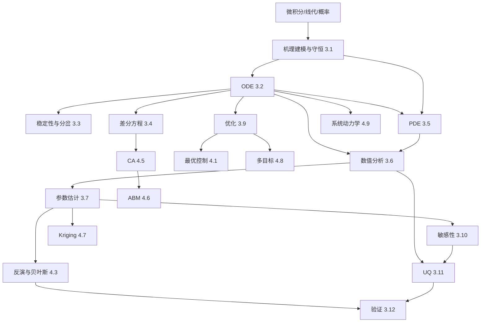

## 这本书为谁写

**读者画像：** 你是团队的**建模手**。比赛时你负责：

- 把题目文字翻译成数学结构（状态、控制、参数、方程、条件）；
- 判断该用哪类模型、为什么用它、它的边界在哪；
- 完成核心推导，说清每一步的物理/数学依据；
- 设计验证方案，判断"结果错了还是模型错了"；
- 把方程、参数、求解方案、验证要求写清楚，交给编程手实现。

| 交付对象 | 你给什么 | 不给他们什么 |
|---|---|---|
| 编程手 | 方程与初边值、参数表（含义/单位/来源）、离散方案、验证清单、输入输出定义 | 不要给"你去想想怎么算" |
| 论文手 | 假设及其理由、模型推导主线、关键结论与区间、适用边界与局限 | 不要替他们写摘要和排版 |
| 数据手 | 需要什么数据、精度要求、缺数据时的替代假设 | 不要把"找数据"整个甩过去 |

---

## 怎么用这本书

**路径一：完整备赛（四周）。** 按第十章的计划走，每周有验收题。适合从现在到比赛还有一个月的情况。

**路径二：查漏补缺（一到两周）。** 先做 1.3 的自评表，找出 2—3 个薄弱项，直接跳到对应章节，只读第 5（变量与参数）、6（推导）、9（局限）、15（常见错误）小节。

**路径三：赛前速查（比赛期间）。** 用 1.4 的优先级总表定位模型，用第六章判断该选哪个，用第七章的诊断表排查"结果不对"。

**每章的固定结构：** 第三、四章的每个模型都按同一套 16 个小节展开，你可以按需跳读，但**推导（6）与参数表（5）不能跳**。

| 小节 | 你要做什么 |
|---|---|
| 1 定义 / 2 核心思想与大白话 | 先建立直觉，再看形式化定义 |
| 3 数学基础 | 缺什么补什么，这一节就是前置清单 |
| 4 基本假设 / 5 变量与参数 | 能说出每条假设被违反的后果；记住单位与物理意义 |
| 6 从基本原理推导核心公式 | 合上书自己推一遍，这是全书最该慢读的部分 |
| 7 求解方法 | 知道解析解与数值解各自何时用、误差多大 |
| 8 适用场景 / 9 局限 / 10 改进 | 能说出"什么时候不能用"以及"改哪一步能救" |
| 11 与其他模型的组合 | 知道它在模型链里接谁、接口是什么 |
| 12 手算算例 | 手算复现，数字必须对得上 |
| 13 最小可运行 MATLAB 示例 | 跑通并做结果检验，不是抄代码 |
| 14 真实美赛 A 题应用 | 看它在真题里如何落地、哪一步最容易错 |
| 15 常见错误 / 16 学习要求 | 对照自查，能否通过验收 |

---

## 符号与排版约定

- 行内公式用 `$...$`，独立公式用 `$$...$$`；全书公式均为**单反斜杠** LaTeX。
- 向量用粗体 $\mathbf{x}$，矩阵用大写 $L$、$A$，转置用 $^{\mathsf T}$。
- 时间导数用点号 $\dot N$，偏导数用 $\partial$。
- 参数用 $\theta$ 或带下标的希腊字母；观测用 $y$，模型预测用 $\hat y$。
- 代码块标注 `matlab`，只给**能独立运行**的最小示例；代码里的注释写数学含义，不写语法解释。
- 单位一律写在符号表或参数表里；公式中不混用单位（例如不要把 mAh 与 W 直接相除）。
**关于真题：** 本书引用的 2019—2026 年 A 题内容，均以题目原文与仓库内 `MCM_A_2020-2026_历年分析报告.md` 为准。凡是原文没有明确给出的数字，书中标注为"假设"或"估计"，不冒充题目条件。

---

## 目录

> **本书分五册。** GitHub 对超过约 512 KB 的 Markdown 不再渲染（只显示源码，页内锚点随之失效），因此按章拆册；每册页首都有"返回总目录"。
>
> - **本册**：开篇、第一章 能力要求与学习路线、第二章 从实际问题到数学模型
> - [第 03 册 · P0 核心必修](MCM_A_备赛学习指南_第03章_P0核心模型.md)（3.1—3.13）
> - [第 04 册 · P1 重点专项](MCM_A_备赛学习指南_第04章_P1重点专项.md)（4.1—4.10）
> - [第 05 册 · P2 选修扩展](MCM_A_备赛学习指南_第05章_P2选修扩展.md)（5.1—5.8）
> - [第 06 册 · 选择比较、工作流、MATLAB、真题、计划、附录](MCM_A_备赛学习指南_第06-10章与附录.md)（第六—十章 + 附录 A—F）

- **[第一章 能力要求与学习路线](#第一章-能力要求与学习路线)**
  - [1.1 先看清楚：八年 A 题到底在考什么](#11-先看清楚八年-a-题到底在考什么)
  - [1.2 建模手的六项能力](#12-建模手的六项能力)
  - [1.3 自评：你现在在哪一格](#13-自评你现在在哪一格)
  - [1.4 全部模型优先级总表](#14-全部模型优先级总表)
  - [1.5 依赖关系：先学什么，后学什么](#15-依赖关系先学什么后学什么)
  - [1.6 三条铁律（比任何模型都重要）](#16-三条铁律比任何模型都重要)
- **[第二章 从实际问题到数学模型](#第二章-从实际问题到数学模型)**
  - [2.1 前 90 分钟：四问与边界](#21-前-90-分钟四问与边界)
  - [2.2 变量提取：状态、控制、输入、输出、参数](#22-变量提取状态控制输入输出参数)
  - [2.3 机理与因果：把描述词翻译成数学结构](#23-机理与因果把描述词翻译成数学结构)
  - [2.4 合理假设：四类假设与写法](#24-合理假设四类假设与写法)
  - [2.5 方程从哪里来：五种来源](#25-方程从哪里来五种来源)
  - [2.6 连续还是离散：四个判据](#26-连续还是离散四个判据)
  - [2.7 线性还是非线性：来源与后果](#27-线性还是非线性来源与后果)
  - [2.8 状态空间表述：把任何动态模型写成标准形](#28-状态空间表述把任何动态模型写成标准形)
  - [2.9 量纲一致性与 Buckingham π](#29-量纲一致性与-buckingham-π)
  - [2.10 初始条件与边界条件](#210-初始条件与边界条件)
  - [2.11 参数的物理意义、量级与无量纲化](#211-参数的物理意义量级与无量纲化)
  - [2.12 模型简化与复杂度控制](#212-模型简化与复杂度控制)
  - [2.13 完整案例 A：2026 电池续航（从文字到方程）](#213-完整案例-a2026-电池续航从文字到方程)
  - [2.14 完整案例 B：2025 楼梯磨损（守恒 + 本构 + 量纲 + 反演）](#214-完整案例-b2025-楼梯磨损守恒--本构--量纲--反演)
  - [2.15 建模过程中的六项即时检验](#215-建模过程中的六项即时检验)
  - [2.16 交底：给编程手的数学规格](#216-交底给编程手的数学规格)
- **[第三章 P0 核心必修](MCM_A_备赛学习指南_第03章_P0核心模型.md#第三章-p0-核心必修)**
  - [3.1 机理建模与守恒定律](MCM_A_备赛学习指南_第03章_P0核心模型.md#31-机理建模与守恒定律)
  - [3.2 状态空间与 ODE](MCM_A_备赛学习指南_第03章_P0核心模型.md#32-状态空间与-ode)
  - [3.3 稳定性、线性化与分岔](MCM_A_备赛学习指南_第03章_P0核心模型.md#33-稳定性线性化与分岔)
  - [3.4 差分方程与离散动态](MCM_A_备赛学习指南_第03章_P0核心模型.md#34-差分方程与离散动态)
  - [3.5 PDE 基础](MCM_A_备赛学习指南_第03章_P0核心模型.md#35-偏微分方程-pde-基础)
  - [3.6 数值计算与数值分析](MCM_A_备赛学习指南_第03章_P0核心模型.md#36-数值计算与数值分析)
  - [3.7 参数估计与非线性拟合](MCM_A_备赛学习指南_第03章_P0核心模型.md#37-参数估计与非线性拟合)
  - [3.8 统计回归与分布建模](MCM_A_备赛学习指南_第03章_P0核心模型.md#38-统计回归与分布建模)
  - [3.9 优化：线性、非线性与整数规划](MCM_A_备赛学习指南_第03章_P0核心模型.md#39-优化线性非线性与整数规划)
  - [3.10 敏感性分析](MCM_A_备赛学习指南_第03章_P0核心模型.md#310-敏感性分析)
  - [3.11 不确定性分析](MCM_A_备赛学习指南_第03章_P0核心模型.md#311-不确定性分析)
  - [3.12 模型验证](MCM_A_备赛学习指南_第03章_P0核心模型.md#312-模型验证)
  - [3.13 量纲分析与相似理论（进阶）](MCM_A_备赛学习指南_第03章_P0核心模型.md#313-量纲分析与相似理论进阶)
- **[第四章 P1 重点专项](MCM_A_备赛学习指南_第04章_P1重点专项.md#第四章-p1-重点专项)**
  - [4.1 最优控制（PMP 与变分）](MCM_A_备赛学习指南_第04章_P1重点专项.md#41-最优控制pmp-与变分)
  - [4.2 动态规划与 MDP](MCM_A_备赛学习指南_第04章_P1重点专项.md#42-动态规划与-mdp)
  - [4.3 参数反演与贝叶斯估计](MCM_A_备赛学习指南_第04章_P1重点专项.md#43-参数反演与贝叶斯估计)
  - [4.4 随机过程与 Monte Carlo](MCM_A_备赛学习指南_第04章_P1重点专项.md#44-随机过程与-monte-carlo)
  - [4.5 元胞自动机（CA）](MCM_A_备赛学习指南_第04章_P1重点专项.md#45-元胞自动机ca)
  - [4.6 主体建模（ABM）](MCM_A_备赛学习指南_第04章_P1重点专项.md#46-主体建模abm)
  - [4.7 空间插值与 Kriging](MCM_A_备赛学习指南_第04章_P1重点专项.md#47-空间插值与-kriging)
  - [4.8 多目标优化与 Pareto](MCM_A_备赛学习指南_第04章_P1重点专项.md#48-多目标优化与-pareto)
  - [4.9 系统动力学](MCM_A_备赛学习指南_第04章_P1重点专项.md#49-系统动力学)
  - [4.10 时间序列](MCM_A_备赛学习指南_第04章_P1重点专项.md#410-时间序列)
- **[第五章 P2 选修扩展](MCM_A_备赛学习指南_第05章_P2选修扩展.md#第五章-p2-选修扩展)**
  - [5.1 预测与评价类](MCM_A_备赛学习指南_第05章_P2选修扩展.md#51-预测与评价类)
  - [5.2 种群、传播与寿命类](MCM_A_备赛学习指南_第05章_P2选修扩展.md#52-种群传播与寿命类)
  - [5.3 决策、网络与混合系统](MCM_A_备赛学习指南_第05章_P2选修扩展.md#53-决策网络与混合系统)
  - [5.4 统计、降维与状态估计](MCM_A_备赛学习指南_第05章_P2选修扩展.md#54-统计降维与状态估计)
  - [5.5 随机与计算类](MCM_A_备赛学习指南_第05章_P2选修扩展.md#55-随机与计算类)
  - [5.6 边缘与前沿（知道边界即可）](MCM_A_备赛学习指南_第05章_P2选修扩展.md#56-边缘与前沿知道边界即可)
  - [5.7 P2 深做路线：21 项各有一条可执行的深入路径](MCM_A_备赛学习指南_第05章_P2选修扩展.md#57-p2-深做路线21-项各有一条可执行的深入路径)
  - [5.8 五个高价值项的深做示范](MCM_A_备赛学习指南_第05章_P2选修扩展.md#58-五个高价值项的深做示范)
- **[第六章 模型选择、比较、组合与改进](MCM_A_备赛学习指南_第06-10章与附录.md#第六章-模型选择比较组合与改进)**
  - [6.1 问题特征 → 候选模型](MCM_A_备赛学习指南_第06-10章与附录.md#61-问题特征--候选模型)
  - [6.2 八组横向比较](MCM_A_备赛学习指南_第06-10章与附录.md#62-八组横向比较)
  - [6.3 单模型够不够：三条判据](MCM_A_备赛学习指南_第06-10章与附录.md#63-单模型够不够三条判据)
  - [6.4 六个组合框架（附数学接口）](MCM_A_备赛学习指南_第06-10章与附录.md#64-六个组合框架附数学接口)
  - [6.5 改进的九种手法](MCM_A_备赛学习指南_第06-10章与附录.md#65-改进的九种手法)
  - [6.6 六种反模式](MCM_A_备赛学习指南_第06-10章与附录.md#66-六种反模式)
- **[第七章 数值、参数估计、验证与不确定性：工作流](MCM_A_备赛学习指南_第06-10章与附录.md#第七章-数值参数估计验证与不确定性工作流)**
  - [7.1 七步主线](MCM_A_备赛学习指南_第06-10章与附录.md#71-七步主线)
  - [7.2 数值诊断：症状 → 原因 → 对策](MCM_A_备赛学习指南_第06-10章与附录.md#72-数值诊断症状--原因--对策)
  - [7.3 参数估计失败诊断](MCM_A_备赛学习指南_第06-10章与附录.md#73-参数估计失败诊断)
  - [7.4 把验证写进交底](MCM_A_备赛学习指南_第06-10章与附录.md#74-把验证写进交底)
  - [7.5 敏感性 → UQ 的决策流程](MCM_A_备赛学习指南_第06-10章与附录.md#75-敏感性--uq-的决策流程)
  - [7.6 参数不确定性 vs 机制不确定性（最容易犯的错）](MCM_A_备赛学习指南_第06-10章与附录.md#76-参数不确定性-vs-机制不确定性最容易犯的错)
  - [7.7 一页纸"可信度声明"模板](MCM_A_备赛学习指南_第06-10章与附录.md#77-一页纸可信度声明模板)
- **[第八章 MATLAB 最小实例库](MCM_A_备赛学习指南_第06-10章与附录.md#第八章-matlab-最小实例库)**
  - [8.1 函数速查（按用途）](MCM_A_备赛学习指南_第06-10章与附录.md#81-函数速查按用途)
  - [8.2 脚本 A：ODE + 事件 + 能量闭合（2026 电池）](MCM_A_备赛学习指南_第06-10章与附录.md#82-脚本-aode--事件--能量闭合2026-电池)
  - [8.3 脚本 B：参数估计 + 置信区间 + 预测区间](MCM_A_备赛学习指南_第06-10章与附录.md#83-脚本-b参数估计--置信区间--预测区间)
  - [8.4 脚本 C：Sobol + Monte Carlo 一体](MCM_A_备赛学习指南_第06-10章与附录.md#84-脚本-csobol--monte-carlo-一体)
  - [8.5 常见报错与修法（都踩过）](MCM_A_备赛学习指南_第06-10章与附录.md#85-常见报错与修法都踩过)
- **[第九章 2019—2026 真题建模拆解](MCM_A_备赛学习指南_第06-10章与附录.md#第九章-20192026-真题建模拆解)**
  - [9.1 2019：Game of Ecology（三条龙）](MCM_A_备赛学习指南_第06-10章与附录.md#91-2019game-of-ecology三条龙)
  - [9.2 2020：Hook Line and Sinker（变暖海域的渔业公司）](MCM_A_备赛学习指南_第06-10章与附录.md#92-2020hook-line-and-sinker变暖海域的渔业公司)
  - [9.3 2021：Fungi（真菌性状与分解）](MCM_A_备赛学习指南_第06-10章与附录.md#93-2021fungi真菌性状与分解)
  - [9.4 2022：Power Profile of a Cyclist（功率分配）](MCM_A_备赛学习指南_第06-10章与附录.md#94-2022power-profile-of-a-cyclist功率分配)
  - [9.5 2023：Drought-Stricken Plant Communities（干旱与群落）](MCM_A_备赛学习指南_第06-10章与附录.md#95-2023drought-stricken-plant-communities干旱与群落)
  - [9.6 2024：Resource Availability and Sex Ratios（七鳃鳗）](MCM_A_备赛学习指南_第06-10章与附录.md#96-2024resource-availability-and-sex-ratios七鳃鳗)
  - [9.7 2025：Testing Time（楼梯磨损反推）](MCM_A_备赛学习指南_第06-10章与附录.md#97-2025testing-time楼梯磨损反推)
  - [9.8 2026：Modeling Smartphone Battery Drain（电池续航）](MCM_A_备赛学习指南_第06-10章与附录.md#98-2026modeling-smartphone-battery-drain电池续航)
  - [9.9 跨年复用：八道题其实在考同一组能力](MCM_A_备赛学习指南_第06-10章与附录.md#99-跨年复用八道题其实在考同一组能力)
- **[第十章 一个月（四周）计划与验收](MCM_A_备赛学习指南_第06-10章与附录.md#第十章-一个月四周计划与验收)**
  - [10.1 时间预算：先算账，再排表](MCM_A_备赛学习指南_第06-10章与附录.md#101-时间预算先算账再排表)
  - [10.2 第 1 周：机理建模与动态系统](MCM_A_备赛学习指南_第06-10章与附录.md#102-第-1-周机理建模与动态系统)
  - [10.3 第 2 周：连续系统数值与优化](MCM_A_备赛学习指南_第06-10章与附录.md#103-第-2-周连续系统数值与优化)
  - [10.4 第 3 周：专项与改进](MCM_A_备赛学习指南_第06-10章与附录.md#104-第-3-周专项与改进)
  - [10.5 第 4 周：真题实战与复盘](MCM_A_备赛学习指南_第06-10章与附录.md#105-第-4-周真题实战与复盘)
  - [10.6 每日节奏模板（6 小时版）](MCM_A_备赛学习指南_第06-10章与附录.md#106-每日节奏模板6-小时版)
  - [10.7 每周验收（可观测，不靠感觉）](MCM_A_备赛学习指南_第06-10章与附录.md#107-每周验收可观测不靠感觉)
  - [10.8 进度落后时怎么砍（按优先级砍，不按章节砍）](MCM_A_备赛学习指南_第06-10章与附录.md#108-进度落后时怎么砍按优先级砍不按章节砍)
- **[附录 A 符号总表](MCM_A_备赛学习指南_第06-10章与附录.md#附录-a-符号总表)**
- **[附录 B 核心公式速查](MCM_A_备赛学习指南_第06-10章与附录.md#附录-b-核心公式速查)**
- **[附录 C MATLAB 函数索引（建模手视角）](MCM_A_备赛学习指南_第06-10章与附录.md#附录-c-matlab-函数索引建模手视角)**
- **[附录 D 教材与可靠资料](MCM_A_备赛学习指南_第06-10章与附录.md#附录-d-教材与可靠资料)**
- **[附录 E 建模交底模板（可直接复制）](MCM_A_备赛学习指南_第06-10章与附录.md#附录-e-建模交底模板可直接复制)**
- **[附录 F 原文档 36 个模型去向索引](MCM_A_备赛学习指南_第06-10章与附录.md#附录-f-原文档-36-个模型去向索引)**

---

## 第一章 能力要求与学习路线

### 1.1 先看清楚：八年 A 题到底在考什么

把 2019—2026 的 A 题排在一起，会发现它们的外壳（龙、渔业、真菌、自行车、植物、七鳃鳗、楼梯、电池）完全不同，但**数学内核只有五类**。

| 年份 | 题目 | 数学内核 | 建模手必须交付的东西 |
|---|---|---|---|
| 2019 | Game of Ecology | 能量收支 + 生长 + 面积换算 | 代谢率标度律、能量平衡方程、面积估算 |
| 2020 | Hook Line and Sinker | 资源动力学 + 空间迁移 + 经济优化 | 温度相关的 $r(T),K(T)$、捕捞生产函数、目标函数 |
| 2021 | Fungi | 反应速率 + 多物种竞争 + 环境情景 | 分解速率 $k(\text{性状};W,T)$、竞争项、情景设置 |
| 2022 | Power Profile of a Cyclist | 质点动力学 + 疲劳状态 + 最优控制 | 功率—速度 ODE、疲劳演化、最优功率分配 |
| 2023 | Drought-Stricken Plant Communities | 随机降雨 + 土壤水 + 群落竞争 | 干旱随机过程、水分平衡、存续概率 |
| 2024 | Resource Availability and Sex Ratios | 性别比函数 + 结构种群 + 反馈 | $p(g)$ 的形式与依据、带性别结构的种群方程 |
| 2025 | Testing Time | 磨损正模型 + 反问题 + 可辨识性 | Archard 型方程、π 群、不可辨识的证明 |
| 2026 | Smartphone Battery Drain | 电荷守恒 + 等效电路 + 热 + UQ | SOC 方程、OCV 关系、事件、置信区间 |

**规律一：** 八道题里有六道要求"随时间演化"（ODE/PDE/差分），两道要求"由结果推原因"（反演）。

**规律二：** 越是近年的题，越强调"**机理 + 不确定性**"，而不是"拟合一条曲线"。2026 年题目明确排斥纯数据拟合与黑箱机器学习——这是方向性信号。

**规律三：** 每道题都有一个"**必须解释清楚的一个数**"：2019 是龙的卡路里需求，2022 是完赛时间，2025 是每天使用人次，2026 是续航时间。**你的模型必须能把这个数拆成"机制 × 参数"的形式**，否则别人无法判断它是否可信。

### 1.2 建模手的六项能力

| 能力 | 具体表现 | 不合格的表现 | 对应章节 |
|---|---|---|---|
| **问题分析** | 能说清每小问要的输出形式、系统边界、时间尺度 | 读完题就开始套模型 | 2.1—2.4 |
| **机理提取** | 能从题面文字找到守恒量、因果链、反馈环 | 只会说"用回归拟合" | 2.5—2.8, 3.1 |
| **假设管理** | 每条假设都有理由，且知道被违反的后果 | 假设写成"为简化起见" | 2.4, 7.6 |
| **建模推导** | 能从基本原理推出方程，量纲自洽 | 直接抄一个公式，不知来源 | 3.1—3.9 |
| **模型选择** | 能给出候选模型、比较依据、组合理由 | 会什么用什么 | 第六章 |
| **验证与 UQ** | 能设计检验、给出区间、说清边界 | 只报一个数，不给误差 | 3.10—3.12, 第七章 |

### 1.3 自评：你现在在哪一格

给每项打 1—5 分（1 = 完全不会，5 = 能独立完成并解释），总分 30。

| 能力 | 自评分 | 判断标准（5 分） |
|---|---|---|
| 问题分析 | | 能在 30 分钟内写出四问表与边界 |
| 机理提取 | | 能对陌生系统列出守恒量与反馈环 |
| 假设管理 | | 能说出每条假设被违反后的定性后果 |
| 建模推导 | | 能从守恒律推出 ODE/PDE 并检查量纲 |
| 模型选择 | | 能给出 2—3 个候选并说明取舍 |
| 验证与 UQ | | 能设计 5 类检验并给出参数区间 |

**读法：** 低于 18 分，按第十章完整走；18—24 分，重点补最低的两项；高于 24 分，直接做第九章真题 + 第六章选择训练。

### 1.4 全部模型优先级总表

**分级标准：**

- **P0 核心必修**：必须掌握原理、核心公式推导、适用条件和基本建模应用。不会，就无法独立完成一道 A 题。
- **P1 重点专项**：掌握原理、数学表达、适用条件和典型应用，能独立选择使用。遇到对应题型必须能上手。
- **P2 选修扩展**：了解思想、条件和局限，遇到再用。不占备赛计划学时。

**关于"学时"：** 指**从零到能独立使用**所需的净学习时间（含推导与最小实现），不含复习。

#### P0：核心必修（13 项，约 68 小时）

| 模型 | 优先级 | 理论难度 | 学习时间 | 前置知识 | 掌握要求 | A 题适用场景 |
|---|---|---|---|---|---|---|
| 机理建模与守恒定律 | P0 | ★★★ | 7 h | 微积分、基础物理 | 从守恒律推出方程，写清每个收支项 | 2019 能量、2022 功率、2026 电荷 |
| 状态空间与 ODE | P0 | ★★★ | 9 h | 微积分、线性代数 | 建模、解析解、`ode45`、事件 | 2020 渔业、2022 骑行、2026 电池 |
| 稳定性与分岔 | P0 | ★★★ | 3 h | ODE、特征值 | 求平衡点、判稳、识别临界参数 | 2024 性别比、2019 生态平衡 |
| 差分方程与离散动态 | P0 | ★★☆ | 3 h | 迭代、矩阵 | 建立递推、判稳、识别混沌 | 2021 真菌、2024 世代 |
| 偏微分方程（PDE）基础 | P0 | ★★★★ | 7 h | ODE、傅里叶级数 | 三类方程判别、定解条件、离散化 | 2021 分解、2023 土壤水、2025 磨损场 |
| 数值计算与数值分析 | P0 | ★★★ | 7 h | 微积分、线性代数 | 误差阶、稳定性、收敛性判断 | 所有需要数值求解的题 |
| 参数估计与非线性拟合 | P0 | ★★★ | 7 h | 3.8、线性代数 | 最小二乘、CI、可辨识性 | 2020、2024、2026 |
| 概率统计与回归 | P0 | ★★☆ | 5 h | 概率论 | 选分布、诊断残差、避免外推 | 2019、2024 |
| 线性与非线性优化 | P0 | ★★★ | 7 h | 线性代数、微积分 | 建模、KKT、影子价格解读 | 2020 经营、2022 功率分配 |
| 敏感性分析 | P0 | ★★★ | 4 h | 统计、回归 | 局部弹性、全局 Sobol | 全部（结论稳健性） |
| 不确定性分析（UQ） | P0 | ★★★ | 4 h | 统计、MC | 区间传播、MC、区间解释 | 2026、2020 |
| 模型验证 | P0 | ★★☆ | 3 h | 全部前置 | 设计 5 类检验并判断通过与否 | 全部 |
| 量纲分析与相似（进阶） | P0 | ★★ | 2 h | 2.9 | π 群用于缩放、实验设计、识别不可辨识 | 2019 巨兽、2025 磨损 |

#### P1：重点专项（10 项，约 49 小时）

| 模型 | 优先级 | 理论难度 | 学习时间 | 前置知识 | 掌握要求 | A 题适用场景 |
|---|---|---|---|---|---|---|
| 最优控制（PMP） | P1 | ★★★★ | 6 h | 3.2、3.9、变分 | 写哈密顿、解必要条件、解释协态 | 2022 功率分配 |
| 动态规划 / MDP | P1 | ★★★ | 5 h | 3.4、概率 | Bellman 方程、值迭代 | 2022 分段决策、资源分配 |
| 参数反演与贝叶斯估计 | P1 | ★★★★ | 7 h | 3.7、概率 | 正模型验证、可辨识、后验 | 2025 磨损反演、2020 参数 |
| 随机过程与 Monte Carlo | P1 | ★★★ | 6 h | 概率、3.11 | 随机输入建模、MC 收敛判断 | 2023 干旱、2026 情景 |
| 元胞自动机（CA） | P1 | ★★★ | 4 h | 3.4、编程概念 | 规则设计、网格无关性检验 | 2021 菌丝、2023 群落 |
| 主体建模（ABM） | P1 | ★★★★ | 5 h | 概率、CA | 规则设计、涌现、多种子 | 2025 人流、2020 船队 |
| 空间插值与 Kriging | P1 | ★★★ | 4 h | 统计、线性代数 | 变异函数、预测方差、LOOCV | 2025 磨损场、2023 土壤 |
| 多目标优化与 Pareto | P1 | ★★★ | 4 h | 3.9 | 支配关系、前沿、取舍说明 | 2019 生态 vs 经济、2020 |
| 系统动力学 | P1 | ★★☆ | 3 h | 3.2、反馈 | 存量流量、回路极性、延迟 | 2020 渔业政策、2019 生态 |
| 时间序列 | P1 | ★★★ | 5 h | 3.8 | 平稳性、ARIMA、回测 | 作输入或基线，不作主模型 |

#### P2：选修扩展（21 项，每项 2—3 小时，不占计划）

| 模型 | 优先级 | 理论难度 | 学习时间 | 前置知识 | 掌握要求 | A 题适用场景 |
|---|---|---|---|---|---|---|
| GM(1,1) | P2 | ★★ | 3 h | 最小二乘 | 知道适用条件（短序列、指数趋势） | 数据极少的粗预测 |
| AHP / TOPSIS / 模糊评价 | P2 | ★★ | 3 h | 线性代数 | 知道权重主观性 | 方案排序（非机理题） |
| 指数平滑 / Holt–Winters | P2 | ★★ | 2 h | 统计 | 知道趋势/季节项含义 | 短期预测基线 |
| 机器学习（基线用） | P2 | ★★★ | 3 h | 统计 | 只作基线/代理，不作主模型 | 2026 明确反对黑箱 |
| SIR / SEIR | P2 | ★★ | 3 h | ODE | 知道 $R_0$ 与最终规模 | 传播类（A 题少直接考） |
| Leslie 矩阵 | P2 | ★★ | 2 h | 线代 | 谱半径 = 长期增长率 | 年龄结构种群 |
| Ricker / Beverton–Holt | P2 | ★★ | 2 h | 差分 | 知道过冲与混沌 | 单种群离散 |
| Weibull 生存分析 | P2 | ★★★ | 3 h | 概率 | 风险函数形状、删失 | 寿命/失效数据 |
| 博弈论（Nash/演化） | P2 | ★★★ | 3 h | 优化 | 最佳响应、均衡存在性 | 多方决策 |
| 排队论 | P2 | ★★ | 2 h | 概率 | $L,W$ 公式与 $\rho<1$ | 服务系统（弱相关） |
| 图论 / 网络流 | P2 | ★★ | 3 h | 离散数学 | 最短路、最大流 | 路径/分配 |
| 阈值 / 分段 / 混合动态 | P2 | ★★★ | 3 h | ODE | 事件切换、Zeno | 2026 低电量保护 |
| 鲁棒 / 随机规划 | P2 | ★★★ | 3 h | 优化 | min-max、机会约束 | 参数不确定下的决策 |
| 聚类（K-means/GMM） | P2 | ★★ | 2 h | 统计 | 标准化、K 选择 | 分组/分区 |
| 分层贝叶斯 | P2 | ★★★★ | 3 h | 贝叶斯 | 部分汇聚、收缩 | 多组数据共享 |
| PCA / POD | P2 | ★★★ | 2 h | 线代 | 方差解释、降维误差 | 高维数据/场 |
| Kalman / 数据同化 | P2 | ★★★ | 3 h | 状态空间 | 预测—校正、$Q/R$ | 在线估计 |
| SDE | P2 | ★★★★ | 3 h | 概率 | Itô 形式、Euler–Maruyama | 连续随机扰动 |
| 元启发式（GA/SA/PSO） | P2 | ★★ | 2 h | 优化 | 只作备用，必须与基线比 | 非凸/离散 |
| 代理模型 / 贝叶斯优化 | P2 | ★★★ | 3 h | 统计 | GP、EI、误差验证 | 仿真昂贵时 |
| 边缘专题（HMM/EVT/Copula/PINN/ABC） | P2 | ★★★★ | 2 h | — | 知道"什么时候值得查" | 特定题型 |

**为什么这样分级（四条说明）：**

1. **PDE 必须是 P0。** 2021（分解场）、2023（土壤水）、2025（磨损场）三道题的空间分布就是结论本身。不会 PDE，这三题只能给"平均深度"这种一眼被看穿的结果。原文把 PDE 放在 P1 是分级错误。
2. **最优控制与参数反演必须是 P1 且给足学时。** 2022 的核心是"功率怎么分配"，本质是最优控制；2025 的核心是"由磨损推历史"，本质是反问题。原文把两者标为"选学"，与真题权重不符。
3. **排队论、图论、SIR、评价类降为 P2。** 不是因为它们没用，而是因为它们**在 A 题里通常是工具而非主线**：需要时查公式即可，不需要为它投入 5 小时以上。原文把它们放进 P1，挤占了 PDE 和反演的学时。
4. **不把所有高级模型都放低优先级，也不全划 P0。** 判据是"**这道题的主结论是否依赖它**"：依赖 → P0/P1；只是辅助 → P2。

### 1.5 依赖关系：先学什么，后学什么



**读法：** 箭头是"必须先学"。例如 4.3 反演依赖 3.7 参数估计；如果你跳过 3.7 直接看 4.3，会看不懂"为什么需要剖面似然"。

### 1.6 三条铁律（比任何模型都重要）

**铁律一：先问"这个数从哪来"，再问"用什么模型"。**
每一个要交付的数字，都必须能追溯到"机制 × 参数"。如果一个数只能靠拟合得到，你就要准备好回答："那你的机理是什么？"

**铁律二：模型复杂度由"需要解释的现象"决定，不由"你会什么"决定。**
多一个状态、多一个维度，就要多一组参数、多一类验证。**能用一个状态说清的事，不要用三个。**

**铁律三：任何结论都要带边界。**
"续航 7.4 小时"是不合格的；"在 25 °C、屏幕中等亮度、电池健康 100% 的条件下，续航 7.4 小时，90% 区间 [6.9, 7.9]"才是合格的。

---

## 第二章 从实际问题到数学模型

这一章是全书的枢纽。学完它，你应该能在没有现成模型可套的情况下，把一个陌生系统拆成"状态—机制—方程—条件—参数"五件事。

### 2.1 前 90 分钟：四问与边界

拿到题，先不要想模型。用一张纸回答四个问题（这是原文 5.4 节的"四问拆题法"，此处扩成正式方法）：

| 问 | 要写出什么 | 决定什么 |
|---|---|---|
| **问输出** | 每一小问最终交付什么形式：曲线、最优策略、排序、概率分布、反演出的历史、还是判断？ | 模型类型（预测/优化/评价/反演） |
| **问状态** | 系统里"什么在变、什么会被记住"？列 3—6 个，写符号、单位、合理范围 | 方程的阶数与结构 |
| **问机制** | 状态之间靠什么联系：守恒、因果、接触、竞争、反馈、优化目标 | 方程的具体形式 |
| **问证据** | 有哪些数据、文献、情景？哪些参数能估、哪些只能假设？用什么独立证据验证？ | 参数来源与可信度 |

**边界（scope）同样重要。** 每道题都有"题目要求"和"你没被要求但忍不住想算"的部分。把边界写成三行：

1. **系统边界**：哪些东西算"内部"，哪些当作外部输入（如 2026 电池题：手机内部的热源算内部，环境温度算外部）。
2. **时间边界**：仿真多久？稳态还是瞬态？（2020 是 50 年经营，2022 是单场比赛，2026 是单次充电到耗尽。）
3. **精度边界**：结论要精确到什么程度？粗模型 + 区间，往往优于精模型 + 单点。

**输出形式直接决定模型类型**，这是最快的一条选型捷径：

| 输出 | 首选 | 次选 |
|---|---|---|
| 一条随时间变化的曲线 | ODE / 差分 | 时间序列（数据驱动） |
| 空间分布图 | PDE / 插值 / CA | 空间统计 |
| 一个数（容量、面积、寿命） | 代数方程 / 积分 / 优化 | 仿真 + 平均 |
| 一个策略/时间表 | 优化 / 最优控制 / DP | 规则 + 仿真比较 |
| 一个排序 | 多指标评价 | 多目标 + 权重 |
| 一个概率/区间 | 随机模型 + MC | 解析近似 |
| 一段历史（参数/使用强度） | 反演 + 可辨识性分析 | 回归 |

### 2.2 变量提取：状态、控制、输入、输出、参数

建模最常见的低级错误，是把五类量混成一锅。判据如下：

| 类型 | 判据 | 数学位置 | 例子（2026 电池） |
|---|---|---|---|
| **状态** $x$ | 有积累/记忆，由微分或差分方程决定；给定初值后由方程演化 | $x'=f(\cdot)$ 左侧 | SOC、温度、SOH |
| **控制** $u$ | 人能设计/选择的量，可分段常数、可连续 | $f$ 的参数 | 充电功率、是否开省电模式 |
| **输入/扰动** $w$ | 人不能选、但影响系统的外部量 | $f$ 的参数 | 环境温度、用户负载、信号强度 |
| **输出** $y$ | 能被观测/测量的量，通常是状态的函数加噪声 | $y=g(x,u)+v$ | 端电压、电流、表面温度 |
| **参数** $\theta$ | 在本次建模时间尺度内视为常数，但数值未知或需标定 | $f$ 的系数 | 内阻 $R$、容量 $Q$、热容 $C_{th}$ |

**三个高频混淆：**

1. **把参数当状态。** 电池内阻随老化缓慢变化，但在一场比赛的时间尺度内它是常数；若你让它随时间变，就必须再写一个"老化方程"，否则方程不可解。判断标准：**它有没有自己的演化规律？** 没有就是参数。
2. **把输入当控制。** 用户负载不是你能设计的，它是扰动；如果你把它当控制去"优化"，结论会变成"建议用户别用手机"，毫无意义。
3. **把输出当状态。** 端电压是输出，不是状态；状态是 SOC。用电压反推 SOC 是"观测"问题，需要观测方程和噪声模型。

**变量表的写法**（每个模型都必须有，交底时直接给编程手）：

| 符号 | 名称 | 类型 | 单位 | 典型值/范围 | 来源 |
|---|---|---|---|---|---|
| $s$ | 荷电状态 SOC | 状态 | — | 0—1 | 定义 |
| $T$ | 电池温度 | 状态 | °C | 20—45 | 测量 |
| $P$ | 负载功率 | 输入 | W | 1—10 | 情景设定 |
| $R$ | 内阻 | 参数 | Ω | 0.05—0.2 | 数据手册/辨识 |
| $Q$ | 额定能量 | 参数 | Wh | 14.8 | 标称 4000 mAh × 3.7 V |

### 2.3 机理与因果：把描述词翻译成数学结构

题目里的自然语言，几乎都能映射到有限的几种数学结构。这张表要背下来：

| 题面词 | 数学结构 | 写法 |
|---|---|---|
| 积累、存量、剩余、总量 | 积分/守恒 | $\dfrac{dX}{dt}=\text{流入}-\text{流出}$ |
| 流动、通量、迁移、扩散 | 通量 + 散度 | $\dfrac{\partial c}{\partial t}=-\nabla\cdot\mathbf{J}+S$ |
| 驱动、梯度、势差 | 本构关系 | $\mathbf{J}=-D\nabla c$ |
| 反应、分解、转化、消耗 | 源汇项 | $S=-kc$ 或 $S=\mu c(1-c/K)$ |
| 竞争、捕食、耦合 | 双线性耦合项 | $-acb$ |
| 延迟、滞后、孕育期 | 时滞/储池 | $x'=f(x(t-\tau))$ 或级联一阶环节 |
| 反馈、自我强化/抑制 | 回路符号 | $f'$ 的符号与回路极性 |
| 阈值、临界、崩溃 | 分段/鞍结分岔 | $f$ 中含 $x-x_c$ 的符号函数 |
| 饱和、上限、容量 | 饱和函数 | $1-x/K$，$\tanh$，$\min$ |
| 个体差异、异质 | 分布/分层 | $\theta_i\sim p(\theta)$ |
| 随机、波动、不确定 | 随机项 | $\sigma\,dW$ 或随机参数 |

**因果 vs 相关（这是 A 题最容易翻车的地方）：**

- 2024 的"食物少→雄性多"是**可塑性响应**，不是"雄性多导致食物少"。方向搞反，整篇结论作废。
- 判断因果的三条实用标准：**时间先后**（原因在前）、**机制可写**（能写出中间步骤）、**干预可检验**（改变原因，结果应改变）。
- 如果只能观测到相关、写不出机制，就老老实实做"经验关系 + 外推警告"，不要假装它是机理模型。

### 2.4 合理假设：四类假设与写法

假设不是"为了简化而简化"，而是**明确声明你在哪里切断了现实**。每条假设写四栏：

| 假设 | 依据 | 违反后果 | 可否检验/补救 |
|---|---|---|---|
| 电池内部温度均匀 | Biot 数小，单体尺寸小 | 高温时低估局部衰减 | 加集总参数对比/多点测温 |
| 内阻不随 SOC 变化 | 平台区近似 | 低 SOC 时电压误差增大 | 分段常数或 $R(s)$ |
| 用户负载分段常数 | 使用情景离散化 | 快速波动时误差大 | 提高分段数做收敛检验 |
| 磨损系数 $K$ 为常数 | 材料均一、无润滑 | 局部材料差异导致偏差 | 分区标定 + 敏感性 |

**四类假设，缺一类就会漏：**

1. **尺度假设**：空间是否均匀（0D/1D/2D/3D）、时间是否可分尺度（准稳态）。
2. **结构假设**：方程的函数形式（线性/非线性、一阶/二阶、是否含时滞）。
3. **参数假设**：参数是否常数、是否已知、分布形式。
4. **随机性假设**：噪声是机制的一部分，还是观测误差？这两者的数学处理完全不同。

**写法要求：** 每条假设必须能回答"如果它不成立，我的哪个结论会变、往哪个方向变"。答不上来的假设，说明你还没想清楚，删掉或改写。

### 2.5 方程从哪里来：五种来源

这是"文字→方程"的核心。五种来源按可靠性排序：

#### 2.5.1 守恒定律（最可靠）

**质量守恒（控制体形式）：**

$$
\frac{d}{dt}\int_{\Omega}\rho\,dV=-\oint_{\partial\Omega}\rho\,\mathbf{v}\cdot\mathbf{n}\,dA+\int_{\Omega}S\,dV .
$$

左边是控制体内质量变化率，右边第一项是净流出（$\mathbf{n}$ 为外法向），第二项是源。用散度定理化为局部形式：

$$
\frac{\partial \rho}{\partial t}+\nabla\cdot(\rho\mathbf{v})=S .
$$

对浓度 $c$（单位体积的量）与通量 $\mathbf{J}$：

$$
\frac{\partial c}{\partial t}+\nabla\cdot\mathbf{J}=S .
$$

一维、$S=0$ 时就是我们最熟的 $\partial_t c+\partial_x J=0$。**所有"守恒型"方程都长这样**，区别只在 $\mathbf{J}$ 怎么来。

**用法示例（2021 枯落物分解）：** 把"枯落物"看成一种物质，分解是汇：$\partial_t L=-\nabla\cdot\mathbf{J}-k(T,M)L$，其中 $k$ 依赖温湿度、$M$ 是水分。你不需要"发明"方程，只需要说清"什么在守恒、汇是什么"。

#### 2.5.2 能量守恒

对控制体（热力学第一定律，忽略动能与势能变化）：

$$
\frac{dE}{dt}=\dot Q-\dot W+\sum \dot m_{\text{in}}h_{\text{in}}-\sum \dot m_{\text{out}}h_{\text{out}} .
$$

对质点/刚体的机械能：

$$
\frac{d}{dt}\left(\frac12 mv^2+mgz\right)=P_{\text{drive}}-P_{\text{diss}} .
$$

**用法示例（2022 骑行）：** 车手做的功一部分变成重力势能，一部分被阻力耗散：

$$
P_{\text{eff}}=v\left(mg\sin\theta+C_r mg\cos\theta+\tfrac12\rho C_d A v^2\right).
$$

这条式子就是 2022 的"能量预算"，后面加疲劳、加风向都只是改它。

#### 2.5.3 动量守恒

$$
\sum\mathbf{F}=\frac{d}{dt}(m\mathbf{v}) .
$$

流体情形即 Navier–Stokes 的来源：$\rho(\partial_t\mathbf{u}+\mathbf{u}\cdot\nabla\mathbf{u})=-\nabla p+\mu\nabla^2\mathbf{u}+\mathbf{f}$。A 题极少要求解 N–S，但**知道它从哪来**，你才敢用"阻力 $\propto v^2$"这类简化，并说清忽略了什么（黏性、压缩性、湍流）。

#### 2.5.4 本构关系（把通量变成梯度）

守恒方程本身不封闭：$\mathbf{J}$ 未知。必须补一条"物质如何响应梯度"的关系：

| 本构 | 表达式 | 适用 |
|---|---|---|
| Fourier 导热 | $\mathbf{q}=-k\nabla T$ | 固体/静止流体导热 |
| Fick 扩散 | $\mathbf{J}=-D\nabla c$ | 稀溶液、分子扩散 |
| Newton 黏性 | $\tau=\mu\dfrac{du}{dy}$ | 牛顿流体 |
| Ohm 定律 | $I=\dfrac{V}{R}$ | 电路 |
| Archard 磨损 | $V=\dfrac{K W s}{H}$ | 磨粒磨损（2025 核心） |
| Darcy 渗流 | $\mathbf{q}=-\dfrac{k}{\mu}\nabla p$ | 多孔介质（土壤水） |

**本构是"经验 + 物理"的混合体，必须给出适用范围。** 比如 Archard 律假定磨损与载荷、滑动距离成正比、与硬度成反比，忽略第三体（磨屑）与润滑；超出这个范围（如严重塑性变形）就不成立。

#### 2.5.5 经验/统计规律（最后的选择）

当机制写不出来，只能用数据关系：阈值型（$\max(0,x-x_c)$）、幂律（$y=ax^b$）、饱和型（Michaelis–Menten、Hill）、异速生长（$y=ax^{3/4}$）。

**使用纪律：** 只能内插，不能外推；必须给参数的置信区间；必须说明"这是现象学关系，不是机理"。2024 的"生长速率→性别比"关系就属于此类，题目给的 78%/56% 是两端锚点，中间的函数形式是你的建模选择——**不同选择必须做敏感性分析**。

#### 2.5.6 平衡/优化原理

当系统"趋于某个最优状态"时，可以用变分或优化代替动力学：

- 光学/力学的最小作用量原理；
- 热力学的自由能最小；
- 经济/行为的最小成本、最大收益；
- 博弈的 Nash 均衡、演化稳定策略。

**代价：** 你假定系统"已经或正在到达最优"，这在生态、工程里常常不成立。用它之前必须回答："这个系统凭什么最优？"

### 2.6 连续还是离散：四个判据

| 判据 | 连续时间（ODE/PDE） | 离散（差分/CA/事件） |
|---|---|---|
| **时间尺度** | 事件远多于观测，可近似连续 | 一年一次繁殖、按班次/批次更新 |
| **个体** | 数量大，可视为密度 | 个体少且异质（ABM） |
| **机制** | 速率型（每秒多少） | 计数型（每年多少只） |
| **数据** | 高频观测 | 只有年度/批次数据 |

**两条不同的"离散化"，不要混：**

1. **数值离散**：真实模型是连续的，为了求解把它离散（Euler、RK、有限差分）。步长是数值参数，应做收敛检验。
2. **本质离散**：真实过程就是离散的（一年一代、一次事件）。步长是物理参数，不能随意减小。

**典型误判：** 把年度繁殖数据硬套连续 Logistic，会算出"每年 0.3 只"这种非整数中间量，而且低估过度补偿导致的振荡。正确做法是 Ricker/Beverton–Holt 差分（见 P0-4）。

### 2.7 线性还是非线性：来源与后果

**非线性从哪来（A 题四大来源）：**

1. **本构非线性**：辐射换热 $T^4$、阻力 $v^2$、Archard 中的接触面积随载荷变化。
2. **耦合乘积**：捕食 $acb$、感染 $\beta SI$、人口 $\times$ 人均。
3. **饱和**：$1-N/K$、$\tanh$、Michaelis–Menten。
4. **阈值/分段**：关机、保护、切换。

**后果（必须在论文里承认）：**

- 叠加原理失效：不能把两个解相加；
- 可能出现多平衡点、分岔、混沌（Ricker 就是例子）；
- 优化变成非凸，局部最优不等于全局最优；
- 参数估计的目标函数可能多峰。

**处理手法：**

| 手法 | 何时用 | 代价 |
|---|---|---|
| 在工作点线性化 | 只关心小扰动/稳定性 | 大范围失效 |
| 对数/幂变换 | 幂律、指数增长 | 零值/负值不可用 |
| 分段线性 | 阈值型机制 | 切换点处不光滑 |
| 无量纲化 + 摄动 | 小参数明确 | 需要尺度分析 |
| 直接非线性求解 | 有可靠初值/全局方法 | 计算量与多解风险 |

### 2.8 状态空间表述：把任何动态模型写成标准形

**连续时间：**

$$
\dot{\mathbf{x}}=\mathbf{f}(\mathbf{x},\mathbf{u},t;\boldsymbol\theta),\qquad
\mathbf{y}=\mathbf{g}(\mathbf{x},\mathbf{u},t;\boldsymbol\theta)+\mathbf{v}.
$$

**离散时间：**

$$
\mathbf{x}_{k+1}=\mathbf{F}(\mathbf{x}_k,\mathbf{u}_k,k;\boldsymbol\theta),\qquad
\mathbf{y}_k=\mathbf{G}(\mathbf{x}_k,\mathbf{u}_k;\boldsymbol\theta)+\mathbf{v}_k.
$$

**为什么一定要写成这个形式：**

1. 阶数清楚：$n$ 个一阶方程 = $n$ 维状态；高阶方程必须降阶（$\ddot x\to x,v$）。
2. 初值清楚：需要 $n$ 个初始条件，不多不少。
3. 稳定性有标准工具：平衡点 $\mathbf{f}(\mathbf{x}^*)=0$，Jacobian $\mathbf{J}=\partial\mathbf{f}/\partial\mathbf{x}$，特征值实部全负则局部渐近稳定。
4. 数值求解、参数估计、最优控制、Kalman 滤波全部以它为输入。

**例：Lotka–Volterra 捕食模型**

$$
\dot N=\alpha N-\beta NP,\qquad \dot P=\delta NP-\gamma P .
$$

平衡点：$(0,0)$ 与 $(N^*,P^*)=(\gamma/\delta,\ \alpha/\beta)$。在非零平衡点的 Jacobian：

$$
\mathbf{J}=\begin{bmatrix}\alpha-\beta P^* & -\beta N^*\\ \delta P^* & \delta N^*-\gamma\end{bmatrix}
=\begin{bmatrix}0 & -\beta\gamma/\delta\\ \delta\alpha/\beta & 0\end{bmatrix},
$$

特征值满足 $\lambda^2=-\alpha\gamma$，即 $\lambda=\pm i\sqrt{\alpha\gamma}$，纯虚根 → 线性化判定失效（中心），需要靠首次积分 $V=\delta N-\gamma\ln N+\beta P-\alpha\ln P$ 证明闭合轨道。**这个例子说明：线性化只能判"稳定/不稳定"，判不了"中心"，必须另找守恒量或 Lyapunov 函数。** 这是 A 题里区分"看起来稳"和"真的稳"的关键。

---

### 2.9 量纲一致性与 Buckingham π

#### 2.9.1 量纲齐次性：最便宜的查错工具

任何物理方程的每一项必须同量纲。记 $[\,\cdot\,]$ 为量纲，则

$$
\left[\frac{dX}{dt}\right]=[X]\,T^{-1},\qquad [\nabla c]=[c]\,L^{-1},\qquad [\nabla\cdot\mathbf{J}]=[J]\,L^{-1}.
$$

所以 $\partial_t c=-\nabla\cdot\mathbf{J}$ 要求 $[c]T^{-1}=[J]L^{-1}$，即 $[J]=[c]L\,T^{-1}$——这正是"通量 = 浓度 × 速度"。

**三步查错法：**

1. 写出每个符号的量纲（用 $M,L,T,\Theta$ 基本量纲）；
2. 检查加减项、等式两边；
3. 检查指数、对数、三角函数的自变量必须无量纲。

#### 2.9.2 Buckingham π 定理

若一个问题有 $n$ 个有量纲变量、涉及 $k$ 个独立基本量纲，则可用 $n-k$ 个无量纲群 $\pi_1,\dots,\pi_{n-k}$ 重写关系：

$$
f(x_1,\dots,x_n)=0\ \Longleftrightarrow\ \Phi(\pi_1,\dots,\pi_{n-k})=0 .
$$

**完整推导案例：**

流体中物体受到的阻力 $F$，认为依赖密度 $\rho$、速度 $v$、特征长度 $L$、黏度 $\mu$。**五个变量**：$F,\rho,v,L,\mu$。

| 变量 | 量纲 |
|---|---|
| $F$ | $MLT^{-2}$ |
| $\rho$ | $ML^{-3}$ |
| $v$ | $LT^{-1}$ |
| $L$ | $L$ |
| $\mu$ | $ML^{-1}T^{-1}$ |

量纲矩阵（每列一个变量，行是 $M,L,T$）：

$$
\mathbf{A}=\begin{bmatrix}
1 & 1 & 0 & 0 & 1\\
1 & -3 & 1 & 1 & -1\\
-2 & 0 & -1 & 0 & -1
\end{bmatrix}.
$$

$\operatorname{rank}\mathbf{A}=3$（$k=3$），$n=5$，故 $\pi$ 群个数为 $n-k=2$。解 $\mathbf{A}\mathbf{e}=0$ 得两组独立指数：

$$
\pi_1=\frac{F}{\rho v^2L^2},\qquad \pi_2=\frac{\rho vL}{\mu}=\mathrm{Re}.
$$

于是

$$
\frac{F}{\rho v^2L^2}=\Phi(\mathrm{Re})\quad\Longrightarrow\quad F=\tfrac12\rho v^2L^2\,C_D(\mathrm{Re}),
$$

其中 $C_D=2\Phi$ 就是阻力系数。**这条式子解释了为什么"阻力 $\propto v^2$"不是拍脑袋**：它是量纲分析的必然结果，而"系数随 $Re$ 变"才是真正需要实验/本构去补的部分。

**π 群的三种用法：**

1. **减参数**：5 个变量的问题变成 2 个群的关系，实验量从 $5$ 维降到 $2$ 维。
2. **判相似**：两个系统若 $Re$ 相同且几何相似，则 $C_D$ 相同——模型实验可外推到原型。
3. **判可辨识性**（进阶用法，2.14 会用到）：若观测方程只依赖某个 π 群，则群内参数**只能确定组合、不能分别确定**。

**常见错误：**

- 变量清单漏项（漏了 $\mu$ 就只剩 1 个 π 群，结论完全不同）；
- 把"角度""应变"等无量纲量当有量纲量；
- 量纲矩阵秩算错（必须真的化行阶梯，不能看行列式猜）；
- 得到 π 群后不给物理解释（$Re$ 是惯性力/黏性力之比，这才是它的意义）。

### 2.10 初始条件与边界条件

**计数规则：**

- ODE 系统 $n$ 阶 → 需要 $n$ 个初始条件（每个状态一个）；
- 时间上 $m$ 阶偏导 → 需要 $m$ 个初始条件（热方程 1 个，波动方程 2 个）；
- 空间上 $2p$ 阶偏导 → 每条边界需要 $p$ 个边界条件（二阶方程每条边界 1 个）。

**三类边界条件及其物理含义：**

| 类型 | 形式 | 物理含义 | 例子 |
|---|---|---|---|
| 第一类（Dirichlet） | $u\vert _{\partial\Omega}=u_b$ | 边界值被固定 | 楼梯两端温度等于室温 |
| 第二类（Neumann） | $-k\nabla u\cdot\mathbf{n}=q_b$ | 边界通量给定 | 绝热（$q_b=0$）、已知热流 |
| 第三类（Robin） | $-k\nabla u\cdot\mathbf{n}=h(u-u_\infty)$ | 对流换热/有限传导 | 表面散热 |

**三个必须检查的点：**

1. **相容性**：初始条件与边界条件在角点 $(x=0,t=0)$ 处不能矛盾。若 $u(x,0)=0$ 而 $u(0,t)=1$，则在 $(0,0)$ 处跳变，数值解会在初始时刻出现陡峭层——这是物理上合理的"阶跃"，但要确认你的格式能处理。
2. **过量约束**：二阶方程每条边界只能给 1 个条件。给两个 Dirichlet 会过约束（无解），给零个会欠定（解不唯一）。
3. **纯 Neumann 问题的解不唯一**：全绝热 + 无源时，解只确定到相差一个常数，必须额外给"总量守恒"或参考点。

**例（2026 电池的热模型）：**

$$
C_{th}\frac{dT}{dt}=I^2R+hA(T_{\text{amb}}-T),\qquad T(0)=T_0 .
$$

这是一阶 ODE，只需要 1 个初始条件。稳态 $T_\infty=T_{\text{amb}}+I^2R/(hA)$ 是"长时间使用后的温度"，可以拿来验证瞬态解是否收敛到它。

### 2.11 参数的物理意义、量级与无量纲化

**每个参数必须回答四个问题：**

1. 它是什么（物理意义）？
2. 它的单位是什么（量纲）？
3. 它的典型量级是多少（数量级估计）？
4. 它从哪来（实测/文献/标定/假设）？

**数量级估计（Fermi 法）示例：** 2026 电池，$Q=4000$ mAh、标称 $3.7$ V，则能量 $Q=14.8$ Wh；若平均功耗 $3$ W，续航约 $5$ h。这个粗估能在你写方程之前就排除"续航 50 小时"这类荒谬结论。

**无量纲化：** 用特征尺度 $x=L\tilde x,\ t=\tau\tilde t,\ u=U\tilde u$ 把方程变成无量纲形式，好处是：

- 参数个数减少，物理意义更清楚（出现 $Re$、$Pe$、$Da$ 等）；
- 数值条件改善（避免 $10^{-9}$ 与 $10^{9}$ 同场）；
- 直接看出哪些项可以忽略（小参数）。

**例（扩散方程）：** $\partial_t c=D\partial_{xx}c$，取 $\tilde x=x/L,\ \tilde t=t/(L^2/D)$，得 $\partial_{\tilde t}\tilde c=\partial_{\tilde x\tilde x}\tilde c$——**扩散时间尺度是 $L^2/D$**。这个结论比任何公式都有用：它告诉你"要等多快"。

### 2.12 模型简化与复杂度控制

**复杂度阶梯（从低到高，够用就停）：**

| 层级 | 形式 | 何时够用 | 2026 电池例子 |
|---|---|---|---|
| 0D 代数 | $y=f(u)$ | 稳态、无记忆 | 平均功耗 × 续航 |
| 0D ODE | $\dot x=f(x,u)$ | 集总、无空间 | SOC + 温度 |
| 1D PDE | $\partial_t u=\partial_x(D\partial_xu)+S$ | 一个方向主导 | 电芯厚度方向温度 |
| 2D/3D PDE | 全空间 | 空间分布是结论本身 | 整机温度场 |
| 随机/异质 | SDE / ABM / 分层 | 变异是结论本身 | 用户行为差异 |

**四种简化手法：**

1. **时间尺度分离（准稳态）**：若快变量弛豫远快于慢变量（$\tau_{\text{fast}}\ll\tau_{\text{slow}}$），令快变量导数为 0，代回慢方程。例：电池温度相对 SOC 变化很快，可在每个 SOC 点上用稳态温度。
2. **空间集总**：Biot 数 $Bi=hL/k\ll 0.1$ 时内部温度近似均匀（集总参数）。
3. **小项忽略**：无量纲化后系数 $\ll 1$ 的项可略，但必须估计误差量级。
4. **参数聚合**：把无法分别辨识的参数合成一个复合参数（如 $K/H$），并明确"只能确定这个组合"。

**加复杂度的三问测试（任何一次"要不要加"都用它）：**

1. 这个机制是否**改变结论的方向或量级**？（只改变小数点后两位 → 不加）
2. 它的参数**能否从数据/文献确定**？（不能 → 加了也无法验证）
3. 加了之后**还能不能做验证**？（不能 → 不如用一个承认局限的简单模型）

### 2.13 完整案例 A：2026 电池续航（从文字到方程）

**题目语言：** "建立手机电池从满电到关机的连续时间模型，预测不同使用情景下的剩余时间，分析温度与老化的影响。"

**第一步，定状态。** 什么会被记住？电量（SOC）、温度。SOH 变化慢，本场视为参数。

**第二步，写守恒。** 电荷守恒：

$$
\frac{dQ}{dt}=-I(t),\qquad Q(0)=Q_0,
$$

其中 $Q$ 为剩余电荷（C 或 Ah），$I>0$ 为放电电流。用 SOC $s=Q/Q_n$ 与功率 $P=VI$：

$$
\frac{ds}{dt}=-\frac{P(t)}{3600\,Q_{\text{Wh}}},\qquad s(0)=1,
$$

这里 $t$ 以**小时**计，$Q_{\text{Wh}}$ 为额定能量（Wh）。**单位必须自洽**：若 $t$ 用秒，右端要除以 $3600$；这是原文模型 7 用 mAh 除以 W 却报"小时"的错误根源。

**第三步，写观测方程。** 端电压不是状态，是输出：

$$
V(t)=\mathrm{OCV}(s)-I R(s,T),
$$

$\mathrm{OCV}(s)$ 是开路电压曲线（单调、在中间段较平），$R$ 随温度升高而下降（Arrhenius 型近似 $R=R_0e^{E_a/(RT)}$ 或线性近似）。

**第四步，写热平衡。**

$$
C_{th}\frac{dT}{dt}=I^2R+hA\,(T_{\text{amb}}-T),\qquad T(0)=T_0 .
$$

**第五步，定参数。**

| 参数 | 含义 | 单位 | 典型值 | 来源 |
|---|---|---|---|---|
| $Q_{\text{Wh}}$ | 额定能量 | Wh | 14.8 | 4000 mAh × 3.7 V |
| $R_0$ | 参考内阻 | Ω | 0.08 | 数据手册/脉冲测试 |
| $E_a$ | 内阻活化能 | J/mol | $2\times10^4$ | 文献/拟合 |
| $C_{th}$ | 热容 | J/K | 30 | 材料估算 |
| $hA$ | 散热系数×面积 | W/K | 0.05 | 温升实验标定 |

**第六步，可辨识性分析（这是 A 题拉开差距的地方）。**

- 只测端电压 $V$：$R$ 与 $\mathrm{OCV}$ 的常数偏移**不可区分**（$V=\mathrm{OCV}-IR$，改变 $R$ 可由平移 OCV 补偿）；
- 在 OCV 平台段（$d\mathrm{OCV}/ds\approx0$），$s$ 对 $V$ 几乎无影响 → **SOC 不可辨识**；
- 补救：库仑计数（对 $I$ 积分）给 $s$ 的独立信息；静置测 OCV 给校准点；脉冲测试分离 $R$。

**结论模板：** "在 $s\in[0.2,0.9]$、$T\in[20,40]^\circ$C 内，模型对 $R$ 的 $\pm20\%$ 误差导致续航预测 $\pm6\%$；平台段以外结论可信，低于 $s=0.1$ 时因 $R(s)$ 非线性，误差可达 $15\%$。"

**验证（必须做）：** 能量闭合 $\int_0^{t_{\text{end}}}P\,dt=Q_{\text{Wh}}$；极端情景（$P=0$ 应永续，$P\to\infty$ 应瞬时耗尽）；与厂商标称续航对比。

### 2.14 完整案例 B：2025 楼梯磨损（守恒 + 本构 + 量纲 + 反演）

**题目语言：** "用楼梯的磨损情况推断使用频率、方向偏好与并行人数；讨论年龄估计的可靠性与修缮历史的影响。"

**第一步，机制。** 每人每次踩踏造成微小磨损，长期累积成可测的磨损深度场 $h(x,y)$。

**第二步，本构（Archard 律）。** 体积磨损

$$
V=\frac{K\,F_n\,s}{H},
$$

$K$ 无量纲磨损系数，$F_n$ 法向载荷（N），$s$ 滑动距离（m），$H$ 材料硬度（Pa）。换成深度（除以接触面积 $A_c$）：

$$
\delta=\frac{K F_n s}{H A_c}\quad[\text{m/次}].
$$

量纲检查：$\dfrac{1\cdot \mathrm{N}\cdot\mathrm{m}}{\mathrm{Pa}\cdot\mathrm{m^2}}=\dfrac{\mathrm{N\cdot m}}{(\mathrm{N/m^2})\mathrm{m^2}}=\mathrm{m}$ ✓。

**第三步，累积方程（连续近似）。**

$$
\frac{\partial h}{\partial t}=n(x,y)\,\delta,\qquad h(x,y,0)=0,
$$

$n(x,y)$ 是单位面积、单位时间的踩踏次数（人次/(m²·s)）。若使用强度稳定 $T$ 年，则 $h=n\,\delta\,T$。

**第四步，量纲分析揭示不可辨识性。** 把上式无量纲化：唯一的 π 群是

$$
\Pi=\frac{h\,H\,A_c}{n\,T\,K\,F_n\,s}=1 .
$$

**这个群只含组合 $nK$。** 所以：**只测 $h$，无法同时定出 $n$ 与 $K$**——磨损系数减半、人流翻倍，给出完全相同的深度场。这不是数据不够，是结构性的不可辨识。必须在文档里明说，并给出三条出路：

1. 独立测 $K$（实验室磨损试验、同材质样本）；
2. 只报告相对分布 $n(x,y)/\bar n$（形状可辨识，绝对值不可）；
3. 用多种证据交叉约束（修缮记录、监控计数、鞋底材质）。

**第五步，算例（数值已用 MATLAB 核对）。** 取 $K=10^{-4}$、$F_n=700$ N、$s=0.3$ m、$H=5$ GPa、$A_c=0.02$ m²：

$$
\delta=\frac{10^{-4}\times700\times0.3}{5\times10^{9}\times0.02}=2.1\times10^{-10}\ \mathrm{m}=0.21\ \mathrm{nm/次}.
$$

若实测中央磨损 $4$ mm、楼梯使用 $30$ 年：

$$
n=\frac{4\times10^{-3}}{2.1\times10^{-10}\times30\times365}\approx1.74\times10^{3}\ \text{人次/天}.
$$

**敏感性：** $\partial\ln n/\partial\ln K=-1$——$K$ 减半，$n$ 估计翻倍（$3479$ 人次/天）。所以结论必须写成"**若 $K$ 为 $10^{-4}$，则约 1700 人次/天；$K$ 的不确定性直接线性传递到人流估计**"。

**第六步，方向与并行人数。** 上行/下行磨损剖面的不对称给出方向偏好；横向磨损宽度分布给出并行人数（宽度超过单人足迹的部分需要两人并行才能磨到）。这两条是**几何证据**，不依赖 $K$，比绝对人流更可靠——优先报告它们。

**第七步，验证。** 材料试样磨损试验（定 $K$）、历史照片/修缮记录（定 $T$）、另一部同建筑楼梯（可比性）、数值上检查网格无关性（若用插值重建场）。

### 2.15 建模过程中的六项即时检验

不要等模型做完再验证。每写完一组方程，立刻做这六项（每项 1 分钟）：

| 检验 | 操作 | 失败信号 |
|---|---|---|
| 量纲 | 逐项查量纲 | 加减项不同量纲 |
| 极限 | 令参数 $\to0$ 或 $\to\infty$ | 出现无穷大/负值/违反物理 |
| 守恒 | 对封闭系统积分，看总量 | 总量漂移 |
| 符号/单调 | 物理上该增的项是否增 | 温度升高续航反而变长 |
| 量级 | 代入典型值，看是否合理 | 续航 500 小时 |
| 基线 | 与最简模型比 | 复杂模型没有改善任何指标 |

**例（电池）：** 令 $P\to0$，$ds/dt\to0$，续航 $\to\infty$ ✓；令 $T\to\infty$，$R\to0$，$V\to\mathrm{OCV}$ ✓；令 $hA\to0$（绝热），$T$ 线性上升 ✓。三个极限都对，方程的可信度立刻提高一档。

### 2.16 交底：给编程手的数学规格

建模手的最终交付物不是"想法"，而是一份**可直接实现、可被检验**的数学规格。它至少包含七块：

| 块 | 内容 | 反例（不合格） |
|---|---|---|
| 1. 状态与变量 | 符号、含义、单位、初值 | "用 x 表示电量" |
| 2. 方程 | 每个方程的完整形式与来源 | "参考 Logistic 模型" |
| 3. 参数 | 数值、单位、范围、来源、是否可标定 | "参数取经验值" |
| 4. 初边值 | 每个边界/初值的数值与依据 | "边界条件按实际情况" |
| 5. 求解方案 | 建议方法、步长/网格、容差、刚性提示 | "用 MATLAB 跑一下" |
| 6. 输出清单 | 要生成哪些量、哪些图、什么单位 | "画出结果" |
| 7. 检验清单 | 必须通过的守恒/极限/收敛检查及期望值 | 无 |

**好例子（可直接实现）：**

```
状态: s (SOC, 无量纲, s0=1), T (温度, °C, T0=25)
方程: ds/dt = -P(t)/(3600*Q),  Q=14.8 Wh, t 以小时计
      Cth*dT/dt = I^2*R + hA*(Tamb-T),  I=P/V, V=OCV(s)-I*R
参数: R=0.08 Ω [0.05,0.12], Cth=30 J/K [20,45], hA=0.05 W/K [0.03,0.08]
情景: P(t)=5 W (0-1h), 8 W (t>1h); Tamb=25 °C
求解: ode45, RelTol=1e-8, AbsTol=1e-10, 终止事件 s=0
输出: tte (h), 能量闭合 ∫P dt, T 峰值, s(t), T(t)
检验: |∫P dt - 14.8| < 0.05 Wh; tte ∈ (2.0,2.5) h
```

---
